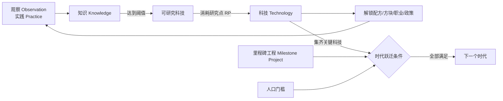
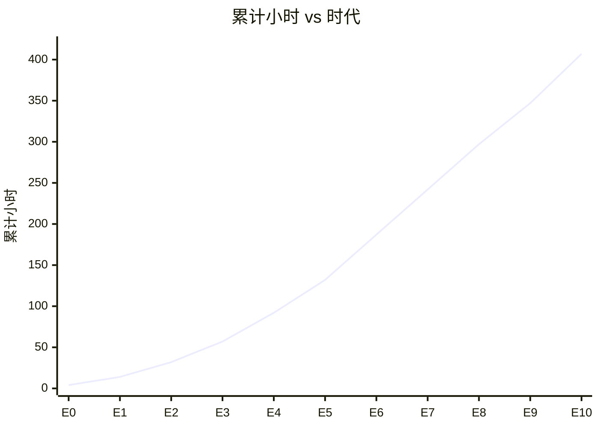

# 01 · 时代与进度

本章定义 11 个时代（E0-E10）、时代跃迁规则、每个时代的玩法动词、空间尺度、能源、交通、货币、地图能力、聚落上限、威胁与里程碑，并给出标准节奏曲线与前 10 小时体验脚本。所有模组章节中的时代引用必须与本章一致。

## 1. 进度模型总览



- **知识 Knowledge**：由 Discovery 的观察、实验，或任何模组中的实际操作获得（例如第一次用燧石敲击燧石、第一次让陶坯被火烧硬）。知识属于文明。
- **科技 Technology**：知识达到阈值后，在研究设施中消耗研究点完成。科技属于文明，全体玩家共享（DR-24）。
- **关键科技 Keystone**：每个时代 4 项，全部完成才能跃迁。
- **里程碑工程 Milestone Project**：每个时代 1 项需要实际建造或完成的标志性成就。
- **人口门槛**：玩家文明总人口（含实体与抽象）达到下限。
- 不能跳过时代。下一时代的科技在当前时代可以“预研”至多 3 项（只有前置全部满足时）。

## 2. 时代总表

| 序号 | ID | 名称 | 标准时长 | 累计 | 科技数 | 新玩法动词 | 空间尺度 |
| --- | --- | --- | --- | --- | --- | --- | --- |
| E0 | `stone` | 石器时代 | 4 h | 4 h | 18 | 采集、打制、生火、狩猎、搭棚、探路 | 营地（约 100 格） |
| E1 | `neolithic` | 新石器与农耕 | 10 h | 14 h | 26 | 定居、播种、驯化、烧陶、编织、储粮 | 河谷（约 500 格） |
| E2 | `bronze` | 青铜时代 | 18 h | 32 h | 30 | 采矿、冶炼、合金、书写、运货、交换 | 流域（约 2 kb） |
| E3 | `iron` | 铁器时代 | 25 h | 57 h | 32 | 锻造、铸币、筑路、征税、筑城、立法 | 地区（约 5 kb） |
| E4 | `medieval` | 中世纪 | 35 h | 92 h | 36 | 水力、风力、行会、造纸、运河、城堡 | 王国（约 10 kb） |
| E5 | `renaissance` | 文艺复兴与大航海 | 40 h | 132 h | 36 | 远洋、导航、银行、印刷、实验科学、殖民 | 大陆与海洋（约 30 kb） |
| E6 | `industrial` | 工业时代 | 55 h | 187 h | 40 | 蒸汽、机床、炼钢、铁路、工厂、调度 | 跨大陆（约 60 kb） |
| E7 | `electric` | 电气时代 | 55 h | 242 h | 38 | 发电、电网、通信、内燃、化工、流水线 | 全球通信 |
| E8 | `atomic` | 原子与航空 | 55 h | 297 h | 36 | 飞行、雷达、核裂变、石化、高速路 | 全球航线 |
| E9 | `information` | 信息时代 | 50 h | 347 h | 34 | 计算、编程、自动调度、集装箱、火箭 | 全球网络 |
| E10 | `space` | 太空时代 | 60 h | 407 h | 34 | 发射、对接、轨道建造、月面采矿、殖民 | 地月系统与火星 |
| 合计 | | | **407 h** | | **360** | | |

时长解释：

- “标准时长”指熟悉系统的玩家在标准难度、单人、正常探索节奏下的时长。
- 快速玩家约 300 小时；全收集与深度建造玩家约 500 小时以上。
- 时长由科技成本、人口增长速度与里程碑工程体量共同决定，见 [35-balance.md](35-balance.md)。

## 3. 时代详表

### 3.1 能源、材料与交通

| 时代 | 主要能源 | 代表材料 | 交通 | 物流尺度 |
| --- | --- | --- | --- | --- |
| E0 `stone` | 人力、火 | 燧石、石、木、骨、兽皮、纤维 | 步行、木筏 | 背篓、手拿 |
| E1 `neolithic` | 人力、畜力 | 陶、亚麻、黏土砖、泥灰 | 独木舟、雪橇、驮兽 | 驮队 |
| E2 `bronze` | 木炭、畜力 | 铜、锡、青铜、金、银 | 车轮与牛车、河船、帆船（近岸） | 车队、河运 |
| E3 `iron` | 木炭、风箱炉 | 铁、钢（渗碳）、石灰砂浆、玻璃 | 铺装道路、桨帆船 | 驿站、港口 |
| E4 `medieval` | 水车、风车 | 铸铁、纸、灰浆、砖瓦 | 马车、运河、柯克船 | 运河、行会仓储 |
| E5 `renaissance` | 改良风车、水力锻锤 | 火药、印刷铅字、精密黄铜 | 卡拉维尔船、盖伦船 | 远洋贸易航线 |
| E6 `industrial` | 煤与蒸汽 | 熟铁、坩埚钢、贝塞麦钢、焦炭 | 蒸汽机车、铁路、蒸汽船 | 铁路货站、仓库 |
| E7 `electric` | 水电、火电、石油 | 铜线、橡胶、铝、化工品、混凝土 | 电车、汽车、卡车 | 公路运输、配送中心 |
| E8 `atomic` | 核裂变、燃气轮机 | 塑料、合金钢、铀、半导体雏形 | 飞机、高速公路、油轮 | 航空货运、管道运输 |
| E9 `information` | 光伏、风机、智能电网 | 硅晶圆、复合材料、锂电池 | 喷气客机、高铁、集装箱船 | 自动调度网络 |
| E10 `space` | 先进裂变、太空光伏、RTG、实验聚变 | 钛合金、碳纤维、月壤、氦-3 | 火箭、航天飞机、月面车 | 轨道物流、地月运输 |

### 3.2 社会、经济与地图

| 时代 | 聚落上限 | 货币形态 | 治理 | 地图能力（Atlas） |
| --- | --- | --- | --- | --- |
| E0 | 营地 Camp | 赠礼经济（无货币） | 族长 | 记忆地图：模糊、会褪色，无小地图 |
| E1 | 村落 Village | 物物交换 | 长老会 | 手绘地图物品，8 个路径点 |
| E2 | 镇 Town | 商品货币（谷物、称量银） | 城邦 | 地标与路标，32 个路径点，石碑记录 |
| E3 | 城 City | 铸币 | 王权/共和 | 道路测量；首个小地图（半径 64，仅已测绘地区） |
| E4 | 城 City | 铸币 + 汇票 | 封建/行会自治 | 罗盘方位条；小地图半径 128 |
| E5 | 城 City | 银行与纸币 | 议会/君主立宪 | 航海图：经纬网格、海岸线、洋流图层 |
| E6 | 都市 Metropolis | 中央银行、股票交易所 | 宪政/工会 | 三角测量：等高线、地质、铁路图层 |
| E7 | 都市 Metropolis | 电汇 | 普选 | 电报联网：远程聚落实时数据、天气图层 |
| E8 | 特大城市 Megacity | 国际货币体系 | 福利国家/计划经济（可选） | 航拍：大范围高精度；雷达显示移动目标 |
| E9 | 特大城市 Megacity | 电子支付 | 数字治理 | GIS：图层叠加、分析、路线规划 |
| E10 | 特大城市 + 太空殖民地 | 电子支付（多星球结算） | 星际宪章 | 卫星图像、GPS 精确坐标、月球与火星地图 |

### 3.3 职业、威胁与代表内容

| 时代 | 新 NPC 职业（Settlements） | 主要威胁（Frontiers/Nations） | 代表内容 |
| --- | --- | --- | --- |
| E0 | 采集者、猎人、打制匠、守火人 | 猛兽、寒冬缺粮 | 燧石刀、火堆、窝棚、记忆地图 |
| E1 | 农夫、牧人、陶工、织工 | 干旱、虫害、小部落袭扰 | 种子筛选、陶罐、羊圈、粮窖 |
| E2 | 矿工、冶炼工、书吏、车夫、商人 | 盗匪、洪水、聚落疫病 | 竖炉、青铜工具、泥板、牛车 |
| E3 | 铁匠、石匠、士兵、税吏、教师 | 边境冲突、攻城器械 | 块炼炉、铸币厂、道路、城墙 |
| E4 | 磨坊工、造纸工、行会师傅、修士学者 | 瘟疫、城堡战争 | 水车、风车、造纸坊、运河闸门 |
| E5 | 水手、领航员、银行家、印刷工、科学家 | 海盗、殖民边疆冲突 | 盖伦船、星盘、印刷机、望远镜 |
| E6 | 机械工、司炉、列车员、工程师、工人 | 工业事故、污染、劳资冲突 | 蒸汽机、车床、高炉、蒸汽机车 |
| E7 | 电工、接线员、司机、化学家 | 大规模边境战争、工业污染扩散 | 发电机、电网、电报、汽车 |
| E8 | 飞行员、雷达员、核工程师 | 核事故、空袭 | 飞机、雷达站、核反应堆 |
| E9 | 程序员、调度员、技术员 | 气候变化、系统性故障 | 计算机、集装箱港、风机阵列 |
| E10 | 宇航员、任务控制员、殖民者 | 太空碎片、太阳风暴、火星沙尘暴 | 火箭、轨道站、月球基地、火星殖民地 |

## 4. 时代跃迁条件

时代跃迁由 `tctechnology` 判定。全部条件满足后，文明面板出现“宣布新时代”按钮；玩家确认后触发 `EraAdvancedEvent`，播放全服演出（音乐、标题、HUD 时代主题切换）。

| 跃迁 | 关键科技（4 项） | 里程碑工程 | 人口下限 |
| --- | --- | --- | --- |
| E0 → E1 | `stone/fire_making`、`stone/knapping`、`stone/foraging_lore`、`stone/shelter_building` | 部落火塘 Tribal Hearth：放置聚落核心并建成 3 座窝棚 | 6 |
| E1 → E2 | `neolithic/cultivation`、`neolithic/pottery`、`neolithic/animal_husbandry`、`neolithic/weaving` | 第一粮仓 First Granary：储粮可供全体居民 1 季 | 20 |
| E2 → E3 | `bronze/smelting`、`bronze/alloying`、`bronze/writing`、`bronze/the_wheel` | 律法石碑 Stele of Law（Commons `tccommons:law_stele`，19 §5.10；与 Echoes 的纪念碑 `tcechoes:stele` 不同）：建成议事厅并刻立第一部法典 | 50 |
| E3 → E4 | `iron/bloomery`、`iron/coinage`、`iron/road_building`、`iron/masonry` | 大道 Great Road：用铺装道路连接 2 座相距 ≥ 1,000 格的聚落 | 120 |
| E4 → E5 | `medieval/water_power`、`medieval/papermaking`、`medieval/guilds`、`medieval/magnetic_compass` | 学府 Academy：建成研究机构并收藏 20 本书籍 | 300 |
| E5 → E6 | `renaissance/printing_press`、`renaissance/celestial_navigation`、`renaissance/banking`、`renaissance/scientific_method` | 远洋贸易站 Overseas Trading Post：在另一块大陆建立并维持贸易站 2 季 | 700 |
| E6 → E7 | `industrial/steam_engine`、`industrial/railway`、`industrial/steelmaking`、`industrial/machine_tools` | 干线铁路 Trunk Railway：总长 ≥ 5,000 格，连接 3 座城 | 1,500 |
| E7 → E8 | `electric/power_grid`、`electric/telegraphy`、`electric/internal_combustion`、`electric/industrial_chemistry` | 区域电网 Regional Grid：同一电网为 5 座聚落供电 | 3,000 |
| E8 → E9 | `atomic/powered_flight`、`atomic/nuclear_fission`、`atomic/transistor`、`atomic/radar` | 洲际航线 Intercontinental Air Route：跨洋定期航班运营 1 年 | 5,000 |
| E9 → E10 | `information/integrated_circuit`、`information/computer_networks`、`information/rocketry`、`information/automation` | 首颗人造卫星 First Satellite：发射并在轨运行 | 8,000 |
| E10 终局 | `space/life_support`、`space/orbital_assembly`、`space/in_situ_resources`、`space/interplanetary_transfer` | 火星自给殖民地 Self-Sustaining Mars Colony：50 名殖民者在火星连续 1 年无需地球补给 | 12,000 |

终局完成后触发“文明纪元”结算（Echoes 生成本文明的编年史书），游戏继续，不强制结束。

### 4.1 缺失模组时的替代条件

模组家族必须在不完整安装时仍可推进时代。若关键科技或里程碑依赖的模组未安装，`tctechnology` 自动替换为下表条件。

| 原条件依赖 | 缺失时替代 |
| --- | --- |
| Settlements（聚落核心、人口） | 人口门槛改为“玩家数 × 已完成科技数”；里程碑改为提交等价物资 |
| Cultivation（粮仓、储粮） | 改为在粮仓方块中储存任意食物 |
| Industry（冶炼、机器） | 使用 `tctechnology` 自带的简化工作台配方 |
| Networks（道路、铁路、航线） | 改为在两点间放置里程碑标记并步行/骑行往返 |
| Discovery（研究机构） | 研究点由 `tctechnology` 的研究台方块产生 |
| Exchange（贸易站） | 改为在另一大陆放置贸易站标记并存放货物 |
| Orbit（卫星） | 改为“全球通信网 Global Communications Network”：在 5 个大陆放置通信站 |
| Nations（AI 文明） | 无影响；外交相关科技改为普通科技 |

## 5. 科技成本曲线

| 时代 | 单项科技平均 RP | 研究设施 | 典型 RP 产出（每 MC 日） | 单项平均耗时 |
| --- | --- | --- | --- | --- |
| E0 | 20 | 火塘旁讨论（无设施） | 30 | 约 0.7 日 |
| E1 | 60 | 长老之屋 | 60 | 1 日 |
| E2 | 150 | 书吏之屋 | 110 | 1.4 日 |
| E3 | 320 | 学堂 | 180 | 1.8 日 |
| E4 | 650 | 修院缮写室 | 300 | 2.2 日 |
| E5 | 1,200 | 学府、天文台 | 480 | 2.5 日 |
| E6 | 2,200 | 工程学院、实验室 | 750 | 2.9 日 |
| E7 | 3,800 | 研究所 | 1,150 | 3.3 日 |
| E8 | 6,000 | 国家实验室 | 1,700 | 3.5 日 |
| E9 | 9,000 | 计算中心 | 2,500 | 3.6 日 |
| E10 | 13,000 | 航天中心 | 3,500 | 3.7 日 |

说明：

- RP 产出是“标准发展水平”的参考值；实际由研究人员数量、设施等级、书籍、熟练度和联动加成决定，公式见 04。
- 科技研究可以并行：每个研究设施同时研究 1 项，玩家可建多个设施。
- 科技只有在**知识阈值**满足后才能开始研究；知识来源与阈值见 04、17。

### 5.1 追赶机制

- **知识扩散 Diffusion**：若与已拥有某项科技的 AI 文明有贸易或外交接触，该科技 RP 成本 -10%，每多一个接触文明再 -10%，上限 -40%。
- **遗迹线索 Echo Clue**：遗迹中发现的古文明知识可直接提供知识值，或降低特定科技 15%-50% RP。
- **落后补偿**：若玩家文明时代落后于最先进 AI 文明 2 个时代以上，全体科技 RP 成本 -15%。

## 6. 难度预设

| 预设 | 科技成本 | 人口增长 | AI 文明攻击性 | 灾害频率 | 适用 |
| --- | --- | --- | --- | --- | --- |
| 沙盒 Sandbox | ×0.5 | ×1.5 | 和平（不主动宣战） | ×0.5 | 建造与探索为主 |
| 标准 Standard | ×1.0 | ×1.0 | 正常 | ×1.0 | 默认 |
| 历史 Historical | ×1.5 | ×0.8 | 偏高 | ×1.3 | 长线挑战 |
| 自定义 Custom | 0.25-3.0 | 0.25-3.0 | 0-3 级 | 0-3.0 | 服务器 |

配置位于 `tctechnology-server.toml` 的 `[difficulty]`；其他模组读取 `DifficultyApi.get()` 获取乘数。

## 7. 节奏曲线



节奏原则：

1. **E0-E2 快速入门**（32 小时）：每 1-2 小时有新动词，迅速建立“文明会成长”的预期。
2. **E3-E5 扩展地图**（100 小时）：从地区到大陆与海洋，第一次遇到并深度交往 AI 文明。
3. **E6-E8 工业与全球化**（165 小时）：最复杂的工厂、物流与环境后果；节奏最长但由大量可见过程支撑。
4. **E9-E10 收束与升空**（110 小时）：自动化减轻管理负担，焦点转到太空计划。

### 7.1 每时代的“新鲜感配额”

每个时代必须提供：

- 至少 1 个新玩法动词（见第 2 节）。
- 至少 1 个新空间尺度。
- 至少 1 项新地图能力。
- 至少 3 个新 NPC 职业。
- 至少 1 个新威胁类型。
- 至少 1 个新建筑类别（多方块或蓝图）。
- 至少 1 首时代主题音乐与 HUD 时代主题。

## 8. 前 10 小时体验脚本（标准难度、全家族安装）

| 实时 | 场景 | 玩家目标 | 系统教学 |
| --- | --- | --- | --- |
| 0:00 | 星球生成与历史模拟进度屏（约 1-2 分钟），显示大陆轮廓与古代文明兴衰摘要 | — | Wildlands、Echoes 预计算 |
| 0:02 | 玩家与 4 名族人在温带河谷醒来；族人围坐在熄灭的火堆旁 | 观察四周 | `V` 观察模式提示；记忆地图开始记录 |
| 0:05 | 族长提示“冬天还有 2 季”；HUD 只显示季节图标与部族人数 | 采集燧石、纤维、木材 | 采集给 `foraging` 熟练度 |
| 0:15 | 用燧石敲击燧石获得知识“打制” | 制作燧石刀 | 知识 → 科技流程；`U` 科技树 |
| 0:30 | 钻木生火，火塘成为临时营地中心 | 研究 `stone/fire_making` | 研究点来自火塘旁讨论 |
| 0:45 | 狼群在黄昏出现在河对岸 | 建围栏或驱赶 | 威胁提示；族人自主应对 |
| 1:00 | 指派第一个职业：1 名采集者、1 名猎人 | 按住 `Z` 指令轮盘 | 岗位分配 |
| 1:30 | 探索上游，发现黏土河岸与野生谷物 | 用 `B` 标记路径点 | 记忆地图会褪色，提示回访 |
| 2:00 | 建成 3 座窝棚，放置“部落火塘”聚落核心 | 完成 E0 里程碑工程 | 聚落边界、`J` 文明面板 |
| 2:30 | 一名路过的流浪者请求加入 | 接收移民 | 人口与吸引力 |
| 3:00 | 秋季：野果减少，猎物迁徙 | 制作背篓与熏肉 | Ecology 迁徙、季节 |
| 3:45 | 关键科技齐备，人口 6 | 宣布进入 E1 | 时代跃迁演出 |
| 4:00 | 获得“手绘地图”能力 | 绘制河谷地图 | Atlas 手绘地图 |
| 4:30 | 选择定居点：比较两个河谷的土壤与洪水风险 | 使用观察模式读取土壤 | Cultivation 土壤、Wildlands 洪泛区 |
| 5:30 | 第一次播种；选择种子性状 | 研究 `neolithic/cultivation` | 育种入门 |
| 6:30 | 冬季：储存不足的压力出现 | 建造陶窑烧制储粮罐 | 食品保存 |
| 7:30 | 驯化第一群山羊 | 建羊圈 | 畜牧 |
| 8:30 | 远处地平线出现另一个部族的炊烟 | 派遣侦察或亲自前往 | Nations 第一次接触 |
| 9:30 | 以陶罐交换对方的燧石与盐 | 第一次物物交换 | Exchange 入门 |
| 10:00 | 粮仓建成并储满 1 季粮食 | 推进 E1 里程碑 | 下一阶段目标展示 |

## 9. 进度数据格式

科技、时代与里程碑全部数据驱动，位于 `data/tctechnology/`：

```text
data/tctechnology/
├─ tc_era/            # 11 个时代定义：关键科技、里程碑、人口下限、替代条件
├─ tc_tech/<era>/     # 360 项科技
├─ tc_milestone/      # 11 项里程碑工程
└─ tc_recipe_gate/    # 配方与方块的科技门槛
```

时代定义示例：

```json
{
  "id": "tctechnology:bronze",
  "index": 2,
  "keystones": [
    "tctechnology:bronze/smelting",
    "tctechnology:bronze/alloying",
    "tctechnology:bronze/writing",
    "tctechnology:bronze/the_wheel"
  ],
  "milestone": "tctechnology:stele_of_law",
  "population_min": 50,
  "fallbacks": {
    "tcsettlements": { "population_min_formula": "players * techs_completed" }
  },
  "theme": { "music": "tctechnology:music.era.bronze", "hud_palette": "bronze" }
}
```

## 10. 验收标准

1. 11 个时代数据文件全部存在，关键科技与里程碑 ID 在 04 与 36 中均能找到。
2. 只安装 `tcivilization` + `tctechnology` 时，可以从 E0 推进到 E10（使用替代条件）。
3. 全家族安装时，标准难度测试档在 E2 结束时累计时长落在 25-40 小时区间。
4. 每个时代满足第 7.1 节“新鲜感配额”，由 36 章 ID 表核对。
5. 时代跃迁触发 `EraAdvancedEvent`，所有已安装模组都能收到并更新 HUD 主题。
