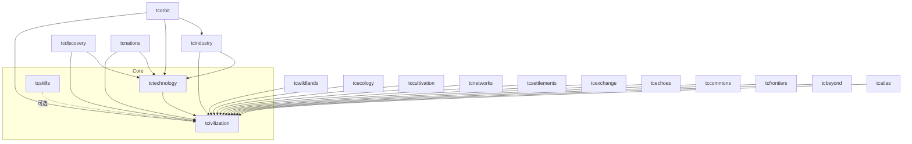
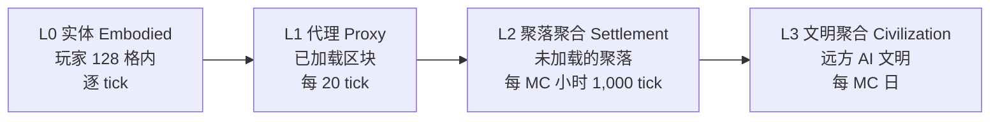

# 02 · 技术架构

本章定义 18 个模组的依赖关系、共享数据层、材料与实体归属、模拟分级（Simulation LOD）、线程模型、存档结构、东西环绕实现与性能预算。所有模组章节中的“数据结构”“API”“性能预算”小节必须遵守本章。

## 1. 模组家族与依赖

### 1.1 分层

| 层 | 模组 | 职责 | 能否单独安装 |
| --- | --- | --- | --- |
| L-Core | `tcivilization` | 文明、聚落注册、共享实体 `person`、地区网格、事件总线、世界历史存储、模拟调度器 | 是（提供状态与命令） |
| L-Core | `tctechnology` | 时代、科技、知识、研究点、配方门槛、原版配方移除、难度 | 是（需 `tcivilization`） |
| L-Core | `tcskills` | 玩家熟练度、技能、天赋、成长等级、倍率 API | 是（完全独立） |
| L-Theme | 12 个主题模组 + `tcatlas`、`tcnations`、`tcorbit` | 各自玩法 | 是（只需 `tcivilization`；部分需 `tctechnology`） |

### 1.2 依赖图



实线 = `required`；所有主题模组之间只能是 `optional` 依赖。唯一例外：`tcorbit` 必须依赖 `tcindustry`（火箭需要工业材料链），这是有意识的设计决定，`tcorbit` 的独立玩法定义为“需要工业”。

### 1.3 必需依赖矩阵

| 模组 | tcivilization | tctechnology | tcskills | 其他必需 |
| --- | --- | --- | --- | --- |
| tcivilization | — | 否 | 否 | — |
| tctechnology | 是 | — | 否 | — |
| tcskills | 否 | 否 | — | — |
| tcwildlands | 是 | 否 | 否 | — |
| tcecology | 是 | 否 | 否 | — |
| tccultivation | 是 | 否 | 否 | — |
| tcindustry | 是 | 是 | 否 | — |
| tcnetworks | 是 | 否 | 否 | — |
| tcsettlements | 是 | 否 | 否 | — |
| tcexchange | 是 | 否 | 否 | — |
| tcdiscovery | 是 | 是 | 否 | — |
| tcechoes | 是 | 否 | 否 | — |
| tccommons | 是 | 否 | 否 | — |
| tcfrontiers | 是 | 否 | 否 | — |
| tcbeyond | 是 | 否 | 否 | — |
| tcatlas | 是 | 否 | 否 | — |
| tcnations | 是 | 是 | 否 | — |
| tcorbit | 是 | 是 | 否 | tcindustry |

> 现状（v0.1）：所有 `neoforge.mods.toml` 把 `tcivilization`、`tctechnology` 写为 `optional`。v0.2 起按本表修正。`tcskills` 对所有模组保持 `optional`。

### 1.4 软联动规则

1. 主题模组之间的调用只能通过 **核心中定义的接口** 或 **`ModList.isLoaded()` 守卫的桥接类**。
2. 桥接类放在 `com.nightcity.<module>.compat.<other>` 包下，只有在目标模组加载时才被类加载。
3. 禁止在主题模组之间直接引用对方的方块或物品常量；改用 ID 字符串 + `c:` 标签 + `BuiltInRegistries` 查找。
4. 每个联动在 [34-interaction-matrix.md](34-interaction-matrix.md) 登记；未登记的联动视为缺陷。

## 2. 共享数据层（tcivilization）

### 2.1 核心对象

| 对象 | Java 类 | 唯一键 | 说明 |
| --- | --- | --- | --- |
| 文明 | `Civilization` | `UUID civId` | 玩家文明恒为 `PLAYER_CIV_ID`；AI 文明由 Nations 创建 |
| 聚落 | `SettlementRecord` | `UUID settlementId` | 由 Settlements 或 Nations 创建；核心只存登记信息 |
| 地区 | `RegionCell` | `long regionKey = (rx << 32) \| rz` | 512×512 格；各模组以“附加层”方式挂数据 |
| 人 | `PersonRecord` | `UUID personId` | 抽象层人员记录；实体化时绑定 `PersonEntity` |
| 世界历史 | `WorldHistory` | 单例 | Echoes 生成；核心存储与查询 |
| 文明记忆 | `MemoryEntry` | 自增 `long` | 事件日志：建造、战争、条约、灾害 |

### 2.2 地区附加层 Region Layers

每个模组可以向 `RegionCell` 注册一个附加层，用于存放该模组在此地区的统计数据：

```java
public interface RegionLayer<T> {
    Identifier id();                       // net.minecraft.resources.Identifier（26.x 起替代 ResourceLocation）；例如 tcwildlands:geo
    T createDefault(RegionCell cell);
    Codec<T> codec();                      // 磁盘
    LayerSync sync();                      // NONE / NEAR / ON_DEMAND / GLOBAL_SUMMARY（03 §5.2.3）
}

// 在 RegisterRegionLayersEvent（模组总线）中注册；属性表以 03 §5.2.3 为准
event.register(TWildlands.GEO_LAYER);
T data = RegionCell.of(level, pos).layer(TWildlands.GEO_LAYER);
```

已登记附加层（各章节细化；**权威清单是 33 §12 的生成表**，它从各章附录 A 的 `region_layer` 行汇总，本表只作概览）：

| 层 ID | 所属 | 内容 |
| --- | --- | --- |
| `tcivilization:civ` | 核心 | 发现位集、聚落索引、人物计数、地区压力 |
| `tcwildlands:geo` | Wildlands | 板块、岩性、矿床、地热、构造风险 |
| `tcwildlands:climate` | Wildlands | 年均温、降水、季节振幅、风、环境负荷对气候的偏移 |
| `tcwildlands:hydro` | Wildlands | 流域 ID、河流等级、地下水、洪水风险 |
| `tcecology:ecosystem` | Ecology | 物种种群、生态健康、演替阶段 |
| `tccultivation:agri` | Cultivation | 土壤质量统计、作物适宜性、特产 |
| `tcindustry:emission` | Industry | 污染物与碳排放累计 |
| `tcnetworks:transport` | Networks | 道路/铁路密度、货运量 |
| `tcsettlements:demography` | Settlements | 人口、住房、职业结构 |
| `tcexchange:market` | Exchange | 区域价格表、供需 |
| `tcdiscovery:field_record` | Discovery | 每地区的观察记录计数（17 §11） |
| `tcechoes:history` | Echoes | 本地区的历史事件、遗迹 |
| `tccommons:claim` | Commons | 领土、土地权限、法律区 |
| `tcfrontiers:danger` | Frontiers | 危险等级、盗匪活动、灾害风险 |
| `tcbeyond:anomaly` | Beyond | 异界渗透强度 |
| `tcatlas:survey` | Atlas | 测绘等级与地图瓦片版本 |
| `tcnations:influence` | Nations | 各文明影响力 |
| `tcorbit:remote_sensing` | Orbit | 卫星遥感覆盖与重访时间（E9 起） |

### 2.3 事件总线

核心在 `NeoForge.EVENT_BUS` 上发布以下事件（完整列表见 33）：

| 事件 | 发布者 | 典型订阅者 |
| --- | --- | --- |
| `EraAdvancedEvent` | tctechnology | 全部 |
| `TechnologyUnlockedEvent` | tctechnology | 全部 |
| `SettlementFoundedEvent` / `SettlementTierChangedEvent` | tcivilization | Atlas、Exchange、Commons、Nations |
| `PersonEmbodiedEvent` / `PersonAbstractedEvent` | tcivilization | Settlements、Nations |
| `RegionLoadPressureEvent` | tcivilization | Ecology、Wildlands |
| `SeasonChangedEvent` | tcwildlands（若未安装则由核心按日历发布） | Cultivation、Ecology、Exchange |
| `CivDayEvent` | tcivilization | Beyond、Settlements、Exchange 等日结算模组 |
| `MemoryRecordedEvent` | tcivilization | Echoes、Atlas |

### 2.4 共享实体：人 `tcivilization:person`

- 所有人形 NPC（居民、商人、士兵、盗匪、AI 文明成员、宇航员）都是 `PersonEntity`。
- 外观由“族群外观集 + 服装层 + 职业道具”组合。
- 行为由 **组件 Component** 附加：`ResidentComponent`（Settlements）、`MerchantComponent`（Exchange）、`SoldierComponent`（Nations）、`BanditComponent`（Frontiers）、`CrewComponent`（Networks/Orbit）。
- 核心只提供：寻路（含大高度世界的分层寻路）、日程调度框架、需求框架、对话框架、实体化/抽象化。

## 3. 材料与内容归属

同一种材料只能由一个模组注册。其他模组通过 `c:` 标签引用。

| 材料类别 | 拥有者 | 示例 |
| --- | --- | --- |
| 岩石、土壤基质、矿石、原矿、宝石原石 | Wildlands | `granite`、`raw_chalcopyrite`、`granite_cassiterite_ore` |
| 原木、树苗、野生植物、野生动物 | Ecology | `oak_log`（使用原版）、`red_deer`、`wild_emmer` |
| 驯化作物、种子、驯化动物、食物、肥料 | Cultivation | `emmer_wheat_seeds`、`goat`、`bread` |
| 两个以上互不依赖的模组都要产出、且各自独立玩法都离不开的基础副产物 | Civilization Core | `wood_ash`（Cultivation 的篝火/熔炉与 Industry 的炉窑都产出） |
| 金属锭、板、线、合金、机械零件、工具、机器 | Industry | `bronze_ingot`、`steel_plate`、`gear` |
| 石器工具（E0-E1） | Technology Core | `flint_knife`、`stone_axe` |
| 道路、轨道、车辆、船、货站 | Networks | `rail_iron`、`steam_locomotive` |
| 住房与公共设施功能方块、聚落核心 | Settlements | `settlement_core`、`granary` |
| 货币、账本、合同、商队物品 | Exchange | `bronze_coin`、`ledger` |
| 研究设施、仪器、书籍、标本 | Discovery | `observatory`、`specimen_jar` |
| 遗迹方块、古文物 | Echoes | `ancient_tablet` |
| 法律、宪章、地契、公共工程标记 | Commons | `land_deed` |
| 前哨、远征物资、武器（E2 以后的军事装备） | Frontiers | `field_tent`、`crossbow` |
| 异质资源、异界方块 | Beyond | `anomalous_crystal` |
| 地图、测绘仪器、路径点物品 | Atlas | `hand_drawn_map`、`theodolite` |
| AI 文明专属建筑与外交物品 | Nations | `envoy_seal`、`treaty_scroll` |
| 火箭、航天器、太空服、月壤、火星土 | Orbit | `rocket_engine`、`regolith` |

### 3.1 原版材料的处理

- 原版木材、羊毛、石头、泥土、沙子等方块**保留**，由各拥有者模组通过数据包调整获取与用途。
- 原版铁、金、铜、钻石、绿宝石、红石、青金石矿石**不再由主世界生成**；Wildlands 生成自有矿石。原版矿石方块只在 Echoes 遗迹与 Beyond 影响区的战利品中出现。
- 原版锭（`minecraft:iron_ingot` 等）保留注册，并加入 `c:ingots/iron` 等标签，以便与第三方模组兼容；Industry 的产物直接产出原版铁锭/金锭/铜锭，**不再重复注册**这三种锭。
- 原版工具：大部分合成移除，见 30。

## 4. 模拟分级 Simulation LOD



| 级别 | 适用对象 | 触发条件 | 频率 | 内容 |
| --- | --- | --- | --- | --- |
| L0 实体 | NPC、动物、车辆、机器 | 玩家 128 格内且区块加载 | 每 tick | 完整 AI、动画、寻路、交互 |
| L1 代理 | NPC、机器 | 区块已加载但距玩家 > 128 格 | 每 20 tick | 无动画、跳跃式移动、批量工作结算 |
| L2 聚落 | 聚落内所有人员与设施 | 聚落区块未加载 | 每 1,000 tick | 产出、消耗、人口、建造进度的统计结算 |
| L3 文明 | AI 文明整体 | 无玩家聚落在其影响范围 | 每 24,000 tick | 扩张、科技、外交、经济的宏观模型 |

### 4.1 实体化预算

- `MAX_EMBODIED_NPC = 500`。超过时按“与最近玩家的距离 × 重要度系数”排序，最远者降级为 L1 代理（不渲染、无实体）。
- 重要度：正在对话/交易 ×0、战斗中 ×0.3、正在执行玩家指令 ×0.5、普通 ×1.0。
- 实体化与抽象化必须无缝：抽象层记录位置、当前任务、背包摘要；实体化时还原。
- 动物使用独立预算 `MAX_EMBODIED_WILDLIFE = 300`（Ecology）。

### 4.2 一致性规则

1. L2/L3 的结算结果必须与 L0 长期平均一致（误差 ≤ 10%），由测试档对比验证。
2. 玩家不在场时不得发生“玩家不可接受的损失”：L2 不会烧毁玩家建筑、不会杀死已命名 NPC；只能产生可恢复的统计变化（例如库存减少、满意度下降）。
3. 降级为 L2 时，聚落的“方块级状态”冻结；恢复加载时根据 L2 结果做“追赶模拟 Catch-up”，上限为 3 MC 日，超出部分只做统计结算。

## 5. 线程模型

| 工作 | 线程 | 说明 |
| --- | --- | --- |
| 方块/实体逻辑 | 服务器主线程 | Minecraft 要求 |
| 星球预计算（板块、高度、水文、气候、历史） | 世界创建时的后台线程池 | 进度屏显示 |
| 区块地形生成 | Minecraft worldgen 线程 | 只读访问预计算结果 |
| L2/L3 模拟 | `TCSimulationExecutor`（后台单线程 + 主线程提交） | 读快照、算结果、主线程应用 |
| 寻路（远距离） | `TCPathExecutor`（2 线程） | 长距离路线（商队、军队）使用地区图 |
| 地图瓦片渲染 | 客户端后台线程 | Atlas |
| 存档写入 | Minecraft 存档线程 | `SavedData` + 自定义区域文件 |

规则：后台线程**只读快照**，产生“变更指令”列表，由主线程在 `ServerTickEvent.Post` 中按预算应用；禁止后台线程直接修改世界。

## 6. 世界生成与环绕

### 6.1 生成管线


- 星球粗模型分辨率 64 格/样本（2,560 × 1,280），预计算产物写入 `<world>/tc/planet.bin`（见第 7 节）（约 60-120 MB，压缩后约 25 MB）。
- 区块生成时，在粗模型上做双三次插值 + 本地细节噪声。
- 详细规格见 [10-wildlands.md](10-wildlands.md)。

### 6.2 东西环绕（DA-13）

Minecraft 坐标不能真正环绕，方案：

1. 所有生成噪声在 X 方向使用周期 163,840 的周期函数，保证 `x = -81,920` 与 `x = 81,920` 处地形完全一致。
2. 在 `x ∈ [-82,176, -81,920)` 与 `[81,920, 82,176)` 各生成 256 格缓冲带，内容是对侧镜像。
3. 玩家、实体、载具越过 `|x| ≥ 81,920 + 128` 时，传送到对侧对应位置（保持速度、朝向、乘客关系），使用区块预加载避免闪烁。
4. 南北方向 `|z| > 40,960` 为极地冰盖与世界边界，无环绕。
5. 地图（Atlas）、寻路、物流路线、地区网格全部使用环绕距离：`dx = wrap(x2 - x1)`。

## 7. 存档结构

```text
<world>/
├─ data/
│  ├─ tcivilization.dat              # 文明、聚落登记、全局计数（SavedData）
│  ├─ tctechnology.dat               # 科技、知识、RP、时代
│  ├─ tcskills.dat                   # 玩家技能档案
│  └─ <modid>.dat                    # 各模组全局状态
├─ tc/
│  ├─ planet.bin                     # Wildlands 星球粗模型（只读）
│  ├─ history.bin                    # Echoes 世界历史（只读 + 追加）
│  ├─ regions/r.<rx>.<rz>.tcr        # 地区附加层，每文件 8×8 个地区
│  ├─ people/p.<bucket>.tcp          # 抽象人员记录，按 UUID 哈希分桶
│  └─ atlas/                         # 服务器端测绘数据
└─ (原版区块、实体、玩家数据)
```

- 地区文件按需加载，LRU 缓存 256 个地区。
- 所有格式带版本号 `formatVersion`，提供迁移器。
- 客户端地图缓存在 `.minecraft/tcatlas/<server-or-world-id>/`。

## 8. 性能预算

### 8.1 服务器 tick 预算（标准场景：单人、E6、3 座城、200 名实体 NPC）

| 模组 | 平均 ms/tick | 峰值 ms/tick |
| --- | --- | --- |
| tcivilization（调度、实体化、事件） | 1.0 | 3.0 |
| tctechnology | 0.1 | 0.5 |
| tcskills | 0.05 | 0.2 |
| tcwildlands（季节、天气、河流动态） | 0.6 | 2.0 |
| tcecology | 0.8 | 2.5 |
| tccultivation | 0.6 | 2.0 |
| tcindustry | 2.0 | 5.0 |
| tcnetworks | 1.2 | 4.0 |
| tcsettlements | 1.8 | 5.0 |
| tcexchange | 0.3 | 1.5 |
| tcdiscovery | 0.1 | 0.5 |
| tcechoes | 0.1 | 0.5 |
| tccommons | 0.1 | 0.5 |
| tcfrontiers | 0.4 | 2.0 |
| tcbeyond | 0.2 | 1.0 |
| tcatlas（服务器测绘） | 0.2 | 1.0 |
| tcnations | 0.4 | 3.0 |
| tcorbit | 0.3 | 1.5 |
| **合计** | **≤ 10.25** | — |

原版自身约 15-25 ms，故整体 MSPT 目标 ≤ 35 ms。

### 8.2 客户端预算

| 项目 | 目标 |
| --- | --- |
| HUD + 小地图 | ≤ 0.6 ms/帧 |
| 世界地图打开时 | ≤ 4 ms/帧（60 FPS 下） |
| 自定义实体渲染（500 NPC） | 使用实例化与 LOD 模型，≤ 3 ms/帧 |
| 显存（模组贴图，默认 128x 包） | ≤ 1.5 GB |
| 内存（客户端） | 推荐分配 10-12 GB |

### 8.3 预计算预算

| 步骤 | 目标耗时（8 核） |
| --- | --- |
| 板块 + 高度场 + 侵蚀 | ≤ 40 s |
| 水文 + 气候 + 生物群系 | ≤ 20 s |
| 地质与矿床 | ≤ 10 s |
| 历史模拟（Echoes，5,000 年） | ≤ 30 s |
| 合计 | ≤ 100 s（显示进度屏） |

## 9. 配置分层

| 文件 | 范围 | 示例 |
| --- | --- | --- |
| `<modid>-common.toml` | 两端共享 | 功能开关 |
| `<modid>-server.toml` | 每个世界，位于 `serverconfig/` | 模拟参数、难度、平衡乘数 |
| `<modid>-client.toml` | 客户端 | HUD、地图、画质 |
| 数据包 `data/<modid>/...` | 每个世界 | 科技、配方、物种、作物、矿床、结构 |

所有平衡数值优先放数据包；只有“性能与开关”放 TOML。

TOML 的节名与键名一律用 `snake_case`（例如 `[maintenance] auto_threshold`），正文引用写作 `节.键`（`maintenance.auto_threshold`）。枚举取值、Java 字段名（例如 `Difficulty.techCost`）与原版或第三方的键（例如 `key.quickActions`）不受此约定约束。

## 10. 兼容性

| 对象 | 策略 |
| --- | --- |
| Sodium | 不修改区块网格管线；自定义方块使用标准 `BakedModel`；动态渲染使用 BER 并支持 Sodium 剔除 |
| Iris + Complementary | 所有自定义方块注册 `block.properties` 映射（发光、植物摇摆、水、玻璃）；实体与 BER 写入正确的 `entityId`；LabPBR 贴图 |
| 世界高度 -512 至 1024 | 自定义维度类型 `tcwildlands:earthlike`；测试 Sodium 区段数上限与光照引擎 |
| 第三方世界生成模组 | 默认不兼容（DR-08 完全替换）；提供 `tcwildlands-common.toml` 开关 `replace_overworld = true` |
| 第三方科技模组 | 通过 `c:` 标签互通材料；不保证进度平衡 |

## 11. 测试策略

| 类型 | 工具 | 覆盖 |
| --- | --- | --- |
| 纯逻辑单元测试 | JUnit 5（每个模组 `src/test/java`） | 公式、经济模型、种群模型、科技判定 |
| 生成确定性测试 | JUnit + 固定种子快照 | 同种子同结果；环绕边界连续 |
| GameTest | NeoForge GameTest 框架 | 机器、作物、NPC 行为、命令 |
| 长时模拟测试 | 无头服务器 + `/tcdebug simulate <duration>`（如 `200d`，03 §5.13） | L0 与 L2 一致性、性能 |
| 性能基准 | `/tcdebug profile` + Spark | 第 8 节预算 |
