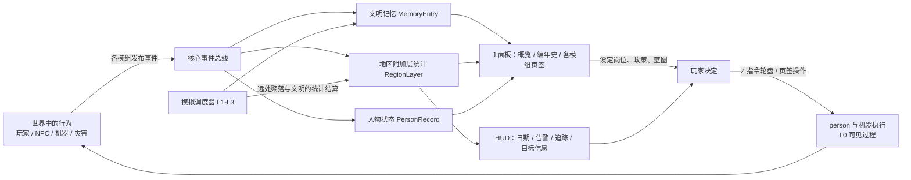

# 03 · 文明核心 Civilization Core（`tcivilization`）

> 模组 ID：`tcivilization`（源码目录 `tcivilization-core/`，Java 包 `com.nightcity.tcivilization`）
> 依赖：`neoforge`、`minecraft`（必需）；不依赖任何其他 `tc*` 模组（[02 §1.3](02-architecture.md)）。
> API 版本：`TcApi.VERSION = 1`（P0 冻结为 `api-v1`，之后只增不删，见 [40 §2](40-roadmap.md)）。
> 相关章节：[00](00-vision-and-pillars.md) 决策记录、[01](01-eras-and-progression.md) 时代、[02](02-architecture.md) 架构、[04](04-core-technology.md) 科技核心、[05](05-skills.md) 技能、[31](31-ui-ux.md) UI/UX 规范、[32](32-art-audio.md) 美术音频、[33](33-data-api.md) API 汇总。
> 代码约定：Minecraft 26.x 中资源标识类为 `net.minecraft.resources.Identifier`（`Identifier.fromNamespaceAndPath(modid, path)`），本章所有 Java 草图均使用 `Identifier`；[02](02-architecture.md) 草图中的 `ResourceLocation` 等价于此类。

---

## 1. 定位与设计支柱

### 1.1 定位

文明核心是整个模组家族唯一被所有主题模组 `required` 的底座。它**不拥有任何玩法内容**（没有科技、没有配方、没有材料），只提供 18 个模组共同使用的“骨骼与神经”：

| 职责 | 内容 | 本章小节 |
| --- | --- | --- |
| 共享数据层 | 文明 `Civilization`、成员 `CivMember`、聚落登记 `SettlementRecord`、时代状态存储、全局计数 | 5.1、11 |
| 地区模型 | 512 × 512 格地区网格 `RegionCell`、东西环绕坐标、地区附加层 API `RegionLayer`、地区压力 | 5.2 |
| 日历 | 全球统一时钟、年/季/日换算；Wildlands 缺失时发布 `SeasonChangedEvent` | 5.3 |
| 文明记忆 | `MemoryEntry` 事件日志、编年功绩 Chronicle Feat、里程碑记录存储 | 5.4、5.5 |
| 事件总线 | 全部核心事件类型与发布规则 | 5.6、12.3 |
| 共享实体 | `tcivilization:person` 与组件系统、需求/日程/对话框架、分层寻路、外观部件 | 5.7 |
| 模拟调度 | L0-L3 模拟分级、实体化预算 `MAX_EMBODIED_NPC = 500`、追赶模拟 | 5.8 |
| 存档 | `data/tcivilization.dat`、`tc/regions`、`tc/people`、`tc/memory`、迁移器 | 5.9、11 |
| UI 外壳 | `J` 文明面板外壳与 `CivPanelTabRegistry`、`HudWidgetRegistry`、`Z` 指令轮盘 `CommandWheelRegistry`、人物检视 `PersonSectionRegistry`、`TcNotifications`、`TrackerApi`、`AlertProvider`、`TargetInfoProvider`、`DeepLinkRegistry`、共享控件、中性皮肤 `tcivilization:skin/neutral` | 5.10、10 |
| 技能桥接 | 无状态转发门面 `ProficiencyBridge`（熟练度数据全部在 `tcskills`，DR-33） | 5.11 |
| 降级与替代 | 其他模组缺失时的行为 | 5.12 |
| 运维 | `/tc`、`/tcdebug`（`simulate`、`profile`、`selftest`）命令 | 5.13 |

### 1.2 核心设计原则

| 编号 | 原则 | 来源 | 含义 |
| --- | --- | --- | --- |
| CP-1 | 不拥有玩法内容 | 02 §1.1 | 本模组不定义科技（附录 B 为空）、不注册材料与配方。任何“玩法规则”都属于主题模组；核心只提供机制与存储。 |
| CP-2 | 一个世界一个玩家文明 | DR-02 | 全部玩家属于 `PLAYER_CIV_ID`。AI 文明由 Nations 创建。核心不支持玩家之间分属不同文明。 |
| CP-3 | 快照计算、主线程应用 | 02 §5 | 后台线程只读快照、产出变更指令；主线程在 `ServerTickEvent.Post` 中按预算应用。 |
| CP-4 | 可见过程优先 | 支柱 3、DR-20 | 核心提供的 `person` 必须能以实体形式“做事”（搬运、行走、工作动画）；菜单只做规划与监控。 |
| CP-5 | 不让玩家在离线/抽象时受不可接受的损失 | 02 §4.2 | 抽象层不得删除玩家方块、不得杀死已命名 NPC。 |
| CP-6 | 不持有熟练度 | DR-33 | 熟练度、技能点、天赋、成长全部在 `tcskills`；核心只有无状态转发门面，`tcskills` 缺失时调用为空操作。 |
| CP-7 | 一个外壳 | DR-28、31 | 各模组不建立自己的管理界面与入口按键，只向 `J` 面板注册页签、向 HUD 注册组件。 |
| CP-8 | 中立外观 | 32 §5.1 | 核心自带中性皮肤 `tcivilization:skin/neutral`；时代皮肤由 Atlas 提供。 |
| CP-9 | API 只增不删 | RM-P1 | `api-v1` 冻结后只能增加方法与事件；废弃项至少保留 1 个版本并标注 `@Deprecated(forRemoval = false)`。 |
| CP-10 | 预算从第一天开始 | RM-P6 | 本模组服务器平均 ≤ 1.0 ms/tick、峰值 ≤ 3.0 ms/tick（02 §8.1）。 |

### 1.3 明确不属于本模组

| 内容 | 拥有者 |
| --- | --- |
| 时代跃迁判定、科技、知识、RP、里程碑**定义与完成判定**、难度预设 | tctechnology（[04](04-core-technology.md)） |
| 聚落核心方块、住房、职业、教育、公共卫生 | tcsettlements |
| 季节天气的物理过程、`SeasonChangedEvent` 的正式发布 | tcwildlands（核心只在其缺失时按日历发布） |
| 世界历史的**生成** | tcechoes（核心只存储与查询 `WorldHistory`） |
| HUD 布局编辑器、时代皮肤、小地图、罗盘条、`H` / `Ctrl+H` 按键 | tcatlas（核心只在 Atlas 缺失时注册 `H` 作为回退） |
| 熟练度、技能、天赋 | tcskills |
| 土地权限、法律、政策 | tccommons |
| AI 文明决策与外交 | tcnations |

---

## 2. 独立玩法（只安装 `tcivilization`）

文明核心可以单独安装（02 §1.1 “提供状态与命令”）。单独安装时它是一个轻量的“文明档案 Civilization Ledger”，不改变原版玩法节奏，但让玩家的世界开始“被记住”。

### 2.1 玩家能看到什么

| 功能 | 表现 | 规则 |
| --- | --- | --- |
| `J` 文明面板 | 只有“概览 `tcivilization:overview`”与“编年史 `tcivilization:chronicle`”两个页签 | 页签栏不出现未安装模组的占位页签（31 契约） |
| 文明概览 | 文明名称与旗帜、成员列表、世界日数（第 N 年 · 季 · 日）、已到访地区数 / 51,200、累计在线时长、编年功绩数 | 文明名称可由首位玩家在首次打开面板时命名，默认“无名部族 Nameless Tribe” |
| 编年史 | 时间轴列出文明记忆：首次进入下界、首次击败末影龙、首次到访新地区（每 10 个一条汇总）、成员加入、编年功绩达成 | 记忆规则见 5.4 |
| HUD 日期组件 | `tcivilization:date_season`：`第 1 年 · 春 · 第 3 日`，无时代徽章（未安装 Technology Core） | 日历规则见 5.3 |
| 告警滚动条 | `tcivilization:alerts`：显示持续性问题；单独安装时只有“存档写入失败”“地区文件损坏已隔离”两类系统告警 | 见 5.10.5 |
| 目标信息 | `tcivilization:target_info`：准星对准的方块/实体名称与所属模组（原版显示 “Minecraft”） | 见 5.10.7 |
| 追踪 | `tcivilization:pinned_tracker`：最多固定 3 个目标；单独安装时可固定“编年功绩”进度 | 见 5.10.6 |
| 编年功绩 | 12 项基于原版行为的功绩（5.5.2），达成时播放 `ceremony` 级通知并写入编年史 | 只是纪念，不解锁任何东西 |
| 命令 | `/tc status`、`/tc civ rename`、`/tc chronicle`、`/tc region info` 等（5.13） | 管理命令需权限等级 2 |

### 2.2 单独安装时不会发生的事

1. 不生成任何 `tcivilization:person`（NPC 由 Settlements、Nations、Frontiers 等生成）。只有 `/tcdebug person spawn` 可以生成测试用人物，便于模组开发者调试。
2. 不改变原版世界生成、原版村民、原版配方。
3. 不显示时代（`CivilizationApi.era()` 返回 `Optional.empty()`），HUD 与概览中的时代位置显示“—”。

### 2.3 核心 + 科技核心（`tcivilization` + `tctechnology`）

按 [01 §10](01-eras-and-progression.md) 验收第 2 条，仅安装两个核心即可从 E0 推进到 E10（使用 01 §4.1 替代条件）。此时本模组额外提供：时代徽章 `TcEraBadge`、时代跃迁 `ceremony` 通知与编年史条目、概览页“下一时代条件”卡片（由 tctechnology 贡献的概览卡）。

---

## 3. 联动玩法

核心与每个模组的关系分两类：**它们使用核心**（所有模组）与**核心因它们而变化**（下表“核心的变化”列）。附录 C 是机器可读版本。

| 模组 | 它使用核心的什么 | 核心的变化（联合时更深） |
| --- | --- | --- |
| tctechnology | 写入 `Civilization.era`；发布 `EraAdvancedEvent`、`TechnologyUnlockedEvent`；注册页签 `tctechnology:tech_tree` 与概览卡 | 日期组件显示 `TcEraBadge`；时代跃迁写入编年史（重要度 5）并触发 `ceremony` 通知；`person` 服装随文明时代更新（32 §4.3） |
| tcskills | 通过 `ProficiencyBridge` 接收全家族的熟练度调用；注册页签 `tcskills:skills`（PERSONAL 组） | `Z` 轮盘的指令数量、人物检视的“师徒”分节读取技能倍率；核心自身行为（5.11）开始产生熟练度 |
| tcwildlands | 地区附加层 `geo`/`climate`/`hydro`；发布正式的 `SeasonChangedEvent`；`RegionGridSpec` 声明 `earthlike` 环绕 | 核心停止自己的季节事件；日期组件附加半球季节（南半球相位偏移）；地区压力加入环境负荷分量 |
| tcecology | `ecosystem` 层；订阅 `RegionLoadPressureEvent` | 地区压力加入采伐/狩猎分量；编年史记录“物种在本地区灭绝/恢复” |
| tccultivation | `agri` 层；`person` 农夫动作集 | 编年史记录首次收获、粮仓里程碑 |
| tcindustry | `emission` 层；机器的 `TargetInfoProvider` | 地区压力加入污染分量；告警加入“机器故障”类 `AlertProvider` |
| tcnetworks | `CrewComponent`、远距离寻路 `TCPathExecutor` 的地区图、`Z` 轮盘的车辆指令 | 寻路地区图使用道路/铁路加权；`person` 可乘坐载具（乘客关系在抽象化时保留） |
| tcsettlements | 创建 `SettlementRecord`；`ResidentComponent`；需求/日程框架的主要使用者；开局部族 | `person` 获得居民生活：日程、住房、职业；概览页显示人口；`MAX_EMBODIED_NPC` 预算主要由居民占用 |
| tcexchange | `MerchantComponent`、`market` 层、对话框架中的交易节点 | 编年史记录首次交易、首个铸币；人物检视出现“交易”分节 |
| tcdiscovery | 页签 `tcdiscovery:journal`；观察模式 `V` 调用 `TargetInfoProvider` 数据 | `target_info` 在观察模式开启时让位给 Discovery 的观察面板 |
| tcechoes | 写入 `WorldHistory`（`tc/history.bin`）；订阅 `MemoryRecordedEvent` 生成传说；终局编年史书 | 编年史页可切换“世界历史”时间轴；遗迹事件写入文明记忆 |
| tccommons | `claim` 层；政策与权限；`Z` 轮盘的公共工程指令 | `CivMember.role` 由 Commons 的权限规则解释；核心命令的权限检查委托 Commons |
| tcfrontiers | `BanditComponent`、`danger` 层、告警“威胁接近” | `person` 获得战斗组件；实体化优先级“战斗中 ×0.3”生效 |
| tcbeyond | `anomaly` 层；原版怪物生成规则 | 编年史记录影响区出现与封闭；`target_info` 显示异质方块的渗透度 |
| tcatlas | 读取地区发现位集；提供时代皮肤、布局编辑器、`H`/`Ctrl+H` | 核心放弃 `H` 回退键；HUD 组件位置由 Atlas 布局文件决定；`TcMapSnippet` 使用 Atlas 瓦片 |
| tcnations | 创建 AI `Civilization`；`SoldierComponent`；L3 文明聚合模型；`influence` 层 | 文明记忆记录条约与背约，供 AI 文明“记住”玩家；概览页出现“已接触文明”卡片 |
| tcorbit | 为 `tcorbit:moon`、`tcorbit:mars` 注册 `RegionGridSpec`；`CrewComponent`（宇航员） | 地区网格扩展到多维度；编年史记录首颗卫星、登月、火星殖民 |

---

## 4. 核心玩法循环

核心自身没有“生产循环”；它的循环是**信息循环**：世界中发生的事被记录、汇总、呈现给玩家，玩家据此做出文明层面的决定，决定再通过 NPC 与机器在世界中可见地执行。



循环中的三个关键时刻：

1. **被记住**：任何有意义的行为（建成、灭绝、条约、灾害、时代）在 1 tick 内进入文明记忆，玩家在编年史中能找到时间、地点和参与者。
2. **被看见**：持续问题进入告警滚动条，一次性事件进入通知，玩家关心的目标进入追踪器——HUD 在“极简”级别下只显示真正需要注意的东西（DR-28）。
3. **被执行**：玩家通过 `Z` 轮盘或页签下达的指令由 `person` 实体走过去、拿起工具、完成动作；离开玩家视野后由模拟调度器以统计方式继续，回来时追赶结算。

---

## 5. 系统规则与公式

### 5.1 文明与成员

#### 5.1.1 文明记录

```text
PLAYER_CIV_ID = 00000000-0000-0000-0000-000000000001   // 固定，所有玩家共享（DR-02）
AI 文明 ID   = UUID v4，由 tcnations 通过 CivilizationApi.createAiCivilization(...) 创建
```

| 字段 | 类型 | 写入者 | 说明 |
| --- | --- | --- | --- |
| `id` | UUID | 核心 | 玩家文明固定；AI 文明随机 |
| `kind` | `PLAYER` / `AI` / `HISTORIC` | 核心 | `HISTORIC` 为 Echoes 生成的已消亡文明，只读 |
| `name` | String（≤ 32 字符） | 玩家 / Nations | 默认“无名部族 Nameless Tribe” |
| `banner` | `BannerPatternLayers` | 玩家 / Nations | 旗帜外观，用于概览、地图、`TcPersonChip` 边框 |
| `eraIndex` | int 0-10 | **仅 tctechnology** | 未安装 Technology Core 时为 -1（隐藏） |
| `foundedTick` | long | 核心 | 首位玩家首次进入世界的游戏刻 |
| `members` | `Map<UUID, CivMember>` | 核心 | 仅玩家文明使用 |
| `settlements` | `List<UUID>` | Settlements / Nations 通过 API | 聚落登记索引，详情在 `SettlementRecord` |
| `stats` | `CivStats` | 核心 + 各模组 | 计数器字典，键为 `Identifier` |
| `flags` | `Set<Identifier>` | 各模组 | 开关型状态，例如 `tcnations:first_contact_made` |

`CivStats` 是通用计数器，各模组以 `CivilizationApi.stats(civ).add(Identifier, long)` 写入。核心自身维护的计数器：

| 计数器 ID | 含义 | 更新时机 |
| --- | --- | --- |
| `tcivilization:regions_visited` | 文明成员到访过的地区数 | 首次进入地区 |
| `tcivilization:play_ticks` | 所有成员在线游戏刻之和 | 每 20 tick 累加 |
| `tcivilization:population` | 名下 `person` 数（非 `DEAD`） | 人物创建/死亡 |
| `tcivilization:memory_entries` | 文明记忆条目数 | 写入记忆 |
| `tcivilization:feats` | 已达成编年功绩数 | 功绩达成 |
| `tcivilization:peak_players` | 同时在线峰值（兼容原型 `peakPlayers`） | 登录 |

#### 5.1.2 成员

```text
玩家首次登录：
  if config.auto_join_player_civ (默认 true): 加入 PLAYER_CIV_ID，role = founder(第一个) / member
  else: 在 J 面板概览页出现“加入文明”按钮；未加入的玩家只能查看，不能对文明下达指令
```

| 字段 | 说明 |
| --- | --- |
| `playerId` | UUID |
| `role` | `Identifier`；核心内置 `tcivilization:founder`、`tcivilization:member`、`tcivilization:guest`。Commons 安装时可注册更多角色并定义权限（[19](19-commons.md)）；未安装 Commons 时 `founder` 与 `member` 权限相同，`guest` 只读 |
| `joinedTick` | 加入时刻 |
| `pins` | `List<TrackerPin>`，最多 3 个（5.10.6） |
| `chronicleCursor` | 编年史上次查看位置，用于“新条目”红点 |
| `contribution` | `Map<Identifier, Long>`：各模组上报的贡献计数（用于概览页“成员贡献”表，不影响任何数值） |

离线成员仍是成员。成员被移出（`/tc civ kick`，权限 3）后其已建成方块与 NPC 不受影响，仍属于文明。

所有修改类操作（面板按钮、轮盘指令、人物指令）都经 `CivPermissions.check(player, action, scope)`（12.1）在服务器端判定；上表角色规则是没有 Commons 解析器时的默认结论，拒绝结果以 `tcivilization:action_result` 返回并显示原因（31 §16.1）。

#### 5.1.3 聚落登记

核心不实现聚落玩法，只保存聚落的“户籍卡”，供其他模组在 Settlements 缺失或卸载后仍能查询：

| 字段 | 说明 |
| --- | --- |
| `id` | UUID |
| `civ` | 所属文明 |
| `name` | 名称 |
| `corePos` | `GlobalPos`，聚落核心方块位置 |
| `regionKey` | 所在地区 |
| `tier` | int 0-6，由 Settlements 写入（[15](15-settlements.md)） |
| `population` | 缓存人口 |
| `foundedTick` | 建立时刻 |

`SettlementFoundedEvent` 与 `SettlementTierChangedEvent` 由**核心**发布（02 §2.3），由 Settlements 调用 `SettlementRegistry.found(...)` / `setTier(...)` 触发——这样即使发布者变化，订阅者也只依赖核心。

### 5.2 地区模型

#### 5.2.1 坐标换算

```java
// 常量见 README §2
static final int REGION_SIZE = 512;
static final int WORLD_WIDTH = 163_840;    // 320 个地区
static final int HALF_WIDTH  = 81_920;
static final int Z_LIMIT     = 40_960;     // 160 个地区

static int wrapX(int x) { return Math.floorMod(x + HALF_WIDTH, WORLD_WIDTH) - HALF_WIDTH; }
static int regionX(int blockX) { return Math.floorDiv(wrapX(blockX), REGION_SIZE); }  // -160..159
static int regionZ(int blockZ) { return Math.floorDiv(Math.clamp(blockZ, -Z_LIMIT, Z_LIMIT - 1), REGION_SIZE); } // -80..79
static long regionKey(int rx, int rz) { return ((long) rx << 32) | (rz & 0xFFFF_FFFFL); }
static int fileX(int rx) { return Math.floorDiv(rx, 8); }  // 每个 .tcr 文件 8×8 个地区
```

| 量 | 值 |
| --- | --- |
| 主世界地区数 | 320 × 160 = 51,200 |
| 主世界地区文件数 | 40 × 20 = 800 个 `.tcr`（每文件 64 个地区） |
| 地区中心 | `(rx × 512 + 256, rz × 512 + 256)` |
| 相邻关系 | `rx` 东西环绕（`rx = 159` 与 `rx = -160` 相邻）；`rz` 不环绕 |

> 注：环绕的“物理”实现（区块镜像、实体传送）属于 Wildlands（[10](10-wildlands.md)）。核心只负责所有坐标相关 API 一律使用 `wrapX` 归一化，保证地区键在接缝两侧一致。

#### 5.2.2 多维度网格 `RegionGridSpec`

```text
每个维度可以注册一个网格规格；未注册的维度不分配地区（RegionApi 返回 Optional.empty()）。
```

| 维度 | 注册者 | 宽 × 高（地区） | X 环绕 | 说明 |
| --- | --- | --- | --- | --- |
| `minecraft:overworld` | 核心（默认） | 320 × 160 | 是（Wildlands 缺失时环绕只影响地区键，不影响物理世界） | 主地图 |
| `minecraft:the_nether` | 核心 | 320 × 160 | 否 | 以 1:1 地区网格记录下界压力与发现 |
| `minecraft:the_end` | 核心 | 64 × 64 | 否 | 仅记录发现与异常 |
| `tcorbit:moon` | tcorbit | 由 Orbit 定义 | 由 Orbit 定义 | 见 [24](24-orbit.md) |
| `tcorbit:mars` | tcorbit | 由 Orbit 定义 | 由 Orbit 定义 | 见 [24](24-orbit.md) |

存储路径为 `tc/regions/<namespace>/<path>/r.<fx>.<fz>.tcr`；主世界沿用 02 §7 的 `tc/regions/r.<fx>.<fz>.tcr`（无子目录，兼容既有约定）。

#### 5.2.3 地区附加层

地区附加层（Region Layer）是“每个地区一块可序列化数据”。拥有者在 `RegisterRegionLayersEvent` 中注册：

| 属性 | 规则 |
| --- | --- |
| ID | `<modid>:<layer>`；02 §2.2 与 33 §12 生成表列出的层 ID 为保留 ID |
| 编解码 | `Codec<T>`（磁盘）+ `StreamCodec<RegistryFriendlyByteBuf, T>`（同步，可选） |
| 默认值 | `Supplier<T>`，读取未写入的地区时返回 |
| 同步策略 | `NONE` / `NEAR`（玩家所在 3×3 地区）/ `ON_DEMAND`（客户端请求时）/ `GLOBAL_SUMMARY`（只同步摘要） |
| 最大序列化大小 | 每层每地区 ≤ 16 KiB（超过时写入失败并告警，防止存档膨胀） |
| 脏标记 | `RegionHandle.markDirty(layerId)`；只有脏层被写回 |

核心自己的附加层 `tcivilization:civ`：

| 字段 | 类型 | 说明 |
| --- | --- | --- |
| `discoveredBy` | `BitSet`（文明索引） | 哪些文明到访过该地区，Atlas 据此显示迷雾 |
| `firstVisitTick` | long | 玩家文明首次到访 |
| `settlementIds` | `List<UUID>` | 地区内聚落 |
| `personCount` | short | 地区内 `person` 数（按状态分 3 组计数：EMBODIED / PROXY / ABSTRACT） |
| `pressure` | float 0-1 | 地区负载压力（5.2.4） |
| `memoryHeat` | short | 最近 1 年该地区记忆条目数，用于地图“历史热度” |

#### 5.2.4 地区压力

地区压力是一个 0-1 的综合指标，衡量“这个地区承受的人类活动强度”，供 Ecology、Commons、Settlements 做决策。

```text
pressure = clamp( Σ_i weight_i × component_i , 0, 1 )

核心内置分量：
  population_density = min(1, personCount / 200)            weight 0.40
  build_density      = min(1, placedBlocks / 250_000)        weight 0.20   (placedBlocks 由 BlockEvent 计数, 只计玩家与 NPC 放置)
其他分量由 RegionPressureContributor 提供（各自 weight 在注册时声明，总权重自动归一化）：
  tcecology:harvest   (采伐/狩猎)        建议 weight 0.20
  tcindustry:pollution (污染)            建议 weight 0.20
  tcwildlands:hazard  (环境负荷)         建议 weight 0.10
```

| 阈值 | 事件 | 典型订阅者行为 |
| --- | --- | --- |
| 跨越 0.25 | `RegionLoadPressureEvent(level = LOW)` | Ecology 开始降低野生动物再生 |
| 跨越 0.50 | `MEDIUM` | Commons 提示可设立保护区 |
| 跨越 0.75 | `HIGH` | 告警滚动条出现“地区负载过高” |
| 跨越 0.90 | `CRITICAL` | Settlements 降低该地区新移民意愿 |

事件带滞回：向下跨越需要低于阈值 0.05 才再次触发，防止抖动。压力在 L2 节奏（每 1,000 tick）为“已加载地区”重算，L3 节奏（每 24,000 tick）为“未加载但有数据”的地区重算。

#### 5.2.5 地区文件格式 `.tcr`

```text
offset  size   内容
0       4      magic "TCR1"
4       4      formatVersion (int, 当前 1)
8       4      dataVersion (int, 写入时的 MC 数据版本)
12      64×12  索引表：每个地区 [int offset, int length, int crc32]，0 表示空
...            地区块：DEFLATE(level 4) 压缩的 NBT：{ layers: { "<layer id>": <codec 输出> }, version: int }
```

| 规则 | 值 |
| --- | --- |
| 写入方式 | 先写 `r.x.z.tcr.tmp`，`fsync` 后原子重命名 |
| 内存缓存 | LRU 256 个地区（02 §7）；被 `pin` 的地区（玩家所在 3×3、正在被 L1 模拟的地区）不淘汰 |
| 写回时机 | 淘汰时、自动保存时（`LevelEvent.Save`）、每 6,000 tick 的增量刷新 |
| 损坏处理 | CRC 不符 → 该地区隔离为 `r.x.z.tcr.corrupt.<tick>`，地区以默认值重建，发布系统告警 |
| IO 线程 | `TC-RegionIO` 1 个线程（02 §5） |

### 5.3 日历

核心维护唯一的世界日历。Wildlands 安装时它负责季节的物理效果并正式发布 `SeasonChangedEvent`；未安装时由核心按日历发布同一事件（02 §2.3）。

```text
DAY_TICKS    = 24_000
SEASON_DAYS  = 12        // README §2
YEAR_DAYS    = 48
totalDays    = floor(level.getDayTime() / DAY_TICKS)       // 使用主世界 dayTime，受睡觉跳夜影响
year         = totalDays / YEAR_DAYS + 1                   // 从第 1 年开始
seasonIndex  = (totalDays % YEAR_DAYS) / SEASON_DAYS       // 0 春 1 夏 2 秋 3 冬
dayOfSeason  = totalDays % SEASON_DAYS + 1                 // 1..12
南半球季节    = (seasonIndex + 2) % 4                       // 仅 Wildlands 安装时显示（z > 0 为南半球）
```

| 显示格式（`date_season` 组件） | 示例 |
| --- | --- |
| 标准 | `第 3 年 · 秋 · 第 7 日` |
| 带时代（Technology Core 安装） | `[E2 青铜]  第 3 年 · 秋 · 第 7 日` |
| 紧凑（HUD 缩放 < 0.75 或 `minimal` 级别下被固定显示） | `3·秋·7` |

`/time set` 回拨时间不会撤销已经发布的季节事件；回拨后的下一次季节变化会再次发布事件，订阅者需幂等处理（事件带 `year` 与 `seasonIndex`）。

**日结事件 `CivDayEvent`。** 核心在服务器 tick 末尾（`ServerTickEvent.Post`）比较主世界 `totalDays` 与已持久化的 `lastDay`（存于 `tc/civilization.dat`），变大时发布一次：

```text
CivDayEvent(server, day = totalDays, year, seasonIndex, dayOfSeason,
            elapsedDays = totalDays - lastDay)   // 正常 1；跳夜、停服重启或 /time add 时 > 1
```

- 每次跨日只发布**一次**，不按 `elapsedDays` 重复发布；需要补算的订阅者自行循环，并自定上限（建议 ≤ 7 日，见 21 §12.3）。
- `totalDays < lastDay`（`/time set` 回拨）时不发布，只把 `lastDay` 重置为 `totalDays`；已结算的内容不回滚。
- 若同一 tick 也跨了季节，先发布 `CivDayEvent`，再发布 `SeasonChangedEvent`。
- 订阅者在主线程执行，单个订阅者每日预算 ≤ 5 ms；更重的结算交给后台任务（33 §4）。

### 5.4 文明记忆

#### 5.4.1 条目

| 字段 | 说明 |
| --- | --- |
| `id` | long，按文明自增 |
| `tick` | 游戏刻 |
| `type` | `Identifier`，在 `RegisterMemoryTypesEvent` 中注册；带默认重要度与图标 |
| `civ` | 所属文明 |
| `region` | 地区键（可为空） |
| `pos` | `GlobalPos`（可为空） |
| `actors` | `List<UUID>`：玩家或 `person` |
| `importance` | 1-5 |
| `payload` | `CompoundTag`（≤ 2 KiB），由注册该类型的模组解释 |

每条写入都会发布 `MemoryRecordedEvent`（Echoes 订阅以生成传说，Nations 订阅以更新 AI 文明对玩家的记忆）。

| 重要度 | 含义 | 示例 | HUD 行为 |
| --- | --- | --- | --- |
| 1 | 日常 | 一次交易、一次收获 | 不通知 |
| 2 | 值得记录 | 新地区到访（10 个汇总一条）、新成员 | 不通知 |
| 3 | 重要 | 聚落升级、首次发现矿物、条约签订 | `info` 通知 |
| 4 | 重大 | 聚落被毁、物种灭绝、命名 NPC 死亡、首颗卫星 | `warning` 或 `success` 通知 |
| 5 | 时代级 | 时代跃迁、终局里程碑 | `ceremony` 通知 |

#### 5.4.2 压缩与上限

```text
每 MC 年（48 日）年初执行一次，在 TC-Sim 线程：
  对每个文明：
    importance == 1 且 age > 2 年 的条目 → 按 (type, region, 季度) 合并为 1 条“摘要”条目，payload 记录 count
    若条目数 > memory_cap (默认 50_000)：从最旧的 importance ≤ 2 条目开始删除，直至 ≤ 90% 上限
    importance ≥ 4 的条目永不删除
```

存储于 `tc/memory/<civ-uuid>.tcm`（追加写日志 + 每年压缩重写）。这是对 02 §7 存档布局的补充，见本章 §18 开放问题 OQ-03-02。

### 5.5 里程碑与编年功绩

#### 5.5.1 里程碑存储

里程碑的**定义与完成判定**属于 tctechnology（01 §4）。核心只提供存储：`MilestoneRecord(Identifier id, UUID civ, long completedTick, List<UUID> contributors)`，以及查询 `CivilizationApi.milestones(civ)`。这样 Echoes、Atlas、Nations 能在不依赖 tctechnology 的情况下读取已完成的里程碑。

#### 5.5.2 编年功绩 Chronicle Feat

编年功绩是**纯纪念性**的数据驱动成就，用来让单独安装的核心也能有“文明被记住”的体验。它不解锁科技、不给 RP、不影响时代（避免与 01 的里程碑重复）。

数据路径 `data/<namespace>/tc_feat/<path>.json`：

```json
{
  "title": "feat.tcivilization.first_nether",
  "icon": "minecraft:obsidian",
  "importance": 4,
  "trigger": { "type": "tcivilization:advancement", "advancement": "minecraft:story/enter_the_nether" },
  "scope": "civ",
  "proficiency": { "skill": "leadership", "amount": 25 }
}
```

内置 12 项（只依赖原版行为）：

| 功绩 ID | 名称 | 触发 | 重要度 |
| --- | --- | --- | --- |
| `tcivilization:first_night` | 第一夜 | 文明首次度过一个夜晚（有成员在线） | 2 |
| `tcivilization:first_iron` | 铁的时代之前 | 首次获得铁锭 | 3 |
| `tcivilization:first_diamond` | 闪耀之石 | 首次获得钻石 | 3 |
| `tcivilization:first_nether` | 炽热之门 | 原版进度 `story/enter_the_nether` | 4 |
| `tcivilization:first_end` | 世界尽头 | 原版进度 `story/enter_the_end` | 4 |
| `tcivilization:dragon_slain` | 屠龙 | 原版进度 `end/kill_dragon` | 5 |
| `tcivilization:wither_slain` | 凋零之后 | 原版进度 `nether/kill_wither` | 4 |
| `tcivilization:regions_10` | 远行者 | 到访 10 个地区 | 2 |
| `tcivilization:regions_100` | 大陆行者 | 到访 100 个地区 | 3 |
| `tcivilization:circumnavigation` | 环球航行 | 同一成员在一次连续旅程中跨越全部 320 个 `rx` 列（需要东西环绕，Wildlands 安装时才可达成） | 5 |
| `tcivilization:year_1` | 一周年 | 世界日历到达第 2 年 | 3 |
| `tcivilization:year_10` | 十年 | 第 11 年 | 4 |

其他模组可以用同一数据格式注册自己的功绩（触发类型通过 `RegisterFeatTriggersEvent` 扩展）。

### 5.6 事件总线

核心事件全部发布在 `NeoForge.EVENT_BUS`（游戏事件），注册类事件发布在模组总线。发布规则：

| 规则 | 内容 |
| --- | --- |
| 线程 | 所有游戏事件只在服务器主线程发布；后台线程产出的结果先排队，在 `ServerTickEvent.Post` 中按预算发布 |
| 可取消 | 只有“将要发生”的事件可取消（`PersonEmbodyEvent.Pre`、`MemoryRecordEvent.Pre`）；“已发生”事件不可取消 |
| 幂等 | 每个事件带单调递增的 `sequence`（每世界一个计数器），订阅者可用它去重 |
| 预算 | 单 tick 发布的核心事件 ≤ 256 个，超出部分顺延到下一 tick（保持顺序） |
| 客户端 | 客户端事件只用于 UI（`HudDataUpdatedEvent`、`CivPanelOpenedEvent`），不承载逻辑 |

完整事件列表见 §12.3。

### 5.7 共享人物实体 `tcivilization:person`

#### 5.7.1 实体与记录

`tcivilization:person` 是全家族唯一的类人 NPC 实体（DR-17：不使用原版村民）。实体本身是“外壳”，真实数据在 `PersonRecord`（服务器端，`tc/people`）：

| 状态 | 是否有实体 | 数据位置 | 模拟 |
| --- | --- | --- | --- |
| `EMBODIED` | 有 `PersonEntity` | 实体 + 记录 | L0 / L1 |
| `PROXY` | 无（所在区块已加载但超出实体化预算） | 记录 + 地区计数 | L1 统计 |
| `ABSTRACT` | 无（区块未加载） | 记录 | L2 / L3 |
| `DEAD` | 无 | 记录保留 2 MC 年供编年史与 Echoes 引用，之后压缩为墓志 | 无 |

| 实体属性 | 值 |
| --- | --- |
| 基类 | `PathfinderMob`；`MobCategory.MISC`（不受原版刷怪上限影响） |
| 碰撞箱 | 0.6 × 1.8（与玩家相同） |
| 基础生命 | 20（由组件修改，如 `SoldierComponent` +10） |
| 移动速度 | 0.5（行走），0.65（奔跑） |
| 可交互 | 右键 → 对话（若有对话树）或人物检视 `tcivilization:person_screen`；`Shift+右键` 直接打开人物检视 |
| 原版行为 | 不交易、不繁殖、不被僵尸转化、不受原版袭击影响；被攻击时按组件决定反击或逃跑 |
| 持久化 | 实体 `save` 只写 `personId`；其余数据从 `PersonRecord` 读取。区块卸载时实体被移除并转为 `ABSTRACT` |

#### 5.7.2 `PersonRecord`

| 字段 | 类型 | 说明 |
| --- | --- | --- |
| `id` | UUID | 永久 ID |
| `civ` | UUID | 所属文明 |
| `settlement` | UUID（可空） | 居住聚落 |
| `name` | `PersonName(given, family, epithet)` | 由文化名字表生成；`epithet` 为传奇称号（Echoes） |
| `birthDay` | int | 出生的世界日 |
| `culture` | `Identifier` | 文化（Nations 提供；默认 `tcivilization:default`） |
| `appearance` | long | 外观种子（5.7.6） |
| `components` | `Map<PersonComponentType<?>, Object>` | 组件 |
| `task` | `TaskSummary` | 当前任务摘要（类型、目标位置、进度 0-1） |
| `lastPos` | `GlobalPos` | 最后位置 |
| `state` | 枚举（5.7.1） | |
| `importance` | `EnumSet<ImportanceFlag>` | `NAMED`（玩家命名）、`LEGEND`（Echoes）、`LEADER`、`MASTER`（技能大师）、`QUEST`；带标志的人物在实体化排序中优先、抽象层不会意外死亡 |
| `relations` | `Int2ByteMap`（personIndex → -100..100） | 最多 32 条，按绝对值保留最强关系 |

#### 5.7.3 组件系统

```text
组件类型在 RegisterPersonComponentsEvent（模组总线）中注册，注册后冻结。
每个组件类型声明：
  id            Identifier
  codec         Codec<T>                         存盘
  syncCodec     StreamCodec<..., T> 或 null      需要客户端显示时
  tickTiers     EnumSet<SimTier>                 在哪些模拟层被调用
  onEmbody      (PersonRecord, PersonEntity) -> void   实体化时把数据灌入实体（AI 目标、装备、动画集）
  onAbstract    (PersonEntity, PersonRecord) -> void   抽象化时把实体状态写回记录
  inspectSection Identifier 或 null              对应人物检视分节（PersonSectionRegistry）
```

| 组件 | 拥有者 | 说明 |
| --- | --- | --- |
| `tcivilization:schedule` | 核心 | 24 时段日程 |
| `tcivilization:needs` | 核心 | 五项需求 |
| `tcivilization:relations` | 核心 | 人际关系缓存 |
| `tcivilization:appearance` | 核心 | 外观覆盖（服装、配饰） |
| `tcivilization:inventory_summary` | 核心 | 携带物品摘要（≤ 9 格，抽象时只保留计数） |
| `ResidentComponent` | tcsettlements | 住所、职业、教育、健康（DR-19：医疗只对 NPC） |
| `MerchantComponent` | tcexchange | 库存、价格偏好 |
| `SoldierComponent` | tcnations | 编制、士气、装备等级 |
| `BanditComponent` | tcfrontiers | 营地、敌意 |
| `CrewComponent` | tcnetworks / tcorbit | 载具岗位、航天员训练 |

组件可以在运行时增删（例如居民应征入伍时添加 `SoldierComponent`）。增删发布 `PersonComponentChangedEvent`。

#### 5.7.4 需求框架（仅 NPC）

五项需求 0-100，100 为完全满足。需求只作用于 NPC 与聚落，**不作用于玩家**（DR-19）。

| 需求 | 自然衰减（每 MC 日） | 满足方式（示例，具体由组件定义） | 低于 30 时 |
| --- | --- | --- | --- |
| `food` 食物 | -40 | 用餐（Settlements 食堂、Cultivation 作物） | 工作效率 ×0.7 |
| `rest` 休息 | -50（工作时段）/ +80（睡眠时段） | 睡眠 | 工作效率 ×0.8，行走速度 ×0.9 |
| `social` 社交 | -20 | 交谈、节庆、酒馆 | 对话树出现抱怨节点 |
| `safety` 安全 | 事件驱动（附近敌对生物、灾害 -10..-60） | 城墙、卫兵、离开危险 | 日程切换为“避难” |
| `purpose` 意义 | -10（无岗位时 -30） | 有岗位、完成任务、受表彰 | 迁出意愿上升（Settlements 解释） |

```text
mood = 0.30×food + 0.25×rest + 0.15×social + 0.20×safety + 0.10×purpose     // 0..100
workEfficiencyFromNeeds = Π_i (need_i < 30 ? penalty_i : 1.0)                 // 下限 0.4
```

`mood` 供 Settlements（满意度）、Commons（民意）、Nations（士气）读取；核心不对 `mood` 施加额外规则。

#### 5.7.5 日程

一天分为 24 个时段，每段 1,000 tick（与原版时间同步，时段 0 = 早晨 6:00）。

| 活动 ID | 默认时段 | 说明 |
| --- | --- | --- |
| `tcivilization:sleep` | 13-23（夜间） | 回到住所；无住所时就地露宿（`safety` -5） |
| `tcivilization:work` | 1-9 | 执行岗位任务（由组件提供 `WorkProvider`） |
| `tcivilization:meal` | 0、6、12 | 进食 |
| `tcivilization:leisure` | 10-12 | 社交、闲逛 |
| `tcivilization:shelter` | 事件触发 | 避难（危险、暴风雨） |
| `tcivilization:follow` | 指令触发 | 跟随玩家（`Z` 轮盘指令） |

日程模板由数据 `data/<ns>/tc_schedule/*.json` 定义，组件可以覆盖（例如夜班卫兵、船员轮班）。

#### 5.7.6 外观

```text
appearanceSeed (long) → 体型 6 × 肤色 12 × 发型 24 × 发色 10 → 17,280 种基础组合
服装 = f(文明时代, 职业组件, 文化)，见 32 §4.3
客户端把最近使用的 512 种组合烘焙为图集（tcivilization-client.toml: npc_appearance_cache）
```

#### 5.7.7 对话

对话树为数据驱动，路径 `data/<ns>/tc_dialogue/<path>.json`。节点类型：`line`（台词）、`choice`（玩家选项）、`condition`（检查组件/文明状态）、`action`（执行注册的动作，例如 `tcexchange:open_trade`）、`end`。

| 规则 | 值 |
| --- | --- |
| 打开 | 右键 `person` 时，按优先级选择第一个条件满足的对话树（组件提供候选） |
| 距离 | 玩家离开 8 格自动关闭 |
| 实体化优先级 | 对话中的人物重要度系数 ×0（永不被抽象化，02 §4.1） |
| 网络 | `tcivilization:dialogue_open`（S→C）、`tcivilization:dialogue_choice`（C→S） |
| 熟练度 | 完成一次对话（到达 `end` 节点，且至少经过 1 个 `choice`）通过 `ProficiencyBridge` 给 `diplomacy` +2，每 MC 日上限 20 |

#### 5.7.8 寻路

| 层次 | 范围 | 实现 | 线程 |
| --- | --- | --- | --- |
| 局部 | ≤ 64 格 | 原版 `PathNavigation`（A*），开门、梯子、游泳 | 主线程（原版） |
| 中程 | 64-512 格 | 分段：把目标投影到已加载区块边界的“门户”节点，逐段原版寻路 | 主线程 + 缓存 |
| 远程 | > 512 格（跨地区） | 地区图：节点为地区，边权 = 地形代价 × 道路系数（Networks 提供，道路 ×0.3、铁路 ×0.1） | `TC-Path` 2 线程（`TCPathExecutor`） |

远程路径结果是“地区序列 + 每地区入口点”，抽象人物按地区序列以统计速度移动（L2：每 1,000 tick 前进 `speed × 1000 × terrainFactor` 格）。

### 5.8 模拟调度器

#### 5.8.1 分级

| 级别 | 条件 | 频率 | 对象 | 主要工作 |
| --- | --- | --- | --- | --- |
| L0 | 实体化，距最近玩家 ≤ 128 格 | 每 tick | `PersonEntity` | 原版 AI + 组件目标；完整动作与动画 |
| L1 | 区块已加载，> 128 格或超出实体化预算 | 每 20 tick | `PersonRecord`（`PROXY`）、已加载地区 | 任务进度统计、需求衰减、产出结算 |
| L2 | 区块未加载 | 每 1,000 tick | 地区 / 聚落 | 聚落产出与消耗、人口、地区压力 |
| L3 | 全局 | 每 24,000 tick | 文明 | AI 文明决策（Nations）、记忆压缩检查、长期趋势 |

#### 5.8.2 实体化预算

```text
MAX_EMBODIED_NPC = 500   (server 配置 max_embodied_npc, 100..1000)

每 20 tick (L1 节奏) 重算一次：
  candidates = 所有 state ∈ {EMBODIED, PROXY} 的人物（其所在区块已加载）
  score(p) = distanceToNearestPlayer(p) × importanceFactor(p)
    importanceFactor: 对话中 0；战斗中 0.3；执行玩家指令 0.5；带 NAMED/LEGEND/LEADER 标志 0.7；普通 1.0
  按 score 升序取前 MAX_EMBODIED_NPC 个 → 应为 EMBODIED；其余 → 应为 PROXY
  距离 > 128 的人物即使排进预算也保持 PROXY（L0 范围限制）
  为防抖：已实体化的人物 score × 0.85（保留偏好）；每次重算最多切换 32 个人物
```

| 切换 | 动作 | 事件 |
| --- | --- | --- |
| PROXY → EMBODIED | 在记录位置（或任务目标路径上的推算位置）生成 `PersonEntity`；调用各组件 `onEmbody` | `PersonEmbodiedEvent` |
| EMBODIED → PROXY / ABSTRACT | 调用 `onAbstract`；移除实体；记录位置 | `PersonAbstractedEvent` |

生成位置必须可站立（`isFree` 且下方实心）；失败时在 8 格内搜索，仍失败则保持 `PROXY`。

#### 5.8.3 追赶模拟

```text
区块/地区重新加载时：
  elapsed = now - lastSimulatedTick
  capped  = min(elapsed, catch_up_cap_days × 24_000)      // 默认 3 MC 日 (02 §4.2)
  steps   = ceil(capped / 1_000)                          // 以 L2 步长批量结算
  每 tick 最多执行 catch_up_steps_per_tick 步（默认 16），剩余步数排队，期间该地区人物保持 PROXY
```

L2 与 L0 的一致性要求：同一聚落连续 1 个 MC 日的产出，L2 结果与 L0 实测相差 ≤ 10%（02 §4.2）。核心提供 `/tcdebug simulate compare <settlement> <days>` 自动对比两种模式（5.13）。

#### 5.8.4 线程

| 线程 | 数量 | 用途 |
| --- | --- | --- |
| 服务器主线程 | 1 | 实体 L0、应用变更、发布事件 |
| `TC-Sim` | `max(1, min(4, cores - 2))` | L1-L3 计算（读快照，产出 `SimCommand`） |
| `TC-Path` | 2 | 远程寻路 |
| `TC-RegionIO` | 1 | 地区文件读写 |
| `TC-PeopleIO` | 1 | 人物文件读写 |

主线程每 tick 的“应用阶段”预算为 `sim_apply_budget_ms`（默认 0.6 ms）；超出部分排队。队列积压超过 5,000 条时发布 `RegionLoadPressureEvent` 的系统级变体并在 `/tc status` 中警示。

### 5.9 存档

| 路径 | 内容 | 格式 |
| --- | --- | --- |
| `data/tcivilization.dat` | 文明、成员、聚落登记、里程碑记录、功绩、全局计数、日历状态、存档版本 | `SavedDataType` + Codec（ID `tcivilization:civilization_state`，沿用原型） |
| `tc/regions/[dim/]r.<fx>.<fz>.tcr` | 地区附加层 | 5.2.5 |
| `tc/people/p.<bucket>.tcp` | 人物记录；`bucket = (personIndex >>> 8)`，每文件 256 人 | 与 `.tcr` 相同的容器格式，magic `TCP1` |
| `tc/memory/<civ>.tcm` | 文明记忆 | 追加日志 + 年度重写 |
| `tc/notifications/<uuid>.dat` | 每玩家最近 50 条警告级及以上通知（31 §7.7） | NBT |
| `tc/history.bin` | 世界历史 | 由 Echoes 写入；核心只负责路径与读取 API |

迁移：存档根数据带 `schemaVersion`（当前 1）。核心维护 `DataFixerRegistry`，各模组按 `(modid, fromVersion)` 注册迁移函数；加载时按版本顺序执行。原型 `CivilizationSavedData`（`worldTicks`、`loginEvents`、`peakPlayers`）在首次加载时迁移为 `CivStats` 中的 `tcivilization:play_ticks`、`tcivilization:peak_players`，`loginEvents` 丢弃。

内容删除规则（RM-P8）：被删除的方块在加载时替换为 `tcivilization:placeholder`（保留原 ID 于方块实体，右键显示原 ID），被删除的物品替换为 `tcivilization:legacy_item`（保留原 ID 与数量于数据组件，可在合成格中“分解”为空，用于清理）。

### 5.10 UI 外壳与框架

核心拥有全家族唯一的 UI 外壳；跨模组 UX 规则见 [31](31-ui-ux.md)。本节定义机制与数值，API 签名见 §12。

#### 5.10.1 `J` 文明面板与页签

| 规则 | 值 |
| --- | --- |
| 菜单 | `tcivilization:civ_panel`；按 `J`（`key.tcivilization.civ_panel`）打开 |
| 页签组 | `PERSONAL`、`CIV`、`ECONOMY`、`WORLD`、`KNOWLEDGE`（按此顺序排列） |
| 页签注册 | `CivPanelTabRegistry.register(CivPanelTabSpec)`，在客户端 `RegisterCivTabsEvent` 中；每个模组最多 2 个页签 |
| 排序 | 组内按 `order` 升序；同 `order` 按模组 ID 字母序 |
| 占位 | 从不为未安装模组显示占位页签 |
| 语言键 | `civtab.<modid>.<tab>` |
| 热键直达 | 其他模组的热键（`U`、`Y`；以及默认不绑定的 `key.tcskills.skills`、`key.tcnations.diplomacy`）只调用 `CivPanel.open(tabId)` 打开面板并定位到页签，不创建独立界面 |
| 概览卡 | 每个页签可贡献 1 张 200×100（GUI 像素）概览卡，显示在 `tcivilization:overview` 页 |
| 数据 | 页签打开时发送 `tcivilization:panel_request`，服务器以 `tcivilization:panel_snapshot` 回复；打开期间每 20 tick 增量刷新 |
| 记忆位置 | 记住每个玩家上次打开的页签与滚动位置（客户端本地） |

页签总表（31 契约，组/顺序/ID）：

| 组 | 顺序 | 页签 ID | 拥有者 | 直达键 |
| --- | --- | --- | --- | --- |
| PERSONAL | 50 | `tcskills:skills` | tcskills | 默认不绑定（`key.tcskills.skills`）；`J` › 个人 › 技能，或 `Z` 轮盘“个人”项 |
| CIV | 0 | `tcivilization:overview` | 核心 | `J` 默认页 |
| CIV | 100 | `tctechnology:tech_tree` | tctechnology | `U` |
| CIV | 200 | `tcsettlements:settlements` | tcsettlements | — |
| CIV | 250 | `tccommons:governance` | tccommons | — |
| CIV | 300 | `tcnations:diplomacy` | tcnations | 默认不绑定（`key.tcnations.diplomacy`）；`J` › 文明 › 外交 |
| ECONOMY | 400 | `tccultivation:agriculture` | tccultivation | — |
| ECONOMY | 450 | `tcindustry:production` | tcindustry | — |
| ECONOMY | 500 | `tcnetworks:logistics` | tcnetworks | — |
| ECONOMY | 550 | `tcexchange:market` | tcexchange | — |
| WORLD | 600 | `tcwildlands:geography` | tcwildlands | — |
| WORLD | 650 | `tcecology:ecology` | tcecology | — |
| WORLD | 700 | `tcfrontiers:expeditions` | tcfrontiers | — |
| WORLD | 750 | `tcbeyond:anomalies` | tcbeyond | — |
| WORLD | 800 | `tcorbit:space_program` | tcorbit | — |
| KNOWLEDGE | 850 | `tcdiscovery:journal` | tcdiscovery | `Y`（`key.tcdiscovery.journal`） |
| KNOWLEDGE | 870 | `tcechoes:legends` | tcechoes | Discovery 缺失时 `Y`（`key.tcechoes.journal`） |
| KNOWLEDGE | 900 | `tcivilization:chronicle` | 核心 | — |

#### 5.10.2 HUD 组件注册表

| 规则 | 值 |
| --- | --- |
| 注册 | 客户端 `RegisterHudWidgetsEvent` → `HudWidgetRegistry.register(HudWidgetSpec)` |
| 语言键 | `hud.<modid>.<widget>` |
| 级别 | `minimal` ⊂ `standard` ⊂ `expanded`（DR-28）；组件声明自己出现的最低级别 |
| 情境 | `relevant`（O(1) 判断，例如手持扳手、骑乘、在自己聚落内）；返回 false 时不绘制、不占位 |
| GUI 层 | 核心只注册一个 NeoForge GUI 层 `tcivilization:hud`（原版 `BOSS_OVERLAY` 之上、`CHAT` 之下）；各模组不注册自己的 GUI 层 |
| 位置 | 9 个锚点 + 偏移；Atlas 安装时由 Atlas 布局编辑器覆盖 |
| 解锁 | `unlockTech` 未满足时不显示（tctechnology 未安装时视为已解锁） |
| 数据 | 需要服务器数据的组件声明 `dataChannels`；客户端在组件首次可见时发送 `tcivilization:hud_subscribe`，服务器以 `tcivilization:hud_data` 推送，最快 10 tick 一次 |
| 级别切换 | Atlas 安装时由 Atlas 的 `H`/`Ctrl+H` 控制；Atlas 缺失时核心注册 `H`（`key.tcivilization.hud_level`）循环三级 |
| 预算 | 所有组件合计客户端渲染 ≤ 0.5 ms/帧（32 §8 与 02 §8） |
| 颜色 | 状态不得只靠颜色表达，必须同时有图标或文字（31 契约，`high_contrast`/`colorblind_mode` 生效） |

核心自带 4 个组件：

| 组件 ID | 最低级别 | 默认锚点（偏移） | 内容 |
| --- | --- | --- | --- |
| `tcivilization:date_season` | standard | TOP_LEFT (4, 4) | 季节图标 + “第 3 年 · 夏 · 第 7 日” + 昼夜小表盘；Technology Core 安装时附时代徽章，且 E0 只显示季节与“第 N 日”，掌握历法类科技后显示年份（31 §3.3） |
| `tcivilization:alerts` | minimal | TOP_LEFT (4, 22)；Atlas 安装时位于小地图下方 | 持续问题，最多 4 行，按严重度排序，超出时末行显示“另 N 条”；无告警时不占位 |
| `tcivilization:target_info` | standard | TOP_CENTER (0, 22)；Atlas 安装时位于罗盘条下方 | 准星目标（≤ 交互距离）的名称、所属模组与 `TargetInfoProvider` 提供的 1-3 行信息；每 4 tick 刷新 |
| `tcivilization:pinned_tracker` | standard | MIDDLE_RIGHT (-4, 0) | 最多 3 个追踪项：图标 + 标题 + 进度条 + 预计完成时间 |

#### 5.10.3 `Z` 指令轮盘

| 规则 | 值 |
| --- | --- |
| 按键 | `Z`（`key.tcivilization.command_wheel`）；默认按住显示、松开执行，可设 `[wheel] mode = toggle`（原版 26.x 的 `G` 为“快捷操作”，整合包内 Iris 占用 `R`/`K`/`I`，故使用 `Z`） |
| 菜单 | `tcivilization:command_wheel`（客户端覆盖层，不暂停游戏） |
| 上下文 | 按下瞬间沿准星射线检测（最远 64 格，需视线可达）：人物、其他实体、方块或无目标；客户端先显示 `WheelProvider.predict` 的本地预测，同时发送 `tcivilization:wheel_query`，收到 `tcivilization:wheel_options` 后替换 |
| 选项来源 | `CommandWheelRegistry.register(WheelProvider)`；每个提供者对当前上下文返回 0-n 个 `WheelOption` |
| 容量 | 8 个方向槽；“上”槽固定为目标的主要动作，“下”槽固定为“取消/关闭”；超过 8 个选项时分页，滚轮翻页，最多 3 页 |
| 选择 | 鼠标相对中心方向（中心 12 像素死区）、数字键 1-8 或单击；危险选项（`needsConfirm`）弹出 `TcConfirmDialog` |
| 执行 | 松开按键时选中的扇区 → `tcivilization:wheel_execute`；服务器再次校验权限与条件 |
| 冷却 | 同一选项对同一目标 10 tick 防抖 |
| 无选项 | 显示“此处无可用指令”，不报错；不可用选项灰显并附原因，不隐藏 |

核心自带的上下文指令：

| 上下文 | 指令 | 效果 |
| --- | --- | --- |
| 准星对准己方 `person` | 跟随我 | 添加 `tcivilization:follow` 日程覆盖（最长 1 MC 日） |
| 准星对准己方 `person` | 在此等候 | 原地停留，直到下一个指令或 1 MC 日 |
| 准星对准己方 `person` | 前往该处（再点选地面） | 设置移动任务 |
| 准星对准己方 `person` | 自由活动 | 清除指令覆盖，恢复日程 |
| 准星对准己方 `person` | 查看 | 打开 `tcivilization:person_screen` |
| 任意 | 固定/取消固定准星目标 | `TrackerApi.pin` |
| 任意 | 打开文明面板 | 等同 `J` |
| 任意 | 个人 | 打开 `J` 面板 PERSONAL 组（`tcskills:skills` 等；无个人页签时隐藏） |

各模组的上下文指令（示例）：Settlements 指派岗位、Networks 车辆调度、Frontiers 编队、Commons 划定公共工程。

#### 5.10.4 人物检视 `tcivilization:person_screen`

核心提供外壳与 3 个基础分节（身份、需求与日程、关系）；其他模组用 `PersonSectionRegistry.register(SectionSpec)` 增加分节（Settlements“职业与住所”、Exchange“交易”、Nations“军籍”、Skills“技能与师承”等）。分节按 `order` 排序，只在人物拥有对应组件时显示。数据经 `tcivilization:person_inspect_request` / `tcivilization:person_inspect_snapshot` 往返。

#### 5.10.5 通知与告警

| 机制 | 用途 | API | 显示 |
| --- | --- | --- | --- |
| 通知 | 一次性事件 | `TcNotifications.send(...)` → `tcivilization:notify` | toast（交给原版 `ToastManager` 队列）/ 危急横幅 / 仪式覆盖层；全部进入面板右侧通知中心 |
| 告警 | 持续问题（条件消失前一直存在） | `AlertProvider`（服务器端，每 100 tick 轮询） | `tcivilization:alerts` |

呈现细节以 [31 §7](31-ui-ux.md) 为准，核心实现以下数值：

| 严重度 | 图标形状 | 默认时长 | 声音 | 可否打断 |
| --- | --- | --- | --- | --- |
| `INFO` | 圆点 | 5 s | 无（可选轻音 `tcivilization:ui.notify.info`） | 否 |
| `SUCCESS` | 对勾 | 6 s | `tcivilization:ui.notify.success` | 否 |
| `WARNING` | 三角 | 8 s | `tcivilization:ui.notify.warning` | 否 |
| `CRITICAL` | 八边形 | 直到确认，最长 15 s，之后收起为 `alerts` 常驻项 | `tcivilization:ui.notify.critical`（同 `mergeKey` 60 s 只响一次） | 是：顶部居中横幅（只打断提示，不打断操作） |
| `CEREMONY` | 星 | 见 31 §9 | `tcivilization:event.ceremony` | 是：全屏仪式覆盖，可延迟；`reduced_motion` 时为静态卡 |

| 限流与合并（服务器端执行） | 值 |
| --- | --- |
| TC toast 同时显示 | ≤ 3 条（原版队列 ≤ 5）；排队 > 10 条时最旧的信息级直接转入通知中心 |
| 合并 | 同一玩家、同一 `mergeKey`、10 s 内合并为“×N” |
| 单模组信息级 | ≤ 6 条/分钟 |
| 信息级 + 成功级合计 | ≤ 12 条/分钟（`notify.info_per_minute`） |
| 警告级 | ≤ 6 条/分钟，超出合并为“N 条警告” |
| 战斗免打扰 | 8 s 内受到/造成伤害或 16 格内有敌对目标：信息/成功只进通知中心，警告延后到脱战 2 s，仪式延后（`[notifications] combat_dnd`） |
| 持久化 | 每玩家最近 50 条警告级及以上通知存于 `tc/notifications/<uuid>.dat`，登录时同步并给出离线摘要 |
| 类别 | `TcNotifications.registerCategory(...)`；核心注册 `tcivilization:system`、`tcivilization:civilization`；玩家可按类别静音（危急级不可静音） |

通知可带深链接（5.10.8）；生产者须先调用 `DeepLink.isResolvable`。toast 不依赖点击：5 s 内按 `J` 打开面板时通知抽屉自动展开并高亮该条。

仪式不走 toast：生产者调用 `Ceremonies.play(...)`（§12.1），服务器发送 `tcivilization:ceremony`，客户端 `CeremonyOverlay`（L4）按 31 §9 的时间线演出，战斗中或打开界面时延迟。核心自身只发起编年功绩重要度 5 的小型仪式；时代晋升仪式由 tctechnology 发起。

#### 5.10.6 追踪器 `TrackerApi`

| 规则 | 值 |
| --- | --- |
| 上限 | 每玩家 3 个固定目标 |
| 目标类型 | `TrackableType`（各模组注册）：功绩进度、里程碑、科技研究、建造工程、远征、订单… |
| 数据 | `TrackerPin(Identifier type, String key, Component label)`；进度由类型提供者每 20 tick 计算 |
| 同步 | `tcivilization:tracker_pin`（C→S 固定/取消）、`tcivilization:tracker_sync`（S→C 标签与进度） |
| 失效 | 目标完成后显示“已完成”10 s 后自动移除；目标不存在（模组被移除）时移除并 `info` 通知 |

#### 5.10.7 目标信息

`TargetInfoProvider` 由各模组为自己的方块/实体注册，返回 ≤ 3 行 `Component` 与可选进度条。核心对原版内容只显示名称与“Minecraft”。Discovery 安装且观察模式（`V`）开启时，`target_info` 隐藏，由 Discovery 的观察面板接管（31 契约）。查询在客户端进行，需要服务器数据的提供者通过 `hud_data` 通道（目标变化时请求，同一目标 20 tick 缓存）。

#### 5.10.8 深链接

格式 `tc:<modid>/<path>?<query>`，例如 `tc:tctechnology/tech?id=tctechnology:bronze_working`、`tc:tcivilization/chronicle?entry=1234`。各模组用 `DeepLinkRegistry.register(modid, handler)` 注册解析器；目标模组缺失时链接显示为灰色文字（不可点击，附“需要 <模组名>”提示）。

#### 5.10.9 共享控件与皮肤

共享控件（客户端，`com.nightcity.tcivilization.client.ui`）：`TcTable`、`TcChart`、`TcMapSnippet`、`TcPersonChip`、`TcItemChip`、`TcProgressBar`、`TcEraBadge`、`TcSearchField`、`TcConfirmDialog`。各模组的页签必须使用这些控件，不自造同类控件。

皮肤：控件绘制通过 `TcSkin` 接口取得九宫格、颜色与字体样式。Atlas 缺失时使用中性皮肤 `tcivilization:skin/neutral`（浅灰白底、深灰字与描边、无纹理装饰，不随时代变化；取值见 31 §10.2 规则 5）；Atlas 安装时由 Atlas 按时代提供 `tcatlas:skin/<era>`（32 §5.1）。

#### 5.10.10 无障碍

客户端配置 `tcivilization-client.toml` 的 `[accessibility]`（§13.3）对所有使用共享控件的界面生效：`colorblind_mode` 替换状态色板；`high_contrast` 加粗描边并去除半透明背景；`reduced_motion` 关闭轮盘展开动画、`ceremony` 标题卡动画与 HUD 滚动动画。Atlas 读取同一组键。

### 5.11 熟练度门面 `ProficiencyBridge`

按 DR-33，熟练度、技能点、天赋与成长**全部**存放在 `tcskills`；核心不存储任何熟练度。由于核心不能依赖 `tcskills`（02 §1.3），而部分模组只依赖核心，核心提供一个**无状态**转发门面：

```text
ProficiencyBridge.add(player, skillId, amount, source)       → 若已注册 sink 则转发，否则空操作
ProficiencyBridge.multiplier(player, skillId, effectType)    → 若已注册则转发，否则返回 1.0
ProficiencyBridge.isAvailable()                              → tcskills 是否已注册 sink
```

`tcskills` 在 `FMLCommonSetupEvent` 中通过 `ProficiencyBridge.registerSink(...)` 注册自身（[05 §12](05-skills.md)）。门面校验 `skillId` 属于 22 个技能 ID，未知 ID 在开发环境抛异常、发布环境记录一次警告并丢弃。各模组可直接调用 `SkillsApi`（软依赖）或调用门面，两者结果相同；推荐使用门面以免产生硬依赖。

### 5.12 降级与替代

| 缺失模组 | 核心行为 |
| --- | --- |
| tctechnology | 时代隐藏（`era()` 为空）；`TcEraBadge` 不显示；`person` 服装固定为 E0 外观；编年功绩照常 |
| tcskills | `ProficiencyBridge` 空操作、倍率 1.0；人物检视无“技能与师承”分节；`Z` 轮盘“个人”项隐藏 |
| tcwildlands | 核心按日历发布 `SeasonChangedEvent`；无半球季节；地区压力无环境分量；东西环绕只作用于地区键 |
| tcsettlements | 不生成居民；聚落登记为空；概览页无人口卡 |
| tcatlas | 使用中性皮肤；核心注册 `H` 循环 HUD 级别；HUD 组件使用默认锚点；`TcMapSnippet` 显示坐标网格占位图 |
| tcdiscovery | `target_info` 始终可用；无 `V` 观察模式 |
| tccommons | `founder`/`member` 同权、`guest` 只读；核心管理命令只检查原版权限等级 |
| tcechoes | 编年史只显示文明记忆，无“世界历史”切换；`tc/history.bin` 不存在 |
| tcnations | 只有玩家文明；无 AI 文明，L3 只做记忆压缩与统计 |
| 其他主题模组 | 其事件、页签、组件、附加层均不存在；核心不显示任何占位 |

### 5.13 命令

| 命令 | 权限 | 作用 |
| --- | --- | --- |
| `/tc status` | 0 | 文明名、成员数、日历、人口、地区到访数、模拟队列长度（替代原型 `/tcivilization status`，旧命令保留为别名） |
| `/tc civ rename <name>` | founder 或 2 | 重命名文明 |
| `/tc civ join` / `leave` / `kick <player>` | 0 / 0 / 3 | 成员管理 |
| `/tc chronicle [page]` | 0 | 在聊天栏列出最近记忆 |
| `/tc region info [x z]` | 0 | 地区键、各附加层摘要、压力 |
| `/tc person info <uuid 或 准星>` | 2 | 人物记录 |
| `/tcdebug simulate <duration> [region]` | 3 | 强制执行 L1-L3 模拟；`<duration>` 接受 `t`（tick）或 `d`（MC 日）后缀，如 `72000t`、`200d`，无后缀按 MC 日 |
| `/tcdebug simulate compare <settlement> <days>` | 3 | L0 与 L2 一致性对比（5.8.3） |
| `/tcdebug profile [seconds]` | 3 | 输出各模组 tick 耗时到 `logs/tc-profile-<time>.csv` |
| `/tcdebug selftest` | 3 | 检查注册冲突、页签数量、附加层大小、存档完整性 |
| `/tcdebug person spawn [n]` | 3 | 生成测试人物（仅调试） |
| `/tc civ inspect <name>` | 2 | 以只读方式打开任意文明的文明面板，顶部显示“管理员查看 · 只读”横条（31 §16.5） |
| `/tcdebug ui <player>` | 3 | 输出该玩家的 HUD 订阅表、各通道最近发送时间与字节数（31 §15.4） |
| `/tcclient debug ui`（客户端指令） | — | 切换界面性能叠层：各 HUD 控件平均/峰值耗时、订阅通道数、近 10 s 收到字节数 |
| `/tc vanilla status [system]` | 0 | 当前维度的有效怪物策略、袭击/巡逻状态、星球/深地/界阈模式与各原版系统拥有者；带 `system` 时显示单个系统的拥有者链与回退来源；OP 额外看到判定依据与 `vanilla_rules.dat` 记录（30 §4.7） |
| `/tcdebug vanilla owners` | 3 | 原版系统拥有者登记表与冲突记录 |
| `/tcdebug vanilla restore <rule>\|all` | 3 | 把本家族写入过的游戏规则恢复为写入前的值并删除记录（30 §4.3） |
| `/tcdebug vanilla policy <dimension> <vanilla\|ruins_only\|clear>` | 3 | 临时覆盖某维度的有效怪物策略（不写配置，重启失效），用于测试 |

---

## 6. 数值表

| 量 | 值 | 来源 / 配置 |
| --- | --- | --- |
| 地区边长 | 512 格 | README §2 |
| 主世界地区 | 320 × 160 = 51,200 | README §2 |
| 地区缓存 | 256 个地区（LRU） | `region_cache_size` 64-1024 |
| 每层每地区上限 | 16 KiB | 固定 |
| 实体化上限 | 500 | `max_embodied_npc` 100-1000 |
| L0 半径 | 128 格 | `embody_radius` 64-192 |
| 实体化重算 | 每 20 tick，最多切换 32 人 | `embody_switch_per_pass` 8-128 |
| 追赶上限 | 3 MC 日 | `catch_up_cap_days` 1-7 |
| 每 tick 追赶步数 | 16 | `catch_up_steps_per_tick` 1-64 |
| 记忆上限 | 50,000 条 / 文明 | `memory_cap` 5,000-500,000 |
| 记忆压缩年龄 | 2 MC 年（重要度 1） | 固定 |
| 死亡人物保留 | 2 MC 年 | 固定 |
| 人际关系上限 | 32 条 / 人 | 固定 |
| 地区压力阈值 | 0.25 / 0.50 / 0.75 / 0.90，滞回 0.05 | 固定 |
| 通知并发 | 3 条 TC toast；每分钟 12 条信息/成功级 | `notify.info_per_minute` 4-60 |
| 追踪器 | 3 个固定目标 | 固定（31 契约） |
| 轮盘 | 8 槽 × 最多 3 页 | 固定（31 §5.3） |
| 每模组页签 | ≤ 2 | 固定（31 契约） |
| 概览卡 | 200 × 100 GUI 像素 | 固定 |

人物 LOD（客户端渲染，32 §4）：LOD0 ≤ 16 格完整模型与动画；LOD1 16-48 格简化动画；LOD2 48-128 格静态姿势；> 128 格不渲染（`entity_lod_scale` 缩放）。

---

## 7. 内容清单

| 类型 | ID | 时代 | 用途 |
| --- | --- | --- | --- |
| 方块 | `tcivilization:placeholder` | — | 已删除方块的替身（RM-P8）；不可合成，创造模式物品栏隐藏 |
| 方块实体 | `tcivilization:placeholder` | — | 保存原方块 ID 与 NBT |
| 物品 | `tcivilization:legacy_item` | — | 已删除物品的替身；保存原 ID 与数量 |
| 实体 | `tcivilization:person` | E0 | 共享人物实体（5.7） |

核心不注册流体、维度、生物群系与结构。其余注册项（菜单、按键、负载、HUD 组件、页签、附加层、声音）见附录 A。

---

## 8. 配方与生产链

无。核心不拥有玩法内容（CP-1），不注册任何配方；`legacy_item` 的“分解为空”通过合成格的特殊配方类型 `tcivilization:discard_legacy` 实现，不产出任何物品。

---

## 9. 交互规范

| 操作 | 条件 | 结果 |
| --- | --- | --- |
| `J` | 任意 | 打开文明面板，默认概览页（或上次的页签） |
| 按住 `Z` | 任意 | 显示指令轮盘；移动鼠标选择扇区；松开执行；按 `Esc` 或右键取消 |
| `H`（仅 Atlas 缺失时） | 任意 | HUD 级别 minimal → standard → expanded 循环 |
| 右键 `person` | 有对话树 | 打开对话 |
| 右键 `person` | 无对话树 | 打开人物检视 |
| `Shift` + 右键 `person` | 任意 | 打开人物检视 |
| 左键 `person` | 己方人物 | 无伤害（防误伤），显示“这是你的同胞”提示；`Shift` + 左键才会攻击 |
| toast 跳转 | 带深链接 | toast 显示期间或消失后 5 s 内按 `J` → 通知抽屉定位该条；在已释放鼠标的 TC 界面中 toast 可直接点击（31 §7.2） |
| 右键 `placeholder` | 任意 | 聊天栏显示原方块 ID 与“该内容已被移除” |
| 面板内 `Tab` / `Shift+Tab` | 面板打开 | 切换页签 |
| 面板内 `Ctrl+F` | 页签支持搜索 | 聚焦 `TcSearchField` |
| 面板内 `1`-`5` | 面板打开 | 跳到对应页签组 |

所有面板操作都可用鼠标完成；键盘操作是快捷方式而非必需（31 无障碍规则）。

---

## 10. UI 线框

### 10.1 文明面板外壳 + 概览页 `tcivilization:overview`

```text
┌─[旗帜] 青石部族 ───────────────── [E2 青铜] 第 3 年 · 秋 · 第 7 日 ──────── [?][✕]┐
│ 个人 │ 文明 │ 经济 │ 世界 │ 知识 │                                              │
│ ─────┴──────┴──────┴──────┴──────                                              │
│ [概览] [科技树] [聚落] [治理] [外交]          ← 当前组的页签（只列已安装模组）  │
├────────────────────────────────────────────────────────────────────────────────┤
│ ┌概览卡 200×100─────┐ ┌概览卡──────────────┐ ┌概览卡──────────────┐            │
│ │ 文明               │ │ 科技（tctechnology）│ │ 聚落（tcsettlements）│          │
│ │ 成员 4  人口 128   │ │ 下一时代：E3 铁器  │ │ 3 座 · 最高 Tier 2  │            │
│ │ 到访地区 37/51200  │ │ ▓▓▓▓▓▓░░░ 64%      │ │ 告警 1 ⚠ 粮食不足   │            │
│ └────────────────────┘ └────────────────────┘ └────────────────────┘            │
│ ┌最近编年史──────────────────────────────┐ ┌成员贡献（TcTable）────────────┐    │
│ │ ★★★★★ 第3年秋5日 进入青铜时代          │ │ 玩家     角色   在线   贡献    │    │
│ │ ★★★   第3年秋2日 青石镇升为 Tier 2    │ │ Alice    创始人 41h   建造 812 │    │
│ │ ★★    第3年夏9日 新成员 Bob 加入       │ │ Bob      成员   12h   采矿 230 │    │
│ │                       [查看全部 →]     │ │                               │    │
│ └────────────────────────────────────────┘ └───────────────────────────────┘    │
└────────────────────────────────────────────────────────────────────────────────┘
```

页签组标签同时有文字与图标；当前组以下划线 + 粗体表示（不只靠颜色）。

### 10.2 编年史页 `tcivilization:chronicle`

```text
├─ 编年史 ─────────────────────────────────────────────────────────────────────┤
│ [搜索 TcSearchField____] 重要度 [≥3 ▼] 类型 [全部 ▼] 地区 [全部 ▼] [文明记忆|世界历史*] │
│ ── 第 3 年 ─────────────────────────────────────────────────────────────────── │
│  秋 7  ★★★★★ [徽章] 进入青铜时代                      参与：Alice、Bob   [⌖地图] │
│  秋 2  ★★★   青石镇升为 Tier 2                         地区 (12,-4)       [⌖地图] │
│  夏 9  ★★    新成员 Bob 加入                                                     │
│  夏 1  ★★    到访新地区 ×10（摘要）                                     [展开 ▸] │
│ ── 第 2 年 ─────────────────────────────────────────────────────────────────── │
│  冬 11 ★★★★  编年功绩「炽热之门」                       Alice              [📌] │
│                                                       ◂ 上一页  3/18  下一页 ▸ │
```

`*` “世界历史”切换仅在 Echoes 安装时出现。`[⌖地图]` 为深链接（Atlas 安装时打开地图并定位，缺失时显示坐标）。`[📌]` 固定到追踪器。

### 10.3 人物检视 `tcivilization:person_screen`

```text
┌─ 林阿青 · 「石匠」 ─────────────────────────────── [固定📌] [跟随] [✕] ┐
│ ┌──────┐ 青石部族 · 青石镇 · 32 岁 · 文化：河谷                        │
│ │ 3D   │ 状态：实体化（L0）  当前任务：砌墙 ▓▓▓▓░░ 58%                   │
│ │ 模型 │ 心情 72（满意 ☺）                                              │
│ └──────┘                                                                │
│ [身份] [需求与日程] [关系] [职业与住所]¹ [技能与师承]² [交易]³ [军籍]⁴   │
│ ── 需求与日程 ───────────────────────────────────────────────────────── │
│  食物 ▓▓▓▓▓▓▓░░░ 68   休息 ▓▓▓▓▓░░░░░ 51   社交 ▓▓▓▓▓▓▓▓░░ 80         │
│  安全 ▓▓▓▓▓▓▓▓▓░ 92   意义 ▓▓▓▓▓▓░░░░ 60                              │
│  日程 0───6───────12──────18──────23                                   │
│       ░餐░工作工作工作░餐░闲闲闲░睡睡睡睡睡睡睡睡睡睡░                    │
└─────────────────────────────────────────────────────────────────────────┘
```

¹ tcsettlements ² tcskills ³ tcexchange ⁴ tcnations：只在对应模组安装且人物拥有组件时显示。需求条附数字，低于 30 时附 “⚠” 图标。

### 10.4 `Z` 指令轮盘

```text
                    [ 跟随我 ]
         [ 检视 ]              [ 前往此处 ]
                   ╭────────╮
     [ 个人 ]      │ 林阿青 │      [ 指派岗位 ]¹
                   │ 石匠   │
         [ 固定 ]  ╰────────╯   [ 编入队伍 ]²
                   [ 更多… ▸ ]
```

中心显示上下文（准星目标名称）；不可用选项灰显并附原因（例如“需要 Commons：权限不足”）。¹ tcsettlements ² tcfrontiers。

### 10.5 HUD 默认布局（standard 级别）

```text
┌──────────────────────────────────────────────────────────────────────────────┐
│[E2] 第3年·秋·第7日 ❀              林阿青 · 石匠                ┌ toast ─────┐│
│⚠ 青石镇粮食不足（2）               [Settlements] 砌墙 58%       │✓ 研究完成  ││
│                                                                 └────────────┘│
│                                                          ┌ 追踪 ──────────┐  │
│                                                          │ ① 青铜冶炼 64% │  │
│                         +                                │ ② 城墙 120/400 │  │
│                                                          │ ③ 功绩:十年    │  │
│                                                          └────────────────┘  │
│                                                                              │
│                                              [tcskills:proficiency_feed ↗]   │
│                    ♥♥♥♥♥♥♥♥♥♥  ▣▣▣▣▣▣▣▣▣                                      │
└──────────────────────────────────────────────────────────────────────────────┘
```

`minimal` 级别只保留告警行；`expanded` 级别额外显示其他模组的情境组件（31 契约列表）。

---

## 11. 数据结构与存档

```java
package com.nightcity.tcivilization.api;

public record Civilization(UUID id, CivKind kind, String name, BannerPatternLayers banner,
                           int eraIndex, long foundedTick, Map<UUID, CivMember> members,
                           List<UUID> settlements, CivStats stats, Set<Identifier> flags) {
    public static final Codec<Civilization> CODEC = RecordCodecBuilder.create(i -> i.group(
        UUIDUtil.CODEC.fieldOf("id").forGetter(Civilization::id),
        CivKind.CODEC.fieldOf("kind").forGetter(Civilization::kind),
        Codec.string(1, 32).fieldOf("name").forGetter(Civilization::name),
        BannerPatternLayers.CODEC.optionalFieldOf("banner", BannerPatternLayers.EMPTY).forGetter(Civilization::banner),
        Codec.intRange(-1, 10).fieldOf("era").forGetter(Civilization::eraIndex),
        Codec.LONG.fieldOf("founded").forGetter(Civilization::foundedTick),
        Codec.unboundedMap(UUIDUtil.STRING_CODEC, CivMember.CODEC).fieldOf("members").forGetter(Civilization::members),
        UUIDUtil.CODEC.listOf().fieldOf("settlements").forGetter(Civilization::settlements),
        CivStats.CODEC.fieldOf("stats").forGetter(Civilization::stats),
        Identifier.CODEC.listOf().xmap(Set::copyOf, List::copyOf).fieldOf("flags").forGetter(Civilization::flags)
    ).apply(i, Civilization::new));
}

public record CivMember(UUID playerId, Identifier role, long joinedTick,
                        List<TrackerPin> pins, long chronicleCursor, Map<Identifier, Long> contribution) {}

public record SettlementRecord(UUID id, UUID civ, String name, GlobalPos corePos,
                               long regionKey, int tier, int population, long foundedTick) {}

public record MilestoneRecord(Identifier id, UUID civ, long completedTick, List<UUID> contributors) {}

public record MemoryEntry(long id, long tick, Identifier type, UUID civ, OptionalLong region,
                          Optional<GlobalPos> pos, List<UUID> actors, int importance, CompoundTag payload) {}

public record PersonRecord(UUID id, UUID civ, Optional<UUID> settlement, PersonName name, int birthDay,
                           Identifier culture, long appearance, Map<Identifier, Object> components,
                           TaskSummary task, GlobalPos lastPos, PersonState state,
                           EnumSet<ImportanceFlag> importance, Int2ByteMap relations) {}

public record TrackerPin(Identifier type, String key, Component label) {}

public record Notification(Identifier category, Severity severity, Component title, @Nullable Component body,
                           @Nullable Identifier icon, @Nullable DeepLink link, String mergeKey, int ttlTicks) {}
public enum Severity { INFO, SUCCESS, WARNING, CRITICAL, CEREMONY }   // 与 31 §7.4 相同

/** 可被多名玩家修改的共享对象（政策、岗位分配、蓝图、路线、订单、条约草案、共享标记）实现此接口 */
public interface VersionedShared {
    long version();                    // 每次成功修改 +1；乐观并发与字段级合并见 31 §16.3
}
```

共享可变对象由各主题模组定义（Commons 政策、Settlements 岗位与蓝图、Networks 路线、Exchange 订单、Nations 条约草案），一律带 `long version` 字段并实现 `VersionedShared`：客户端提交修改时附带所见版本；版本不同时，若两次修改不涉及同一字段（列表按元素 ID 比较），服务器自动合并并给双方发信息级通知，否则以 `action_result{ok=false, reason=conflict}` 返回最新快照（12.4）。核心自身唯一的共享可变对象是 `Civilization` 的名称与旗帜（`CivMember.pins` 属于个人，不需要版本），版本号存于 `CivStats.version`，修改同样走此流程。

`tcivilization:civilization_state`（`data/tcivilization.dat`）根结构：`{ schemaVersion, sequence, calendar{lastSeasonIndex, lastYear}, civs[], settlements[], milestones[], feats{civ→[id,tick]}, personIndex{uuid→int} }`。人物记录、地区附加层与记忆不放在 `.dat` 中，以免单文件过大（02 §7）。

---

## 12. 公共 API、事件、网络负载

### 12.1 服务器端 API（`com.nightcity.tcivilization.api`）

```java
public final class TcApi { public static final int VERSION = 1; }

public interface CivilizationApi {
    UUID PLAYER_CIV_ID = UUID.fromString("00000000-0000-0000-0000-000000000001");
    static CivilizationApi get(MinecraftServer server);
    Civilization playerCiv();
    Optional<Civilization> civ(UUID id);
    Optional<Civilization> civOf(ServerPlayer player);
    OptionalInt era(UUID civ);                          // 空 = tctechnology 未安装
    void setEra(UUID civ, int era, EraWriteToken token); // token 仅 tctechnology 可取得
    Civilization createAiCivilization(String name, Identifier culture, BannerPatternLayers banner);
    Civilization createHistoricCivilization(String name, Identifier culture, BannerPatternLayers banner,
                                            int endYear);   // kind = HISTORIC：只读、无成员、不参与 tick；仅 tcechoes 在世界创建时调用（18 OQ-ECH-6）
    CivStatsView stats(UUID civ);
    void setFlag(UUID civ, Identifier flag, boolean value);
    List<MilestoneRecord> milestones(UUID civ);
    void recordMilestone(MilestoneRecord record);
}

public interface SettlementRegistry {                   // Settlements / Nations 调用；发布核心事件
    SettlementRecord found(UUID civ, String name, GlobalPos core);
    void setTier(UUID settlement, int tier);
    void setPopulation(UUID settlement, int population);
    void remove(UUID settlement, Identifier reason);
    Optional<SettlementRecord> get(UUID id);
    List<SettlementRecord> inRegion(ResourceKey<Level> dim, long regionKey);
}

public interface RegionApi {
    static long regionKey(int rx, int rz);
    static int wrapX(int x);
    Optional<RegionHandle> at(ResourceKey<Level> dim, BlockPos pos);
    Optional<RegionHandle> get(ResourceKey<Level> dim, int rx, int rz);
    <T> T layer(RegionHandle region, RegionLayerType<T> type);  // 读：主线程或快照
    <T> void update(RegionHandle region, RegionLayerType<T> type, UnaryOperator<T> op); // 写：仅主线程，自动 markDirty
    void pin(RegionHandle region, Object owner);
    void unpin(RegionHandle region, Object owner);
    float pressure(RegionHandle region);
}

public interface MemoryApi {
    MemoryEntry record(UUID civ, Identifier type, int importance, @Nullable GlobalPos pos,
                       List<UUID> actors, CompoundTag payload);
    Stream<MemoryEntry> query(UUID civ, MemoryQuery query);   // 分页，按 tick 降序
}

public interface PersonApi {
    PersonRecord create(PersonSpec spec);                       // 初始为 ABSTRACT；由调度器决定实体化
    Optional<PersonRecord> get(UUID id);
    <T> Optional<T> component(UUID person, PersonComponentType<T> type);
    <T> void setComponent(UUID person, PersonComponentType<T> type, @Nullable T value);
    void assignTask(UUID person, TaskSpec task);
    void kill(UUID person, Identifier cause);                   // 命名人物需显式 cause
    Optional<PersonEntity> entity(UUID person);
    void requestEmbody(UUID person, float importanceFactor, int ticks); // 临时提高优先级
}

public final class ProficiencyBridge {
    public static void add(ServerPlayer p, String skillId, int amount, Identifier source);
    public static double multiplier(ServerPlayer p, String skillId, Identifier effectType);
    public static boolean isAvailable();
    public static void registerSink(ProficiencySink sink);      // 仅 tcskills 调用
}

public final class TcNotifications {                            // 31 §7.8
    public static void send(ServerPlayer player, Notification n);
    public static void send(CivId civ, Notification n);          // 在线成员；离线成员登录时收到警告级及以上
    public static void sendToRegion(ServerLevel level, RegionPos region, Notification n);
    public static void registerCategory(Identifier id, Component name, Identifier icon, Severity defaultMinimum);
}

public interface AlertProvider {                                 // 服务器端，每 100 tick 轮询
    Identifier id();
    List<Alert> poll(ServerPlayer viewer);                      // Alert(Severity, Component, Optional<String> deepLink)
}

public interface TrackerApi {
    boolean pin(ServerPlayer p, TrackerPin pin);                // 超过 3 个返回 false
    void unpin(ServerPlayer p, Identifier type, String key);
    void registerType(Identifier type, TrackableProvider provider); // provider: (player, key) -> Optional<Progress>
}

/** 仪式（31 §9）：服务器发起，客户端以 L4 覆盖层 CeremonyOverlay 演出 */
public final class Ceremonies {
    public static void play(ServerPlayer player, CeremonySpec spec);   // → tcivilization:ceremony
    public static void play(CivId civ, CeremonySpec spec);             // 文明全部在线成员；离线成员登录时补播
}
public record CeremonySpec(Identifier id, CeremonyScale scale, Component title, Component subtitle,
                           Identifier emblem, List<UnlockEntry> unlocks,   // unlocks ≤ 8
                           @Nullable Identifier music, @Nullable Identifier skinAfter) {}
public enum CeremonyScale { SMALL, LARGE }                       // 时间线与延迟条件见 31 §9.2-9.4

/** 知识门控：提示框与目标信息据此隐藏未知属性（显示“？”） */
public interface KnowledgeView {
    boolean isKnown(Player player, Identifier subject, Identifier property);
    static KnowledgeView get();                                  // 默认实现恒返回 true；tcdiscovery 安装时替换
    static void replace(KnowledgeView impl);                     // 只允许调用一次（tcdiscovery 在公共初始化时）
}

/** 操作权限（31 §16.1）：所有修改类请求的服务器端权威判定；客户端预测使用只读镜像 */
public final class CivPermissions {
    public static ActionCheck check(ServerPlayer player, Identifier action, @Nullable ActionScope scope);
    /** 解析器按优先级排序，取第一个非 PASS 结果；tccommons 注册领地与角色解析器 */
    public static void registerResolver(PermissionResolver resolver);
}
public sealed interface ActionCheck permits ActionCheck.Allow, ActionCheck.Deny {
    record Allow() implements ActionCheck {}
    record Deny(Identifier reason, Component detail, Optional<String> fixLink) implements ActionCheck {}
}
public interface PermissionResolver {
    int priority();                                              // 大者优先
    Result resolve(ServerPlayer player, Identifier action, @Nullable ActionScope scope);
    sealed interface Result permits Pass, Decided {}
    record Pass() implements Result {}
    record Decided(ActionCheck check) implements Result {}
}
public record ActionScope(@Nullable CivId civ, @Nullable UUID object, @Nullable GlobalPos pos) {}

/** 原版策略（30 §2.3）：各模组通过它判断原版系统由谁接管，不各自猜测 */
public interface VanillaPolicyService {
    static VanillaPolicyService get();
    boolean isPlanetMode(MinecraftServer server);          // 主世界生成器注册键为 tcwildlands:planet；不加载 Wildlands 类
    boolean isDeepEarthMode(MinecraftServer server);       // the_nether 维度类型为 tcwildlands:deep_earth
    boolean isThresholdMode(MinecraftServer server);       // tcbeyond 已接管末地
    MonsterPolicy effectiveMonsterPolicy(ServerLevel level);
    Optional<String> owner(VanillaSystem system);
    void registerOwner(VanillaSystem system, String modId, int priority); // FMLCommonSetup 中调用；链首 100，依次 −10
}
public enum MonsterPolicy { VANILLA, RUINS_ONLY, BEYOND }
public enum VanillaSystem { WORLDGEN, STRUCTURES, MONSTER_SPAWNS, PHANTOMS, WILDLIFE_SPAWNS, RAIDS, PATROLS,
    WANDERING_TRADER, VILLAGERS, RECIPE_GATES, WEATHER, FIRE, LOCATOR_BAR, COORDINATES, NETHER, END } // 封闭列表，拥有者链见 30 §2.3
```

`effectiveMonsterPolicy` 的判定顺序、`RUINS_ONLY` 下各生成原因的处理以及拥有者冲突规则由 [30 §3.4 与 §4.1](30-vanilla-overrides.md) 规定，本章只负责实现。同一系统出现两个相同优先级的拥有者时，开发环境抛异常，发布构建按模组 ID 字典序取第一个并记录 `ERROR`（30 §4.1）。

`Deny.reason` 取 `tcivilization:<id>`，`<id>` ∈ {`permission`, `era`, `tech`, `knowledge`, `resource`, `distance`, `busy`, `owner`, `vote`, `cooldown`, `server`}，语言键 `gui.tcivilization.reason.<id>`（显示文案与修复链接见 31 §16.1）。没有任何解析器给出结论时使用核心默认规则：5.1.2 的角色规则（`founder` 与 `member` 同权，`guest` 只读）、5.12 的降级规则，文明改名与解散只限 `founder` 或权限等级 2（5.13）；`[ui] disabled_features`（13.2）中列出的功能返回 `server` 并在界面上隐藏。

### 12.2 客户端 API（`com.nightcity.tcivilization.client.api`）

```java
public interface HudWidgetRegistry {                            // 通过 RegisterHudWidgetsEvent 取得
    void register(HudWidgetSpec spec);
}
public record HudWidgetSpec(Identifier id, HudLevel minLevel, HudAnchor defaultAnchor, int defaultX, int defaultY,
                            int prefWidth, int prefHeight, int compactHeight, int priority, boolean defaultVisible,
                            Optional<Identifier> unlockTech, int refreshTicks, Set<Identifier> dataChannels,
                            Predicate<HudContext> relevant, Supplier<HudWidget> factory) {}   // 与 31 §3.2 相同
public enum HudLevel { MINIMAL, STANDARD, EXPANDED }

public interface CivPanelTabRegistry {
    void register(CivPanelTabSpec spec);                        // 每模组 ≤ 2，超出时注册失败并记录错误
}
public record CivPanelTabSpec(Identifier id, CivTabGroup group, int order, Identifier icon,
                              Optional<Identifier> unlockTech, Predicate<CivTabContext> visible,
                              Optional<OverviewCard> overviewCard,
                              Function<CivTabContext, CivTabPage> factory) {}          // 与 31 §4.3 相同
public enum CivTabGroup { PERSONAL, CIVILIZATION, ECONOMY, WORLD, KNOWLEDGE }        // 界面标签：个人/文明/经济/世界/知识

public interface CommandWheelRegistry {
    void register(WheelProvider provider);
}
public interface WheelProvider {                                 // 与 31 §5.3 相同
    Identifier id();
    List<WheelOption> options(WheelContext ctx);                 // 服务器端
    default List<WheelOption> predict(ClientWheelContext ctx) { return List.of(); }
    void execute(ServerPlayer player, WheelTarget target, Identifier optionId);
}
public record WheelOption(Identifier id, Identifier icon, Component label, int priority, boolean enabled,
                          Optional<Component> disabledReason, boolean needsConfirm, WheelSlotHint slotHint) {}

public interface PersonSectionRegistry {
    void register(SectionSpec spec);                            // SectionSpec(id, order, requiredComponent, factory)
}

public interface TargetInfoProvider {
    Optional<TargetInfo> describe(HitResult hit, ClientLevel level); // ≤ 3 行 + 可选进度
}
public interface DeepLinkRegistry {
    void register(String modid, DeepLinkHandler handler);       // tc:<modid>/<path>?<query>
    boolean open(String link);
}
public final class CivPanel { public static void open(Identifier tabId); }
public final class CeremonyOverlay { public static void show(CeremonySpec spec); }   // L4 覆盖层；reduced_motion 时为静态卡
```

`CommandWheelRegistry.register` 在服务器端注册选项逻辑（`FMLCommonSetupEvent`）；`WheelOption.icon` 在客户端解析。`HudWidgetRegistry`、`CivPanelTabRegistry`、`PersonSectionRegistry`、`TargetInfoProvider`、`DeepLinkRegistry` 只在客户端注册事件（`RegisterHudWidgetsEvent`、`RegisterCivTabsEvent`、`RegisterPersonSectionsEvent`、`RegisterTargetInfoEvent`、`RegisterDeepLinksEvent`）中可用。

### 12.3 事件

| 事件 | 总线 | 发布时机 | 可取消 |
| --- | --- | --- | --- |
| `RegisterRegionLayersEvent` | 模组 | 公共初始化 | 否 |
| `RegisterPersonComponentsEvent` | 模组 | 公共初始化 | 否 |
| `RegisterMemoryTypesEvent` | 模组 | 公共初始化 | 否 |
| `RegisterFeatTriggersEvent` | 模组 | 公共初始化 | 否 |
| `RegisterHudWidgetsEvent` / `RegisterCivTabsEvent` / `RegisterPersonSectionsEvent` / `RegisterTargetInfoEvent` / `RegisterDeepLinksEvent` | 模组（客户端） | 客户端初始化 | 否 |
| `CivilizationCreatedEvent` | 游戏 | 新文明创建 | 否 |
| `CivMemberChangedEvent` | 游戏 | 成员加入/离开/角色变化 | 否 |
| `SettlementFoundedEvent` | 游戏 | `SettlementRegistry.found` | 否 |
| `SettlementTierChangedEvent` | 游戏 | `setTier` | 否 |
| `SettlementRemovedEvent` | 游戏 | `remove` | 否 |
| `RegionFirstVisitEvent` | 游戏 | 文明首次到访地区 | 否 |
| `RegionLoadPressureEvent` | 游戏 | 压力跨越阈值（5.2.4） | 否 |
| `SeasonChangedEvent` | 游戏 | 仅 Wildlands 缺失时由核心发布 | 否 |
| `CivDayEvent` | 游戏 | 主世界跨入新的一日（5.3）；带 `elapsedDays` | 否 |
| `MemoryRecordEvent.Pre` / `MemoryRecordedEvent` | 游戏 | 写入记忆前/后 | Pre 可 |
| `ChronicleFeatEvent` | 游戏 | 功绩达成 | 否 |
| `PersonCreatedEvent` / `PersonDiedEvent` | 游戏 | 人物创建/死亡 | 否 |
| `PersonEmbodyEvent.Pre` / `PersonEmbodiedEvent` | 游戏 | 实体化前/后 | Pre 可 |
| `PersonAbstractedEvent` | 游戏 | 抽象化后 | 否 |
| `PersonComponentChangedEvent` | 游戏 | 组件增删 | 否 |
| `SimulationStepEvent(tier, region)` | 游戏 | L1-L3 结果应用时 | 否 |
| `RegionTierChangedEvent(level, region, oldTier, newTier)` | 游戏 | 地区在 L1（含已加载区块）与 L2（无已加载区块）之间切换；滞回 200 tick，防止玩家在边界来回时抖动（5.8.1）。人物级的 L0 切换用 `PersonEmbodiedEvent`/`PersonAbstractedEvent` | 否 |
| `HudDataUpdatedEvent(channel)` | 游戏（客户端） | 收到并解码 `hud_data` 后；只用于 UI 刷新 | 否 |
| `CivPanelOpenedEvent(tabId)` | 游戏（客户端） | 文明面板打开或切换页签后；只用于 UI | 否 |
| `TcNotificationReceivedEvent(notification)` | 游戏（客户端） | 通知进入客户端队列前（31 §7） | 是：取消后不显示；Atlas 等借此在地图上同步标注（通常不取消） |
| `EmissionRecordedEvent(level, regionKey, pollutant, amountKg, source)` | 游戏 | 排放方调用 `EmissionLedger.record`（12.5）后，核心按地区每 1,000 tick 合批发布一次。类在核心托管包 `api.world.event`（12.5）；排放方为 Industry、Networks（车辆）、Cultivation（畜牧），订阅者为 Wildlands（气候积分）、Ecology（毒性）、Settlements（健康） | 否 |
| `WorldHistoryReadyEvent(server, view, freshlyGenerated)` | 游戏 | 世界历史生成或从 `tc/history.bin` 载入完成后、玩家可加入前；Echoes 缺失时不发布。类在核心托管包 `api.history`（12.5），由 tcechoes 发布；Nations 据此播种幸存政体（23）、Ecology 读取灭绝记录 | 否 |

`EraAdvancedEvent` 与 `TechnologyUnlockedEvent` 由 tctechnology 定义与发布（02 §2.3）；核心订阅前者写入记忆与通知。

### 12.4 网络负载

| 负载 ID | 方向 | 内容 | 频率限制 |
| --- | --- | --- | --- |
| `tcivilization:civ_state_sync` | S→C | 文明名、旗帜、时代、日历、成员摘要 | 变化时 + 登录 |
| `tcivilization:region_layer_sync` | S→C | 3×3 地区内 `NEAR` 层数据 | 每层每地区 ≤ 1 次/40 tick |
| `tcivilization:notify` | S→C | `Notification` | 限流见 5.10.5 |
| `tcivilization:ceremony` | S→C | `CeremonySpec` | 事件；同一玩家同时只排队 1 个大型仪式 |
| `tcivilization:hud_subscribe` | C→S | 订阅/退订 HUD 数据通道（可见控件集合变化，去抖 10 tick） | ≤ 2 次/s |
| `tcivilization:hud_data` | S→C | 通道数据 | 每通道 ≤ 1 次/10 tick |
| `tcivilization:panel_request` | C→S | 页签 ID、分页参数 | ≤ 4 次/s |
| `tcivilization:panel_snapshot` | S→C | 页签数据（各模组 `StreamCodec`） | 应答 + 打开期间每 40 tick 增量；单包 ≤ 64 KiB |
| `tcivilization:wheel_query` | C→S | 准星目标 | ≤ 4 次/s |
| `tcivilization:wheel_options` | S→C | `List<WheelOption>` | 应答 |
| `tcivilization:wheel_execute` | C→S | 选项 ID + 上下文 | ≤ 4 次/s；同一选项 10 tick 防抖 |
| `tcivilization:tracker_pin` | C→S | 固定/取消 | ≤ 2 次/s |
| `tcivilization:tracker_sync` | S→C | 3 个固定目标的标签与进度 | 每 20 tick（有变化时） |
| `tcivilization:person_inspect_request` | C→S | 人物 UUID | ≤ 2 次/s |
| `tcivilization:person_inspect_snapshot` | S→C | 人物记录 + 各分节数据 | 应答 + 打开期间每 20 tick |
| `tcivilization:dialogue_open` | S→C | 对话节点 | 事件 |
| `tcivilization:dialogue_choice` | C→S | 选项索引 | ≤ 4 次/s |
| `tcivilization:action_result` | S→C | 回应任一修改类 C→S 请求：`requestId`（客户端为每个修改请求分配的递增 `int`，原样带回）、`ok`、`reason`（`ActionCheck` 原因 ID 或 `conflict`）、`detail`、`fixLink`、可选 `undoToken`（10 s 有效）；版本冲突时附最新快照 | 随请求 |
| `tcivilization:action_undo` | C→S | 撤销令牌（31 §16.4） | ≤ 2 次/s |
| `tcivilization:panel_presence` | S→C | 同一共享对象的查看者列表（≤ 4 + “+N”）与 30 s 软锁持有者（31 §16.2）；只在同一文明内 | 变化时，≤ 1 次/s |

所有 C→S 负载在服务器端重新校验距离（人物 ≤ 8 格、方块 ≤ 8 格）、权限（`CivPermissions.check`，12.1）与文明成员身份；超出频率的负载被丢弃并计数，同一玩家 10 s 内被丢弃超过 200 个时记录一次 `WARN`（31 §14.5，不踢出）。修改共享对象的请求携带客户端所见的 `version`（第 11 节），不一致时以 `action_result{ok=false, reason=conflict}` 拒绝。通用规则（ID、编解码、默认限流、带宽）见 33 §6。

### 12.5 核心托管契约（Core-hosted contracts）

某个模组的数据若要被两个以上**不依赖它**的模组读取，接口就放在核心包 `com.nightcity.tcivilization.api.<area>` 里：提供者在 `FMLCommonSetupEvent`（`enqueueWork` 内）安装实现，核心在提供者缺失时安装降级默认实现。读者只依赖核心，因此无论提供者是否安装都能编译、运行。这是 33 §3.1 的模式 (a)；只被一两个模组读取的数据仍用提供者自己的 `XApi`（33 §3.2）。

| 契约 | 安装入口（调用一次） | 提供者 | 缺失时的默认实现 | 接口定义 |
| --- | --- | --- | --- | --- |
| 世界数据 `api.world` | `TcWorldApis.install(WorldApiSet)`；客户端 `TcWorldApis.installClient(SeasonalColorApi)` | tcwildlands | `isPlanetActive()=false`；`wrapX` 恒等；气候由原版生物群系温度与降水换算；季节按核心日历（5.6）；矿床、河流、储层、灾害列表为空；`hazardLevel=0`；`citySiteScore` 只按高度与水源打分 | 10 §12.1。接口用到的值类型同在 `api.world`：`ClimateSample`、`ClimateNormals`、`WeatherState`、`ForecastSkill`、`HistoricalTrace`、`SiteScore`、`TransportMode`、`ProspectMethod`、`ProspectReading`、`Anomaly`、`LocalSeason`（10 §12.1），以及 `HazardApi` 的返回类型 `HazardRecord` 与枚举 `HazardType`（取值见 10 §11.4） |
| 世界事件 `api.world.event` | —（事件类，见下文） | tcwildlands 发布；`SeasonChangedEvent` 在 Wildlands 缺失时由核心发布；`EmissionRecordedEvent` 由核心 `EmissionLedger` 合批发布 | 不发布 | 10 §12.2、本章 12.3 |
| 排放账本 `api.world` | 无需安装：核心自带实现 `EmissionLedger` | tcivilization（排放方：Industry、Networks、Cultivation 调用 `record`） | — | 本节下文 |
| 星球进度 `api.world` | 实现由 tcwildlands 在 `FMLCommonSetupEvent` 安装；外部阶段调用 `PlanetProgressStages.register(id, title, order)`（`order ≥ FIRST_EXTERNAL_ORDER` = 1000，Wildlands 自身占 100-700） | tcwildlands（进度屏与登录门控）；tcechoes 等登记外部阶段 | `register` 只记录；`report`、`complete` 只写日志；不显示进度屏、不阻止登录；`isProvidedBy("tcivilization")` 为真 | 10 §12.1 |
| 世界历史 `api.history` | `TcHistory.install(WorldHistoryView)`；事件 `WorldHistoryReadyEvent` 也在此包 | tcechoes | `isLoaded()=false`，所有列表为空，`relation` 返回中立；不发布事件 | 18 §12.1 |
| 知识门控 | `KnowledgeView.replace(impl)` | tcdiscovery | 恒为已知 | 本章 12.1 |
| 熟练度 | `ProficiencyBridge.registerSink(sink)` | tcskills | `add` 丢弃；`multiplier=1.0`；`isAvailable()=false` | 本章 12.1、05 §12 |
| 操作权限 | `CivPermissions.registerResolver(resolver)`（可多个，按优先级） | tccommons 等 | 12.1 末段的核心默认规则 | 本章 12.1 |
| 原版接管 | `VanillaPolicyService.registerOwner(system, modId, priority)` | 各模组 | 原版行为 | 30 §2.3 |
| 时代写入 | `CivilizationApi.setEra(civ, era, EraWriteToken)` | tctechnology（令牌唯一持有者） | `era()` 返回空 | 本章 12.1、04 §12 |
| 物品估值 `api.value` | `VuValuation.install(ValuationProvider)` | tcexchange（覆写 > 配方图 > 回退表） | `VuFallback.estimate`：只查回退表 `data/tcivilization/tc_value/fallback_vanilla.json`，未列出物品按稀有度 1/5/20/50 VU | 16 §5.3 |

```java
package com.nightcity.tcivilization.api.world;

public record WorldApiSet(PlanetApi planet, ClimateApi climate, WeatherApi weather, GeoApi geo, HydroApi hydro,
                          SuitabilityApi suitability, HazardApi hazards, ProspectingApi prospecting,
                          LocalSeasonProvider seasons) {}

public final class TcWorldApis {
    public static void install(WorldApiSet set);                // 仅 FMLCommonSetupEvent；第二次调用见下方规则
    public static void installClient(SeasonalColorApi colors);  // 仅 FMLClientSetupEvent
    public static PlanetApi planet();   public static ClimateApi climate();   public static WeatherApi weather();
    public static GeoApi geo();         public static HydroApi hydro();       public static SuitabilityApi suitability();
    public static HazardApi hazards();  public static ProspectingApi prospecting();
    public static LocalSeasonProvider seasons();
    public static SeasonalColorApi seasonalColors();            // 仅客户端
    public static boolean isProvidedBy(String modid);           // "tcwildlands" 或 "tcivilization"（默认实现）
}

/** 全球排放账本（核心自带，存于 tcivilization 世界存档 emissions.dat）。只在服务器主线程调用。 */
public final class EmissionLedger {
    public static final Identifier CO2E = Identifier.parse("tcivilization:co2e");      // kg CO₂ 当量
    /** 排放方每次燃烧/工序/车辆/畜群结算调用；核心按 (区域, 污染物) 累加，每 1,000 tick 合批发布 EmissionRecordedEvent。
     *  amountKg < 0 表示治理设备或碳汇去除（只对 CO2E 有效，全球累计不低于 0）。 */
    public static void record(ServerLevel level, BlockPos pos, Identifier pollutant, double amountKg, Identifier source);
    public static double globalTotalKg(Identifier pollutant);                        // 开服以来累计；Wildlands 气候积分读 CO2E
    public static double regionTotalKg(RegionKey region, Identifier pollutant, int days);   // 最近 days 个 MC 日，≤ 96
    public static double civTotalKg(CivId civ, Identifier pollutant, int days);      // 按排放点所在领地归属
}
```

```java
package com.nightcity.tcivilization.api.history;

public final class TcHistory {
    public static void install(WorldHistoryView view);          // 仅 tcechoes，FMLCommonSetupEvent
    public static WorldHistoryView view();                      // 未安装时返回空视图（isLoaded() = false）
}
// WorldHistoryView 及其记录类型（Culture、Polity、HistoryEvent、Extinction、Route、AncientMine、Relation）
// 的签名见 18 §12.1；它们的包是 com.nightcity.tcivilization.api.history，实现在 com.nightcity.echoes.api.impl。
```

```java
package com.nightcity.tcivilization.api.value;

public interface ValuationProvider {
    double valueOf(ItemStack stack);                            // 单件 VU，含数据组件系数；≥ 0
}

public final class VuValuation {
    public static void install(ValuationProvider provider);     // 仅 tcexchange，FMLCommonSetupEvent
    public static double valueOf(ItemStack stack);              // 已安装时委托提供者，否则等于 VuFallback.estimate
    public static boolean isProvidedBy(String modid);           // "tcexchange" 或 "tcivilization"
}

public final class VuFallback {
    public static double estimate(ItemStack stack);             // 只读回退表（16 §5.3.4），数据包可覆盖
}
```

Frontiers 的过路财富、Nations 的礼物与贡金、Commons 的实物罚款、Atlas 的地图估值都调用 `VuValuation.valueOf`，因此 Exchange 缺失时数值仍与 16 §5.3.4 的回退表一致。

安装规则：

1. 安装方法只在指定初始化事件中有效；之后调用时，开发环境（`general.api_strict_mode = true`）抛 `IllegalStateException`，生产环境记录 `ERROR` 并忽略。
2. 每个契约只接受**第一个**安装者（`CivPermissions.registerResolver` 例外，它允许多个并按优先级排序）。第二个安装者得到同样的错误处理，日志列出两个模组 ID。
3. 安装完成前（或提供者缺失时）读取，返回默认实现，**不返回 null、不抛异常**。需要区分时，调用方用 `isProvidedBy`、`isLoaded()` 或 `isAvailable()`。
4. 契约接口和记录属于 `TcApi.VERSION` 的稳定面（33 §3.4）：新增方法必须带 `default` 实现；删除或改签名时提升 `VERSION`，并保留一个版本周期的弃用期。
5. 提供者的实现类放在 `com.nightcity.<模组>.api.impl`，不对外公开。读者禁止 `instanceof` 判断实现类。
6. 世界事件（`PlanetGeneratedEvent`、`SeasonChangedEvent`、`WeatherChangedEvent`、`Disaster*Event`、`RiverFloodStageChangedEvent`、`DepositDiscoveredEvent`、`ReservoirDepletedEvent`、`ClimateShiftedEvent`、`RockIdentifiedEvent`、`HazardDamageEvent`、`EmissionRecordedEvent`）的类都在 `com.nightcity.tcivilization.api.world.event`。字段与发布时机以 10 §12.2 和本章 12.3 为准。

---

## 13. 配置项

### 13.1 `tcivilization-common.toml`

| TOML 键 | 默认 | 范围 | 说明 |
| --- | --- | --- | --- |
| `general.api_strict_mode` | false | bool | 开发环境：未知技能 ID、页签超额等直接抛异常 |
| `threads.sim_threads` | 0 | 0-8 | `TC-Sim` 线程数；0 = `max(1, min(4, cores-2))` |
| `threads.path_threads` | 2 | 1-4 | `TC-Path` 线程数 |
| `vanilla.scarcity_substitutes` | true | bool | 启用内置数据包 `tcivilization:monster_scarcity_substitutes`（怪物稀缺时的线、拴绳、粘性活塞、黑色染料替代配方，30 §7）；放在 common 是因为配方在数据包加载期决定（30 §4.4） |

### 13.2 `tcivilization-server.toml`（每世界）

| TOML 键 | 默认 | 范围 | 说明 |
| --- | --- | --- | --- |
| `civ.auto_join_player_civ` | true | bool | 新玩家自动加入玩家文明 |
| `civ.default_name` | `"Nameless Tribe"` | ≤ 32 字符 | 默认文明名（显示时本地化） |
| `npc.max_embodied_npc` | 500 | 100-1000 | `MAX_EMBODIED_NPC` |
| `npc.embody_radius` | 128 | 64-192 | L0 半径（格） |
| `npc.embody_switch_per_pass` | 32 | 8-128 | 每次重算最多切换数 |
| `npc.protect_own_people` | true | bool | 普通左键不伤害己方人物 |
| `sim.catch_up_cap_days` | 3 | 1-7 | 追赶上限（MC 日） |
| `sim.catch_up_steps_per_tick` | 16 | 1-64 | 每 tick 追赶步数 |
| `sim.sim_apply_budget_ms` | 0.6 | 0.2-2.0 | 主线程应用预算 |
| `region.region_cache_size` | 256 | 64-1024 | 地区 LRU 容量 |
| `region.flush_interval_ticks` | 6000 | 1200-24000 | 增量写回间隔 |
| `region.layer_sync_interval_ticks` | 40 | 10-200 | `NEAR` 层同步最小间隔 |
| `memory.memory_cap` | 50000 | 5000-500000 | 每文明记忆上限 |
| `memory.record_region_visits` | true | bool | 记录新地区到访（每 10 个汇总） |
| `calendar.publish_season_without_wildlands` | true | bool | Wildlands 缺失时发布季节事件 |
| `notify.info_per_minute` | 12 | 4-60 | 每玩家每分钟 info/success 上限 |
| `notify.broadcast_to_chat` | false | bool | 文明建立、宣战、时代晋升额外以一行带深链接的系统消息发到聊天栏（31 §16.5）；其他通知从不镜像到聊天 |
| `ui.disabled_features` | `[]` | 标识符列表 | 关闭指定界面功能（如 `tcatlas:waypoint_share`）；被关闭的功能隐藏，相关请求返回 `server` 拒绝原因 |
| `vanilla.monster_policy` | `auto` | `auto` / `vanilla` / `ruins_only` | Beyond 未接管怪物时的回退门（30 §3.4.1）：`auto` 在星球模式下等同 `ruins_only`，否则等同 `vanilla`；`ruins_only` 只允许原版怪物出现在遗迹结构内、刷怪笼与试炼刷怪笼；Beyond 为 `full`/`quiet` 时本键无效 |

### 13.3 `tcivilization-client.toml`

界面类键与 31 §13.2 为同一规格，键名、默认值、范围必须一致；渲染与音频键的权威说明见 32 §10。

| TOML 键 | 默认 | 范围 | 说明 |
| --- | --- | --- | --- |
| `hud.level` | `standard` | `minimal` / `standard` / `expanded` | HUD 等级；H 循环（Atlas 读写同一键） |
| `hud.scale` | 1.0 | 0.5-2.0 | 在原版 GUI 缩放上再乘 |
| `notifications.duration_scale` | 1.0 | 0.5-3.0 | toast 时长倍率；危急横幅的 15 s 上限同样乘以此值 |
| `notifications.combat_dnd` | true | bool | 战斗免打扰（31 §7.5） |
| `notifications.muted_categories` | `[]` | 类别 ID 列表 | 被静音的类别只进通知中心；`CRITICAL` 不可静音 |
| `notifications.narrate` | true | bool | 到达时用原版旁白朗读标题（仍受原版旁白开关控制） |
| `wheel.mode` | `hold` | `hold` / `toggle` | 指令轮盘触发方式 |
| `wheel.deadzone` | 12 | 4-32 | 轮盘中心死区半径（逻辑像素） |
| `tooltip.shift_hint` | true | bool | 提示框底部显示“按住 Shift 查看详情” |
| `format.temperature_unit` | `celsius` | `celsius` / `fahrenheit` | 只影响显示，且只在 `en_us` 下生效；内部始终是 °C 与 K |
| `format.compact_numbers` | true | bool | HUD 与列表中 ≥ 100,000 的整数用紧凑写法；面板详情始终显示完整数字 |
| `panel.remember_last_tab` | true | bool | J 打开上次所在页签；false 时总是概览 |
| `panel.pause_singleplayer` | true | bool | 单人游戏打开文明面板（含各页签）时暂停；地图另由 Atlas 配置 |
| `accessibility.colorblind_mode` | `off` | `off` / `deuteranopia` / `protanopia` / `tritanopia` / `monochrome` | 语义色与分类色替换（31 §11.1） |
| `accessibility.high_contrast` | false | bool | 不透明背景、2 像素边框 |
| `accessibility.reduced_motion` | false | bool | 关闭动画与仪式动效 |
| `debug.show_widget_bounds` | false | bool | 绘制每个 HUD 控件的边框与 ID（开发用） |

渲染与音频键：

| TOML 键 | 默认 | 范围 | 说明 |
| --- | --- | --- | --- |
| `render.connected_textures` | `auto` | `auto` / `on` / `off` | 32 §3.5 |
| `render.entity_lod_scale` | 1.0 | 0.5-2.0 | 人物 LOD 距离倍率 |
| `render.npc_appearance_cache` | 512 | 128-2048 | 外观图集组合数 |
| `render.max_custom_particles` | 2000 | 500-8000 | 自定义粒子上限 |
| `audio.soundscape_enabled` | true | bool | `SoundscapeManager` 开关 |
| `audio.crowd_ambience_threshold` | 12 | 4-64 | 人群环境音触发人数 |
| `audio.music_silence_min_s` / `audio.music_silence_max_s` | 180 / 480 | 0-1800 | 音乐间隔 |

---

## 14. 性能预算

| 项目 | 平均 | 峰值 | 措施 |
| --- | --- | --- | --- |
| 服务器 tick（本模组合计） | ≤ 1.0 ms | ≤ 3.0 ms | 02 §8.1 |
| 其中：实体化重算（每 20 tick） | ≤ 0.15 ms 摊销 | ≤ 1.0 ms | 只对已加载候选做部分排序（选择算法，O(n)） |
| 其中：模拟结果应用 | ≤ 0.6 ms | ≤ 1.5 ms | `sim_apply_budget_ms` 队列化 |
| 其中：事件发布 | ≤ 0.1 ms | ≤ 0.3 ms | 单 tick ≤ 256 个事件 |
| 其中：HUD / 面板数据推送 | ≤ 0.1 ms | ≤ 0.3 ms | 增量、按通道订阅 |
| 500 个 L0 人物的核心基础 AI | ≤ 2 µs/人/tick | — | 组件 AI 计入各组件拥有者预算 |
| 内存：地区缓存 | ≤ 64 MiB | — | 256 地区 × 12 层 × 平均 ≤ 20 KiB |
| 内存：人物记录 | ≤ 1.5 KiB/人 | — | 只持久化玩家文明人物与“与玩家交互过”的 AI 文明人物 |
| 磁盘：每地区 | ≤ 64 KiB（压缩后） | — | 每层 16 KiB 上限 |
| 客户端：HUD 合计 | ≤ 0.5 ms/帧 | — | 文本缓存、仅在数据变化时重排 |
| 客户端：面板打开 | ≤ 50 ms 首帧 | — | 快照分页（每页 ≤ 50 行） |
| 网络：每玩家 | ≤ 4 KiB/s 平均 | ≤ 32 KiB/s | 限流见 12.4 |

L3 AI 文明的普通人口只以统计数字存在（Nations 的人口字段），不创建 `PersonRecord`。

---

## 15. 技能熟练度挂钩

核心通过 `ProficiencyBridge.add(...)` 调用（等价于 `SkillsApi.addProficiency(...)`，`tcskills` 缺失时为空操作）。数值遵循 brief 标尺（琐碎 1、例行 2-5、有意义 10-25、重大 50-150）。

| 行为 | 技能 | 数值 | 冷却/上限 |
| --- | --- | --- | --- |
| 文明首次到访一个地区（到达者获得） | `exploration` | 15 | 每地区每文明 1 次 |
| 通过 `Z` 轮盘向己方人物下达指令并被执行 | `leadership` | 1 | 每人物 200 tick 冷却；每 MC 日 ≤ 30 |
| 与人物完成一次对话（至少 1 个选择） | `diplomacy` | 2 | 每 MC 日 ≤ 20 |
| 编年功绩达成（参与者） | `leadership` | 25（重要度 ≤ 3）/ 100（重要度 ≥ 4） | 每功绩每文明 1 次 |

核心不为原版采矿、战斗等行为提供挂钩——这些由 `tcskills` 的原版回退挂钩负责（[05 附录 D](05-skills.md)），避免重复计数。

---

## 16. 原版改动

核心只做两类原版改动：一是为全家族提供原版策略服务与回退门（拥有者链末端），二是本章自身的 UI 与编年史需要。原版改动的总表、优先级与回退矩阵以 [30 章](30-vanilla-overrides.md) 为准。

| 改动 | 方式 | 说明 |
| --- | --- | --- |
| 原版村民 | 无 | DR-17 的村民替换由 tcsettlements 负责（30 VO-VL）；核心只提供共享实体 `tcivilization:person` |
| 按键 | 新增 `J`、`Z`、`H`（仅 Atlas 缺失时） | 不占用 R、K、I、O、G、C、X、L、P、F、Q、T、E |
| 季节 | Wildlands 缺失时只发布事件 | 不改天气、作物、光照 |
| 原版进度 | 只读 | 作为编年功绩触发器；深地模式下 `first_nether` 显示为“深地之门”（同一 ID，OQ-03-06） |
| 原版策略服务 | `VanillaPolicyService`（12.1） | 星球/深地/界阈模式判定、原版系统拥有者登记、有效怪物策略（30 §2.3） |
| 原版怪物自然生成 | `LevelEvent.PotentialSpawns` 过滤 + `FinalizeSpawnEvent` 拦截 `PATROL` | 只在有效策略为 `RUINS_ONLY` 且维度属于 `#tcivilization:monster_policy/restricted` 时执行；遗迹结构内、刷怪笼、试炼刷怪笼与其他生成原因不受影响（30 §3.4.2）；`vanilla.monster_policy`（13.2） |
| 幻翼 | `PlayerSpawnPhantomsEvent` 拒绝 | 只在有效策略为 `RUINS_ONLY` 时（30 VO-SP-02） |
| 袭击与巡逻 | 拥有者链末端 | Frontiers 与 Beyond 均缺失且有效策略为 `RUINS_ONLY` 时，由核心按 30 §4.3 写入 `minecraft:raids = false`、`minecraft:spawn_patrols = false` |
| 游戏规则写入记录 | `data/tcivilization/vanilla_rules.dat` | 全家族唯一的写入记录；只在首次加载写入，尊重管理员修改，`writer_mod` 缺失时提示 OP 恢复（30 §4.3） |
| 稀缺替代配方 | 内置数据包 `tcivilization:monster_scarcity_substitutes` | 羊毛 → 线、植物纤维 → 线、线 → 拴绳、胶/蜂蜜瓶 → 粘性活塞、木炭 → 黑色染料；`vanilla.scarcity_substitutes`（13.1，30 §7） |
| 骨头替代掉落 | GLM `tcivilization:scarcity_bones` | `#tcivilization:bone_bearing` 中的原版动物 35% 掉落 1 根骨头，抢夺每级 +10%；只在有效策略 ≠ `VANILLA` 时生效，与 Ecology 是否在场无关（30 §7.1） |

核心定义的数据驱动对象（不属于附录 A 的注册表类型）：

| 类型 | ID | 默认内容 |
| --- | --- | --- |
| 维度标签 | `#tcivilization:monster_policy/restricted` | `minecraft:overworld` |
| 实体类型标签 | `#tcivilization:monster_policy/exempt` | 空 |
| 结构标签 | `#tcivilization:monster_ruins` | `#tcechoes:hostile_ruins`（`required: false`）、`minecraft:trial_chambers` |
| 实体类型标签 | `#tcivilization:bone_bearing` | 牛、猪、羊、马、驴、骡、山羊、羊驼、骆驼；Ecology 以 `replace: false` 追加体型 M 及以上的野生哺乳类（11 §6.3） |
| 全局战利品修改器 | `tcivilization:scarcity_bones` | 见上表 |
| 加载条件 | `tcivilization:common_config` | 字段 `modid`、`key`（点分路径）、可选 `equals`（字符串）；读取该模组 common 配置中的键：无 `equals` 时要求布尔值，有 `equals` 时比较字符串值。供内置数据包与条件配方使用（30 §4.4）。模组未加载、键不存在或类型不符时返回 `false`（后两种记 `WARN` 一次）。common 配置在模组构造期加载，早于数据包，所以加载期可读；需要取反时外包 `neoforge:not` |
| 内置数据包 | `tcivilization:monster_scarcity_substitutes` | 默认启用 |

除上述外核心不改原版内容。

---

## 17. 验收标准

| 编号 | 条目 | 验证方法 |
| --- | --- | --- |
| AC-03-01 | 只安装核心可进入世界，`J` 面板只有概览与编年史两个页签，无占位页签 | 手动 + `/tcdebug selftest` |
| AC-03-02 | `wrapX(81920) == -81920`；`regionX(-81921) == 159`；`x = ±81,919` 两侧地区键相邻 | 单元测试 |
| AC-03-03 | 写入 10,000 个地区的附加层后关闭世界，重开数据一致；`.tcr` CRC 损坏时只隔离该地区并发出告警 | GameTest |
| AC-03-04 | 生成 1,000 个人物，任意时刻 `EMBODIED` ≤ `max_embodied_npc`；对话中人物不被抽象化 | GameTest |
| AC-03-05 | 实体化切换不在同一人物上 40 tick 内反复发生（防抖） | GameTest 统计 |
| AC-03-06 | 卸载聚落 3 MC 日后重载，追赶结算完成；L2 产出与 L0 实测相差 ≤ 10% | `/tcdebug simulate compare` |
| AC-03-07 | 500 个实体化人物时本模组服务器平均 ≤ 1.0 ms/tick、峰值 ≤ 3.0 ms | `/tcdebug profile` |
| AC-03-08 | Wildlands 缺失时每 12 MC 日发布一次 `SeasonChangedEvent`；安装时核心不发布 | 事件计数测试 |
| AC-03-09 | `tcskills` 缺失时所有 `ProficiencyBridge` 调用无异常、倍率为 1.0 | 单元测试 |
| AC-03-10 | 某模组注册第 3 个页签时失败并记录错误；页签按组与顺序排列 | 单元测试 |
| AC-03-11 | toast 同时 ≤ 3 条；10 s 内相同通知合并；战斗中 info 延后 | 客户端测试 |
| AC-03-12 | 追踪器第 4 个固定返回 false 并提示；目标完成 10 s 后移除 | GameTest |
| AC-03-13 | `Z` 轮盘松开即执行；`reduced_motion` 时无展开动画；不可用项显示原因 | 手动 |
| AC-03-14 | `colorblind_mode` 各模式（含 `monochrome`）下所有状态均有图标或文字区分 | 截图评审 |
| AC-03-15 | 删除一个注册方块后加载存档，方块变为 `tcivilization:placeholder` 且右键显示原 ID | GameTest |
| AC-03-16 | 原型存档加载后 `play_ticks`、`peak_players` 正确迁移 | 迁移测试 |
| AC-03-17 | 记忆超过上限时重要度 ≥ 4 的条目全部保留 | 单元测试 |
| AC-03-18 | 伪造距离或权限的 C→S 负载全部被拒绝 | 安全测试 |
| AC-03-19 | 只装核心 + Wildlands（星球模式，`monster_policy = auto`）：主世界夜晚 10 个 MC 日内自然生成的原版怪物数为 0；地牢刷怪笼与试炼刷怪笼正常产怪；改为 `vanilla` 并重启后恢复原版生成 | GameTest + 统计 |
| AC-03-20 | 首次加载写入 `minecraft:raids = false` 后，管理员改回 true 并重启：值保持 true，`vanilla_rules.dat` 记录不变，OP 只收到一次提示；`/tcdebug vanilla restore all` 后规则恢复为写入前的值且记录清空 | GameTest |
| AC-03-21 | 未安装 Wildlands 时 `isPlanetMode` 返回 false，且核心不加载任何 `tcwildlands` 类 | 单元测试 + 类加载日志 |

---

## 18. 开放问题与风险

| 编号 | 问题 / 风险 | 当前假设 | 影响 |
| --- | --- | --- | --- |
| OQ-03-01 | 未安装 tctechnology 时是否应有“简易时代”（例如按功绩推断） | 不推断，时代隐藏，避免与 01 的判定冲突 | 单独安装体验 |
| OQ-03-02 | `tc/memory/` 是否加入 02 §7 存档布局 | 加入（本章 5.4.2）；需 02 维护者确认 | 存档布局一致性 |
| OQ-03-03 | 附录 A 中按键的 ID 写法 | 使用 `tcivilization:<action>`，翻译键 `key.tcivilization.<action>` 写在说明列 | 36 章 ID 总表 |
| OQ-03-04 | HUD 默认锚点与 Atlas 小地图、罗盘条冲突 | Atlas 安装时由 Atlas 布局覆盖；核心默认锚点只用于无 Atlas | 31 / 22 |
| OQ-03-05 | AI 文明人物的持久化范围 | 只持久化与玩家交互过的人物（§14） | 存档体积 |
| OQ-03-06 | 深地模式下进入深地触发 `first_nether`“炽热之门”，名称与深地不符（30 VO-OQ-07） | 同一 ID，深地模式下显示为“深地之门”，由 `VanillaPolicyService.isDeepEarthMode` 选择语言键；原版进度不改 | 编年史文案 |
| OQ-03-07 | 星球模式且无 Beyond 时末地无法进入，`first_end` 与 `dragon_slain` 永远无法达成（30 VO-OQ-04） | 这两个功绩在 `isPlanetMode && !tcbeyond` 时从编年史功绩列表中隐藏，不计入完成度 | 编年史完成度 |
| R-03-01 | 500 个 `PathfinderMob` 的原版 AI 成本超出预算 | 组件 AI 目标节流；> 64 格的 L0 人物每 2 tick 选择一次目标 | 性能 |
| R-03-02 | 东西环绕接缝处寻路与地区键不一致 | 所有 API 强制 `wrapX`；接缝两侧地区同时 `pin` | 正确性 |
| R-03-03 | 记忆日志在大型服务器上增长过快 | 重要度 1 压缩 + 上限；`record_region_visits` 可关 | 磁盘 |
| R-03-04 | 第三方模组与 `Z` / `J` / `H` 冲突 | 原版按键冲突提示；默认键已避开 Iris 与原版 26.x 占用键 | 按键 |

---

## 附录 A：注册 ID

按键行的 ID 为 `tcivilization:<action>`，对应翻译键 `key.tcivilization.<action>` 写在说明列（OQ-03-03）。中性皮肤 `tcivilization:skin/neutral` 是客户端资源 ID，不属于注册表类型，不列入本表。

| 类型 | ID | 中文名 | 英文名 | 时代 | 说明 |
| --- | --- | --- | --- | --- | --- |
| block | tcivilization:placeholder | 已移除内容占位 | Removed Content Placeholder | — | 被删除方块的替身，右键显示原 ID（RM-P8） |
| block_entity | tcivilization:placeholder | 占位数据 | Placeholder Data | — | 保存原方块 ID 与 NBT |
| item | tcivilization:legacy_item | 遗留物品 | Legacy Item | — | 被删除物品的替身，可分解为空 |
| item | tcivilization:wood_ash | 草木灰 | Wood Ash | E0 | 共享副产物（02 §3），加入 `c:dusts/wood_ash`；核心只注册不产出，由 Cultivation（篝火/熔炉，12 §8.2）与 Industry（炉窑，13 §5.3）产出；用于施肥与钾碱 |
| entity | tcivilization:person | 人物 | Person | E0 | 全家族共享类人 NPC，组件化（5.7） |
| menu | tcivilization:civ_panel | 文明面板 | Civilization Panel | E0 | J 面板外壳，承载各模组页签 |
| menu | tcivilization:person_screen | 人物检视 | Person Inspector | E0 | 人物检视外壳，承载各模组分节 |
| menu | tcivilization:command_wheel | 指令轮盘 | Command Wheel | E0 | Z 指令轮盘覆盖层 |
| keybind | tcivilization:civ_panel | 打开文明面板 | Open Civilization Panel | — | key.tcivilization.civ_panel，默认 J |
| keybind | tcivilization:command_wheel | 指令轮盘 | Command Wheel | — | key.tcivilization.command_wheel，默认 Z，按住显示松开执行 |
| keybind | tcivilization:hud_level | 切换 HUD 级别 | Cycle HUD Level | — | key.tcivilization.hud_level，默认 H，仅 tcatlas 未安装时注册 |
| payload | tcivilization:civ_state_sync | 文明状态同步 | Civilization State Sync | — | S→C |
| payload | tcivilization:region_layer_sync | 地区层同步 | Region Layer Sync | — | S→C，3×3 地区 |
| payload | tcivilization:notify | 通知 | Notify | — | S→C，toast |
| payload | tcivilization:ceremony | 仪式 | Ceremony | — | S→C，`CeremonySpec`，L4 仪式覆盖层 |
| payload | tcivilization:hud_subscribe | HUD 订阅 | HUD Subscribe | — | C→S |
| payload | tcivilization:hud_data | HUD 数据 | HUD Data | — | S→C |
| payload | tcivilization:panel_request | 面板请求 | Panel Request | — | C→S |
| payload | tcivilization:panel_snapshot | 面板快照 | Panel Snapshot | — | S→C |
| payload | tcivilization:wheel_query | 轮盘查询 | Wheel Query | — | C→S |
| payload | tcivilization:wheel_options | 轮盘选项 | Wheel Options | — | S→C |
| payload | tcivilization:wheel_execute | 轮盘执行 | Wheel Execute | — | C→S |
| payload | tcivilization:tracker_pin | 追踪固定 | Tracker Pin | — | C→S |
| payload | tcivilization:tracker_sync | 追踪同步 | Tracker Sync | — | S→C |
| payload | tcivilization:person_inspect_request | 人物检视请求 | Person Inspect Request | — | C→S |
| payload | tcivilization:person_inspect_snapshot | 人物检视快照 | Person Inspect Snapshot | — | S→C |
| payload | tcivilization:dialogue_open | 打开对话 | Dialogue Open | — | S→C |
| payload | tcivilization:dialogue_choice | 对话选择 | Dialogue Choice | — | C→S |
| payload | tcivilization:action_result | 操作结果 | Action Result | — | S→C，`ok`/`reason`/撤销令牌（31 §16） |
| payload | tcivilization:action_undo | 操作撤销 | Action Undo | — | C→S，≤ 2 次/s |
| payload | tcivilization:panel_presence | 面板在场 | Panel Presence | — | S→C，查看者与 30 s 软锁，≤ 1 次/s |
| hud_widget | tcivilization:date_season | 日期与季节 | Date and Season | — | 标准级别，TOP_LEFT (4,4)，含时代徽章 |
| hud_widget | tcivilization:alerts | 告警 | Alerts | — | 极简级别，TOP_LEFT (4,22)，持续问题滚动条 |
| hud_widget | tcivilization:target_info | 目标信息 | Target Info | — | 标准级别，TOP_CENTER (0,22)，Discovery 观察模式时隐藏 |
| hud_widget | tcivilization:pinned_tracker | 追踪器 | Pinned Tracker | — | 标准级别，MIDDLE_RIGHT (-4,0)，最多 3 个 |
| civ_tab | tcivilization:overview | 概览 | Overview | — | CIV 组，顺序 0，承载各模组概览卡 |
| civ_tab | tcivilization:chronicle | 编年史 | Chronicle | — | KNOWLEDGE 组，顺序 900，文明记忆 |
| region_layer | tcivilization:civ | 文明层 | Civilization Layer | — | 发现位集、聚落索引、人物计数、压力 |
| sound | tcivilization:ui.panel.open | 面板打开 | Panel Open | — | UI |
| sound | tcivilization:ui.wheel.open | 轮盘打开 | Wheel Open | — | UI |
| sound | tcivilization:ui.notify.info | 通知·信息 | Notify Info | — | UI |
| sound | tcivilization:ui.notify.success | 通知·成功 | Notify Success | — | UI |
| sound | tcivilization:ui.notify.warning | 通知·警告 | Notify Warning | — | UI |
| sound | tcivilization:ui.notify.critical | 通知·危急 | Notify Critical | — | UI |
| sound | tcivilization:event.ceremony | 庆典 | Ceremony | — | 时代跃迁、重大功绩 |
| sound | tcivilization:person.voice | 人物低语 | Person Voice | E0 | 无词语的拟声 |
| sound | tcivilization:person.work.hammer | 锤击 | Hammer Work | E0 | 工作动作 |
| sound | tcivilization:person.work.saw | 锯木 | Saw Work | E0 | 工作动作 |
| sound | tcivilization:person.work.dig | 挖掘 | Dig Work | E0 | 工作动作 |
| sound | tcivilization:person.work.hoe | 锄地 | Hoe Work | E0 | 工作动作 |
| sound | tcivilization:person.hurt | 人物受伤 | Person Hurt | E0 | |
| sound | tcivilization:person.cheer | 欢呼 | Person Cheer | E0 | 庆典、完工 |
| sound | tcivilization:person.mourn | 哀悼 | Person Mourn | E0 | 命名人物死亡 |

## 附录 B：科技

| 科技 ID | 中文名 | 时代 | RP | 知识阈值 | 前置 | 解锁 |
| --- | --- | --- | --- | --- | --- | --- |

本模组不拥有任何科技（CP-1；brief §2.2 配额为 0）。时代、科技与里程碑定义全部属于 tctechnology（[04](04-core-technology.md)）。

## 附录 C：联动登记

| 对方模组 | 方向 | 联动内容 |
| --- | --- | --- |
| tctechnology | 双向 | 对方写入文明时代并发布时代事件；本模组显示时代徽章、记录时代跃迁记忆、提供概览卡位与 `tctechnology:tech_tree` 页签 |
| tcskills | 双向 | 本模组的 `ProficiencyBridge` 转发全家族熟练度调用；对方注册 sink、`tcskills:skills` 页签与人物检视“技能与师承”分节 |
| tcwildlands | 双向 | 对方提供 geo/climate/hydro 层、正式季节事件与 earthlike 环绕；本模组提供地区网格、日历与缺失时的季节回退 |
| tcecology | 双向 | 对方提供 ecosystem 层与采伐压力分量；本模组发布地区负载压力事件并记录物种灭绝记忆 |
| tccultivation | 对方→本模组 | 对方使用 agri 层与 person 农夫动作集，并写入首次收获等记忆 |
| tcindustry | 双向 | 对方提供 emission 层、污染压力分量、机器告警与目标信息；本模组提供 HUD 与告警框架 |
| tcnetworks | 双向 | 对方提供道路/铁路寻路权重与 CrewComponent；本模组提供地区图远程寻路与 Z 轮盘车辆指令入口 |
| tcsettlements | 双向 | 对方通过聚落登记 API 触发聚落事件并提供 ResidentComponent；本模组提供人物实体、需求与日程框架、实体化预算 |
| tcexchange | 对方→本模组 | 对方提供 MerchantComponent、market 层、对话交易动作与人物检视“交易”分节 |
| tcdiscovery | 双向 | 对方观察模式接管 target_info 并注册 journal 页签；本模组提供 TargetInfoProvider 数据 |
| tcechoes | 双向 | 对方写入世界历史并订阅记忆事件生成传说；本模组存储 WorldHistory 并在编年史中提供切换 |
| tccommons | 双向 | 对方解释成员角色权限并提供 claim 层与公共工程指令；本模组委托命令权限检查 |
| tcfrontiers | 对方→本模组 | 对方提供 BanditComponent、danger 层、威胁告警与编队轮盘指令 |
| tcbeyond | 对方→本模组 | 对方提供 anomaly 层与异质渗透目标信息，并写入影响区记忆 |
| tcatlas | 双向 | 对方提供时代皮肤、布局编辑器与 H 键；本模组提供发现位集、中性皮肤与 HUD 组件注册表 |
| tcnations | 双向 | 对方创建 AI 文明并提供 SoldierComponent 与 influence 层；本模组提供文明记录、L3 调度与条约记忆 |
| tcorbit | 对方→本模组 | 对方为月球与火星注册地区网格并提供 CrewComponent，写入航天记忆 |

## 附录 D：技能挂钩

| 行为 | 技能 | 数值 | 冷却/上限 |
| --- | --- | --- | --- |
| 文明首次到访一个地区 | exploration | 15 | 每地区每文明 1 次 |
| 通过 Z 轮盘向己方人物下达指令并被执行 | leadership | 1 | 每人物 200 tick；每 MC 日 ≤ 30 |
| 与人物完成一次对话 | diplomacy | 2 | 每 MC 日 ≤ 20 |
| 编年功绩达成 | leadership | 25（重要度 ≥ 4 时 100） | 每功绩每文明 1 次 |

