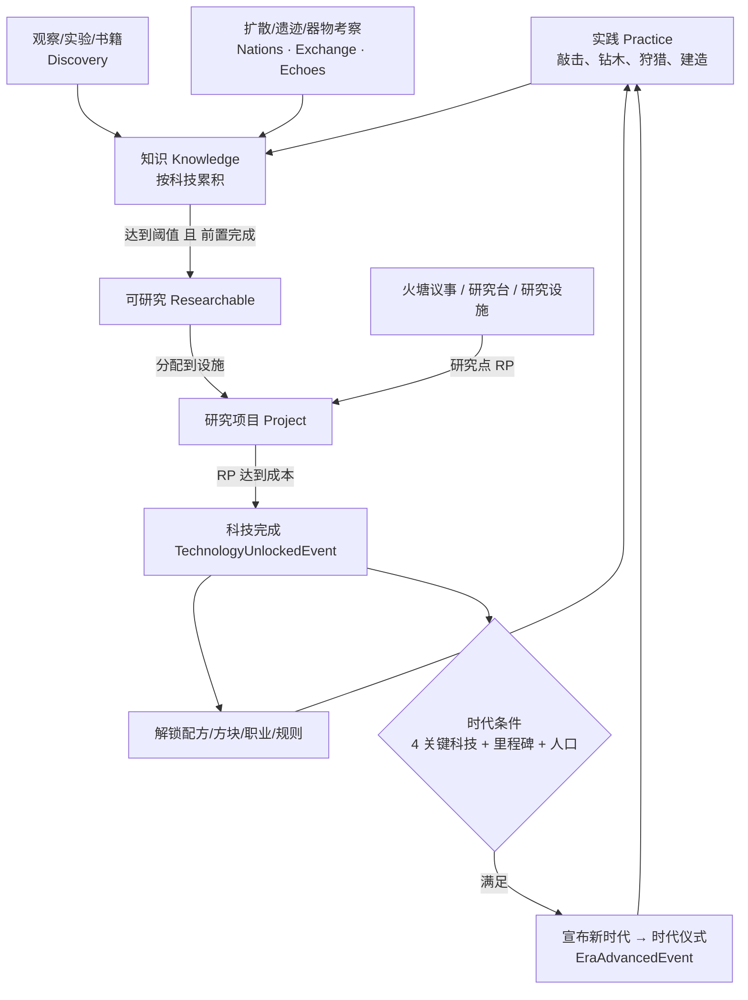
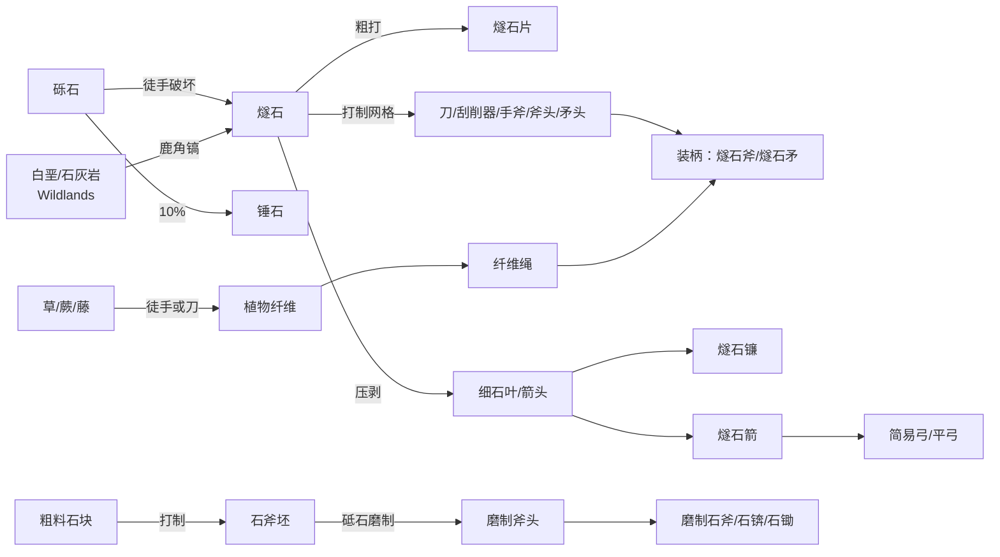

# 04 · 科技核心 Technology Core（`tctechnology`）

> 命名空间：`tctechnology` · Java 包：`com.nightcity.technology` · 主类：`TTechnology`
> 必需依赖：`tcivilization`（02 §1.3）；可选：`tcskills` 与全部主题模组。
> 本章是**科技框架**的权威规格：科技数据格式、知识与研究点、前置规则、时代跃迁与仪式、缺失模组替代、知识扩散钩子、`U` 科技页、公共 API；同时定义本模组自有内容：E0-E1 石器工具、狩猎矛与简易弓、打制、生火、采集知识，以及贯穿各时代的“知识方法论”科技线。

---

## 1. 定位与设计支柱

### 1.1 定位

科技核心是整个模组家族的**进度骨架**：

1. **框架**：读取所有模组随 JAR 发布的科技数据（`data/tctechnology/tc_tech/<era>/<tech>.json`），校验、建图、同步，并维护每个文明（玩家文明与 AI 文明）的知识、研究、科技与时代状态。
2. **裁判**：判定配方/方块/物品的科技门槛（`tc_recipe_gate`）、时代跃迁条件（01 §4）以及缺失模组时的替代条件（01 §4.1）。
3. **内容**：E0 `stone`-E1 `neolithic` 的石器工具链（打制 → 装柄 → 磨制）、生火与火塘、狩猎矛与简易弓、采集篮；再加上一条每个时代 1 项的“知识方法论”科技线（火塘议事 → 技艺传承 → 器物考察 → … → 知识方舟），它们改变**研究系统本身**的规则，而不是某个主题领域的产物。

### 1.2 设计支柱（本模组的落实方式）

| 支柱 | 在本模组中的落实 |
| --- | --- |
| 支柱 3 可见过程 | 知识来自真实操作（敲击燧石、钻木、狩猎）；研究点来自火塘边的族人、研究台前的研究者；打制是可见的逐片剥落；磨制石斧在砥石上实际磨出 |
| 支柱 4 独立有趣 | 只装 `tcivilization` + `tctechnology` 即可从 E0 推进到 E10：替身科技、研究台、里程碑标记与物资窖保证每个时代都可完成 |
| 支柱 5 文明层面 | 科技属于文明（DR-24）；玩家个人只贡献知识与研究，个人熟练度只提供效率（DR-25）；不引入任何个人生存条（DR-19） |
| 支柱 6 新动词 | E0 的“打制、生火、狩猎、采集”四个动词由本模组提供；时代跃迁仪式明确宣告每个时代的新动词 |
| 支柱 7 可逆代价 | 研究不会失败、不会遗失；唯一的“代价”是时间、人力与机会成本（同一设施一次只研究 1 项） |

### 1.3 不做的事

- 不定义研究设施的建筑与仪器（Discovery 拥有；本模组只提供后备“研究台”）。
- 不决定 AI 文明研究什么（Nations 拥有决策；本模组只存储其科技状态并提供扩散压力值）。
- 不定义 E2 以后的武器（Frontiers）与任何金属工具（Industry）。
- 不定义熟练度曲线（05）；本模组只调用 `SkillsApi.addProficiency`。

---

## 2. 独立玩法（只安装 `tcivilization` + `tctechnology`）

| 阶段 | 玩家体验 | 依靠的本模组系统 |
| --- | --- | --- |
| E0 开局 | 在砾石滩上捡到锤石与燧石，粗打出石片；钻木生火，族人（若 Settlements 缺失则只有玩家）围坐火塘，第一批研究点出现 | 粗打、`fire_drill`、`fire_pit`、火塘议事 RP |
| E0 中段 | 用 5×5 打制网格做出燧石刀、刮削器、手斧；装柄做燧石斧与燧石矛；投矛与简易弓狩猎 | 打制网格、`stone/hafting`、`stone/spear_hunting`、`stone/archery` |
| E0 → E1 | 关键科技齐备；`stone/shelter_building` 为替身科技（研究台提交物资获得知识）；里程碑在物资窖中提交等价物资；宣布新时代并观看仪式 | 替身科技、`milestone_cache`、时代仪式 |
| E1 | 在砥石上磨制石斧；细石器镰刀；鹿角镐开采白垩中的燧石结核；火把束携火、免钻木点燃新篝火坑；研究台取代火塘成为主要 RP 来源 | `grinding_slab`、`antler_pick`、`firebrand`、`research_table` |
| E2-E10 | 主题内容由原版物品承担：替身关键科技解锁原版熔炉、铜/铁/钻石工具等（`tc_recipe_gate/fallback`）；里程碑用标记、物资窖、通信站完成；方法论科技线持续改变研究规则 | 后备配方门槛、`milestone_marker`、`comm_station`、方法论科技 |

独立安装时的科技总数 = 本模组 25 项 + 41 项替身关键科技 = 66 项，足以构成一条可通关的主干（01 §10 验收 2）。

---

## 3. 联动玩法

| 对方模组 | 联动 | 缺失时的降级 |
| --- | --- | --- |
| `tcivilization` | 文明对象、人口、文明记忆（科技完成与时代跃迁写入 `MemoryEntry`）、J 面板外壳、HUD 注册、通知、深链接 | 必需依赖 |
| `tcskills` | 打制/生火/狩猎/研究产生熟练度；`crafting` 降低打制过度剥落率；`scholarship` 提高主持研究的 RP | 无熟练度，倍率按 1.0 |
| `tcwildlands` | 燧石来自白垩/石灰岩结核；`#tctechnology:soft_rock` 引用其沉积岩；湿度与降雨影响钻木成功率与火把束熄灭；“另一大陆”判定使用其大陆 ID | 原版世界；软岩标签退化为原版石头（慢速）；湿度按原版降雨；大陆按距离 + 海洋比例判定 |
| `tcecology` | 狩猎矛与弓的目标是 Ecology 物种；点燃的火塘降低捕食者接近意愿；`firebrand` 可作为 Ecology“计划烧除”（其 `neolithic/controlled_burning`）的点火工具；鹿角来自 Ecology 鹿类 | 原版动物；鹿角用骨头替代 |
| `tccultivation` | 燧石镰刀与石锄是 E1 耕作工具；`flint_sickle` 收割其作物时种子 +1 | 镰刀只收割原版作物；第一粮仓里程碑改为物资窖储存食物 |
| `tcindustry` | E2 起由 Industry 接管全部工具；刮削器是其制革工序的工具；工业生产线为 `electric/corporate_rnd` 提供 RP | 后备配方门槛开放原版熔炉与原版工具 |
| `tcnetworks` | 里程碑“大道/干线铁路/洲际航线”由 Networks 判定 | 里程碑标记 + 往返旅行 |
| `tcsettlements` | 族人参与火塘议事、担任研究员；`stone/shelter_building` 是 E0 关键科技；NPC 工作产生实践知识；人口门槛 | 人口门槛改为“玩家数 × 已完成科技数”公式；只有玩家能主持研究 |
| `tcexchange` | 贸易往来构成知识扩散接触；学术赞助以 VU 计价 | 赞助按内置贵金属估值表 |
| `tcdiscovery` | 提供观察、实验、书籍与各时代研究设施（RP 主来源）；研究台在其存在时停用 | 研究台提供全部设施 RP |
| `tcechoes` | 遗迹线索降低科技 RP（01 §5.1）；古文物可被“器物考察”；时代跃迁写入编年史 | 无遗迹折扣 |
| `tccommons` | “宣布新时代”的权限由治理角色决定 | 任何文明成员玩家都可宣布 |
| `tcfrontiers` | E2 起武器由 Frontiers 接管；点燃火塘的威慑也作用于猛兽袭扰 | 简易弓与燧石矛在全时代保持可用 |
| `tcbeyond` | Beyond 的 8 项科技不参与时代关键科技，但同样使用本框架 | 无 |
| `tcatlas` | 客户端接收负载 `tctechnology:era_advanced` 切换时代皮肤（服务端模组改为监听 `EraAdvancedEvent`）；HUD 布局编辑器可摆放本模组组件 | 使用 tcivilization 中性皮肤 |
| `tcnations` | 驱动 AI 文明的研究选择（状态数据仍存于本模组存档，11.3）；扩散接触、落后补偿、技术交流外交动作 | 外交相关效果改为普通效果（01 §4.1） |
| `tcorbit` | E9→E10 里程碑“首颗人造卫星”；`space/knowledge_ark` 以 `space/orbital_assembly` 为前置 | 全球通信网（5 大陆 `comm_station`） |

---

## 4. 核心玩法循环



单次循环（E0 示例）：敲击燧石 10 次 → `stone/knapping` 知识满 10 → 火塘议事 2 个黄昏产出约 30 RP → 完成打制 → 打制网格开启 → 做出燧石刀 → 用燧石刀割草获得纤维，推进 `stone/foraging_lore` 与 `stone/hafting` 的知识。

---

## 5. 系统规则与公式

### 5.1 科技数据加载与校验

- 每项科技一个 JSON：`data/tctechnology/tc_tech/<era>/<tech>.json`，随**拥有者模组**的 JAR 发布；科技 ID 由路径推出：`tc_tech/stone/knapping.json` → `tctechnology:stone/knapping`。其他命名空间下的 `tc_tech` 目录被忽略并记录警告。
- 加载器 `TechDefinitionLoader` 是一个 `SimpleJsonResourceReloadListener`（不使用数据包注册表：NeoForge 模组注册表路径会变成 `data/<ns>/tctechnology/...`，与 01 §9 约定冲突）。服务器重载数据包后重新建图，并以 `tctechnology:tech_defs_sync` 下发客户端。
- 服务器管理员可以用同路径的数据包覆盖或禁用任意科技（`"disabled": true`），优先级遵循原版数据包顺序。

校验顺序（任何一步失败都只影响该科技，绝不让服务器崩溃）：

| 步骤 | 规则 | 失败处理 |
| --- | --- | --- |
| V1 解析 | Codec 解码；`era` 必须等于目录名 | 跳过该文件，错误码 `TECH_PARSE` |
| V2 拥有者 | `owner` 必须是已加载模组；NeoForge `neoforge:conditions` 可附加条件 | 跳过，`TECH_OWNER_ABSENT`（信息级） |
| V3 前置存在 | 每个前置 ID 都已加载；缺失的若是关键科技，则加载替身（5.8） | 否则移除该前置边，`TECH_PREREQ_MISSING` |
| V4 前置时代 | 前置的时代 ≤ 本科技时代 | 移除该边，`TECH_PREREQ_ERA` |
| V5 跨模组 | 前置的 `owner` 与本科技不同时，前置必须是 `tc_era` 中登记的关键科技 | 移除该边，`TECH_PREREQ_CROSS` |
| V6 无环 | Tarjan 强连通分量；环内全部科技禁用 | `TECH_CYCLE`，列出环 |
| V7 布局 | 计算深度、泳道、行位置（`tree.lane` / `tree.row_hint` 只作提示） | — |

`/tcdebug selftest tech`（40 P0）输出：已加载科技数（按时代、按拥有者）、替身数、各错误码计数；任何 `TECH_CYCLE` 或 `TECH_PARSE` 都使自检失败。

### 5.2 科技状态与可见性

每个文明（玩家文明与 AI 文明）对每项科技有一个状态：

| 状态 | 条件 | 科技树外观（31 §5.1） |
| --- | --- | --- |
| `HIDDEN` 隐藏 | 科技时代 ≥ 当前时代 + 2，且知识为 0 | 不绘制，只在时代列头显示“未知科技 ×N” |
| `UNDISCOVERED` 未知 | 可见时代内，知识为 0 | 剪影 +“？”；悬停显示 1 条线索（第一条知识来源的 `hint`） |
| `KNOWN` 已知 | 知识 > 0，但知识未达阈值或前置未全部完成 | 灰色 + 锁形角标 +“需要：……” |
| `RESEARCHABLE` 可研究 | 知识 ≥ 阈值、前置全部完成、时代允许（5.6） | 正常图标 + 细边框 |
| `RESEARCHING` 研究中 | 已分配到研究地点或研究池有投入 | 环形进度 + 百分比 |
| `COMPLETED` 已完成 | 进度 ≥ 成本 | 实心底 + 勾形角标 |

- 知识可以在前置完成之前累积（“先会做，后理解”），但时代 ≥ 当前 + 2 的科技知识上限为阈值的 50%。
- 状态单调：`COMPLETED` 不可撤销；研究进度按科技保存，换设施或暂停都不丢失（支柱 7）。

### 5.3 知识 Knowledge

知识按“文明 × 科技”累积，整数。每个科技 JSON 的 `knowledge.sources` 声明哪些行为产生它的知识。

| 来源类型 | 典型触发 | 拥有者/提供者 | 来源倍率 `source_mult` |
| --- | --- | --- | --- |
| `PRACTICE` 实践 | 敲击、合成、击杀、破坏、使用、建造 | 任意模组（触发器注册） | 1.0 |
| `OBSERVATION` 观察 | 观察模式凝视目标 | Discovery | 1.0 |
| `EXPERIMENT` 实验 | 实验台完成实验 | Discovery | 1.5 |
| `ARTIFACT` 器物 | 在研究地点检视外来/古代器物 | Echoes、Nations、本模组 | 0.25（`bronze/artifact_study` 后 1.0） |
| `DIFFUSION` 扩散 | 与拥有该科技的文明保持接触 | Nations、Exchange | 1.0 |
| `TEACHING` 传授 | NPC 教师授课、玩家主持讲解 | Settlements | 1.0 |
| `BOOK` 书籍 | 阅读/收藏书籍 | Discovery | 1.0 |
| `ECHO` 遗迹 | 遗迹线索 | Echoes | 1.0 |
| `SUBMIT` 提交 | 在研究台提交样品（替身科技与后备） | 本模组 | 1.0 |

```text
gain        = amount × source_mult × actor_mult
actor_mult  = 1.0（玩家） | 0.25（NPC，族人在岗位上的实践） | 0.75（NPC，完成 neolithic/craft_lineage 后）
daily_cap   = 每（文明, 科技, 来源条目）每 MC 日上限；缺省 ceil(threshold × 0.5)
knowledge_max = threshold × 1.0（完成 medieval/codified_crafts 后为 × 1.5）
```

- **灵感 Insight**：某科技知识**首次**达到阈值时，文明研究池获得 `0.10 × rp_base`，发送 `success` 通知“灵感：打制”，并写入 `KnowledgeThresholdReachedEvent`。
- 触发器类型由模组在 `RegisterKnowledgeTriggersEvent` 中注册，内置：`tctechnology:break_block`、`place_block`、`craft_item`、`use_item`、`strike_block`、`kill_entity`、`interact_entity`、`submit_items`、`visit_biome`、`milestone_progress`、`tech_completed`（参数见 11.2）。

### 5.4 研究点 RP、研究地点与研究池

RP 只有两个去处：**研究项目**（研究地点驱动）与**文明研究池**（非地点来源）。

1. **研究地点 Research Site**：任何实现 `ResearchSite` 的方块实体（通过 `ResearchSiteProvider` 注册）。每个地点同时只研究 1 项科技，可排队 5 项；完成后自动开始队列下一项。
2. **研究池 Research Pool**：灵感、学术赞助、企业研发、命令、任务奖励进入研究池。玩家在科技树中把研究池 RP 投入任意 `RESEARCHABLE`/`RESEARCHING` 科技，**单项科技最多 50% 成本来自研究池**（保证设施仍是主路）。研究池上限 `3 × avg_rp[当前时代]`，溢出丢弃并提示。
3. 地点产出溢出（项目完成时多出的 RP）进入研究池。

**火塘议事 Hearth Discussion（E0 起，无需科技）**

```text
活跃时段     : 每日 12000–18000 tick（黄昏至午夜），火塘处于燃烧状态
participants = 6 格内的文明成员玩家 + 闲置于火塘的族人（Settlements）
               若 tcsettlements 未安装：participants = max(玩家数, 3)    // 抽象部族
rp_per_hour  = 1.5 × min(participants, 6)^0.8 × hearth_mult              // 1 MC 小时 = 1000 tick
hearth_mult  = 1.0；完成 stone/hearth_council 后 1.5
可用火塘数   = 1（完成 stone/hearth_council 后 2）
```

参考：5 人 → `1.5 × 5^0.8 ≈ 5.4 RP/小时`，6 小时 ≈ 32.6 RP/日，与 01 §5 E0 典型值 30 吻合；议事后约 49 RP/日。

**研究台 Research Table（E1，Discovery 的后备设施）**

```text
rp_per_day(table_n) = base_table[era_current] × staff × skill_mult × book_mult × 0.85^(n-1)
base_table[E]       = 0.5 × typical_rp_day[E]           // E1 30, E2 55, E3 90, E4 150, E5 240,
                                                        // E6 375, E7 575, E8 850, E9 1250, E10 1750
staff               = 1.0 有研究员（Settlements 岗位）或 tcsettlements 未安装（抽象学者）；否则 0
                      玩家“主持研究”（站在 4 格内并开启主持）时额外 +1.0（仅在场期间）
skill_mult          = ProficiencyBridge.multiplier(host, "scholarship", "speed/research")
                      // 主持者；50 级 1.30，天赋余量与上限见 05 §6.3-6.4（DR-25）；Skills 缺席 1.0
book_mult           = 1 + 0.05 × 书槽内书本数（最多 5 本，原版书或 Discovery 书籍）
n                   = 该文明第 n 张工作中的研究台（按放置顺序）
```

- 2 张研究台满员 ≈ `0.5 + 0.425 = 0.925 ×` 典型产出，再加主持与书本即可达到或超过 01 §5 的典型值。
- `research_table_mode = auto`（默认）：Discovery 安装时研究台配方隐藏，已放置的研究台产出 ×0.5；`always` 始终全额；`never` 禁用。
- 产出每 100 tick 结算一次（5.10 性能）；区块未加载时按 `SimulationTier` 的抽象结算（02 §4）。

### 5.5 研究成本

```text
cost(t, civ) = round( rp_base(t) × difficulty.tech_cost
                      × diffusion × echo × catchup × hindsight × method )
diffusion = max(0.60, 1 − 0.10 × contacts_with(t))     // 01 §5.1，接触文明数，上限 −40%
echo      = Π CostFactorProvider.factor(civ, t)       // 12.1；Echoes 提供 1 − max(clue_discount(t))，0.50–0.85
catchup   = 0.85 若 civ.era + 2 ≤ max(AI 文明时代)，否则 1.0
hindsight = max(0.50, 0.80^(civ.era − era(t)))         // 落后时代的旧科技更便宜
method    = (1 − overflow_discount) × ark_factor
overflow_discount = min(0.20, 0.40 × (knowledge/threshold − 1))   // 仅完成 medieval/codified_crafts 后
ark_factor = 0.5 若完成 space/knowledge_ark 且 era(t) ≤ civ.era − 2，否则 1.0
下限      : cost ≥ ceil(0.40 × rp_base × difficulty.tech_cost)
            （ark_factor 生效的科技下限为 0.25）
```

`difficulty.tech_cost` 来自 `[difficulty]`（01 §6）：Sandbox 0.5 / Standard 1.0 / Historical 1.5 / Custom 0.25–3.0。成本在科技进入 `RESEARCHABLE` 时与每次相关因子变化时重算；已投入进度不变，只改变剩余量。

### 5.6 时代允许与预研

- 当前时代及以前的科技：知识与前置满足即可研究。
- 下一时代科技：**预研**，同时处于 `RESEARCHING` + `COMPLETED` 的下一时代科技最多 3 项（01 §1），配置 `pre_research_limit`。
- 时代 ≥ 当前 + 2：不可研究。
- 下一时代的**关键科技**也可预研（计入 3 项），但宣布新时代仍需全部条件。

### 5.7 时代跃迁与仪式

**条件**（全部满足，读取 `tc_era/<era>.json`）：

1. 目标时代的 4 项关键科技全部 `COMPLETED`（01 §4）。
2. 当前时代的里程碑工程已完成（判定器由拥有者模组注册，缺失时用 5.8 的后备判定器），完成后写入核心 `MilestoneRecord`。
3. 人口 ≥ `population_min`（Settlements 提供；缺失时用 5.8 公式）。

**宣布**：

- 条件满足时：核心 `AlertProvider` 显示持续提示“可以宣布新时代”，`tctechnology:era_progress` 与概览卡高亮；科技树顶部出现“宣布新时代”按钮（`TcConfirmDialog` 二次确认，列出即将解锁的新动词）。
- 权限：未装 Commons 时任意文明成员玩家可宣布；装有 Commons 时由其权限 `tccommons:declare_era` 决定（缺省授予领袖角色）。
- `auto_declare_era = false`（默认）；设为 `true` 时条件满足后 1 MC 日自动宣布。
- 服务器流程：`EraAdvanceEvent.Pre`（可取消，供 Commons 投票等）→ 写 `Civilization.era` → 发布 `EraAdvancedEvent` → 写入文明记忆（重要度 5）→ 核心 `ceremony` 通知 → 向**所有客户端**发送 `tctechnology:era_advanced`。时代不可倒退。
- AI 文明跃迁（Nations 调用 `TechApi.advanceEra`）无仪式；已接触的玩家收到 `info` 通知“某文明进入青铜时代”。

**仪式 Ceremony（tctechnology 拥有的全屏覆盖层）**：

| 阶段 | 时长 | 内容 |
| --- | --- | --- |
| 1 标题卡 | 0–6 s | `TcEraBadge` 大号徽章 + “青铜时代 Bronze Age”；音效 `tctechnology:event.era_advance` 起，随后接 `tctechnology:music.era.<era>` |
| 2 回顾 | 6–14 s | 本时代用时（游戏日）、4 项关键科技、里程碑、人口、贡献最多的 3 人（`TcPersonChip`） |
| 3 新动词 | 14–22 s | `tc_era.new_verbs` 列表（各模组以数据贡献，例如“冶炼”“书写”“驾车”），每项 1 行图标 + 文字 |

- 3 s 后任意键 / `Esc` / 点击“跳过”可跳过；跳过者直接看到 1 行静态横幅。
- **延后**：玩家处于战斗中（5 s 内受到或造成伤害，与 03 §5.10 一致）或打开了任何界面时延后播放；最长延后 5 分钟，超时改为 `ceremony` toast + 编年史入口。
- `tcivilization-client.toml [accessibility] reduced_motion = true`：无缩放、无粒子、淡入改为直接切换，阶段 2/3 合并为一页静态卡，总时长 12 s。
- 可从编年史页签重播：深链接 `tc:tctechnology/ceremony?era=bronze`。
- Atlas 监听同一负载切换 `tcatlas:skin/<era>` 皮肤；未装 Atlas 时 HUD 使用核心中性皮肤。

### 5.8 缺失模组的替代（01 §4.1 的实现）

`EraFallbackResolver` 在每次数据重载后为 11 个时代逐项检查：

**A. 替身关键科技 Fallback Stub**：若某关键科技的拥有者未安装，则从 `data/tctechnology/tc_tech_fallback/<era>/<tech>.json` 加载替身（同一 ID，`owner = tctechnology`，`fallback = true`）。替身：

- RP = 01 §5 该时代平均值；知识阈值 = 本章 6.3 的时代参考阈值；知识来源 = 研究台 `SUBMIT`（提交该领域代表性原版物品）+ 相关原版行为（例如 `bronze/smelting` 替身：熔炼原版铜锭）。
- 前置 = 上一时代全部可用关键科技（保证图连通）。
- 解锁 = `tc_recipe_gate/fallback/` 中的后备配方门槛（下表）。
- 全家族最多 41 项替身（44 项关键科技 − 本模组 3 项）；只装两个核心时全部加载。替身不计入附录 B。

| 替身关键科技（缺失拥有者） | 后备解锁（原版内容） |
| --- | --- |
| `stone/shelter_building`（Settlements） | 原版床、木门、活板门 |
| `neolithic/pottery`（Industry） | 原版砖、花盆、装饰陶罐 |
| `neolithic/weaving`（Industry） | 原版羊毛、地毯、旗帜 |
| `neolithic/cultivation`、`neolithic/animal_husbandry`（Cultivation） | 原版堆肥桶、拴绳、动物繁殖（耕地由本模组 `stone_hoe` 提供） |
| `bronze/smelting`（Industry） | 原版熔炉、铜锭配方、石质工具（石镐可采原版石头） |
| `bronze/alloying`（Industry） | 原版铜制品、避雷针、望远镜 |
| `iron/bloomery`（Industry） | 原版铁锭、铁工具、铁甲、铁砧 |
| `medieval/water_power`（Industry） | 原版磨石、切石机 |
| `industrial/steam_engine`、`industrial/steelmaking`（Industry） | 原版高炉、活塞、铁轨 |
| `industrial/machine_tools`（Industry） | 原版钻石工具、锻造台 |
| `electric/*`、`atomic/*`、`information/*`（Industry/Networks） | 原版红石器件、侦测器、比较器、动力铁轨、鞘翅修复配方等，详表见数据文件 |
| `bronze/writing`、`medieval/papermaking`（Discovery） | 原版书、书与笔、讲台、地图 |
| 其余 | 仅推进时代，不解锁内容 |

**B. 后备里程碑判定器**（`tc_milestone/fallback/*.json`）：

| 里程碑（拥有者） | 缺失时替代判定 |
| --- | --- |
| 部落火塘（Settlements） | 放置 `milestone_cache` 并提交 3 座窝棚的等价物资（原木 48、木棍 32、`cordage` 12） |
| 第一粮仓（Cultivation） | `milestone_cache` 设为“粮仓”模式，储存食物营养值 ≥ 人口 × 30（任意食物） |
| 律法石碑（Commons） | `milestone_cache` 提交石料 64 + 书与笔 1，并在其上写下“法典”书名 |
| 大道、干线铁路、洲际航线（Networks） | 两个 `milestone_marker` 相距 ≥ 1,000 / 5,000 / 跨洋（不同大陆）格，玩家在 3 / 5 / 7 MC 日内往返一次（步行、骑乘、乘船均可） |
| 学府（Discovery） | 3 张研究台 + `milestone_cache` 中收藏 20 本书 |
| 远洋贸易站（Exchange） | 在另一大陆放置 `milestone_marker`（贸易站模式）+ 相邻 `milestone_cache` 存放货物 ≥ 64 组并维持 2 季 |
| 区域电网（Industry） | `milestone_cache` 提交红石块 32、铜块 32，并在 5 个聚落标记点各放 1 个原版红石灯（`milestone_marker` 绑定） |
| 首颗人造卫星（Orbit） | 全球通信网：5 个大陆各放置 1 座 `comm_station` |
| 火星自给殖民地（Orbit） | `milestone_cache` 提交“方舟物资”（每种原版作物种子 64、每种可繁殖动物刷怪蛋替代物：拴绳 + 饲料 64）并维持 1 年 |

大陆判定：Wildlands 安装时用其大陆 ID；否则按“相距 ≥ 2,000 格且两点之间直线采样海洋生物群系比例 ≥ 40%”。

**C. 人口后备**（Settlements 缺失）：

```text
effective_population = 文明玩家数 × 已完成科技数
需达到 fallback_population_min[目标时代]:
E1 6 | E2 16 | E3 24 | E4 28 | E5 33 | E6 38 | E7 43 | E8 48 | E9 53 | E10 58 | 终局 63
```

数值保证只装两个核心、单人时也能推进（独立模式可完成科技：E0 11、累计至 E10 共 66 项）。

**D. 外交科技**：Nations 缺失时，科技 JSON 中 `"diplomatic": true` 的效果改为 `fallback_effect`（01 §4.1）。本模组的 `iron/knowledge_exchange` 即按此处理（7.3）。

### 5.9 知识扩散钩子

- **文明内部**：科技属于文明（DR-24），全部玩家属于同一文明（DR-02），玩家之间不存在扩散，只共享。
- **文明之间**：`ContactProvider`（Nations 注册“外交接触”，Exchange 注册“近 2 季内有贸易”）返回 `contacts(civ)`。每 MC 日一次：

```text
对每个可见时代的科技 t（本文明未完成）：
  n = 拥有 t 的接触文明数
  knowledge(t) += min(n, 4) × 1 × source_mult[DIFFUSION]   // 计 daily_cap
  成本因子 diffusion 按 5.5 计算
```

- **AI 文明**：Nations 决定其研究方向；本模组只存储 `CivTechState` 并提供 `TechApi.diffusionPressure(civ, tech)`（0–1，接触文明中拥有比例）作为其决策输入；Discovery 的研究设施与本章研究台都只服务玩家文明。

### 5.10 配方与内容门槛

- `tc_recipe_gate/*.json`：`{ "tech": "...", "recipes": [...], "items": [...], "blocks": [...] }`。门槛未满足时：配方书隐藏、合成结果槽为空并显示锁形提示“需要科技：打制”、放置方块被拒绝（提示同上）。
- 配方 JSON 也可内联门槛：顶层字段 `"tctechnology:tech_unlocked": "tctechnology:<era>/<tech>"`（其他模组如 Settlements 使用此写法）。它不是 `neoforge:conditions` 加载条件（加载期无法得知文明），而由 `RecipeGateService` 在合成时按合成者所属文明判定；未安装本模组时该字段被忽略，配方按原样可用，由拥有者模组自行提供替代条件。
- `RecipeGateService` 直接处理原版菜单：工作台、熔炉、烟熏炉、高炉、营火、切石机、锻造台、织布机；其他模组的机器调用 `TechApi.isRecipeUnlocked(civ, recipeId)`。
- 原版工具配方移除（DR-15，02 §3.1、30）：本模组移除原版木/石/铜/铁/金/钻石工具与武器配方；E0-E1 由本章石器替代，E2 起由 Industry/Frontiers 注册；两者缺失时由 5.8 后备门槛恢复原版配方。

### 5.11 打制 Knapping

**粗打（无需科技）**：主手 `hammerstone`、副手 `#tctechnology:knappable` 物品，按住使用 1 s：

```text
产出 flint_flake ×1 的概率 = 0.60；原料消耗概率 = 0.35
每次粗打：PRACTICE 知识 +1 → stone/knapping（每日上限 10）
```

**打制网格（完成 `stone/knapping` 后）**：同样的手持方式按 `Shift` + 使用打开 `tctechnology:knapping` 菜单（5×5 网格）。

1. 每点击一格剥落该格（播放 `tctechnology:block.knapping.strike`，飞出石片粒子）；剩余形状与 `tctechnology:knapping` 配方类型（数据驱动）匹配时，结果槽显示成品，点击“完成”取出。
2. **过度剥落**：每次点击时，相邻随机一格也剥落的概率

```text
p_over = base[material] × waste_mult × tool_mult
waste_mult = 1 / ProficiencyBridge.multiplier(player, "crafting", "speed/handcraft")
             // 50 级约 −23%（1/1.30）；上限见 05 §6.4（DR-25）；Skills 缺席 1.0
base    : minecraft:flint 0.10 | #knappable_coarse（石英岩、玄武岩、流纹岩等松散石块）0.20
tool_mult: hammerstone 1.0 | antler_billet（软锤）0.7 | pressure_flaker（压剥，细活配方必需）0.5
```

3. 打坏的坯料可点“回收”得到 `flint_flake ×2`。粗料（`#knappable_coarse`）制成的工具耐久 ×0.7。
4. 配方本身受科技门槛控制：例如 `microlith` 与 `flint_arrowhead` 需要 `stone/microliths` 且需在副手持 `pressure_flaker`。

### 5.12 生火 Fire Making 与篝火坑

| 行为 | 规则 |
| --- | --- |
| 钻木（`fire_drill`，无需科技） | 对准含 `tinder` 的 `fire_pit` 按住使用 4 s；成功率 20%（完成 `stone/fire_making` 后 70%）；每次尝试耐久 −1，PRACTICE 知识 +1 → `stone/fire_making`（每日上限 12） |
| 弓钻（`bow_drill`，需 `stone/fire_making`） | 按住 2.5 s；成功率 90% |
| 潮湿惩罚 | 露天且正在下雨 −30%；Wildlands 湿度 > 0.8 再 −20%；有遮蔽时无惩罚 |
| `fire_pit` 燃料 | 任意原版燃料，燃烧时间 = 原版熔炉燃料值；完成生火前只有 1 个燃料槽、熄灭即冷却；完成后 4 个燃料槽，熄灭后余烬保留 1 MC 日（加燃料即可复燃） |
| 用途 | 光照 15；烤制（行为同原版营火，4 格）；火塘议事研究地点（5.4）；Ecology 捕食者 12 格内接近意愿 −50%（钩子） |
| 保火（`neolithic/fire_keeping`） | 余烬保留 1 → 3 MC 日；燃料燃烧时间 ×1.25；`firebrand` 火把束：在燃烧的篝火坑旁合成，耐久 8，对未点燃的篝火坑/原版营火/蜡烛使用即刻点燃（免钻木）；雨中露天手持 30 s 熄灭；可作为 Ecology 计划烧除的点火工具（与原版火把等效） |
| 原版营火 | 原版营火配方移除，以 `fire_pit` 替代（16）；原版火把配方由 `stone/fire_making` 门控 |

`tcsettlements:settlement_core` 的 E0“部落火塘”形态同样注册为火塘研究地点（由 Settlements 实现 `ResearchSiteProvider`），与 `fire_pit` 共享“可用火塘数”。

### 5.13 狩猎矛与简易弓

| 武器 | 近战 | 投掷/射击 | 规则 |
| --- | --- | --- | --- |
| `wooden_spear` 削尖木矛 | 3 | 投掷 4，射程约 12 格 | 无需科技；投出后成为实体，可拾回 |
| `flint_spear` 燧石矛 | 5 | 投掷 7，射程约 14 格 | 需 `stone/hafting` |
| `spear_thrower` 投矛器 | — | 副手持有时投矛射程 ×1.6、伤害 +2 | 需 `stone/spear_hunting` |
| `bone_harpoon` 骨鱼叉 | 3 | 投掷 6，水中不减速，带绳回收（8 格） | 需 `stone/bone_working` |
| `simple_bow` 简易弓 | — | 拉满 1.2 s，`flint_arrow` 伤害 5 | 需 `stone/archery` |
| `flatbow` 平弓 | — | 拉满 1.0 s，伤害 6.5，耐久 250 | 需 `neolithic/flatbow` |

- 狩猎击杀给 `hunting` 熟练度并按物种产生 `kill_entity` 实践知识（`stone/spear_hunting`、`stone/archery`）。
- E2 起 Frontiers 注册更强的武器；本表武器全时代可用。Frontiers 缺失时，原版弓、弩、剑的配方由后备门槛按时代恢复（弓 ← `neolithic/flatbow`，弩 ← `medieval/guilds` 或其替身，铁剑 ← `iron/bloomery`）。

### 5.14 采集知识与编篮

- 徒手破坏草、蕨、藤蔓：15% 得 `plant_fiber`；手持 `flint_knife` 30%；完成 `stone/foraging_lore` 后再 +15%。
- `stone/foraging_lore` 同时解锁：`cordage`（3 纤维搓成）、`tinder`（干草/纤维）、浆果丛与野生作物额外产出 +1 的概率 25%，以及目标信息中的“可食用/有毒”文字标注（`TargetInfoProvider`）。
- `gathering_basket`：16 格，只接受 `#tctechnology:forage`（植物、种子、纤维、燧石、木棍等自然物）；放在快捷栏时自动收纳拾取的自然物。
- `storage_basket`：9 格方块，只接受自然物，可被族人存取（Settlements 物流钩子）。

### 5.15 石器材料与采掘边界

- `flint` 工具材料：耐久 60、效率 3.5、伤害加成 1.0、附魔性 5。本模组**不提供燧石镐**：燧石工具只有刀、刮削器、手斧、斧、矛，不能采石。
- `polished_stone` 材料：耐久 140、效率 4.5、伤害加成 1.5、附魔性 5；只用于斧与锛，同样不能采石。
- `antler_pick`：可采 `#tctechnology:soft_rock`（Wildlands 的白垩、石灰岩、页岩、泥岩、砂岩、石膏岩、岩盐），耐久 100，效率 2.5。
- Wildlands 缺失时，`#tctechnology:soft_rock` 改为原版石头、圆石、安山岩、闪长岩、花岗岩（效率 ×0.5），保证独立模式在 E1 即可采石；硬岩与矿石由 Industry 金属镐或 5.8 后备门槛（原版石镐、铁镐）负责。
- 砾石：徒手破坏得 `minecraft:flint` 的概率由 10% 提高到 25%，得 `hammerstone` 10%（全局战利品修改器 `tctechnology:gravel_knapping`）。

### 5.16 知识方法论科技线（E1-E10）

每个时代 1 项，改变研究系统本身的规则：

| 科技 | 效果 |
| --- | --- |
| `neolithic/craft_lineage` 技艺传承 | NPC 实践知识倍率 0.25 → 0.75；Settlements 教师岗位产生 `TEACHING` 知识 |
| `bronze/artifact_study` 器物考察 | `ARTIFACT` 倍率 0.25 → 1.0；可在研究地点“逆向研究”外来物品：按 `tc_recipe_gate` 查得门控科技，一次检视给其知识 `0.25 × threshold`（每件物品每科技 1 次） |
| `iron/knowledge_exchange` 知识互通 | 外交动作“交换学者”（Nations，`diplomatic: true`）：双方各选 1 项对方已有科技，知识直接达阈值；Nations 缺失时的 `fallback_effect`：全部 `DIFFUSION` 每日上限 ×2，且研究池上限 ×1.5 |
| `medieval/codified_crafts` 工艺成法 | 知识上限 ×1.5；超出阈值的知识按 5.5 折扣成本（最多 −20%） |
| `renaissance/research_patronage` 学术赞助 | 研究台/设施菜单出现“赞助”槽：投入货币（Exchange VU 或贵金属估值）转为研究池 RP，`rp = 0.5 × VU × 0.9^(当日已赞助次数)` |
| `industrial/patent_office` 专利局 | 每完成 1 项科技，研究池获得 `0.05 × cost`；“发明公告”通知；扩散给 AI 文明的速度 −50%（Nations 读取） |
| `electric/corporate_rnd` 企业研发 | Industry 生产线按其产值的 1% 向研究池贡献 RP（Industry 缺失时：每台运转的原版熔炉/高炉 2 RP/MC 小时，上限 200/日） |
| `atomic/big_science` 大科学 | 研究项目可“联合攻关”：多个地点同时研究同一科技，第 2 个起每个地点贡献 60% |
| `information/collaborative_research` 协作研究 | 每个结盟 AI 文明或每座拥有研究设施的聚落，使全部研究产出 +5%，上限 +25% |
| `space/knowledge_ark` 知识方舟 | 落后 ≥ 2 个时代的未完成科技成本 ×0.5（下限 0.25）；终局编年史附带完整科技谱系 |

## 6. 数值表

### 6.1 时代参考值（科技作者必须遵守）

| 时代 | 目录 | 平均 RP（01 §5） | 允许 RP 区间（×0.5–×2） | 参考知识阈值 | 阈值区间 | 典型 RP/日 | 研究台基础 RP/日 |
| --- | --- | --- | --- | --- | --- | --- | --- |
| E0 | `stone` | 20 | 10–40 | 10 | 5–20 | 30 | —（火塘） |
| E1 | `neolithic` | 60 | 30–120 | 30 | 15–60 | 60 | 30 |
| E2 | `bronze` | 150 | 75–300 | 45 | 25–90 | 110 | 55 |
| E3 | `iron` | 320 | 160–640 | 70 | 35–140 | 180 | 90 |
| E4 | `medieval` | 650 | 325–1,300 | 100 | 50–200 | 300 | 150 |
| E5 | `renaissance` | 1,200 | 600–2,400 | 140 | 70–280 | 480 | 240 |
| E6 | `industrial` | 2,200 | 1,100–4,400 | 190 | 95–380 | 750 | 375 |
| E7 | `electric` | 3,800 | 1,900–7,600 | 250 | 125–500 | 1,150 | 575 |
| E8 | `atomic` | 6,000 | 3,000–12,000 | 320 | 160–640 | 1,700 | 850 |
| E9 | `information` | 9,000 | 4,500–18,000 | 400 | 200–800 | 2,500 | 1,250 |
| E10 | `space` | 13,000 | 6,500–26,000 | 500 | 250–1,000 | 3,500 | 1,750 |

加载器对超出区间的科技发出 `TECH_COST_RANGE` 警告（不阻止加载）。

### 6.2 知识来源参考量

| 行为 | 来源 | 单次知识 | 每日上限（缺省） |
| --- | --- | --- | --- |
| 粗打一次 | PRACTICE | 1 | 10 |
| 钻木一次（不论成败） | PRACTICE | 1 | 12 |
| 用打制网格完成一件石器 | PRACTICE | 2 | `ceil(K/2)` |
| 击杀一只猎物（矛/弓） | PRACTICE | 2 | `ceil(K/2)` |
| 观察模式凝视新目标 | OBSERVATION | 1–3 | `ceil(K/2)` |
| 完成一次实验 | EXPERIMENT | 5–15 | `ceil(K/2)` |
| 研究台提交一组样品（替身/后备） | SUBMIT | `0.1 × K` | `ceil(K/2)` |
| 检视一件器物 | ARTIFACT | `0.25 × K × 倍率` | 每物品每科技 1 次 |
| 每个拥有该科技的接触文明 | DIFFUSION | 1/日 | 4/日 |

### 6.3 石器与狩猎器具数值

| 物品 | 类别 | 耐久 | 效率 | 伤害 | 攻速 | 备注 |
| --- | --- | --- | --- | --- | --- | --- |
| `flint_knife` | 刀 | 40 | 2.5 | 2 | 2.0 | 剥皮、割纤维；Industry 制革工序工具 |
| `flint_scraper` | 刮削器 | 50 | — | 1 | 1.6 | 处理生皮、剥树皮（Industry 钩子） |
| `hand_axe` | 手斧 | 45 | 3.0 | 3 | 1.0 | 无柄，可砍木 |
| `flint_axe` | 斧 | 60 | 3.5 | 5 | 0.9 | |
| `polished_stone_axe` | 斧 | 140 | 4.5 | 6 | 0.9 | 砍木额外 10% 原木 |
| `stone_adze` | 锛 | 140 | 4.0 | 3 | 1.0 | 对原木使用“劈板”，1 原木 → 2 木板（不需工作台） |
| `digging_stick` | 掘棍 | 30 | 2.0 | 1 | 1.2 | 可挖泥土/沙，采集根茎额外掉落 |
| `flint_sickle` | 镰 | 80 | 3.0 | 2 | 1.4 | 3×3 收割作物与草，种子/纤维 +1 |
| `stone_hoe` | 锄 | 90 | — | 1 | 1.0 | 耕地（原版锄配方已移除；E2 起由 Industry 金属锄接替） |
| `antler_pick` | 镐 | 100 | 2.5 | 2 | 1.0 | 只采 `#tctechnology:soft_rock` |
| `simple_bow` | 弓 | 120 | — | 5（箭） | 拉满 1.2 s | |
| `flatbow` | 弓 | 250 | — | 6.5（箭） | 拉满 1.0 s | |
| `fire_drill` | 钻火器 | 20 | — | — | 4 s/次 | 成功率 20%/70% |
| `bow_drill` | 弓钻 | 60 | — | — | 2.5 s/次 | 成功率 90% |

`crafting` 熟练度只影响打制过度剥落与打制速度；`hunting` 影响投掷精度；倍率与上限见 §15（DR-25）。

### 6.4 E0 节奏模拟（标准难度、全家族、5 名族人）

| MC 日 | 关键事件 | 累计完成科技 |
| --- | --- | --- |
| 1 | 粗打 10 次 → 打制知识满；钻木 12 次 → 生火知识满；灵感 2 次（+4 RP） | 0 |
| 2 | 火塘议事 ~32 RP → 完成生火（20）与采集知识（15）的大半 | 1 |
| 3 | 完成打制、采集知识；打制网格开启 | 3 |
| 4–6 | 装柄、编篮、火塘议事；`stone/shelter_building`（Settlements） | 6–7 |
| 7–11 | 投矛狩猎、骨角加工、细石器、弓箭（含 3 项预研 E1 科技之一） | 10–11 |
| 约 11 | 4 关键科技 + 部落火塘 + 人口 6 → 宣布 E1 | 11–12 |

约 11 MC 日 ≈ 3.7 实时小时，与 01 §8 的 3:45 一致。

### 6.5 难度乘数（`[difficulty]`）

| 预设 | `tech_cost` | `knowledge_gain` | `insight_bonus` | 其他模组读取 |
| --- | --- | --- | --- | --- |
| Sandbox | 0.5 | 1.5 | 0.15 | `population_growth` 1.5、`ai_aggression` 0、`disaster_rate` 0.5 |
| Standard | 1.0 | 1.0 | 0.10 | 1.0 / 1 / 1.0 |
| Historical | 1.5 | 0.8 | 0.08 | 0.8 / 2 / 1.3 |
| Custom | 0.25–3.0 | 0.25–3.0 | 0–0.5 | 0.25–3.0 / 0–3 / 0–3.0 |

---

## 7. 内容清单

### 7.1 方块

| ID | 名称 | 时代 | 门槛 | 说明 |
| --- | --- | --- | --- | --- |
| `tctechnology:fire_pit` | 篝火坑 | E0 | 无（满功能需 `stone/fire_making`） | 火塘研究地点、烤制、光源 |
| `tctechnology:storage_basket` | 储物篮 | E0 | `stone/basketry` | 9 格自然物容器 |
| `tctechnology:grinding_slab` | 砥石 | E1 | `neolithic/ground_stone_tools` | 磨制石斧头，需相邻水源或持水 |
| `tctechnology:research_table` | 研究台 | E1 | E1 时代 + `research_table_mode` | Discovery 的后备研究地点 |
| `tctechnology:milestone_marker` | 里程碑标记 | — | 需要后备里程碑时可用 | 路线端点 / 贸易站 / 电网节点 |
| `tctechnology:milestone_cache` | 物资窖 | — | 需要后备里程碑时可用 | 提交物资、粮仓模式、方舟物资 |
| `tctechnology:comm_station` | 通信站 | E9 | `information/computer_networks`（或其替身），仅 Orbit 缺失时可合成 | 全球通信网后备里程碑 |

后备方块（`milestone_marker`、`milestone_cache`、`comm_station`）只在对应拥有者模组缺失时出现在配方书与创造标签页。

### 7.2 物品

| 时代 | 物品 |
| --- | --- |
| E0（无门槛） | `hammerstone` 锤石、`flint_flake` 燧石片、`plant_fiber` 植物纤维、`wooden_spear` 削尖木矛、`digging_stick` 掘棍、`fire_drill` 钻火器 |
| E0（`stone/knapping`） | `flint_knife` 燧石刀、`flint_scraper` 刮削器、`hand_axe` 手斧、`flint_axe_head` 燧石斧头、`flint_spear_point` 燧石矛头 |
| E0（`stone/foraging_lore`） | `tinder` 火绒、`cordage` 纤维绳 |
| E0（`stone/fire_making`） | `bow_drill` 弓钻 |
| E0（`stone/hafting`） | `flint_axe` 燧石斧、`flint_spear` 燧石矛 |
| E0（`stone/spear_hunting`） | `spear_thrower` 投矛器 |
| E0（`stone/bone_working`） | `bone_harpoon` 骨鱼叉、`antler_billet` 鹿角软锤、`pressure_flaker` 压剥器 |
| E0（`stone/basketry`） | `gathering_basket` 采集篮 |
| E0（`stone/microliths`） | `microlith` 细石叶、`flint_arrowhead` 燧石箭头 |
| E0（`stone/archery`） | `simple_bow` 简易弓、`flint_arrow` 燧石箭 |
| E1 | `stone_axe_blank` 石斧坯、`polished_axe_head` 磨制斧头、`polished_stone_axe` 磨制石斧、`stone_adze` 石锛、`flint_sickle` 燧石镰、`stone_hoe` 石锄、`antler_pick` 鹿角镐、`firebrand` 火把束、`flatbow` 平弓 |

### 7.3 科技（25 项，附录 B 为权威）

| 时代 | 数量 | 科技 |
| --- | --- | --- |
| E0 `stone` | 10 | 采集知识★、打制★、生火★、装柄、投矛狩猎、骨角加工、编篮、细石器、弓箭、火塘议事 |
| E1 `neolithic` | 6 | 磨制石器、复合工具、燧石开采、保火、技艺传承、平弓 |
| E2-E10 | 各 1 | 器物考察、知识互通、工艺成法、学术赞助、专利局、企业研发、大科学、协作研究、知识方舟 |

★ = 时代关键科技（E0 → E1 的 4 项中的 3 项）。E0 共 18 项科技的目标中，本模组占 10 项，其余由 Settlements、Ecology、Wildlands 等提供。

### 7.4 标签与数据类型

| 标签/数据 | 内容 |
| --- | --- |
| `#tctechnology:knappable` | `minecraft:flint`、`tcwildlands:raw_flint`（可选条目） |
| `#tctechnology:knappable_coarse` | Wildlands 松散石块（石英岩、玄武岩、流纹岩，可选条目） |
| `#tctechnology:soft_rock`（方块） | 见 5.15 |
| `#tctechnology:forage` | 采集篮可收纳的自然物 |
| `#tctechnology:fire_starters`（物品） | 可直接点燃篝火坑的物品：`tctechnology:firebrand`、`minecraft:torch`、`minecraft:flint_and_steel` |
| `#tctechnology:cordage` | `tctechnology:cordage`（Networks 木筏、Industry 绳索可引用）；同时加入 `#c:strings` |
| `tc_tech`、`tc_tech_fallback`、`tc_era`、`tc_milestone`、`tc_recipe_gate`、`tc_knapping_material` | 数据目录，格式见 11 |
| 配方类型 `tctechnology:knapping`、`tctechnology:grinding` | 打制与磨制 |

### 7.5 实体、菜单与声音

| 类型 | ID | 说明 |
| --- | --- | --- |
| 实体 | `tctechnology:thrown_spear` | 投出的 `wooden_spear` / `flint_spear`；记录原物品 NBT，命中后插在目标或地面，可拾回 |
| 实体 | `tctechnology:thrown_harpoon` | 投出的 `bone_harpoon`；水中不减速，8 格绳长内右键收回 |
| 实体 | `tctechnology:flint_arrow` | `flint_arrow` 的箭实体（与物品同 ID，类型不同） |
| 菜单 | `tctechnology:knapping` | 打制网格（10.3） |
| 菜单 | `tctechnology:research_table` | 研究台（10.4） |
| 菜单 | `tctechnology:storage_basket` / `tctechnology:gathering_basket` | 9 格 / 16 格篮子 |
| 菜单 | `tctechnology:fire_pit`、`tctechnology:milestone_cache` | 篝火坑燃料与烤制槽；物资窖提交界面 |
| 声音 | `tctechnology:event.era_advance` | 时代跃迁短乐句（stinger，8–20 s，32 §8.8） |
| 声音 | `tctechnology:event.tech_unlocked`、`tctechnology:ui.insight` | 科技完成提示；灵感（知识达阈值）提示 |
| 声音 | `tctechnology:block.knapping.strike`、`tctechnology:block.fire_pit.crackle`、`tctechnology:item.fire_drill.spin` | 打制、篝火、钻火 |
| 声音 | `tctechnology:music.era.<era>` ×11 | 时代主题音乐类别（每类 3–5 首，32 §8.8）；仪式第 1 阶段后接播 |

## 8. 配方与生产链

### 8.1 配方表

| 产物 | 配方类型 | 输入 | 门槛 |
| --- | --- | --- | --- |
| `digging_stick` | 有序（竖 2） | 木棍 ×2 | — |
| `wooden_spear` | 有序（斜 3） | 木棍 ×2 + `flint_flake` | — |
| `fire_drill` | 无序 | 木棍 ×2 + `plant_fiber` | — |
| `tinder` ×2 | 无序 | `plant_fiber` ×2 或 短草 ×2 | `stone/foraging_lore` |
| `cordage` | 无序 | `plant_fiber` ×3 | `stone/foraging_lore` |
| `flint_knife` | 打制网格 | 燧石 | `stone/knapping` |
| `flint_scraper` | 打制网格 | 燧石 | `stone/knapping` |
| `hand_axe` | 打制网格 | 燧石或粗料 | `stone/knapping` |
| `flint_axe_head` | 打制网格 | 燧石或粗料 | `stone/knapping` |
| `flint_spear_point` | 打制网格 | 燧石 | `stone/knapping` |
| `microlith` ×4 | 打制网格（需 `pressure_flaker`） | 燧石 | `stone/microliths` |
| `flint_arrowhead` ×2 | 打制网格（需 `pressure_flaker`） | 燧石 | `stone/microliths` |
| `bow_drill` | 无序 | `fire_drill` + 木棍 + `cordage` | `stone/fire_making` |
| `flint_axe` | 有序 | `flint_axe_head` + 木棍 + `cordage` | `stone/hafting` |
| `flint_spear` | 有序 | `flint_spear_point` + 木棍 ×2 + `cordage` | `stone/hafting` |
| `spear_thrower` | 有序 | 木棍 + `flint_knife`（不消耗，耐久 −2） | `stone/spear_hunting` |
| `bone_harpoon` | 有序 | 骨头 ×2 + `cordage` | `stone/bone_working` |
| `antler_billet` | 无序 | 鹿角（Ecology）或骨头 ×2 | `stone/bone_working` |
| `pressure_flaker` | 无序 | 骨头 + `flint_knife`（不消耗） | `stone/bone_working` |
| `gathering_basket` | 有序 | `plant_fiber` ×6 + 木棍 ×2 | `stone/basketry` |
| `storage_basket` | 有序 | `plant_fiber` ×8 + 木棍 ×4 | `stone/basketry` |
| `simple_bow` | 有序 | 木棍 ×3 + `cordage` ×3 | `stone/archery` |
| `flint_arrow` ×4 | 有序 | `flint_arrowhead` + 木棍 + 羽毛 | `stone/archery` |
| `fire_pit` | 有序 | 圆石/松散石块 ×4 + 木棍 ×4（无圆石时可用 `flint_flake` ×4） | — |
| `stone_axe_blank` | 打制网格 | 粗料 | `neolithic/ground_stone_tools` |
| `grinding_slab` | 有序 | 砂岩/任意石块 ×3 + 沙 | `neolithic/ground_stone_tools` |
| `polished_axe_head` | `tctechnology:grinding`（砥石上按住 8 s，有沙 ×1.25 速） | `stone_axe_blank` | `neolithic/ground_stone_tools` |
| `polished_stone_axe` | 有序 | `polished_axe_head` + 木棍 + `cordage` | `neolithic/ground_stone_tools` |
| `stone_adze` | 有序（横装） | `polished_axe_head` + 木棍 ×2 + `cordage` | `neolithic/ground_stone_tools` |
| `flint_sickle` | 有序 | `microlith` ×3 + 木棍 + `cordage` | `neolithic/composite_tools` |
| `stone_hoe` | 有序 | `polished_axe_head` 或 `hand_axe` + 木棍 ×2 + `cordage` | `neolithic/composite_tools` |
| `antler_pick` | 有序 | `antler_billet` ×2 + 木棍 + `cordage` | `neolithic/flint_mining` |
| `firebrand` ×4 | 无序 | 木棍 ×4 + `tinder`，需在燃烧的 `fire_pit` 旁合成 | `neolithic/fire_keeping` |
| `flatbow` | 有序 | 原木 + `cordage` ×3 + `stone_adze`（不消耗） | `neolithic/flatbow` |
| `research_table` | 有序 | 木板 ×4 + 原木 ×2 + `flint_knife`（不消耗） | 时代 ≥ E1，按 `research_table_mode` |
| `milestone_marker` | 有序 | 石块 ×3 + 木棍 + 染料 | 后备里程碑激活时 |
| `milestone_cache` | 有序 | 木板 ×6 + 石块 ×2 + `cordage` | 后备里程碑激活时 |
| `comm_station` | 有序 | 铁块 ×2 + 红石块 ×2 + 避雷针 + 铜块 ×4 | Orbit 缺失且 `information/computer_networks` 完成 |

### 8.2 石器生产链



### 8.3 火的生产链

`plant_fiber` → `tinder` → 放入 `fire_pit` → `fire_drill`/`bow_drill` 钻木 → 燃烧的篝火坑 →（夜间）火塘议事 RP；→ `firebrand`（E1 保火）→ 免钻木点燃新篝火坑 / Ecology 计划烧除的点火工具。

## 9. 交互规范

| 操作 | 输入 | 条件 | 结果与反馈 |
| --- | --- | --- | --- |
| 打开科技树 | `U`（`key.tctechnology.tech_tree`） | 任意时刻 | 打开 `J` 文明面板并切到 `tctechnology:tech_tree`，进入宽屏模式（31 §5.1） |
| 粗打 | 主手锤石 + 副手可打制物，按住使用 1 s | — | 敲击声、石片粒子；60% 得燧石片 |
| 打开打制网格 | 同上 + `Shift` | `stone/knapping` | 打开 `tctechnology:knapping` 菜单 |
| 钻木 | 手持钻火器/弓钻，对准含火绒的篝火坑按住使用 | 篝火坑内有火绒 | 进度弧 + 烟雾粒子；成功则点燃，失败提示“火星熄灭了” |
| 加燃料 / 取熟食 | 对篝火坑使用 | — | 同原版营火 |
| 加入火塘议事 | 黄昏后站在燃烧的火塘 6 格内（可坐下） | 活跃时段 | `research_progress` 显示“火塘议事：+5.4 RP/时” |
| 磨制 | 持石斧坯对砥石按住使用 8 s | 相邻水源 | 研磨声；完成弹出磨制斧头 |
| 研究台 | 右键打开 `tctechnology:research_table` 菜单 | — | 选择项目、队列、主持、书槽、提交样品、赞助槽 |
| 设为当前研究 | 科技树详情栏按钮 | `RESEARCHABLE` | 分配到空闲研究地点（无空闲时加入首个地点队列）；`TrackerApi` 可固定 |
| 投入研究池 | 详情栏“投入研究池”滑条 | 池中有 RP | 至多补足该科技成本的 50% |
| 宣布新时代 | 科技树顶部按钮 →`TcConfirmDialog` | 5.7 条件 + 权限 | 全服仪式 |
| 跳过仪式 | 任意键 / `Esc` / “跳过” | 仪式开始 3 s 后 | 收起为静态横幅 |
| 投矛 / 射箭 | 同原版三叉戟 / 弓 | — | 实体化投射物，可拾回 |

- 本模组不注册指令轮盘（`Z`）条目，也不占用 R、K、I、O、G、C、X、L、P、F、Q、T、E 任何默认键。
- 目标信息（`TargetInfoProvider`）：篝火坑显示燃烧剩余、余烬保留时间、当前议事人数与 RP/时；研究台显示当前项目、进度、预计天数；砥石显示磨制进度。
- 持续告警（`AlertProvider`）：“可以宣布新时代”、“研究地点闲置（N 处）”、“研究池即将溢出”。一次性通知（`TcNotifications`）：灵感（success）、科技完成（success）、时代跃迁（ceremony，由核心发送）。
- 深链接：`tc:tctechnology/tech/<tech_id>`（31 §4.8；兼容 03 的 `tech?id=` 形式）、`tc:tctechnology/ceremony?era=<era>`、`tc:tctechnology/site?pos=x,y,z`。

---

## 10. UI 线框

### 10.1 科技树页签 `tctechnology:tech_tree`（文明分组，排序 100，本地化键 `civtab.tctechnology.tech_tree`）

```text
┌──────────────────────────────────────────────────────────────────────────────────────────────┐
│ [E1 新石器时代]  研究池 42/180 RP   研究地点 3（闲置 1）   今日 +61 RP   [宣布新时代 ▸]（满足时）│
│ [🔍 搜索 Ctrl+F________] 模组[全部▾] 类别[全部▾] [□只看可研究] [□显示替身] [□显示已完成]     │
├──────────┬──────────┬──────────┬──────────┬───────────────────────┬──────────────────────────┤
│ E0 石器 ✓│ E1 新石器●│ E2 青铜  │ E3 铁器  │ … E4-E10 未知科技 ×N   │ 详情栏（宽 220）         │
│ 18/18    │ 9/26     │ 预研 1/3 │ 未知 ×32 │                       │ ★ 燧石开采  E1 新石器    │
│ 食物 ─────────────────────────────────────────────            │ 状态：可研究             │
│ [✓采集]──[✓编篮]  [●耕作 62%]                                  │ 成本 60 RP（扩散 −10%）  │
│ 工具 ─────────────────────────────────────────────            │ 知识 30/30 ▓▓▓▓▓▓▓▓      │
│ [✓打制]─[✓装柄]─[○磨制]──[？]                                 │ 前置：✓骨角加工 ✓打制    │
│ 知识 ─────────────────────────────────────────────            │ 解锁：鹿角镐、软岩采掘   │
│ [✓火塘议事]──[🔒技艺传承]──[？器物考察]                        │ 知识来源：采掘白垩 +1    │
│ …（泳道随已安装模组出现）                                      │ [设为当前研究] [固定追踪]│
│                                                               │ [投入研究池 ▭▭▭ 0/30]     │
├───────────────────────────────────────────────────────────────┴──────────────────────────┤
│ 拖动/WASD 平移  滚轮 缩放(全局/时代/细节)  Tab 显示页签栏  Esc 关闭          图例 [?]         │
└──────────────────────────────────────────────────────────────────────────────────────────────┘
```

- **时代列**：E0-E10，列头 `TcEraBadge` + “已完成/总数”；当前时代列加粗边框并标“●”，已完成时代标“✓”，下一时代显示“预研 n/3”，更远时代只显示“未知科技 ×N”。
- **泳道**（`tree.lane`）：`food` 食物与农牧、`tools` 工具与材料、`industry` 能源与工业、`settlement` 建筑与聚落、`transport` 交通与物流、`society` 社会与治理、`economy` 经济与贸易、`knowledge` 知识与科学、`military` 军事与边疆、`nature` 地理与自然、`space` 航天与异界。没有任何可见科技的泳道折叠为 8 像素细线。
- **节点状态**完全按 31 §5.1（形状 + 文字 + 颜色同时表达）；替身科技加虚线边框与“替身”文字角标。
- **搜索**（`TcSearchField`）：匹配中文名、英文名、科技 ID、解锁物品名；`Enter` 依次跳转，不可见（`HIDDEN`）科技不出现在结果中。
- **筛选**：模组（按 `owner`）、类别（泳道）、只看可研究、显示替身、显示已完成。筛选状态保存在客户端。
- **概览卡**（200×100，贡献给 `tcivilization:overview`）：“研究概况”——各研究地点当前项目与进度（最多 3 行 `TcProgressBar`）、今日 RP、研究池。核心固定的“时代进度”卡数据来自 `TechApi.eraProgress`。

### 10.2 HUD 组件

| ID | 本地化键 | 显示级别 | 默认 | 位置/尺寸 | 刷新 | 相关性 |
| --- | --- | --- | --- | --- | --- | --- |
| `tctechnology:research_progress` | `hud.tctechnology.research_progress` | 标准 | 显示 | 右中（追踪下方），160×20 | 20 tick | 存在进行中的研究 |
| `tctechnology:era_progress` | `hud.tctechnology.era_progress` | 扩展（31 §3.3.1） | 隐藏 | 右中，160×20 | 100 tick | 已安装本模组 |

```text
research_progress:  ⚗ 燧石开采  ▓▓▓▓▓▓░░░░ 62%  约 0.6 日   (+火塘 5.4/时)
era_progress:       E1→E2 关键科技 2/4 · 里程碑 ✗ 第一粮仓 · 人口 14/20
```

两个组件都通过数据通道 `tctechnology:research` 接收服务端推送（每 20 tick 合并一次，仅在值变化时发送）。

### 10.3 打制网格 `tctechnology:knapping`

```text
┌ 打制：燧石 ─────────────────────────┐
│  ■ ■ □ ■ ■      目标：燧石刀 ✓      │
│  ■ ■ ■ ■ ■      过度剥落率 8%       │
│  □ ■ ■ ■ □      工具：锤石          │
│  □ ■ ■ ■ □      [完成]  [回收]      │
│  □ □ ■ □ □      配方书 ▸            │
└─────────────────────────────────────┘
```

■ 未剥落，□ 已剥落（同时以纹理区分，不依赖颜色）；悬停格子显示“剥落此格”。

### 10.4 研究台 `tctechnology:research_table`

```text
┌ 研究台 ────────────────────────────────────────────┐
│ 当前：燧石开采  ▓▓▓▓▓▓░░░░ 37/60 RP   约 0.6 日     │
│ 队列：1 平弓  2 保火      [+添加]                   │
│ 研究员：阿岚（Settlements）  [主持研究：开]  +100%   │
│ 书槽 [📖][📖][ ][ ][ ]  +10%    产出 61 RP/日       │
│ 提交样品 [ ][ ][ ] → 替身/后备科技知识               │
│ 赞助槽 [ ]（需学术赞助）                            │
└────────────────────────────────────────────────────┘
```

### 10.5 时代仪式覆盖层

```text
┌──────────────────────────────────────────────────────────────┐
│                        ◆ E2 ◆                                 │
│                  青 铜 时 代 · Bronze Age                     │
│     ───────────────────────────────────────────────           │
│   用时 47 日 · 冶炼 ✓ 合金 ✓ 书写 ✓ 车轮 ✓ · 第一粮仓 ✓ · 人口 52 │
│   新的动词：⚒ 冶炼  ✎ 书写  ⛟ 驾车  ⚖ 立法                      │
│                                         [跳过 ▸]（3 s 后）     │
└──────────────────────────────────────────────────────────────┘
```

## 11. 数据结构与存档

### 11.1 科技 JSON（`data/tctechnology/tc_tech/stone/knapping.json`）

```json
{
  "owner": "tctechnology",
  "era": "stone",
  "rp": 15,
  "keystone": true,
  "knowledge": {
    "threshold": 10,
    "sources": [
      { "type": "PRACTICE", "trigger": "tctechnology:strike_block",
        "params": { "item": "#tctechnology:knappable" }, "amount": 1, "daily_cap": 10,
        "hint": "tech.tctechnology.stone.knapping.hint" },
      { "type": "OBSERVATION", "trigger": "tcdiscovery:observe",
        "params": { "block": "minecraft:gravel" }, "amount": 2 }
    ]
  },
  "prerequisites": [],
  "unlocks": {
    "recipes": ["tctechnology:knapping/flint_knife", "tctechnology:knapping/hand_axe"],
    "items": [], "blocks": [], "features": ["tctechnology:knapping_grid"], "jobs": []
  },
  "tree": { "lane": "tools", "row_hint": 0 },
  "icon": "tctechnology:flint_knife",
  "diplomatic": false,
  "neoforge:conditions": []
}
```

触发器条目中引用未安装模组的触发器（如 `tcdiscovery:observe`）时，该条目静默忽略。

### 11.2 Java 草图

```java
package com.nightcity.technology.api;

public enum TechEra { STONE, NEOLITHIC, BRONZE, IRON, MEDIEVAL, RENAISSANCE,
                      INDUSTRIAL, ELECTRIC, ATOMIC, INFORMATION, SPACE }   // index 0..10

public enum KnowledgeSourceType { PRACTICE, OBSERVATION, EXPERIMENT, ARTIFACT,
                                  DIFFUSION, TEACHING, BOOK, ECHO, SUBMIT }

public record KnowledgeSource(KnowledgeSourceType type, Identifier trigger, CompoundTag params,
                              int amount, Optional<Integer> dailyCap, Optional<String> hint) {}

public record TechUnlocks(List<Identifier> recipes, List<Identifier> items, List<Identifier> blocks,
                          List<Identifier> features, List<Identifier> jobs) {}

public record TechDefinition(Identifier id, String owner, TechEra era, int rp, boolean keystone,
                             int threshold, List<KnowledgeSource> sources, List<Identifier> prerequisites,
                             TechUnlocks unlocks, TreeHint tree, Identifier icon,
                             boolean diplomatic, Optional<Identifier> fallbackEffect, boolean fallback) {
    public static final Codec<TechDefinition> CODEC = RecordCodecBuilder.create(i -> i.group(
            Codec.STRING.fieldOf("owner").forGetter(TechDefinition::owner),
            TechEra.CODEC.fieldOf("era").forGetter(TechDefinition::era),
            ExtraCodecs.POSITIVE_INT.fieldOf("rp").forGetter(TechDefinition::rp),
            Codec.BOOL.optionalFieldOf("keystone", false).forGetter(TechDefinition::keystone),
            KnowledgeBlock.CODEC.fieldOf("knowledge").forGetter(TechDefinition::knowledgeBlock),
            Identifier.CODEC.listOf().optionalFieldOf("prerequisites", List.of()).forGetter(TechDefinition::prerequisites),
            TechUnlocks.CODEC.optionalFieldOf("unlocks", TechUnlocks.EMPTY).forGetter(TechDefinition::unlocks),
            TreeHint.CODEC.optionalFieldOf("tree", TreeHint.DEFAULT).forGetter(TechDefinition::tree),
            Identifier.CODEC.fieldOf("icon").forGetter(TechDefinition::icon),
            Codec.BOOL.optionalFieldOf("diplomatic", false).forGetter(TechDefinition::diplomatic),
            Identifier.CODEC.optionalFieldOf("fallback_effect").forGetter(TechDefinition::fallbackEffect)
        ).apply(i, TechDefinition::fromJson));   // id 由文件路径注入：Identifier.fromNamespaceAndPath("tctechnology", era + "/" + name)
}

public record EraDefinition(Identifier id, int index, List<Identifier> keystones, Identifier milestone,
                            int populationMin, int fallbackPopulationMin, List<Identifier> newVerbs,
                            Identifier music, String hudPalette) {}

public enum TechState { HIDDEN, UNDISCOVERED, KNOWN, RESEARCHABLE, RESEARCHING, COMPLETED }

public record EraProgress(TechEra current, Optional<TechEra> next, int keystonesDone, int keystonesTotal,
                          boolean milestoneDone, int population, int populationRequired, boolean canDeclare) {}
```

### 11.3 存档

文件 `data/tctechnology.dat`（02 §7），`SavedDataType` ID 沿用现有代码 `tctechnology:technology_state`，`formatVersion = 2`。

```text
TechnologySavedData
├─ formatVersion : int = 2
├─ civs : Map<UUID, CivTechState>            // 玩家文明 + AI 文明
│   ├─ era : int (0-10)
│   ├─ eraHistory : List<{era:int, tick:long, declaredBy:UUID}>
│   ├─ completed : List<Identifier>           // 运行时转为 BitSet（按图索引）
│   ├─ progress : Map<Identifier,int>         // 已投入 RP（含研究池投入量 poolSpent）
│   ├─ knowledge : Map<Identifier,int>
│   ├─ dailyKnowledge : Map<String,int>       // key = tech|sourceIndex，日界清零
│   ├─ insightFired : List<Identifier>
│   ├─ pool : int                             // 研究池（v1 的 research_points 迁移至此）
│   └─ sites : Map<GlobalPos,{tech:Identifier, queue:List<Identifier>, presider:UUID?}>
└─ fallbackMilestones : Map<Identifier, MilestoneProgressTag>
```

- v1 → v2 迁移：旧字段 `research_points`（int）整体并入玩家文明 `pool`。
- 未知科技 ID（模组被移除）保留在存档中但不参与计算；模组重新安装后恢复。
- 体积估算：每个文明 ≤ 360 × (完成 + 进度 + 知识) ≈ 12 KB 压缩前；50 个 AI 文明 ≤ 600 KB。

---

## 12. API、事件与网络负载

### 12.1 公共 API（`com.nightcity.technology.api`）

```java
public interface TechApi {
    static TechApi get() { return TTechnology.api(); }
    Optional<TechDefinition> definition(Identifier tech);
    Collection<TechDefinition> all();
    TechState state(UUID civ, Identifier tech);
    boolean isUnlocked(UUID civ, Identifier tech);
    boolean isRecipeUnlocked(UUID civ, Identifier recipe);
    boolean isItemUnlocked(UUID civ, Item item);
    Optional<TechEra> era(UUID civ);
    EraProgress eraProgress(UUID civ);
    int knowledge(UUID civ, Identifier tech);
    int cost(UUID civ, Identifier tech);
    void addKnowledge(UUID civ, Identifier tech, KnowledgeSourceType type, int amount, @Nullable Entity actor);
    void fireTrigger(ServerPlayer player, Identifier trigger, CompoundTag context);   // 按触发器批量匹配
    void addResearchPoints(UUID civ, int rp, Identifier reason);                     // 进入研究池
    void grant(UUID civ, Identifier tech, Identifier reason);                        // AI 文明、命令、任务
    boolean advanceEra(UUID civ, boolean ceremony);                                  // 条件不满足返回 false
    float diffusionPressure(UUID civ, Identifier tech);                              // 0-1
    void registerCostFactor(CostFactorProvider provider);                            // 见下文；仅 FMLCommonSetupEvent
    void invalidateCost(UUID civ, Identifier tech);                                  // 提供者数据变化时调用
}

public interface DifficultyApi {
    static DifficultyApi get() { return TTechnology.difficulty(); }
    Difficulty current();   // record Difficulty(String preset, double techCost, double knowledgeGain,
                            //   double insightBonus, double populationGrowth, int aiAggression, double disasterRate)
}

public interface ResearchSite {                  // 方块实体实现；Discovery 的研究设施、Settlements 的部落火塘
    Identifier siteType();                       // tctechnology:hearth | tctechnology:research_table | tcdiscovery:...
    UUID civ();
    double rpPerDay(ResearchSiteContext ctx);    // 5.4 公式由实现方提供；框架只负责结算
    int hearthSlotCost();                        // 火塘类返回 1，其余 0
}

public interface MilestoneChecker { Identifier milestone(); MilestoneStatus check(UUID civ, ServerLevel level); }
public interface ContactProvider  { Set<UUID> contacts(UUID civ); }

/** 研究成本因子（5.5 的 echo 项）。在 FMLCommonSetupEvent 中经 TechApi.registerCostFactor 注册；可多个，结果相乘。 */
public interface CostFactorProvider {
    Identifier id();                                     // 例如 tcechoes:clue_discount
    double factor(UUID civ, Identifier tech);            // (0, 1]；1.0 = 无影响；服务器主线程调用，结果按日缓存
}
```

`TechApi` 另有 `void registerCostFactor(CostFactorProvider provider)`（只在 `FMLCommonSetupEvent` 中有效，重复 `id` 记录错误并忽略）。框架每 MC 日或收到 `invalidateCost(civ, tech)` 时重算；所有提供者的乘积受 5.5 的总下限约束，单个提供者的返回值被钳制在 `[0.5, 1.0]`。

`TechApi` 方法都只能在服务器主线程调用；客户端使用只读镜像 `ClientTechMirror`（`isUnlocked`、`state`、`eraProgress`）。

### 12.2 事件

| 事件 | 总线 | 可取消 | 时机 / 字段 |
| --- | --- | --- | --- |
| `RegisterKnowledgeTriggersEvent` | 模组 | 否 | 启动时注册触发器类型 |
| `RegisterResearchSitesEvent` | 模组 | 否 | 注册研究地点类型（方块实体类型 → 工厂） |
| `RegisterMilestoneCheckersEvent` | 模组 | 否 | 注册里程碑判定器 |
| `TechDefinitionsReloadedEvent` | 游戏 | 否 | 建图完成；含错误汇总 |
| `KnowledgeGainedEvent` | 游戏 | 否 | 每 100 tick 合并发布：civ、Map<tech, delta> |
| `KnowledgeThresholdReachedEvent` | 游戏 | 否 | civ、tech、insightRp |
| `ResearchStartedEvent` | 游戏 | 否 | civ、tech、site |
| `TechnologyUnlockedEvent` | 游戏 | 否 | civ、tech、reason（research/grant/command）、tick（02 §2.3） |
| `EraAdvanceEvent.Pre` | 游戏 | 是 | civ、from、to、declaredBy；Commons 可取消（投票未通过） |
| `EraAdvancedEvent` | 游戏 | 否 | civ、from、to、tick、durationDays（02 §2.3） |

### 12.3 网络负载

| ID | 方向 | 内容 | 频率 / 大小 |
| --- | --- | --- | --- |
| `tctechnology:tech_defs_sync` | S→C | 全部科技与时代定义（压缩） | 登录与重载时；≤ 64 KB，超出分片 |
| `tctechnology:tech_state_sync` | S→C | 玩家文明完整状态 | 登录时；≤ 16 KB |
| `tctechnology:tech_delta` | S→C | 状态/知识/进度增量 | 每 20 tick 合并，仅变化时；≤ 1 KB |
| `tctechnology:research_command` | C→S | 设为研究、队列、投入研究池、主持开关 | 用户操作；服务端校验权限与距离 |
| `tctechnology:declare_era` | C→S | 宣布新时代请求 | 用户操作；服务端复核 5.7 条件 |
| `tctechnology:knapping_strike` | C→S | 网格格子索引 | 用户操作；每 tick ≤ 4 次 |
| `tctechnology:era_advanced` | S→全部 C | civ、from、to、回顾数据、新动词 | 每次时代跃迁 1 次；客户端播放仪式，Atlas 切皮肤 |

HUD 数据通道 `tctechnology:research` 借用核心的 HUD 推送机制（31 §3.8），不是独立负载。

## 13. 配置项

`tctechnology-server.toml`（每个世界，`serverconfig/`）：

| 节 | 键 | 默认 | 范围 | 说明 |
| --- | --- | --- | --- | --- |
| `[difficulty]` | `preset` | `"standard"` | sandbox / standard / historical / custom | 01 §6；非 custom 时下列数值被预设覆盖 |
| | `tech_cost` | 1.0 | 0.25–3.0 | 科技成本乘数 |
| | `knowledge_gain` | 1.0 | 0.25–3.0 | 知识获取乘数 |
| | `insight_bonus` | 0.10 | 0.0–0.5 | 灵感奖励占 rp_base 比例 |
| | `population_growth` | 1.0 | 0.25–3.0 | 供 Settlements 读取 |
| | `ai_aggression` | 1 | 0–3 | 供 Nations 读取 |
| | `disaster_rate` | 1.0 | 0.0–3.0 | 供 Wildlands 读取 |
| `[research]` | `pre_research_limit` | 3 | 0–5 | 下一时代预研上限 |
| | `pool_max_share` | 0.5 | 0.0–1.0 | 单项科技可由研究池支付的比例 |
| | `pool_cap_multiplier` | 3.0 | 1.0–10.0 | 研究池上限 = 倍数 × 当前时代平均 RP |
| | `research_table_mode` | `"auto"` | auto / always / never | 5.4 |
| | `max_research_tables` | 8 | 1–32 | 每文明工作中的研究台上限 |
| | `site_queue_length` | 5 | 1–10 | 每个研究地点队列长度 |
| | `settle_interval_ticks` | 100 | 20–400 | RP 结算周期 |
| `[knowledge]` | `default_daily_cap_ratio` | 0.5 | 0.1–2.0 | 缺省每日上限 = 比例 × 阈值 |
| | `npc_practice_mult` | 0.25 | 0.0–1.0 | 族人实践知识倍率（技艺传承后 +0.5） |
| | `far_era_knowledge_cap` | 0.5 | 0.0–1.0 | 时代 ≥ 当前 + 2 的知识上限比例 |
| `[era]` | `auto_declare_era` | false | — | 5.7 |
| | `ceremony_enabled` | true | — | 关闭时只发送核心 `ceremony` 通知 |
| | `ceremony_max_defer_seconds` | 300 | 30–1800 | 仪式最长延后 |
| `[diffusion]` | `step` | 0.10 | 0.0–0.25 | 每个接触文明的折扣 |
| | `floor` | 0.60 | 0.3–1.0 | 扩散因子下限 |
| | `catchup_discount` | 0.15 | 0.0–0.5 | 落后补偿 |
| `[fallback]` | `enable_stubs` | true | — | 替身关键科技 |
| | `population_min` | `[6,16,24,28,33,38,43,48,53,58,63]` | 每项 1–20,000 | 5.8 C |
| | `continent_min_distance` | 2000 | 500–10,000 | 无 Wildlands 时的大陆判定 |
| `[content]` | `gravel_flint_chance` | 0.25 | 0.0–1.0 | 5.15 |
| | `gravel_hammerstone_chance` | 0.10 | 0.0–1.0 | 5.15 |
| | `replace_vanilla_campfire` | true | — | 16 |

`tctechnology-client.toml`：`[tree] default_zoom = "era"`（global / era / detail）、`wide_mode = true`、`show_fallback_techs = true`；`[ceremony] play_music = true`。动效遵循 `tcivilization-client.toml [accessibility] reduced_motion`，本模组不另设开关。

---

## 14. 性能预算

| 项目 | 预算 | 手段 |
| --- | --- | --- |
| 服务器平均 / 峰值 | 0.1 / 0.5 ms/tick（02 §8.1） | 全部结算按周期批处理 |
| 触发器匹配 | 每事件 ≤ 2 µs | `Map<triggerId, List<SourceRef>>` 预索引；参数匹配用预编译谓词 |
| RP 结算 | 每 100 tick ≤ 0.3 ms | 玩家文明每周期结算；AI 文明每 tick 轮询 5 个 |
| 每日扩散 | ≤ 2 ms，分摊到 20 tick | 仅遍历可见时代未完成科技 |
| 数据重载建图 | ≤ 50 ms（400 项） | Tarjan + 拓扑布局，一次性 |
| 网络 | 每玩家 ≤ 1 KB/s 平均 | 增量合并、仅变化时发送 |
| 客户端科技树 | ≤ 2 ms/帧（31 §5.1） | 视口剔除、连线批量绘制、节点图集 |
| 客户端 HUD 两组件 | ≤ 0.05 ms/帧 | 缓存文本，20/100 tick 更新 |
| 内存 | 服务器 ≤ 2 MB；客户端镜像 ≤ 1 MB | BitSet 存完成状态 |

---

## 15. 技能挂钩

所有挂钩通过 `SkillsApi.addProficiency(player, skill, amount)` 调用；`tcskills` 缺失时忽略。完整数值见附录 D。熟练度对本模组机制的影响一律经 `ProficiencyBridge.multiplier` 取 05 §6.3 倍率：0 级为 1.0，上限见 05 §6.4 与 35 §11.2（DR-25）：

| 技能 | 影响 |
| --- | --- |
| `crafting` | 打制过度剥落率 ÷ `speed/handcraft` 倍率（5.11；50 级约 −23%）；磨制速度 × `speed/handcraft`（50 级 +30%，含天赋 ≤ +50%） |
| `hunting` | 投矛/射箭散布 ÷ `precision/tracking` 倍率（次效果；50 级 +10%，约 −9%；含天赋 ≤ +30%） |
| `foraging` | 植物纤维掉率 × `yield/forage`（50 级 +15%，含天赋 ≤ +25%） |
| `scholarship` | 主持研究时研究台/火塘 RP × `speed/research`（§5.3 `skill_mult`；50 级 ×1.30，含天赋 ≤ ×1.50） |
| `leadership` | 宣布新时代者获得一次性熟练度；无数值加成 |

**回退挂钩**：本模组不调用 `SkillsApi.claimFallback`。打制、研究、燧石镰、篝火坑与狩猎挂钩只覆盖本模组内容，不覆盖全部原版工作台配方、作物与动物，因此 `tcskills:hook/craft` 等回退挂钩保持开启，重叠由 05 15.2 第 4 条同 tick 去重处理。

---

## 16. 原版改动

| 改动 | 方式 | 可关闭 |
| --- | --- | --- |
| 移除全部原版工具与武器配方（木/石/铜/铁/金/钻石工具，弓、弩、剑）；E2 起由 Industry/Frontiers 注册替代品，缺失时由 `tc_recipe_gate/fallback/` 按时代恢复（见 30） | 数据包配方覆盖 + `RecipeGateService` | 否（DR-15） |
| 原版营火、灵魂营火配方改为 `fire_pit` 配方 | 配方覆盖 | `replace_vanilla_campfire` |
| 原版火把由 `stone/fire_making` 门控；打火石由 `iron/bloomery` 门控 | `tc_recipe_gate` | 数据包 |
| 砾石徒手掉落燧石 25%、锤石 10% | 全局战利品修改器 `tctechnology:gravel_knapping` | 配置 |
| 原版合成书：未解锁配方隐藏 | 客户端配方书过滤 | 否 |
| 缺失模组时恢复原版配方 | `tc_recipe_gate/fallback/` | 自动 |

不修改原版方块属性、不增加任何玩家生存条（DR-19）。

---

## 17. 验收标准

1. 只装 `tcivilization` + `tctechnology`：加载 25 项本模组科技 + 41 项替身，`/tcdebug selftest tech` 零错误；单人可从 E0 推进到 E10（后备里程碑与人口公式）。
2. 全家族安装：加载 360 项科技，无环、无越级前置、无非关键科技跨模组前置；替身数为 0。
3. 新世界开局 15 分钟内（标准难度）玩家能通过粗打获得“打制”知识并收到灵感通知（01 §8）。
4. 5 人火塘议事一夜产出 30–35 RP；完成火塘议事后 47–52 RP。
5. E0 → E1 在标准难度、全家族下约 11 MC 日内可达成；仪式在战斗中延后、3 s 后可跳过、`reduced_motion` 下为静态卡。
6. `era_advanced` 负载到达后，Atlas 已安装时 HUD 皮肤在 1 帧内切换；未安装时无报错。
7. 预研上限生效：第 4 项下一时代科技无法开始研究，并显示原因。
8. 研究池投入不能超过单项成本 50%；研究地点更换项目后进度不丢失。
9. 删除一个主题模组后重新进入存档：其科技从树中消失，替身出现，已完成状态保留在存档；重新安装后恢复。
10. 科技树 360 节点绘制 ≤ 2 ms/帧；服务器平均开销 ≤ 0.1 ms/tick（E6 标准场景）。
11. 所有 UI 状态同时以形状/文字表达，色盲模式下可区分。
12. 附录 A/B/C/D 通过 `tools/design/aggregate.py --check`。

---

## 18. 开放问题与风险

| # | 问题 / 风险 | 当前倾向 |
| --- | --- | --- |
| Q1 | 按键映射名 `key.tctechnology.tech_tree` 在附录 A 中以 `tctechnology:tech_tree`（类型 keybind）登记，以满足 ID 校验格式 | 由 36 章汇总时映射回 `key.` 形式 |
| Q2 | `plant_fiber`、`cordage` 与 Industry 纺织链（`neolithic/weaving`）的边界 | 本模组保留 E0 纤维与绳；Industry 用 `#tctechnology:cordage` / `#c:strings` 引用，不重复注册 |
| Q3 | 律法石碑里程碑的拥有者（Commons 或 Settlements）未在 01 明确 | **已解决**：Commons 拥有 `tccommons:law_stele` 与判定（19 §5.10）；Commons 缺失时用 5.8 后备方案 |
| Q4 | Wildlands 缺失时原版石头可被鹿角镐采掘，可能让 E1 过快获得石料 | 效率 ×0.5 抑制；试玩后调 |
| Q5 | 独立模式人口后备公式在多人服会过易（玩家数相乘） | 可在 `[fallback] population_min` 调整；考虑改为 `sqrt(玩家数)` |
| Q6 | 方法论科技线的跨模组前置依赖 6 个其他模组的关键科技；缺失时由替身补齐 | 已由 5.8 A 保证；需自检覆盖 |
| R1 | 360 项科技由 15 位作者分别撰写，数值区间可能失衡 | 6.1 区间 + 加载器 `TECH_COST_RANGE` 警告 + 36 章汇总统计 |
| R2 | 触发器滥用（刷知识） | 每日上限 + 首次灵感一次性 |
| R3 | 仪式打断多人服其他玩家 | 延后规则 + 3 s 可跳过 + 配置关闭 |
| Q7 | “烧荒”归属：`neolithic/controlled_burning`（计划烧除）由 Ecology 定义 | 本模组改为 `neolithic/fire_keeping` 保火，只提供 `firebrand` 作为点火工具；Ecology 判定烧除效果 |
| R4 | 并行撰写的章节可能注册同名科技或物品（如纤维、绳、陶器类 E1 内容） | 以 `aggregate.py --check` 的 `b-dup` / `a-dup` 为准，后写者改名 |

---

## 附录 A：注册 ID

| 类型 | ID | 中文名 | 英文名 | 时代 | 说明 |
| --- | --- | --- | --- | --- | --- |
| block | `tctechnology:fire_pit` | 篝火坑 | Fire Pit | E0 | 火塘研究地点、烤制、光源；替换原版营火配方 |
| block | `tctechnology:storage_basket` | 储物篮 | Storage Basket | E0 | 9 格自然物容器；`stone/basketry` |
| block | `tctechnology:grinding_slab` | 砥石 | Grinding Slab | E1 | 磨制石器工作方块；`neolithic/ground_stone_tools` |
| block | `tctechnology:research_table` | 研究台 | Research Table | E1 | Discovery 缺失或 `research_table_mode` 允许时的研究地点 |
| block | `tctechnology:milestone_marker` | 里程碑标记 | Milestone Marker | — | 后备里程碑：路线端点、贸易站、电网节点；拥有者模组缺失时才可合成 |
| block | `tctechnology:milestone_cache` | 物资窖 | Milestone Cache | — | 后备里程碑：提交物资、粮仓、方舟物资 |
| block | `tctechnology:comm_station` | 通信站 | Communication Station | E9 | 全球通信网后备里程碑；仅 Orbit 缺失时可合成 |
| block_entity | `tctechnology:fire_pit` | 篝火坑 | Fire Pit | E0 | 燃料、余烬计时、火塘议事状态 |
| block_entity | `tctechnology:storage_basket` | 储物篮 | Storage Basket | E0 | 9 格库存 |
| block_entity | `tctechnology:grinding_slab` | 砥石 | Grinding Slab | E1 | 磨制进度 |
| block_entity | `tctechnology:research_table` | 研究台 | Research Table | E1 | 实现 `ResearchSite`；书籍槽、队列、主持者 |
| block_entity | `tctechnology:milestone_marker` | 里程碑标记 | Milestone Marker | — | 配对端点与验证状态 |
| block_entity | `tctechnology:milestone_cache` | 物资窖 | Milestone Cache | — | 已提交物资计数 |
| block_entity | `tctechnology:comm_station` | 通信站 | Communication Station | E9 | 联网站点登记 |
| item | `tctechnology:hammerstone` | 锤石 | Hammerstone | E0 | 粗打与打制网格的基础工具；砾石 10% 掉落 |
| item | `tctechnology:flint_flake` | 燧石片 | Flint Flake | E0 | 粗打产物；简易切割 |
| item | `tctechnology:plant_fiber` | 植物纤维 | Plant Fiber | E0 | 破坏草类获得 |
| item | `tctechnology:wooden_spear` | 削尖木矛 | Sharpened Wooden Spear | E0 | 无门槛近战/投掷 |
| item | `tctechnology:digging_stick` | 掘棍 | Digging Stick | E0 | 挖土、采根茎 |
| item | `tctechnology:fire_drill` | 钻火器 | Fire Drill | E0 | 钻木取火，成功率 20%/70% |
| item | `tctechnology:flint_knife` | 燧石刀 | Flint Knife | E0 | `stone/knapping` |
| item | `tctechnology:flint_scraper` | 刮削器 | Flint Scraper | E0 | `stone/knapping`；Industry 制革钩子 |
| item | `tctechnology:hand_axe` | 手斧 | Hand Axe | E0 | `stone/knapping`；无柄砍木 |
| item | `tctechnology:flint_axe_head` | 燧石斧头 | Flint Axe Head | E0 | `stone/knapping`；装柄部件 |
| item | `tctechnology:flint_spear_point` | 燧石矛头 | Flint Spear Point | E0 | `stone/knapping`；装柄部件 |
| item | `tctechnology:tinder` | 火绒 | Tinder | E0 | `stone/foraging_lore`；生火材料 |
| item | `tctechnology:cordage` | 纤维绳 | Cordage | E0 | `stone/foraging_lore`；加入 `#c:strings` |
| item | `tctechnology:bow_drill` | 弓钻 | Bow Drill | E0 | `stone/fire_making`；成功率 90% |
| item | `tctechnology:flint_axe` | 燧石斧 | Flint Axe | E0 | `stone/hafting` |
| item | `tctechnology:flint_spear` | 燧石矛 | Flint Spear | E0 | `stone/hafting`；近战 5 / 投掷 7 |
| item | `tctechnology:spear_thrower` | 投矛器 | Spear Thrower | E0 | `stone/spear_hunting`；副手射程 ×1.6 |
| item | `tctechnology:bone_harpoon` | 骨鱼叉 | Bone Harpoon | E0 | `stone/bone_working`；带绳回收 |
| item | `tctechnology:antler_billet` | 鹿角软锤 | Antler Billet | E0 | `stone/bone_working`；过度剥落 ×0.7 |
| item | `tctechnology:pressure_flaker` | 压剥器 | Pressure Flaker | E0 | `stone/bone_working`；细活配方必需 |
| item | `tctechnology:gathering_basket` | 采集篮 | Gathering Basket | E0 | `stone/basketry`；16 格自动收纳 |
| item | `tctechnology:microlith` | 细石叶 | Microlith | E0 | `stone/microliths`；复合工具部件 |
| item | `tctechnology:flint_arrowhead` | 燧石箭头 | Flint Arrowhead | E0 | `stone/microliths` |
| item | `tctechnology:simple_bow` | 简易弓 | Simple Bow | E0 | `stone/archery`；耐久 120 |
| item | `tctechnology:flint_arrow` | 燧石箭 | Flint Arrow | E0 | `stone/archery`；伤害 5 |
| item | `tctechnology:stone_axe_blank` | 石斧坯 | Stone Axe Blank | E1 | `neolithic/ground_stone_tools` |
| item | `tctechnology:polished_axe_head` | 磨制斧头 | Polished Axe Head | E1 | 砥石磨制产物 |
| item | `tctechnology:polished_stone_axe` | 磨制石斧 | Polished Stone Axe | E1 | 耐久 140 |
| item | `tctechnology:stone_adze` | 石锛 | Stone Adze | E1 | 劈板：1 原木 → 2 木板 |
| item | `tctechnology:flint_sickle` | 燧石镰 | Flint Sickle | E1 | `neolithic/composite_tools`；3×3 收割 |
| item | `tctechnology:stone_hoe` | 石锄 | Stone Hoe | E1 | `neolithic/composite_tools`；替代原版锄 |
| item | `tctechnology:antler_pick` | 鹿角镐 | Antler Pick | E1 | `neolithic/flint_mining`；只采软岩 |
| item | `tctechnology:firebrand` | 火把束 | Firebrand | E1 | `neolithic/fire_keeping`；携火，免钻木点燃篝火坑 |
| item | `tctechnology:flatbow` | 平弓 | Flatbow | E1 | `neolithic/flatbow`；耐久 250 |
| entity | `tctechnology:thrown_spear` | 投出的矛 | Thrown Spear | E0 | 木矛/燧石矛投射物，可拾回 |
| entity | `tctechnology:thrown_harpoon` | 投出的鱼叉 | Thrown Harpoon | E0 | 骨鱼叉投射物，8 格绳回收 |
| entity | `tctechnology:flint_arrow` | 燧石箭 | Flint Arrow | E0 | 箭实体 |
| menu | `tctechnology:knapping` | 打制 | Knapping | E0 | 5×5 打制网格 |
| menu | `tctechnology:fire_pit` | 篝火坑 | Fire Pit | E0 | 燃料与烤制槽 |
| menu | `tctechnology:storage_basket` | 储物篮 | Storage Basket | E0 | 9 格 |
| menu | `tctechnology:gathering_basket` | 采集篮 | Gathering Basket | E0 | 16 格 |
| menu | `tctechnology:research_table` | 研究台 | Research Table | E1 | 项目、队列、书籍、赞助槽 |
| menu | `tctechnology:milestone_cache` | 物资窖 | Milestone Cache | — | 提交物资进度 |
| keybind | `tctechnology:tech_tree` | 科技树 | Technology Tree | — | 按键映射名 `key.tctechnology.tech_tree`，默认 U，打开 J 文明面板的科技页签 |
| civ_tab | `tctechnology:tech_tree` | 科技 | Technology | — | 文明分组，排序 100；本地化键 `civtab.tctechnology.tech_tree` |
| hud_widget | `tctechnology:research_progress` | 研究进度 | Research Progress | — | 标准层级；当前研究与研究池 RP；`hud.tctechnology.research_progress` |
| hud_widget | `tctechnology:era_progress` | 时代进度 | Era Progress | — | 扩展层级，默认隐藏；关键科技与里程碑清单；`hud.tctechnology.era_progress` |
| payload | `tctechnology:tech_defs_sync` | 科技定义同步 | Tech Definitions Sync | — | S→C，登录与重载时 |
| payload | `tctechnology:tech_state_sync` | 科技状态同步 | Tech State Sync | — | S→C，登录时完整状态 |
| payload | `tctechnology:tech_delta` | 科技状态增量 | Tech Delta | — | S→C，每 20 tick 合并 |
| payload | `tctechnology:research_command` | 研究指令 | Research Command | — | C→S，设为研究、队列、研究池投入 |
| payload | `tctechnology:declare_era` | 宣布时代 | Declare Era | — | C→S，服务端复核条件 |
| payload | `tctechnology:knapping_strike` | 打制敲击 | Knapping Strike | — | C→S，网格格子索引 |
| payload | `tctechnology:era_advanced` | 时代已跃迁 | Era Advanced | — | S→全部 C；触发仪式覆盖层，Atlas 切换时代皮肤 |
| sound | `tctechnology:event.era_advance` | 时代跃迁乐句 | Era Advance Stinger | — | 仪式第 1 阶段 |
| sound | `tctechnology:event.tech_unlocked` | 科技完成 | Technology Unlocked | — | 完成通知 |
| sound | `tctechnology:ui.insight` | 灵感 | Insight | — | 知识达阈值 |
| sound | `tctechnology:block.knapping.strike` | 打制敲击声 | Knapping Strike | E0 | 粗打与网格 |
| sound | `tctechnology:block.fire_pit.crackle` | 篝火噼啪声 | Fire Pit Crackle | E0 | 环境循环 |
| sound | `tctechnology:item.fire_drill.spin` | 钻木声 | Fire Drill Spin | E0 | 钻火器与弓钻 |
| sound | `tctechnology:music.era.stone` | 石器时代主题 | Stone Age Theme | E0 | 音乐类别，3–5 首 |
| sound | `tctechnology:music.era.neolithic` | 新石器时代主题 | Neolithic Theme | E1 | 音乐类别 |
| sound | `tctechnology:music.era.bronze` | 青铜时代主题 | Bronze Age Theme | E2 | 音乐类别（01 §9） |
| sound | `tctechnology:music.era.iron` | 铁器时代主题 | Iron Age Theme | E3 | 音乐类别 |
| sound | `tctechnology:music.era.medieval` | 中世纪主题 | Medieval Theme | E4 | 音乐类别 |
| sound | `tctechnology:music.era.renaissance` | 文艺复兴主题 | Renaissance Theme | E5 | 音乐类别 |
| sound | `tctechnology:music.era.industrial` | 工业时代主题 | Industrial Age Theme | E6 | 音乐类别 |
| sound | `tctechnology:music.era.electric` | 电气时代主题 | Electric Age Theme | E7 | 音乐类别 |
| sound | `tctechnology:music.era.atomic` | 原子时代主题 | Atomic Age Theme | E8 | 音乐类别 |
| sound | `tctechnology:music.era.information` | 信息时代主题 | Information Age Theme | E9 | 音乐类别 |
| sound | `tctechnology:music.era.space` | 太空时代主题 | Space Age Theme | E10 | 音乐类别 |

## 附录 B：科技

| 科技 ID | 中文名 | 时代 | RP | 知识阈值 | 前置 | 解锁 |
| --- | --- | --- | --- | --- | --- | --- |
| `tctechnology:stone/foraging_lore` | 采集知识 | E0 | 15 | 10 | — | 关键科技；`tinder`、`cordage`；纤维掉率 +15%；浆果/野生作物额外产出；可食用/有毒标注 |
| `tctechnology:stone/knapping` | 打制 | E0 | 15 | 10 | — | 关键科技；打制网格；`flint_knife`、`flint_scraper`、`hand_axe`、`flint_axe_head`、`flint_spear_point` |
| `tctechnology:stone/fire_making` | 生火 | E0 | 20 | 12 | — | 关键科技；篝火坑满功能、火塘议事、`bow_drill`、原版火把 |
| `tctechnology:stone/hafting` | 装柄 | E0 | 20 | 15 | `tctechnology:stone/knapping`、`tctechnology:stone/foraging_lore` | `flint_axe`、`flint_spear` |
| `tctechnology:stone/spear_hunting` | 投矛狩猎 | E0 | 20 | 15 | `tctechnology:stone/hafting` | `spear_thrower`；投矛狩猎知识 |
| `tctechnology:stone/bone_working` | 骨角加工 | E0 | 20 | 15 | `tctechnology:stone/knapping` | `bone_harpoon`、`antler_billet`、`pressure_flaker` |
| `tctechnology:stone/basketry` | 编篮 | E0 | 15 | 12 | `tctechnology:stone/foraging_lore` | `gathering_basket`、`storage_basket` |
| `tctechnology:stone/microliths` | 细石器 | E0 | 30 | 18 | `tctechnology:stone/knapping`、`tctechnology:stone/bone_working` | `microlith`、`flint_arrowhead` |
| `tctechnology:stone/archery` | 弓箭 | E0 | 35 | 20 | `tctechnology:stone/spear_hunting`、`tctechnology:stone/microliths` | `simple_bow`、`flint_arrow` |
| `tctechnology:stone/hearth_council` | 火塘议事 | E0 | 25 | 15 | `tctechnology:stone/fire_making` | 火塘 RP ×1.5；可用火塘 1 → 2 |
| `tctechnology:neolithic/ground_stone_tools` | 磨制石器 | E1 | 60 | 30 | `tctechnology:stone/hafting` | `grinding_slab`、`stone_axe_blank`、`polished_axe_head`、`polished_stone_axe`、`stone_adze` |
| `tctechnology:neolithic/composite_tools` | 复合工具 | E1 | 70 | 35 | `tctechnology:stone/microliths`、`tctechnology:stone/hafting` | `flint_sickle`、`stone_hoe` |
| `tctechnology:neolithic/flint_mining` | 燧石开采 | E1 | 60 | 30 | `tctechnology:stone/bone_working`、`tctechnology:stone/knapping` | `antler_pick`；软岩采掘；燧石结核 |
| `tctechnology:neolithic/fire_keeping` | 保火 | E1 | 50 | 25 | `tctechnology:stone/fire_making`、`tctechnology:stone/foraging_lore` | `firebrand`；篝火坑余烬 1 → 3 MC 日；篝火坑燃料效率 +25% |
| `tctechnology:neolithic/craft_lineage` | 技艺传承 | E1 | 80 | 40 | `tctechnology:stone/hearth_council`、`tctechnology:stone/shelter_building` | NPC 实践知识 ×0.25 → ×0.75；教师岗位产生 `TEACHING` 知识 |
| `tctechnology:neolithic/flatbow` | 平弓 | E1 | 50 | 30 | `tctechnology:stone/archery` | `flatbow`；Frontiers 缺失时恢复原版弓配方 |
| `tctechnology:bronze/artifact_study` | 器物考察 | E2 | 150 | 45 | `tctechnology:neolithic/craft_lineage`、`tctechnology:bronze/writing` | `ARTIFACT` 倍率 0.25 → 1.0；逆向研究外来物品 |
| `tctechnology:iron/knowledge_exchange` | 知识互通 | E3 | 320 | 70 | `tctechnology:bronze/artifact_study` | 外交动作“交换学者”（diplomatic）；后备：扩散日上限 ×2、研究池上限 ×1.5 |
| `tctechnology:medieval/codified_crafts` | 工艺成法 | E4 | 650 | 100 | `tctechnology:iron/knowledge_exchange`、`tctechnology:medieval/papermaking` | 知识上限 ×1.5；超阈值知识折扣成本 ≤ 20% |
| `tctechnology:renaissance/research_patronage` | 学术赞助 | E5 | 1200 | 140 | `tctechnology:medieval/codified_crafts`、`tctechnology:renaissance/banking` | 研究地点赞助槽：货币 → 研究池 RP |
| `tctechnology:industrial/patent_office` | 专利局 | E6 | 2200 | 190 | `tctechnology:renaissance/research_patronage`、`tctechnology:industrial/machine_tools` | 每完成 1 项科技研究池 +5% 成本；扩散给 AI −50% |
| `tctechnology:electric/corporate_rnd` | 企业研发 | E7 | 3800 | 250 | `tctechnology:industrial/patent_office`、`tctechnology:electric/power_grid` | 生产线产值 1% 转为研究池 RP |
| `tctechnology:atomic/big_science` | 大科学 | E8 | 6000 | 320 | `tctechnology:electric/corporate_rnd`、`tctechnology:atomic/nuclear_fission` | 联合攻关：多地点同研一项，第 2 个起 60% |
| `tctechnology:information/collaborative_research` | 协作研究 | E9 | 9000 | 400 | `tctechnology:atomic/big_science`、`tctechnology:information/computer_networks` | 每个盟友/研究聚落研究产出 +5%，上限 +25% |
| `tctechnology:space/knowledge_ark` | 知识方舟 | E10 | 13000 | 500 | `tctechnology:information/collaborative_research`、`tctechnology:space/orbital_assembly` | 落后 ≥ 2 时代的科技成本 ×0.5；终局完整科技谱系 |

## 附录 C：联动登记

| 对方模组 | 方向 | 联动内容 |
| --- | --- | --- |
| tcivilization | 双向 | 本模组写入 `Civilization.era`、里程碑记录与 `MemoryEntry`；使用核心的 J 面板页签、HUD 注册、通知、深链接、目标信息、`TrackerApi`、`AlertProvider` 与共享控件 |
| tcskills | 本模组→对方 | 打制、生火、狩猎、研究、宣布时代产生熟练度（附录 D）；经 `ProficiencyBridge.multiplier` 读取 `crafting`、`hunting`、`foraging`、`scholarship` 的 05 倍率作效率加成（§15） |
| tcwildlands | 对方→本模组 | 燧石结核与沉积岩充实 `#tctechnology:knappable` / `#tctechnology:soft_rock`；湿度与降雨影响钻木与火把束熄灭；大陆 ID 用于里程碑判定 |
| tcecology | 双向 | Ecology 物种为狩猎目标并产生 `kill_entity` 知识、鹿类提供鹿角；本模组的火塘威慑降低捕食者接近意愿；`firebrand` 可点燃 Ecology 的计划烧除 |
| tccultivation | 双向 | 本模组提供 E1 镰与锄（收割其作物种子 +1）；Cultivation 的 `neolithic/cultivation`、`neolithic/animal_husbandry` 为 E1 关键科技，缺失时由本模组替身与后备配方门槛接管 |
| tcindustry | 双向 | Industry 自 E2 接管全部工具并引用 `#tctechnology:cordage`、`flint_scraper`；其生产线经 `electric/corporate_rnd` 向研究池贡献 RP；缺失时本模组恢复原版熔炉与工具配方 |
| tcnetworks | 对方→本模组 | 道路、干线铁路、洲际航线等时代里程碑由 Networks 判定（`MilestoneChecker`）；`information/computer_networks` 为协作研究前置 |
| tcsettlements | 双向 | 族人参与火塘议事、担任研究员、产生实践知识；部落火塘是研究地点；本模组读取人口门槛并以 `craft_lineage` 开放教师岗位 |
| tcexchange | 对方→本模组 | 贸易往来构成扩散接触（`ContactProvider`）；学术赞助按 VU 计价；`renaissance/banking` 为学术赞助前置 |
| tcdiscovery | 双向 | Discovery 提供观察/实验/书籍知识来源与各时代研究设施（`ResearchSite`）；其存在时研究台停用；本模组提供科技框架与 `TechApi` |
| tcechoes | 双向 | 遗迹线索提供 `ECHO` 成本折扣与古文物（器物考察）；本模组的时代跃迁写入编年史 |
| tccommons | 对方→本模组 | 宣布新时代的权限 `tccommons:declare_era` 与投票（取消 `EraAdvanceEvent.Pre`）；律法石碑里程碑判定 |
| tcfrontiers | 对方→本模组 | E2 起武器由 Frontiers 提供；缺失时本模组按时代恢复原版弓、弩、剑配方 |
| tcbeyond | 对方→本模组 | Beyond 的 8 项异界科技使用本框架但不参与时代关键科技 |
| tcatlas | 本模组→对方 | 负载 `tctechnology:era_advanced` 通知 Atlas 切换时代皮肤；HUD 布局编辑器摆放 `research_progress`、`era_progress` |
| tcnations | 双向 | Nations 驱动 AI 文明研究选择、提供外交接触与“交换学者”动作；本模组提供 `diffusionPressure`、`TechApi.grant` 与 AI 文明科技存档 |
| tcorbit | 对方→本模组 | 首颗人造卫星等 E9→E10 里程碑；`space/orbital_assembly` 为知识方舟前置；缺失时启用 `comm_station` 后备里程碑 |

## 附录 D：技能挂钩

| 行为 | 技能 | 数值 | 冷却/上限 |
| --- | --- | --- | --- |
| 粗打：用锤石敲击燧石或砾石得到石片 | crafting | 1 | 冷却 1 s；每 MC 日 100 |
| 打制网格完成一件工具或部件 | crafting | 3 | 每 MC 日 60 |
| 打制网格完成压剥细活配方（细石叶、箭头） | crafting | 5 | 每 MC 日 50 |
| 砥石磨制完成一件磨制斧头 | crafting | 4 | 每 MC 日 40 |
| 钻火器或弓钻成功生火 | crafting | 2 | 冷却 30 s；每 MC 日 20 |
| 破坏草类获得植物纤维 | foraging | 1 | 每 MC 日 50 |
| 采集浆果或野生作物并触发采集知识额外产出 | foraging | 2 | 每 MC 日 40 |
| 在篝火坑烤制食物 | cooking | 2 | 每 MC 日 60 |
| 用矛、骨鱼叉或弓箭击杀野生动物 | hunting | 6 | 每 MC 日 120 |
| 用骨鱼叉捕获水生动物 | hunting | 4 | 每 MC 日 80 |
| 用石锛劈板 | woodcutting | 1 | 每 MC 日 60 |
| 用鹿角镐采掘软岩 | mining | 1 | 每 MC 日 100 |
| 用燧石镰收割作物 | farming | 1 | 每 MC 日 60 |
| 整夜在场参与火塘议事 | scholarship | 5 | 每 MC 日 1 次 |
| 主持研究台或研究地点 | scholarship | 2 | 每 MC 小时 1 次；每 MC 日 30 |
| 某科技知识达到阈值（灵感） | scholarship | 10 | 每科技每文明 1 次 |
| 作为贡献者参与完成一项科技 | scholarship | 15 | 每科技每人 1 次 |
| 器物考察：逆向研究一件外来物品 | scholarship | 10 | 每物品每科技 1 次 |
| 学术赞助投入货币 | trade | 2 | 每 MC 日 10 次 |
| 完成一次“交换学者”外交动作 | diplomacy | 20 | 每对文明每 30 MC 日 1 次 |
| 宣布新时代（宣布者） | leadership | 300 | 每时代 1 次 |
| 时代跃迁时在线的文明成员 | leadership | 50 | 每时代每人 1 次 |
| 后备里程碑：里程碑标记配对验证成功 | surveying | 25 | 每对标记 1 次 |
| 后备里程碑：完成往返旅行验证 | exploration | 25 | 每里程碑 1 次 |
| 后备里程碑：物资窖提交完成 | logistics | 10 | 每物资窖 1 次 |
