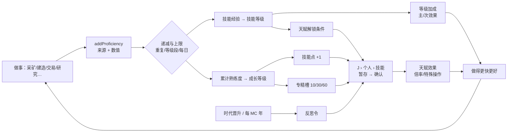

# 05 · 技能成长 Skills（`tcskills`）

> 模组 ID：`tcskills`（源码目录 `tcskills/`，Java 包 `com.nightcity.skills`）
> 依赖：`neoforge`、`minecraft`（必需）；`tcivilization`、`tctechnology`、`tcsettlements`、`tcbeyond` 均为可选（[02 §1.3](02-architecture.md)：本模组可完全独立运行）。
> 相关章节：[00](00-vision-and-pillars.md) DR-19/DR-25/DR-33、[01](01-eras-and-progression.md) 时代、[02](02-architecture.md) 架构、[03 §5.11](03-core-civilization.md) `ProficiencyBridge`、[31 §5.2](31-ui-ux.md) 技能页签规范、[35](35-balance.md) 平衡、[40](40-roadmap.md) 路线图。
> 代码约定：资源标识类为 `net.minecraft.resources.Identifier`（`Identifier.fromNamespaceAndPath(modid, path)`）。
> 本章是 22 个技能 ID、熟练度数值尺度、等级曲线、倍率上限与天赋的**权威来源**；其他章节只登记“行为 → 技能 → 数值 → 冷却/上限”（brief §2.1）。

---

## 1. 定位与设计支柱

### 1.1 定位

技能成长模组记录“玩家亲手做过什么、做得有多熟”，并把熟练转化为**中等幅度**的效率加成、少量特殊操作与专精工艺（DR-25）。按 DR-33，熟练度、技能点、天赋与成长**全部**存放在本模组；文明核心只有无状态转发门面 `ProficiencyBridge`（[03 §5.11](03-core-civilization.md)）。

| 职责 | 内容 | 本章小节 |
| --- | --- | --- |
| 技能注册 | 22 个固定技能 `tcskills:<skill>`，分 5 组 | 5.1 |
| 熟练度获取 | 获取管线、递减规则、每日软上限、防刷 | 5.2、5.3 |
| 等级 | 每技能 0-50 级曲线；非专精上限 40 | 5.4 |
| 成长与技能点 | 成长等级 1-100（全技能累计熟练度驱动），每级 1 技能点 | 5.5 |
| 效果 | 效果类型、等级系数、上限、倍率查询 | 5.6 |
| 天赋 | 22 棵天赋树 × 7 个天赋，数据驱动 | 5.7、6.6 |
| 专精与重置 | 3 个专精槽、反思令（重置天赋） | 5.8、5.9 |
| 多人与 NPC | 同伴带教、协作分配、拜 NPC 为师 | 5.10 |
| 桥接与降级 | 向 `ProficiencyBridge` 注册；原版回退挂钩；独立模式界面 | 5.11、5.12 |
| 界面 | `J` 面板“个人 › 技能”页签、熟练度动态 HUD、成长通知 | 9、10 |
| 运维 | `/tcskills` 命令；旧原型存档迁移 | 5.13、5.14 |

### 1.2 设计支柱

| 编号 | 支柱 | 来源 | 含义 |
| --- | --- | --- | --- |
| SK-1 | 中等影响 | DR-25 | 技能只提供效率、特殊操作与专精工艺。**任何**科技、配方、方块、时代都不以技能等级为硬门槛；全部倍率受 6.4 的上限约束（[35](35-balance.md) 复核） |
| SK-2 | 做什么长什么 | 支柱“可见过程” | 熟练度只来自真实行为；不能用物品、货币或经验瓶直接购买熟练度 |
| SK-3 | 专精而非全能 | — | 技能点总数 100，补满全部 22 棵树需要 286 点；3 个专精槽才能达到 50 级与终局天赋 |
| SK-4 | 文明而非生存 | DR-19、DA-12 | 不提供任何个人生存效果（生命、饥饿、伤害减免、温度、呼吸、摔落等）；`medicine` 只作用于 NPC 与聚落公共卫生 |
| SK-5 | 独立可用 | 02 §1.3 | 只装本模组时，通过原版回退挂钩（附录 D）与独立界面完整可玩 |
| SK-6 | 唯一数据所有者 | DR-33 | 所有熟练度状态只存在 `tcskills` 存档；其他模组只调用 API，不缓存等级到自己的存档 |
| SK-7 | 数字透明 | 31 §5.2 | 所有加成显示为具体数字（如“采伐速度 +8%”），不使用“略微提高”之类的模糊描述 |

### 1.3 非目标

1. 不做属性点（力量、敏捷、体质）系统，不修改玩家生命值、护甲、移动速度、饱食度。
2. 不做技能书/经验瓶式的熟练度购买；Discovery 的书籍只给“学习”类熟练度（写作、阅读行为本身）。
3. NPC 不获得玩家技能经验；NPC 职业熟练由 Settlements 的 `craftLevel` 管理（[15](15-settlements.md)）。
4. 不做 PvP 相关的成长；击杀玩家不给任何熟练度（DR-02 合作）。

---

## 2. 独立玩法（只安装本模组与必需核心时）

本模组没有必需的 `tc*` 依赖，因此“独立”分两档：

| 档位 | 安装组合 | 能力 |
| --- | --- | --- |
| S0 纯独立 | `tcskills` + 原版 | 21 个技能（`arcana` 隐藏）、原版回退挂钩（附录 D 全部启用）、天赋无时代门槛、反思令按 MC 年发放、独立技能界面 `tcskills:standalone_screen`、独立 HUD 层 |
| S1 核心 | + `tcivilization`（可再加 `tctechnology`） | 改用 `J` 面板页签 `tcskills:skills`、核心 HUD 控件 `tcskills:proficiency_feed`、`TcNotifications` 成长通知、人物检视“技能与师承”分节、`ProficiencyBridge` 汇入核心自身挂钩；有 `tctechnology` 时天赋时代门槛与“时代晋升 → 反思令”生效 |

### 2.1 S0 体验

1. 进入世界即拥有全部 21 个技能，均为 0 级；成长等级 1，技能点 1。
2. 挖矿、砍树、耕种、繁殖、烹饪、合成、附魔、交易、绘制地图、鞘翅飞行等原版行为通过附录 D 的回退挂钩获得熟练度。右侧中部出现“+3 采矿”之类的淡出提示（`tcskills:proficiency_feed` 的独立版本）。
3. 技能升级时出现原版样式 toast：“采矿 升到 5 级 · 可学习天赋「矿脉直觉」”。首次出现时附带提示：可在 选项 › 控制 › 文明与科技 为“技能”绑定按键（默认未绑定）。
4. 打开技能界面的方式：
   - `key.tcskills.skills`：S0 下默认绑定 `J`（核心不存在时 `J` 空闲；与 Echoes 只在 Discovery 缺失时注册 `Y` 的规则同理）；S1 下默认不绑定。
   - 命令 `/tcskills open`（客户端命令，任何权限）。
   - 原版暂停菜单不插入按钮（避免与其他模组冲突）。
5. 独立界面与 S1 页签使用**同一个页面类** `SkillsPage`，只是外层容器不同（10.5），保证两档体验一致。

### 2.2 S0 降级清单

| 功能 | S0 行为 |
| --- | --- |
| 时代门槛 | 关闭（`talent.era_gate` 无效） |
| 反思令 | 每 48 MC 日（1 MC 年，世界日数 `dayTime / 24000`）+1，持有上限 3 |
| 通知 | 直接使用原版 `ToastManager` 与自绘 `SkillToast`；合并规则同 10.6 |
| HUD | 把 `tcskills:proficiency_feed` 以同一 ID 注册为 NeoForge GUI 层（原版 `CHAT` 之下），只绘制熟练度动态 |
| 拜师 | 不可用（需要 `tcsettlements` 的职业 NPC） |
| 名册 | 可用（同一服务器玩家） |
| `arcana` | 隐藏，`addProficiency` 对其调用被丢弃（开发环境警告） |

### 2.3 S1 额外能力

| 来源 | 能力 |
| --- | --- |
| `tcivilization` | `ProficiencyBridge` sink；核心自身挂钩（首访地区 `exploration`、轮盘指令 `leadership`、NPC 对话 `diplomacy`、编年功绩 `leadership`，[03 附录 D](03-core-civilization.md)）；页签、HUD 控件、通知类别 `tcskills:growth`、人物检视分节、`Z` 指令轮盘“个人”项、`TrackerApi` 技能目标追踪 |
| `tctechnology` | 天赋时代门槛（5.7.3）；`EraAdvancedEvent` → 每位在线及离线成员 +1 反思令；`scholarship` 通过研究挂钩获得（[04](04-core-technology.md)） |

---

## 3. 联动玩法

所有模组通过 `SkillsApi.addProficiency(...)`（软依赖）或核心 `ProficiencyBridge.add(...)` 给予熟练度；数值与冷却登记在各自章节第 15 节与附录 D。下表只列出本模组提供或读取的能力。

| 对方模组 | 对方 → 本模组 | 本模组 → 对方 |
| --- | --- | --- |
| `tcivilization` | 门面转发；页签、HUD、通知、人物分节、轮盘、追踪器外壳 | 注册 sink；`tcskills:skills` 页签与总览卡“成长”；人物检视“技能与师承”分节 |
| `tctechnology` | `EraAdvancedEvent`、当前时代；研究完成 → `scholarship` | 天赋时代门槛读取时代；不影响科技研究门槛（SK-1） |
| `tcwildlands` | 勘探、敲击识别、群系发现 → `mining`/`surveying`/`exploration`；装上后接管原版矿石/群系回退挂钩 | 提供 `surveying` 倍率（`precision/survey`、`range/survey`）与 `prospect` op 用于敲击识别成功率与矿化提示半径（[10 §5.10.5](10-wildlands.md)）；`exploration` 等级决定地理描述详细度 |
| `tcecology` | 追踪、狩猎、采集、林业 → `hunting`/`foraging`/`woodcutting` | `hunting` 等级：追踪半径、逃跑距离 −3%/10 级（≤ −30%）、陷阱成功率；`foraging` 野生植物掉落 +5%/10 级；`woodcutting` ≥ 30 识别矮林萌桩（[11](11-ecology.md)） |
| `tccultivation` | 耕作、育种、灌溉、畜牧、食品加工 → `farming`/`husbandry`/`cooking` | 接管原版作物/繁殖/熔炉食物回退挂钩；读取 `yield/crop`、`speed/breeding`、`quality/food` |
| `tcindustry` | 手作工序、冶炼、锻造、机器装配与维修 → `crafting`/`smithing`/`engineering` | 手工工序速度、品级判定、维修效率、故障诊断信息深度（[13 §3.3](13-industry.md)） |
| `tcnetworks` | 驾驶、调度、施工、测量、飞行 → `logistics`/`engineering`/`construction`/`surveying`/`aeronautics` | 玩家驾驶 `crewFactor` 由 `logistics`/`aeronautics` 等级决定（[14](14-networks.md)） |
| `tcsettlements` | 建造、指挥、救治 → `construction`/`leadership`/`medicine`；职业 NPC 的 `craftLevel` | `leadership` 等级使居民执行玩家指令效率 +0.5%/级（≤ +25%）；拜师（5.10.3）；职业 `skill` 字段只用于显示与师承匹配，NPC 不获得玩家经验 |
| `tcexchange` | 交易、议价、商队 → `trade`/`logistics` | `price` 效果（≤ ±15%）、商队容量 |
| `tcdiscovery` | 实验、观察、写作 → `scholarship`/`surveying`/`medicine` | `precision/experiment`；“学者之眼”天赋使观察进度 +15%（需 Discovery） |
| `tcechoes` | 遗迹解读、传说线索 → `exploration`/`scholarship` | `yield/loot`、`range/reveal` |
| `tccommons` | 治理、投票、公共工程 → `leadership`/`diplomacy`/`construction` | `influence/morale`、`capacity/command` |
| `tcfrontiers` | 远征、防御战、侦察、补给 → `combat`/`exploration`/`leadership`/`logistics`/`surveying`/`medicine` | `combat` 影响命中散布、装填速度；`exploration` 远征行进与发现；`leadership` 队伍士气；`logistics` 补给损耗；`surveying` 侦察精度；`medicine` 重伤 NPC 救治（[20](20-frontiers.md)） |
| `tcbeyond` | 异界行为 → `arcana`；装上后 `arcana` 可见 | `arcana` 天赋树（5.7、6.6） |
| `tcatlas` | 测绘、地图绘制 → `surveying`/`exploration`；HUD 布局编辑器托管 `proficiency_feed` | 仪器误差 `ε × (1 − 0.01 × min(L, 30))`；记忆半衰期 `× (1 + 0.02 × min(L, 25))`（[22](22-atlas.md)） |
| `tcnations` | 谈判、条约、战争、朝贡 → `diplomacy`/`combat`/`leadership`/`trade` | `influence/relation`、`speed/negotiation` |
| `tcorbit` | 发射、轨道任务、航天器装配 → `aeronautics`/`engineering`/`scholarship` | `precision/flight/launch`、`cost/propellant` |

**直接读等级的约定**：Atlas、Ecology、Settlements 等模组按自己的公式读取 `SkillsApi.getLevel(...)`。这是允许的，但每个公式必须在其章节写明，且单项加成不得超过 6.4 中同类效果的上限；推荐优先使用 `SkillsApi.getMultiplier(...)`，这样天赋与上限由本模组统一处理。

---

## 4. 核心玩法循环



| 节奏 | 时间尺度 | 玩家感受 |
| --- | --- | --- |
| 微循环 | 秒 | 每个动作出现“+2 采矿”淡出数字 |
| 短循环 | 10-30 分钟 | 某技能升级；成长等级 +1 → 获得 1 技能点 |
| 中循环 | 数小时 | 学习一个天赋，工作方式改变（例如矿脉直觉高亮同类矿石） |
| 长循环 | 时代 | 选择专精、拿到第 5 层天赋；时代晋升带来反思令，可重新规划 |
| 终局 | E8 以后 | 专精技能 45 级 → 终局天赋，成为文明中某一行的“大师” |

---

## 5. 系统规则与公式

### 5.1 技能注册

22 个技能在代码中固定注册（不可由数据包增删），ID 为 `tcskills:<skill>`，语言键 `skill.tcskills.<skill>` 与 `skill.tcskills.<skill>.desc`。每个技能有一个**主效果**与一个**次效果**，等级加成只作用于这两项（5.6.2）。

| # | 技能 ID | 中文 | 组 | 主效果 | 次效果 | 主要时代 | 原版回退来源（附录 D） |
| --- | --- | --- | --- | --- | --- | --- | --- |
| 1 | `foraging` | 采集 | 采集 GATHERING | `yield/forage` | `speed/forage` | E0-E2 | 浆果、甜浆果丛、可可、蘑菇、甘蔗 |
| 2 | `hunting` | 狩猎 | 采集 | `yield/animal_drop` | `precision/tracking` | E0-E3 | 击杀被动/中立动物、钓鱼 |
| 3 | `woodcutting` | 伐木 | 采集 | `speed/axe` | `yield/log` | E0-E6 | 破坏自然原木 |
| 4 | `mining` | 采矿 | 采集 | `speed/pickaxe` | `wear/pickaxe` | E0-E10 | 破坏自然矿石 |
| 5 | `farming` | 农耕 | 生养 PROVISION | `yield/crop` | `speed/crop` | E1-E9 | 收获成熟作物 |
| 6 | `husbandry` | 畜牧 | 生养 | `yield/animal_product` | `speed/breeding` | E1-E8 | 繁殖、剪毛、挤奶 |
| 7 | `cooking` | 烹饪 | 生养 | `quality/food` | `cost/fuel` | E0-E7 | 取出熔炉/烟熏炉/营火食物 |
| 8 | `medicine` | 医学 | 生养 | `precision/treatment` | `speed/treatment` | E1-E10 | 治愈僵尸村民、取出酿造的药水（等级效果只作用于 NPC，DR-19） |
| 9 | `crafting` | 手工 | 制造 MAKING | `speed/handcraft` | `cost/handcraft` | E0-E5 | 工作台合成（非可逆配方） |
| 10 | `smithing` | 冶金 | 制造 | `quality/metal` | `cost/fuel` | E2-E8 | 取出熔炉/高炉金属、锻造台 |
| 11 | `engineering` | 工程 | 制造 | `wear/machine` | `speed/assembly` | E4-E10 | 放置红石机械元件 |
| 12 | `construction` | 建造 | 制造 | `speed/build` | `cost/build` | E0-E10 | 放置建筑方块（每 20 块） |
| 13 | `logistics` | 物流 | 社会 SOCIETY | `capacity/cargo` | `speed/vehicle` | E1-E10 | 船、矿车、骑马行驶距离 |
| 14 | `trade` | 贸易 | 社会 | `price/trade` | `capacity/caravan` | E1-E10 | 与流浪商人/村民交易 |
| 15 | `diplomacy` | 外交 | 社会 | `influence/relation` | `speed/negotiation` | E1-E10 | 首次与某个流浪商人交易、治愈后首次交易 |
| 16 | `leadership` | 领导 | 社会 | `capacity/command` | `influence/morale` | E1-E10 | 袭击胜利、铁傀儡建造 |
| 17 | `combat` | 战斗 | 社会 | `wear/weapon` | `precision/aim` | E0-E10 | 击杀敌对生物 |
| 18 | `scholarship` | 学术 | 求索 INQUIRY | `speed/research` | `precision/experiment` | E2-E10 | 附魔、书与笔署名 |
| 19 | `surveying` | 测绘 | 求索 | `precision/survey` | `range/survey` | E3-E10 | 填充地图 |
| 20 | `exploration` | 探险 | 求索 | `range/reveal` | `yield/loot` | E0-E10 | 首次进入群系、结构 |
| 21 | `aeronautics` | 航空航天 | 求索 | `cost/propellant` | `precision/flight` | E8-E10 | 鞘翅飞行距离 |
| 22 | `arcana` | 异术 | 求索 | `precision/ritual` | `cost/anomaly` | 仅 Beyond | 无（只由 Beyond 给予） |

界面显示顺序按上表编号。`arcana` 只在 `tcbeyond` 已加载时显示与接受熟练度。

### 5.2 熟练度获取管线

熟练度数值尺度（brief §2.1，每次调用的 `amount`）：琐碎动作 1；常规动作 2-5；有意义的成果 10-25；重大成就 50-150；时代级里程碑 200-500。

```text
输入：玩家 P、技能 S、数值 a（整数）、来源 src（Identifier）、标志 F ⊆ {MILESTONE, COLLABORATIVE, PASSIVE, ADMIN}

0. 校验：S ∉ 22 技能 → 丢弃（开发环境抛 IllegalArgumentException）；S = arcana 且未加载 tcbeyond → 丢弃
   a 截断到 [1, 500]（超出时记录一次警告）
1. 排除：P 为 FakePlayer（机器人、自动化）、旁观模式；创造模式且 creative_gain = false → 丢弃
2. 事件：ProficiencyGainEvent.Pre(P, S, a, src, F)，可取消或修改 a
3. base = a × global_rate
4. 若 MILESTONE ∉ F 且 ADMIN ∉ F：base ×= m_repeat(P, S, src) × m_band(a, L_S)
5. base ×= m_specialty(P, S) × m_teach(P, S) × m_learning(P, S)
6. 若 MILESTONE ∉ F 且 ADMIN ∉ F：base = dailySoftCap(P, S, base)
7. frac_S += base；gain = ⌊frac_S⌋；frac_S −= gain               // 小数累积，避免 1 点动作被吞
8. xp_S = min(xp_S + gain, cumulative(50))                       // 等级上限见 5.4
9. total += gain → 成长等级（5.5）
10. 若等级变化：SkillLevelUpEvent；排队客户端增量（每 10 tick 合批发送 proficiency_delta）
11. ProficiencyGainEvent.Post(P, S, gain, src)
```

| 乘数 | 定义 | 范围 |
| --- | --- | --- |
| `global_rate` | 服务器配置 `gain.global_rate` | 0.1-10.0，默认 1.0 |
| `m_repeat` | 5.3.1 重复递减 | 0.1-1.0 |
| `m_band` | 5.3.2 等级段递减 | 0.25-1.0 |
| `m_specialty` | 专精技能 1.25，否则 1.0（5.8） | 1.0 / 1.25 |
| `m_teach` | max(同伴带教，拜师)，二者不叠加（5.10）；带教 1.2（导师有 `leadership/mentor` 天赋时 1.3），拜师 1.2 | 1.0-1.3 |
| `m_learning` | 天赋 `learning/<skill>` 修正之和，上限 1.5（6.4） | 1.0-1.5 |

`COLLABORATIVE` 只影响分配（5.10.2），`PASSIVE` 表示非玩家主动操作（例如 Industry 机器在玩家在场时运转），`PASSIVE` 来源的 `m_repeat` 半衰期加倍。

### 5.3 递减与防刷

#### 5.3.1 重复递减

每个 `(玩家, 技能, 来源)` 维护一个衰减累计值 `recent`，半衰期 6,000 tick（5 分钟）：

```text
recent ← recent × 0.5^(Δt / 6000) + a                    // Δt = 距上次同来源调用的 tick 数
m_repeat = max(0.1, 1 / (1 + max(0, recent − 60) / 120))
```

| `recent` | ≤ 60 | 120 | 180 | 300 | 540 | ≥ 1,140 |
| --- | --- | --- | --- | --- | --- | --- |
| `m_repeat` | 1.00 | 0.67 | 0.50 | 0.33 | 0.20 | 0.10 |

每位玩家最多跟踪 64 个来源（LRU），被淘汰的来源视为 `recent = 0`。来源应细到“同一种行为对象”，例如 `minecraft:iron_ore`、`tcwildlands:rock_tap`，而不是整个模组。

#### 5.3.2 等级段递减

琐碎与常规动作对高等级玩家的价值下降，重大成就不受影响：

```text
m_band(a, L) =
    a ≤ 5        : clamp(1 − (L − 10) / 60,  0.25, 1)
    6 ≤ a ≤ 49   : clamp(1 − (L − 25) / 100, 0.50, 1)
    a ≥ 50       : 1
```

| 当前等级 L | 0-10 | 20 | 25 | 30 | 40 | 45 | 50 |
| --- | --- | --- | --- | --- | --- | --- | --- |
| a ≤ 5 | 1.00 | 0.83 | 0.75 | 0.67 | 0.50 | 0.42 | 0.33 |
| 6-49 | 1.00 | 1.00 | 1.00 | 0.95 | 0.85 | 0.80 | 0.75 |
| ≥ 50 | 1.00 | 1.00 | 1.00 | 1.00 | 1.00 | 1.00 | 1.00 |

#### 5.3.3 每日软上限

每个技能每 MC 日（24,000 tick，以世界日序号 `dayTime / 24000` 为界）有软上限，超出部分 ×0.25：

```text
dailyCap(L) = 600 + 40 × L
dailySoftCap(P, S, x) = 在 today_S < dailyCap 内的部分 ×1；超出部分 ×0.25
today_S += 处理前的 x（计入的是软上限前的数值）
```

| L | 0 | 10 | 20 | 30 | 40 | 50 |
| --- | --- | --- | --- | --- | --- | --- |
| 每日上限 | 600 | 1,000 | 1,400 | 1,800 | 2,200 | 2,600 |
| 当级升级所需 | 15 | 545 | 1,445 | 2,590 | 3,940 | — |

`MILESTONE` 标志（里程碑、时代级事件、编年功绩）不计入也不受此上限。

#### 5.3.4 防刷规则

| 漏洞 | 规则 |
| --- | --- |
| 放置后再破坏 | 区块附件 `tcskills:placed` 记录玩家放置的方块位置（每区块最多 4,096 个，超出时淘汰最旧）；破坏这些位置不给 `mining`/`woodcutting`/`foraging`。Wildlands/Ecology 装载时由它们的挂钩自行判断 |
| 可逆合成 | 存在一步逆向配方（9 锭 ↔ 1 块、木板 ↔ 台阶不算）的配方，以及标签 `tcskills:no_proficiency` 中的配方不给 `crafting` |
| 刷怪笼 | 生成原因 `SPAWNER`/`TRIAL_SPAWNER` 的生物 `combat`/`hunting` ×0.25 |
| 自动化 | `FakePlayer` 永不获得熟练度（机器人、放置器、Create 类模组的机械手） |
| 挂机 | `PASSIVE` 来源要求玩家 120 秒内有过输入（服务器以移动/交互包判断），否则丢弃 |
| 交易刷新 | 同一商人同一交易项是同一来源，受 5.3.1 递减 |
| 指令 | `/tcskills train` 只对 OP 可用，带 `ADMIN` 标志，并写入日志 |

### 5.4 技能等级

```text
xpToNext(L)  = round5(15 × (L + 1)^1.5)          // 从 L 级升到 L+1 级所需，L = 0..49；round5 = 四舍五入到 5 的倍数
cumulative(L) = Σ_{i=0}^{L−1} xpToNext(i)          // 达到 L 级的累计经验
cap(P, S)    = 50（S 为专精）| 40（非专精）
level(P, S)  = max{ L ≤ cap : cumulative(L) ≤ xp_S }
reserve(P,S) = xp_S − cumulative(cap)              // 非专精到 40 级后继续累积的“储备”，上限为 cumulative(50)
```

1. 非专精技能到 40 级后熟练度仍然入账（继续受递减与日上限），界面显示“储备 12,340 / 46,120”。选为专精时储备立即转化为等级。
2. 取消专精时等级回落到 40，经验不丢失；41 级以上才能解锁的天赋**保留但失效**（界面显示为“休眠”），重新专精后自动恢复。
3. 等级不会因任何原因下降（死亡、离线、重置天赋都不扣经验）。

完整等级表见 6.1。

### 5.5 成长等级与技能点

成长等级 G（1-100）由全部技能**实际入账**的熟练度总和 `total` 驱动，与单个技能等级无关：

```text
growthCost(G)        = 500 + 100 × (G − 1)                 // 从 G−1 升到 G，G = 2..100
cumulativeGrowth(G)  = 50 × (G − 1) × (G + 10)             // 达到 G 的累计熟练度；G = 100 时为 544,500
skillPointsEarned(G) = G                                    // 初始 1 点，每升 1 级 +1，总计 100 点
skillPointsFree      = skillPointsEarned − Σ 已学天赋花费
```

| 成长等级 | 奖励 | 称号（名册显示） |
| --- | --- | --- |
| 1 | 1 技能点 | 学徒 Apprentice |
| 10 | 专精槽 1 | 熟手 Journeyman |
| 25 | — | 工匠 Artisan |
| 30 | 专精槽 2 | — |
| 50 | — | 名匠 Expert |
| 60 | 专精槽 3 | — |
| 75 | — | 大匠 Master |
| 100 | — | 宗师 Grandmaster |

成长等级与称号只用于展示、专精槽与技能点，不给任何直接加成。完整成长表见 6.2。

### 5.6 效果类型与乘数

#### 5.6.1 效果 ID

效果是带层级的 Identifier：`tcskills:<category>/<sub>/<sub>…`，共 11 个类别：

| 类别 | 含义 | 方向 | 典型消费者 |
| --- | --- | --- | --- |
| `speed` | 动作/工序耗时缩短（返回值作除数） | 正 | Industry 手工、Settlements 蓝图施工、Technology 研究 |
| `yield` | 产出数量或额外掉落概率 | 正 | Cultivation、Ecology、Wildlands |
| `cost` | 材料/燃料/推进剂消耗 | 负 | Industry、Orbit |
| `wear` | 工具/机器/武器耐久消耗 | 负 | 原版耐久、Industry 机器磨损 |
| `quality` | 品质评分或品质档概率 | 正 | Industry 品质、Cultivation 食物 |
| `precision` | 误差、散布、成功率 | 正 | Atlas 测量误差、Frontiers 散布、Discovery 实验 |
| `range` | 揭示/探测/追踪半径 | 正 | Atlas、Ecology |
| `price` | 卖出价 ×m，买入价 ÷m | 正 | Exchange、原版交易 |
| `influence` | 关系、士气、文化影响 | 正 | Nations、Commons、Settlements |
| `capacity` | 载重、指挥人数、商队规模 | 正 | Networks、Settlements、Frontiers |
| `learning` | 熟练度获取（`m_learning`，只由天赋提供） | 正 | tcskills 自身 |

另有能力开关 `tcskills:op/<name>`（简称 op）：天赋给予的特殊操作，由所属模组用 `SkillsApi.hasOp(player, op)` 查询，可带一个数值参数 `opValue`。op 不参与乘数计算。

路径匹配：`e1 ⊑ e2` 当且仅当 e2 的路径等于 e1，或以 `e1 + "/"` 开头。例如查询 `tcskills:speed/pickaxe/ore` 时，`speed/pickaxe` 与 `speed/pickaxe/ore` 的加成都计入，`speed/pickaxe/deep` 不计入。

#### 5.6.2 乘数公式

```text
multiplier(P, S, e):
    if tcskills 未加载                → 1.0            // 由核心 ProficiencyBridge 返回
    L   = level(P, S)
    c   = coef(category(e), S)        // 6.3；未覆写时用 6.4 的类别默认值
    lv  = c × L         若 primary(S) ⊑ e
        = c × L / 2     若 secondary(S) ⊑ e（且主效果不匹配）
        = 0             否则
    tal = Σ { m.amount | t ∈ activeTalents(P, S), m ∈ t.effectiveModifiers, m.effect ⊑ e }
    b   = min(cap(category(e)), lv + tal)          // 6.4，b ≥ 0
    return 1 + b   （正向类别）
           1 − b   （cost、wear）
```

1. 只计算**被查询技能**自己的等级与天赋；跨技能叠加不存在（例如查询 `mining` 时不计 `engineering` 的天赋）。
2. `activeTalents` 不含“休眠”天赋（5.8）与时代门槛未满足的天赋（5.7.3）。
3. `effectiveModifiers`：所需模组存在时是 `modifiers`，否则是 `fallback.modifiers`（5.7.4）。
4. 消费者模组只调用一次 `multiplier()`，不得自行再乘等级系数；读取等级自行计算的模组（Atlas、Ecology、Settlements，见 §3）的结果不得超过同类别上限。
5. 查询结果缓存于玩家档案，失效条件为等级、天赋、专精或已加载模组变化；单次查询为 O(1) 的哈希命中（§14）。

### 5.7 天赋

#### 5.7.1 树结构

每个技能一棵 7 节点的天赋树，共 22 × 7 = 154 个天赋。ID 为 `tcskills:<skill>/<talent>`，语言键 `talent.tcskills.<skill>.<talent>`（+ `.desc`）。

```text
T1 ── T2 ──┬── T3a ──┬── T4 ── T5 ── C（终局，需专精）
           └── T3b ──┘
```

| 槽 | 技能等级 | 点数 | 默认时代门槛 | 前置 | 开发阶段（40 章） |
| --- | --- | --- | --- | --- | --- |
| T1 | 5 | 1 | E0 | — | P2 |
| T2 | 12 | 1 | E1 | T1 | P3 |
| T3a / T3b | 20 | 2 | E2 | T2；二者互斥 | P4 |
| T4 | 28 | 2 | E4 | T3a 或 T3b | P5 |
| T5 | 36 | 3 | E6 | T4 | P6 |
| C | 45 | 4 | E8 | T5，且该技能为专精 | P7 |

一棵树学满花 1 + 1 + 2 + 2 + 3 + 4 = 13 点；全部 22 棵需 286 点，而一名玩家一生最多 100 点，因此最多学满 7 棵树或广泛学习浅层天赋（SK-3）。

#### 5.7.2 数据格式

天赋定义放在数据包 `data/<ns>/tc_talent/<skill>/<talent>.json`，tcskills 自带全部 154 个。数据包可覆写数值，但**不能新增槽位或技能**；新增 ID 会因槽位冲突而被拒绝加载。

```json
{
  "skill": "tcskills:mining",
  "slot": "t3b",
  "cost": 2,
  "level": 20,
  "era_gate": "tcivilization:e2",
  "exclusive_with": "tcskills:mining/prospector",
  "modifiers": [],
  "ops": [ { "op": "tcskills:op/mine_crew", "value": 0.10 } ],
  "requires_mod": "tcsettlements",
  "fallback": { "modifiers": [ { "effect": "tcskills:speed/pickaxe", "amount": 0.05 } ], "ops": [] },
  "icon": "tcskills:talent/mining/shaft_foreman"
}
```

加载校验（失败则拒绝该文件并记录错误）：`skill` 必须是 22 个技能之一；`slot` ∈ {t1, t2, t3a, t3b, t4, t5, c}，且每技能每槽恰好 1 个；`cost`、`level` 与 5.7.1 一致（数据包只能改 `modifiers`、`ops` 数值与 `era_gate`）；`amount` 在 (0, 0.25]；除 `arcana` 外，有 `requires_mod` 的天赋必须带非空 `fallback`；同一树主效果的天赋加成之和超过“上限 − 50 级等级加成”（6.4 “天赋余量”）时发出警告。

#### 5.7.3 时代门槛

`era_gate` 只在 `tctechnology` 已加载且服务器配置 `talent.era_gate = true` 时生效：要求玩家所属文明的当前时代 ≥ `era_gate`（读核心 `CivApi.era(civ)`）。未满足时天赋显示为锁定，并注明“需要进入 E4 中世纪”。已学天赋若因配置变化而不满足门槛，则变为休眠，不退点。单人或独立模式（S0、无 Technology）不检查时代门槛。

各树的覆写见 6.6（例如 `aeronautics` 的 T3-C 推迟到 E7-E10，T1 保持 E0 以覆盖原版鞘翅）。

#### 5.7.4 依赖模组与回退

天赋的 `requires_mod` 不存在时：

1. 天赋照常可学，卡片在效果行下方显示“回退：…（需要 文明聚落 才有完整效果）”。
2. 生效的是 `fallback.modifiers` / `fallback.ops`；回退必须由 tcskills 自身或原版机制实现（§16）。
3. 之后安装该模组时自动切换为完整效果，不退点；卸载时反向切换。

#### 5.7.5 暂存与确认

界面中点击可学的天赋只是**暂存**（虚线边框，见 §10）；技能点预览会扣除暂存花费。按“确认”时客户端发送 `tcskills:talent_commit`（有序 ID 列表），服务器原子校验：等级、点数、前置、互斥、时代门槛、专精要求全部满足才整体写入，否则整体拒绝并返回第一条失败原因。关闭界面时若有未确认暂存，弹出 `TcConfirmDialog`：“放弃 3 个暂存天赋？”。已学天赋只能通过重修（5.9）移除。

### 5.8 专精

| 项 | 规则 |
| --- | --- |
| 槽位 | 成长等级 10 / 30 / 60 各开放 1 个，共 3 个 |
| 效果 | 熟练度获取 ×1.25；等级上限 40 → 50（储备经验立即转化）；可学终局天赋 C |
| 选择 | 首次填入空槽免费，不受冷却 |
| 更换 | 每个槽每 MC 年（48 MC 日）可更换一次；冷却按槽计；换出的技能等级回落到 40，经验保留为储备，C 天赋变为休眠（不退点） |
| 限制 | `arcana` 只有在 `tcbeyond` 加载时可选；同一技能不能占两个槽 |
| 展示 | 名册与人物界面显示专精图标；称号后缀，例如“大匠 · 冶金” |

### 5.9 重修与反思令

天赋点的重新分配用**反思令**（Reflection Token）支付。

| 项 | 规则 |
| --- | --- |
| 获得（S1 + Technology） | 文明每进入一个新时代（核心 `EraAdvancedEvent`），文明内每位成员 +1 |
| 获得（其他情况） | 每 48 MC 日 +1（从玩家首次加入世界计时） |
| 上限 | 3（`respec.max_tokens`，1-10） |
| 单树重修 | 1 枚：移除该技能全部天赋，退还全部点数 |
| 全部重修 | 2 枚：移除全部天赋，退还全部点数；专精不变 |
| 新手免费 | 成长等级 < 10 时重修免费且不消耗令 |
| 不受影响 | 熟练度、技能等级、成长等级、专精 |
| 确认 | `TcConfirmDialog` 列出将移除的天赋与退还点数；服务器收到 `tcskills:respec_request` 后再次校验 |
| 管理员 | `/tcskills respec <player> [skill]` 免费，带审计日志 |

反思令在新时代到来时发放，让玩家能把点数转向新时代的玩法（例如进入 E6 后从手工转向工程），这是本模组与时代进程的主要耦合点。

### 5.10 多人与 NPC

#### 5.10.1 同伴带教

```text
eligibleMentor(M, P, S) =
    M ≠ P 且 M 在线、同一维度、距离 ≤ R（32 格；M 有 leadership/mentor 天赋时 48 格）
    且 同一文明（S1）或 同一原版计分板队伍（S0；无队伍时取 mentor.s0_any_player，默认 false）
    且 level(M, S) ≥ max(20, level(P, S) + 10)
m_mentor = 1.2（最佳导师有 leadership/mentor 时 1.3）
```

1. 每次获取时自动选取 `level(M, S)` 最高的合格导师；不需要双方操作。熟练度动态显示“受 张三 带教 ×1.2”。
2. 导师回报：学习者在带教下每实际入账 25 点，导师获得 `leadership` +1（来源 `tcskills:mentoring`，每 MC 日上限 40，受日上限与递减）。
3. 带教乘数与拜师乘数取较大者，不叠加（5.2 的 `m_teach`）。
4. 每 20 tick 重算一次每位玩家的导师缓存（只扫描同维度、同文明在线玩家，≤ 64 人）。

#### 5.10.2 协作分配

调用方以 `COLLABORATIVE` 标志调用 `SkillsApi.addCollaborative(shares, skill, amount, source)`，`shares` 为参与者 → 贡献比例（总和 1.0）：

```text
对每个参与者 p（按贡献排序取前 8 名）：
    a_p = amount                                   若 share_p ≥ 0.10
        = amount × share_p / 0.10                  若 share_p < 0.10
    然后 a_p 走 5.2 管线（各自的递减、专精、日上限）
```

例：4 名玩家共同完成 Settlements 的纪念建筑（`construction` 120，MILESTONE），每人贡献 ≥ 10%，各得 120。用例：共同研究（Technology）、共同建造（Settlements）、远征队（Frontiers）、商队（Exchange）。

#### 5.10.3 NPC 拜师

需要 `tcsettlements`。职业 NPC（`tcivilization:person` + Settlements 职业组件）的职业 `skill` 字段与 `craftLevel`（0-5，15 章）决定其能否收徒：

| NPC `craftLevel` | 3 | 4 | 5 |
| --- | --- | --- | --- |
| 可教到的玩家等级上限 `5 × craftLevel + 5` | 20 | 25 | 30 |

1. 入口：人物检视“技能与师承”分节的“拜师”按钮，或对该 NPC 打开 Z 指令轮盘选“拜师”。条件：同一文明、`craftLevel ≥ 3`、玩家该技能等级 < 上限。
2. 效果：玩家在师父 32 格内获取该技能熟练度时 `m_master = 1.2`。
3. 同时只能拜一位师父；更换师父无代价，但有 1 MC 日冷却。
4. 出师：玩家等级达到上限时自动结束，发成功级通知“出师：随 王铁匠 学成冶金”，并写入核心文明记忆（重要度 2，类型 `tcskills:apprenticeship`）。
5. NPC 不从玩家处获得任何经验或等级（DR-33、15 章）；玩家等级也不影响 NPC 的 `craftLevel`。

#### 5.10.4 名册

技能页签内的子视图“名册”（不是独立页签）：列出同一文明的全部玩家成员（S0 为同服务器全部玩家），显示头像、成长等级、称号、专精、最高 3 个技能；可按任一技能排序（“谁的冶金最高”）。安装 Settlements 时追加“可拜师的师傅”分区：按技能列出 `craftLevel ≥ 3` 的 NPC 与其所在聚落。数据经 `tcskills:roster_request` / `roster_snapshot` 按需获取，不同文明之间不可见。

### 5.11 与核心的桥接

```text
FMLCommonSetupEvent（tcskills）:
    if ModList.isLoaded("tcivilization"):
        ProficiencyBridge.registerSink(SkillsSink.INSTANCE)       // 03 §5.11
        RegisterCivTabsEvent            → tcskills:skills（PERSONAL，order 50）
        RegisterHudWidgetsEvent         → tcskills:proficiency_feed
        PersonSectionRegistry           → tcskills:skills_and_mentors（“技能与师承”）
        CommandWheelRegistry            → 个人入口与“拜师”上下文指令
        TcNotifications.registerCategory(tcskills:growth, …, SUCCESS)
        订阅 EraAdvancedEvent（tctechnology 存在时）→ 反思令
```

1. 主题模组一律经核心门面 `ProficiencyBridge.add(...)` / `multiplier(...)` 调用，因此不需要对 tcskills 的编译期依赖；tcskills 缺失时门面返回空操作与 1.0（03 §5.12）。
2. `SkillsSink.add` 直接进入 5.2 管线；`SkillsSink.multiplier` 等价于 `SkillsApi.multiplier`。
3. 只依赖 tcskills（而不依赖核心）的第三方模组可直接调用 `SkillsApi`（§12）。
4. 门面调用必须在服务器主线程；`TC-Sim` 线程上的模拟结果先回到主线程再发放（02 §6）。

### 5.12 原版回退挂钩

附录 D 列出 tcskills 自带的原版行为挂钩，保证 S0 下 21 个技能都有获取途径。两条抑制规则避免与主题模组重复发放：

1. **命名空间规则**：回退挂钩只处理 `minecraft:` 命名空间的方块、物品、实体与配方；TC 模组的内容由该模组自己的附录 D 挂钩发放。
2. **模组接管**：下表“接管”列的模组在启动时调用 `SkillsApi.claimFallback` 声明接管，对应挂钩整体关闭，由该模组覆盖全部原版目标的附录 D 行代替。“重叠”列的模组只覆盖部分原版目标，按 15.2 第 3 条不得声明接管；挂钩保持开启，重叠由同 tick 去重处理（15.2 第 4 条）。

| 回退挂钩（`tcskills:hook/…`） | 接管（`claimFallback`） | 重叠但不接管（去重） |
| --- | --- | --- |
| `mine_ore` → `mining` | `tcwildlands`（10 §15 第 3 条） | `tcindustry` 风镐只修正给予量（13 §15） |
| `fell_log` → `woodcutting`；`forage` → `foraging`；`hunt_animal`、`fish` → `hunting` | — | `tcecology`（11 §15 第 5 条）；`tctechnology` 采集与狩猎挂钩（04 §15） |
| `harvest_crop` → `farming`；`shear`、`milk` → `husbandry`；`cook_food` → `cooking` | `tccultivation`（12 §15.4） | `tctechnology` 燧石镰、篝火坑（04 §15） |
| `breed`、`tame` → `husbandry` | — | `tccultivation` 只覆盖牲畜（12 §15.4）；`tcecology` 驯服猎鹰 |
| `smelt_metal`、`smithing_table` → `smithing`；`redstone_place` → `engineering` | `tcindustry`（13 §15） | — |
| `craft` → `crafting` | — | `tctechnology` 打制与研究（04 §15） |
| `enchant`、`sign_book` → `scholarship` | — | `tcdiscovery`（17 §15） |
| `map_fill` → `surveying`；`first_biome`、`first_structure` → `exploration` | — | `tcatlas`（22 §15 第 5 条）；`tcwildlands` 只对自有群系与结构发放，不重叠 |
| `ride` → `logistics`；`elytra` → `aeronautics` | — | `tcnetworks` 只计自有载具，不重叠（14 §15） |
| `trade` → `trade`；`first_trade` → `diplomacy` | — | `tcexchange`（16 §15）；Settlements 移除村民且 Exchange 以行商代替流浪商人后为 `INERT` |
| `build` → `construction`；`cure_villager` → `medicine` | — | `tcsettlements`（15 §15） |
| `kill_hostile`、`kill_boss` → `combat`；`raid_victory`、`iron_golem` → `leadership`；`brew_potion` → `medicine`；`first_dimension` → `exploration` | — | 不关闭（原版敌对生物、Boss 与酿造在所有组合下都存在；袭击关闭时 `raid_victory` 为 `INERT`） |

服务器配置 `hooks.vanilla_fallback`（默认 true）可整体关闭，`hooks.disabled` 可按挂钩 ID 关闭（ID 见附录 D 的“行为”列，格式 `tcskills:hook/<name>`）。

### 5.13 命令

| 命令 | 权限 | 作用 |
| --- | --- | --- |
| `/tcskills status [player]` | 0（查看他人 2） | 成长等级、点数、专精、22 个技能等级与储备 |
| `/tcskills open [skill]` | 0 | 打开技能界面（S1 为 J 面板技能页签，S0 为独立界面） |
| `/tcskills grant <player> <skill> <amount>` | 2 | 发放熟练度（`ADMIN` 标志，跳过递减与日上限，写审计日志）；旧命令 `train` 为其别名 |
| `/tcskills set <player> <skill> <level>` | 2 | 直接设定等级（经验设为该级累计值） |
| `/tcskills talent <player> learn/forget <talent>` | 2 | 学习/移除天赋（`learn` 替代旧命令 `learn`，仍校验前置但不校验点数） |
| `/tcskills respec <player> [skill]` | 2 | 免费重修（5.9） |
| `/tcskills tokens <player> <n>` | 2 | 设定反思令 |
| `/tcskills reset <player>` | 3 | 清空全部熟练度、天赋、专精（需二次输入确认） |
| `/tcskills debug gains <player> [seconds]` | 3 | 在聊天栏实时输出该玩家每次获取的完整乘数分解（5.2 各项） |
| `/tcskills debug hooks` | 3 | 列出各回退挂钩启用/抑制状态与抑制原因 |

### 5.14 原型迁移

现有原型（`com.nightcity.skills`）在首次加载新版本时迁移，存档 `schemaVersion` 1 → 2：

| 原型数据 | 新版处理 |
| --- | --- |
| 技能经验 `xp`（原等级 = xp / 100 + 1） | 熟练度单位不变，`xp_S = xp` 原样保留，按 5.4 曲线重算等级（例：原 xp 2,500 = 原 26 级 → 新 10 级） |
| 原成长点（每级 level × 100） | 丢弃，按 5.5 由 Σxp 重算成长等级与技能点 |
| 天赋 `efficient_learner` | 移除并退还点数 |
| 天赋 `<skill>_specialist` | 若成长等级已开放专精槽，则把该技能设为专精；否则移除并退还 |
| `SkillsApi.getProficiencyMultiplier` (`1 + min(L−1, 20) × 0.05`) | 保留为 `@Deprecated`，内部改为 `multiplier(player, skill, primary(skill))` |
| `SkillsApi` 的 `ServerLevel` + `UUID` 重载 | 保留为 `@Deprecated`，转发到 `ServerPlayer` 版本；离线 UUID 时写入离线待发放队列（11.3），登录时处理（跳过带教判定） |
| 命令 `train` / `learn` | 保留为 `grant` / `talent learn` 的别名，一个大版本后移除 |

迁移后给每位玩家 1 枚额外反思令（不超过上限）并发信息级通知“技能系统已更新，天赋点已退还”。

---

## 6. 数值表

### 6.1 技能等级表

`xpToNext(L) = round5(15 × (L+1)^1.5)`；“累计”为达到该等级所需的总熟练度。非专精上限 40（62,635），专精上限 50（108,755）。

| L | 升到 L+1 | 累计 | L | 升到 L+1 | 累计 | L | 升到 L+1 | 累计 |
| --- | --- | --- | --- | --- | --- | --- | --- | --- |
| 0 | 15 | 0 | 17 | 1,145 | 7,685 | 34 | 3,105 | 41,950 |
| 1 | 40 | 15 | 18 | 1,240 | 8,830 | 35 | 3,240 | 45,055 |
| 2 | 80 | 55 | 19 | 1,340 | 10,070 | 36 | 3,375 | 48,295 |
| 3 | 120 | 135 | 20 | 1,445 | 11,410 | 37 | 3,515 | 51,670 |
| 4 | 170 | 255 | 21 | 1,550 | 12,855 | 38 | 3,655 | 55,185 |
| 5 | 220 | 425 | 22 | 1,655 | 14,405 | 39 | 3,795 | 58,840 |
| 6 | 280 | 645 | 23 | 1,765 | 16,060 | 40 | 3,940 | 62,635 |
| 7 | 340 | 925 | 24 | 1,875 | 17,825 | 41 | 4,085 | 66,575 |
| 8 | 405 | 1,265 | 25 | 1,990 | 19,700 | 42 | 4,230 | 70,660 |
| 9 | 475 | 1,670 | 26 | 2,105 | 21,690 | 43 | 4,380 | 74,890 |
| 10 | 545 | 2,145 | 27 | 2,220 | 23,795 | 44 | 4,530 | 79,270 |
| 11 | 625 | 2,690 | 28 | 2,345 | 26,015 | 45 | 4,680 | 83,800 |
| 12 | 705 | 3,315 | 29 | 2,465 | 28,360 | 46 | 4,835 | 88,480 |
| 13 | 785 | 4,020 | 30 | 2,590 | 30,825 | 47 | 4,990 | 93,315 |
| 14 | 870 | 4,805 | 31 | 2,715 | 33,415 | 48 | 5,145 | 98,305 |
| 15 | 960 | 5,675 | 32 | 2,845 | 36,130 | 49 | 5,305 | 103,450 |
| 16 | 1,050 | 6,635 | 33 | 2,975 | 38,975 | 50 | — | 108,755 |

天赋等级要求对应的累计熟练度：T1（5 级）425；T2（12 级）3,315；T3（20 级）11,410；T4（28 级）26,015；T5（36 级）48,295；C（45 级）83,800。

### 6.2 成长等级表

`growthCost(G) = 500 + 100 × (G − 1)`，`cumulativeGrowth(G) = 50 × (G − 1) × (G + 10)`。

| G | 本级所需 | 累计 | G | 本级所需 | 累计 | G | 本级所需 | 累计 |
| --- | --- | --- | --- | --- | --- | --- | --- | --- |
| 1 | — | 0 | 13 | 1,700 | 13,800 | 45 | 4,900 | 121,000 |
| 2 | 600 | 600 | 14 | 1,800 | 15,600 | 50 | 5,400 | 147,000 |
| 3 | 700 | 1,300 | 15 | 1,900 | 17,500 | 55 | 5,900 | 175,500 |
| 4 | 800 | 2,100 | 16 | 2,000 | 19,500 | 60 | 6,400 | 206,500 |
| 5 | 900 | 3,000 | 17 | 2,100 | 21,600 | 65 | 6,900 | 240,000 |
| 6 | 1,000 | 4,000 | 18 | 2,200 | 23,800 | 70 | 7,400 | 276,000 |
| 7 | 1,100 | 5,100 | 19 | 2,300 | 26,100 | 75 | 7,900 | 314,500 |
| 8 | 1,200 | 6,300 | 20 | 2,400 | 28,500 | 80 | 8,400 | 355,500 |
| 9 | 1,300 | 7,600 | 25 | 2,900 | 42,000 | 85 | 8,900 | 399,000 |
| 10 | 1,400 | 9,000 | 30 | 3,400 | 58,000 | 90 | 9,400 | 445,000 |
| 11 | 1,500 | 10,500 | 35 | 3,900 | 76,500 | 95 | 9,900 | 493,500 |
| 12 | 1,600 | 12,100 | 40 | 4,400 | 97,500 | 100 | 10,400 | 544,500 |

参照：一名玩家把 3 个专精练到 50、另 6 个技能练到 40 时累计约 702,000，已超过 G100；即 100 个技能点足以支撑“3 棵满树 + 若干浅层天赋”的终局配置，而不足以学满全部 286 点。

### 6.3 各技能等级加成（50 级）

系数取 6.4 的类别默认值；主效果按全系数，次效果按半系数。

| 技能 | 主效果 | 40 级 | 50 级 | 次效果 | 40 级 | 50 级 |
| --- | --- | --- | --- | --- | --- | --- |
| foraging | `yield/forage` | +12% | +15% | `speed/forage` | +12% | +15% |
| hunting | `yield/animal_drop` | +12% | +15% | `precision/tracking` | +8% | +10% |
| woodcutting | `speed/axe` | +24% | +30% | `yield/log` | +6% | +7.5% |
| mining | `speed/pickaxe` | +24% | +30% | `wear/pickaxe` | −10% | −12.5% |
| farming | `yield/crop` | +12% | +15% | `speed/crop` | +12% | +15% |
| husbandry | `yield/animal_product` | +12% | +15% | `speed/breeding` | +12% | +15% |
| cooking | `quality/food` | +16% | +20% | `cost/fuel` | −6% | −7.5% |
| medicine | `precision/treatment` | +16% | +20% | `speed/treatment` | +12% | +15% |
| crafting | `speed/handcraft` | +24% | +30% | `cost/handcraft` | −6% | −7.5% |
| smithing | `quality/metal` | +16% | +20% | `cost/fuel` | −6% | −7.5% |
| engineering | `wear/machine` | −20% | −25% | `speed/assembly` | +12% | +15% |
| construction | `speed/build` | +24% | +30% | `cost/build` | −6% | −7.5% |
| logistics | `capacity/cargo` | +24% | +30% | `speed/vehicle` | +12% | +15% |
| trade | `price/trade` | +8% | +10% | `capacity/caravan` | +12% | +15% |
| diplomacy | `influence/relation` | +16% | +20% | `speed/negotiation` | +12% | +15% |
| leadership | `capacity/command` | +24% | +30% | `influence/morale` | +8% | +10% |
| combat | `wear/weapon` | −20% | −25% | `precision/aim` | +8% | +10% |
| scholarship | `speed/research` | +24% | +30% | `precision/experiment` | +8% | +10% |
| surveying | `precision/survey` | +16% | +20% | `range/survey` | +10% | +12.5% |
| exploration | `range/reveal` | +20% | +25% | `yield/loot` | +6% | +7.5% |
| aeronautics | `cost/propellant` | −12% | −15% | `precision/flight` | +8% | +10% |
| arcana | `precision/ritual` | +16% | +20% | `cost/anomaly` | −6% | −7.5% |

### 6.4 效果类别：系数、上限与天赋余量

| 类别 | 主效果系数/级 | 上限（等级 + 天赋） | 50 级主效果 | 天赋余量（主效果） | DR-25 档位 |
| --- | --- | --- | --- | --- | --- |
| `speed` | 0.6% | +50% | +30% | +20% | 中 |
| `yield` | 0.3% | +25% | +15% | +10% | 中 |
| `cost` | 0.3%（减少） | −25% | −15% | −10% | 中 |
| `wear` | 0.5%（减少） | −40% | −25% | −15% | 中 |
| `quality` | 0.4% | +30% | +20% | +10% | 中 |
| `precision` | 0.4% | +30% | +20% | +10% | 中 |
| `range` | 0.5% | +40% | +25% | +15% | 中 |
| `price` | 0.2% | +15% | +10% | +5% | 低 |
| `influence` | 0.4% | +30% | +20% | +10% | 中 |
| `capacity` | 0.6% | +50% | +30% | +20% | 中 |
| `learning` | — | +50% | — | +50% | — |

“天赋余量”是同一棵树中作用于主效果路径（含子路径的最大组合）的天赋加成之和的设计上限，5.7.2 的加载校验据此告警。直接读取等级的模组（§3）其公式结果也不得超过本表“上限”列。

### 6.5 熟练度数值参照

| 档位 | `amount` | 标志 | 例 |
| --- | --- | --- | --- |
| 琐碎 | 1 | — | 破坏 1 块原版矿石、采 1 次浆果、放置 20 个建筑方块 |
| 常规 | 2-5 | — | 收获一株成熟作物（2）、击杀敌对生物（3）、完成一次合成（2）、繁殖一对动物（4） |
| 有意义的成果 | 10-25 | — | 完成一个蓝图建筑（Settlements 15-25）、一次成功实验（Discovery 15）、首次进入新群系（15） |
| 重大成就 | 50-150 | 通常 MILESTONE | 首次冶炼某种金属（Industry 50）、签订条约（Nations 100）、完成远征（Frontiers 120） |
| 时代级 | 200-500 | MILESTONE | 宣布时代（Technology 300）、首次轨道发射（Orbit 500） |

单次调用超过 500 会被截断（5.2 步骤 0）。主题模组的具体数值以各自附录 D 为准。

### 6.6 天赋总表

22 棵树 × 7 槽 = 154 个天赋。完整 ID 为 `tcskills:<skill>/<talent>`，表中省略 `tcskills:` 前缀；效果中的路径同样省略 `tcskills:`（例如 `speed/pickaxe` 即 `tcskills:speed/pickaxe`）。

读表约定：

1. **效果列**：`路径 +x` 表示一条 modifier（`amount = x`，cost/wear 类别中 +x 表示减少 x）；`op 名称=值` 表示一个特殊操作（`tcskills:op/<名称>`，值为 `opValue`）。多个天赋给同一 op 时取最大值，不累加。
2. **依赖 → 回退**：`—` 表示无依赖；否则“模组 → 回退效果”，回退效果**整体替换**完整效果（5.7.4）。
3. **时代**：按 5.7.1 的槽位默认值填写；与默认值不同的用粗体标出。
4. 每棵树末尾给出“主效果余量核算”：沿任一合法路径（T3a 或 T3b 二选一）、任一模组组合（完整或回退）作用于主效果路径（含子路径）的天赋加成最大和，必须 ≤ 6.4 的天赋余量。
5. 所有天赋都遵守 SK-4（DR-19）：不改变玩家生命、饥饿、护甲、伤害减免、温度、呼吸、摔落、移动速度；`medicine` 只作用于 NPC 与聚落。
6. 天赋效果在“当前没有任何已加载模组消费”时仍可学习，卡片显示灰色说明“当前环境中无模组使用此效果”（10.2）；S0 下由本模组实现的效果与 op 见 6.7。

#### 6.6.1 采集组

**foraging 采集**（主效果 `yield/forage`，余量 +10%）

| 槽 | 天赋 ID | 中文名 | 效果 | 时代 | 依赖 → 回退 |
| --- | --- | --- | --- | --- | --- |
| T1 | `foraging/keen_eye` | 识物 | op `forage_sense`=8：潜行静止 2 秒后，8 格内标签 `#tcskills:forage_sense` 中可采收的植物显示粒子提示 5 秒（冷却 20 秒） | E0 | — |
| T2 | `foraging/quick_hands` | 巧手 | `speed/forage +0.10` | E1 | — |
| T3a | `foraging/bountiful` | 丰拾 | `yield/forage +0.05` | E2 | — |
| T3b | `foraging/herbalist` | 草药师 | `yield/forage/herb +0.05`；op `herb_identify`=1：Ecology 植物检视显示药性与可入药部位 | E2 | `tcecology` → `yield/forage +0.03` |
| T4 | `foraging/forager_lore` | 采集心得 | `learning/foraging +0.15` | E4 | — |
| T5 | `foraging/wild_harvest` | 野获 | `yield/forage +0.05` | E6 | — |
| C | `foraging/forest_steward` | 林间管护 | `speed/forage +0.10`；op `wild_regrow`=0.25：玩家采收后野生植物再生时间 −25%（Ecology） | E8 | `tcecology` → `speed/forage +0.10` |

余量核算：T3a 0.05 + T5 0.05 = 0.10；T3b（完整 0.05 / 回退 0.03）+ T5 0.05 ≤ 0.10。✓

**hunting 狩猎**（主效果 `yield/animal_drop`，余量 +10%）

| 槽 | 天赋 ID | 中文名 | 效果 | 时代 | 依赖 → 回退 |
| --- | --- | --- | --- | --- | --- |
| T1 | `hunting/tracker` | 寻踪 | op `quarry_sense`=16：潜行静止 2 秒后，16 格内被动/中立动物描边 3 秒（冷却 30 秒）；Ecology 加载时改为高亮其足迹与气味踪迹 | E0 | — |
| T2 | `hunting/clean_kill` | 利落 | `yield/animal_drop +0.05` | E1 | — |
| T3a | `hunting/trapper` | 设陷者 | op `trap_bonus`=0.15：Ecology 陷阱与鱼梁成功率 +15% | E2 | `tcecology` → `yield/animal_drop +0.03` |
| T3b | `hunting/stalker` | 潜猎 | `precision/tracking +0.10`；op `flee_reduce`=0.10：动物察觉与逃跑距离 −10%（Ecology，与等级效果合计 ≤ −40%） | E2 | `tcecology` → op `quarry_sense`=24 |
| T4 | `hunting/field_dressing` | 野外处理 | `learning/hunting +0.15` | E4 | — |
| T5 | `hunting/master_tracker` | 追踪大师 | `yield/animal_drop +0.02`；`precision/tracking +0.05` | E6 | — |
| C | `hunting/apex_hunter` | 猎首 | op `rare_quarry`=0.10：Ecology 追踪结果中稀有个体出现率 +10%，其珍贵材料掉落率 +10% | E8 | `tcecology` → `precision/tracking +0.05`；op `quarry_sense`=32 |

余量核算：T2 0.05 + T3a 回退 0.03 + T5 0.02 = 0.10。✓

**woodcutting 伐木**（主效果 `speed/axe`，余量 +20%）

| 槽 | 天赋 ID | 中文名 | 效果 | 时代 | 依赖 → 回退 |
| --- | --- | --- | --- | --- | --- |
| T1 | `woodcutting/clean_fell` | 顺纹 | `speed/axe +0.05` | E0 | — |
| T2 | `woodcutting/timber_sense` | 识材 | `yield/log +0.05` | E1 | — |
| T3a | `woodcutting/feller` | 伐倒手 | op `tree_fell`=12：潜行砍断自然原木时，与之连通的同种自然原木（≤ 12 块）自上而下依次掉落；斧头耐久逐块照常消耗，耐久不足时中止 | E2 | — |
| T3b | `woodcutting/forester` | 林务员 | `yield/log +0.05`；op `coppice_sense`=20：识别矮林萌桩所需 `woodcutting` 等级从 30 降到 20（Ecology） | E2 | `tcecology` → `yield/log +0.08` |
| T4 | `woodcutting/heavy_axe` | 重斧 | `speed/axe +0.08` | E4 | — |
| T5 | `woodcutting/sap_reader` | 树脉 | `wear/axe +0.15` | E6 | — |
| C | `woodcutting/master_forester` | 山林大匠 | `speed/axe +0.07`；op `replant_sapling`=1：一棵自然树的原木全部伐尽后，若背包有同种树苗，自动在最低原木位置补种 1 株 | E8 | — |

余量核算：T1 0.05 + T4 0.08 + C 0.07 = 0.20。✓

**mining 采矿**（主效果 `speed/pickaxe`，余量 +20%）

| 槽 | 天赋 ID | 中文名 | 效果 | 时代 | 依赖 → 回退 |
| --- | --- | --- | --- | --- | --- |
| T1 | `mining/vein_sense` | 矿脉直觉 | op `vein_sense`=3：破坏自然矿石后，与之面相连的同种矿石在 3 格内描边 2 秒（不穿透显示未连通矿石） | E0 | — |
| T2 | `mining/steady_swing` | 稳镐 | `speed/pickaxe +0.05` | E1 | — |
| T3a | `mining/prospector` | 勘探者 | `yield/ore +0.05`；op `prospect`=0.15：Wildlands 敲击识别成功率与矿化提示半径 +15% | E2 | `tcwildlands` → `yield/ore +0.05`；op `vein_sense`=5 |
| T3b | `mining/shaft_foreman` | 矿井工头 | op `mine_crew`=0.10：指挥 Settlements 矿工 NPC 时其采掘效率 +10% | E2 | `tcsettlements` → `speed/pickaxe +0.05` |
| T4 | `mining/deep_delver` | 深掘 | `speed/pickaxe/ore +0.05`；`wear/pickaxe +0.10` | E4 | — |
| T5 | `mining/rock_reader` | 岩性 | `speed/pickaxe +0.05` | E6 | — |
| C | `mining/master_miner` | 矿冶宗匠 | `yield/ore +0.05`；op `vein_sense`=6 | E8 | — |

余量核算（最大路径 `speed/pickaxe/ore`）：T2 0.05 + T3b 回退 0.05 + T4 0.05 + T5 0.05 = 0.20。✓ 本模组的破坏速度应用器查询路径为 `speed/pickaxe/ore`（目标在 `#c:ores` 中）或 `speed/pickaxe/stone`（其余），见 6.7。

#### 6.6.2 生养组

**farming 农耕**（主效果 `yield/crop`，余量 +10%）

| 槽 | 天赋 ID | 中文名 | 效果 | 时代 | 依赖 → 回退 |
| --- | --- | --- | --- | --- | --- |
| T1 | `farming/furrow` | 整垄 | op `till_area`=3：用锄开垦泥土/草方块时，沿玩家朝向一次开垦 1×3（潜行时只开垦 1 格）；锄头耐久按格计 | E0 | — |
| T2 | `farming/green_thumb` | 巧手育苗 | `yield/crop +0.03`；`learning/farming +0.10` | E1 | — |
| T3a | `farming/seed_saver` | 留种 | op `seed_return`=0.25：收获成熟作物时 25% 概率额外返还 1 份种子 | E2 | — |
| T3b | `farming/irrigator` | 水利 | op `irrigation`=0.10：Cultivation 灌溉渠覆盖半径 +10% | E2 | `tccultivation` → `yield/crop +0.03` |
| T4 | `farming/crop_rotation` | 轮作 | `yield/crop +0.04`；`speed/crop +0.10` | E4 | — |
| T5 | `farming/harvest_master` | 丰收 | `speed/crop +0.10` | E6 | — |
| C | `farming/agronomist` | 农学家 | op `breed_insight`=1：Cultivation 育种界面显示隐性性状与后代性状概率 | E8 | `tccultivation` → op `auto_replant`=1（收获成熟作物后从掉落中扣 1 份种子原地补种） |

余量核算：T2 0.03 + T3b 回退 0.03 + T4 0.04 = 0.10。✓ 次效果 `speed/crop`：50 级 15% + 0.20 = 35% ≤ 50%。

**husbandry 畜牧**（主效果 `yield/animal_product`，余量 +10%）

| 槽 | 天赋 ID | 中文名 | 效果 | 时代 | 依赖 → 回退 |
| --- | --- | --- | --- | --- | --- |
| T1 | `husbandry/gentle_hand` | 温和之手 | `speed/breeding +0.10` | E0 | — |
| T2 | `husbandry/good_fleece` | 优质产出 | `yield/animal_product +0.05` | E1 | — |
| T3a | `husbandry/breeder` | 育种家 | op `breed_traits`=1：Cultivation 畜群界面显示亲代性状与后代概率 | E2 | `tccultivation` → `speed/breeding +0.10` |
| T3b | `husbandry/herder` | 牧人 | `capacity/herd +0.20`（Cultivation 牧场/围栏容量） | E2 | `tccultivation` → `yield/animal_product +0.03` |
| T4 | `husbandry/husbandry_lore` | 畜牧心得 | `learning/husbandry +0.15` | E4 | — |
| T5 | `husbandry/prime_stock` | 良种 | `yield/animal_product +0.02`；`speed/breeding +0.05` | E6 | — |
| C | `husbandry/master_herder` | 畜牧宗师 | op `twin_birth`=0.10：玩家促成的繁殖 10% 概率额外生成 1 只幼崽 | E8 | — |

余量核算：T2 0.05 + T3b 回退 0.03 + T5 0.02 = 0.10。✓

**cooking 烹饪**（主效果 `quality/food`，余量 +10%）

| 槽 | 天赋 ID | 中文名 | 效果 | 时代 | 依赖 → 回退 |
| --- | --- | --- | --- | --- | --- |
| T1 | `cooking/even_heat` | 匀火 | `cost/fuel +0.05`；`learning/cooking +0.10` | E0 | — |
| T2 | `cooking/seasoning` | 调味 | `quality/food +0.04` | E1 | — |
| T3a | `cooking/hearth_cook` | 灶头 | op `extra_portion`=0.10：从熔炉/烟熏炉/营火（或 Cultivation 灶具）取出食物时 10% 概率多得 1 份 | E2 | — |
| T3b | `cooking/preserver` | 腌藏 | op `preserve`=0.20：Cultivation 中玩家制作的储藏食品腐坏速度 −20% | E2 | `tccultivation` → `quality/food +0.03` |
| T4 | `cooking/banquet` | 宴席 | op `feast_bonus`=0.10：Settlements 宴会与公共食堂对居民士气的效果 +10% | E4 | `tcsettlements` → `quality/food +0.03` |
| T5 | `cooking/master_palate` | 品鉴 | `cost/fuel +0.05` | E6 | — |
| C | `cooking/grand_chef` | 大厨 | op `signature_dish`=1：Cultivation 中品质最高档的菜品带“某某之作”署名，Settlements 宴席士气额外 +1 档 | E8 | `tccultivation` → op `extra_portion`=0.20 |

余量核算：T2 0.04 + T3b 回退 0.03 + T4 回退 0.03 = 0.10。✓ 食物品质只影响 Cultivation 的品质档与 NPC 士气，**不增加玩家饱食度或饱和度**（SK-4）。

**medicine 医学**（主效果 `precision/treatment`，余量 +10%；全部只作用于 NPC、家畜与聚落）

| 槽 | 天赋 ID | 中文名 | 效果 | 时代 | 依赖 → 回退 |
| --- | --- | --- | --- | --- | --- |
| T1 | `medicine/field_medic` | 救护 | `speed/treatment +0.10` | E0 | — |
| T2 | `medicine/diagnosis` | 诊断 | `precision/treatment +0.04`；op `diagnose`=1：人物检视显示 NPC 病情、病程与传染性 | E1 | — |
| T3a | `medicine/surgeon` | 外科 | `precision/treatment/injury +0.03`（Frontiers 重伤 NPC 救治、Settlements 工伤） | E2 | — |
| T3b | `medicine/public_health` | 公共卫生 | op `sanitation`=0.15：Settlements 聚落疫病扩散率 −15% | E2 | `tcsettlements` → `speed/treatment +0.05` |
| T4 | `medicine/apothecary` | 药剂 | op `remedy_yield`=0.15：Cultivation/Ecology 药草制剂产出 +15% | E4 | `tccultivation` → `learning/medicine +0.15` |
| T5 | `medicine/physician` | 名医 | `speed/treatment +0.10`；`learning/medicine +0.10` | E6 | — |
| C | `medicine/healer_of_cities` | 城医 | `precision/treatment +0.03`；op `epidemic_control`=0.25：Settlements 疫情持续时间 −25% | E8 | `tcsettlements` → `precision/treatment +0.03` |

余量核算：T2 0.04 + T3a 0.03 + C 0.03 = 0.10。✓

#### 6.6.3 制造组

**crafting 手工**（主效果 `speed/handcraft`，余量 +20%）

| 槽 | 天赋 ID | 中文名 | 效果 | 时代 | 依赖 → 回退 |
| --- | --- | --- | --- | --- | --- |
| T1 | `crafting/nimble_fingers` | 灵巧 | `speed/handcraft +0.05` | E0 | — |
| T2 | `crafting/frugal` | 节料 | `cost/handcraft +0.05` | E1 | — |
| T3a | `crafting/knapper` | 打制匠 | `speed/handcraft/knapping +0.05`；op `knap_quality`=0.10：Technology 打制石器时得到上等石器的概率 +10% | E2 | `tctechnology` → `speed/handcraft +0.05` |
| T3b | `crafting/toolwright` | 工具匠 | `quality/tool +0.10`（Industry 手工工具品级判定） | E2 | `tcindustry` → `cost/handcraft +0.05` |
| T4 | `crafting/workshop_flow` | 工坊流程 | `speed/handcraft +0.05`；`learning/crafting +0.10` | E4 | — |
| T5 | `crafting/master_hands` | 匠手 | `speed/handcraft +0.05` | E6 | — |
| C | `crafting/artisan_mark` | 匠印 | op `maker_mark`=1：本人在工作台合成的不可堆叠物品（工具、武器、盔甲、容器）写入原版 `minecraft:lore` 一行“制作者：玩家名”；`cost/handcraft +0.05` | E8 | — |

余量核算（最大路径 `speed/handcraft/knapping`）：T1 0.05 + T3a 0.05 + T4 0.05 + T5 0.05 = 0.20。✓ 次效果 `cost/handcraft`：50 级 7.5% + T2 0.05 + T3b 回退 0.05 + C 0.05 = 22.5% ≤ 25%。

**smithing 冶金**（主效果 `quality/metal`，余量 +10%）

| 槽 | 天赋 ID | 中文名 | 效果 | 时代 | 依赖 → 回退 |
| --- | --- | --- | --- | --- | --- |
| T1 | `smithing/bellows` | 鼓风 | `cost/fuel +0.05` | E0 | — |
| T2 | `smithing/assayer` | 验金 | `quality/metal +0.04` | E1 | — |
| T3a | `smithing/bladesmith` | 刀剑匠 | `quality/metal/weapon +0.03`（Industry 武器锻造品级） | E2 | `tcindustry` → `quality/metal +0.03` |
| T3b | `smithing/founder` | 铸造师 | op `cast_yield`=0.10：Industry 浇铸完成时 10% 概率返还 1 锭当量的金属液 | E2 | `tcindustry` → `cost/fuel +0.05` |
| T4 | `smithing/forge_master` | 炉温掌控 | `quality/metal +0.03`；`learning/smithing +0.10` | E4 | — |
| T5 | `smithing/alloy_lore` | 合金学 | op `alloy_insight`=1：Industry 合金配比界面显示各成分对品级的影响；`cost/fuel +0.03` | E6 | `tcindustry` → `cost/fuel +0.03` |
| C | `smithing/grand_smith` | 冶炼宗匠 | op `masterwork`=0.05：Industry 品级判定为最高档时 5% 概率升为“杰作”档（只改变品级显示与 Industry 自身的品级效果） | E8 | `tcindustry` → `learning/smithing +0.10` |

余量核算：T2 0.04 + T3a 0.03 + T4 0.03 = 0.10。✓ 次效果 `cost/fuel`：50 级 7.5% + T1 0.05 + T3b 回退 0.05 + T5 0.03 = 20.5% ≤ 25%。

**engineering 工程**（主效果 `wear/machine`，余量 +15%）

| 槽 | 天赋 ID | 中文名 | 效果 | 时代 | 依赖 → 回退 |
| --- | --- | --- | --- | --- | --- |
| T1 | `engineering/tinkerer` | 修补匠 | `speed/assembly +0.10` | E0 | — |
| T2 | `engineering/maintenance` | 保养 | `wear/machine +0.05` | E1 | — |
| T3a | `engineering/diagnostician` | 诊断师 | op `diagnose_depth`=2：Industry 机器故障诊断多显示 2 层原因链 | E2 | `tcindustry` → `speed/assembly +0.05` |
| T3b | `engineering/redstone_savant` | 红石学者 | op `circuit_view`=16：主手持红石粉并潜行时，16 格内红石粉显示其信号强度数字（只读取客户端已同步的方块状态，tcskills 客户端渲染） | E2 | — |
| T4 | `engineering/precision_fit` | 精密配合 | `wear/machine +0.05`；`learning/engineering +0.10` | E4 | — |
| T5 | `engineering/systems_thinker` | 系统思维 | `speed/assembly +0.10`；op `network_insight`=1：Industry 动力/物流网络界面标出瓶颈节点 | E6 | `tcindustry` → `speed/assembly +0.05` |
| C | `engineering/chief_engineer` | 总工程师 | `wear/machine +0.05`；op `overhaul`=0.25：Industry 机器大修耗材 −25% | E8 | `tcindustry` → `wear/machine +0.05` |

余量核算：T2 0.05 + T4 0.05 + C 0.05 = 0.15。✓ 次效果 `speed/assembly`：50 级 15% + T1 0.10 + T3a 回退 0.05 + T5 0.10 = 40% ≤ 50%。

**construction 建造**（主效果 `speed/build`，余量 +20%）

| 槽 | 天赋 ID | 中文名 | 效果 | 时代 | 依赖 → 回退 |
| --- | --- | --- | --- | --- | --- |
| T1 | `construction/mason` | 石匠 | `speed/build +0.05` | E0 | — |
| T2 | `construction/thrifty` | 省料 | `cost/build +0.05` | E1 | — |
| T3a | `construction/architect` | 建筑师 | op `blueprint_slots`=1：Settlements 同时进行的蓝图施工数 +1 | E2 | `tcsettlements` → `speed/build +0.05` |
| T3b | `construction/road_builder` | 筑路 | `speed/build/road +0.05`（Networks 道路与轨道铺设） | E2 | `tcnetworks` → `speed/build +0.05` |
| T4 | `construction/foreman` | 工头 | `speed/build +0.05`；`learning/construction +0.10` | E4 | — |
| T5 | `construction/master_builder` | 营造 | `cost/build +0.05`；op `repair_discount`=0.15：Settlements 修缮建筑的材料需求 −15% | E6 | `tcsettlements` → `cost/build +0.05` |
| C | `construction/monument_maker` | 营造宗匠 | `speed/build +0.05`；op `monument`=1：Settlements 纪念建筑完工时刻上玩家署名，并以重要度 3 写入文明记忆 | E8 | `tcsettlements` → `speed/build +0.05` |

余量核算（最大路径 `speed/build/road`）：T1 0.05 + T3b 0.05 + T4 0.05 + C 0.05 = 0.20。✓ 次效果 `cost/build`：50 级 7.5% + T2 0.05 + T5 0.05 = 17.5% ≤ 25%。

#### 6.6.4 社会组

**logistics 物流**（主效果 `capacity/cargo`，余量 +20%）

| 槽 | 天赋 ID | 中文名 | 效果 | 时代 | 依赖 → 回退 |
| --- | --- | --- | --- | --- | --- |
| T1 | `logistics/packer` | 打包 | `capacity/cargo +0.05` | E0 | — |
| T2 | `logistics/rider` | 骑手 | `speed/vehicle +0.05` | E1 | — |
| T3a | `logistics/quartermaster` | 军需官 | `capacity/cargo +0.05`；op `supply_efficiency`=0.10：Frontiers 远征补给每日消耗 −10% | E2 | `tcfrontiers` → `capacity/cargo +0.05` |
| T3b | `logistics/dispatcher` | 调度员 | op `dispatch_slots`=2：Networks 调度台可同时编排的线路 +2 | E2 | `tcnetworks` → `speed/vehicle +0.05` |
| T4 | `logistics/caravan_master` | 商队首领 | `capacity/cargo +0.05`；`learning/logistics +0.10` | E4 | — |
| T5 | `logistics/route_planner` | 路线规划 | `speed/vehicle +0.05`；op `route_hint`=1：Atlas 地图上标出本人走过路线中耗时最短的一条 | E6 | `tcatlas` → `speed/vehicle +0.05` |
| C | `logistics/logistics_master` | 后勤宗师 | `capacity/cargo +0.05` | E8 | — |

余量核算：T1 0.05 + T3a 0.05 + T4 0.05 + C 0.05 = 0.20。✓ 次效果 `speed/vehicle`：50 级 15% + T2 0.05 + T3b 回退 0.05 + T5 0.05 = 30% ≤ 50%。`speed/vehicle` 只作用于坐骑与载具本身，不改变玩家步行移动速度（SK-4）。

**trade 贸易**（主效果 `price/trade`，余量 +5%）

| 槽 | 天赋 ID | 中文名 | 效果 | 时代 | 依赖 → 回退 |
| --- | --- | --- | --- | --- | --- |
| T1 | `trade/haggler` | 讨价 | `price/trade +0.02` | E0 | — |
| T2 | `trade/market_sense` | 行情 | op `price_memory`=1：Exchange 市场界面显示本人近 7 MC 日的成交价走势 | E1 | `tcexchange` → `learning/trade +0.10` |
| T3a | `trade/broker` | 掮客 | `price/trade +0.02` | E2 | — |
| T3b | `trade/caravaneer` | 商旅 | `capacity/caravan +0.15` | E2 | — |
| T4 | `trade/reputation` | 信誉 | op `trader_reputation`=0.10：Exchange NPC 商人对本人的信誉增长 +10% | E4 | `tcexchange` → `price/trade +0.01` |
| T5 | `trade/merchant_prince` | 商贾 | `capacity/caravan +0.10`；`learning/trade +0.10` | E6 | — |
| C | `trade/trade_magnate` | 商业巨子 | op `market_maker`=1：Exchange 中可设立 1 个以本人署名的常设挂牌报价 | E8 | `tcexchange` → `capacity/caravan +0.10` |

余量核算：T1 0.02 + T3a 0.02 + T4 回退 0.01 = 0.05。✓ 次效果 `capacity/caravan`：50 级 15% + T3b 0.15 + T5 0.10 + C 回退 0.10 = 50% ≤ 50%。

**diplomacy 外交**（主效果 `influence/relation`，余量 +10%）

| 槽 | 天赋 ID | 中文名 | 效果 | 时代 | 依赖 → 回退 |
| --- | --- | --- | --- | --- | --- |
| T1 | `diplomacy/courteous` | 礼数 | `influence/relation +0.03` | E0 | — |
| T2 | `diplomacy/interpreter` | 通译 | `speed/negotiation +0.10` | E1 | — |
| T3a | `diplomacy/envoy` | 使节 | op `envoy_slots`=1：Nations 可同时派出的使节 +1 | E2 | `tcnations` → `influence/relation +0.03` |
| T3b | `diplomacy/mediator` | 调停 | op `mediation`=0.15：Commons 议事中调解争端的成功率 +15% | E2 | `tccommons` → `influence/relation +0.03` |
| T4 | `diplomacy/statecraft` | 治术 | `influence/relation +0.04`；`learning/diplomacy +0.10` | E4 | — |
| T5 | `diplomacy/silver_tongue` | 辞令 | `speed/negotiation +0.10` | E6 | — |
| C | `diplomacy/grand_ambassador` | 大使 | op `treaty_slots`=1：Nations 同时生效的条约上限 +1 | E8 | `tcnations` → `speed/negotiation +0.05` |

余量核算：T1 0.03 + T3 回退 0.03 + T4 0.04 = 0.10。✓ 次效果 `speed/negotiation`：50 级 15% + T2 0.10 + T5 0.10 + C 回退 0.05 = 40% ≤ 50%。

**leadership 领导**（主效果 `capacity/command`，余量 +20%）

| 槽 | 天赋 ID | 中文名 | 效果 | 时代 | 依赖 → 回退 |
| --- | --- | --- | --- | --- | --- |
| T1 | `leadership/rally` | 号召 | `capacity/command +0.05` | E0 | — |
| T2 | `leadership/mentor` | 良师 | op `mentor`=48：同伴带教半径 32 → 48 格，带教乘数 1.2 → 1.3（5.10.1） | E1 | — |
| T3a | `leadership/captain` | 队长 | `capacity/command +0.05`；op `squad_order`=1：Frontiers 远征队可下达“分队”指令 | E2 | `tcfrontiers` → `capacity/command +0.05` |
| T3b | `leadership/steward` | 管家 | `influence/morale +0.05`；op `steward`=0.10：Settlements 居民执行玩家指令效率额外 +10%（与 §3 的等级公式合计 ≤ +35%） | E2 | `tcsettlements` → `influence/morale +0.05` |
| T4 | `leadership/inspiring` | 鼓舞 | `influence/morale +0.05`；`learning/leadership +0.10` | E4 | — |
| T5 | `leadership/commander` | 统帅 | `capacity/command +0.05` | E6 | — |
| C | `leadership/sovereign` | 宗主 | `capacity/command +0.05`；op `civic_aura`=0.05：本人在场时 Commons 公共工程进度 +5% | E8 | `tccommons` → `capacity/command +0.05` |

余量核算：T1 0.05 + T3a 0.05 + T5 0.05 + C 0.05 = 0.20。✓ 次效果 `influence/morale`：50 级 10% + T3b 0.05 + T4 0.05 = 20% ≤ 30%。

**combat 战斗**（主效果 `wear/weapon`，余量 +15%；本树不含任何伤害加成或伤害减免）

| 槽 | 天赋 ID | 中文名 | 效果 | 时代 | 依赖 → 回退 |
| --- | --- | --- | --- | --- | --- |
| T1 | `combat/weapon_care` | 兵器保养 | `wear/weapon +0.05` | E0 | — |
| T2 | `combat/steady_aim` | 稳瞄 | `precision/aim +0.10` | E1 | — |
| T3a | `combat/marksman` | 射手 | `precision/aim +0.05`；op `reload`=0.10：Frontiers 火器与弩炮装填时间 −10% | E2 | `tcfrontiers` → `wear/weapon +0.05` |
| T3b | `combat/vanguard` | 前锋 | `wear/weapon +0.05`；op `formation`=1：Frontiers 远征队可排“盾阵”队形 | E2 | `tcfrontiers` → `wear/weapon +0.05` |
| T4 | `combat/drillmaster` | 操练 | `wear/weapon +0.05`；`learning/combat +0.10` | E4 | — |
| T5 | `combat/veteran` | 老兵 | `precision/aim +0.05`；op `battle_read`=1：Frontiers 战场界面显示敌方士气条 | E6 | `tcfrontiers` → `learning/combat +0.10` |
| C | `combat/warmaster` | 兵法家 | op `command_volley`=1：Frontiers 远征队可下达“齐射”指令 | E8 | `tcfrontiers` → `learning/combat +0.10` |

余量核算：T1 0.05 + T3 0.05 + T4 0.05 = 0.15。✓ 次效果 `precision/aim`：50 级 10% + T2 0.10 + T3a 0.05 + T5 0.05 = 30% ≤ 30%；`learning/combat` 最多 0.30。`precision/aim` 只供 Frontiers 的 NPC 远征队与攻城器械散布使用，S0 下不修改原版弓弩（6.7）。

#### 6.6.5 求索组

**scholarship 学术**（主效果 `speed/research`，余量 +20%）

| 槽 | 天赋 ID | 中文名 | 效果 | 时代 | 依赖 → 回退 |
| --- | --- | --- | --- | --- | --- |
| T1 | `scholarship/note_taker` | 笔记 | `speed/research +0.05` | E0 | — |
| T2 | `scholarship/scholars_eye` | 学者之眼 | op `observe_progress`=0.15：Discovery 观察进度 +15% | E1 | `tcdiscovery` → `speed/research +0.05` |
| T3a | `scholarship/experimenter` | 实验家 | `precision/experiment +0.10` | E2 | — |
| T3b | `scholarship/librarian` | 典籍 | `speed/research +0.05`；op `knowledge_spread`=0.10：Technology 文明内知识传播（藏书、学堂）速度 +10% | E2 | `tctechnology` → `speed/research +0.05` |
| T4 | `scholarship/polymath` | 博学 | `speed/research +0.05`；`learning/scholarship +0.10` | E4 | — |
| T5 | `scholarship/theorist` | 理论家 | `precision/experiment +0.05` | E6 | — |
| C | `scholarship/sage` | 宗师学者 | op `eureka`=0.05：Technology 研究完成时 5% 概率返还该科技 10% 的 RP（期望 0.5%） | E8 | `tctechnology` → `precision/experiment +0.05` |

余量核算：T1 0.05 + T2 回退 0.05 + T3b 0.05 + T4 0.05 = 0.20。✓ 次效果 `precision/experiment`：50 级 10% + T3a 0.10 + T5 0.05 + C 回退 0.05 = 30% ≤ 30%。

**surveying 测绘**（主效果 `precision/survey`，余量 +10%）

| 槽 | 天赋 ID | 中文名 | 效果 | 时代 | 依赖 → 回退 |
| --- | --- | --- | --- | --- | --- |
| T1 | `surveying/pacer` | 步测 | `precision/survey/pace +0.05`（Atlas 步测误差） | E0 | — |
| T2 | `surveying/sketcher` | 速写 | `range/survey/sketch +0.15`（Atlas 速写半径） | E1 | — |
| T3a | `surveying/instrument_maker` | 仪器 | `precision/survey/instrument +0.05`（Atlas 仪器误差） | E2 | — |
| T3b | `surveying/geologist` | 地质 | op `strata_read`=1：Wildlands 岩层剖面检视显示下方 16 格的地层序列 | E2 | `tcwildlands` → `precision/survey +0.02` |
| T4 | `surveying/triangulator` | 三角测量 | `precision/survey +0.03`；`learning/surveying +0.10` | E4 | — |
| T5 | `surveying/cartographer` | 制图师 | `range/survey +0.07` | E6 | — |
| C | `surveying/surveyor_general` | 测绘总监 | op `geodesy`=1：Atlas 跨区域基线闭合（大地测量）可用；`range/survey +0.05` | E8 | `tcatlas` → `range/survey +0.05` |

余量核算（最大路径 `precision/survey/pace`）：T1 0.05 + T3b 回退 0.02 + T4 0.03 = 0.10；`precision/survey/instrument`：T3a 0.05 + T4 0.03 = 0.08。✓ 次效果 `range/survey/sketch`：50 级 12.5% + T2 0.15 + T5 0.07 + C 0.05 = 39.5% ≤ 40%。

**exploration 探险**（主效果 `range/reveal`，余量 +15%）

| 槽 | 天赋 ID | 中文名 | 效果 | 时代 | 依赖 → 回退 |
| --- | --- | --- | --- | --- | --- |
| T1 | `exploration/wayfinder` | 寻路 | `range/reveal +0.05` | E0 | — |
| T2 | `exploration/keen_memory` | 强记 | `range/reveal/memory +0.05`（Atlas 记忆半衰期） | E1 | — |
| T3a | `exploration/pathfinder` | 开路者 | `range/reveal +0.03`；op `trail_mark`=1：Atlas 自动在地图上记录本人足迹 | E2 | `tcatlas` → `yield/loot +0.05` |
| T3b | `exploration/relic_hunter` | 寻宝 | `yield/loot +0.05`；op `ruin_lore`=1：Echoes 遗迹解读多给 1 条线索 | E2 | `tcechoes` → `yield/loot +0.08` |
| T4 | `exploration/trailblazer` | 拓路 | `yield/loot +0.03`；`learning/exploration +0.10` | E4 | — |
| T5 | `exploration/far_sight` | 远望 | `range/reveal +0.02` | E6 | — |
| C | `exploration/grand_explorer` | 大探险家 | op `first_footprint`=1：首次进入某群系或结构时以本人署名写入文明记忆（核心 `MemoryApi`）；`yield/loot +0.05` | E8 | `tcivilization` → `yield/loot +0.05` |

余量核算（最大路径 `range/reveal/memory`）：T1 0.05 + T2 0.05 + T3a 0.03 + T5 0.02 = 0.15。✓ 次效果 `yield/loot`：50 级 7.5% + T3b 回退 0.08 + T4 0.03 + C 0.05 = 23.5% ≤ 25%。

**aeronautics 航空航天**（主效果 `cost/propellant`，余量 +10%；T3-C 时代门槛后移）

| 槽 | 天赋 ID | 中文名 | 效果 | 时代 | 依赖 → 回退 |
| --- | --- | --- | --- | --- | --- |
| T1 | `aeronautics/glider_trim` | 滑翔修整 | `wear/elytra +0.15`（原版鞘翅耐久消耗 −15%） | E0 | — |
| T2 | `aeronautics/thermal_reader` | 气流 | `precision/flight +0.05`；`learning/aeronautics +0.10` | E1 | — |
| T3a | `aeronautics/aviator` | 飞行员 | `cost/propellant +0.05` | **E7** | — |
| T3b | `aeronautics/airship_master` | 飞艇长 | op `airship_handling`=0.10：Networks 飞艇转向与爬升响应 +10% | **E7** | `tcnetworks` → `precision/flight +0.05` |
| T4 | `aeronautics/flight_engineer` | 飞行工程 | `cost/propellant +0.03` | **E8** | — |
| T5 | `aeronautics/rocketeer` | 火箭手 | `precision/flight/launch +0.05`；`cost/propellant +0.02` | **E9** | — |
| C | `aeronautics/astronaut` | 宇航员 | op `eva_efficiency`=0.15：Orbit 舱外作业（维修、装配）速度 +15%，不影响氧气、辐射或防护 | **E10** | `tcorbit` → `precision/flight +0.05` |

余量核算：T3a 0.05 + T4 0.03 + T5 0.02 = 0.10。✓ 次效果 `precision/flight/launch`：50 级 10% + T2 0.05 + T3b 回退 0.05 + T5 0.05 + C 回退 0.05 = 30% ≤ 30%。

**arcana 异术**（主效果 `precision/ritual`，余量 +10%；整棵树只在 `tcbeyond` 加载时可见，因此无 `requires_mod` 与回退）

| 槽 | 天赋 ID | 中文名 | 效果 | 时代 | 依赖 → 回退 |
| --- | --- | --- | --- | --- | --- |
| T1 | `arcana/attunement` | 感应 | `precision/ritual +0.03` | E0 | — |
| T2 | `arcana/warding` | 护持 | `cost/anomaly +0.05`（本人仪式造成的世界异常度增量 −5%） | E1 | — |
| T3a | `arcana/ritualist` | 仪式师 | `precision/ritual +0.04` | E2 | — |
| T3b | `arcana/anomaly_reader` | 异象解读 | op `anomaly_insight`=1：Beyond 异象检视显示异常来源与衰减时间 | E2 | — |
| T4 | `arcana/arcane_lore` | 秘传 | `learning/arcana +0.10`；`cost/anomaly +0.05` | E4 | — |
| T5 | `arcana/binder` | 缚印 | `precision/ritual +0.03` | E6 | — |
| C | `arcana/archmage` | 异术宗师 | op `ritual_echo`=0.10：Beyond 仪式完成时 10% 概率不消耗催化材料 | E8 | — |

余量核算：T1 0.03 + T3a 0.04 + T5 0.03 = 0.10。✓ 次效果 `cost/anomaly`：50 级 7.5% + T2 0.05 + T4 0.05 = 17.5% ≤ 25%。

### 6.7 效果的落地者

#### 6.7.1 S0 原版效果应用器

下列效果路径在原版内容上由 tcskills **唯一**应用；主题模组接管对应原版行为时，本模组的应用器关闭，由主题模组按 5.6.2 第 4 条调用 `multiplier()` 应用到自己的内容上，**不得**对同一原版内容再次应用同一路径。

| 效果路径（技能） | 应用方式 | 关闭条件 |
| --- | --- | --- |
| `speed/pickaxe/ore`、`speed/pickaxe/stone`（mining）；`speed/axe`（woodcutting） | `PlayerEvent.BreakSpeed`：目标在 `#minecraft:mineable/pickaxe`（`#c:ores` 用 `/ore`，其余用 `/stone`）或 `#minecraft:mineable/axe` 中，且主手为对应工具时 `newSpeed = originalSpeed × m`；对任何命名空间的方块生效，是破坏速度的唯一应用点 | 不关闭（主题模组的方块同样落在这些标签内，它们不得另行加速） |
| `wear/pickaxe`、`wear/axe`（采集组）；`wear/weapon`（combat）；`wear/elytra`（aeronautics） | 在破坏、攻击命中、鞘翅每 20 tick 扣耐久的时刻记录主手/胸甲物品的耐久；同一 tick 末尾若耐久减少，以概率 `1 − m` 恢复 1 点（无 mixin） | 不关闭 |
| `yield/crop`（farming） | `BlockDropsEvent`：成熟的 `minecraft:` 作物；每个掉落堆以概率 `m − 1` 额外 +1 | `tccultivation` |
| `yield/log`（woodcutting） | `BlockDropsEvent`：不在 `tcskills:placed` 中的 `minecraft:` 原木 | `tcecology` |
| `yield/forage`（foraging） | 甜浆果丛/发光浆果右键采收、蘑菇与可可掉落 | `tcecology` |
| `yield/ore`（mining） | `BlockDropsEvent`：`#c:ores` 中的 `minecraft:` 矿石，非玩家放置，且未带精准采集 | `tcwildlands` |
| `yield/animal_drop`（hunting） | `LivingDropsEvent`：玩家击杀的被动/中立 `minecraft:` 动物 | `tcecology` |
| `yield/animal_product`（husbandry） | 玩家用剪刀剪 `minecraft:` 羊：同 tick 生成的羊毛掉落物以概率 `m − 1` 额外 +1（只作用于羊毛；挤奶、蛋不变） | `tccultivation` |
| `speed/crop`（farming） | `CropGrowEvent.Pre`：每 100 tick 为每个已加载区块缓存“32 格内在线玩家 `farming` 倍率的最大值”，作物随机刻时以概率 `r = (m − 1) × p / (1 − p)` 把事件结果设为 `ALLOW`（p 为原版本次生长概率，由 `CropBlock.getGrowthSpeed` 算出；r 截断到 ≤ 1），期望生长速率 ×m | `tccultivation` |
| `speed/breeding`（husbandry） | `BabyEntitySpawnEvent`：发起繁殖的玩家倍率 m，亲代繁殖冷却改为 `6000 / m` tick | `tccultivation` |
| `price/trade`（trade） | `PlayerContainerEvent.Open` 打开 `MerchantMenu` 时对每个报价调用 `addToSpecialPriceDiff(−⌊基础价 × (1 − 1/m)⌋)`；关闭时原版 `resetSpecialPrices` 自动清除 | `tcexchange` |
| `speed/vehicle`（logistics） | 玩家骑乘 `minecraft:` 马类时给坐骑加瞬时属性修饰 `tcskills:vehicle_speed`（`movement_speed` ×m），下马时移除 | `tcnetworks` |
| `yield/loot`（exploration） | 全局战利品修饰器 `tcskills:loot_bonus`，只匹配 `minecraft:chests/*` 战利品表，首次打开者按 `m − 1` 概率额外抽取一次 | 不关闭（只作用于原版战利品表） |

`range/reveal`、`precision/*`、`capacity/*`、`influence/*`、`quality/*`、`speed/handcraft|assembly|build|research|negotiation|treatment`、`cost/*` 在 S0 下没有原版落地点，界面按 6.6 第 6 条显示“当前环境中无模组使用此效果”。

#### 6.7.2 tcskills 自行实现的 op

| op | 天赋 | 实现 |
| --- | --- | --- |
| `forage_sense` | `foraging/keen_eye` | 服务器检测潜行静止 40 tick → `sense_highlight`（标签 `#tcskills:forage_sense` 中的方块坐标，≤ 64 个） |
| `quarry_sense` | `hunting/tracker`（含回退值） | 同上，目标为被动/中立实体 ID（≤ 32 个），客户端描边 |
| `vein_sense` | `mining/vein_sense`、`mining/master_miner`（含回退值） | `BlockEvent.BreakEvent` 后 BFS 面相连同种矿石（≤ 64 块，半径 = op 值）→ `sense_highlight` |
| `tree_fell` | `woodcutting/feller` | 潜行破坏自然原木后，每 tick 依次破坏 1 块连通同种自然原木（≤ 12），逐块走 `ServerPlayerGameMode.destroyBlock` 以保留保护与耐久逻辑 |
| `replant_sapling` | `woodcutting/master_forester` | 最后一块原木被破坏后从背包扣 1 株同种树苗放到最低原木位置（该位置可放置时） |
| `till_area` | `farming/furrow` | `BlockEvent.BlockToolModificationEvent`（锄地）后对朝向两侧各 1 格重复同一修改，逐格消耗耐久 |
| `seed_return`、`auto_replant` | `farming/seed_saver`、`farming/agronomist` 回退 | `BlockDropsEvent` 追加种子 / 扣 1 份种子原地补种 |
| `twin_birth` | `husbandry/master_herder` | `BabyEntitySpawnEvent` 后以 op 值概率复制生成 1 只幼崽（同实体类型，原版 `AgeableMob.getBreedOffspring`） |
| `extra_portion` | `cooking/hearth_cook`、`cooking/grand_chef` 回退 | `PlayerEvent.ItemSmeltedEvent` 中食物（`#c:foods`）以 op 值概率额外给 1 份 |
| `maker_mark` | `crafting/artisan_mark` | `PlayerEvent.ItemCraftedEvent`，最大堆叠 1 的产物追加 lore 行；不覆盖已有 lore |
| `circuit_view` | `engineering/redstone_savant` | 纯客户端渲染，读本地玩家天赋镜像 |
| `mentor` | `leadership/mentor` | 5.10.1 导师缓存 |
| `first_footprint` | `exploration/grand_explorer` | 核心存在时调用 `MemoryApi.record`（重要度 1，同一群系/结构每文明一次） |

以上 op 在主题模组接管同类行为时（6.7.1 关闭条件）**仍然保留**：它们是玩家主动触发的特殊操作，与主题模组的产量/速度规则不重叠；`till_area` 与 `seed_return` 在 `tccultivation` 加载时只对 `minecraft:` 作物与耕地生效。

#### 6.7.3 由其他模组消费的 op 与路径

| 消费模组 | op | 专用效果路径 |
| --- | --- | --- |
| `tctechnology` | `knap_quality`、`knowledge_spread`、`eureka` | `speed/handcraft/knapping`、`speed/research` |
| `tcwildlands` | `prospect`、`strata_read` | `yield/ore`（破坏速度仍由 6.7.1 统一应用） |
| `tcecology` | `herb_identify`、`wild_regrow`、`trap_bonus`、`flee_reduce`、`rare_quarry`、`coppice_sense` | `yield/forage/herb`、`precision/tracking`、`yield/log`、`yield/animal_drop` |
| `tccultivation` | `irrigation`、`breed_insight`、`breed_traits`、`preserve`、`signature_dish`、`remedy_yield` | `capacity/herd`、`quality/food`、`yield/crop`、`speed/crop`、`speed/breeding` |
| `tcindustry` | `cast_yield`、`alloy_insight`、`masterwork`、`diagnose_depth`、`network_insight`、`overhaul` | `quality/tool`、`quality/metal/weapon`、`cost/fuel`、`cost/handcraft`、`speed/handcraft`、`wear/machine`、`speed/assembly` |
| `tcnetworks` | `dispatch_slots`、`airship_handling` | `speed/build/road`、`speed/vehicle`、`capacity/cargo`、`precision/flight` |
| `tcsettlements` | `mine_crew`、`blueprint_slots`、`repair_discount`、`monument`、`steward`、`feast_bonus`、`sanitation`、`epidemic_control`、`diagnose` | `speed/build`、`cost/build`、`influence/morale`、`speed/treatment`、`precision/treatment` |
| `tcexchange` | `price_memory`、`trader_reputation`、`market_maker` | `price/trade`、`capacity/caravan` |
| `tcdiscovery` | `observe_progress` | `precision/experiment` |
| `tcechoes` | `ruin_lore` | `yield/loot` |
| `tccommons` | `mediation`、`civic_aura` | `influence/relation`、`influence/morale`、`capacity/command` |
| `tcfrontiers` | `supply_efficiency`、`squad_order`、`reload`、`formation`、`battle_read`、`command_volley` | `precision/aim`、`capacity/command`、`capacity/cargo`、`precision/treatment/injury` |
| `tcbeyond` | `anomaly_insight`、`ritual_echo` | `precision/ritual`、`cost/anomaly` |
| `tcatlas` | `trail_mark`、`route_hint`、`geodesy` | `precision/survey/pace`、`precision/survey/instrument`、`range/survey/sketch`、`range/reveal/memory` |
| `tcnations` | `envoy_slots`、`treaty_slots` | `influence/relation`、`speed/negotiation` |
| `tcorbit` | `eva_efficiency` | `cost/propellant`、`precision/flight/launch` |

这些 op 目前尚未在各自章节登记消费逻辑（§18 Q-3）；在消费模组实现前，对应天赋显示“当前环境中无模组使用此效果”，不会被隐藏或禁用。

#### 6.7.4 Atlas 键映射

22 章 Atlas 以自有键读取测绘修正；本模组把这些键映射到效果路径，Atlas 只需调用 `SkillsApi.getMultiplier(player, skill, effect)`：

| Atlas 键 | 技能 | 效果路径 | 公式 |
| --- | --- | --- | --- |
| `tcatlas:pace_error` | `surveying` | `precision/survey/pace` | 误差 ×`(2 − m)` |
| `tcatlas:instrument_error` | `surveying` | `precision/survey/instrument` | 误差 ×`(2 − m)`（最多 −30%） |
| `tcatlas:memory_half_life` | `exploration` | `range/reveal/memory` | 半衰期 ×m（最多 +40%） |
| `tcatlas:sketch_radius` | `surveying` | `range/survey/sketch` | 半径 ×m |

22 §3.3 已按本表改写（§18 Q-2 已解决）。

---

## 7. 内容清单

本模组**不注册任何方块、物品、实体、流体、维度、生物群系或结构**。理由：熟练度是玩家的行为记录，不能以物品形式买卖或转移（SK-2）；技能书、经验瓶式道具与“训练假人”之类的方块都会绕过“做什么长什么”。界面、HUD 与音效以外的全部内容都是数据或运行时状态。

### 7.1 注册项（附录 A 登记）

| 类型 | ID | 时代 | 用途 |
| --- | --- | --- | --- |
| 按键 | `tcskills:skills`（`key.tcskills.skills`，分类 `key.categories.tc`） | — | 打开技能界面；S0 默认 `J`，S1 默认未绑定（2.1、9.1） |
| 页签 | `tcskills:skills` | — | 文明面板“个人”分组，排序 50（S1） |
| HUD 控件 | `tcskills:proficiency_feed` | — | 熟练度动态（10.7） |
| 网络负载 | 14 个，见 12.6 | — | 档案同步、天赋提交、重修、专精、名册、成长记录、感知高亮 |
| 音效 | `tcskills:ui.level_up`、`tcskills:ui.talent_learn`、`tcskills:ui.growth_up` | — | 技能升级、天赋确认成功、成长等级提升；类别 `master`（界面音） |

### 7.2 数据驱动与运行时对象（不进附录 A）

| 对象 | ID / 路径 | 说明 |
| --- | --- | --- |
| 数据包类型 | `data/<ns>/tc_talent/<skill>/<talent>.json` | 154 个天赋定义（5.7.2）；数据包只能改数值与时代门槛 |
| 方块标签 | `#tcskills:forage_sense` | `forage_sense` 高亮目标；默认含甜浆果丛、发光浆果藤、蘑菇、可可、南瓜、西瓜、甘蔗、`#c:crops`（成熟时） |
| 方块标签 | `#tcskills:natural_logs` | 回退挂钩与 `tree_fell` 判定的“自然原木”：`#minecraft:logs` 减去去皮原木与木头 |
| 物品标签 | `#tcskills:no_proficiency` | 合成产物在此标签中时不给 `crafting`（5.3.4；原版配方不是注册表，因此按产物物品判定），默认含 `#c:storage_blocks`、`#c:ingots`、`#c:nuggets`、木板、台阶、楼梯 |
| 实体类型标签 | `#tcskills:livestock` | `husbandry` 回退挂钩与 `twin_birth` 适用的原版家畜：牛、羊、猪、鸡、马、驴、骆驼、山羊、兔、哞菇 |
| 方块标签 | `#tcskills:redstone_components` | `engineering` 回退挂钩计数的红石机械元件：活塞、黏性活塞、侦测器、比较器、中继器、投掷器、发射器、漏斗、红石灯、拉杆、压力板、绊线钩、标靶、铜灯、合成器 |
| 方块标签 | `#tcskills:building_blocks` | `construction` 回退挂钩计数的建筑方块：木板、楼梯、台阶、墙、栅栏、玻璃、砖类、石砖类、陶瓦、混凝土、磨制石材；泥土、沙子、沙砾、圆石、地狱岩不计 |
| 全局战利品修饰器 | `tcskills:loot_bonus`（codec 同名） | `yield/loot` 的原版宝箱应用器（6.7.1） |
| 区块附件 | `tcskills:placed` | 玩家放置的方块位置（5.3.4，11.4） |
| 属性修饰 ID | `tcskills:vehicle_speed` | 坐骑速度修饰（6.7.1），只存在于被骑乘期间，不写入存档 |
| 玩家附件 | `tcskills:profile`（`AttachmentType`，`copyOnDeath = true`） | 玩家完整档案（11.2），随玩家数据存档 |
| 存档 | `<world>/data/tcskills.dat`（`SavedData`） | 全部玩家的名册摘要与离线待发放队列（11.3） |
| 通知类别 | `tcskills:growth` | 31 §7.6 |
| 追踪类型 | `tcskills:skill_goal` | `TrackerApi` 固定“采矿 → 25 级”之类的目标（9.3） |
| 人物分节 | `tcskills:skills_and_mentors` | 人物检视“技能与师承”（10.8） |
| 轮盘提供者 | `tcskills:personal` | Z 轮盘“个人”项与“拜师”上下文指令（9.4） |
| 文明记忆类型 | `tcskills:apprenticeship`、`tcskills:first_footprint`、`tcskills:monument` | 出师、首访署名、纪念建筑署名 |
| 客户端界面 | `tcskills:standalone_screen` | S0 外层容器（10.5） |
| 图标纹理 | `tcskills:textures/gui/skill/<skill>.png`（16×16）、`tcskills:textures/gui/talent/<skill>/<talent>.png`（24×24） | 22 + 154 个单色图标（32 §5） |
| 命令 | `/tcskills …` | 5.13 |

---

## 8. 配方与生产链

无。本模组没有物品，因此没有配方、生产链或燃料。与配方的关系只有三条，均在其他章节的系统中生效：

1. 熟练度**从不**作为任何配方、科技、方块的硬门槛（SK-1）；主题模组用 `multiplier()` 调整工序时间、产量、品级，而不是开放或关闭配方。
2. `#tcskills:no_proficiency` 决定哪些合成不给 `crafting`（防刷，5.3.4）。
3. `crafting/artisan_mark` 的 `maker_mark` 只在产物上追加一行 lore，不改变配方结果的物品类型、数量或其他组件。

---

## 9. 交互规范

### 9.1 按键

| 按键 | 上下文 | 作用 |
| --- | --- | --- |
| `key.tcskills.skills`（S0 默认 `J`；S1 默认未绑定） | 游戏中 | 打开技能界面并定位到上次查看的技能；S1 下等价于打开文明面板并选中 `tcskills:skills` |
| `J` › 个人 › 技能 | S1 | 页签入口（31 §4.4） |
| `Z` 轮盘“个人” › 技能 | S1 | 轮盘入口（31 §6.2 规则 2：未绑定功能必须可达） |
| `Ctrl+Tab` / `Ctrl+Shift+Tab` | 面板内 | 下一个 / 上一个页签（核心外壳，31 §6.4） |
| `Tab` / `Shift+Tab` | 技能页内 | 焦点在左栏 → 中栏 → 右栏 → 底栏按钮间前进 / 后退 |
| `1`-`5` | 技能页内，搜索框无焦点 | 跳到采集 / 生养 / 制造 / 社会 / 求索 分组的第一项 |
| `↑` / `↓` | 技能页内，左栏有焦点 | 选择上/下一技能 |
| `←` / `→` | 天赋树有焦点 | 在同层天赋间移动焦点（T3a ↔ T3b） |
| `Enter` / `空格` | 天赋有焦点 | 暂存 / 取消暂存 |
| `Ctrl+Enter` | 有暂存时 | 确认（等同按“确认”按钮） |
| `Ctrl+F` | 技能页内 | 聚焦搜索框（按技能名、天赋名、效果名搜索） |
| `Esc` | 有暂存时 | 弹出 `TcConfirmDialog`“放弃 N 个暂存天赋？”（5.7.5）；无暂存时关闭 |

S0 下首次获得任何熟练度时发一条信息级 toast：“按 J 查看技能（可在 选项 › 控制 › 文明与科技 中修改）”；S1 下首次解锁天赋时发同类信息通知，提示可为技能页绑定按键（31 §6.2 规则 2）。

### 9.2 手持与潜行组合（只对已学对应天赋的玩家生效）

| 操作 | 前提 | 结果 | 取消 |
| --- | --- | --- | --- |
| 潜行并静止 2 秒 | `foraging/keen_eye` | 8 格内可采收植物显示绿色粒子 5 秒；冷却 20 秒 | 移动或松开潜行 |
| 潜行并静止 2 秒 | `hunting/tracker` | 16 格内被动/中立动物描边 3 秒；冷却 30 秒；两项同时拥有时依次触发，不共享冷却 | 同上 |
| 用镐破坏自然矿石 | `mining/vein_sense` | 面相连同种矿石在 3（大师 6）格内描边 2 秒 | — |
| 潜行 + 斧破坏自然原木 | `woodcutting/feller` | 连通同种自然原木（≤ 12）每 tick 掉落 1 块 | 松开潜行、切换主手物品或斧头耐久剩 1 时立刻停止 |
| 不潜行用锄开垦 | `farming/furrow` | 朝向两侧各 1 格同时开垦（1×3） | 潜行时只开垦 1 格 |
| 主手红石粉 + 潜行 | `engineering/redstone_savant` | 16 格内红石粉上方显示信号强度数字 | 松开潜行 |

不新增任何对原版物品的左/右键行为；上述组合都只在原版已有动作上附加效果。所有高亮只在本地客户端渲染，其他玩家不可见。

### 9.3 界面操作

| 控件 | 操作 | 结果 |
| --- | --- | --- |
| 左栏技能行 | 左键 | 中栏切换到该技能的天赋树，右栏显示详情 |
| 左栏技能行 | 右键 | 菜单：设为专精 / 固定目标到 HUD 追踪（`tcskills:skill_goal`）/ 复制数值到剪贴板 |
| 天赋卡（可学） | 左键 | 暂存（虚线边框）；点数预览扣除花费 |
| 天赋卡（暂存） | 左键或右键 | 取消暂存；若有依赖它的暂存天赋，一并取消 |
| 天赋卡（已学/锁定/休眠） | 悬停 | `TcTooltip` 显示效果、回退、门槛与锁定原因 |
| “确认（N）”按钮 | 左键 | 发送 `talent_commit`；成功后暂存变为已学并播放 `ui.talent_learn` |
| “重修…”按钮 | 左键 | `TcConfirmDialog` 列出将移除的天赋、退还点数、消耗反思令 |
| 专精槽 | 左键空槽 | 弹出技能选择列表；更换已占槽位时显示冷却与后果 |
| 顶部视图切换 | 左键 | “技能 / 成长记录 / 名册”三个子视图（10.1、10.3、10.4） |
| 名册行 | 左键 | 只读查看该成员的技能概要；有 Settlements 时“可拜师的师傅”分区可点“前往 ›”深链接到人物 |

### 9.4 指令轮盘（S1）

| 上下文 | 选项 | 条件 |
| --- | --- | --- |
| 无目标 | “个人 › 技能” | 始终 |
| 对准本文明的职业 NPC | “拜师（冶金 · 可教到 25 级）” | 安装 `tcsettlements`，`craftLevel ≥ 3`，玩家该技能低于上限；已拜他人时显示“改拜（1 日冷却）” |
| 对准本文明的玩家 | “查看技能” | 打开名册并定位到该玩家 |

### 9.5 S0 与 S1 的交互差异

| 交互 | S0 | S1 |
| --- | --- | --- |
| 打开界面 | `J` 或 `/tcskills open` → 独立界面 | `J` › 个人 › 技能、Z 轮盘、自绑定快捷键 |
| 拜师 | 不可用 | 需 Settlements |
| HUD 追踪目标 | 不可用（无 `TrackerApi`） | 可用，占用 3 个固定位之一 |
| 名册范围 | 同服务器全部玩家 | 同文明成员 |

---

## 10. UI 线框描述

本节遵循 31 §5.2 与 31 §4 的外壳约定。S1 下技能页签的内容区在面板最大尺寸 880×500 时约为 808×448（减去页签栏 72、页眉 36、页脚 16）；以下线框按此尺寸绘制，括号内数字为逻辑像素。所有加成以具体数值显示（DR-25），不用“略微提高”之类的形容词。

### 10.1 技能子视图（默认视图）

```text
┌─ 子导航 (808×20) ────────────────────────────────────────────────────────────────────────────┐
│ [技能] 成长记录  名册     成长 34 · 工匠  ▓▓▓▓▓▓▓░░ 3,240/3,900   技能点 5（暂存 −2）  反思令 ◆◆◇ │
├─ 左栏 (200) ───────┬─ 中栏 (380) ─────────────────────────────────┬─ 右栏 (220) ──────────────┤
│[搜索 Ctrl+F      ] │ 采矿 · 27 级 · ★专精槽 1        树内已用 4/13 点 │ 采矿 27 → 28 级            │
│▼ 采集 GATHERING    │                                               │ ▓▓▓▓▓░░░░░ 1,215 / 2,220    │
│ ▶[图] 采矿  27★ ▓▓░│  ┌───────┐   ┌───────┐        ┌───────┐        │ 今日 640 / 1,680（软上限）  │
│  [图] 伐木  14  ▓░░│  │T1  ✓  │───│T2  ✓  │──┬─────│T3a ✓  │──┐     │ 储备：—（专精，上限 50）    │
│  [图] 采集   8  ▓▓░│  │矿脉直觉│   │ 稳镐  │  │     │ 勘探者 │  │     ├─ 当前加成 ────────────────┤
│  [图] 狩猎   3  ░░░│  └───────┘   └───────┘  │     └───────┘  │     │ 采掘速度    +21.2%          │
│▼ 生养 PROVISION    │                         │  ✕  ┌───────┐  │     │  等级 27 × 0.6% = +16.2%     │
│  [图] 农耕  19  ▓▓▓│                         └─────│T3b    │──┤     │  稳镐 +5%                    │
│  [图] 畜牧   6  ▓░░│                               │矿井工头│  │     │ 镐耐久消耗  −6.75%           │
│  [图] 烹饪  11  ▓░░│                               └───────┘  │     │ 矿石额外掉落 +5%（勘探者）   │
│  [图] 医学   0  ░░░│  ┌╌╌╌╌╌╌╌┐   ┌───────┐   ┌───────┐        │     ├─ 28 级预览 ───────────────┤
│▼ 制造 MAKING       │  ┊T4 暂存 ┊◀──┘       │   │C  🔒  │◀───────┘     │ 采掘速度 +21.8%（+0.6%）    │
│  …                 │  ┊ 深掘   ┊──▶│T5  🔒 │──▶│矿冶宗匠│              │ T4 深掘 需 28 级 ✓ 已暂存    │
│▼ 社会 SOCIETY      │  └╌╌╌╌╌╌╌┘   │ 岩性  │   └───────┘              ├─ 主要获取途径 ─────────────┤
│  …                 │              └───────┘                         │ 破坏自然矿石 1/块            │
│▼ 求索 INQUIRY      │  需 36 级        需 45 级 · 需专精               │ 勘探敲击识别 3（Wildlands）  │
│  …                 │                                               │ 首次冶炼金属 50（Industry）  │
│                    │ [确认（1）· 花费 2]   [清除暂存]   [重修…]       │ 带教：受 张三 带教 ×1.2     │
└────────────────────┴───────────────────────────────────────────────┴────────────────────────────┘
```

| 区域 | 内容与规则 |
| --- | --- |
| 子导航 | `TcTabBar`（子导航样式）3 项：技能 / 成长记录 / 名册；右侧成长等级、称号、本级进度（`TcProgressBar`，同时显示数字）、可用技能点（暂存时括号显示预扣）、反思令（实心/空心菱形 + 悬停数字与下次发放时间） |
| 左栏 | 5 个可折叠分组标题 + 21/22 行（`arcana` 仅在 Beyond 加载时出现在求索组末尾）；每行 16 高：16×16 图标、名称、等级、专精星、48 宽迷你进度条；非专精到 40 级的行进度条变为“储备”斜纹样式。有可学天赋的行在名称后显示金色圆点。搜索框按技能名、天赋名、效果名过滤，支持拼音首字母 |
| 中栏 | 所选技能的天赋树（10.2）；顶部行显示技能名、等级、专精槽号、树内已用点数；底部操作条 24 高：“确认（N）· 花费 M”（无暂存时禁用）、“清除暂存”、“重修…”（10.2.3） |
| 右栏 | 四个区块：进度（本级进度、今日获取 / 每日软上限、储备）；当前加成（主次效果最终数值，并逐项展开等级与天赋来源，超出类别上限时显示“已达上限 +50%”）；下一级预览（数值差与本级将满足条件的天赋）；主要获取途径（读取当前已加载模组的附录 D 摘要，最多 6 条，按数值降序；带教/拜师状态在末行） |
| 全局天赋盘 | 左栏顶部的“全部”行（第 0 行）：中栏改为 22 个技能的缩略树网格（每格 72×40，显示已学/可学/锁定节点数），点击某格跳到该技能 |

**紧凑布局**（内容区宽度 < 640）：左栏缩为 40 宽只显示图标与等级；右栏隐藏，以中栏右上角“详情”按钮打开同内容的覆盖抽屉（宽 220）。

**总览卡**（`overviewCard`，31 §4.5，200×100）：“成长”——成长等级与进度、可用技能点、专精技能与等级、最近一次升级（“2 分钟前 · 采矿 27”）；点击打开技能页签。

### 10.2 天赋树

#### 10.2.1 节点布局

7 个节点按 5.7.1 的拓扑排列：上行 `T1 → T2 → (T3a | T3b)`，下行 `T4 → T5 → C`，连线用折线；每个节点卡片 72×40（图标 24×24 + 名称一行 + 状态角标）。树在中栏内居中，不需要缩放或平移；`arcana` 树与其他树同构。

#### 10.2.2 节点状态

| 状态 | 外观（形状 + 颜色 + 文字，色盲安全） | 悬停提示补充 |
| --- | --- | --- |
| 锁定（等级不足） | 灰底、锁形角标、下方小字“需 36 级” | 当前等级与所需等级 |
| 锁定（时代门槛） | 灰底、锁形角标、`TcEraBadge` 小徽“E6” | “需要文明进入 E6 工业化”（S0 不出现） |
| 锁定（需专精） | 灰底、星形空心角标 | “终局天赋需将本技能设为专精” |
| 可学 | 亮色实线边框、轻微脉动（`reduced_motion` 时无脉动） | 花费、效果、回退 |
| 暂存 | 虚线边框、黄色描边、角标“暂存” | “确认后生效”；依赖它的暂存节点 |
| 已学 | 实底、对勾角标 | 生效中的效果（完整或回退） |
| 互斥 | 斜线覆盖、“✕”角标 | “与 勘探者 互斥（T3 二选一）” |
| 休眠 | 50% 透明、月亮角标 | “取消专精后休眠，重新专精即恢复”或“时代门槛不再满足” |
| 回退生效 | 已学外观 + 右上“回退”小标签 | “当前未安装 文明聚落：生效 `speed/pickaxe +5%`；安装后自动切换为完整效果” |
| 无消费者 | 效果行灰色斜体 | “当前环境中无模组使用此效果”（6.6 规则 6） |

#### 10.2.3 暂存、确认与重修

1. 暂存与确认的规则见 5.7.5；底栏“确认（N）· 花费 M”在点数不足或任一暂存节点失效时禁用，并在按钮提示中给出原因。
2. 服务器拒绝时（`talent_result{ok=false}`），失败的节点闪烁红色描边 1 秒，其余暂存保留，原因显示在底栏左侧（“已不满足：T4 深掘 需要 28 级”）。
3. “重修…”打开 `TcConfirmDialog`：

```text
┌─ 重修采矿天赋树 ─────────────────────────────────────┐
│ 将移除：矿脉直觉、稳镐、勘探者                         │
│ 退还技能点：4                                          │
│ 消耗反思令：1（剩余 2 → 1）  ［成长 < 10 级：免费］   │
│ 熟练度、等级、成长等级与专精不受影响                   │
│                                                        │
│ ( ) 只重修本树（1 枚）   ( ) 重修全部 22 棵树（2 枚）  │
│                          [取消]   [确认重修]           │
└────────────────────────────────────────────────────────┘
```

4. 专精槽：右栏顶部“★专精槽 1”可点击，弹出 3 个槽位（未开放的显示“成长 30 级开放”），已占槽显示下次可更换的游戏日；更换时 `TcConfirmDialog` 列出“等级回落到 40、终局天赋休眠、经验保留为储备”。

### 10.3 成长记录子视图

```text
┌─ 子导航 ───────────────────────────────────────────────────────────────────────────────────────┐
│ 技能 [成长记录] 名册                                       范围 [7 日 ▾]   技能 [全部 ▾]   [导出 CSV] │
├─ 图表 (808×180) ───────────────────────────────────────────────────────────────────────────────┤
│ 每日入账熟练度（堆叠面积，按技能组着色；虚线 = 每日软上限之和）                                  │
│ 3k ┤                                                    ▁▂▃▅▇█                                     │
│ 2k ┤                         ▂▃▅▅▆▆▅▃▂            ▃▅▆▇▇█████                                     │
│ 1k ┤      ▂▃▄▅▅▅▄▃▂▁   ▁▂▃▅▆▇█████████▇▅▃▂▁▂▃▅▆███████████                                     │
│  0 ┼──────┬──────┬──────┬──────┬──────┬──────┬──────                                           │
│        第 41 日  42     43     44     45     46     47                                          │
├─ 事件 (808×236，TcTable，虚拟滚动，每页 50) ────────────────────────────────────────────────────┤
│ 时间            │ 类型       │ 内容                                         │ 来源                │
│ 第 47 日 14:20  │ 升级       │ 采矿 26 → 27                                 │ 破坏自然矿石        │
│ 第 47 日 09:05  │ 成长       │ 成长 33 → 34 · +1 技能点                     │ —                  │
│ 第 46 日 18:40  │ 天赋       │ 学习 勘探者（采矿 T3a，2 点）                 │ —                  │
│ 第 45 日 07:12  │ 里程碑     │ +50 冶金：首次冶炼青铜                        │ tcindustry          │
│ 第 44 日 22:31  │ 带教       │ 受 张三 带教：本日 +312 采矿                  │ tcskills:mentoring  │
│ 第 40 日 06:00  │ 反思令     │ +1（文明进入 E4）                             │ EraAdvancedEvent    │
└─────────────────┴────────────┴──────────────────────────────────────────────┴────────────────────┘
```

1. 图表用 `TcChart`（S0 用 10.5 的简化图表），数据为服务器聚合的每日入账值（11.2 `dailyTotals`，保留最近 56 个 MC 日）；悬停显示当日各技能数值。
2. 事件表的类型：升级、成长、天赋（学习/重修）、专精（设定/更换）、里程碑（`MILESTONE` 来源且 `amount ≥ 50`）、带教（按日汇总）、拜师/出师、反思令。每位玩家保留最近 500 条（11.2 `history`，环形缓冲）。
3. 数据经 `history_request(page, filter)` → `history_page` 分页获取（12.6）。“导出 CSV”写到 `screenshots/tc/skills-<玩家>-<日>.csv`（31 §4.7）。

### 10.4 名册子视图

```text
┌─ 子导航 ───────────────────────────────────────────────────────────────────────────┐
│ 技能 成长记录 [名册]                         排序 [成长等级 ▾]   [搜索 Ctrl+F      ] │
├─ 玩家成员（TcTable）──────────────────────────────────────────────────────────────┤
│ 成员            │ 成长 │ 称号         │ 专精              │ 最高 3 项               │
│ [头像] 张三      │  52  │ 名匠 · 冶金   │ 冶金 50 · 工程 41  │ 冶金 50 · 工程 41 · 采矿 38 │
│ [头像] 我        │  34  │ 工匠 · 采矿   │ 采矿 27           │ 采矿 27 · 农耕 19 · 伐木 14 │
├─ 可拜师的师傅（需要 文明聚落）─────────────────────────────────────────────────────┤
│ [TcPersonChip] 王铁匠 · 铁匠 │ 冶金 · 手艺 5 · 可教到 30 级 │ 青川镇 │ [前往 ›]      │
└────────────────────────────────────────────────────────────────────────────────────┘
```

1. 按任一技能排序时，“最高 3 项”列替换为该技能等级与专精标记。
2. 只读：名册不提供任何修改其他玩家的操作。点击成员行在右侧弹出该成员的 22 项等级只读卡片。
3. NPC 区只显示职业技能与 `craftLevel`（星级），不显示熟练度数值（31 OQ-UX-03）；“前往 ›”为 `tc:tcivilization/person/<uuid>` 深链接。

### 10.5 `SkillsPage` 外层容器（S0 与 S1）

`SkillsPage` 是唯一的页面实现，实现核心的 `CivTabPage` 接口语义（`init`、`render`、`handleDeepLink`、`onSnapshot`、`onClose`），但只依赖本模组的抽象 `SkillsUiKit`：

| 项 | S1（`tcivilization` 已加载） | S0（独立） |
| --- | --- | --- |
| 外层 | 文明面板页签 `tcskills:skills`（`CivPanelTabSpec`：PERSONAL、order 50、icon `tcskills:textures/gui/tab.png`、`unlockTech` 空、`visible` 恒真） | `tcskills:standalone_screen`：居中 808×472（屏幕减四周 16 边距后取较小值），顶部 24 高标题栏“技能 · <玩家名>”与关闭按钮 |
| 控件 | `CoreUiKit`：委托 31 §4.7 的 `TcTabBar`、`TcTable`、`TcChart`、`TcProgressBar`、`TcTooltip`、`TcConfirmDialog`、`TcSearchField`、`TcPersonChip` | `VanillaUiKit`：本模组自带的简化实现（原版按钮与文本框、单色进度条、纯文本提示框、折线图无导出、确认对话框无输入名称确认），配色为 31 §10.2 规则 5 的中性皮肤取值的副本 |
| 皮肤 | `TcSkin`（随时代，Atlas 提供） | 固定中性皮肤 |
| 数据 | 核心 `panel_request(tab=tcskills:skills, params)` → `panel_snapshot`，载荷为 `ProfileView`（11.5）；面板打开期间每 40 tick 增量 | `profile_request` → `profile_snapshot`，同一 `ProfileView` codec；打开期间每 40 tick 请求一次 |
| 修改操作 | 本模组 C→S 负载（`talent_commit` 等，12.6），不经核心 `action_result`，结果由 `talent_result` 返回 | 同左 |
| 暂停 | 遵循核心 `[panel] pause_singleplayer` | `tcskills-client.toml [screen] pause_singleplayer`（默认 true） |
| 深链接 | `DeepLinkRegistry.register("tcskills", …)`：`tc:tcskills/skill/<skill>`、`tc:tcskills/talent/<skill>/<talent>`、`tc:tcskills/history`、`tc:tcskills/roster?sort=<skill>` | 无深链接；`/tcskills open <skill>` 等价于定位到该技能 |
| 关闭 | 有暂存时 `onClose` 返回 false 并弹确认 | 同左 |

无障碍（31 §11）：键盘焦点顺序为子导航 → 左栏 → 中栏（按节点拓扑顺序）→ 底栏按钮 → 右栏；所有状态同时用形状与文字表达；旁白读出“采矿，27 级，专精，可学天赋 1 个”。

### 10.6 通知与 toast 合并

| 事件 | 级别 | S1 通知（类别 `tcskills:growth`） | S0 toast（`SkillToast`，160×32） | 合并键 |
| --- | --- | --- | --- | --- |
| 技能升级 | 成功 | “采矿 升到 27 级” + 若本级解锁天赋则正文“可学习：深掘” | 同文 | `tcskills:level/<skill>`：10 秒内同一技能多次升级合并为“采矿 升到 29 级（+3）”，不用“×N” |
| 成长升级 | 成功 | “成长 34 · +1 技能点”；跨 10/30/60 时正文“专精槽 2 已开放” | 同文 | `tcskills:growth`：10 秒内合并为最终等级 |
| 天赋确认成功 | 成功 | 不发通知（玩家就在界面中），只播放 `ui.talent_learn` | 同左 | — |
| 反思令 +1 | 信息 | “获得反思令（2/3）：文明进入 E4” | 同文 | `tcskills:token` |
| 出师 | 成功 | “出师：随 王铁匠 学成冶金” | — | 不合并 |
| 首次获得熟练度 | 信息 | 提示技能页入口与可自绑定快捷键（31 §6.1 规则 2） | “按 J 查看技能（可在 选项 › 控制 › 文明与科技 中修改）” | 只发一次（11.2 `flags.hintShown`） |
| 每日软上限达到 | 信息 | “采矿 今日已达软上限，之后获取 ×0.25” | 同文 | `tcskills:softcap/<skill>`，每技能每 MC 日一次 |

1. 通知的深链接为 `tc:tcskills/skill/<skill>`（升级）或 `tc:tcskills/history`（成长、反思令）。
2. 战斗免打扰、限流与通知中心由核心处理（31 §7.4-7.5）；S0 的 `SkillToast` 自行实现最简单的战斗免打扰（8 秒内受到或造成伤害时延迟到战斗结束后 2 秒）和每分钟最多 6 条的限流。
3. 31 §5.2 第 4 条写的类别 `skill` 与 31 §7.6 的 `tcskills:growth` 不一致，本章以 §7.6 为准（§18）。
4. 2.1 第 3 条“默认未绑定”的提示文字只适用于 S1；S0 默认绑定 `J`，提示文字以本表为准。

### 10.7 HUD 控件 `tcskills:proficiency_feed`

```java
public static final HudWidgetSpec FEED = new HudWidgetSpec(
        Identifier.of("tcskills", "proficiency_feed"),
        HudLevel.STANDARD, HudAnchor.MIDDLE_RIGHT,
        4, 0,                 // 相对锚点偏移
        120, 34,              // 首选：最多 3 行 × 10 + 4 内边距
        12,                   // 压缩模式：只显示 1 行
        10,                   // priority：右中堆叠的末尾（31 §3.3.2）
        true, Optional.empty(),
        2,                    // 刷新周期（tick）；绘制每帧
        Set.of(),             // 纯客户端数据：读取 proficiency_delta 更新的本地镜像
        ctx -> FeedCache.lastGainTick() + 100 >= ctx.clientTick(),   // 最近 5 秒有获取
        ProficiencyFeedWidget::new);
```

```text
                                          ┌─ proficiency_feed (120×34) ─┐
                                          │  +12 采矿     ×1.2 带教      │   ← 最新行在上
                                          │   +4 建造                    │
                                          │   +1 伐木                    │   ← 正在淡出
                                          └──────────────────────────────┘
```

| 规则 | 值 |
| --- | --- |
| 合并 | 同一技能在本行可见期间（最近 3 秒内）的新增量累加到该行并重置计时，行不移动；新技能在顶部插入新行 |
| 行数 | 标准 3 行，扩展等级 5 行；超出时最旧行立即淡出 |
| 淡出 | 每行在最后一次累加后保持 2 秒，再用 1 秒淡出（总计 3 秒）；`reduced_motion` 时不淡出，3 秒后直接消失 |
| 附加标记 | 带教/拜师时行尾显示“×1.2 带教”；达到每日软上限后行尾显示“×0.25”；升级时该行加粗并显示“→ 27 级” 2 秒 |
| 数值 | 显示**实际入账**值（5.2 步骤 7 的 `gain`），小于 1 的累积不显示 |
| 不显示 | F1、死亡界面；战斗免打扰期间仍显示（不是通知）；`tcskills-client.toml [hud] feed_enabled = false` 时从不出现 |
| 布局 | S1 由核心布局（Atlas 布局编辑器可移动、隐藏）；S0 作为同 ID 的 NeoForge GUI 层，固定在右中、原版 `CHAT` 之下，可用 `[hud] s0_offset_y` 微调 |
| 本地化 | `hud.tcskills.proficiency_feed` = “熟练度动态”；`.desc` = “最近获得的熟练度，3 秒后淡出” |

### 10.8 人物检视分节 `tcskills:skills_and_mentors`

`PersonSectionRegistry.register(SectionSpec)`，order 400，标题“技能与师承”。只在被检视对象为玩家，或为拥有 Settlements 职业组件的 NPC 时显示：

| 对象 | 内容 |
| --- | --- |
| 玩家 | 成长等级、称号、专精；最高 5 个技能等级（同文明成员可见；他文明玩家只见称号） |
| 职业 NPC | 职业技能名与手艺星级（`craftLevel`）；可教到的等级；“拜师”按钮（条件见 5.10.3，不满足时灰显并说明原因）；当前师徒关系“徒弟：我（冶金 22/30）” |

31 §5.9 的人物界面分节表若未列出本分节，以本节为准（§18）。

### 10.9 本地化键

| 键 | 例 |
| --- | --- |
| `civtab.tcskills.skills` | 技能 / Skills |
| `skill.tcskills.<skill>`、`.desc` | 采矿 / Mining |
| `skillgroup.tcskills.<group>` | 采集 / Gathering |
| `talent.tcskills.<skill>.<talent>`、`.desc` | 矿脉直觉 / Vein Sense |
| `effect.tcskills.<category>/<sub>…` | 采掘速度 / Mining Speed（未登记的子路径回退到父路径名称） |
| `op.tcskills.<op>` | 矿脉直觉 / Vein Sense |
| `title.tcskills.<rank>` | 学徒、熟手、工匠、名匠、大匠、宗师 |
| `hud.tcskills.proficiency_feed`、`.desc` | 10.7 |
| `key.tcskills.skills` | 技能 / Skills |
| `notification.tcskills.<event>` | 10.6 各行 |
| `gui.tcskills.<element>` | 按钮、区块标题、锁定原因 |

zh_cn 与 en_us 必须同时提供；`KeyBindingContractTest`（31 §6.3）覆盖本模组按键。

---

## 11. 数据结构与存档

### 11.1 存储位置

| 数据 | 位置 | 生命周期 |
| --- | --- | --- |
| 玩家档案 `SkillProfile` | 玩家附件 `tcskills:profile`（NeoForge `AttachmentType`，随 `<world>/playerdata/<uuid>.dat` 保存） | 永久；`copyOnDeath = true`，死亡与跨维度不丢失 |
| 名册摘要、离线待发放 | `SavedData` `tcskills`（`<world>/data/tcskills.dat`） | 永久；每位曾登录玩家一条摘要 |
| 玩家放置记录 | 区块附件 `tcskills:placed` | 随区块保存；每区块 ≤ 4,096 条 |
| 天赋定义 | 数据包 `tc_talent`（11.6） | 每次数据包重载 |
| 乘数缓存、导师缓存、HUD 镜像 | 内存 | 不保存 |

把完整档案放在玩家附件而不是 `SavedData`，是为了让离线玩家的数据不常驻内存、不随世界自动保存反复写盘；名册与离线发放所需的少量数据放在 `SavedData`。

### 11.2 玩家档案

```java
public record SkillProfile(
        int schemaVersion,                         // 当前 2（5.14）
        int version,                               // 乐观并发版本号，每次修改 +1（31 §16.3）
        EnumMap<Skill, SkillEntry> skills,         // 22 项；arcana 在无 Beyond 时保留数据但隐藏
        long totalGain,                            // Σ 实际入账，驱动成长等级
        List<Identifier> talents,                  // 已学天赋（含休眠），≤ 154
        Specialty[] specialties,                   // 长度 3；未开放或空槽为 null
        int tokens, long nextTokenDay,             // 反思令与下次按时发放的世界日序号（S0/无 Technology）
        Optional<Apprenticeship> apprenticeship,
        List<RepeatEntry> repeat,                  // 5.3.1，LRU ≤ 64
        long dayIndex,                             // 当前日序号；跨日时清零各 SkillEntry.today
        ArrayDeque<int[]> dailyTotals,             // 最近 56 日，每日 22 个 int（10.3 图表）
        RingBuffer<GrowthLogEntry> history,        // ≤ 500 条（[history] max_entries）
        Set<Identifier> firstSeen,                 // 回退挂钩的“首次”记录：群系、结构类型、商人 UUID 哈希
        int flags) {}                              // 位：hintShown、migratedV2

public record SkillEntry(long xp, float frac, int today, int pendingDelta) {}
public record Specialty(Skill skill, long lastChangedDay) {}
public record Apprenticeship(UUID master, Skill skill, int capLevel, long startedDay, long cooldownUntilDay) {}
public record RepeatEntry(Identifier source, Skill skill, double recent, long lastTick) {}
public record GrowthLogEntry(long day, int tickOfDay, LogType type, byte skill,
                             int a, int b, short sourceIndex) {}   // a/b 依类型：旧/新等级、天赋索引、数值等
public enum LogType { LEVEL, GROWTH, TALENT_LEARN, RESPEC, SPECIALTY, MILESTONE, MENTORED_DAY,
                      APPRENTICE_START, APPRENTICE_END, GRADUATE, TOKEN }
```

1. `level`、`reserve`、`growthLevel`、`skillPointsFree` 都是派生值，不存档，加载后由 5.4/5.5 公式重算。
2. `dailyTotals` 与 `history` 用紧凑整数编码（`GrowthLogEntry` 约 24 字节）；来源 ID 存入 `SavedData` 的全局字符串表，条目只存索引 `sourceIndex`。
3. `firstSeen` 只记录本模组回退挂钩与 `first_footprint` 用到的“首次”键，上限 4,096 条；超出时最旧的群系键被淘汰（只影响 `first_biome` 能否再次发放，且再次发放仍受 15.2 去重）。

Codec（存档用 `Codec`，网络用 `StreamCodec`，均在 `com.nightcity.skills.data`）：

```java
public static final Codec<SkillEntry> ENTRY = RecordCodecBuilder.create(i -> i.group(
        Codec.LONG.fieldOf("xp").forGetter(SkillEntry::xp),
        Codec.FLOAT.optionalFieldOf("frac", 0f).forGetter(SkillEntry::frac),
        Codec.INT.optionalFieldOf("today", 0).forGetter(SkillEntry::today),
        Codec.INT.optionalFieldOf("pending", 0).forGetter(SkillEntry::pendingDelta)
).apply(i, SkillEntry::new));

public static final Codec<SkillProfile> PROFILE = RecordCodecBuilder.create(i -> i.group(
        Codec.INT.fieldOf("schema").forGetter(SkillProfile::schemaVersion),
        Codec.INT.optionalFieldOf("version", 0).forGetter(SkillProfile::version),
        Codec.unboundedMap(Skill.CODEC, ENTRY).fieldOf("skills").forGetter(p -> p.skills()),
        Codec.LONG.fieldOf("total").forGetter(SkillProfile::totalGain),
        Identifier.CODEC.listOf().fieldOf("talents").forGetter(SkillProfile::talents),
        SPECIALTY.listOf(3, 3).fieldOf("specialties").forGetter(p -> Arrays.asList(p.specialties())),
        // …其余字段同理；history/dailyTotals 使用 Codec.INT_STREAM 打包
).apply(i, SkillProfile::of));
```

未知技能键（例如数据来自更新版本）原样保留在 `skills` 之外的 `extra` 复合标签中，不丢弃。

### 11.3 `SavedData` `tcskills`

```java
public record RosterSummary(UUID player, String name, int growth, byte[] levels /* 22 */,
                            Skill[] specialties, long lastSeenDay) {}
public record PendingGrant(UUID player, Skill skill, int amount, Identifier source, int flags, long day) {}
public record PendingTokens(UUID player, int amount, Identifier reason) {}

public final class SkillsSavedData extends SavedData {
    Map<UUID, RosterSummary> roster;          // 登录、升级、专精变化时更新
    List<PendingGrant> pendingGrants;         // 旧 UUID 重载与离线发放（5.14），≤ 256 条/玩家，登录时按 5.2 管线处理
    List<PendingTokens> pendingTokens;        // EraAdvancedEvent 给离线成员的反思令
    List<String> sourceTable;                 // 来源 ID 字符串表（11.2 第 2 条）
    int schemaVersion;                        // 2
}
```

离线待发放在登录时按入队顺序执行，`ADMIN`/`MILESTONE` 标志保留；超过 48 MC 日未登录的待发放熟练度仍保留（不过期），反思令发放仍受上限 3 约束。

### 11.4 区块附件 `tcskills:placed`

```java
public final class PlacedBlocks {             // AttachmentType<PlacedBlocks>，serializable
    IntOpenHashSet packed;                     // (x & 15) | (z & 15) << 4 | (y + 2048) << 8
    IntArrayFIFOQueue order;                   // 淘汰最旧
    static final Codec<PlacedBlocks> CODEC = Codec.INT_STREAM.xmap(PlacedBlocks::of, PlacedBlocks::toStream);
}
```

1. 写入：玩家（非 FakePlayer）放置方块且该方块属于采集类回退挂钩的目标：`#c:ores`、`#tcskills:natural_logs`、蘑菇、甘蔗、南瓜、西瓜。作物与可可靠“成熟”判定防刷，不记录；其他方块也不记录，因此一般建筑不会撑满容量。
2. 清除：方块被破坏或被替换时移除对应条目。
3. 主题模组可用 `SkillsApi.isPlayerPlaced(level, pos)` 查询（12.2），也可以自行判断（5.3.4）。

### 11.5 界面视图 `ProfileView`

S1 的 `panel_snapshot` 与 S0 的 `profile_snapshot` 使用同一个视图对象，只包含界面需要的派生值，单个 ≤ 6 KB：

```java
public record ProfileView(
        int version, int growth, long growthInto, long growthCost, String titleKey,
        int pointsFree, int tokens, long nextTokenDay,
        List<SpecialtyView> specialties,                    // 3 项：skill、可更换日、是否开放
        List<SkillView> skills,                             // 21 或 22 项
        Optional<ApprenticeView> apprenticeship,
        Optional<String> mentorName, float teachMult) {}

public record SkillView(Skill skill, int level, long xpInto, long xpToNext, long reserve,
                        int today, int dailyCap, boolean specialty,
                        float primaryBonus, float secondaryBonus,   // 已含天赋与上限
                        List<Breakdown> breakdown,                   // 右栏“等级 +16.2%、稳镐 +5%”
                        byte[] talentState) {}                       // 7 个节点状态（10.2.2 的枚举序号）

public static final StreamCodec<RegistryFriendlyByteBuf, ProfileView> STREAM = /* 复合 StreamCodec */;
```

客户端另存一份轻量镜像 `ClientSkillMirror`（22 个等级、专精集合、已生效 op 集合），用于 HUD、客户端高亮（`circuit_view`、`forage_sense` 的渲染）与 `SkillsApi` 客户端查询；镜像由登录时的 `profile_snapshot` 初始化，之后由 `proficiency_delta` 与 `talent_result` 增量更新。

### 11.6 天赋定义 `TalentDef`

```java
public record TalentDef(Identifier id, Skill skill, Slot slot, int cost, int level,
                        Optional<Identifier> eraGate, Optional<Identifier> exclusiveWith,
                        List<Modifier> modifiers, List<OpGrant> ops,
                        Optional<String> requiresMod, Optional<Fallback> fallback, Identifier icon) {}
public record Modifier(Identifier effect, float amount) {}          // amount ∈ (0, 0.25]
public record OpGrant(Identifier op, float value) {}
public record Fallback(List<Modifier> modifiers, List<OpGrant> ops) {}
public enum Slot { T1, T2, T3A, T3B, T4, T5, C }
```

JSON 格式与加载校验见 5.7.2。`TalentRegistry` 在 `AddReloadListenerEvent` 中加载，重载后对所有在线玩家失效乘数缓存并重发 `profile_snapshot`。服务器与客户端的天赋数值通过登录时的 `profile_snapshot` 间接同步（客户端只显示服务器给出的数值，不自行计算加成），因此只改服务器数据包不会造成显示不一致。

### 11.7 版本与迁移

| `schemaVersion` | 变化 |
| --- | --- |
| 1 | 原型（5.14） |
| 2 | 本设计：档案移入玩家附件；新增专精、反思令、历史、日统计 |

1. 首次加载 v1 存档时执行 5.14 的迁移，迁移前把原文件复制为 `tcskills.dat.v1.bak`。
2. 未来版本的字段只增不改；读取到更高的 `schemaVersion` 时拒绝写回该玩家档案并在日志中报错，避免降级覆盖。
3. 移除本模组后：玩家附件与区块附件作为未知数据由 NeoForge 保留在存档中（不读取、不删除）；重新安装后恢复。其他模组不受影响（调用 API 为空操作）。

---

## 12. API、事件与网络

### 12.1 打包与调用方式

| 项 | 规定 |
| --- | --- |
| API 构件 | `com.nightcity:tcskills-api`，包 `com.nightcity.skills.api`，只含门面、接口、事件、记录类型，无玩法代码（约 30 KB） |
| 软依赖方式 A | 调用方以 JarJar 内嵌 `tcskills-api`（版本区间 `[2,3)`），直接调用 `SkillsApi`。多个模组内嵌时 NeoForge 选最高版本。`tcskills` 缺席时门面绑定 `NoopSkills`：获取为空操作，`multiplier` 返回 1.0，`getLevel` 返回 0，`hasOp` 返回 false，`isAvailable()` 返回 false |
| 软依赖方式 B | 已依赖核心的模组也可调用核心门面 `ProficiencyBridge.add/multiplier/isAvailable`（03 §5.11），结果与方式 A 相同 |
| 实现绑定 | `tcskills` 在 `FMLCommonSetupEvent` 中执行 `SkillsApi.bind(SkillsImpl.INSTANCE)` 与 `ProficiencyBridge.registerSink(SkillsSink.INSTANCE)`；`bind` 只接受一次 |
| 技能参数 | `String`，接受 `"mining"` 或 `"tcskills:mining"`；大小写敏感；未知 ID 在开发环境抛 `IllegalArgumentException`，发布环境每个调用点记录一次警告并丢弃 |
| 效果参数 | `String`，接受 `"speed/pickaxe"` 或 `"tcskills:speed/pickaxe"`；op 用 `"op/vein_sense"` 或完整 ID |
| 线程 | 获取类方法必须在服务器主线程调用（开发环境断言；发布环境自动 `server.execute` 转回主线程并记录一次警告）。查询类方法读不可变缓存快照，可在任何线程调用（`TC-Sim` 线程可直接读 `multiplier`） |
| 客户端 | 查询类方法在客户端只对本地玩家有效（读 11.5 的 `ClientSkillMirror`），对其他玩家返回 0 / 1.0 / false |

### 12.2 `SkillsApi` 门面

```java
package com.nightcity.skills.api;

public final class SkillsApi {
    public static final int MAX_AMOUNT = 500;                      // 单次调用上限，固定常量，不可配置

    // —— 可用性 ——
    public static boolean isAvailable();                           // tcskills 已加载并绑定
    public static boolean isSkillActive(String skill);             // arcana 在无 tcbeyond 时为 false

    // —— 获取（服务器主线程）——
    public static GainResult addProficiency(ServerPlayer player, String skill, int amount);
    public static GainResult addProficiency(ServerPlayer player, String skill, int amount, Identifier source);
    public static GainResult addProficiency(ServerPlayer player, String skill, int amount, Identifier source,
                                            Set<GainFlag> flags);
    public static Map<UUID, GainResult> addCollaborative(Map<ServerPlayer, Double> shares, String skill,
                                            int amount, Identifier source, Set<GainFlag> flags);
    public static void addOffline(MinecraftServer server, UUID player, String skill, int amount,
                                  Identifier source, Set<GainFlag> flags);   // 进入离线待发放队列（11.3）

    // —— 查询（任意线程）——
    public static int     getLevel(Player player, String skill);           // 0-50
    public static long    getXp(Player player, String skill);              // 含储备
    public static int     getGrowthLevel(Player player);                   // 1-100；缺席时 0
    public static double  multiplier(Player player, String skill, String effect);     // 5.6.2
    public static double  getMultiplier(Player player, String skill, String effect);  // multiplier 的别名
    public static boolean hasOp(Player player, String op);
    public static float   opValue(Player player, String op, float fallback);
    public static boolean hasTalent(Player player, Identifier talent);     // 只计生效中的天赋
    public static boolean isSpecialty(Player player, String skill);
    public static Set<String> specialties(Player player);                  // 短 ID，例如 "smithing"

    // —— 回退挂钩与提示（FMLCommonSetupEvent 或 ServerAboutToStartEvent 中调用）——
    public static void claimFallback(Identifier hook, String modid);       // 15.2 规则 3
    public static void registerGainHint(String skill, String modid, Component label, int amount);

    // —— 防刷辅助（服务器）——
    public static boolean isPlayerPlaced(Level level, BlockPos pos);       // 查询 tcskills:placed
    public static boolean isSpawnerOrigin(Entity entity);                  // SPAWNER / TRIAL_SPAWNER 生成

    // —— 旧版（原型兼容，一个大版本后移除）——
    @Deprecated public static double getProficiencyMultiplier(ServerPlayer p, String skill); // → multiplier(p, skill, primary)
    @Deprecated public static void addProficiency(ServerLevel level, UUID player, String skill, int amount);
                                                                           // 在线 → ServerPlayer 版本；离线 → addOffline
    @Deprecated public static GainResult award(ServerPlayer p, String skill, int amount, Identifier source);
                                                                           // 15、16 章所写 SkillApi.award 的兼容别名
    static void bind(SkillsService impl);                                  // 包内可见，只供 tcskills 调用
}

public enum GainFlag { MILESTONE, PASSIVE, COLLABORATIVE, ADMIN }

public record GainResult(Status status, int requested, int clamped, int credited, int levelAfter) {
    public enum Status { CREDITED, ACCUMULATED, CANCELED, DROPPED_INVALID, DROPPED_EXCLUDED,
                         DROPPED_IDLE, DEDUPED, QUEUED_OFFLINE, UNAVAILABLE }
    public static final GainResult UNAVAILABLE_RESULT = new GainResult(Status.UNAVAILABLE, 0, 0, 0, 0);
}
```

1. **三参数调用**（`addProficiency(player, skillId, amount)`）是 10、22、04 章使用的形式。来源默认为 `tcskills:unspecified/<skill>`，因此同一技能的全部三参数调用共享一个递减桶（5.3.1）。开发环境中每个调用点（`StackWalker` 取调用类）首次调用时记录一次提示，建议改用带 `source` 的重载。
2. **单次 500 截断**（5.2 步骤 0）：`amount ≤ 0` → `DROPPED_INVALID`（开发环境抛异常）；`amount > 500` → 截断为 500，`GainResult.clamped = 500`，每个 `source` 每次运行记录一次警告。截断发生在 `ProficiencyGainEvent.Pre` 之前；`Pre` 监听者改写的数值再次截断到 [0, 500]，0 视为取消。同一行为不得拆成多次调用来绕过上限（17.2 验收项）。
3. `addCollaborative`：先对 `amount` 做一次截断，再按 5.10.2 分配，每位参与者各走一次 5.2 管线并自动带上 `COLLABORATIVE`；`shares` 之和偏离 1.0 超过 0.01 时按比例归一化。
4. `GainResult` 只供调用方调试与界面提示，调用方不得根据它重复调用（例如“未入账就再给一次”）。
5. 客户端查询与 `registerGainHint` 在两端都可调用；`registerGainHint` 的内容出现在 10.1 右栏“主要获取途径”，同一 `(skill, modid)` 最多 6 条。

### 12.3 来源类别与管线步骤

来源类别由标志与来源命名空间共同决定：

| 类别 | 判定 | 步骤 1 排除 | 步骤 4 递减 | 步骤 5 专精/带教/学习 | 步骤 6 日上限 | 额外检查 | 典型来源 |
| --- | --- | --- | --- | --- | --- | --- | --- |
| ACTION | 无标志 | 是 | 是 | 是 | 是 | — | `tcwildlands:rock_tap`、`tcindustry:forge_strike` |
| MILESTONE | `MILESTONE` | 是 | 否 | 是 | 否（也不计入 `today`） | 调用方必须保证“每对象 1 次”类上限 | 时代宣布 300、首列火车 200 |
| COLLABORATIVE | 由 `addCollaborative` 自动加 | 是 | 是（可与 `MILESTONE` 并用而跳过） | 是 | 是（同左） | 前 8 名参与者 | 共同研究、纪念建筑 |
| PASSIVE | `PASSIVE` | 是 | 是，半衰期 ×2 | 是 | 是 | 玩家 120 秒内有输入，否则 `DROPPED_IDLE` | Industry 机器在玩家在场时运转 |
| ADMIN | `ADMIN` | FakePlayer 与旁观仍排除；创造模式不排除 | 否 | 是 | 否 | 只接受来自 `/tcskills grant` 与 `SkillsAdmin`（权限 2）的调用 | 管理命令 |
| MENTORING | 来源 `tcskills:mentoring` | 是 | 是 | 专精、学习是；带教否（不形成链） | 是 | 本模组内部每 MC 日 40 上限（5.10.1） | 导师回报 |
| FALLBACK | 来源 `tcskills:hook/<name>` | 是 | 是 | 是 | 是 | 放置方块、刷怪笼、同 tick 去重（15.2） | 附录 D 全部行 |

外部调用传入 `ADMIN` 或 `COLLABORATIVE` 时这两个标志被移除，并记录一次警告。外部调用使用 `tcskills:` 命名空间的来源 ID 时改写为 `tcskills:unspecified/<skill>`，防止冒充回退挂钩或导师回报。

### 12.4 职责划分：谁执行冷却与上限

| 职责 | 调用方模组 | tcskills |
| --- | --- | --- |
| 附录 D 中的冷却、每日上限、“每对象 1 次” | **执行**（用自己的计数器；tcskills 不理解“每条线路一次”之类的语义） | 不执行 |
| 数值符合本章附录 D 登记 | **执行**；聚合脚本检查登记值 ∈ (0, 500] | 不检查具体值，只做截断 |
| 单次截断 [1, 500]、技能 ID 校验、`arcana` 可用性 | — | **执行** |
| FakePlayer、旁观、创造、挂机 | 不需要重复判断 | **执行** |
| 重复递减、等级段递减、每日软上限 | **不得**再叠加自己的递减（附录 D 的硬上限除外） | **执行** |
| 玩家放置方块不给采集类熟练度 | 主题模组的挂钩自行判断（可用 `isPlayerPlaced`） | 本模组回退挂钩执行 |
| 刷怪笼生物 ×0.25 | 主题模组的击杀挂钩用 `isSpawnerOrigin` 自行乘 0.25（向上取整，至少 1） | 本模组回退挂钩执行 |
| 同一行为与回退挂钩重复 | 调用 `claimFallback` 或接受同 tick 去重 | **执行**同 tick 去重（15.2） |
| 主线程调用 | **执行** | 发布环境兜底转回主线程 |
| 离线玩家 | 调用 `addOffline` | 队列与登录发放 |

### 12.5 事件

全部事件在 `NeoForge.EVENT_BUS` 上、服务器主线程触发（客户端事件除外），定义在 API 构件中；`tcskills` 缺席时从不触发。

```java
public abstract class ProficiencyGainEvent extends PlayerEvent {
    public String skill(); public Identifier source(); public Set<GainFlag> flags(); public Category category();
    public static final class Pre extends ProficiencyGainEvent implements ICancellableEvent {
        public int amount(); public void setAmount(int amount);      // 截断到 [0, 500]，0 = 取消
    }
    public static final class Post extends ProficiencyGainEvent {
        public int credited(); public int levelBefore(); public int levelAfter(); public float multiplierApplied();
    }
}
public final class SkillLevelUpEvent extends PlayerEvent { String skill; int oldLevel; int newLevel; boolean fromSpecialty; }
public final class GrowthLevelUpEvent extends PlayerEvent { int oldGrowth; int newGrowth; int pointsGained; OptionalInt slotOpened; }
public final class TalentLearnedEvent extends PlayerEvent { List<Identifier> talents; Cause cause; }   // COMMIT / COMMAND / MIGRATION
public final class TalentRespecEvent extends PlayerEvent { Optional<String> skill; List<Identifier> removed; int pointsRefunded; int tokensSpent; }
public final class SpecialtyChangedEvent extends PlayerEvent { int slot; Optional<String> oldSkill; Optional<String> newSkill; }
public final class ApprenticeshipEvent extends PlayerEvent { UUID master; String skill; Phase phase; }  // START / END / GRADUATE
public final class ReflectionTokenEvent extends PlayerEvent { int delta; int total; Reason reason; }    // ERA / YEARLY / MIGRATION / ADMIN / SPENT
public final class TalentEffectsChangedEvent extends PlayerEvent { Set<String> skills; }  // 生效修正或 op 集合变化
// 客户端（NeoForge.EVENT_BUS，客户端线程）
public final class ClientSkillsUpdatedEvent extends Event { boolean full; Set<String> changedSkills; }
```

| 事件 | 可取消 | 典型订阅者 | 用途 |
| --- | --- | --- | --- |
| `ProficiencyGainEvent.Pre` | 是 | 服务器整合包脚本、Beyond | 调整或屏蔽特定来源（例如活动期间 ×2） |
| `ProficiencyGainEvent.Post` | 否 | Atlas（统计）、核心编年 | 统计、成就 |
| `SkillLevelUpEvent` | 否 | 本模组通知；Settlements（居民对玩家称呼） | 通知、称号 |
| `GrowthLevelUpEvent` | 否 | 本模组通知 | 技能点、专精槽 |
| `TalentLearnedEvent` / `TalentRespecEvent` | 否 | 本模组；消费 op 的主题模组 | 刷新 op 相关状态（例如 Industry 的批量手作界面按钮） |
| `TalentEffectsChangedEvent` | 否 | 自行缓存乘数的模组（Networks `crewFactor`、Atlas 误差） | 让外部缓存失效；不订阅者每次调用 `multiplier` 也只是 O(1) |
| `ApprenticeshipEvent` | 否 | Settlements（师父 NPC 的对白）、核心记忆 | 出师写入文明记忆 |
| `ReflectionTokenEvent` | 否 | 本模组通知 | 反思令提示 |
| `ClientSkillsUpdatedEvent` | 否 | 客户端渲染（`circuit_view`、`forage_sense`） | 本地镜像更新后刷新 |

### 12.6 网络负载

均通过 `RegisterPayloadHandlersEvent` 注册，版本 `"2"`；C→S 负载在服务器主线程处理并做权限、距离与版本校验，限流按“每玩家每秒”计。

| 负载 ID | 方向 | 字段 | 触发 | 校验与限流 |
| --- | --- | --- | --- | --- |
| `tcskills:talent_commit` | C→S | `List<Identifier> talents`（≤ 16）、`int profileVersion` | 天赋暂存“确认” | 5.7.5 原子校验；版本不符拒绝；2 次/秒 |
| `tcskills:respec_request` | C→S | `Optional<String> skill`、`int profileVersion` | 重修确认框“确定” | 5.9；1 次/秒 |
| `tcskills:specialty_set` | C→S | `int slot`、`Optional<String> skill`、`int profileVersion` | 专精槽选择 | 5.8 冷却；1 次/秒 |
| `tcskills:roster_request` | C→S | `String sortSkill`、`int page`、`String query`（≤ 32 字符） | 名册翻页/排序/搜索 | 只返回同文明（S0 同服务器）；4 次/秒 |
| `tcskills:apprentice_request` | C→S | `UUID npc`、`String skill`、`Action START/END` | 人物检视或轮盘“拜师”“结束拜师” | 5.10.3 条件；NPC 距离 ≤ 8 格；1 次/秒 |
| `tcskills:profile_request` | C→S | 无 | S0 独立界面打开期间每 40 tick | S1 改走核心 `panel_request`；1 次/秒 |
| `tcskills:history_request` | C→S | `int page`、`HistoryFilter filter`（技能、类型、日范围） | 成长记录翻页 | 只读本人；4 次/秒 |
| `tcskills:goal_pin` | C→S | `String skill`、`int targetLevel`（当前等级 +1 ~ cap） | “追踪到 N 级” | S1 转 `TrackerApi.pin`；S0 无追踪器时忽略；2 次/秒 |
| `tcskills:profile_snapshot` | S→C | `ProfileView`（11.5）+ `ClientMirrorInit` | 登录、天赋重载、S0 `profile_request` | ≤ 6 KB |
| `tcskills:proficiency_delta` | S→C | `List<DeltaEntry>`：`byte skill`、`int gain`、`long xp`、`byte level`、`byte flags`（mentored / softcapped / levelUp / reserve） | 有获取时每 10 tick 合批 | 每玩家每 10 tick ≤ 1 包，≤ 22 条 |
| `tcskills:roster_snapshot` | S→C | `List<RosterRow>`（≤ 20/页）、`int total`、`List<MasterRow>` | 响应 `roster_request` | ≤ 4 KB |
| `tcskills:talent_result` | S→C | `boolean ok`、`Optional<Component> reason`、`Optional<Identifier> failedTalent`、`int newVersion`、`MirrorPatch patch` | 响应 commit / respec / specialty / apprentice | — |
| `tcskills:history_page` | S→C | `List<GrowthLogEntry>`（≤ 50）、`int total`、`int[] dailyTotals`（56 × 22，可选） | 响应 `history_request` | ≤ 8 KB |
| `tcskills:sense_highlight` | S→C | `Kind kind`（FORAGE / VEIN）、`List<BlockPos>`（≤ 64）、`int durationTicks` | `forage_sense`、`vein_sense` 触发（6.7.2） | 每玩家每 20 tick ≤ 1 包 |

```java
public record TalentCommitPayload(List<Identifier> talents, int profileVersion) implements CustomPacketPayload {
    public static final Type<TalentCommitPayload> TYPE = new Type<>(Identifier.of("tcskills", "talent_commit"));
    public static final StreamCodec<RegistryFriendlyByteBuf, TalentCommitPayload> CODEC = StreamCodec.composite(
            Identifier.STREAM_CODEC.apply(ByteBufCodecs.list(16)), TalentCommitPayload::talents,
            ByteBufCodecs.VAR_INT, TalentCommitPayload::profileVersion,
            TalentCommitPayload::new);
}

public record DeltaEntry(byte skill, int gain, long xp, byte level, byte flags) {
    public static final StreamCodec<ByteBuf, DeltaEntry> CODEC = StreamCodec.composite(
            ByteBufCodecs.BYTE, DeltaEntry::skill, ByteBufCodecs.VAR_INT, DeltaEntry::gain,
            ByteBufCodecs.VAR_LONG, DeltaEntry::xp, ByteBufCodecs.BYTE, DeltaEntry::level,
            ByteBufCodecs.BYTE, DeltaEntry::flags, DeltaEntry::new);
}
```

1. S1 下技能页签的读数据走核心 `panel_request` / `panel_snapshot`（31 §4.6），载荷与 `profile_snapshot` 同为 `ProfileView` 编码；写操作一律走上表本模组的 C→S 负载。
2. 任何 C→S 负载都不能改变熟练度数值；熟练度只能由服务器侧行为或管理命令产生。
3. 客户端未安装本模组时（服务器装、客户端未装），本模组的负载被 NeoForge 协商为可选，服务器不向该客户端发送；该玩家照常获得熟练度，只是看不到界面与 HUD。

### 12.7 其他注册

| 注册 | 内容 |
| --- | --- |
| 追踪类型 | `TrackerApi.registerType(tcskills:skill_goal, …)`：键 `<skill>@<level>`，进度 = 当前经验 / 目标累计经验，到达后自动完成并发成功通知（S1） |
| 通知类别 | `TcNotifications.registerCategory(tcskills:growth, "notify.category.tcskills.growth", SUCCESS)`（S1） |
| 深链接 | `DeepLinkRegistry`：`tc:tcskills/skill/<skill>`、`tc:tcskills/talent/<skill>/<talent>`、`tc:tcskills/history`、`tc:tcskills/roster` |
| 音效 | `tcskills:ui.level_up`、`tcskills:ui.talent_learn`、`tcskills:ui.growth_up`（`SoundEvent`，类别 `master`） |
| 指令轮盘 | `CommandWheelRegistry.register(tcskills:personal, …)`（S1，服务器端 common setup） |
| 核心桥接 | `ProficiencyBridge.registerSink(SkillsSink.INSTANCE)`：`SkillsSink implements ProficiencyBridge.Sink`，`add` → `addProficiency(player, skill, amount, source)`；`multiplier` → `SkillsApi.multiplier` |

---

## 13. 配置

### 13.1 服务器配置 `tcskills-server.toml`

位于 `<world>/serverconfig/`，每个世界独立；修改后 `/reload` 或重启生效（`[hooks]` 与 `[vanilla_effects]` 立即生效，其余在下次获取时生效）。

```toml
[gain]
global_rate = 1.0              # 0.1-10.0；5.2 步骤 3
creative_gain = false          # 创造模式是否获得熟练度
daily_cap_base = 600           # 0-100000；5.3.3 dailyCap 常数项
daily_cap_per_level = 40       # 0-10000；5.3.3 每级增量
over_cap_factor = 0.25         # 0.0-1.0；软上限之后的系数
repeat_half_life_ticks = 6000  # 200-72000；5.3.1
repeat_free = 60               # 0-10000；recent 低于此值不递减
repeat_floor = 0.1             # 0.0-1.0；m_repeat 下限
spawner_factor = 0.25          # 0.0-1.0；刷怪笼生物（本模组回退挂钩；主题模组按 12.4 自行读取同一值）
passive_idle_seconds = 120     # 10-3600；PASSIVE 来源的挂机判定

[talent]
era_gate = true                # 5.7.3；无 tctechnology 时无效

[respec]
max_tokens = 3                 # 1-10
token_interval_days = 48       # 1-480；S0 或无 tctechnology 时按时发放的间隔（MC 日）
free_below_growth = 10         # 0-100；成长等级低于此值时重修免费
single_tree_cost = 1           # 0-3
full_cost = 2                  # 0-3

[specialty]
change_cooldown_days = 48      # 0-480；每槽更换冷却（MC 日）
gain_multiplier = 1.25         # 1.0-2.0；m_specialty

[mentor]
enabled = true
radius = 32                    # 8-128；有 leadership/mentor 天赋时 +16
s0_any_player = false          # S0 无计分板队伍时任何玩家都可带教
multiplier = 1.2               # 1.0-1.5；带教天赋另 +0.1
reward_per = 25                # 1-1000；学习者每入账多少点给导师 leadership +1
reward_daily_cap = 40          # 0-500

[apprentice]
enabled = true                 # 需 tcsettlements
radius = 32                    # 8-128
multiplier = 1.2               # 1.0-1.5
change_cooldown_days = 1       # 0-48

[hooks]
vanilla_fallback = true        # 附录 D 全部回退挂钩的总开关
disabled = []                  # 按 ID 关闭，例如 ["tcskills:hook/craft"]
same_tick_dedup = true         # 15.2 规则 4
dedup_window_ticks = 2         # 1-20；回退挂钩入账前的等待窗口

[vanilla_effects]              # §16 每一行的独立开关
break_speed = true
durability = true
block_drops = true             # yield/crop、yield/log、yield/forage、yield/ore
mob_drops = true               # yield/animal_drop、羊毛
crop_growth = true
breeding = true
trade_price = true
mount_speed = true
chest_loot = true
talent_ops = true              # 6.7.2 中改变世界状态或物品的 op：tree_fell、replant_sapling、till_area、seed_return、auto_replant、twin_birth、extra_portion、maker_mark

[anti_exploit]
placed_per_chunk = 4096        # 256-65536；11.4

[history]
max_entries = 500              # 50-2000；11.2
daily_totals_days = 56         # 7-112
```

单次调用上限 500（5.2 步骤 0）、技能列表、天赋结构与等级曲线不可配置；天赋数值由数据包修改（5.7.2）。

### 13.2 客户端配置 `tcskills-client.toml`

```toml
[screen]
pause_singleplayer = true      # 只作用于 S0 独立界面；S1 遵循核心 [panel] pause_singleplayer
remember_last_skill = true     # 打开时定位到上次查看的技能
show_reserve = true            # 非专精 40 级后显示储备经验

[hud]
feed_enabled = true            # 10.7
feed_lines = 3                 # 1-5；扩展等级下另 +2，最多 5
feed_hold_seconds = 2.0        # 0.5-10.0
feed_fade_seconds = 1.0        # 0.0-5.0
show_multiplier_tags = true    # 行尾“×1.2 带教”“×0.25”
s0_offset_y = 0                # -200-200；只用于 S0 独立 GUI 层

[toast]
s0_enabled = true              # S0 SkillToast；S1 下通知由核心管理
s0_per_minute = 6              # 1-20
```

色盲、高对比、减少动态等无障碍设置不在本文件重复定义，读取核心 `tcivilization-client.toml [accessibility]`（31 §13.2）；S0 下没有核心时，`reduced_motion` 跟随原版“视角摇晃”与“屏幕效果”滑块均为 0 时视为开启。

31 §13.3 的客户端配置索引已登记本文件。

---

## 14. 性能预算

| 项 | 预算 | 手段 |
| --- | --- | --- |
| 单次 `addProficiency` 管线（不含事件监听者） | 平均 ≤ 2 µs | 技能以 `byte` 索引；`EnumMap`；递减 LRU 64 项线性扫描；不分配临时对象（`GainResult` 只在调试或调用方需要时构造，常规返回共享实例） |
| `multiplier()` 查询 | 命中 ≤ 0.2 µs；未命中 ≤ 5 µs | `(skill, effect)` → `float` 缓存，失效条件见 5.6.2 第 5 条；效果字符串在首次使用时驻留为 `EffectKey` |
| 回退挂钩判定 | 每事件 ≤ 1 µs | 抑制状态在 common setup 与配置重载时计算为 `long` 位集；标签查询使用原版 `holder.is(tag)` |
| 导师缓存重算 | 每 20 tick ≤ 0.05 ms（64 名在线玩家） | 只比较同维度、同文明玩家；按 `level(M,S) ≥ max(20, L+10)` 预筛 |
| 服务器总开销 | 20 名在线玩家时平均 ≤ 0.05 ms/tick，峰值 ≤ 0.2 ms/tick | 合批同步、缓存乘数 |
| `proficiency_delta` | 每玩家每 10 tick ≤ 1 包、≤ 22 条、≤ 300 字节 | 同技能增量合并 |
| 面板快照 | `ProfileView` ≤ 6 KB；面板打开期间每 40 tick 一次增量 | 天赋状态以 `byte[7]` 编码 |
| 每位在线玩家内存 | ≤ 24 KB（档案 ≈ 20 KB + 缓存） | `history` 紧凑编码，来源字符串表全局共享 |
| `SavedData` 大小 | 每位曾登录玩家 ≈ 80 字节摘要 | 完整档案不在 `SavedData` 中 |
| 区块附件 | 每区块 ≤ 4,096 × 4 字节 | 只记录回退目标方块（11.4） |
| 天赋数据包重载 | ≤ 50 ms（154 个文件） | 一次性解析，校验错误只记录日志 |
| `tree_fell` | 每 tick 每玩家 1 块 | 分摊到多个 tick，避免单 tick 破坏 12 块 |
| `vein_sense` / `forage_sense` | 单次 BFS ≤ 64 节点、≤ 0.1 ms | 结果 ≤ 64 个坐标 |
| `CropGrowEvent` 应用器 | 每次 ≤ 0.3 µs | 区块级倍率每 100 tick 缓存一次 |
| `map_fill` 挂钩 | 每 40 tick 扫描主手地图，≤ 0.02 ms/玩家 | 只比较新揭示像素计数 |
| 客户端技能页 | 渲染 ≤ 1 ms/帧 | 天赋树节点静态布局，只在数据变化时重排 |
| HUD 控件 | ≤ 0.02 ms/帧 | 最多 5 行文本，无纹理批次以外的绘制 |

性能测试场景：20 名玩家同时挖矿（每人每秒 5 次 `mine_ore`）并且 4 人在同一导师范围内，持续 10 分钟，服务器 tick 预算占用满足上表。

---

## 15. 技能挂钩

### 15.1 来源总览

| 来源 | 发放者 | 登记位置 | 冷却与上限由谁执行 |
| --- | --- | --- | --- |
| 原版回退挂钩 `tcskills:hook/<name>` | 本模组 | 本章附录 D | 本模组 |
| 导师回报 `tcskills:mentoring` | 本模组 | 本章附录 D、5.10.1 | 本模组 |
| 核心自身挂钩（首访地区、轮盘指令、NPC 对话、编年功绩） | `tcivilization` 经 `ProficiencyBridge` | 03 附录 D | 核心 |
| 主题模组挂钩 | 各主题模组经 `SkillsApi` 或 `ProficiencyBridge` | 各章附录 D | 调用方（12.4） |
| 管理命令 | `/tcskills grant` | 5.13 | — |

本模组不为任何 `tc*` 模组的内容发放熟练度；主题模组装载后，它的方块、物品、实体与配方只经它自己的附录 D 挂钩给予熟练度。

### 15.2 回退挂钩去重规则

只装 `tcskills`（S0）或 `tcskills` + 核心（S1）时，附录 D 的回退挂钩是大部分技能的唯一来源。装上主题模组后，同一个原版行为可能同时被回退挂钩和主题模组挂钩计数。以下规则按顺序生效：

1. **命名空间规则**：回退挂钩只处理 `minecraft:` 命名空间的方块、物品、实体、配方、群系、结构与维度。
2. **防刷判定**：采集类挂钩跳过 `tcskills:placed` 中的位置（11.4）；击杀类挂钩对刷怪笼生物 ×`spawner_factor`（向上取整，至少 1）；FakePlayer、旁观者与（`creative_gain = false` 时）创造模式玩家由 5.2 步骤 1 排除。
3. **接管声明**：主题模组在 `FMLCommonSetupEvent` 或 `ServerAboutToStartEvent` 中调用 `SkillsApi.claimFallback(hook, modid)` 后，该挂钩整体关闭。条件：
   - 接管方必须在自己的附录 D 中有一行覆盖该挂钩的**全部** `minecraft:` 目标（例如接管 `mine_ore` 的模组必须对原版矿石也给 `mining`）；
   - 只覆盖部分目标（例如只对自己的矿石发放）的模组**不得**声明接管，改由规则 4 去重；
   - 在 `ServerAboutToStartEvent` 中的声明（用于读取世界级配置，例如 Wildlands 的星球生成开关）在服务器停止时清除；
   - 5.12 表列出各章确认的接管方；表本身不会关闭任何挂钩，关闭只由 `claimFallback` 调用触发。
4. **延迟去重**（`[hooks] same_tick_dedup = true`）：回退挂钩不立即入账，而是先排队，等待 `dedup_window_ticks` 个 tick：

   ```text
   挂钩在 tick T 触发 → pending[P] += (hook, S, a, T)
   任一 ACTION 或 COLLABORATIVE 来源（12.3）在 tick t 为 (P, S) 进入管线 → lastExternal[P][S] = t
   每个服务器 tick 末（ServerTickEvent.Post）：
       对 pending[P] 中 T + dedup_window_ticks ≤ now 的项：
           lastExternal[P][S] ∈ [T − 1, T + dedup_window_ticks] → 丢弃，GainResult.DEDUPED，计入 debug 统计
           否则 → 以来源 tcskills:hook/<name> 进入 5.2 管线（FALLBACK 类别）
   玩家登出时 pending[P] 直接丢弃
   ```

   `MILESTONE`、`PASSIVE`、`ADMIN`、`MENTORING` 来源不触发去重（它们不是同一次玩家动作）。去重只比较“同一玩家、同一技能”，因此主题模组为同一动作给**另一个**技能（例如破坏原版矿石时 Wildlands 给 `surveying`）不会吞掉回退挂钩的 `mining`。
5. **只读监听**：所有挂钩以 `EventPriority.LOWEST`、`receiveCanceled = false` 注册，只读取事件结果，从不取消或修改事件；其他模组取消了的行为不计数。
6. **管理开关**：`[hooks] vanilla_fallback`（总开关）、`[hooks] disabled`（按 ID）。`/tcskills debug hooks` 列出每个挂钩的状态：`ENABLED`、`CLAIMED(<modid>)`、`DISABLED_CONFIG`、`INERT`（目标在当前组合下不存在，例如 Settlements 抑制村庄后的 `trade`）。
7. **不得拆分**：任何模组不得把同一次行为拆成多次调用来绕过 500 截断或去重窗口；同一行为在同一 tick 只应有一次调用（17.2）。

### 15.3 回退挂钩实现

| 挂钩 | 事件 | 判定（均先满足 15.2 规则 1、2） | 预期接管者 |
| --- | --- | --- | --- |
| `mine_ore` | `BlockEvent.BreakEvent` | 方块在 `#c:ores`；`player.hasCorrectToolForDrops(state)`；数值按矿种分档（附录 D） | `tcwildlands` |
| `fell_log` | `BlockEvent.BreakEvent` | `#tcskills:natural_logs`；`tree_fell` 连锁破坏的每块都计 | `tcecology` |
| `forage` | `BlockEvent.BreakEvent`；`PlayerInteractEvent.RightClickBlock` 后同 tick 比对方块年龄 | 蘑菇、可可（成熟）、甘蔗；右键采收甜浆果丛与发光浆果 | `tcecology` |
| `hunt_animal` | `LivingDeathEvent` | 击杀者为玩家（直接或其投射物）；受害者为 `Animal` 或 `WaterAnimal`，非幼年、非已驯服 | `tcecology` |
| `fish` | `ItemFishedEvent` | 每次收竿一次；钓获物含附魔书、命名牌、鞍、鹦鹉螺壳或带附魔的弓/钓竿时按“宝藏”计 | `tcecology` |
| `harvest_crop` | `BlockEvent.BreakEvent` | `CropBlock.isMaxAge`、下界疣满龄、未记录在 `placed` 中的南瓜与西瓜 | `tccultivation` |
| `breed` | `BabyEntitySpawnEvent` | `getCausedByPlayer()` 为该玩家 | `tccultivation` |
| `shear` | `PlayerInteractEvent.EntityInteract` | 手持剪刀，交互前 `readyForShearing()` 为 true、交互后为 false | `tccultivation` |
| `milk` | `PlayerInteractEvent.EntityInteract` | 牛、哞菇、山羊；同一个体 6,000 tick 内只计一次（实体持久数据 `tcskills:last_milked`） | `tccultivation` |
| `tame` | `AnimalTameEvent` | 驯服成功（同一个体只能被驯服一次） | `tccultivation` |
| `cook_food` | `PlayerEvent.ItemSmeltedEvent`；营火为 `RightClickBlock` 放入成功 | 产物在 `#c:foods`；熔炉/烟熏炉按取出数量计，单次取出最多计 16 | `tccultivation` |
| `smelt_metal` | `PlayerEvent.ItemSmeltedEvent` | 产物在 `#c:ingots`；熔炉/高炉按取出数量计，单次最多计 16；粒不计 | `tcindustry` |
| `smithing_table` | `PlayerEvent.ItemCraftedEvent`（容器为 `SmithingMenu`） | 下界合金升级或盔甲纹饰 | `tcindustry` |
| `brew_potion` | `PlayerBrewedPotionEvent` | 取出的瓶装药水不是水瓶，每瓶计一次，单次最多计 3 | 无（不关闭） |
| `redstone_place` | `BlockEvent.EntityPlaceEvent` | `#tcskills:redstone_components`；该玩家最近 64 个放置位置之一不计（内存环形缓冲，不存档） | `tcindustry` |
| `craft` | `PlayerEvent.ItemCraftedEvent`（`CraftingMenu`、`InventoryMenu`） | 产物不在 `#tcskills:no_proficiency`；Shift 批量合成每 tick 最多计一次 | `tctechnology` |
| `build` | `BlockEvent.EntityPlaceEvent` | `#tcskills:building_blocks`；最近 256 个位置之一不计；计数器每满 20 发放一次 | `tcsettlements` |
| `elytra` | `PlayerTickEvent.Post`（每 20 tick 采样） | `isFallFlying()` 期间累计水平位移；每满 500 格发放一次 | `tcnetworks` |
| `ride` | `PlayerTickEvent.Post`（每 20 tick 采样） | 乘坐 `minecraft:` 马类、骆驼、猪、炽足兽、船、矿车时累计位移；玩家 120 秒内无输入时不累计 | `tcnetworks` |
| `trade` | `TradeWithVillagerEvent` | 每次成交；来源按“商人 UUID + 交易项”细分 | `tcexchange` |
| `first_trade` | `TradeWithVillagerEvent` | 该玩家首次与某流浪商人成交，或首次与自己治愈的村民成交（实体持久数据 `tcskills:greeted`） | `tcexchange` |
| `cure_villager` | `LivingConversionEvent.Post` | 僵尸村民 → 村民，`conversionStarter` 为该玩家；同一村民个体只计一次（实体持久数据 `tcskills:cured`，转化时复制到新实体），防止反复感染再治愈 | `tcsettlements` |
| `kill_hostile` | `LivingDeathEvent` | 受害者实现 `Enemy`，不在 Boss 名单内 | 无（不关闭） |
| `kill_boss` | `LivingDeathEvent` | 凋灵、末影龙、监守者、远古守卫者；死亡前 60 秒内对其造成过伤害的每位玩家各计一次；每位玩家每种 Boss 首次带 `MILESTONE` | 无（不关闭） |
| `raid_victory` | `MobEffectEvent.Added` | 获得 `minecraft:hero_of_the_village` | 无（Frontiers 关闭袭击时自然失效） |
| `iron_golem` | `EntityJoinLevelEvent` | `IronGolem.isPlayerCreated()`，且 4 格内有在同一 tick 放置雕刻南瓜的玩家 | 无（不关闭） |
| `enchant` | `PlayerEnchantItemEvent` | 按附魔台选项档位 1/2/3 | `tcdiscovery` |
| `sign_book` | `PlayerTickEvent.Post`（每 40 tick 检查主手） | 主手为 `written_book`，作者为该玩家、代数为原稿，且该标题未出现在 `firstSeen` 中 | `tcdiscovery` |
| `map_fill` | `PlayerTickEvent.Post`（每 40 tick 检查主副手） | 手持 `filled_map`，按 `(玩家, 地图 ID)` 记录已揭示像素数，新揭示像素每满 1,024 发放一次 | 无（`tcatlas` 重叠但不接管，22 §15 第 5 条） |
| `first_biome` | `PlayerTickEvent.Post`（每 20 tick） | 所在 `minecraft:` 群系不在 `firstSeen` 中 | 无（`tcatlas` 重叠但不接管，22 §15 第 5 条） |
| `first_structure` | `PlayerTickEvent.Post`（每 40 tick） | 位于 `minecraft:` 结构的组件包围盒内，该结构类型不在 `firstSeen` 中 | 无（Echoes 若接管须声明） |
| `first_dimension` | `PlayerEvent.PlayerChangedDimensionEvent` | 首次进入 `minecraft:the_nether` 或 `minecraft:the_end` | 无（不关闭） |

“首次”类挂钩的键在触发时立即写入 `firstSeen`，即使随后被规则 4 去重也不会再次触发。

### 15.4 S0 覆盖

| 技能 | S0 回退来源 | 技能 | S0 回退来源 |
| --- | --- | --- | --- |
| `foraging` | `forage` | `trade` | `trade` |
| `hunting` | `hunt_animal`、`fish` | `diplomacy` | `first_trade` |
| `woodcutting` | `fell_log` | `leadership` | `raid_victory`、`iron_golem`、导师回报 |
| `mining` | `mine_ore` | `combat` | `kill_hostile`、`kill_boss` |
| `farming` | `harvest_crop` | `scholarship` | `enchant`、`sign_book` |
| `husbandry` | `breed`、`shear`、`milk`、`tame` | `surveying` | `map_fill` |
| `cooking` | `cook_food` | `exploration` | `first_biome`、`first_structure`、`first_dimension` |
| `medicine` | `cure_villager`、`brew_potion` | `aeronautics` | `elytra` |
| `crafting` | `craft` | `logistics` | `ride` |
| `smithing` | `smelt_metal`、`smithing_table` | `engineering` | `redstone_place` |
| `construction` | `build` | `arcana` | 无（只由 Beyond 给予） |

`diplomacy`、`leadership` 与 `medicine` 在 S0 下来源稀少，升级明显慢于采集类技能。这是有意为之：这三个技能的主要玩法在 Settlements、Commons、Nations 中（§18 Q-6）。

### 15.5 其他模组登记附录 D 的约定

1. 来源 ID 写作 `<modid>:<行为>`，并细到“同一种行为对象”（5.3.1），例如 `tcindustry:forge_strike/iron`。
2. 数值按 5.2 尺度；单次 ≤ 500，附录 D 的“数值”列必须是本次调用传入的值（乘数前）。
3. `MILESTONE` 只用于“每对象 1 次”或“每文明 1 次”的行，并在“冷却/上限”列写明计数对象。
4. 机器在玩家在场时运转之类的被动来源带 `PASSIVE`；多人共同成果用 `addCollaborative`。
5. 采集与击杀类挂钩自行调用 `isPlayerPlaced` / `isSpawnerOrigin`（12.4）。
6. 完整接管某个原版行为时调用 `claimFallback`，并在本章 5.12 表中确认自己是预期接管者；否则依赖规则 4。
7. 不得自行叠加递减或日上限（12.4）；需要硬上限时写在附录 D 的“冷却/上限”列并自己执行。

---

## 16. 原版改动

本模组只改动下表各项，全部通过数据驱动的全局战利品修饰器或 NeoForge 事件实现，**不使用 mixin，不写入任何游戏规则**。每一项都只有本模组一个拥有者；主题模组接管同一原版行为时，按 6.7.1 的“关闭条件”自动停用对应应用器（不需要配置）。

| 改动 | 机制 | 配置开关（TOML 键与默认值） | 本模组缺席或开关关闭时 | 理由 |
| --- | --- | --- | --- | --- |
| 镐、斧破坏速度随 `mining`、`woodcutting` 提高（6.7.1） | NeoForge 事件 `PlayerEvent.BreakSpeed` | `tcskills-server.toml [vanilla_effects] break_speed = true` | 原版破坏速度 | 两个技能的主效果；全组合中唯一的破坏速度应用点，避免主题模组重复加速 |
| 镐、斧、武器、鞘翅耐久消耗降低 | NeoForge 事件：`BlockEvent.BreakEvent`、`LivingDamageEvent.Post`、`PlayerTickEvent.Post` 记录耐久，tick 末以概率 `1 − m` 恢复 1 点 | `[vanilla_effects] durability = true` | 原版耐久 | `wear/*` 次效果；用事件比对而不是 mixin `ItemStack.hurtAndBreak`，以免与其他耐久模组冲突 |
| 原版成熟作物、自然原木、采集植物、矿石额外掉落 | NeoForge 事件 `BlockDropsEvent` | `[vanilla_effects] block_drops = true` | 原版掉落 | `yield/*` 效果；不修改战利品表文件，因此不影响其他模组对同一战利品表的改动 |
| 玩家击杀的原版动物额外掉落；剪羊毛额外羊毛 | NeoForge 事件 `LivingDropsEvent`；剪毛时同 tick 的 `EntityJoinLevelEvent`（羊毛掉落物） | `[vanilla_effects] mob_drops = true` | 原版掉落 | `yield/animal_drop`、`yield/animal_product` |
| 原版作物生长加速（32 格内农耕玩家） | NeoForge 事件 `CropGrowEvent.Pre` | `[vanilla_effects] crop_growth = true` | 原版生长速度 | `speed/crop`；不改 `minecraft:random_tick_speed`，只影响玩家附近的作物 |
| 繁殖冷却缩短 | NeoForge 事件 `BabyEntitySpawnEvent` | `[vanilla_effects] breeding = true` | 原版 6,000 tick | `speed/breeding` |
| 村民与流浪商人报价折扣（打开交易界面期间） | NeoForge 事件 `PlayerContainerEvent.Open` + `MerchantOffer.addToSpecialPriceDiff` | `[vanilla_effects] trade_price = true` | 原版价格 | `price/trade`；关闭界面时原版 `resetSpecialPrices` 自动清除，不留存档痕迹 |
| 骑乘原版坐骑时坐骑移速提高 | 临时属性修饰 `tcskills:vehicle_speed`（`movement_speed`，transient，不存档）；`EntityMountEvent` 添加与移除 | `[vanilla_effects] mount_speed = true` | 原版坐骑速度 | `speed/vehicle`；修饰只加在坐骑上，不加在玩家身上 |
| 首次打开原版宝箱时额外抽取一次 | 全局战利品修饰器 `tcskills:loot_bonus`（`data/tcskills/loot_modifiers/loot_bonus.json`，条件：战利品表 ID 匹配 `minecraft:chests/*` 且开关开启） | `[vanilla_effects] chest_loot = true` | 原版战利品 | `yield/loot`；只追加抽取，不替换原有物品 |
| 天赋 op 改变世界或物品：`tree_fell`、`replant_sapling`、`till_area`、`seed_return`、`auto_replant`、`twin_birth`、`extra_portion`、`maker_mark`（6.7.2） | NeoForge 事件（各 op 见 6.7.2） | `[vanilla_effects] talent_ops = true` | 天赋仍可学习，卡片显示“服务器已关闭此效果”，op 不生效 | 玩家主动选择的天赋效果；逐块破坏走 `ServerPlayerGameMode.destroyBlock`，保留领地保护与耐久逻辑 |

以下原版内容**不改动**（“无”）：

| 原版内容 | 处理 | 原因 |
| --- | --- | --- |
| 原版经验值与经验等级 | 无。不读取、不修改、不消耗；熟练度与原版经验完全独立，二者不能互换 | 原版经验是附魔与铁砧的货币，改动会牵连 Beyond 对附魔的条件设计 |
| 附魔台、铁砧、砂轮的消耗与结果 | 无。默认保留；`enchant` 挂钩只监听 | 30 章已定归属：原版附魔默认保留，Beyond 只追加条件 |
| 酿造 | 无。`brew_potion` 挂钩只监听 | 同上 |
| 原版配方与战利品表文件 | 无。不覆盖、不删除任何 JSON | 产量加成全部走事件与 GLM 追加 |
| 原版进度 | 无。不新增、不修改进度；S0 的升级提示由 `SkillToast` 自绘 | 避免进度界面被 22 个技能刷屏 |
| 游戏规则 | 无 | 本模组没有需要全局开关的原版行为 |
| 玩家属性 | 无。不给玩家本体添加任何属性修饰（生命、护甲、移速、饱食、氧气） | DR-19：技能与天赋不得给玩家增加生存机制，`medicine` 等级效果只作用于 NPC |
| 怪物生成、袭击、巡逻、村民 | 无。`raid_victory` 只监听效果 `hero_of_the_village` | 归属见 30 章：Beyond、Frontiers、Settlements |

---

## 17. 验收标准

### 17.1 管线与 API

| 编号 | 场景 | 通过条件 |
| --- | --- | --- |
| AC-SK-01 | `addProficiency(p, "mining", 800, src)` | `GainResult.clamped = 500`，日志对该 `src` 只警告一次；`Pre` 监听者把数值改为 900 时再次截断为 500 |
| AC-SK-02 | 卸下 `tcskills`，主题模组照常调用 `SkillsApi.addProficiency` 与 `ProficiencyBridge.add` | 无异常、无类加载错误；返回 `UNAVAILABLE`；`multiplier()` 返回 1.0，`getLevel()` 返回 0 |
| AC-SK-03 | 未知技能 ID、`amount ≤ 0` | `DROPPED_INVALID`；开发环境抛 `IllegalArgumentException`，发布环境静默丢弃 |
| AC-SK-04 | 未装 `tcbeyond` 时给 `arcana` | 丢弃；技能页不显示 `arcana`；装上 Beyond 后出现且等级为 0 |
| AC-SK-05 | 乘数 0.5 下连续 10 次 `amount = 1` | 共入账 5 点（5.2 步骤 7 小数累积） |
| AC-SK-06 | `ProficiencyGainEvent.Pre` 被取消 | 不入账、不发 `Post`、HUD 不出现；未取消时每次升级恰好一个 `SkillLevelUpEvent` |
| AC-SK-07 | 外部模组传入 `ADMIN` 标志或 `tcskills:hook/mine_ore` 来源 | 标志被移除、来源改写为 `tcskills:unspecified/<skill>`，各记录一次警告 |
| AC-SK-08 | 对离线玩家 `addOffline` | 进入待发放队列；登录后 1 tick 内入账，成长记录显示原来源与时间 |
| AC-SK-09 | 三参数调用 | 来源为 `tcskills:unspecified/<skill>`；开发环境每个调用类提示一次 |

### 17.2 防刷与去重

| 编号 | 场景 | 通过条件 |
| --- | --- | --- |
| AC-SK-10 | 放置并破坏同一块铁矿 100 次 | `mining` 不增加 |
| AC-SK-11 | 击杀刷怪笼生成的僵尸 | `combat` +1（3 × 0.25 向上取整） |
| AC-SK-12 | FakePlayer（放置器、机械手）触发全部挂钩 | 全部为 `DROPPED_EXCLUDED` |
| AC-SK-13 | 同一来源连续 200 次 `amount = 2` | 实际入账符合 5.3.1 表（`m_repeat` 最低 0.1） |
| AC-SK-14 | 超过每日软上限 | 超出部分 ×0.25；HUD 行尾显示“×0.25”；每技能每 MC 日只通知一次 |
| AC-SK-15 | 测试模组在同一 tick 对原版铁矿给 `mining` 2 | 回退挂钩结果为 `DEDUPED`，该玩家 `mining` 只增加测试模组那一次 |
| AC-SK-16 | 测试模组同一 tick 给 `surveying` | 回退挂钩的 `mining` 照常入账（不同技能不去重） |
| AC-SK-17 | 测试模组调用 `claimFallback(tcskills:hook/mine_ore, "testmod")` | `/tcskills debug hooks` 显示 `CLAIMED(testmod)`；回退挂钩不再排队 |
| AC-SK-18 | 全家族安装后执行脚本化行为集（挖原版矿、砍树、杀动物、钓鱼、合成、交易、附魔） | `/tcskills debug gains` 中每个“玩家 × 行为 × tick”最多一个非回退来源；无同一行为被拆成多次调用 |
| AC-SK-19 | 9 锭 ↔ 1 块反复合成 100 次 | `crafting` 不增加 |
| AC-SK-20 | 骑矿车在环形轨道上挂机 | 120 秒无输入后 `ride` 停止累计 |

### 17.3 天赋、专精与重修

| 编号 | 场景 | 通过条件 |
| --- | --- | --- |
| AC-SK-21 | 点数不足、前置未满足、时代未到时提交天赋 | 服务器拒绝，`talent_result` 给出原因；界面不变 |
| AC-SK-22 | 两个客户端用同一 `version` 提交 | 后到者被拒绝并收到新快照（31 §16.3） |
| AC-SK-23 | 数据包重载时校验全部天赋 | 任一效果路径累计值超过 6.4 上限的天赋被拒绝加载并记录错误；内置数据包零错误 |
| AC-SK-24 | DR-19 扫描 | 自动测试遍历全部天赋：无任何天赋给玩家本体添加属性修饰、饱食、氧气、生命恢复或伤害减免；`medicine` 路径只出现在 NPC 消费者中 |
| AC-SK-25 | 消耗反思令重修一个技能 | 该技能天赋全部移除、点数返还；对应 op 在同一 tick 失效；`TalentRespecEvent` 发出 |
| AC-SK-26 | 设定专精 | 专精技能上限 50、非专精 40；非专精 40 级后经验进入储备，改设专精后储备立即转化为等级（5.8） |
| AC-SK-27 | 有 `tctechnology` 时学习 E3 天赋，文明仍在 E2 | 拒绝；S0 下同一天赋可学 |
| AC-SK-28 | `[vanilla_effects] talent_ops = false` | 天赋可学，卡片显示“服务器已关闭此效果”，op 不触发 |

### 17.4 UI

| 编号 | 场景 | 通过条件 |
| --- | --- | --- |
| AC-SK-30 | S1 打开 J 面板 | 只注册一个页签 `tcskills:skills`，位于“个人”分组、排序 50；`key.tcskills.skills` 默认未绑定；可从 J › 个人 › 技能 与 Z 轮盘“个人”项进入 |
| AC-SK-31 | 连续挖矿 4 次（每次 +3） | HUD `tcskills:proficiency_feed` 只显示一行“+12 采矿”；最后一次获得后 2 秒开始淡出，3 秒后消失；5 秒内无获得时控件不出现 |
| AC-SK-32 | `reduced_motion` 开启 | HUD 行不淡出，3 秒后直接消失；升级动画替换为静态高亮 |
| AC-SK-33 | S0（无核心） | `J` 打开独立技能界面（`J` 未被占用时）；`/tcskills open` 可用；升级 toast 每分钟不超过 `s0_per_minute` |
| AC-SK-34 | 语言检查 | `zh_cn` 与 `en_us` 无缺失键（10.9） |
| AC-SK-35 | 无障碍 | 天赋状态（已学、可学、锁定、无消费者）都有形状或文字区分，不只依赖颜色 |

### 17.5 加载矩阵

| 编号 | 组合 | 通过条件 |
| --- | --- | --- |
| AC-SK-40 | 只装 `tcskills`（S0） | 脚本化测试世界中每个回退挂钩至少触发一次；除 `arcana` 外 21 个技能都能升到 1 级；无崩溃 |
| AC-SK-41 | 核心 + `tcskills`（S1） | 页签、HUD 控件、通知类别 `tcskills:growth`、人物检视分节可用；全部回退挂钩为 `ENABLED`；核心挂钩与回退挂钩不重复计数 |
| AC-SK-42 | 全部 18 个模组 | 声明接管的挂钩显示 `CLAIMED`；AC-SK-18 通过；21 个技能与 `arcana` 都可获得 |
| AC-SK-43 | 全部模组减去 `tcskills` | 无崩溃；无技能页签；所有读取乘数的功能按 1.0 运行 |
| AC-SK-44 | 全部模组逐一减去一个主题模组 | 被减模组声明接管的挂钩恢复 `ENABLED`；其余挂钩状态不变 |

### 17.6 存档、迁移与性能

| 编号 | 场景 | 通过条件 |
| --- | --- | --- |
| AC-SK-50 | 原型存档（`schemaVersion` 1）首次加载 | 原 xp 2,500 的技能为新 10 级；天赋按 5.14 转换；`schemaVersion` 写为 2 |
| AC-SK-51 | 保存、重载、死亡复活 | 档案逐字段一致（Codec 往返）；死亡后档案保留 |
| AC-SK-52 | §14 的性能测试场景 | 服务器开销与包大小满足 §14 |
| AC-SK-53 | 名册 | 只能看到同一文明（S0 为同服务器）玩家；不同文明之间请求被拒绝 |

---

## 18. 开放问题与风险

### 18.1 开放问题

| 编号 | 问题 | 当前倾向 |
| --- | --- | --- |
| Q-1 | 10、22、04 章使用三参数 `addProficiency`，同一技能的不同行为共享一个递减桶（`tcskills:unspecified/<skill>`），会互相压低收益 | 开发期提示（12.2 第 1 条）；第二轮请各章改用带 `source` 的重载 |
| Q-2 | 22 章 Atlas 自算公式：记忆半衰期最高 +50%，超过 6.4 同类上限 40%；仪器误差公式不含天赋（6.7.4） | **已解决**：22 §3.3 改用 `getMultiplier` + 6.7.4 键映射，上限以 6.4 为准 |
| Q-3 | 6.7.3 中各主题模组消费的 op 尚未在其章节登记消费逻辑 | 各章第二轮补登；未消费前天赋照常可学，卡片显示“当前环境中无模组使用此效果” |
| Q-4 | S0 默认把 `key.tcskills.skills` 绑定到 `J`，31 §6.1 按键表写“未绑定 / 总是” | **已解决**：保留 S0 绑定 `J`（核心缺席时 `J` 无人使用，10.6 第 4 条）；31 §6.1 已补注此例外 |
| Q-5 | 31 章三处未同步：§5.2 第 4 条通知类别写 `skill`（§7.6 为 `tcskills:growth`）；§5.9 人物分节表缺 `tcskills:skills_and_mentors`；§13.3 客户端配置索引缺 `tcskills-client.toml` | **已解决**：31 §7.6 为 `tcskills:growth`；§5.9 已登记 `tcskills:skills_and_mentors`（order 400）；§13.3 已登记本文件 |
| Q-6 | S0 下 `diplomacy`、`leadership`、`medicine` 来源稀少（15.4），升级明显慢 | 接受；若测试反馈过慢，把 `first_trade` 扩展为“每种村民职业首次成交” |
| Q-7 | 20 章 Frontiers“武器命中敌对生物 → `combat` 4（每目标每 2 秒 1 次）”与 `kill_hostile` 重叠：致命一击同 tick 会使回退挂钩被去重，非致命命中则两者都计 | 倾向 Frontiers 声明接管 `kill_hostile` 并对原版敌对生物照常发放；否则接受“命中 + 击杀”两份（数值都小） |
| Q-8 | 移除 `tcskills` 后再装回，玩家附件 `tcskills:profile` 能否保留取决于 NeoForge 对未注册附件类型的处理 | 实现阶段验证；若会被丢弃，改为把档案存到 `<world>/data/tcskills/players/<uuid>.dat`，附件只作运行时缓存 |

### 18.2 跨章冲突（需协调者处理）

| 编号 | 冲突 | 涉及章节 | 本章处理 | 需要对方的改动 |
| --- | --- | --- | --- | --- |
| X-1 | 写作 `SkillApi.award(player, skill, amount, source)`，类名与方法名都不存在 | 15、16（19 章 Q1 也指出） | 提供 `@Deprecated SkillsApi.award` 兼容别名（12.2） | **已解决**：15、16、24 已改为 `ProficiencyBridge.add` |
| X-2 | `1 + 0.25 × scholarship_level / 100`、`0.25 × crafting_level / 100` 假设 0-100 级；本模组等级 0-50，按原式最多只有 +12.5% | 04 §5 | 不改等级尺度 | **已解决**：04 §5.4、§5.11 改为 `ProficiencyBridge.multiplier(...)` |
| X-3 | 预期接管者都未写 `claimFallback` 调用 | 10、11、12、13、14、15、16、17、22 | 未声明时挂钩保持开启，靠 15.2 规则 4 去重 | **已解决**：按 15.2 第 3 条核对各章附录 D。完整覆盖原版目标的 10（`mine_ore`）、12（`harvest_crop`、`shear`、`milk`、`cook_food`）、13（`smelt_metal`、`smithing_table`、`redstone_place`）声明接管；04、11、14、15、16、17、22 在 §15 写明不接管、依赖去重；5.12 表改为“接管 / 重叠”两列 |
| X-4 | 附录未写或未按格式书写，聚合脚本无法核对技能覆盖与反向联动 | 10、12、13、19、21 | 本章附录 C 按各章 §3 内容写出反向行 | 补齐附录 A-D |

### 18.3 风险

| 编号 | 风险 | 缓解 |
| --- | --- | --- |
| R-1 | 回退挂钩与主题模组双重计数 | 命名空间规则、接管声明、延迟去重（15.2）；AC-SK-18 在全家族组合下脚本化检查 |
| R-2 | 数据包作者写出超上限或给玩家加生存属性的天赋 | 加载时按 6.4 上限与 DR-19 白名单校验，违规天赋拒绝加载（AC-SK-23、AC-SK-24） |
| R-3 | `tree_fell`、`till_area` 与领地保护模组冲突 | 逐块走 `ServerPlayerGameMode.destroyBlock` / 原版工具修改事件，保护模组的取消照常生效 |
| R-4 | 骑乘与鞘翅挂机刷熟练度 | 120 秒输入检查、每 MC 日上限、5.3.1 递减 |
| R-5 | Frontiers 关闭原版袭击后 `raid_victory` 永不触发 | 预期行为；Frontiers 自身提供 `leadership` 来源 |

---

## 附录 A：注册 ID

| 类型 | ID | 中文名 | 英文名 | 时代 | 说明 |
| --- | --- | --- | --- | --- | --- |
| keybind | `tcskills:skills` | 技能 | Skills | — | 语言键 `key.tcskills.skills`，分类 `key.categories.tc`；S0 默认 `J`，S1 默认未绑定（9.1） |
| civ_tab | `tcskills:skills` | 技能 | Skills | — | 文明面板“个人”分组，排序 50（S1） |
| hud_widget | `tcskills:proficiency_feed` | 熟练度动态 | Proficiency Feed | — | 标准等级，右中堆叠末尾；最近 5 秒有获得时出现，3 秒淡出（10.7） |
| payload | `tcskills:talent_commit` | 天赋提交 | Talent Commit | — | C→S（12.6） |
| payload | `tcskills:respec_request` | 重修请求 | Respec Request | — | C→S |
| payload | `tcskills:specialty_set` | 设定专精 | Specialty Set | — | C→S |
| payload | `tcskills:roster_request` | 名册请求 | Roster Request | — | C→S |
| payload | `tcskills:apprentice_request` | 拜师请求 | Apprentice Request | — | C→S |
| payload | `tcskills:profile_request` | 档案请求 | Profile Request | — | C→S，只用于 S0 |
| payload | `tcskills:history_request` | 成长记录请求 | History Request | — | C→S |
| payload | `tcskills:goal_pin` | 追踪目标 | Goal Pin | — | C→S |
| payload | `tcskills:profile_snapshot` | 档案快照 | Profile Snapshot | — | S→C |
| payload | `tcskills:proficiency_delta` | 熟练度增量 | Proficiency Delta | — | S→C，每 10 tick 合批 |
| payload | `tcskills:roster_snapshot` | 名册快照 | Roster Snapshot | — | S→C |
| payload | `tcskills:talent_result` | 天赋操作结果 | Talent Result | — | S→C |
| payload | `tcskills:history_page` | 成长记录页 | History Page | — | S→C |
| payload | `tcskills:sense_highlight` | 感知高亮 | Sense Highlight | — | S→C，`forage_sense` / `vein_sense` |
| sound | `tcskills:ui.level_up` | 技能升级 | Skill Level Up | — | 界面音，类别 `master` |
| sound | `tcskills:ui.talent_learn` | 天赋学习 | Talent Learned | — | 界面音，类别 `master` |
| sound | `tcskills:ui.growth_up` | 成长等级提升 | Growth Level Up | — | 界面音，类别 `master` |

## 附录 B：科技

本模组不拥有科技（技能与天赋不是科技，不进入研究树；SK-1）。

| 科技 ID | 中文名 | 时代 | RP | 知识阈值 | 前置 | 解锁 |
| --- | --- | --- | --- | --- | --- | --- |

## 附录 C：联动登记

| 对方模组 | 方向 | 联动内容 |
| --- | --- | --- |
| tcivilization | 双向 | 对方的 `ProficiencyBridge` 转发全家族熟练度调用并发放核心自身挂钩；本模组注册 sink、`tcskills:skills` 页签、`proficiency_feed` HUD 控件、`tcskills:growth` 通知类别、人物检视“技能与师承”分节、轮盘“个人”项与技能目标追踪 |
| tctechnology | 双向 | 对方的打制、生火、狩猎、研究、宣布时代发放熟练度，并提供当前时代与 `EraAdvancedEvent`；本模组以时代作天赋门槛并在时代晋升时发反思令，`crafting`、`scholarship` 等级/乘数用于对方 ≤ +25% 的效率加成 |
| tcwildlands | 双向 | 对方的勘探、敲击识别、群系发现发放 `mining`/`surveying`/`exploration`，预期接管 `mine_ore` 回退挂钩；本模组提供 `mining`、`surveying` 乘数与 `prospect`、`strata_read` op |
| tcecology | 双向 | 对方的狩猎、追踪、陷阱、采集、林业发放 `hunting`/`foraging`/`woodcutting`，预期接管 `fell_log`、`forage`、`hunt_animal`、`fish`；本模组的等级与 op 影响追踪半径、逃跑距离、陷阱效率、野生植物掉落 |
| tccultivation | 双向 | 对方的耕作、育种、畜牧、食品加工发放 `farming`/`husbandry`/`cooking`，预期接管对应回退挂钩；本模组提供 `yield/crop`、`speed/breeding`、`quality/food` 与育种、储藏 op |
| tcindustry | 双向 | 对方的手作工序、冶炼、锻造、机器装配与维修发放 `crafting`/`smithing`/`engineering`，预期接管 `smelt_metal`、`smithing_table`、`redstone_place`；本模组提供手工速度、品级、维修与诊断相关乘数和 op |
| tcnetworks | 双向 | 对方的驾驶、调度、筑路、勘测、飞行发放 `logistics`/`engineering`/`construction`/`surveying`/`exploration`/`aeronautics`/`husbandry`，预期接管 `ride`、`elytra`；本模组的 `logistics`/`aeronautics` 决定玩家驾驶 `crewFactor` |
| tcsettlements | 双向 | 对方的建造、指挥、救治发放 `construction`/`leadership`/`medicine`/`scholarship`/`surveying` 并提供职业 NPC 用于拜师，预期接管 `build`、`cure_villager`；本模组的 `leadership`、`medicine` 提高居民效率与治疗效果 |
| tcexchange | 双向 | 对方的交易、议价、商队发放 `trade`/`diplomacy`/`logistics`/`leadership`，预期接管 `trade`、`first_trade`；本模组提供 `price/trade` 倍率（≤ ±15%）与商队容量 |
| tcdiscovery | 双向 | 对方的观察、实验、写作、发掘、标本发放熟练度，预期接管 `enchant`、`sign_book`；本模组提供 `precision/experiment` 与 `observe_progress` op |
| tcechoes | 双向 | 对方的遗迹解读与传说线索发放 `exploration`/`scholarship`；本模组提供 `yield/loot`、`range/reveal` 与 `ruin_lore` op |
| tccommons | 双向 | 对方的治理、投票、公共工程发放 `leadership`/`diplomacy`/`construction`；本模组提供 `influence/morale`、`capacity/command` 与 `mediation`、`civic_aura` op |
| tcfrontiers | 双向 | 对方的远征、防御战、侦察、补给发放 `combat`/`exploration`/`leadership`/`logistics`/`surveying`/`medicine` 等；本模组提供命中散布、装填、士气、补给损耗、侦察精度、NPC 救治相关乘数与 op |
| tcbeyond | 双向 | 对方的异界行为是 `arcana` 的唯一来源，装载后 `arcana` 可见；本模组提供 `arcana` 天赋树与 `precision/ritual`、`cost/anomaly` 乘数 |
| tcatlas | 双向 | 对方的测绘与地图绘制发放 `exploration`/`surveying`，HUD 布局编辑器托管 `proficiency_feed`，预期接管 `map_fill`、`first_biome`；本模组修正步测误差、仪器误差、记忆半衰期、草图半径（6.7.4） |
| tcnations | 双向 | 对方的谈判、条约、战争、朝贡发放 `diplomacy`/`leadership`/`combat`/`trade`/`exploration`/`logistics`；本模组提供 `influence/relation`、`speed/negotiation` 与 `envoy_slots`、`treaty_slots` op |
| tcorbit | 双向 | 对方的发射、轨道任务、航天器装配、地外开采发放 `aeronautics`/`engineering`/`scholarship`/`mining`；本模组提供 `precision/flight/launch`、`cost/propellant` 与 `eva_efficiency` op |

## 附录 D：技能挂钩

本模组的行（回退挂钩只作用于 `minecraft:` 内容，去重与接管规则见 15.2；冷却与上限由本模组执行）：

| 行为 | 技能 | 数值 | 冷却/上限 |
| --- | --- | --- | --- |
| `tcskills:hook/mine_ore` 破坏原版矿石（煤、铜、下界金、石英 / 铁、金、红石、青金石 / 钻石、绿宝石、远古残骸） | mining | 1/2/5 | 玩家放置的方块不计 |
| `tcskills:hook/fell_log` 破坏自然原木 | woodcutting | 1 | 玩家放置的方块不计 |
| `tcskills:hook/forage` 采收甜浆果、发光浆果，破坏蘑菇、成熟可可、甘蔗 | foraging | 1 | 玩家放置的方块不计 |
| `tcskills:hook/hunt_animal` 击杀原版被动/中立动物 | hunting | 3 | 刷怪笼生物 ×0.25；幼年与已驯服个体不计 |
| `tcskills:hook/fish` 钓鱼收竿（普通 / 宝藏） | hunting | 2/5 | 无 |
| `tcskills:hook/harvest_crop` 收获成熟原版作物、南瓜、西瓜、下界疣 | farming | 2 | 只计成熟作物；玩家放置的南瓜、西瓜不计 |
| `tcskills:hook/breed` 繁殖原版动物 | husbandry | 4 | 无 |
| `tcskills:hook/shear` 剪羊毛或哞菇 | husbandry | 2 | 无 |
| `tcskills:hook/milk` 挤奶（牛、哞菇、山羊） | husbandry | 1 | 每个体 6,000 tick 1 次 |
| `tcskills:hook/tame` 驯服原版动物 | husbandry | 5 | 每个体 1 次 |
| `tcskills:hook/cook_food` 取出熔炉、烟熏炉食物，或在营火上放入食物（每份） | cooking | 1 | 单次取出最多计 16 |
| `tcskills:hook/smelt_metal` 取出熔炉、高炉中的锭（每锭） | smithing | 1 | 单次取出最多计 16；粒不计 |
| `tcskills:hook/smithing_table` 锻造台下界合金升级 / 盔甲纹饰 | smithing | 10/3 | 无 |
| `tcskills:hook/brew_potion` 从酿造台取出药水（每瓶） | medicine | 1 | 单次取出最多计 3；水瓶不计 |
| `tcskills:hook/cure_villager` 治愈僵尸村民 | medicine | 25 | 每个体 1 次 |
| `tcskills:hook/redstone_place` 放置红石机械元件 | engineering | 1 | 最近 64 个放置位置不重复计 |
| `tcskills:hook/craft` 工作台或背包合成原版配方 | crafting | 2 | 每 tick 最多 1 次；可逆配方与 `#tcskills:no_proficiency` 不计 |
| `tcskills:hook/build` 放置建筑方块（每 20 块） | construction | 1 | 最近 256 个放置位置不重复计 |
| `tcskills:hook/ride` 骑乘原版坐骑、船、矿车（每 500 格） | logistics | 1 | 每 MC 日最多 60 点；120 秒无输入不累计 |
| `tcskills:hook/trade` 与村民或流浪商人成交 | trade | 2 | 递减按“商人 + 交易项”细分 |
| `tcskills:hook/first_trade` 首次与某流浪商人成交，或首次与自己治愈的村民成交 | diplomacy | 10 | 每个体 1 次 |
| `tcskills:hook/raid_victory` 袭击胜利（获得村庄英雄） | leadership | 50 | 每次袭击 1 次 |
| `tcskills:hook/iron_golem` 建造铁傀儡 | leadership | 10 | 每 MC 日 3 次 |
| `tcskills:mentoring` 导师回报：学习者在带教下每实际入账 25 点 | leadership | 1 | 每 MC 日 40 点 |
| `tcskills:hook/kill_hostile` 击杀原版敌对生物（Boss 除外） | combat | 3 | 刷怪笼生物 ×0.25 |
| `tcskills:hook/kill_boss` 击败凋灵 / 末影龙 / 监守者 / 远古守卫者 | combat | 首次 100/150/50/25，之后 10 | 每种 Boss 首次带 MILESTONE；死亡前 60 秒内造成伤害的玩家各计一次 |
| `tcskills:hook/enchant` 附魔台附魔（选项 1/2/3） | scholarship | 3/5/8 | 无 |
| `tcskills:hook/sign_book` 署名书与笔 | scholarship | 10 | 每 MC 日 1 次；同一标题 1 次 |
| `tcskills:hook/map_fill` 手持地图揭示新像素（每 1,024 像素） | surveying | 2 | 每 MC 日最多 100 点 |
| `tcskills:hook/first_biome` 首次进入某原版群系 | exploration | 15 | 每群系 1 次 |
| `tcskills:hook/first_structure` 首次进入某种原版结构 | exploration | 25 | 每结构类型 1 次 |
| `tcskills:hook/first_dimension` 首次进入下界或末地 | exploration | 100 | 每维度 1 次（MILESTONE） |
| `tcskills:hook/elytra` 鞘翅飞行（每 500 格） | aeronautics | 2 | 每 MC 日最多 60 点 |
