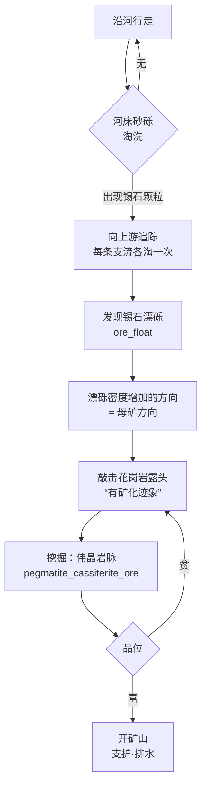

# 10 山河 Wildlands（`tcwildlands`）

| 项 | 内容 |
| --- | --- |
| 模组 ID | `tcwildlands` |
| 中文名 / 英文名 | 山河 / Wildlands |
| Java 包 | `com.nightcity.wildlands`（主类 `TWildlands`，事件类 `TWildlandsEvents`，已有 `/tcwildlands status` 指令） |
| 必需依赖 | `tcivilization`（核心：区域层框架、日历、HUD 与文明面板外壳、`ProficiencyBridge` 门面） |
| 可选联动 | 其余 16 个模组全部可选；联动一律经核心接口或 `com.nightcity.wildlands.compat.<other>` 桥接类，以 `ModList.isLoaded()` 守卫 |
| 维度 | `minecraft:overworld`（维度类型 `tcwildlands:earthlike`）、`minecraft:the_nether`（深地重做，维度类型 `tcwildlands:deep_earth`） |
| 区域层 | `tcwildlands:geo`、`tcwildlands:climate`、`tcwildlands:hydro` |
| 相关章节 | 00（DR-08~DR-14、DR-16、DR-18、DR-19、DA-02、DA-09、DA-13）、01、02（区域层、`planet.bin`、性能预算）、11 Ecology、12 Cultivation、13 Industry、22 Atlas、30 原版改动、31 UI、32 美术、40 路线图 |
| 文档状态 | 规格稿 v1 |

> 本章是 18 个模组中体量最大的一章：它定义整个星球。其他模组看到的地形、岩石、矿物、河流、气候、季节、天气与灾害，全部来自本章。凡本章与 README 全局常量或 00 章决策（DR/DA）冲突之处，以 README 与 00 为准，并应回改本章。

---

## 1. 定位与设计支柱

### 1.1 定位

山河 Wildlands 负责“地球物理层”：用一个可复现、可解释的物理流程，从种子生成一颗 1:250 的类地星球，并让这颗星球在游戏过程中继续“运转”——季节轮替、天气系统移动、河流涨落、地壳积累应力、火山孕育喷发、气候随文明排放缓慢变化。

它对玩家提供三类东西：

1. **一颗值得探索的星球**：大陆、海洋、山脉、水系、气候带与生物群系的分布有地理学上的道理，玩家可以“读懂”地形（DR-09、DR-11）。
2. **可推理的资源地质**：矿物按真实成矿作用分布在对应的围岩与构造环境中，并在地表留下可观察的找矿标志；从石器时代捡拾燧石到原子时代的地球物理勘探，找矿方式随时代演进。
3. **作为物理过程的环境压力**：季节、天气与灾害是有前兆、有成因、有空间范围的过程，而不是随机惩罚。它们只作用于世界与文明（作物、聚落、交通、工业），不给玩家添加个人生存条（DR-19）。

### 1.2 设计支柱

| 编号 | 支柱 | 含义 | 对设计的约束 |
| --- | --- | --- | --- |
| WP-1 | **地理可读** | 看到一条山脉，玩家可以推断板块边界；看到沙漠，可以推断副热带高压或雨影 | 每个地貌与群系都必须能追溯到生成流程中的一个物理原因；禁止“纯随机贴片式”群系 |
| WP-2 | **尺度真实、体验可玩** | 1:250 的星球尺度（DR-10）保证地理多样性；垂直方向压缩到 -512..1024（DR-12） | 水平距离不缩放；高度按非线性映射，保证山地可攀登、海洋可航行 |
| WP-3 | **地质即进度** | 每个时代都有新的可用矿物与新的找矿手段；找矿是技能而非运气 | 矿物出现时代与 brief §2.3 一致；每类矿床至少有一种可观察的地表标志 |
| WP-4 | **过程而非事件** | 季节、天气、灾害都由状态量驱动，有前兆、能预测、可防御 | 灾害不得无前兆地摧毁玩家建筑；未加载区域只做可恢复的统计影响（02 的 L2 规则） |
| WP-5 | **确定性与性能** | 同一种子在任何机器上生成相同的星球；生成不卡服 | 预计算星球 ≤ 100 s；每 tick 平均 ≤ 0.6 ms；后台线程只读快照 |
| WP-6 | **独立可玩** | 只装核心与本模组时，就是一个完整的“写实地球生存”世界生成模组 | 所有联动功能都有独立回退；不生成空占位内容 |

### 1.3 与已确认决策的对齐

| 决策 | 本章如何落实 |
| --- | --- |
| DR-08 完全替换原版主世界 | `tcwildlands-common.toml` 的 `replace_overworld = true`（默认）时，`minecraft:overworld` 的生成器替换为 `TcPlanetChunkGenerator`；原版世界预设仍可在新建世界时手动选择（此时本模组的地理功能降级，见 2.5） |
| DR-09 类地星球，每个种子大陆不同 | 板块数量、位置、运动方向全部由种子决定；同一种子保证完全相同 |
| DR-10 1:250，赤道 ≈ 16 万格 | 星球 163,840 × 81,920 格（DA-03），1 格 ≈ 244.6 m 的“地理距离” |
| DR-11 数个大陆，单个 2-5 万格 | 板块模拟后做大陆数量与尺寸校验，不合格则换子种子重跑（5.3.6） |
| DR-12 Y -512..1024，最高山约 800 格，深海约 -300 | 非线性高度映射（5.1.4）：珠峰级 8,850 m → Y 860；深海平原 5,000 m → Y -277；海沟最深 Y -460 |
| DR-13 一年 48 日，按半球与纬度变化，昼夜长度随纬度变化 | 5.12 季节与日长；南半球季节相位偏移半年 |
| DR-14 环境后果可逆 | 5.17 气候变化：区域温度与降水随排放、砍伐缓慢偏移，治理可逆转 |
| DR-16 下界 = 地热与火山深层科学维度 | 5.16 深地 |
| DR-18 灾害是威胁来源之一 | 5.14 自然灾害 |
| DR-19 不加个人生存机制 | 没有体温、口渴、湿度条；寒冷与炎热只影响作物、NPC、机器和群系，不直接伤害玩家（例外：岩浆、坠落、溺水、窒息等原版物理伤害保留） |
| DA-02 全球统一时钟 | 所有地点共用同一 `dayTime`；纬度只改变日出日落时刻与太阳高度（5.1.5） |
| DA-09 保留 `minecraft:the_nether` ID | 深地使用原维度 ID，替换维度类型与生成器 |
| DA-13 东西环绕 | 周期噪声 + 256 格镜像缓冲带 + 越界无缝传送（5.1.3） |

### 1.4 范围边界

| 属于本章 | 不属于本章（拥有者） |
| --- | --- |
| 地形、岩石、矿物、土壤母质、沉积物、洞穴、地下水、油气储层数据 | 原油与天然气流体（Industry 注册 `tcindustry:crude_oil`、`tcindustry:natural_gas`） |
| 生物群系 ID、气候包络、地表方块 | 动植物物种、树木、植被演替（Ecology）；独立回退时用原版树木特征 |
| 季节、天气、灾害的物理过程与对方块的直接作用 | 灾害对聚落的社会影响、疫病（Settlements）；保险与赈灾经济（Exchange）；救灾政策（Commons） |
| 土壤母质与初始肥力参数 | 耕作土壤、肥力动态、作物（Cultivation） |
| 找矿标志、岩石识别、`ProspectingApi` 数据 | 地图物品、测绘与勘探仪器物品（Atlas）；实验与标本（Discovery） |
| 下界“深地”维度生成与地热数据 | 地热发电机（Industry）；原版怪物生成规则（Beyond） |
| 自然结构（地貌类） | 遗迹、废墟（Echoes）；聚落建筑（Settlements）；危险区域（Frontiers） |
| 金属冶炼前的原矿物品 | 金属锭、加工材料、工具（Industry；E0-E1 石器归 tctechnology） |

---

## 2. 独立玩法（只安装本模组与必需核心时）

只安装 `tcivilization` 与 `tcwildlands` 时，本模组是一个完整的“写实星球世界生成 + 环境模拟”模组。以下内容在独立模式下全部可用，并且不出现任何指向未安装模组的占位物（UP-5）。

### 2.1 开局：选址

1. 新建世界后，服务端在首次启动时预计算星球（5.2）。客户端显示“星球形成”进度界面（10.4），分阶段显示：板块 → 造山 → 侵蚀 → 水系 → 气候 → 群系 → 地质。
2. 预计算完成后，首个加入的玩家看到“选择出生地”界面（10.5）：系统按 `SuitabilityApi.startSiteScore` 给出 5 个候选地点（温带或亚热带、近淡水、有燧石与黏土、不在灾害高风险区），附带地形缩略图、气候图（月均温/降水柱状图）、主要岩石与已知地表资源。玩家也可点“随机”或“自定义坐标”（需要服务器权限）。
3. 多人服务器中，只有第一位加入者（或拥有 `tcwildlands.start_site` 权限者）选择；其他玩家在同一地点出生（DR-02 所有玩家同属一个文明）。
4. 选址结果写入 `<world>/tc/wildlands/start_site.json`，并设为世界出生点。

### 2.2 探索一颗星球

| 活动 | 具体内容 |
| --- | --- |
| 环球航行 | 赤道周长 163,840 格；向东一直走会回到起点（东西环绕）。完成一次环绕（经度累计跨越 360°）记录为成就并给予探险熟练度 |
| 登顶与下潜 | 最高峰约 Y 860；海沟最深约 Y -460；`/tcwildlands here` 显示真实海拔（米）与 Y 的对应 |
| 气候带穿越 | 从赤道雨林走向极地冰盖，会经过稀树草原、副热带沙漠、地中海灌丛、温带阔叶林、北方针叶林、苔原；同纬度大陆东西两岸气候不同（洋流与盛行风） |
| 自然奇观 | 15 种自然结构：间歇泉田、熔岩管、喀斯特洞穴、天坑、天然拱、陨石坑、金伯利岩管、晶洞、海蚀柱群等（7.7） |
| 地理知识 | 群系首次进入时，在聊天栏显示群系名与气候类型（Köppen 代码），并解锁该群系在“地理”页签中的条目 |

### 2.3 找矿与采矿

独立模式下找矿完全依靠玩家自己的观察，不需要任何仪器：

1. **捡拾松散石块**：地表的 `tcwildlands:loose_stones` 告诉玩家下方基岩的种类（每块松散石块的岩性取自其正下方 8 格内的岩层）。
2. **敲击识别**：潜行 + 右键，用镐敲击天然岩石，识别岩石名称，并在附近 32 格内存在矿化时给出“有矿化迹象”的提示（9.2）。
3. **地表标志**：铁帽 `gossan`（铁锈色风化岩，表示下方硫化物矿体）、孔雀石绿斑、矿化漂砾 `ore_float`（沿河道向上游追踪可找到母矿脉）、沥青渗出 `bitumen_seep`、气泡渗出 `gas_seep`、硫磺喷气孔 `fumarole`。
4. **淘洗**：站在浅水中，手持 `minecraft:bowl` 右键河床砂砾或砂子，按该河段上游流域的重矿物含量获得砂金、锡石、钛铁矿、独居石或宝石原石（9.3）。
5. **采矿**：矿石方块有 3 个品位（贫、中、富），掉落 1/2/3 个原矿；同一矿体的品位由中心向边缘衰减，鼓励玩家“追矿”。
6. **矿山稳定性**：大跨度地下空间会触发岩体失稳（5.10.6）；放置 `tcwildlands:timber_prop` 等支护可以防止冒顶。

独立模式下原矿的去向（只在 `tcindustry` 未安装时启用的回退配方，见 8.4）：

| 原矿 | 原版熔炉产物 |
| --- | --- |
| `raw_native_copper`、`raw_malachite`、`raw_chalcopyrite` | `minecraft:copper_ingot` |
| `raw_bog_iron`、`raw_hematite`、`raw_magnetite` | `minecraft:iron_ingot` |
| `raw_native_gold` | `minecraft:gold_ingot` |
| `raw_cinnabar` | `minecraft:redstone`（2 个） |
| `raw_diamond`、`raw_emerald`、`raw_lapis`、`raw_amethyst` | 合成为 `minecraft:diamond`、`minecraft:emerald`、`minecraft:lapis_lazuli`（4 个）、`minecraft:amethyst_shard`（2 个） |
| 煤类 `raw_lignite`、`raw_bituminous_coal`、`raw_anthracite`、`raw_peat` | 直接作为燃料，燃烧时间见 6.6 |

其余矿物（锡、铅、锌、钛、铀等）在独立模式下没有原版产物，只作为收藏品和地理知识存在（不额外提供“矿物块”装饰方块，避免内容膨胀），物品提示写明“需要冶金知识才能利用”。没有 Technology 时不出现“需要某科技”的字样（UP-5）。

### 2.4 季节、天气与灾害

| 系统 | 独立模式下的表现 |
| --- | --- |
| 季节 | 草叶颜色随季节变化；温带冬季降雪、水面结冰；高纬度极昼极夜；原版作物生长速度乘以季节与温度系数（16.4） |
| 天气 | 天气按地区不同：一处下雨时 2,000 格外可能是晴天；锋面与气旋从西向东（中纬度）或从东向西（信风带）移动；季风区雨季集中 |
| 灾害 | 洪水、地震、火山、干旱、风暴（热带气旋、暴风雪、龙卷风、沙尘暴）、山火、雪崩全部生效；有前兆、有预警（10.3 的状态控件与核心警报） |
| 气候变化 | 独立模式下没有工业排放源，只有砍伐（玩家砍伐原版树木）与火山的影响；变化幅度很小 |

灾害规则对独立模式同样适用“不无预警地摧毁建筑”：地震震级与位置在发生前 1-3 MC 日通过前兆（小震、动物不安、井水变浑）体现；洪水在河流上游降雨后 0.5-2 MC 日到达；火山有数 MC 日的前兆期。

### 2.5 原版世界预设下的降级

若玩家关闭 `replace_overworld` 或在新建世界时选择原版预设：

1. 不生成星球；`PlanetApi.isPlanetActive()` 返回 `false`。
2. 岩石、矿物、土壤方块仍注册，但只在本模组的“地质补丁”特征中零星出现（按原版群系温度挑选岩性），保证物品可获得。
3. 季节仍按“虚拟纬度 = 0.5 × 原版群系温度映射”运行，`ClimateApi`/`WeatherApi` 按虚拟纬度给出数值；天气本身使用原版全局天气，火焰使用原版逻辑（30 VO-FR-03）；灾害只保留风暴（在原版雷暴期间抽样，16.6）。
4. 地理页签显示“当前世界未使用山河星球生成”，并只显示季节与当地天气。

### 2.6 独立模式下的文明面板与 HUD

1. 文明面板“世界”分组中出现本模组唯一页签 `tcwildlands:geography`（地理），内容包括已知地区、气候图、勘探记录、灾害记录（10.2）。
2. HUD 扩展等级下显示情境控件 `tcwildlands:local_conditions`（10.3）。
3. 季节显示由核心控件 `tcivilization:date_season` 负责；本模组向核心日历提供“本地季节”（南半球相位相反、热带显示雨季/旱季），见 12.1。
4. 持续性灾害风险通过核心 `AlertProvider` 进入 `tcivilization:alerts`；即时灾害通过 `TcNotifications` 发送（10.6）。

---

## 3. 联动玩法（逐个列出与其他模组的联动）

所有联动遵守同一模式：Wildlands 是**数据提供者**，通过核心 `com.nightcity.tcivilization.api.world` 包中的接口（12.1；03 §12.5 核心托管契约）发布；对方模组只读这些接口，或订阅本模组发布的事件。Wildlands 调用对方模组时，只经过 `com.nightcity.wildlands.compat.<other>` 桥接类，并以 `ModList.isLoaded("<modid>")` 守卫。

### 3.1 tcivilization（核心，必需）

| 方向 | 内容 |
| --- | --- |
| 核心 → 本模组 | 区域层框架 `RegionLayer<T>`、存档目录 `tc/`、日历时钟、`RegisterHudWidgetsEvent`、`CivPanelTabRegistry`、`AlertProvider`、`TcNotifications`、`TrackerApi`、`TargetInfoProvider`、`DeepLinkRegistry`、指令轮盘（Z）的 `WheelProvider` |
| 本模组 → 核心 | 注册 `tcwildlands:geo/climate/hydro` 三个区域层；作为 `PlanetApi`、`ClimateApi`、`WeatherApi`、`GeoApi`、`HydroApi`、`SuitabilityApi`、`HazardApi`、`ProspectingApi` 的提供者；向核心日历提供 `LocalSeasonProvider`；发布 `SeasonChangedEvent`；注册地区压力分量 `tcwildlands:hazard`（见下） |
| 降级 | 本模组不可能在没有核心时运行。若本模组缺失，核心使用平坦默认实现：纬度恒为 45°N、季节按日历、`ClimateApi` 返回原版群系温度与降水 |

**向核心注册的地区压力分量**：`RegionPressureContributor` `tcwildlands:hazard`（建议权重 0.10，03 §5.2.4），表示“环境负荷”：

```text
hazard = min(1, 0.6 × D + 0.4 × clamp(-SPI / 3, 0, 1))
  D   = 近 48 MC 日内影响本地区的 HazardRecord 中 buildingDamageIndex 的最大值（11.4；含 abstractOnly 记录）
  SPI = 地区中心的 HazardApi.droughtIndex（标准化降水指数，≤ -1.5 为干旱，5.14.4）
```

核心计算地区压力时调用；本模组只读灾害记录与气候层缓存，不触发新的采样。星球模式关闭（`replace_overworld = false`）时该分量恒为 0。

### 3.2 tctechnology（科技核心）

1. 本模组拥有 15 项科技（附录 B），覆盖历法、找矿、矿山支护与排水、水文、地层学、气象、地震学、火山学、石油地质、地球物理、气候模型、行星地质。
2. 科技解锁影响**信息精度**，而不是让资源凭空出现：例如 `renaissance/stratigraphy` 之后，敲击识别会给出“该地层年代与可能的矿床类型”；`electric/seismology` 之后，地震预警提前量从“前兆描述”变为“预计震级区间与时间窗”。
3. 实践来源：首次识别 10 种岩石、首次记录一次洪水等行为，向对应科技贡献“实践知识”。本模组在 04 的 `RegisterKnowledgeTriggersEvent` 中注册两个触发器：`tcwildlands:identify_rock`（参数 `rock`，首次识别某种岩石时触发）与 `tcwildlands:record_hazard`（参数 `type` 取 `HazardType` 小写名，首次在地理页签记录某类灾害时触发），行为发生时调用 `TechApi.fireTrigger`。哪项科技按多少计入由科技 JSON 的 `knowledge.sources` 决定（04 §5.3），本模组只负责触发。
4. 降级：未安装 Technology 时，所有信息精度按“E5 等价”固定（即无科技门槛，但也没有 E6 以后的预测类信息）。

### 3.3 tcskills（技能）

1. 所有熟练度挂钩见第 15 节与附录 D，统一调用核心门面 `ProficiencyBridge.add(player, skillId, amount, source)`（03 §5.11/§12.1，转发至 05 §12.2 的 `SkillsApi.addProficiency`）。
2. 本模组经 `ProficiencyBridge` 读取 `surveying` 倍率（`precision/survey`、`range/survey`）与天赋 `mining/prospector` 的 `prospect` op，用于敲击识别的成功率与矿化提示半径（5.10.5），读取 `exploration` 等级用于群系首次发现时的地理描述详细程度。
3. 降级：Skills 缺失时，`ProficiencyBridge.add` 为空操作、`multiplier` 返回 1.0，所有等级视为 0，行为按基础值执行。

### 3.4 tcecology（生态）

| 方向 | 内容 |
| --- | --- |
| 本模组 → Ecology | 每个群系的气候包络（年均温、最冷月、最热月、年降水、季节性、土壤母质、地下水深度）；季节与当前天气；山火与洪水区域；火山灰覆盖 |
| Ecology → 本模组 | 植被覆盖率与生物量（影响反照率、蒸散与山火燃料载量）；砍伐面积（影响区域气候偏移） |
| 群系与物种 | 群系 ID 由本模组注册；物种、树木与植被特征由 Ecology 按群系 ID 放置。本模组在群系 JSON 中不写任何树木特征，只保留“特征插槽” `tcwildlands:vegetation_slot` |
| 降级 | Ecology 缺失时，`compat.ecology.VanillaVegetationFallback` 为每个群系注入原版树木与植被特征（6.3 表中“原版回退植被”列） |

### 3.5 tccultivation（农耕）

1. **土壤母质**：`SuitabilityApi.soilParent(pos)` 返回母质（花岗岩风化、玄武岩风化、黄土、冲积、石灰岩风化等）、质地（砂/壤/黏）、初始有机质、pH、排水等级。Cultivation 据此决定农田初始肥力与适种作物。
2. **季节与气候**：Cultivation 读取 `ClimateApi.sample(pos, dayOfYear)` 判断播种窗口、霜冻、积温与降水；本模组发布的 `SeasonChangedEvent` 驱动作物季节逻辑。
3. **灾害**：洪水淹没农田并留下 `tcwildlands:flood_silt` 淤泥层（Cultivation 将其解释为肥力加成）；干旱指数 `HazardApi.droughtIndex(pos)` 降低作物产量；冰雹与霜冻事件通过 `WeatherChangedEvent` 通知。
4. 降级：Cultivation 缺失时，本模组对原版作物应用季节与温度生长系数（16.4）。

### 3.6 tcindustry（工业）

1. Industry 消耗本模组的全部原矿、煤类、岩石、`quartz_sand`、`kaolinite`、`brine`、`thermal_water`，产出金属与加工材料。
2. **油气**：储层是 `tcwildlands:geo` 层中的数据。Industry 的钻井通过 `GeoApi.reservoirAt(pos)` 查询，通过 `GeoApi.extract(reservoirId, amount)` 抽取（服务端主线程调用，原子扣减储量）。流体 `tcindustry:crude_oil`、`tcindustry:natural_gas` 由 Industry 注册。
3. **地热**：深地维度与火山地热田的热流 `GeoApi.heatFlow(pos)`（mW/m²）决定 Industry 地热机组的输出 `HU`。
4. **排放**：Industry 通过核心 `EmissionLedger` 记账 CO₂ 当量；本模组读取并驱动气候变化（5.17）。
5. **矿山工程**：Industry 的排水泵、通风机与本模组的矿井涌水、岩体稳定性计算对接（5.10.6、5.11.3）。
6. 降级：Industry 缺失时，启用 8.4 的原版熔炉回退配方；油气储层数据仍生成，但没有开采手段（只在地理页签显示“油苗”）。

### 3.7 tcnetworks（交通）

1. `SuitabilityApi.terrainCost(from, to, mode)` 给出道路、铁路、运河的坡度、土方与桥隧需求，Networks 的路线规划器用它计算造价。
2. 河流的流速场（payload `tcwildlands:flow_field`）作用于 Networks 的船只；海流作用于远洋船只航速；风场 `WeatherApi.wind(pos)` 作用于帆船。
3. 洪水、雪崩、地震与山体滑坡可以中断道路与铁路：本模组发布 `DisasterStartedEvent`（带影响范围），Networks 自行判定线路损坏。
4. 降级：Networks 缺失时上述数据无人消费，不影响本模组。

### 3.8 tcsettlements（聚落）

1. 选址评分 `SuitabilityApi.citySiteScore(pos)`：淡水距离、可耕地、建材、防洪、地震烈度、气候舒适度、港口条件；Settlements 的“建立聚落”界面显示该评分的分项。
2. 灾害对聚落：本模组给出物理影响（淹没深度、地震烈度、火势、积雪荷载），Settlements 负责 NPC 疏散、伤亡与重建；`HazardApi.forecast(...)` 让聚落的“气象/地震站”岗位产生预警。
3. 季节影响 NPC 日程（日长）与取暖燃料需求（Settlements 读 `ClimateApi`）。
4. 降级：Settlements 缺失时，灾害只作用于方块与原版生物。

### 3.9 tcexchange（贸易）

1. 本模组提供资源稀缺性数据：`GeoApi.depositSummary(regionPos)` 让 Exchange 计算各地区矿产的基准价格与贸易路线。
2. 灾害事件（干旱、洪水、火山）通过事件让 Exchange 调整受灾区商品价格。
3. 降级：无。

### 3.10 tcdiscovery（发现）

1. 本模组的可观察对象（岩石、矿物、找矿标志、气象现象、地质构造）登记为 Discovery 的“观察目标”；观察模式（`V`）下显示已知属性，敲击识别与淘洗结果写入 Discovery 日志（`Y`）。
2. Discovery 的仪器（标本柜、岩石薄片、气象站记录）读取本模组数据；标本物品由 Discovery 注册。
3. 降级：Discovery 缺失时，岩石识别结果写入本模组地理页签的“勘探记录”，观察信息由核心 `tcivilization:target_info` 显示基础名称。

### 3.11 tcechoes（回响）

1. Echoes 的历史模拟在 `PlanetGeneratedEvent` 之后运行，读取 `SuitabilityApi` 选择古代文明的定居点，读取 `GeoApi` 决定古代矿坑与采石场位置。
2. Echoes 可请求本模组生成“历史灾害痕迹”（古地震断崖、古火山灰层、古洪水台地），写入 `tcwildlands:geo` 的历史事件表，作为传说的物理证据；古代矿坑以 `HistoricalTrace.Kind.ANCIENT_WORKINGS` 提交，本模组按 `minedFraction × tonnage` 扣减该矿床储量（12.1“历史痕迹”，18 OQ-ECH-5）。
3. Echoes 的历史模拟进度作为追加阶段接在 10.4 星球形成进度画面之后，经 `PlanetProgressStages.register` 登记（12.1，18 OQ-ECH-4）。
4. 星球模式下原版矿井（`minecraft:mineshaft`）不生成，由 Echoes 的 `tcechoes:ancient_mine` 代替（30 VO-ST-07）。
5. 降级：Echoes 缺失时没有历史痕迹，矿床储量不扣减；本模组内置数据中带加载条件 `neoforge:not` + `neoforge:mod_loaded tcechoes` 的群系标签文件把原版矿井加回本模组的陆地群系（16.1 VO-ST-07 行）。

### 3.12 tccommons（公地）

1. 公共工程（堤坝、防火带、防波堤、抗震加固）在 Commons 中立项；本模组的 `HazardApi` 读取这些工程的方块与登记数据，降低对应灾害的影响。
2. 降级：无 Commons 时，玩家自建的堤坝方块同样按物理规则生效（洪水只是流体，堤坝自然挡水）。

### 3.13 tcfrontiers（边疆）

1. 危险区域可以叠加自然条件：火山区、冰原、沙漠深处由本模组提供 `HazardApi.hazardLevel(pos)`，Frontiers 用于远征补给消耗系数。
2. Frontiers 的远征据点选址读取 `SuitabilityApi.terrainCost` 与气候。
3. 降级：无。

### 3.14 tcbeyond（异界）

1. 深地维度不生成原版下界生物；原版怪物的生成规则由 Beyond 决定（DR-18、DA-08）。Beyond 可在深地的特定地点放置异界影响区，本模组只提供 `deep_earth` 的群系与坐标数据。
2. 本模组不生成任何奇幻内容；Beyond 需要“地脉”时读取 `GeoApi.heatFlow` 与断层数据作为写实基底。
3. 降级：Beyond 缺失时，深地中没有任何敌对生物。

### 3.15 tcatlas（舆图）

1. Atlas 拥有地图物品与全部测绘/勘探仪器（罗盘、磁力仪、重力仪、地震仪、岩芯钻、航空物探、遥感卫星），仪器读数全部来自本模组的 `ProspectingApi.query(method, pos, radius)`。
2. Atlas 的专题图层（地形、地质、气候、降水、群系、矿产、灾害风险）从三个区域层取数据；地图瓦片在 Atlas 侧缓存。
3. 本模组提供 `PlanetApi.latLon(x, z)` 与 `PlanetApi.altitudeMeters(y)` 给 Atlas 的坐标显示与经纬网。
4. 降级：Atlas 缺失时，独立找矿只依靠 2.3 的感官方法；`ProspectingApi` 仍可被其他模组调用。

### 3.16 tcnations（列国）

1. AI 文明的扩张与资源争夺读取 `SuitabilityApi` 与 `GeoApi.depositSummary`；边界倾向沿分水岭与大河。
2. 灾害削弱 AI 文明（抽象人口、粮食），由 Nations 读取 `DisasterEndedEvent` 的统计结果。
3. 降级：无。

### 3.17 tcorbit（寰宇）

1. 遥感卫星（Orbit 发射、Atlas 解读）获取全球气候与地质图层：本模组提供分辨率为 1,024 格的全球栅格快照。
2. `space/planetary_geology`（本模组科技）让 Orbit 的月球、火星采样获得矿物识别。
3. 月壤、火星土与氦-3 由 Orbit 注册；本模组不生成其他星球。
4. 降级：无。

---

## 4. 核心玩法循环（含 mermaid 流程图）

### 4.1 宏观循环：读懂土地 → 利用土地 → 承受土地的回应


### 4.2 找矿微循环（以 E2 铜锡为例）



### 4.3 灾害循环


### 4.4 时代节奏

| 时代 | 玩家与山河的主要关系 | 新的山河玩法 |
| --- | --- | --- |
| E0 stone | 采集燧石、识别岩石、寻找洞穴与水源 | 松散石块、敲击识别、季节观察 |
| E1 neolithic | 定居选址、洪泛平原农耕、泥炭 | 历法、洪水规律、自然金与自然铜 |
| E2 bronze | 第一批矿山：铜、锡、铅、银 | 淘洗与漂砾追踪、坑道支护 |
| E3 iron | 铁矿（沼铁、赤铁、磁铁）、石英砂 | 水文：堤坝与河流预报 |
| E4 medieval | 深井、锌与汞、褐煤、高岭土 | 矿井排水、雪崩与山火防护 |
| E5 renaissance | 硫磺、硝石、石墨；地层学与气象学 | 地质剖面、天气图 |
| E6 industrial | 煤田大规模开采、工业矿业 | 经济地质：矿床储量估算；钢拱支护 |
| E7 electric | 铝、铬、镍、钨、钾盐、磷；石油 | 地震仪、石油地质、地震预警 |
| E8 atomic | 钼、铀、钛；航空物探 | 地球物理勘探、火山学、锚杆支护 |
| E9 information | 锂、稀土、钴；气候模型 | 全球气候预测与治理 |
| E10 space | 行星地质 | 月球、火星的岩石识别（与 Orbit 联动） |

---

## 5. 系统规则与公式

### 5.1 星球模型与坐标

#### 5.1.1 尺寸与常量

```text
PLANET_WIDTH      = 163_840          // X 方向（经度 360°），东西环绕
PLANET_HEIGHT     = 81_920           // Z 方向（纬度 180°）
X_MIN, X_MAX      = -81_920, 81_920  // [X_MIN, X_MAX)
Z_MIN, Z_MAX      = -40_960, 40_960  // -Z 为北；Z = ±40_960 为两极
Y_MIN, Y_MAX      = -512, 1024
SEA_LEVEL         = 63
METERS_PER_BLOCK  = 40_075_000 / 163_840 ≈ 244.6     // 水平“地理距离”
REGION_SIZE       = 512              // 320 × 160 = 51_200 个地区格
CLIMATE_CELL      = 64               // 气候层分辨率（格）
PLANET_GRID       = 64               // L0 星球网格：2_560 × 1_280 采样点
TILE_GRID         = 8                // L1 地区瓦片：每地区 64 × 64 采样点
WEATHER_CELL      = 1_024            // 天气网格：160 × 80
```

#### 5.1.2 经纬度映射

```text
lat_deg = -z / 40_960 × 90          // 北纬为正
lon_deg =  x / 81_920 × 180         // 东经为正；x 环绕后归一化到 [-180, 180)
wrap_x(x) = ((x - X_MIN) mod PLANET_WIDTH) + X_MIN
```

1. 采用**等距圆柱投影**（经纬度均匀）。真实球面上，纬度 φ 处一格东西方向代表的地面距离为 `244.6 × cos φ` m。本模组在所有“面积”与“距离”相关的物理量（河流汇水面积、气旋尺度、板块面积）中使用球面校正因子 `cos φ`，但方块本身不变形。
2. 高纬度视觉上被“拉宽”：60° 处东西方向拉伸 2 倍，80° 处 5.76 倍。生成阶段的所有噪声与地形特征在 X 方向按 `cos φ` 拉伸采样（5.9.3），避免极区出现“压扁”的山脉。
3. **极区处理**：|lat| ≥ 85° 的极冠（|z| ≥ 38,684）为固定的冰盖或极海；|z| ≥ 40,700 处放置不可通行的“极地冰崖”（高冰盖）；原版世界边界只能是正方形，按 X 方向设置（5.1.3），Z 方向的 ±40,960 由本模组的实体位置检查推回（16.1 VO-WG-08）。极点在等距投影中退化为一条线，因此不提供“绕极点到对侧”的玩法，地图在两极显示为冰盖边缘。

#### 5.1.3 东西环绕（DA-13）

```text
WRAP_BUFFER  = 256       // 两端各 256 格的镜像缓冲带
TELEPORT_AT  = 81_920 + 128
```

1. 所有生成噪声对 X 周期为 `PLANET_WIDTH`（5.9.2），因此 x 与 x ± 163,840 处地形完全相同。
2. 世界在 X ∈ [X_MIN - 256, X_MAX + 256) 范围内生成区块：缓冲带中的方块与对侧完全相同（由同一函数生成；玩家修改不同步，缓冲带内禁止放置与破坏方块，交互时显示“世界边缘：继续前进”）。
3. 实体（玩家、载具及其乘客、拴绳生物）的 |x| ≥ `TELEPORT_AT` 时，传送到 `x ∓ 163,840`，保持 y、z、速度与朝向；载具连同乘客一起传送。客户端提前预加载对侧区块（payload `tcwildlands:wrap_preload`，在 |x| ≥ 81,920 - 192 时发送），使传送无加载闪烁。
4. 掉落物与弹射物越过边界时直接删除并在对侧以相同状态重建。
5. 世界边界 X 设为 ±(81,920 + 256)，原版边界墙在缓冲带外，玩家正常游玩时看不到。

#### 5.1.4 垂直映射（DR-12）

真实海拔 `h`（m）与 Y 的映射是非线性的，以便保留“珠峰级”高山的同时让平原与低丘有足够的细节：

```text
陆地（h ≥ 0）:   y = SEA_LEVEL + 797 × (h / 8_850)^0.8
海洋（0 < d ≤ 5_000 m 水深）: y = SEA_LEVEL - 340 × (d / 5_000)^0.8
海洋（d > 5_000 m）:          y = -277 - (d - 5_000) / 6_000 × 183
反函数：h = 8_850 × ((y - 63) / 797)^(1/0.8)
```

| 真实海拔 / 水深 | Y | 说明 |
| --- | --- | --- |
| 8,850 m | 860 | 星球最高峰上限 |
| 5,000 m | 615 | 高原山峰 |
| 4,000 m | 485 | 高原面 |
| 2,000 m | 305 | 中山 |
| 1,000 m | 202 | 低山 |
| 500 m | 143 | 丘陵 |
| 100 m | 85 | 平原 |
| 0 m | 63 | 海平面 |
| 水深 200 m | 37 | 大陆架外缘 |
| 水深 1,000 m | -14 | 大陆坡 |
| 水深 4,000 m | -224 | 洋盆 |
| 水深 5,000 m | -277 | 深海平原 |
| 水深 11,000 m | -460 | 海沟最深点 |
| — | -505..-512 | 基岩层（不可破坏，含深地通道缺口，5.16） |

坡度在方块尺度上被放大：真实 30° 的山坡在 1:250 水平缩放、约 1:8 垂直缩放下，会变成很陡的方块坡。生成器对 L2 细节做坡度限制（5.9.5），保证主要山脊可以步行攀登（大多数地点坡度 ≤ 1 格/格），只有冰川槽谷、海崖和峡谷出现垂直崖壁。

#### 5.1.5 太阳、日长与天空（DR-13、DA-02）

全球共用一个 `dayTime`（DA-02）。纬度与季节只改变**本地**日出日落时刻和太阳高度：

```text
doy          = (dayTime / 24_000) mod 48               // 一年 48 日
// 约定：doy 0 = 北半球春分；doy 12 = 夏至；doy 24 = 秋分；doy 36 = 冬至
decl_deg     = 23.44 × sin(2π × doy / 48)
cos_H0       = -tan(lat) × tan(decl)
H0           = acos(clamp(cos_H0, -1, 1))              // 半昼弧（弧度）
day_fraction = H0 / π                                  // 白昼占全天比例
sunrise_tick = 6_000 - day_fraction × 12_000           // 原版中午为 6_000
sunset_tick  = 6_000 + day_fraction × 12_000
noon_elev    = 90° - |lat - decl|
```

1. 客户端按玩家所在纬度重新映射天体角：本地时间 `t_local` 中，白天段 `[sunrise, sunset]` 线性映射到原版太阳角的 `[0.75, 1.25]`（地平线到地平线），夜晚段映射到其余部分。因此赤道日长恒为 12,000 tick，北纬 60° 夏至日长约 18,300 tick。
2. 极昼：`cos_H0 < -1` 时太阳全天在地平线上，太阳高度在 `noon_elev` 与 `lat + decl - 90°` 之间摆动；极夜：`cos_H0 > 1` 时全天为夜晚，正午天空仍有暮光亮度（太阳在地平线下 < 6° 时）。
3. **天空光照**：服务器端 `skyDarken` 保持原版全局计算（不加 mixin，见 §16.2）；本地太阳高度通过 `PlanetApi.solarElevationDeg(pos, gameTime)` 与 `dayLengthHours` 提供给 Cultivation（作物光照）、Ecology（植物光合）以及 §16.4 的作物生长系数。
4. **睡觉**：沿用原版跳夜（30 VO-WX-11，不改）：跳到下一个 `dayTime ≡ 0 (mod 24,000)`，即全球统一的当地时 06:00；高纬冬季醒来时可能仍在日出前，极夜中醒来仍是黑夜。本模组不修改跳夜终点。
5. 月相保持原版 8 相周期；月亮轨道不随纬度变化（简化）。
6. 光影兼容：天体角重映射通过 `DimensionSpecialEffects` 与 `ClientLevel` 的时间钩子实现，Iris 读取到的 `sunAngle` 已是本地值；在 Complementary Reimagined 下验证日出方向与阴影一致（17 验收）。

### 5.2 生成流水线总览

生成分为三级分辨率，越粗的层越早计算、越被缓存：

| 级别 | 分辨率 | 内容 | 计算时机 | 存储 |
| --- | --- | --- | --- | --- |
| L0 星球网格 | 64 格/采样，2,560 × 1,280 | 板块、地壳类型与年龄、大尺度高度、侵蚀后高度、流向、流量、气候月均值、群系、地质省、矿床与储层 | 新世界首次启动时一次性预计算 | `<world>/tc/planet.bin` |
| L1 地区瓦片 | 8 格/采样，每地区 64 × 64 | 细化高度、河道中心线与宽度、湖面、海岸线、地层顶面、矿体包络 | 区块首次请求该地区时懒计算，确定性（种子 + 3×3 邻域 L0） | `<world>/tc/wildlands/tiles/t.<rx>.<rz>.bin`（LRU 内存缓存 + 磁盘） |
| L2 方块细节 | 1 格 | 细节噪声、岩层与矿石方块、洞穴、地表方块、特征 | 区块生成时 | 区块本身 |

预计算阶段顺序与预算（02 第 8.3 节）：

| 阶段 | 内容 | 预算（参考机 8 线程） |
| --- | --- | --- |
| P0 | 种子展开、参数抽样（板块数、陆地比例、热点数） | < 0.1 s |
| P1 | 板块：球面 Voronoi + Lloyd 松弛、运动、边界分类、地壳年龄 | ≤ 8 s |
| P2 | 构造高度：造山、裂谷、热点、大陆架与洋盆 | ≤ 10 s |
| P3 | 侵蚀：河流功率侵蚀 + 热侵蚀 + 沉积 | ≤ 22 s |
| P1-P3 合计 | | ≤ 40 s |
| P4 | 水文：洼地填充、流向、流量、河网、湖泊、流域 | ≤ 8 s |
| P5 | 气候：洋流、风带、水汽输送、温度、降水、Köppen | ≤ 8 s |
| P6 | 群系分配与边界平滑 | ≤ 4 s |
| P4-P6 合计 | | ≤ 20 s |
| P7 | 地质：岩性省、地层柱、成矿区、矿床、油气系统、深地数据 | ≤ 10 s |
| P8 | 选址评分、写盘 `planet.bin` | ≤ 5 s |
| 总计 | | ≤ 75 s（验收上限 100 s） |

每个阶段使用 `ForkJoinPool`（线程数 = `min(可用核心 - 1, 8)`），在独立的“预计算线程组”中运行；服务器在预计算完成前不接受玩家进入，客户端显示进度界面（10.4），进度通过 `tcwildlands:planet_progress` 推送。

### 5.3 板块构造（P1、P2）

#### 5.3.1 板块划分

1. 板块数 `N_plates = 12 + rand(0..6)`（12-18）。在单位球面上撒 `N_plates` 个种子点，做 3 次 Lloyd 松弛后，再给每个种子随机“权重”（0.6-1.6）做加权 Voronoi，使板块大小不均（真实地球有 7 个大板块、若干小板块）。
2. 在 L0 网格（2,560 × 1,280）上，每个采样点转为球面单位向量后找最近（加权距离）种子，得到板块 ID（`u8`）。为避免边界过直，种子距离加入 3 层域扭曲噪声（周期噪声，振幅为板块平均半径的 15%）。
3. 每个板块标记为**大陆型**或**大洋型**：按面积降序随机挑选板块为大陆核心，直到大陆地壳面积达到 `land_target = 0.29 ± 0.04`（再加上大陆架约 7%）；大陆板块内部的边缘约 20% 为大洋地壳（被动大陆边缘）。

#### 5.3.2 板块运动

每个板块有一个欧拉极 `pole_k` 与角速度 `ω_k`（0.2-1.2 °/Myr 的抽象值）。采样点 p 处的速度：

```text
v(p) = ω_k × (pole_k × p)          // 球面上的切向速度
```

相邻两板块在边界点的相对速度 `Δv = v_a - v_b`，分解为法向分量 `v_n`（正为离散）与切向分量 `v_t`。

#### 5.3.3 边界分类

| 条件 | 类型 | 产生的地貌 |
| --- | --- | --- |
| `v_n < -0.3` 且两侧都是大陆 | 陆陆碰撞 | 宽阔的褶皱山脉与高原（喜马拉雅-青藏型），最高 8,850 m |
| `v_n < -0.3` 且一侧大洋、一侧大陆 | 洋陆俯冲 | 海沟 + 大陆边缘火山弧山脉（安第斯型）；斑岩铜钼矿带 |
| `v_n < -0.3` 且两侧都是大洋 | 洋洋俯冲 | 海沟 + 火山岛弧（日本-阿留申型） |
| `v_n > 0.3` 且在大洋 | 洋中脊 | 中脊隆起（水深约 2,500 m）、新生洋壳、黑烟囱（块状硫化物） |
| `v_n > 0.3` 且在大陆 | 大陆裂谷 | 地堑谷、裂谷湖、碱性火山、蒸发岩（东非型） |
| `\|v_n\| ≤ 0.3` 且 `\|v_t\| > 0.3` | 转换断层 | 线性断层谷、错断河流、频繁中强地震（圣安德烈亚斯型） |
| 其他 | 弱边界 | 低丘 |

#### 5.3.4 地壳年龄与“古造山带”

1. 大洋地壳年龄 = 到最近洋中脊的距离 / 扩张速率，0-180 Myr；年龄决定洋底深度：`depth = 2_500 + 350 × sqrt(age_Myr)` m（板块冷却模型，上限 6,000 m）。
2. 大陆内部按到板块中心的距离与随机“克拉通核”分出：**克拉通**（> 1,500 Myr，低平、古老变质岩基底，金伯利岩管、条带状铁建造、古砂金）、**古造山带**（300-1,000 Myr，被侵蚀的低山，花岗岩与变质岩出露，锡钨矿）、**年轻造山带**（< 100 Myr，高山）。
3. 古造山带不是当前板块边界的产物：P2 在大陆内部按种子随机生成 2-4 条“缝合线”，抬升 400-1,500 m 后在 P3 中被严重侵蚀，形成阿巴拉契亚-乌拉尔型低山。

#### 5.3.5 热点与裂谷

1. 热点数 `N_hotspots = 6 + rand(0..6)`，位置与板块无关（地幔固定）。热点在板块上留下“热点轨迹”：沿板块运动反方向排列的火山链，年龄从热点处向外递增，越老的火山越低（侵蚀 + 沉降），在大洋中形成夏威夷型岛链与海山。
2. 大陆上的热点形成溢流玄武岩高原（`basalt_rock` 大面积出露）与地热区（间歇泉田）。
3. 热点与裂谷的根部是深地入口的候选位置（5.16.2）。

#### 5.3.6 构造高度与校验

```text
h_tect(p) = h_base(crust_type, age)
          + Σ_boundaries uplift(type) × falloff(dist_to_boundary, width(type))
          + Σ_hotspots  swell(dist) + Σ_volcanoes cone(dist, age)
          + craton_noise(p) × 150 m
falloff(d, w) = exp(-(d / w)^2)
```

| 边界类型 | 抬升峰值 uplift | 影响宽度 w | 偏移 |
| --- | --- | --- | --- |
| 陆陆碰撞 | +5,500 m（再叠加高原面 +4,500 m 在 2w 内） | 1,600 格 | 峰线在下盘一侧 0.3w |
| 洋陆俯冲（陆侧） | +4,000 m | 600 格 | 距海沟 1,200 格 |
| 海沟 | -5,000 m（相对洋底） | 150 格 | 边界处 |
| 洋中脊 | +2,500 m（相对洋底） | 900 格 | 边界处 |
| 大陆裂谷 | 肩部 +1,200 m，谷底 -800 m | 300 格 | 谷宽 80-200 格 |
| 转换断层 | ±200 m | 40 格 | 断层线 |

大陆基准高度 `h_base` = 200 m（克拉通）至 600 m（造山带外围），大陆架 -120 m。

**校验**：P2 结束后统计大陆（连通陆地面积 ≥ 1,500 万平方格）。要求：大陆数 3-7 个；至少 3 个大陆的东西或南北跨度在 20,000-50,000 格之间；出生纬度带（20°-55°）中至少 2 个大陆有陆地。不合格时以 `seed' = hash(seed, attempt)` 重跑 P1-P2，最多 8 次；仍不合格则接受最后一次结果并在日志中警告。

### 5.4 侵蚀（P3）

#### 5.4.1 河流功率侵蚀

在 L0 网格上使用 Braun–Willett 隐式算法（O(n) 每次迭代）：

```text
∂h/∂t = U(p) - K × A^m × S^n + D × ∇²h
m = 0.5, n = 1
K = K_rock(lithology) × K_climate(precip)
A = 上游汇水面积（球面校正，平方米）
S = 局部坡度
D = 0.01 m²/yr（坡面扩散）
迭代：80 步，每步 Δt = 50 kyr，抬升 U 在前 40 步由构造高度驱动后逐渐衰减
```

| 岩性 | K_rock（相对值） |
| --- | --- |
| 花岗岩、片麻岩、石英岩 | 0.4 |
| 玄武岩、辉长岩 | 0.6 |
| 砂岩、石灰岩 | 1.0 |
| 页岩、泥岩、凝灰岩 | 1.8 |
| 冲积物、黄土 | 3.0 |

#### 5.4.2 热侵蚀与冰川侵蚀

1. **热侵蚀（崩塌）**：坡度超过休止角 `tan θ = 0.8`（L0 尺度）的部分按 50% 的比例转移到下坡邻点，迭代 20 次；产生倒石堆与山麓沉积。
2. **冰川侵蚀**：在 P5 初算气候后，对年均温 < -2 °C 且高于雪线的格点，用“谷底加宽”规则把 V 形谷改造成 U 形谷，并在海岸处生成峡湾（`cold_fjord_coast`）。因为气候依赖高度、高度依赖侵蚀，P3 → P5 迭代一次：先用粗略气候侵蚀，再算最终气候。

#### 5.4.3 沉积

被侵蚀的物质沿流向搬运，在坡度骤减处（山前、河口、湖盆）沉积：形成冲积扇、洪泛平原、三角洲。沉积厚度写入 L0 的 `sediment_m` 字段，L2 用它决定地表冲积层（`alluvium`、`silt`、`gravel`、`sand`）的厚度（1-12 格）。

### 5.5 水文：河流、流域与湖泊（P4）

#### 5.5.1 洼地处理与流向

1. **优先队列洪泛填充**（Priority-Flood，Barnes 2014）：从海洋格出发填平所有内陆洼地，并加 ε 坡度保证可排水。填平深度 > 30 m 且面积 > 40 个 L0 格的洼地标记为**湖泊**；若该湖的年蒸发量大于入流（P5 气候计算后回算），标记为**内流湖**（咸水/盐湖），否则为外流湖，出口为填充溢出点。
2. **流向**：D8（8 邻域最陡下坡），在等距投影下按 `cos φ` 校正东西距离。
3. **汇水面积** `A` 与**流量** `Q`：

```text
Q(p) = Σ_upstream (P_annual - ET_annual) × cell_area × runoff_coef
runoff_coef = 0.3 (平原) .. 0.7 (山地、冻土)
```

4. **河网**：`Q ≥ Q_river = 5 m³/s` 的格点为河流；Strahler 级序 1-9。级序 ≥ 3 的河流在 L1 中生成可见河道，级序 1-2 只在 L2 中生成小溪（宽 1-2 格）。
5. **流域**：每个入海口（或内流湖）定义一个流域 ID（`u32`），面积 ≥ 50,000 km² 的流域给出中文名（由名称生成器从种子与流域形状生成，可被 Echoes 覆盖）。

#### 5.5.2 河道几何

水力几何（Leopold 关系，换算为方块）：

```text
width_m  = 4.0 × Q^0.5          // 流量 1,000 m³/s → 约 126 m
depth_m  = 0.35 × Q^0.4
width_b  = clamp(width_m / 244.6 × 6, 1, 96)    // 方块宽度（加 6 倍视觉放大，上限 96 格）
depth_b  = clamp(1 + depth_m × 0.6, 1, 14)      // 方块深度
```

| 河流等级 | Q（m³/s） | 宽（格） | 深（格） | 例子 |
| --- | --- | --- | --- | --- |
| 溪流 | 5-30 | 1-2 | 1-2 | 山间小溪 |
| 小河 | 30-300 | 3-8 | 2-4 | 可涉水 |
| 中河 | 300-3,000 | 8-24 | 4-7 | 需要桥 |
| 大河 | 3,000-20,000 | 24-56 | 7-11 | 可通航 |
| 巨川 | > 20,000 | 56-96 | 11-14 | 亚马孙、长江级 |

1. 河道中心线在 L1 中由 L0 流向折线经 Catmull-Rom 平滑，再叠加曲流噪声：曲流波长 `λ = 11 × width_b`，振幅 `0.5 λ × sinuosity`，`sinuosity` 随坡度减小而增大（平原 1.5-2.2，山地 1.0-1.1）。
2. 河谷：河道两侧按“谷宽 = 4-20 × width_b”切出谷地，洪泛平原高度 = 水面 + 1-2 格。
3. 瀑布与急流：沿河道高差 > 4 格/16 格时生成瀑布（垂直落差）或急流（连续台阶）。
4. 三角洲：大河入海且潮差小时，河口生成分汊河道（2-5 条）与 `tropical_delta`/`temperate_delta` 群系。

#### 5.5.3 河水的方块表示

Minecraft 的水方块不能表达平滑下降的河面。规则：

1. 河道内放置**静水源方块**，水面高度按河段分为阶梯：每当河床下降 1 格，在下游放置一个“水面台阶”（台阶处是 1 格高的流动水边缘）。平原大河水面坡度极小，几十到几百格才下降 1 格。
2. 流速感知由**流场**提供：服务端在每个 L1 采样点存储河流流向与流速 `(vx, vz)`（0-2.5 格/秒），通过 `tcwildlands:flow_field` 发给客户端（玩家位于河道 64 格内时，按区块发送）。实体在水中受到 `F = k × (v_flow - v_entity)` 的推力；船由客户端控制，所以客户端也必须应用流场。
3. 季节水位（5.12.4）与洪水（5.14.1）不修改源方块高度，而是在河道上方放置/移除 `tcwildlands:floodwater`（会衰退的流体）。

#### 5.5.4 湖泊与内流盆地

| 类型 | 条件 | 表现 |
| --- | --- | --- |
| 淡水湖 | 入流 ≥ 蒸发 | `temperate_lake`/`cold_lake`；湖面平坦，湖岸 `sand`/`gravel` |
| 构造湖 | 位于裂谷 | 深而狭长（深度可达 60 格），岸为断崖 |
| 冰川湖 | 冰川侵蚀区 | 多个小湖串联（`cold_lake`） |
| 咸水湖/盐湖 | 内流且蒸发 > 入流 | `arid_salt_lake`；湖水为 `tcwildlands:brine`；湖岸 `salt_crust` |
| 盐沼/干盐湖 | 内流且年降水 < 150 mm | `arid_salt_flat`；地表 `salt_crust`，下方 `rock_salt` 与 `gypsum_rock`、`sylvite` 矿层 |

### 5.6 海岸与洋流

#### 5.6.1 海岸类型

| 海岸 | 条件 | 地形 |
| --- | --- | --- |
| 沙滩 | 坡度缓、波浪能中等、沉积物充足 | 宽 6-30 格的沙滩 + 沙丘 |
| 岩岸 | 坡度陡、岩性硬 | 海崖（高 10-60 格）、海蚀柱群 `sea_stack_cluster`、海蚀拱 |
| 峡湾 | 冰川侵蚀 + 海平面以下的 U 形谷 | 狭长深水海湾、两侧绝壁 |
| 红树林 | 热带、低能海岸、河口 | `tropical_mangrove_coast` |
| 盐沼 | 温带、低能海岸 | `temperate_salt_marsh` |
| 珊瑚礁 | 热带浅海、SST ≥ 20 °C 最冷月、无大河淡水 | 岸礁与环礁（热点岛链的老火山） |

#### 5.6.2 洋流

洋流在 L0 网格上以简化的“风生环流 + 西边界强化”计算：

```text
1. 风应力 τ(lat) 由 5.7.2 的行星风带给出
2. 每个大洋盆地内求 Sverdrup 输送的流函数 ψ（Stommel 模型，β-平面近似）
3. 西边界流：在盆地西侧 600 格内速度放大 5 倍（湾流、黑潮型）
4. 极地与赤道附近添加东西向的环极流与赤道逆流
结果：每个海洋格 (u, v) 流速（0-2 m/s 抽象值）与海表温度距平 ΔSST
```

| 洋流 | 典型位置 | 对气候的影响 |
| --- | --- | --- |
| 暖流（西边界流） | 中纬度大陆东岸 | 冬季沿岸温度 +2~+6 °C，降水增加 |
| 寒流（东边界流） | 副热带大陆西岸 | 沿岸温度 -3~-8 °C，形成海雾与沿海沙漠（阿塔卡马型） |
| 北大西洋漂流型 | 中高纬大洋东侧（若存在宽阔洋盆） | 高纬西岸冬季显著偏暖（西欧型） |
| 上升流 | 东边界流沿岸 | 渔业丰富（向 Ecology 提供 `upwelling = true`） |

洋流对玩家的直接作用：Networks 船只的对地速度 = 船速 + 洋流；无 Networks 时，原版船在海面上受到流场推力（与河流相同机制，最大 0.6 格/秒）。

### 5.7 气候（P5）

#### 5.7.1 入射辐射

```text
Q_toa(lat, doy) = S0 / π × (H0 × sin(lat) × sin(decl) + cos(lat) × cos(decl) × sin(H0))
S0 = 1_361 W/m²
```

12 个“气候月”（每 4 MC 日为一个气候月）各算一次，得到每个纬度的日均入射辐射。

#### 5.7.2 行星风带与气压

| 纬度带 | 环流圈 | 地面风 | 气压 | 降水倾向 |
| --- | --- | --- | --- | --- |
| 0°-ITCZ | 哈得来圈上升支 | 辐合、静风 | 赤道低压 | 极多 |
| 5°-30° | 哈得来圈 | 东北/东南信风 | — | 迎风岸多雨，背风内陆干 |
| 25°-35° | 下沉支 | 弱风 | 副热带高压 | 极少（沙漠带） |
| 35°-60° | 费雷尔圈 | 盛行西风 | — | 西岸多雨，锋面气旋 |
| 60° 附近 | 极锋 | 辐合 | 副极地低压 | 较多 |
| 60°-90° | 极地圈 | 极地东风 | 极地高压 | 少（极地荒漠） |

1. ITCZ 随季节南北移动：`lat_itcz(month) = 5° × sin(2π(month - 3)/12) × (陆地占比校正 1.0-2.5)`，在大陆上空移动幅度更大（形成季风）。
2. 季风：大陆面积 ≥ 3,000 万平方格且其低纬一侧有大洋时，夏季气压梯度反转，向陆地输送水汽（`subtropical_monsoon_forest`、`tropical_monsoon_forest` 群系与雨季、旱季）。

#### 5.7.3 温度

```text
T_base(lat, month) = 45 × cos(lat)^1.3 - 18 + seasonal(lat, month) + ΔSST_coastal    // 年均：赤道 27 °C，45° 约 11 °C，60° 约 0 °C，极点 -18 °C（冰盖另减高度项）
seasonal(lat, month) = A(lat, continentality) × cos(2π(month - m_peak)/12)
A = (2 + 0.35 × |lat|) × (0.4 + 0.6 × continentality)       // 振幅（°C）
m_peak = 6.5（北半球，含热惯性滞后 1.5 个气候月）；南半球 m_peak = 0.5
T(p, month) = T_base - LAPSE × h_km + ΔT_climate_change(p)
LAPSE = 6.5 °C/km
continentality = 到海岸的距离（沿盛行风方向，0-1，5,000 格饱和）
```

`ΔSST_coastal` 为 5.6.2 洋流给出的沿岸海温距平，按到海岸距离指数衰减（e 折尺度 800 格）。

#### 5.7.4 水汽输送与降水

降水用二维水汽平流模型（每个气候月独立计算，16 次迭代）：

```text
W(p) 为大气可降水量
∂W/∂t = E(p) - P(p) - ∇·(W × wind)
E = 海洋蒸发 E_ocean(SST) 或陆地蒸散 E_land(T, soil_moisture)
P = W × (r_base + r_orographic + r_convective + r_frontal)
r_orographic = k_o × max(0, wind · ∇h)          // 迎风抬升，雨影在背风侧自然出现
r_convective = k_c × max(0, T - 22) × ITCZ_mask
r_frontal    = k_f × front_freq(lat)            // 35°-65° 的锋面带
```

结果：每格 12 个月的温度与降水、年均值、最冷月、最热月、干季长度。

#### 5.7.5 Köppen 分类

按标准 Köppen-Geiger 规则（阈值以真实单位计算）：

```text
P_th = 2 × T_ann + (28 若夏半年降水 ≥ 70%；14 若 30%-70%；0 若 < 30%)   // cm
B 类（干旱）：P_ann < 10 × P_th → BW（< 5 × P_th）或 BS；h（T_ann ≥ 18）/ k
A 类（热带）：T_cold ≥ 18 → Af（P_dry ≥ 60 mm）/ Am / Aw
C 类（温带）：-3 < T_cold < 18 且 T_hot ≥ 10 → Cfa/Cfb/Cfc/Csa/Csb/Cwa/Cwb
D 类（大陆）：T_cold ≤ -3 且 T_hot ≥ 10 → Dfa/Dfb/Dfc/Dfd/Dwa/Dwb/Dwc
E 类（极地）：T_hot < 10 → ET（≥ 0）/ EF（< 0）
高原/高山 H：海拔 > 2,500 m 时，在群系选择中优先使用高地群系
```

Köppen 代码写入 `tcwildlands:climate` 层，Atlas 的气候图层与地理页签直接显示。

### 5.8 生物群系选择（P6）

#### 5.8.1 选择顺序

每个 L0 格按以下优先级决定群系（先命中先用）：

1. **海洋**（h < 0）：按 SST 带 + 水深选择（冰盖海 / 深海 / 陆架 / 珊瑚礁 / 海沟）。
2. **河流与湖泊**：河道格 → `<climate>_river`；湖泊 → `<climate>_lake` 或 `arid_salt_lake`；大河下游洪泛平原 → `<climate>_floodplain`；三角洲 → `<climate>_delta`。
3. **海岸**：距海岸 ≤ 2 个 L0 格（≤ 128 格）→ 海岸群系。
4. **特殊地质**：活火山周围 → `volcanic_lava_field`；高热流区 → `volcanic_geothermal_field`；石灰岩出露 + 湿润 → `subtropical_karst_hills`；干旱 + 软岩 + 高起伏 → `arid_badlands`、`arid_canyon`。
5. **湿地**：地下水位 ≤ 0.5 m 且坡度 < 0.5% → 按气候选湿地群系。
6. **高地**：海拔 > 雪线 → `alpine_glacier`；高于林线 → `alpine_tundra`/`alpine_meadow`/`alpine_rocky_peaks`；高原面 → `cold_high_plateau`；山地森林带 → `temperate_montane_forest`。
7. **Köppen 主表**：按 6.3 的包络表从 Köppen 代码与补充条件选择。

雪线与林线：

```text
snowline_m = 5_200 × cos(lat)^1.5 - 400 + 500 × aridity    // 赤道约 4,800 m，45° 约 2,700 m，70° 约 640 m；干旱区抬高
treeline_m = snowline_m - 900
```

#### 5.8.2 群系边界

1. L0 群系图在 L1 中经 4 次“域扭曲 + 多数投票”平滑，避免锯齿；L2 中群系边界再用细噪声抖动 ±24 格。
2. 原版群系过渡规则（例如草色混合）保留。最小群系面积 4 个 L0 格（约 16,000 平方格），更小的斑块并入邻居（河流与特殊地质除外）。
3. 群系总表见 6.3（69 个）。

### 5.9 区块生成算法与噪声

#### 5.9.1 生成器结构

`TcPlanetChunkGenerator extends ChunkGenerator`，`TcPlanetBiomeSource extends BiomeSource`，Codec 注册为 `tcwildlands:planet`。区块生成各步骤：

| 原版步骤 | 本模组实现 | 线程 |
| --- | --- | --- |
| `STRUCTURE_STARTS` | 自然结构由 `PlanetStructurePlacement` 按 L0/L1 数据决定位置（不使用随机网格） | worldgen 线程 |
| `BIOMES` | `TcPlanetBiomeSource.getNoiseBiome(qx, qy, qz)`：读 L1 瓦片群系 + 边界抖动；Y < -64 的洞穴群系按岩性与深度 | worldgen 线程 |
| `NOISE` | `fillFromNoise`：按列生成岩层柱（5.9.4），不使用原版密度函数 | worldgen 线程（可并行） |
| `SURFACE` | `buildSurface`：按群系与坡度、沉积厚度放置土壤与沉积物 | worldgen 线程 |
| `CARVERS` | 自有洞穴系统（5.11），替代原版雕刻器 | worldgen 线程 |
| `FEATURES` | 矿体放置（5.10.4）、找矿标志、松散石块、植被插槽、自然结构内容 | worldgen 线程 |

所有步骤只读 L0 快照与 L1 瓦片（不可变对象），不访问 `ServerLevel` 的可变状态，因此满足 C2ME 等并行区块生成模组的要求。

#### 5.9.2 周期噪声

1. 所有 2D 噪声在 X 方向周期为 `PLANET_WIDTH = 163,840 = 2^15 × 5`。格点噪声（OpenSimplex2S 与值噪声）的格距取 `2^k`（k = 0..15）时，周期内格点数为整数，哈希使用 `hash(seed, floorMod(ix, Px), iz)`，其中 `Px = PLANET_WIDTH / spacing`。
2. 需要非 2 的幂格距的噪声，改用 `spacing = PLANET_WIDTH / n` 的最接近整数 n。
3. 3D 噪声（洞穴、岩层褶皱）同样只在 X 周期化，Y、Z 不周期。
4. 单元测试：对每种噪声，在 2,000 个随机点上验证 `noise(x) == noise(x + PLANET_WIDTH)`（误差 0，因为是整数格点哈希）。

#### 5.9.3 球面拉伸采样

为避免高纬度地形被等距投影“拉宽”后显得稀疏，L2 细节噪声在 X 方向使用纬度相关的缩放：

```text
x_noise = x × cos(lat)        // 在 |lat| ≤ 80° 内；更高纬度钳制在 cos(80°)
```

这会破坏 X 方向的整周期性，因此只用于“局部细节噪声”，并且对每个纬度带取 `n_lat = round(PLANET_WIDTH × cos(lat) / spacing)` 作为该带的整数周期，在纬度带之间做 64 格线性混合。L0、L1 的大尺度数据已经在球面上计算，不需要此处理。

#### 5.9.4 地形高度与岩层柱

每一列 (x, z) 的生成：

```text
h_L1   = bicubic(L1 tile height, x, z)                     // 已含河道与湖面
detail = fbm(x_noise, z, octaves=5, base=256, gain=0.45) × relief(p) + ridge(x_noise, z) × ridgeness(p)
h_m    = h_L1 + detail × slope_limit_factor
y_top  = height_to_y(h_m)
for y in [Y_MIN, y_top]:
    block(y) = stratigraphy.blockAt(x, y, z)               // 5.10.2
    if y > y_top - surface_depth: block = surface_rule(...)
fill water up to water_level(x, z)                         // 海平面、湖面或河面
```

`relief(p)` 来自 L0 的“地形起伏度”（平原 4 m，丘陵 40 m，山地 300 m）；`ridgeness` 在造山带内为 0.3-0.8。

#### 5.9.5 坡度限制

L2 的细节噪声在叠加后做两次 3×3 坡度检查：若相邻列 Y 差 > `max_step`（默认 3），则把高者向下拉到 `low + max_step`，但保留以下地貌的陡崖：峡谷（`arid_canyon`）、冰川槽谷、海崖、断层崖、火山口内壁。这些地貌由 L1 的“允许陡崖”掩膜标记。

#### 5.9.6 地表规则

| 条件 | 表层（1 格） | 次表层（2-4 格） | 母质层（2-8 格） |
| --- | --- | --- | --- |
| 湿润草地/森林，坡度 < 1 | `minecraft:grass_block` | `minecraft:dirt` | 按土壤母质：`saprolite`、`loess`、`till`、`alluvium` 等 |
| 黑土草原（Dfa/Dfb 草原） | `minecraft:grass_block` | `tcwildlands:chernozem` | `loess` |
| 热带红土 | `minecraft:grass_block` | `tcwildlands:laterite` | `saprolite` |
| 地中海石灰岩区 | `minecraft:grass_block` | `tcwildlands:terra_rossa` | `limestone` |
| 沙漠沙丘 | `minecraft:sand` | `minecraft:sand` | `tcwildlands:quartz_sand` 层（只在古沙丘下） |
| 岩漠 | `minecraft:gravel` 或裸岩 | 裸岩 | — |
| 冻土 | `minecraft:grass_block`/`minecraft:snow_block` | `tcwildlands:permafrost` | `till` |
| 湿地 | `minecraft:mud`/`minecraft:grass_block` | `tcwildlands:peat` | `silt` |
| 河漫滩 | `minecraft:grass_block` | `tcwildlands:alluvium` | `minecraft:gravel` |
| 火山区 | `tcwildlands:volcanic_ash` | `tcwildlands:black_sand`/`basalt_rock` | — |
| 坡度 ≥ 2 | 裸岩（母岩） | — | — |
| 冰盖 | `minecraft:snow_block` | `minecraft:packed_ice`/`minecraft:blue_ice`（厚度按冰盖高度） | — |

### 5.10 地质：地层、岩性与成矿

#### 5.10.1 地质省

P7 在 L0 上为每格指定一个**地质省**（`u8`）：

| 地质省 | 构造背景 | 地表常见岩石 | 深部岩石 | 主要矿床 |
| --- | --- | --- | --- | --- |
| `CRATON_SHIELD` 地盾 | 克拉通出露 | 片麻岩、花岗岩、石英岩、片岩 | 片麻岩、辉长岩 | 条带状铁、金伯利岩金刚石、绿岩带金、古砂金、铀 |
| `CRATON_PLATFORM` 地台 | 克拉通盖层 | 砂岩、页岩、石灰岩、白云岩 | 片麻岩基底 | 煤、油气、钾盐、磷块岩、铅锌（MVT） |
| `OLD_OROGEN` 古造山带 | 被侵蚀的山脉 | 花岗岩、板岩、片岩、大理岩 | 片麻岩 | 锡钨、钼、伟晶岩锂、铅锌银脉、石墨 |
| `YOUNG_OROGEN` 年轻造山带 | 碰撞山脉 | 板岩、片岩、石灰岩、大理岩 | 花岗岩 | 玉石、红宝石（大理岩）、蓝宝石、石墨 |
| `ARC` 火山弧 | 俯冲带上盘 | 安山岩、流纹岩、凝灰岩、闪长岩 | 闪长岩、花岗岩 | 斑岩铜钼金、浅成低温金银、自然硫、辰砂 |
| `RIFT` 裂谷 | 大陆裂谷 | 玄武岩、流纹岩、砾岩、泥岩 | 辉长岩 | 蒸发岩、自然铜、碱性岩稀土、地热 |
| `LIP` 溢流玄武岩 | 热点 | 玄武岩、凝灰岩 | 辉长岩、橄榄岩 | 铜镍铂（岩浆硫化物）、自然铜、紫晶晶洞 |
| `OPHIOLITE` 蛇绿岩 | 缝合线上的古洋壳 | 橄榄岩、辉长岩、玄武岩 | 橄榄岩 | 铬铁矿、镍、玉石、块状硫化物铜 |
| `SEDIMENTARY_BASIN` 沉积盆地 | 前陆/裂谷盆地 | 砂岩、页岩、泥岩、砾岩 | 页岩 | 煤、油气、砂岩型铀、钾盐 |
| `CARBONATE_SHELF` 碳酸盐台地 | 古浅海 | 石灰岩、白垩、白云岩 | 页岩 | 燧石、磷块岩、铅锌、铝土矿（喀斯特型） |
| `TROPICAL_REGOLITH` 热带风化壳 | A 类气候的稳定地块 | 红土、腐泥土 | 任意 | 铝土矿、镍红土、高岭土 |
| `OCEAN_CRUST` 洋壳 | 海底 | 玄武岩 | 辉长岩、橄榄岩 | 块状硫化物（洋中脊） |

#### 5.10.2 地层柱

每个 L1 采样点有一个地层柱（自上而下最多 8 层），每层 `(rock, top_depth_m, thickness_m, dip_dir, dip_angle)`：

```text
blockAt(x, y, z):
    d = depth_below_surface_m(x, y, z)        // 以真实米计，考虑垂直映射
    layer = column.layerAt(d + fold(x, y, z)) // fold：褶皱噪声，振幅 = 造山强度 × 40 m
    if intrusion.contains(x, y, z): return intrusion.rock     // 岩株、岩脉、岩床
    if ore_body.contains(x, y, z): return ore_block(...)      // 5.10.4
    return layer.rock.block()
```

1. 沉积岩层水平或缓倾（盆地、地台），在造山带强烈褶皱（倾角 30°-80°）。
2. 侵入体：花岗岩基（直径 2,000-15,000 格）、岩株（100-800 格）、岩墙（宽 2-12 格，长 200-2,000 格，常为辉长岩或伟晶岩）、岩床。
3. 变质晕：侵入体外围 20-200 格内，石灰岩 → 大理岩，砂岩 → 石英岩，页岩 → 板岩/片岩；矽卡岩型矿化（磁铁矿、白钨型钨以 `wolframite` 代替）出现在此带。
4. 风化壳：A 类与湿润 C 类气候中，基岩上方有 2-20 格 `saprolite`（腐泥土），花岗岩风化区含 `kaolinite` 透镜体。
5. 原版 `minecraft:stone`、`minecraft:deepslate` 不在主世界生成。深部（真实深度 > 8 km，约 Y < -100 的陆地下方）统一为片麻岩、花岗岩、辉长岩等结晶基底；洋壳下方为辉长岩与橄榄岩。

#### 5.10.3 岩石性质

岩石物理性质（6.1 表）决定：挖掘硬度、爆破抗性、K_rock（侵蚀）、岩体质量 RMR 基础值（5.10.6）、敲击识别难度、松散石块外观与工具材料价值（tctechnology 的石器使用 `knapping_quality`）。

#### 5.10.4 矿床类型与矿体生成

矿床在 P7 中生成为**全球对象**（每个世界约 18,000 个，平均每地区 0.35 个，按地质省加权），写入 `tcwildlands:geo` 层：

```java
public record Deposit(
        long id,                      // 全局唯一：hash(seed, region, index)
        DepositType type,             // 见下表
        Identifier mineral,           // tcwildlands:chalcopyrite 等（主矿物）
        List<Identifier> byproducts,  // 伴生矿物
        BlockPos center,              // 矿体中心（主世界坐标）
        int radiusXZ, int radiusY,    // 矿体包络
        float strikeDeg, float dipDeg,// 走向与倾角（脉状矿体）
        Identifier hostRock,          // 围岩
        float gradeMean,              // 0-1，平均品位指数
        long tonnage,                 // 矿石储量（方块数）
        boolean discovered,           // 文明已发现
        EnumSet<Sign> surfaceSigns) {}
```

| 矿床类型 `DepositType` | 地质省 | 矿体形态 | 尺寸（格） | 深度（Y） | 主矿物 | 伴生 | 地表标志 |
| --- | --- | --- | --- | --- | --- | --- | --- |
| `PORPHYRY` 斑岩型 | ARC、OLD_OROGEN | 筒状浸染体，中心富边缘贫 | 半径 40-120，高 80-200 | 地表至 -200 | chalcopyrite | molybdenite、native_gold | 铁帽、孔雀石斑、蚀变色（白化） |
| `EPITHERMAL` 浅成低温 | ARC | 陡倾石英脉群 | 脉宽 1-4，长 60-300，深 60-150 | 地表至 -80 | native_gold | native_silver、cinnabar | 硅华、热泉、`fumarole` |
| `VMS` 火山块状硫化物 | OPHIOLITE、OCEAN_CRUST | 透镜体 | 30-80 × 15-40 | 任意 | chalcopyrite | sphalerite、galena | 铁帽 |
| `SEDEX_MVT` 沉积/碳酸盐铅锌 | CARBONATE_SHELF、CRATON_PLATFORM | 层状/角砾充填 | 60-200 × 6-20 | -40 至 -300 | galena、sphalerite | native_silver、calamine（氧化带） | 菱锌矿氧化帽 |
| `GREISEN_PEGMATITE` 云英岩/伟晶岩 | OLD_OROGEN | 岩墙、穹顶 | 宽 3-20，长 50-400 | 地表至 -150 | cassiterite、wolframite、spodumene | monazite、raw_emerald | 伟晶岩露头、锡石漂砾 |
| `SKARN` 矽卡岩 | 侵入体与石灰岩接触带 | 不规则外壳 | 20-80 | 地表至 -200 | magnetite | chalcopyrite、wolframite | 大理岩、磁性异常 |
| `BIF` 条带状铁建造 | CRATON_SHIELD | 巨厚层状 | 200-1,500 × 20-80 | 地表至 -150 | hematite | magnetite | 红色铁质山脊 |
| `BOG` 沼铁 | 湿地 | 薄层 | 10-60 × 1-3 | 地表 | bog_iron | — | 红褐色水、铁锈膜 |
| `MAGMATIC_SULFIDE` 岩浆硫化物 | LIP、OPHIOLITE | 底部透镜 | 40-150 × 10-30 | -50 至 -400 | pentlandite | chalcopyrite、cobaltite | 铁帽、磁异常 |
| `PODIFORM_CHROMITE` 豆荚状铬 | OPHIOLITE | 豆荚体 | 5-30 | 地表至 -200 | chromite | — | 橄榄岩、蛇纹岩露头 |
| `LATERITE` 红土型 | TROPICAL_REGOLITH | 平铺层 | 100-800 × 3-15 | 地表 | bauxite | — | 红土台地 |
| `PLACER` 砂矿 | 河流、海滩 | 河床/滩砂层 | 沿河 100-2,000 × 1-4 | 河床 | native_gold、cassiterite、ilmenite、rutile、monazite、宝石 | — | 淘洗、黑砂 |
| `EVAPORITE` 蒸发岩 | RIFT、SEDIMENTARY_BASIN、干盐湖 | 层状 | 500-3,000 × 10-60 | 地表至 -300 | sylvite | rock_salt、gypsum_rock | 盐壳、卤水泉 |
| `PHOSPHORITE` 磷块岩 | CARBONATE_SHELF | 层状 | 300-2,000 × 2-8 | -10 至 -150 | phosphorite | uraninite | 化石层 `fossil_bed` |
| `SANDSTONE_URANIUM` 砂岩型铀 | SEDIMENTARY_BASIN | 卷状前锋 | 40-200 × 3-10 | -20 至 -200 | uraninite | — | 无明显地表标志（需仪器） |
| `HYDROTHERMAL_VEIN` 热液脉 | 各类侵入体外围 | 脉 | 宽 1-3，长 40-200 | 地表至 -250 | native_silver、galena、cobaltite、native_copper | native_gold | 石英脉露头 |
| `KIMBERLITE` 金伯利岩 | CRATON_SHIELD | 胡萝卜状岩管 | 地表半径 20-60，向下收窄 | 地表至 -505 | raw_diamond | — | 蓝土洼地、石榴石砂（指示矿物） |
| `METAMORPHIC_GEM` 变质宝石 | YOUNG_OROGEN、OLD_OROGEN | 透镜体 | 5-30 | 地表至 -100 | raw_ruby、raw_sapphire、raw_jade、raw_lapis、graphite | — | 大理岩、片麻岩露头 |
| `VOLCANIC_NATIVE` 火山自然元素 | ARC、LIP、RIFT | 喷气孔周围、杏仁体 | 10-60 | 地表至 -40 | sulfur、native_copper、raw_amethyst | cinnabar | `fumarole`、晶洞 |
| `CAVE_NITER` 洞穴硝石 | 干旱区喀斯特 | 洞穴壁层 | 洞穴内 | 洞穴 | niter | — | 洞穴（干燥） |
| `CHALK_FLINT` 燧石结核 | CARBONATE_SHELF | 结核层 | 层厚 1，面积大 | 地表至 -60 | flint | — | 白垩崖、河滩燧石卵石 |
| `COAL_BASIN` 煤田 | SEDIMENTARY_BASIN、CRATON_PLATFORM | 多层煤层 | 1,000-6,000 × 每层 1-6 | 地表至 -350 | lignite/bituminous_coal/anthracite（按埋深与变质程度） | — | 露头黑色条带、泥炭沼泽 |
| `KAOLIN` 高岭土 | 花岗岩风化壳 | 透镜体 | 30-150 × 3-15 | 地表 | kaolinite | quartz_sand | 白色土 |
| `GRAPHITE_SCHIST` 石墨片岩 | OLD_OROGEN、YOUNG_OROGEN | 层状 | 50-300 × 2-10 | 地表至 -150 | graphite | — | 黑色闪光片岩 |

**品位场**：矿体内每个方块的品位 `g = gradeMean × (1 - (r/R)^2)^0.7 × (0.75 + 0.5 × noise)`，`g ≥ 0.66` 为富（`grade=rich`），`0.33-0.66` 为中，`0.1-0.33` 为贫，`< 0.1` 时为围岩。矿体包络之外的围岩不放置矿石。

**煤级**：煤层按埋藏深度与古地温分级：埋深 < 1 km 或年轻盆地 → 褐煤 `lignite_seam`；1-4 km → 烟煤 `bituminous_coal_seam`；> 4 km 或受造山变质 → 无烟煤 `anthracite_seam`。泥炭只在现代湿地表层（`peat` 方块）。

**氧化带与次生富集**：硫化物矿体的上部（地下水位以上，最多 12 格）转化为氧化带：黄铜矿 → 孔雀石（`malachite`）+ 自然铜，闪锌矿 → 菱锌矿（`calamine`），方铅矿保留；地表形成铁帽（`gossan`）。这让 E2 玩家先在地表找到孔雀石和自然铜，追下去才遇到 E3 才能冶炼的黄铜矿。

#### 5.10.5 找矿标志与识别

| 标志 | 方块 / 现象 | 含义 | 生成规则 | 最早可理解的时代 |
| --- | --- | --- | --- | --- |
| 松散石块 | `loose_stones`（岩性取自下方 8 格） | 基岩种类 | 每区块 3-12 个，坡度 < 2 的地表 | E0 |
| 矿化漂砾 | `ore_float`（矿物 enum） | 上游或上坡有矿体 | 沿流向在矿体下游 0-600 格内的河床与坡积物中，密度随距离指数衰减（e 折 150 格） | E1 |
| 铁帽 | `gossan` | 下方有硫化物矿体 | 硫化物矿体正上方地表的 30%-60% | E2 |
| 孔雀石斑 | 地表的 `limestone_malachite_ore`/`sandstone_rock_malachite_ore`（贫） | 铜矿 | 氧化带出露 | E1 |
| 硫磺喷气孔 | `fumarole` | 火山、自然硫、热液金 | 活火山与地热田 | E1 |
| 沥青渗出 | `bitumen_seep` | 浅部油藏或裂隙 | 油藏圈闭破裂处 | E1（作为防水材料）/E7（作为油苗） |
| 气泡渗出 | `gas_seep` | 气藏 | 气藏上方的水体底部，冒气泡粒子 | E7 |
| 盐壳与卤水泉 | `salt_crust`、`brine` 泉 | 蒸发岩 | 干盐湖、盐丘顶部 | E1 |
| 指示矿物 | 淘洗得到石榴石砂（显示为淘洗结果文本） | 金伯利岩 | 金伯利岩管下游 1,500 格内 | E5 |
| 异常植被 | Ecology 提供（例如铜草） | 铜矿 | 由 Ecology 读取 `GeoApi` 放置 | E5（需 Ecology） |

**敲击识别**（9.2）的判定：

```text
M_survey   = ProficiencyBridge.multiplier(player, "surveying", "precision/survey")   // 50 级 ×1.20，含天赋 ≤ ×1.30
R_survey   = ProficiencyBridge.multiplier(player, "surveying", "range/survey")       // 次效果；50 级 ×1.125，含天赋 ≤ ×1.40
p_identify = clamp((0.55 + rock_familiarity − rock.difficulty) × M_survey, 0.2, 1.0)
rock_familiarity = 0.25 若该岩石已被本玩家识别过 ≥ 3 次
hint_radius = round(24 × R_survey)（0 级 24，50 级 27，含天赋 ≤ 34）
hint: 若 hint_radius 内存在未发现矿体 → “有矿化迹象”；
      科技 bronze/prospecting 之后 → 额外给出“可能的矿物类别（铜/锡/铅/铁/金…）”
      科技 renaissance/stratigraphy 之后 → 额外给出“地层名称与矿床类型”
      科技 industrial/economic_geology 之后 → 额外给出“估计方向（八方位）”
```

Skills 缺席时两个倍率均为 1.0（05 §6.4，35 §11.2）。识别失败时显示“看起来像某种 <岩类：火成岩/沉积岩/变质岩>”。

#### 5.10.6 岩体稳定性与支护

地下开挖时，以每个“开挖空间”的跨度判定冒顶风险：

```text
span    = 开挖空腔在水平方向的最大连续跨度（格），由方块破坏事件增量维护（只统计玩家/NPC 开挖的空腔，天然洞穴不计）
RMR     = rock.rmr_base - 10 × (若在断层带 50 格内) - 5 × (若含水层) + support_bonus
max_span(RMR) = 0.5 × 1.08^RMR        // RMR 40 → 10.9 格；60 → 50 格；80 → 233 格（近似 Barton/Bieniawski 经验关系的游戏化）
support_bonus = timber_prop +10，steel_mine_arch +20，rock_bolts +30（作用范围：支护方块周围 4 格）
if span > max_span: 每 100 tick 以概率 p = min(0.2, (span/max_span - 1) × 0.1) 触发一次局部冒顶
冒顶：空腔顶部 3×3 至 7×7 的方块转为下落方块（对应岩石的 _cobble），持续 1-3 秒；之前 3 秒播放 `tcwildlands:event.landslide` 低音与掉落碎石粒子（前兆）
```

1. 只在区块已加载且附近 64 格内有玩家时判定；不判定天然洞穴（天然洞穴已经稳定）。
2. 地震时 `max_span` 临时 × (1 - 0.1 × 烈度等级)。
3. Industry 的通风与排水不影响稳定性；Commons 的公共工程可以把整座矿山登记为“已支护”，统一获得 +10。
4. 配置 `rock_mass.enabled` 可关闭（13）。

### 5.11 洞穴、地下水与油气

#### 5.11.1 洞穴系统

替换原版雕刻器。洞穴类型与岩性挂钩：

| 洞穴 | 条件 | 形态 | 深度 | 频率 |
| --- | --- | --- | --- | --- |
| 喀斯特溶洞 | 石灰岩、白云岩、大理岩 + 降水 > 600 mm | 沿层面与节理发育的廊道网、大厅（宽可达 60 格）、地下河、钟乳石（原版 `dripstone` 保留于此） | 地表至地下水位以下 40 格 | 石灰岩区每地区 2-6 个系统 |
| 熔岩管 | 年轻玄武岩 | 平直管道，直径 4-15 格，长 200-2,000 格 | 地表下 5-30 格 | 溢流玄武岩区 |
| 断层裂隙洞 | 断层带 | 狭窄高裂缝（宽 1-4，高 10-60） | 任意 | 断层沿线 |
| 冰川冰洞 | 冰川 | 冰内通道（`ice_cave` 结构） | 冰体内 | 冰川末端 |
| 海蚀洞 | 岩岸 | 短洞（20-40 格） | 海平面 | 岩岸 |
| 晶洞 | 玄武岩杏仁体 | 球形空腔，紫晶内衬 | 任意 | 稀有 |
| 通用细缝 | 任意岩石 | 原版“意面洞”的低密度版（密度原版的 25%） | 地表至 -400 | 全局 |

非岩溶岩性（花岗岩、片麻岩）中大型洞穴很少，玩家在这些地区需要自己开凿矿井——这是写实设计的一部分（WP-3）。

#### 5.11.2 地下水与含水层

1. 地下水位深度 `wt_m` 写入 `tcwildlands:hydro`：湿润平原 1-5 m，山地 10-60 m，沙漠 50-200 m；靠近河流与湖泊时趋于水面。
2. 含水层：砂岩、砾岩、石灰岩（溶洞）、冲积层为含水层；页岩、泥岩、花岗岩为隔水层。在含水层中、地下水位以下开挖时，开挖面每 40 tick 有概率生成 1 个水源方块（渗水），概率 = `0.05 × permeability`。
3. 承压水：被隔水层覆盖的倾斜含水层，若补给区高于当地地表，打穿隔水层时形成自流井（水柱向上 1-6 格），这是 E3 水井玩法（Settlements/Cultivation 读取 `HydroApi.groundwater(pos)`）。
4. 热水与卤水：地热区含水层渗出 `tcwildlands:thermal_water`；蒸发岩区渗出 `tcwildlands:brine`。

#### 5.11.3 矿井涌水

矿井在地下水位以下开挖时，涌水量 `Q_in = Σ_open_faces permeability × head_m × 0.002` 水源方块/秒（上限每区块 2 个/秒）。没有 Industry 时玩家只能用桶与海绵排水，或把矿井开在地下水位以上；科技 `medieval/drainage_adits` 解锁排水平硐的设计提示（平硐出口低于开挖面时，涌水自然排出，判定为不生成涌水）。

#### 5.11.4 油气系统

```java
public record Reservoir(
        long id,
        Identifier fluid,             // tcindustry:crude_oil 或 tcindustry:natural_gas（字符串引用，不依赖 Industry 类）
        BlockPos center, int radiusXZ, int topY, int thicknessY,
        TrapType trap,                // ANTICLINE、FAULT、SALT_DOME、STRATIGRAPHIC
        Identifier reservoirRock,     // sandstone_rock 或 limestone
        Identifier sealRock,          // shale、mudstone 或 rock_salt
        long volumeMb,                // 储量（mB，原油 1 桶方块 = 1,000 mB）
        long remainingMb,
        float pressure,               // 初始压力系数，决定自喷期
        float porosity) {}
```

1. **烃源岩**：沉积盆地中富有机质页岩层（P7 指定）。
2. **生烃窗口**：烃源岩真实埋深 2-4 km → 生油；4-6 km → 生气；> 6 km → 过成熟。
3. **运移与圈闭**：烃类沿储层向上运移，在背斜顶部、断层封堵、盐丘侧翼或岩性尖灭处聚集；必须有上覆盖层（页岩、泥岩、岩盐）。
4. **规模**：每个沉积盆地 3-40 个储层；储量对数正态分布，中位数 2,000 万 mB，最大 50 亿 mB（“超巨型油田”每世界 1-3 个）。
5. 储层**不是方块**：油气不在区块中以流体方块形式存在。Industry 的钻井在储层范围内钻到 `topY` 以下时，通过 `GeoApi.extract` 抽取。自喷期 `remaining/volume > 0.7` 时产量 × `pressure`。
6. 地表标志：圈闭破裂时上方出现 `bitumen_seep`（油）或 `gas_seep`（气）；`ProspectingApi.query(SEISMIC, ...)` 返回地下构造剖面。

### 5.12 季节（DR-13）

#### 5.12.1 日历

| 量 | 值 |
| --- | --- |
| 一日 | 24,000 tick |
| 一季 | 12 MC 日 |
| 一年 | 48 MC 日 = 1,152,000 tick |
| 气候月 | 4 MC 日（一年 12 个，供气候计算） |
| 季节顺序（北半球） | 春（doy 0-11）→ 夏（12-23）→ 秋（24-35）→ 冬（36-47） |
| 南半球 | 相位 +24 日：北半球春季时南半球为秋季 |
| 热带（\|lat\| < 23.44°） | 本地季节显示为“雨季 / 旱季”，由 ITCZ 位置决定 |
| 年份 | 世界创建时为第 1 年 |

`LocalSeasonProvider.season(pos)` 返回 `SPRING/SUMMER/AUTUMN/WINTER/WET/DRY`，核心控件 `tcivilization:date_season` 用它显示本地季节。`SeasonChangedEvent` 在全局季节边界（doy 0/12/24/36）各发布一次，事件携带 `globalSeason` 与 `year`；各模组需要本地季节时调用 `LocalSeasonProvider`。

#### 5.12.2 本地温度

```text
T(p, t) = T_ann(p) + A(p) × cos(2π × (doy_f - phase(p)) / 48) + diurnal(p, t) + weather_anomaly(p, t)
phase(p) = 18（北半球）；42（南半球）；赤道附近振幅 A 很小，相位无关紧要
diurnal  = D(p) × cos(2π × (tickOfDay - 8_000) / 24_000)     // 最高温在下午约 14:00（tick 8,000）
D(p)     = 4 + 8 × aridity(p) - 3 × cloudiness(p, t)            // 日较差 °C
doy_f    = dayTime / 24_000 mod 48（带小数，连续）
```

`T_ann`、`A` 来自 `tcwildlands:climate` 层（由 12 个气候月拟合得到）；`weather_anomaly` 来自当前天气系统（冷锋 -6 °C、暖锋 +3 °C、阴天 -2 °C 日间 / +2 °C 夜间）。

#### 5.12.3 季节对方块世界的作用

| 现象 | 规则 | 判定 |
| --- | --- | --- |
| 降雪与积雪 | `T(p) < 0.5 °C` 且降水时下雪；积雪层数随降雪时长累积（最多 8 层），`T > 2 °C` 时每随机刻以 0.25 概率融化 1 层 | 本模组的降水刻，频率与原版相同：每个已加载区块每 tick 抽 `random_tick_speed / 48` 列（游戏规则 `minecraft:random_tick_speed`，16.3） |
| 水面结冰 | 静水面 `T < -2 °C` 时随机刻结冰概率 0.5；`T > 1 °C` 时融化概率 0.3；河流（有流场处）阈值 -8 °C | 随机刻 |
| 草与叶颜色 | 客户端 `BlockColor`：读本地 `SeasonalColorApi.tint(pos, kind)`，按季节、温度、群系在 4 组色板之间插值（32 章色板） | 客户端缓存 16×16 区块 |
| 落叶 | 温带阔叶林秋季叶色变化；冬季叶片方块渲染为“裸枝”模型（Ecology 存在时由 Ecology 提供叶片季节模型；否则对原版橡树、白桦、深色橡树叶应用透明化 + 裸枝覆盖） | 客户端 |
| 冻土 | `permafrost` 夏季上层 1-3 格变为“活动层”（`thawed=true` 方块状态，可挖速度 × 1.5） | 每季边界批量（只对已加载区块） |
| 河流水位 | 见 5.12.4 | — |

#### 5.12.4 季节水位

河流水位在每个 L1 河段上随季节流量 `Q(month)` 变化：

```text
stage_b(month) = clamp(round(depth_b × ((Q(month) / Q_mean)^0.4 - 1)), -2, +3)
```

`stage_b > 0` 时，在河道边缘放置 `floodwater`（不越出洪泛平原）；`stage_b < 0` 时，河床边缘露出砂砾滩（通过把最外侧 1-2 格水源替换为 `floodwater` 并让其退去实现，不移除玩家放置的水）。季风区与融雪型河流的季节差异最大。

### 5.13 天气系统

#### 5.13.1 天气网格

天气在一个粗网格上模拟：每格 1,024 × 1,024 格（160 × 80 = 12,800 格），每 200 tick 更新一次。每个天气格的状态：

```java
public record WeatherCell(
        float pressureHpa,     // 960-1,050
        float humidity,        // 0-1 相对湿度
        float cloud,           // 0-1 云量
        float precipRate,      // mm/h
        PrecipType type,       // NONE, RAIN, SNOW, SLEET, HAIL
        float windU, float windV,    // m/s
        float tempAnomaly,     // °C
        byte convective,       // 0-3 雷暴强度
        int systemId) {}       // 所属天气系统（锋面/气旋）ID，0 = 无
```

#### 5.13.2 天气系统

天气格的变化由显式的**天气系统**驱动（每个世界同时 20-80 个）：

| 系统 | 生成区域 | 移动 | 尺度 | 寿命 | 天气 |
| --- | --- | --- | --- | --- | --- |
| 温带气旋（含冷锋、暖锋） | 35°-65°，极锋附近 | 随西风向东 8-15 m/s 等效（每 200 tick 移动 1-2 个天气格） | 半径 2-4 个天气格 | 3-6 MC 日 | 暖锋前连续雨/雪，冷锋处雷暴与降温 |
| 副热带高压 | 25°-35° | 季节性南北移动 | 大 | 持续 | 晴、少云 |
| 热带对流云团 | ITCZ | 随信风向西 | 1 格 | 0.5-1 日 | 午后雷阵雨 |
| 季风降水 | 季风区雨季 | 准静止 | 大 | 整季 | 持续性降水，雨量大 |
| 热带气旋 | 5°-30°，SST > 26.5 °C | 先西行后向极转向 | 半径 1-3 格，眼区 0.1 格 | 2-6 日 | 狂风、暴雨、风暴潮（5.14.5） |
| 冷高压/寒潮 | 高纬冬季大陆 | 向低纬推进 | 大 | 2-4 日 | 骤降温 -10~-20 °C、大风、暴风雪 |
| 地形云与雨影 | 山脉迎风坡 | 固定 | 局地 | 持续 | 迎风坡多雨、背风坡晴 |

系统生成率按气候月与纬度从 `tcwildlands:climate` 层抽样，使长期平均降水回归气候值（每个气候月结束时，若某天气格实际降水偏离气候值 > 30%，下个月的系统生成概率向反方向调整）。

#### 5.13.3 与原版天气的关系

1. 原版全局 `isRaining/isThundering` 不再代表全世界：`Level.isRainingAt(pos)` 与 `Biome.getPrecipitationAt` 改为读取所在天气格（MX-01 mixin，16.2），雨雪粒子与音效只在下雨的天气格中出现。
2. `/weather` 指令改为作用于玩家所在天气格及周围 3×3（`/weather clear|rain|thunder [duration]`），并新增 `/tcwildlands weather ...`（9.6）。
3. 客户端渲染：服务端每 200 tick 把玩家周围 5×5 天气格发送给客户端（payload `tcwildlands:weather_cells`）；客户端在格边界做 128 格线性插值，雨强、云量、雾浓度平滑过渡。远处的雨幕（在晴朗格中看到远方暴雨）由客户端在天空盒上绘制“雨柱”公告板（Iris 兼容，见 32 章）。
4. 闪电：雷暴格中按 `convective` 等级每 tick 判定，频率与原版雷暴相当；闪电只落在已加载区块中。
5. 风：风向风速影响粒子（雨、雪、落叶）、Networks 帆船、山火蔓延、火山灰扩散与风力机（Industry 读 `WeatherApi.wind(pos)`）。

#### 5.13.4 天气预报

`WeatherApi.forecast(pos, days)` 返回未来 1-5 MC 日的天气概率。精度由科技决定：

| 科技 | 可预报天数 | 误差 |
| --- | --- | --- |
| 无 | 0（只有“天色”提示：晚霞、晕圈、低气压时动物躲避） | — |
| `neolithic/seasonal_calendar` | 季节性规律（“雨季将在 3 日后开始”） | ±2 日 |
| `renaissance/meteorology` | 1 日 | 降水概率 ±25% |
| `electric/synoptic_meteorology`（电报气象站网络与天气图） | 2 日 | ±15% |
| `information/climate_modeling` | 5 日 | ±8% |

预报实现：在天气系统的副本上用相同规则向前积分，加入与精度对应的扰动；结果缓存，每 MC 日刷新。

### 5.14 自然灾害（物理过程）

总规则：

1. **已加载区块**：灾害以方块与实体的物理变化表现。
2. **未加载区块**：只做 `abstract = true` 的统计影响（作物损失率、建筑损伤指数写入 `tcwildlands:geo` 层的 `hazardLog` 表，见 11.4），供 Settlements、Nations、Cultivation 读取；**不得**修改玩家建筑方块（02 的 L2 规则）。玩家回到该地区时，只“补放”可恢复的自然痕迹（淤泥层、火山灰层、倒木），不破坏玩家方块。
3. 离线追赶上限：3 MC 日（02）。超过的部分直接丢弃，不补算。
4. 每种灾害都有**前兆**与**预警**，强度越大前兆越长。预警进入核心警报（`AlertProvider`），立即性事件用 `TcNotifications`（10.6）。
5. 灾害对玩家只造成原版物理伤害（被淹、被下落方块砸、被岩浆烧、被闪电击），不添加特殊状态条（DR-19）。
6. 所有灾害可在 `tcwildlands-server.toml` 中单独关闭或调整强度（13）。

#### 5.14.1 洪水

```text
每个 L1 河段维护：Q(t) = 基流 + Σ 上游降水径流（单位线卷积，汇流时间 = 河长 / 1.5 m/s，换算为 tick）+ 融雪
stage(t) = 水位（格） = depth_b × ((Q / Q_mean)^0.4 - 1)
洪水等级：Q / Q_bankfull ≥ 1.0 → 漫滩；≥ 2.0 → 中洪；≥ 4.0 → 大洪；≥ 8.0 → 特大洪水
```

1. **表现**：漫滩后，在河段的洪泛平原上放置 `tcwildlands:floodwater` 流体（行为类似水，但会按 `recession_rate` 每 200 tick 降低 1 级，最终消失）；淹没深度 = `stage - (地面 - 河岸)`，最多 6 格。
2. **前兆**：上游降雨（暴雨天气格）在汇流时间前出现；E3 `iron/hydrology` 之后，地理页签的“水文站”曲线显示上游降水与预计到达时间。
3. **堤坝**：任何不透水的玩家方块都会挡住 `floodwater`（它就是流体）；溃堤规则：土质方块（`dirt`、`gravel`、`sand`、`mud` 等）连续被 3 格以上的 `floodwater` 侧压 20 秒，每 100 tick 有 5% 概率被冲走。石质、混凝土方块不会被冲走。
4. **淤泥**：`floodwater` 退去时，被淹没的草地和农田表面加一层 `tcwildlands:flood_silt`（层状方块，1-3 层），给 Cultivation 的肥力加成；没有 Cultivation 时，`flood_silt` 上的原版作物生长 × 1.25，持续一季。
5. **暴雨内涝与山洪**：小流域（级序 1-2）在暴雨格中汇流时间短，0.2-0.5 MC 日内形成山洪，峡谷中水流增强（流场速度 × 3）。
6. **风暴潮**：见 5.14.5。

#### 5.14.2 地震

```text
每条断层段（P1 边界 + 古缝合线，长 2,000-20,000 格）维护应力 σ（0-1）
dσ/dt = loading_rate（板块相对速度 × 系数），约每 20-400 MC 日从 0 涨到 1（按边界类型）
当 σ ≥ σ_fail（0.85-1.0 随机）时破裂：M = clamp(G-R 抽样, 3.0, 9.0)，b = 1.0
破裂长度 L_km = 10^(0.59 M - 2.44)（Wells-Coppersmith）
应力释放：σ -= 0.3 + 0.1 × (M - 5)；余震按 Omori 定律 n(t) ∝ (t + c)^-1，持续 2-6 MC 日
烈度：I(r) = 1.5 M - 3.5 × log10(r_km + 10) + 3.0 + site_amp     // 修正麦卡利烈度；r_km = 到破裂面的格数 × 0.2446（真实等效距离）
site_amp：基岩 0；冲积/填土 +1；湖相/泥 +1.5
```

| 烈度 I | 方块表现（已加载区块） | 原版实体 |
| --- | --- | --- |
| ≤ IV | 屏幕抖动（客户端，振幅随 I）、低频轰鸣 | — |
| V | 悬挂物（灯笼、钟）摇动，花盆等易碎物掉落 | 动物惊逃 |
| VI | 易碎方块（玻璃、玻璃板、陶器类方块）以 10% 概率破碎；土坡崩塌（5.14.7） | — |
| VII | 无支撑的悬空方块（`fragility ≥ 0.6` 的方块，如沙砾、未支撑土）坠落；砌体方块 2% 概率开裂为 `_cobble` 变体（仅限本模组岩石砖块；原版方块不变） | — |
| VIII-IX | 易碎方块 30%；砌体开裂 8%；矿井 `max_span` 降低（5.10.6）；山体滑坡概率大增 | — |
| ≥ X | 地面出现断层错动（沿断层线 1-3 格的高差，只作用于天然方块）；液化：饱和砂土区地面下沉 1 格 | — |

1. **玩家建筑保护**：地震对玩家放置方块只执行“易碎方块破碎”与“本模组岩石砖块开裂”两类变化，且每次地震对单个区块的玩家方块修改上限 64 个；不会推倒整栋建筑。Settlements 存在时，抗震等级（建筑材料与结构）由 Settlements 计算 NPC 伤亡与修缮需求。
2. **前兆**（M ≥ 6）：发生前 1-3 MC 日出现前震（M 3-4）、井水浑浊（`HydroApi` 标记）、动物不安（Ecology）。E7 `electric/seismology` 之后，地震仪（Atlas 仪器）给出“未来 N 日内某地区 M ≥ 6 概率”。
3. **海啸**：海底断层 M ≥ 7.5 时生成海啸波（5.14.5 同机制，波高 = 0.5 × (M - 7)^1.5 × 10 格，上限 12 格，沿海岸以 200 m/s 等效传播）。

#### 5.14.3 火山

每座火山（火山弧、热点、裂谷，全球 150-400 座，其中活火山 30-80 座）维护岩浆房压力 `P`（0-1）与类型（盾状、层状、破火山口）：

```text
dP/dt = supply_rate（热点高、弧中等）；喷发阈值 P ≥ 1
VEI = 按类型抽样：盾状 0-2；层状 2-5；破火山口 4-7
前兆期：VEI 0-2 → 1-3 MC 日；VEI 3-4 → 4-8 日；VEI ≥ 5 → 8-20 日
前兆：地面隆起（火山口附近方块抬升 0-2 格，仅天然方块）、小震群、喷气孔增多、温泉升温
```

| VEI | 喷发表现 | 影响范围 |
| --- | --- | --- |
| 0-1 | 熔岩溢流：火山口与裂隙放出熔岩，熔岩前锋冷却为 `lava_crust`，数 MC 日后转为 `basalt_rock` | 火山周围 300 格 |
| 2-3 | 斯特龙博利/武尔卡诺式：火山弹实体 `tcwildlands:volcanic_bomb`（抛射，落地后为熔岩或 `basalt_rock_cobble`），火山灰层 1-2 层 | 1,000 格；下风向灰层 3,000 格 |
| 4-5 | 普林尼式：喷发柱、火山灰（下风向 1-8 层 `volcanic_ash`）、火山碎屑流（沿山谷高速下泄的下落方块与高温伤害区，速度 40 格/秒，长度 200-800 格）、火山泥流（与融雪或降雨结合，`floodwater` + `volcanic_ash` 混合） | 熔岩与碎屑流 800 格；下风向灰层 4,000-12,000 格 |
| 6-7 | 破火山口塌陷（火山口周围 40-200 格范围下沉 20-80 格，只在区块加载时执行；未加载时作为生成状态在下一次加载时以“新地形”出现——此处不存在玩家建筑才允许，否则改为普通 VEI 5 处理） | 全球降温 0.5-1.5 °C，持续 1-2 年；全球日照减少 |

1. 火山灰（`volcanic_ash`，层状方块 1-8 层）：积在叶片与屋顶上（荷载由 Settlements 计算）；降雨后逐渐压实；一季后转变为肥沃的火山灰土（Cultivation 读为高肥力母质）。
2. 熔岩只在火山口 300 格内流动，按地形下坡；遇水生成 `basalt_rock_cobble` 与蒸汽粒子。
3. E8 `atomic/volcanology` 之后，火山监测（Atlas 仪器）给出 VEI 区间与喷发时间窗。

#### 5.14.4 干旱

```text
SPI_like(p, t) = (P_90d - P_90d_clim) / σ_90d          // 近 90 MC 日（约 2 年）实际降水与气候值的标准化距平
状态：SPI ≥ -0.5 正常；-1.0 轻度；-1.5 中度；-2.0 重度；< -2.0 特大干旱
```

1. 干旱由天气系统自然形成（副高持续控制、季风延迟），也由配置的“干旱年”机制注入（每地区每 8-15 年一次，持续 0.5-1.5 年，表现为该地区天气系统生成率降低）。
2. 作用：河流 `Q` 下降（水位下降，5.12.4）、小溪断流（源方块变为 `floodwater` 后退去，河床露出）、湖面不变（避免大规模方块替换）、地下水位下降（`HydroApi`）、山火燃料干燥度上升、原版作物生长 × (1 + 0.15 × SPI)（SPI 为负时减速）。
3. 干旱指数通过 `HazardApi.droughtIndex(pos)` 提供给 Cultivation、Settlements、Exchange。

#### 5.14.5 风暴

| 风暴 | 形成条件 | 表现 | 强度标度 |
| --- | --- | --- | --- |
| 热带气旋 | 5°-30°、SST > 26.5 °C、夏秋 | 狂风（实体被推动，原版树叶粒子）、暴雨、风暴潮：沿海 `floodwater` 抬升 = 1 + 0.4 × 等级（格）；易碎方块（玻璃板、花盆）在 3 级以上 5% 概率破碎；Ecology 的树木倒伏 | Saffir-Simpson 1-5 |
| 暴风雪 | 冬季温带气旋/寒潮 + T < -5 °C | 能见度降低（客户端雾）、积雪快速累积（每 MC 日 2-4 层）、风吹雪 | 1-3 |
| 雷暴 | 对流 `convective ≥ 2` | 闪电、冰雹（`HAIL`：对原版作物 5% 概率破坏一个生长阶段；对实体无伤害——DR-19） | 1-3 |
| 龙卷风 | 大陆中纬平原，春夏冷锋前强雷暴 | 实体 `tcwildlands:tornado`：沿直线移动 200-1,200 格，宽 8-40 格；拾起掉落物与小实体；对天然叶片与草方块造成破坏路径；对玩家方块只破坏 `fragility ≥ 0.8` 的方块（玻璃、栅栏门以外的轻质方块），每次上限 128 个 | 增强藤田 EF0-EF5 |
| 沙尘暴 | 沙漠与干草原，大风 + 干旱 | 能见度骤降（客户端沙色雾）、沙层在背风面堆积 1 层 | 1-3 |

#### 5.14.6 山火

替换原版火焰蔓延（`FireBlock` 的蔓延逻辑经 mixin 交由本模组计算），采用简化的 Rothermel 模型：

```text
R = R0 × fuel_load × (1 + φ_wind + φ_slope) × (1 - moisture / moisture_ext)
R0 = 0.05 格/秒（基准）
φ_wind  = 0.6 × wind_mps^1.2 / 10（沿风向；逆风方向取 -0.5 φ_wind）
φ_slope = 5.3 × tan(slope)^2（向上坡）
fuel_load：草地 0.6、灌丛 1.0、针叶林 1.4、阔叶林 0.8、热带雨林 0.3、苔原 0.2
moisture：由近 4 MC 日降水与干旱指数换算（0-0.4）
```

1. 实现：火焰仍为原版 `minecraft:fire` 方块；每个燃烧方块在其计划刻（原版 `FireBlock#tick`，每 30-40 tick 一次）上按 R 计算点燃相邻可燃方块的概率；雨中火焰熄灭概率按降水率提高。
2. 自然起火：雷暴中闪电落在干燥燃料上（`moisture < 0.15`）；火山熔岩。玩家用火也会引发山火（在干燥季节尤其危险）。
3. 防火带：宽 ≥ 3 格的不可燃地带阻断蔓延（大风时火星可飞越 2-6 格，概率 `0.02 × wind_mps`）。
4. 火后：草方块变为泥土（下一季恢复）、原版树叶消失、树干变为（Ecology 存在时）焦木方块；没有 Ecology 时变为 `minecraft:air`。
5. 规模上限：同时燃烧的火焰方块全服 ≤ 4,000（配置），超过时最外圈的火焰按距离玩家远近优先熄灭。

#### 5.14.7 滑坡与雪崩

1. **滑坡**：坡度 ≥ 2.5 格/格、土壤或风化层 ≥ 3 格厚、土壤饱和（近 1 MC 日降水 > 50 mm）或地震烈度 ≥ VI 时，在已加载区块中触发：坡面上 6-40 格宽的土体转为下落方块并沿坡下滑。只作用于天然方块。
2. **雪崩**：积雪 ≥ 6 层、坡度 30°-50°（方块坡度 1.2-3）、新雪或升温时触发；积雪层与雪块下滑，堆积于坡脚；玩家被埋（窒息为原版伤害）。E4 之后，地理页签标注“雪崩风险坡面”（基于坡度与积雪统计）。

#### 5.14.8 灾害频率与上限

| 灾害 | 全球期望频率 | 单次影响上限（已加载区块） | 配置开关 |
| --- | --- | --- | --- |
| 漫滩洪水 | 每条 ≥ 4 级河流每年 0.5-2 次（季风区更多） | `floodwater` 方块 ≤ 60,000 / 次 | `hazards.flood.enabled` |
| 地震 M ≥ 5 | 全球每 MC 日 0.3-1 次 | 玩家方块修改 ≤ 64 / 区块 | `hazards.earthquake.enabled` |
| 地震 M ≥ 7 | 全球每 10 MC 日约 1 次 | 同上 | 同上 |
| 火山喷发 VEI ≥ 2 | 全球每 MC 日 0.1-0.3 次 | 熔岩源 ≤ 64；火山弹 ≤ 200 实体 | `hazards.volcano.enabled` |
| 火山喷发 VEI ≥ 6 | 全球每 20-60 年 1 次 | 见 5.14.3 | `hazards.volcano.max_vei` |
| 热带气旋 | 每个洋盆每年 4-12 个 | 易碎方块 ≤ 32 / 区块 | `hazards.storm.enabled` |
| 龙卷风 | 每块大陆中纬平原每年 2-8 个 | 玩家方块 ≤ 128 / 次 | `hazards.storm.tornado` |
| 山火 | 由燃料、干燥度与点火源决定 | 同时燃烧 ≤ 4,000 方块 | `hazards.wildfire.enabled` |
| 滑坡 / 雪崩 | 由降水、地震与积雪决定 | 下落方块 ≤ 2,000 / 次 | `hazards.mass_wasting.enabled` |

### 5.15 自然结构（地貌类）

自然结构全部是物理地貌，不含任何人造物或战利品箱（遗迹归 Echoes，DR-11）。所有结构由 `Structure` 子类实现，生成位置由 L0/L1 地质数据决定，而不是随机散布：

| 结构 ID | 中文名 | 生成条件（数据驱动） | 尺寸 | 内容 |
| --- | --- | --- | --- | --- |
| `tcwildlands:amethyst_geode` | 紫晶晶洞 | 玄武岩、凝灰岩中的古气孔；Y -60..40 | 直径 8-16 | 外壳 `basalt_rock` → 方解石 → 紫水晶；含 `basalt_rock_amethyst_ore` |
| `tcwildlands:kimberlite_pipe` | 金伯利岩管 | 克拉通（地壳年龄 ≥ 0.85）内，L0 选点，全球 40-80 个 | 地表直径 40-120，向下收窄到 Y -400 | `kimberlite`、`kimberlite_diamond_ore`；上部风化为“黄土”色的 `saprolite` |
| `tcwildlands:karst_cave_system` | 喀斯特洞穴 | 石灰岩、白云岩、大理岩；降水 > 800 mm；地下水位附近 | 长 200-1,600 格 | 溶洞大厅、地下河、钟乳石（原版 `pointed_dripstone`）、`cenote` 入口 |
| `tcwildlands:lava_tube` | 熔岩管 | 盾状火山与玄武岩熔岩场 | 长 200-1,500，宽 4-12 | 光滑的 `basalt_rock` 内壁、`polished_basalt_rock` 流痕、天窗塌陷口 |
| `tcwildlands:geyser_field` | 间歇泉田 | 地热异常（热流 ≥ 150 mW/m²）+ 浅层含水层 | 100-400 | 3-12 个 `geyser`、硅华台地（`quartzite` 薄层）、`hot_spring` |
| `tcwildlands:hot_spring` | 温泉 | 断层带或地热异常 | 8-30 | `thermal_water` 源、矿物沉积（`limestone` 钙华、`sulfur`） |
| `tcwildlands:cenote` | 天坑 | 喀斯特区，地下河上方顶板塌陷 | 直径 20-80，深 20-60 | 垂直坑壁、坑底水体与洞口 |
| `tcwildlands:natural_arch` | 天然拱 | 砂岩干旱区或海蚀海岸 | 跨度 10-40 | `sandstone_rock` 拱体 |
| `tcwildlands:impact_crater` | 陨石坑 | 古老克拉通上；全球 5-15 个（按地壳年龄保留） | 直径 200-2,000 | 环形坑缘、中央峰、冲击角砾 `breccia`（使用 `conglomerate` 方块）、少量 `pentlandite`（萨德伯里型） |
| `tcwildlands:fossil_bed` | 化石层 | 页岩、石灰岩、泥岩露头 | 20-60 | 原版 `bone_block` 构成的骨骼化石（Discovery 存在时成为可研究标本点） |
| `tcwildlands:ice_cave` | 冰洞 | 冰川末端、冰盖边缘 | 50-300 | `packed_ice`、`blue_ice` 隧道与融水 |
| `tcwildlands:deep_conduit` | 深地通道 | 热点、裂谷、大火成岩省下方 | 垂直 Y 40 → -495 | 通往深地的天然竖井（5.16.2） |
| `tcwildlands:hoodoo_field` | 石林（土林） | 干旱砂岩、凝灰岩高原 | 100-300 | 高 6-20 的石柱群 |
| `tcwildlands:volcanic_vent` | 火山口 | 每座火山 1 个（L0 火山表） | 直径 30-300 | 火山口湖或熔岩湖、`fumarole`、`sulfur` 结壳 |
| `tcwildlands:sea_stack_cluster` | 海蚀柱群 | 岩质海岸（`cold_rocky_shore`、`cold_fjord_coast`） | 50-200 | 5-20 根 `<rock>` 石柱 |

### 5.16 深地（下界重做，DR-16）

#### 5.16.1 维度定义

1. 维度 ID 保持 `minecraft:the_nether`（DA-09），维度类型替换为 `tcwildlands:deep_earth`：`ultrawarm = true`、`has_ceiling = true`、`piglin_safe = false`、`bed_works = false`、`respawn_anchor_works = false`、`coordinate_scale = 8.0`（保留原版比例，见 18.2 OQ-WLD-1）、`min_y = 0`、`height = 256`、`ambient_light = 0.05`。
2. 生成器 `TcDeepEarthChunkGenerator`（codec `tcwildlands:deep_earth`），群系源 `TcDeepBiomeSource`；通过数据包覆盖 `data/minecraft/dimension/the_nether.json` 实现（`replace_nether = true` 时）。
3. 设定：深地代表主世界之下 20-60 km 的“深部地壳—上地幔”的游戏化切片，它是**写实的**：没有下界生物、没有下界要塞、没有堡垒遗迹、没有玄武岩三角洲的奇幻配色，也没有恶魂与猪灵（原版怪物规则归 Beyond）。

#### 5.16.2 入口

1. 原版下界传送门点火被禁用（星球模式且 `replace_nether = true` 时取消 NeoForge `BlockEvent.PortalSpawnEvent`，不创建传送门；非星球主世界没有 `deep_conduit`，因此该模式下传送门照常并通向深地，见 16.6；MX-03 的 `BaseFireBlock`/`PortalShape` mixin 只作为该事件不可用时的回退，见 16.2；黑曜石框架点火只产生普通火焰并在聊天栏显示一次“这里只是普通的火”的提示，仅限首次）。
2. 进入方式：`tcwildlands:deep_conduit` 自然结构底部（Y ≤ -490）有一个 `tcwildlands:deep_threshold` 方块（不可破坏、发出微光与热浪粒子）。玩家站在其上潜行 3 秒（60 tick）进入深地；落点 = 主世界坐标 ÷ 8，在深地对应位置寻找或生成安全平台（`basalt_rock` 3×3）。
3. 返回：深地中的每个入口落点处都放置对应的 `deep_threshold`；另外深地顶部（Y 240 以上）的“上升通道”与主世界的 `deep_conduit` 一一对应。
4. 深地通道分布：每个热点、每条大陆裂谷各 1-3 个；全球 40-120 个。E8 之后（`atomic/geophysical_survey`）Atlas 的地震剖面可以显示其位置；在此之前要靠追踪地热异常（温泉、间歇泉）。
5. 工程入口（E8+）：Industry 的超深钻井（若存在）可以在热流 ≥ 120 mW/m² 处钻穿到 Y -510，自动生成一个 `deep_threshold`。

#### 5.16.3 深地生成

| 层（深地 Y） | 内容 |
| --- | --- |
| 240-256 | 顶板：`gneiss`、`granite`、`eclogite`；不可破坏的基岩只在 Y 255 一层 |
| 160-240 | 深成岩带：大型 `granite` 岩基、`pegmatite` 脉（锂、钽、稀土）、`gneiss`、`eclogite` 透镜体 |
| 80-160 | 热液带：洞穴充满 `thermal_water` 与蒸汽喷口 `steam_vent`；`massive_sulfide`（块状硫化物：铜、锌、铅、金）、`cobaltite`、`pentlandite` |
| 20-80 | 岩浆带：岩浆房（原版岩浆湖，水平 64-400 格）、`basalt_rock`、`gabbro`、`peridotite`、`chromite` |
| 0-20 | 地幔根部：`peridotite`、`kimberlite` 根部（`kimberlite_diamond_ore` 富品位）、不可破坏的基岩只在 Y 0 一层 |

深地群系（5 个，由热流与岩性决定）：`deep_granite_batholith`、`deep_hydrothermal_caverns`、`deep_magma_chambers`、`deep_mantle_plume`、`deep_kimberlite_roots`。

#### 5.16.4 深地的环境与危险

1. 环境温度 60-400 °C（随深度与岩浆距离）：不对玩家造成体温伤害（DR-19），但影响 Industry 机器的冷却与 Settlements NPC 不能驻留；水在深地放置时蒸发（原版 `ultrawarm` 行为）。
2. 危险只有物理过程：岩浆流、蒸汽喷口（`steam_vent` 周期喷发，站在上方受原版热伤害 2 点/秒）、岩爆（大跨度开挖时 `max_span` 比主世界小 30%，失稳时岩块弹射）。
3. 地热：`GeoApi.heatFlow(pos)` 在深地返回 300-2,000 mW/m²（主世界平均 65），是 Industry 地热机组的最佳地点。

#### 5.16.5 深地的价值

| 资源 | 用途（联动时） | 独立模式 |
| --- | --- | --- |
| `massive_sulfide` 与 `raw_chalcopyrite`、`raw_sphalerite`、`raw_galena` 富矿 | 大规模冶金 | 铜回退配方 |
| 富品位钻石、`eclogite` 中的金红石 | 工业金刚石、钛 | 回退配方得到钻石 |
| 锂、钽、稀土伟晶岩 | 电池与电子（E8+） | 收藏 |
| 地热 | 地热发电 | 无 |
| 深部样本 | Discovery 研究、`atomic/volcanology` 实践知识 | 地理页签条目 |

### 5.17 气候变化（DR-14）

```text
C(t)    = 280 ppm + Σ 排放（EmissionLedger，tCO₂e）× k_airborne / 全球大气量常数 − Σ 吸收（森林、海洋）
ΔT_glob = 3.0 × log2(C / 280)                                     // 平衡气候敏感度 3 °C
ΔT_reg  = ΔT_glob × (1 + 1.5 × |sin(lat)|^2)                      // 极地放大
ΔP_reg  = P_clim × 0.02 × ΔT_glob × wet_dry_sign(cell)            // 湿者愈湿、干者愈干（±2%/°C）
响应：实际 ΔT 以 τ = 2 MC 年 的一阶滞后趋近平衡
砍伐：每块区域 L1 植被覆盖率下降 10% → 该地区 ΔP -3%、ΔT +0.2 °C（局地）
火山：VEI ≥ 6 → ΔT_glob -0.5~-1.5 °C，以 τ = 0.5 年 衰减
```

1. **可逆**：排放停止且植被恢复后，`C` 以每年 1-2% 的速率回落，`ΔT` 随之回落（DR-14 要求后果可逆）。
2. **作用**：气候层的 `T_ann`、`P_ann` 在每个气候月结束时更新偏移量；群系**不**在已生成区块中被替换（避免大面积方块替换）。偏移只影响温度判定（降雪、结冰、作物、Ecology 物种分布）、天气系统生成率与灾害频率（热带气旋强度 +5%/°C、干旱频率、山火燃料干燥度）。
3. **海平面**：不改变方块海平面（Y 63 固定）；只把海平面上升折算为风暴潮高度 + `0.5 × ΔT_glob` 格与沿海洪水风险。
4. 发布 `ClimateShiftedEvent`（每次 `ΔT_glob` 变化超过 0.25 °C 时）。

### 5.18 适宜性评分（`SuitabilityApi`）

#### 5.18.1 城市选址评分

```text
citySiteScore(p) = Σ w_i × s_i(p)，s_i ∈ [0,1]，结果 0-100
s_water   = 1 - min(1, 到最近永久淡水（河流级序 ≥ 2 或湖泊）的格数 / 256)
s_arable  = 半径 256 格内可耕地比例（坡度 < 0.5、土壤厚 ≥ 3、非湿地、生长季 ≥ 4 个气候月）
s_build   = 半径 256 格内可用建材（木材群系、可加工岩石、黏土）的种类数 / 3，上限 1
s_flood   = 1 - 洪水重现期为 10 年的淹没概率
s_quake   = 1 - (50 年超越概率 10% 的烈度 - 5) / 5（夹在 [0,1]）
s_climate = 1 - |T_ann - 15| / 25 - max(0, 0.3 × (dry_months - 6) / 6)
s_harbor  = 海岸类型为海湾、河口、峡湾时 1；平直沙岸 0.4；无海岸 0
s_defense = 地形突起度（高出周围 512 格均值的格数 / 40，上限 1）
权重 w：water 0.22、arable 0.20、build 0.12、flood 0.12、quake 0.08、climate 0.12、harbor 0.08、defense 0.06
```

#### 5.18.2 开局选址评分

```text
startSiteScore(p) = citySiteScore(p) × gate(p)
gate = 0 如果：|lat| > 55°、海拔 > 2,500 m、Köppen 为 BW/EF/ET、10 年洪水淹没、活火山 1,000 格内、
               半径 128 格内没有燧石来源（`chalk` / `limestone` 露头或河床砾石）或没有黏土
否则 gate = 1
候选：在 L0 栅格上取得分前 200 个点，按最小间距 4,000 格做贪心去重，取前 5 个；不足 5 个时放宽 |lat| 到 60°
```

#### 5.18.3 土壤母质

```java
public record SoilParent(
        Identifier material,     // 如 tcwildlands:loess、tcwildlands:alluvium、tcwildlands:saprolite
        Identifier bedrock,      // 下伏岩石，如 tcwildlands:basalt_rock
        Texture texture,         // SAND, LOAM, CLAY, SILT, PEAT
        float organicMatter,     // 0-0.4（质量分数）
        float ph,                // 3.5-9.5
        Drainage drainage,       // POOR, MODERATE, GOOD, EXCESSIVE
        float depthBlocks) {}    // 土壤 + 风化层厚度（格）
```

母质规则：冲积平原 → `alluvium`；黄土高原（干旱区下风向、冰期风成）→ `loess`；草原（Dfa/Dfb/BSk 湿润端）→ `chernozem`；热带湿润 → `laterite`（老地面）或 `saprolite`；地中海石灰岩 → `terra_rossa`；冰川前缘 → `till`；火山区 → `volcanic_ash`；泥炭沼泽 → `peat`；其余按下伏岩石风化。

#### 5.18.4 交通地形代价

```text
terrainCost(a, b, mode) → TerrainCost(record)：
  slope_max、slope_mean（沿直线采样 L1 高度，步长 8 格）
  earthwork_m3 = Σ max(0, |h_line - h_terrain| - tolerance(mode)) × 宽度(mode) × 步长
  bridges：跨越河流（宽 ≥ 8 格）与峡谷的段落列表
  tunnels：坡度超出 mode.maxGrade 且挖方 > 30 格的段落列表
  surface：沿线土壤/岩石类型分布（影响路基与施工速度）
  hazards：沿线洪水、滑坡、雪崩风险段落
mode.maxGrade：ROAD 0.12、RAIL 0.025、CANAL 0（需船闸）、PIPELINE 0.5
```

---

## 6. 数值表

### 6.1 岩石性质

形态系数：`<rock>_cobble` 硬度 = 原岩 × 1.0、抗爆 × 1.0；`<rock>_bricks` 与 `polished_<rock>` 硬度 = 原岩 × 1.0、抗爆 = 原岩 × 1.0（与原版石砖一致，仅外观与“可作建材”标签不同）。所有本模组岩石带标签 `c:stones`（原岩）或 `c:cobblestones`（`_cobble`），并带 `tcwildlands:rocks/igneous|sedimentary|metamorphic`。K_rock 为相对侵蚀系数（花岗岩 = 0.6，见 5.4）。识别难度用于 5.10.5 的 `rock.difficulty`。打制质量 `knapping_quality` 供 tctechnology 石器使用（0 = 不可打制，1 = 最佳）。

| 岩石 ID | 中文 | 大类 | 硬度 | 抗爆 | K_rock | RMR 基准 | 识别难度 | 打制质量 | 主要产状 |
| --- | --- | --- | --- | --- | --- | --- | --- | --- | --- |
| `minecraft:granite` | 花岗岩 | 侵入岩 | 2.0 | 6 | 0.6 | 75 | 0.10 | 0.2 | 岩基、地盾、古造山带 |
| `minecraft:diorite` | 闪长岩 | 侵入岩 | 2.0 | 6 | 0.6 | 72 | 0.15 | 0.2 | 火山弧深部、岩株 |
| `minecraft:andesite` | 安山岩 | 喷出岩 | 1.8 | 6 | 0.8 | 65 | 0.15 | 0.4 | 火山弧 |
| `tcwildlands:gabbro` | 辉长岩 | 侵入岩 | 2.2 | 6 | 0.5 | 78 | 0.20 | 0.2 | 洋壳下部、岩墙、大火成岩省 |
| `tcwildlands:rhyolite` | 流纹岩 | 喷出岩 | 1.8 | 6 | 0.8 | 62 | 0.25 | 0.6 | 火山弧、裂谷 |
| `tcwildlands:basalt_rock` | 玄武岩 | 喷出岩 | 2.0 | 6 | 0.7 | 70 | 0.05 | 0.5 | 洋壳、溢流玄武岩、热点 |
| `minecraft:tuff` | 凝灰岩 | 火山碎屑岩 | 1.5 | 6 | 1.6 | 45 | 0.20 | 0.1 | 火山周围 |
| `minecraft:obsidian` | 黑曜石 | 火山玻璃 | 50（原版） | 1,200（原版） | 0.3 | 80 | 0.05 | 1.0 | 流纹质熔岩流前缘 |
| `tcwildlands:pumice` | 浮岩 | 火山碎屑岩 | 0.8 | 3 | 2.0 | 30 | 0.15 | 0.0 | 普林尼式喷发堆积 |
| `tcwildlands:peridotite` | 橄榄岩 | 超基性岩 | 2.2 | 6 | 0.7 | 68 | 0.30 | 0.1 | 蛇绿岩、深地 |
| `tcwildlands:sandstone_rock` | 砂岩 | 沉积岩 | 1.2 | 4 | 1.4 | 55 | 0.10 | 0.2 | 盆地、地台、沙漠 |
| `tcwildlands:shale` | 页岩 | 沉积岩 | 1.0 | 3 | 1.8 | 35 | 0.15 | 0.1 | 盆地、陆架 |
| `tcwildlands:limestone` | 石灰岩 | 沉积岩 | 1.3 | 5 | 1.0 | 60 | 0.10 | 0.2 | 碳酸盐台地、喀斯特 |
| `tcwildlands:dolomite` | 白云岩 | 沉积岩 | 1.5 | 5 | 0.9 | 62 | 0.30 | 0.2 | 碳酸盐台地 |
| `tcwildlands:chalk` | 白垩 | 沉积岩 | 0.8 | 3 | 2.0 | 35 | 0.05 | 0.0 | 陆架、白垩崖 |
| `tcwildlands:conglomerate` | 砾岩 | 沉积岩 | 1.4 | 5 | 1.2 | 50 | 0.20 | 0.1 | 山前、裂谷 |
| `tcwildlands:mudstone` | 泥岩 | 沉积岩 | 0.9 | 3 | 2.0 | 30 | 0.20 | 0.1 | 湖相、盆地 |
| `tcwildlands:rock_salt` | 岩盐 | 蒸发岩 | 1.0 | 3 | 0.5（另计溶蚀） | 50 | 0.10 | 0.0 | 盐丘、干盐湖下 |
| `tcwildlands:gypsum_rock` | 石膏岩 | 蒸发岩 | 0.9 | 3 | 1.6 | 40 | 0.25 | 0.0 | 蒸发岩序列 |
| `tcwildlands:slate` | 板岩 | 变质岩 | 1.6 | 6 | 0.8 | 60 | 0.15 | 0.3 | 造山带 |
| `tcwildlands:schist` | 片岩 | 变质岩 | 1.5 | 5 | 1.0 | 50 | 0.25 | 0.1 | 造山带 |
| `tcwildlands:gneiss` | 片麻岩 | 变质岩 | 2.2 | 6 | 0.5 | 78 | 0.20 | 0.1 | 地盾、深部基底 |
| `tcwildlands:marble` | 大理岩 | 变质岩 | 1.6 | 6 | 0.9 | 65 | 0.20 | 0.1 | 接触变质带、造山带 |
| `tcwildlands:quartzite` | 石英岩 | 变质岩 | 2.4 | 7 | 0.4 | 82 | 0.25 | 0.6 | 地盾、山脊 |
| `tcwildlands:pegmatite` | 伟晶岩 | 侵入岩（附加） | 2.0 | 6 | 0.6 | 70 | 0.30 | 0.1 | 岩墙、深地 |
| `tcwildlands:kimberlite` | 金伯利岩 | 超基性岩（附加） | 1.6 | 5 | 1.4 | 40 | 0.45 | 0.0 | 克拉通岩管 |
| `tcwildlands:eclogite` | 榴辉岩 | 高压变质岩（附加） | 2.6 | 8 | 0.4 | 82 | 0.50 | 0.1 | 缝合带、深地 |

### 6.2 矿物表

“丰度”为全球矿床对象的期望数量占比（总数约 18,000 个，5.10.4）；“品位均值”为 `gradeMean` 的抽样区间；“工具”为最低挖掘工具档（`minecraft:needs_stone_tool` 或 `minecraft:needs_iron_tool`；石器 E0-E1 只能挖“石档”矿石的贫品位与软岩，详见 tctechnology 的工具规则）。矿石方块挖掘时按品位掉落 1/2/3 个原矿；时运附魔每级 +0.5 个期望值（不超过 2 倍）。

| 矿物 | 中文 | 时代 | 主要矿床类型 | 典型 Y | 丰度 | 品位均值 | 工具 | 原矿 / 产物 |
| --- | --- | --- | --- | --- | --- | --- | --- | --- |
| `native_copper` | 自然铜 | E1 | VOLCANIC_NATIVE、HYDROTHERMAL_VEIN、氧化带 | 40..120 | 4.0% | 0.3-0.6 | 石 | `raw_native_copper` |
| `malachite` | 孔雀石 | E2 | 斑岩/VMS 氧化带 | 30..120 | 5.0% | 0.3-0.6 | 石 | `raw_malachite` |
| `chalcopyrite` | 黄铜矿 | E3 | PORPHYRY、VMS、SKARN、MAGMATIC_SULFIDE | -200..80 | 7.0% | 0.3-0.7 | 铁 | `raw_chalcopyrite` |
| `cassiterite` | 锡石 | E2 | GREISEN_PEGMATITE、PLACER | -150..100 | 3.0% | 0.3-0.6 | 石 | `raw_cassiterite` |
| `galena` | 方铅矿 | E2 | SEDEX_MVT、HYDROTHERMAL_VEIN | -300..60 | 4.5% | 0.3-0.7 | 石 | `raw_galena` |
| `sphalerite` | 闪锌矿 | E4 | SEDEX_MVT、VMS | -300..40 | 4.5% | 0.3-0.7 | 铁 | `raw_sphalerite` |
| `calamine` | 菱锌矿 | E3 | SEDEX_MVT 氧化带 | 20..100 | 2.0% | 0.3-0.5 | 石 | `raw_calamine` |
| `bog_iron` | 沼铁矿 | E3 | BOG | 55..75 | 4.0% | 0.2-0.4 | 石 | `raw_bog_iron` |
| `hematite` | 赤铁矿 | E3 | BIF、沉积 | -150..200 | 5.0% | 0.4-0.8 | 铁 | `raw_hematite` |
| `magnetite` | 磁铁矿 | E3 | SKARN、BIF、岩浆分异 | -200..120 | 4.0% | 0.4-0.8 | 铁 | `raw_magnetite` |
| `native_gold` | 自然金 | E1 | EPITHERMAL、PLACER、绿岩带 | -150..120 | 3.5% | 0.1-0.4 | 石 | `raw_native_gold` |
| `native_silver` | 自然银 | E2 | EPITHERMAL、HYDROTHERMAL_VEIN | -250..80 | 2.0% | 0.1-0.4 | 石 | `raw_native_silver` |
| `cinnabar` | 辰砂 | E4 | EPITHERMAL、热泉 | -80..100 | 1.0% | 0.2-0.5 | 石 | `raw_cinnabar` |
| `bauxite` | 铝土矿 | E7 | LATERITE、喀斯特型 | 50..120 | 3.0% | 0.4-0.8 | 石 | `raw_bauxite` |
| `chromite` | 铬铁矿 | E7 | PODIFORM_CHROMITE | -200..80 | 1.0% | 0.3-0.7 | 铁 | `raw_chromite` |
| `pentlandite` | 镍黄铁矿 | E7 | MAGMATIC_SULFIDE | -400..-50 | 1.5% | 0.3-0.6 | 铁 | `raw_pentlandite` |
| `wolframite` | 黑钨矿 | E7 | GREISEN_PEGMATITE、SKARN | -150..80 | 1.2% | 0.2-0.5 | 铁 | `raw_wolframite` |
| `molybdenite` | 辉钼矿 | E8 | PORPHYRY（伴生） | -200..60 | 1.0% | 0.1-0.4 | 铁 | `raw_molybdenite` |
| `uraninite` | 沥青铀矿 | E8 | SANDSTONE_URANIUM、花岗岩脉、古砂矿 | -200..40 | 0.8% | 0.1-0.4 | 铁 | `raw_uraninite` |
| `ilmenite` | 钛铁矿 | E8 | 辉长岩层状、PLACER（黑砂） | -100..70 | 1.5% | 0.3-0.6 | 铁 | `raw_ilmenite` |
| `rutile` | 金红石 | E8 | PLACER、变质岩 | -100..70 | 1.0% | 0.2-0.5 | 铁 | `raw_rutile` |
| `spodumene` | 锂辉石 | E9 | GREISEN_PEGMATITE、盐湖卤水（`brine` 另计） | -150..80 | 0.8% | 0.2-0.5 | 铁 | `raw_spodumene` |
| `monazite` | 独居石 | E9 | PLACER、碱性岩 | -100..70 | 0.8% | 0.1-0.4 | 铁 | `raw_monazite` |
| `cobaltite` | 辉砷钴矿 | E9 | HYDROTHERMAL_VEIN、MAGMATIC_SULFIDE | -300..40 | 0.6% | 0.1-0.4 | 铁 | `raw_cobaltite` |
| `sulfur` | 自然硫 | E5 | VOLCANIC_NATIVE、蒸发岩盖层 | -40..200 | 2.0% | 0.4-0.8 | 石 | `raw_sulfur` |
| `niter` | 硝石 | E5 | CAVE_NITER、干旱地表 | 0..120 | 1.5% | 0.3-0.6 | 石 | `raw_niter` |
| `sylvite` | 钾盐 | E7 | EVAPORITE | -300..60 | 1.5% | 0.3-0.7 | 石 | `raw_sylvite` |
| `phosphorite` | 磷块岩 | E7 | PHOSPHORITE | -150..60 | 1.5% | 0.3-0.6 | 石 | `raw_phosphorite` |
| `graphite` | 石墨 | E5 | GRAPHITE_SCHIST、METAMORPHIC_GEM | -150..120 | 1.5% | 0.3-0.7 | 石 | `raw_graphite` |
| `kaolinite` | 高岭土 | E4 | KAOLIN | 50..100 | 2.5% | 0.5-0.9 | 无（锹） | 方块 `kaolinite` 掉落 `raw_kaolinite` ×4 |
| `flint` | 燧石 | E0 | CHALK_FLINT、河滩砾石 | 0..120 | 5.0% | 0.4-0.8 | 无（手可采贫品位结核） | `raw_flint`（可直接拆为 `minecraft:flint`） |
| `quartz_sand` | 石英砂 | E3 | 河滩、海滩、沙漠 | 55..120 | —（面状分布） | — | 无（锹） | 方块 `quartz_sand` 本身 |
| 煤：`peat` | 泥炭 | E1 | 现代湿地表层 | 58..80 | 面状 | — | 无（锹） | `raw_peat` |
| 煤：`lignite` | 褐煤 | E4 | COAL_BASIN（浅） | -50..80 | 3.0% | 0.5-0.8 | 石 | `raw_lignite` |
| 煤：`bituminous_coal` | 烟煤 | E6 | COAL_BASIN（中） | -250..40 | 3.5% | 0.5-0.9 | 石 | `raw_bituminous_coal` |
| 煤：`anthracite` | 无烟煤 | E6 | COAL_BASIN（深/变质） | -350..0 | 1.0% | 0.6-0.9 | 铁 | `raw_anthracite` |
| 宝石：`diamond` | 金刚石 | E5 | KIMBERLITE、PLACER | -505..60 | 0.3% | 0.05-0.2 | 铁 | `raw_diamond` |
| 宝石：`emerald` | 祖母绿 | E4 | GREISEN_PEGMATITE、片岩 | -100..100 | 0.3% | 0.05-0.2 | 铁 | `raw_emerald` |
| 宝石：`ruby` | 红宝石 | E4 | METAMORPHIC_GEM（大理岩）、PLACER | -100..100 | 0.3% | 0.05-0.2 | 铁 | `raw_ruby` |
| 宝石：`sapphire` | 蓝宝石 | E4 | METAMORPHIC_GEM（片麻岩）、PLACER | -100..100 | 0.3% | 0.05-0.2 | 铁 | `raw_sapphire` |
| 宝石：`jade` | 玉 | E1 | METAMORPHIC_GEM、OPHIOLITE | -100..120 | 0.4% | 0.1-0.3 | 石 | `raw_jade` |
| 宝石：`lapis` | 青金石 | E2 | METAMORPHIC_GEM（大理岩） | -100..120 | 0.4% | 0.1-0.3 | 石 | `raw_lapis` |
| 宝石：`amethyst` | 紫水晶 | E2 | VOLCANIC_NATIVE（晶洞） | -60..40 | 0.5% | 0.2-0.5 | 石 | `raw_amethyst` |

主世界不生成原版矿石 `minecraft:*_ore`、`minecraft:deepslate_*_ore`、`minecraft:ancient_debris`、`minecraft:nether_*_ore`（16 节）。

### 6.3 生物群系总表（69 个）

所有群系 ID 为 `tcwildlands:<id>`，时代列在附录 A 中统一为 `—`。“包络”为选择条件；`T` 为年均温（°C），`P` 为年降水（mm）。“原版回退植被”只在 Ecology 未安装时由 `compat.ecology.VanillaVegetationFallback` 注入；Ecology 安装时群系中只有 `tcwildlands:vegetation_slot`。群系的原版 `temperature`/`downfall` 字段取包络中值（影响原版草色基准，季节色调再叠加），`temperature` 下限为 0.15；原版 `tickPrecipitation` 的结冰与积雪分支在星球模式下由 MX-01 的 `Biome#shouldFreeze`/`Biome#shouldSnow` 注入返回 false（原版高度修正会让高处的群系温度低于 0.15，单靠下限挡不住），积雪与结冰统一由 §5.12.3 的降水刻负责（见 §16.2、§16.3）。

| 群系 | 中文 | 组 | 包络（Köppen / 条件） | T | P | 地表 | 原版回退植被 |
| --- | --- | --- | --- | --- | --- | --- | --- |
| `polar_sea_ice` | 极地冰海 | 海洋 | 海面 SST < -1.5 °C（冬季） | -15..-2 | 100-400 | 海冰（冬季 `ice`，夏季部分融化） | 无 |
| `polar_deep_ocean` | 极地深海 | 海洋 | 水深 > 1,000 m，SST < 4 | -2..4 | 200-500 | 砾石、`till` | 海带 |
| `cold_shelf_sea` | 寒带陆架海 | 海洋 | 水深 ≤ 200 m，SST 4..12 | 4..12 | 400-1,200 | 砾石、砂 | 海带、海草 |
| `cold_deep_ocean` | 寒带深海 | 海洋 | 水深 > 1,000 m，SST 4..12 | 4..12 | 400-1,200 | 泥、`silt` | 海带 |
| `temperate_shelf_sea` | 温带陆架海 | 海洋 | 水深 ≤ 200 m，SST 12..20 | 12..20 | 600-1,500 | 砂、`silt` | 海草、海带 |
| `temperate_deep_ocean` | 温带深海 | 海洋 | 水深 > 1,000 m，SST 12..20 | 12..20 | 600-1,500 | 泥 | 海草 |
| `tropical_shelf_sea` | 热带陆架海 | 海洋 | 水深 ≤ 200 m，SST > 20 | 20..29 | 800-2,500 | 砂 | 海草 |
| `tropical_deep_ocean` | 热带深海 | 海洋 | 水深 > 1,000 m，SST > 20 | 20..29 | 800-2,500 | 泥 | 海草 |
| `tropical_coral_reef` | 热带珊瑚礁 | 海洋 | SST > 22，水深 ≤ 60 m，远离大河口 | 22..29 | 1,000-2,500 | 砂、`limestone` | 原版珊瑚特征、海泡菜 |
| `abyssal_trench` | 深海海沟 | 海洋 | 俯冲带海沟，水深 > 6,000 m | 1..3 | — | `basalt_rock`、泥 | 无 |
| `tropical_mangrove_coast` | 热带红树林海岸 | 海岸 | A 类，低能海岸、泥滩 | 22..29 | 1,500-3,500 | 泥、`alluvium` | 红树、红树根 |
| `tropical_sandy_beach` | 热带沙滩 | 海岸 | A 类或 BWh，高能海岸 | 22..29 | 300-3,000 | 砂 | 棕榈状丛林木（小型丛林树） |
| `temperate_sandy_beach` | 温带沙滩 | 海岸 | C、D 类，沙质海岸 | 8..20 | 400-1,500 | 砂、`quartz_sand` | 高草、零星橡树 |
| `temperate_salt_marsh` | 温带盐沼 | 海岸 | C 类，河口低能海岸 | 8..18 | 500-1,200 | 泥、`silt` | 高草、海草 |
| `cold_rocky_shore` | 寒带岩岸 | 海岸 | D、E 类或高能岩岸 | -5..10 | 300-1,500 | 裸岩、砾石 | 草丛 |
| `cold_fjord_coast` | 峡湾海岸 | 海岸 | 冰川侵蚀海岸，lat > 45° | -2..8 | 800-3,000 | 裸岩、`till` | 云杉 |
| `tropical_river` | 热带河流 | 淡水 | 河道，A 类 | 22..29 | — | 砂、泥 | 海草 |
| `temperate_river` | 温带河流 | 淡水 | 河道，B/C/D 类 T ≥ 4 | 4..22 | — | 砾石、砂 | 海草 |
| `cold_river` | 寒带河流 | 淡水 | 河道，T < 4 | -10..4 | — | 砾石 | 无 |
| `temperate_lake` | 温带湖泊 | 淡水 | 淡水湖，T ≥ 4 | 4..25 | — | 泥、砂 | 海草 |
| `cold_lake` | 寒带湖泊 | 淡水 | 淡水湖，T < 4 | -10..4 | — | 砾石、泥 | 无 |
| `arid_salt_lake` | 干旱盐湖 | 淡水 | 内流湖，B 类 | 5..25 | < 300 | `salt_crust`、`brine` | 无 |
| `tropical_delta` | 热带三角洲 | 淡水 | 大河河口，A 类 | 22..29 | 1,200-3,000 | `alluvium`、泥 | 红树、丛林灌木 |
| `temperate_delta` | 温带三角洲 | 淡水 | 大河河口，B/C/D 类 | 4..22 | 400-1,500 | `alluvium`、`silt` | 高草、柳状橡树（沼泽橡树） |
| `temperate_floodplain` | 温带洪泛平原 | 淡水 | 级序 ≥ 5 河流两侧，非 A 类 | 4..22 | 400-1,500 | `alluvium`、`flood_silt` | 橡树、白桦稀疏林、高草 |
| `tropical_floodplain` | 热带洪泛平原 | 淡水 | 级序 ≥ 5 河流两侧，A 类 | 22..29 | 1,000-3,000 | `alluvium` | 丛林树、高草 |
| `tropical_swamp` | 热带沼泽 | 湿地 | 地下水位 ≤ 0.5 m，A 类 | 22..29 | 1,500-3,500 | 泥、`peat` | 红树、丛林灌木 |
| `temperate_marsh` | 温带沼泽 | 湿地 | 地下水位 ≤ 0.5 m，C 类或 Dfa/Dfb | 4..20 | 500-1,500 | 泥、`peat` | 沼泽橡树、睡莲 |
| `boreal_peat_bog` | 北方泥炭沼 | 湿地 | 地下水位 ≤ 0.5 m，Dfc/Dfd/ET 南缘 | -8..4 | 300-800 | `peat`、`permafrost` | 稀疏云杉、苔藓 |
| `tropical_rainforest` | 热带雨林 | 热带 | Af | 24..28 | 2,000-4,500 | `laterite`、`saprolite` | 大型丛林树、藤蔓 |
| `tropical_monsoon_forest` | 热带季风林 | 热带 | Am | 23..28 | 1,500-3,000 | `laterite` | 丛林树、竹子 |
| `tropical_dry_forest` | 热带干旱林 | 热带 | Aw，P ≥ 1,000 | 22..28 | 1,000-1,600 | `laterite`、`saprolite` | 金合欢、丛林灌木 |
| `tropical_savanna` | 热带稀树草原 | 热带 | Aw，P < 1,000 或 BSh 湿端 | 22..28 | 500-1,000 | 红色土、`laterite` | 金合欢、高草 |
| `tropical_cloud_forest` | 热带云雾林 | 热带 | A 类或 Cfb，海拔 1,200-3,000 m，迎风坡 | 12..20 | 2,000-5,000 | `saprolite` | 丛林树（小型）、苔藓、蕨类 |
| `hot_sand_desert` | 热沙漠 | 干旱 | BWh，沙源充足（下风向砂岩或河流砂） | 20..30 | < 200 | 砂、沙丘 | 枯灌木、仙人掌 |
| `hot_rocky_desert` | 热石漠 | 干旱 | BWh，基岩出露 | 20..30 | < 200 | 裸岩、砾石 | 枯灌木 |
| `hot_desert_oasis` | 沙漠绿洲 | 干旱 | BWh，地下水位 ≤ 3 m 或泉 | 20..30 | < 200 | 砂、`alluvium` | 棕榈状丛林木、甘蔗 |
| `hot_steppe` | 热草原 | 干旱 | BSh | 18..28 | 250-600 | 砂土、红色土 | 金合欢（稀疏）、草 |
| `cold_desert` | 冷沙漠 | 干旱 | BWk | 0..15 | < 200 | 砾石、砂 | 枯灌木 |
| `cold_steppe` | 冷草原 | 干旱 | BSk | 0..15 | 200-450 | `loess`、`chernozem`（湿端） | 草、零星云杉 |
| `arid_badlands` | 恶地 | 干旱 | B 类 + 软岩（泥岩、页岩）+ 起伏 > 80 m | 8..25 | < 400 | 原版彩色陶瓦 | 枯灌木 |
| `arid_salt_flat` | 盐滩 | 干旱 | B 类内流盆地底部 | 10..30 | < 150 | `salt_crust` | 无 |
| `arid_canyon` | 峡谷 | 干旱 | B 类 + 河流下切 > 120 m | 8..25 | < 400 | `sandstone_rock` 崖壁 | 枯灌木 |
| `humid_subtropical_forest` | 亚热带湿润林 | 温带 | Cfa | 15..22 | 1,000-2,000 | 红黄壤（`saprolite`） | 橡树、深色橡树、竹子 |
| `subtropical_monsoon_forest` | 亚热带季风林 | 温带 | Cwa、Cwb | 14..22 | 800-2,000 | `saprolite` | 橡树、竹子 |
| `subtropical_karst_hills` | 亚热带喀斯特峰林 | 温带 | C 类湿润 + 石灰岩出露 | 14..22 | 1,200-2,000 | `limestone` 峰丛、`terra_rossa` | 橡树、蕨类 |
| `mediterranean_shrubland` | 地中海灌丛 | 温带 | Csa，P < 600 | 14..20 | 300-600 | `terra_rossa` | 灌木（橡树叶丛） |
| `mediterranean_woodland` | 地中海林地 | 温带 | Csa、Csb，P ≥ 600 | 12..18 | 600-1,000 | `terra_rossa`、棕壤 | 橡树、樱花（稀有） |
| `temperate_broadleaf_forest` | 温带阔叶林 | 温带 | Cfb、Dfa 湿润端 | 8..15 | 600-1,500 | 棕壤 | 橡树、白桦 |
| `temperate_rainforest` | 温带雨林 | 温带 | Cfb/Cfc，P > 2,000，西海岸 | 6..12 | 2,000-4,000 | 棕壤、苔藓 | 云杉（巨型）、蕨类 |
| `temperate_grassland` | 温带草原 | 大陆 | Dfa/Dfb，P < 600，或 BSk 湿端 | 2..12 | 350-600 | `chernozem`、`loess` | 高草、花 |
| `temperate_mixed_forest` | 温带混交林 | 大陆 | Dfb、Dwb | 2..10 | 500-1,000 | 棕壤 | 橡树、白桦、云杉 |
| `boreal_forest` | 北方针叶林 | 大陆 | Dfc、Dwc | -6..3 | 300-800 | 灰化土（`till`） | 云杉 |
| `boreal_larch_forest` | 北方落叶松林 | 大陆 | Dfd、Dwd | -15..-4 | 200-500 | `permafrost` | 云杉（稀疏）、裸枝 |
| `polar_tundra` | 极地苔原 | 极地 | ET | -15..-2 | 150-400 | `permafrost`、苔藓 | 草丛、浆果灌丛 |
| `polar_ice_sheet` | 极地冰盖 | 极地 | EF | -50..-15 | 50-300 | `packed_ice`、`snow_block` | 无 |
| `temperate_montane_forest` | 山地针叶林 | 高地 | 林线下 800 m 范围内，非 A 类 | -2..10 | 600-2,000 | 棕壤、碎石 | 云杉、白桦 |
| `alpine_meadow` | 高山草甸 | 高地 | 林线以上，湿润 | -4..4 | 500-1,500 | 草甸土 | 草、花 |
| `alpine_tundra` | 高山苔原 | 高地 | 林线以上，干冷 | -8..0 | 300-800 | 碎石、`permafrost` | 草丛 |
| `alpine_rocky_peaks` | 高山裸岩 | 高地 | 坡度 > 1.5 且林线以上 | -12..-2 | 300-1,500 | 裸岩 | 无 |
| `alpine_glacier` | 高山冰川 | 高地 | 雪线以上 | -20..-5 | 500-3,000 | `snow_block`、`packed_ice`、`blue_ice` | 无 |
| `cold_high_plateau` | 高寒高原 | 高地 | 海拔 > 3,500 m 且起伏 < 300 m | -6..4 | 150-500 | 碎石、`permafrost` | 草丛 |
| `volcanic_lava_field` | 熔岩原 | 火山 | 活火山 1,000 格内或年轻溢流玄武岩 | 随气候 | 随气候 | `basalt_rock`、`lava_crust`、`volcanic_ash` | 无（边缘少量草） |
| `volcanic_geothermal_field` | 地热田 | 火山 | 热流 ≥ 150 mW/m² | 随气候 +2 | 随气候 | `tuff`、`rhyolite`、硅华 | 草丛 |
| `deep_granite_batholith` | 深地花岗岩基 | 深地 | 深地 Y 160-240 主导 | 60..120 | — | `granite`、`pegmatite`、`gneiss` | 无 |
| `deep_hydrothermal_caverns` | 深地热液洞穴 | 深地 | 深地 Y 80-160 + 含水 | 120..250 | — | `thermal_water`、`massive_sulfide` | 无 |
| `deep_magma_chambers` | 深地岩浆房 | 深地 | 深地 Y 20-80 | 250..400 | — | 岩浆、`basalt_rock`、`gabbro` | 无 |
| `deep_mantle_plume` | 深地地幔柱 | 深地 | 主世界热点正下方 | 300..400 | — | `peridotite`、岩浆 | 无 |
| `deep_kimberlite_roots` | 深地金伯利岩根 | 深地 | 主世界克拉通正下方，Y 0-60 | 150..300 | — | `kimberlite`、`peridotite`、`eclogite` | 无 |

计数：海洋 10、海岸 6、淡水 10、湿地 3、热带 5、干旱 9、温带 7、大陆 4、极地 2、高地 6、火山 2、深地 5，共 69。

#### 6.3.1 生物生成表（回答 30 §5.1，OQ-WLD-12）

星球主世界的 64 个地表群系不逐一手写 `spawners`：数据生成器从下表的**原版模板群系**照搬 `spawners`、`spawn_costs` 与 `creature_spawn_probability`，写入各群系 JSON。深地 5 个群系的生成表为空（16.1 VO-SP-10）。

| 原版模板群系 | 本模组群系 |
| --- | --- |
| `minecraft:frozen_ocean` | `polar_sea_ice` |
| `minecraft:deep_frozen_ocean` | `polar_deep_ocean` |
| `minecraft:cold_ocean` | `cold_shelf_sea` |
| `minecraft:deep_cold_ocean` | `cold_deep_ocean` |
| `minecraft:ocean` | `temperate_shelf_sea` |
| `minecraft:deep_ocean` | `temperate_deep_ocean`、`abyssal_trench` |
| `minecraft:lukewarm_ocean` | `tropical_shelf_sea` |
| `minecraft:deep_lukewarm_ocean` | `tropical_deep_ocean` |
| `minecraft:warm_ocean` | `tropical_coral_reef` |
| `minecraft:beach` | `tropical_sandy_beach`、`temperate_sandy_beach` |
| `minecraft:stony_shore` | `cold_rocky_shore` |
| `minecraft:snowy_beach` | `cold_fjord_coast` |
| `minecraft:mangrove_swamp` | `tropical_mangrove_coast`、`tropical_swamp` |
| `minecraft:swamp` | `temperate_salt_marsh`、`temperate_marsh`、`boreal_peat_bog` |
| `minecraft:river` | `tropical_river`、`temperate_river`、`temperate_lake`、`tropical_delta`、`temperate_delta` |
| `minecraft:frozen_river` | `cold_river`、`cold_lake` |
| `minecraft:plains` | `temperate_floodplain`、`temperate_grassland`、`mediterranean_shrubland`、`cold_steppe` |
| `minecraft:jungle` | `tropical_rainforest`、`tropical_monsoon_forest`、`tropical_cloud_forest`、`tropical_floodplain` |
| `minecraft:sparse_jungle` | `tropical_dry_forest` |
| `minecraft:savanna` | `tropical_savanna`、`hot_steppe` |
| `minecraft:desert` | `hot_sand_desert`、`hot_rocky_desert`、`hot_desert_oasis`、`cold_desert`、`arid_salt_flat`、`arid_salt_lake` |
| `minecraft:badlands` | `arid_badlands`、`arid_canyon` |
| `minecraft:forest` | `humid_subtropical_forest`、`subtropical_monsoon_forest`、`subtropical_karst_hills`、`mediterranean_woodland`、`temperate_broadleaf_forest`、`temperate_mixed_forest` |
| `minecraft:old_growth_spruce_taiga` | `temperate_rainforest` |
| `minecraft:taiga` | `boreal_forest`、`boreal_larch_forest`、`temperate_montane_forest` |
| `minecraft:snowy_plains` | `polar_tundra`、`polar_ice_sheet` |
| `minecraft:meadow` | `alpine_meadow` |
| `minecraft:snowy_slopes` | `alpine_tundra` |
| `minecraft:stony_peaks` | `alpine_rocky_peaks`、`volcanic_lava_field` |
| `minecraft:frozen_peaks` | `alpine_glacier` |
| `minecraft:windswept_hills` | `cold_high_plateau`、`volcanic_geothermal_field` |

规则：

1. 模板只决定**生成表**；群系的气候、地表、植被与结构仍按 6.3 与 16.5。模板群系 ID 在数据生成时解析，原版改动生成表后重新运行数据生成器即可同步。
2. `MONSTER` 类别照搬模板（僵尸、骷髅、苦力怕、蜘蛛、末影人、女巫等），但星球模式下核心回退门或 Beyond 按 30 §3.4 过滤：无 Beyond 时只在刷怪笼、试炼密室与 `#tcivilization:monster_ruins` 结构内出现；Beyond 在场时由其影响区分档（21 §5.3）。保留这些条目是为了让 `VANILLA` 策略与 Beyond 影响区有可用的候选列表。
3. `CREATURE`、`AMBIENT`、`WATER_CREATURE`、`UNDERGROUND_WATER_CREATURE`、`WATER_AMBIENT`、`AXOLOTLS` 类别照搬模板。Ecology 在场时，它的群系修改器（11）按物种分布调整这些类别；本模组不做额外调整。
4. 极地组照搬 `snowy_plains`，因此北极熊、流浪者与兔子按原版出现；`polar_ice_sheet` 的 `creature_spawn_probability` 另乘 0.25（冰盖上生物稀少）。
5. `abyssal_trench` 与 `volcanic_lava_field` 只为保持候选列表非空而套用模板；前者水深使大多数水生生物在海沟表层生成，后者的地表方块（`basalt_rock`、`lava_crust`）不是原版动物的生成方块，实际几乎不刷被动生物。

### 6.4 土壤与沉积物

| 方块 | 中文 | 时代 | 硬度 | 工具 | 母质含义（`SoilParent`） | 初始有机质 | pH | 排水 | 特殊规则 |
| --- | --- | --- | --- | --- | --- | --- | --- | --- | --- |
| `loess` | 黄土 | E0 | 0.6 | 锹 | 风成粉砂，肥沃易侵蚀 | 0.02 | 7.5-8.5 | 好 | 雨水冲刷时在坡度 > 1 处有 2% 概率被冲成下落方块 |
| `alluvium` | 冲积土 | E0 | 0.6 | 锹 | 河流沉积，最肥沃 | 0.04 | 6.5-7.5 | 中 | — |
| `silt` | 粉砂 | E0 | 0.5 | 锹 | 湖相、河口细粒沉积 | 0.03 | 6.5-7.5 | 差 | — |
| `chernozem` | 黑钙土 | E0 | 0.6 | 锹 | 草原土 | 0.08 | 6.5-7.5 | 好 | — |
| `laterite` | 红土 | E0 | 1.0 | 锹 | 热带强风化，贫瘠，富铝铁 | 0.01 | 4.5-5.5 | 好 | 暴露在空气中会硬化（被挖出后作为方块放置时硬度 1.5，可作砖） |
| `terra_rossa` | 红色石灰土 | E0 | 0.7 | 锹 | 石灰岩风化 | 0.03 | 7.0-8.0 | 好 | — |
| `marl` | 泥灰岩土 | E0 | 0.8 | 锹 | 湖相钙质黏土，可改良酸性土 | 0.02 | 7.5-8.5 | 中 | — |
| `till` | 冰碛土 | E0 | 0.9 | 锹 | 冰川堆积，夹砾石 | 0.02 | 5.5-7.0 | 中 | 挖掘时 10% 概率掉落 `loose_rock` |
| `permafrost` | 冻土 | E0 | 1.5（冻结）/0.9（`thawed=true`） | 锹/镐 | 极地、高寒 | 0.05 | 5.0-6.5 | 差 | 季节性活动层（5.12.3） |
| `volcanic_ash` | 火山灰 | E0 | 0.3 | 锹 | 火山灰土，一季后高肥力 | 0.01→0.05 | 6.0-7.0 | 好 | 层状方块 1-8 层（5.14.3） |
| `black_sand` | 黑砂 | E0 | 0.5 | 锹 | 玄武岩海滩砂，含钛铁矿 | 0 | — | 极好 | 受重力；淘洗可得 `raw_ilmenite` |
| `quartz_sand` | 石英砂 | E3 | 0.5 | 锹 | 纯净石英砂（玻璃原料） | 0 | — | 极好 | 受重力；原版熔炉烧成 `minecraft:glass` |
| `peat` | 泥炭 | E1 | 0.5 | 锹 | 有机质土 | 0.40 | 3.5-4.5 | 差 | 掉落 `raw_peat`；可燃（6.6） |
| `kaolinite` | 高岭土 | E4 | 0.6 | 锹 | 风化花岗岩 | 0 | 5.0-6.0 | 中 | 掉落 `raw_kaolinite` ×4 |
| `flood_silt` | 洪积淤泥 | E0 | 0.3 | 锹 | 洪水留下的新鲜淤泥 | 0.05 | 6.5-7.5 | 中 | 层状 1-3 层；一季后并入下方土壤（5.14.1） |
| `saprolite` | 腐泥土 | E0 | 0.8 | 锹 | 原位风化岩（保留岩石结构） | 0.01 | 5.0-6.0 | 中 | 下方 2-20 格为基岩 |

### 6.5 气象与灾害阈值汇总

| 参数 | 值 | 来源章节 |
| --- | --- | --- |
| 下雪 | `T < 0.5 °C` 且降水 | 5.12.3 |
| 静水结冰 / 融化 | `T < -2 °C` / `T > 1 °C` | 5.12.3 |
| 天气格 / 更新周期 | 1,024 格 / 200 tick | 5.13.1 |
| 同时存在的天气系统 | 20-80 | 5.13.2 |
| 热带气旋生成 | 纬度 5°-30°、SST > 26.5 °C | 5.13.2 |
| 漫滩 / 中洪 / 大洪 / 特大洪水 | `Q/Q_bf` ≥ 1 / 2 / 4 / 8 | 5.14.1 |
| 地震震级范围、b 值 | 3.0-9.0、1.0 | 5.14.2 |
| 海啸触发 | 海底断层 M ≥ 7.5 | 5.14.2 |
| 火山喷发阈值 | 岩浆房压力 `P ≥ 1` | 5.14.3 |
| 全球降温喷发 | VEI ≥ 6 | 5.14.3 |
| 干旱等级 | SPI -1.0 / -1.5 / -2.0 | 5.14.4 |
| 山火自然起火 | 燃料湿度 < 0.15 + 闪电 | 5.14.6 |
| 滑坡 | 坡度 ≥ 2.5、土厚 ≥ 3、日降水 > 50 mm 或烈度 ≥ VI | 5.14.7 |
| 雪崩 | 积雪 ≥ 6 层、方块坡度 1.2-3 | 5.14.7 |
| 气候敏感度 | 3 °C / CO₂ 倍增 | 5.17 |

### 6.6 燃料燃烧时间

原版熔炉与营火的燃烧时间（tick；原版煤炭 = 1,600）。Industry 存在时，其高炉与锅炉使用自身的热值表（单位 `HU`），本表只约束原版熔炉。

| 物品 | 燃烧时间（tick） | 说明 |
| --- | --- | --- |
| `tcwildlands:raw_peat` | 600 | 低热值，烟多（营火额外烟粒子） |
| `tcwildlands:raw_lignite` | 1,000 | 褐煤 |
| `tcwildlands:raw_bituminous_coal` | 1,600 | 与原版煤炭相同 |
| `tcwildlands:raw_anthracite` | 2,400 | 无烟煤 |
| `tcwildlands:raw_bitumen` | 800 | 沥青；主要用途是防水与铺路（Industry/Networks） |
| `tcwildlands:raw_sulfur` | 不可作燃料 | 防止玩家误用 |

`c:coal` 标签：只包含 `raw_bituminous_coal` 与 `raw_anthracite`（以免褐煤与泥炭被他模组当作标准煤）；新增 `c:fuels/peat`、`c:fuels/lignite`。

---

## 7. 内容清单（方块 / 物品 / 实体 / 结构）

完整 ID 见附录 A。本节说明分组规则与生成合法组合。

### 7.1 岩石方块

1. 19 种契约岩石 + 3 种附加岩石（`pegmatite`、`kimberlite`、`eclogite`）× 4 形态：`<rock>`（原岩，挖掘掉落 `<rock>_cobble`，精准采集掉落原岩）、`<rock>_cobble`、`<rock>_bricks`、`polished_<rock>`。
2. 原版岩石沿用原版方块：`minecraft:granite`、`minecraft:polished_granite`、`minecraft:diorite`、`minecraft:polished_diorite`、`minecraft:andesite`、`minecraft:polished_andesite`、`minecraft:tuff`、`minecraft:polished_tuff`、`minecraft:tuff_bricks`、`minecraft:obsidian`。原版缺失的形态由本模组补齐：`granite_cobble`、`granite_bricks`、`diorite_cobble`、`diorite_bricks`、`andesite_cobble`、`andesite_bricks`、`tuff_cobble`、`obsidian_cobble`、`obsidian_bricks`、`polished_obsidian`。
3. 不提供台阶、楼梯、墙变体（避免 4 × 27 × 3 = 324 个额外方块）；建筑变体由 Settlements 的“建材”系统按 `c:stones` 标签提供，或作为开放问题 OQ-WLD-2（18.2）。
4. 原版 `minecraft:granite`、`diorite`、`andesite`、`tuff` 挖掘时改为掉落对应 `_cobble`（16 节），使四种形态的玩法统一。

### 7.2 矿石方块与合法组合

矿石方块命名 `tcwildlands:<host>_<mineral>_ore`（`host` 为岩石或沉积物 ID，去掉 `minecraft:` 前缀），带方块状态 `grade=poor|normal|rich`。只注册地质上合理的组合（共 87 个）：

| 矿物 | 围岩（host） | 数量 |
| --- | --- | --- |
| native_copper | basalt_rock、sandstone_rock、conglomerate | 3 |
| malachite | limestone、sandstone_rock | 2 |
| chalcopyrite | diorite、andesite、granite、basalt_rock | 4 |
| cassiterite | granite、pegmatite、gravel | 3 |
| galena | limestone、dolomite、granite | 3 |
| sphalerite | limestone、dolomite、shale | 3 |
| calamine | limestone、dolomite | 2 |
| bog_iron | mud、peat | 2 |
| hematite | quartzite、shale、sandstone_rock | 3 |
| magnetite | gabbro、gneiss、marble | 3 |
| native_gold | slate、schist、gravel、conglomerate、andesite | 5 |
| native_silver | andesite、rhyolite、limestone | 3 |
| cinnabar | tuff、sandstone_rock | 2 |
| bauxite | laterite、limestone | 2 |
| chromite | peridotite、gabbro | 2 |
| pentlandite | gabbro、peridotite | 2 |
| wolframite | granite、pegmatite | 2 |
| molybdenite | granite、diorite | 2 |
| uraninite | granite、sandstone_rock、conglomerate | 3 |
| ilmenite | gabbro、sand | 2 |
| rutile | schist、sand、eclogite | 3 |
| spodumene | pegmatite | 1 |
| monazite | granite、sand | 2 |
| cobaltite | schist、gneiss | 2 |
| sulfur | tuff、basalt_rock、gypsum_rock | 3 |
| niter | limestone、sandstone_rock | 2 |
| sylvite | rock_salt | 1 |
| phosphorite | limestone、mudstone | 2 |
| graphite | schist、gneiss、marble | 3 |
| flint | chalk、limestone | 2 |
| diamond | kimberlite、gravel、eclogite | 3 |
| emerald | schist、pegmatite | 2 |
| ruby | marble、gravel | 2 |
| sapphire | gneiss、gravel | 2 |
| jade | peridotite、schist | 2 |
| lapis | marble | 1 |
| amethyst | basalt_rock | 1 |

合计 87。`gravel`、`sand`、`mud` 指原版砾石、沙子、泥（砂矿与沼铁），其矿石方块受重力（`gravel_*_ore`、`sand_*_ore`）。煤层另有 3 个方块：`lignite_seam`、`bituminous_coal_seam`、`anthracite_seam`（宿主统一为页岩外观的煤层纹理，不区分围岩），同样带 `grade`。

矿石掉落：`grade` 决定 1/2/3 个原矿；精准采集掉落矿石方块本身（保留 `grade`）。宝石矿石掉落 `raw_<gem>`。`flint` 矿石掉落 `raw_flint`。

### 7.3 原矿与其他物品

1. 原矿 43 个：31 种矿物的 `raw_<mineral>`（`quartz_sand` 以方块形式存在，无原矿）、4 种煤 `raw_peat`/`raw_lignite`/`raw_bituminous_coal`/`raw_anthracite`、7 种宝石原石、`raw_bitumen`（沥青，来自 `bitumen_seep`）。
2. `loose_rock`：松散石块拾起后的物品，带数据组件 `tcwildlands:rock`（岩性 ID）；4 个同岩性 `loose_rock` 合成 1 个对应 `_cobble`；tctechnology 存在时可用于打制石器。
3. 所有原矿带标签 `c:raw_materials/<mineral>`；宝石带 `c:gems/<gem>`（原石阶段使用 `c:raw_materials/<gem>`，切磨后的宝石由 Industry 注册）。
4. 本模组不注册任何金属锭、工具、仪器、地图（分别归 Industry、tctechnology、Atlas）。

### 7.4 地貌与功能方块

| 方块 | 中文 | 时代 | 来源 | 行为 |
| --- | --- | --- | --- | --- |
| `loose_stones` | 松散石块 | E0 | 地表特征 | 不完整方块；空手右键拾起 1-3 个 `loose_rock`；不阻挡移动 |
| `ore_float` | 矿化漂砾 | E1 | 河床与坡积 | 方块状态 `mineral`（枚举，主要矿物类别）；挖掘掉落 1 个对应原矿（贫） |
| `gossan` | 铁帽 | E2 | 硫化物矿体上方 | 铁锈色风化岩；掉落 `raw_hematite`（10%）或自身 cobble |
| `fumarole` | 喷气孔 | E1 | 火山、地热 | 冒蒸汽粒子；周围随机刻生成 `sulfur` 结壳（以 `tuff_sulfur_ore` 贫品位表示） |
| `geyser` | 间歇泉口 | E0 | `geyser_field` | 方块实体；每 1,200-3,600 tick 喷发 6-30 格高的水柱粒子与上推力 |
| `bitumen_seep` | 沥青渗出 | E1 | 油藏上方 | 黑色黏稠表面，减速 0.4；用桶或铲采集 `raw_bitumen`（每 2,400 tick 再生 1） |
| `gas_seep` | 气泡渗出 | E7 | 气藏上方水底 | 冒泡粒子；火把靠近时在水面产生短暂火焰 |
| `lava_crust` | 熔岩壳 | E0 | 冷却熔岩前锋 | 站立时受原版热伤害；1-3 MC 日后转为 `basalt_rock` |
| `steam_vent` | 蒸汽喷口 | E8 | 深地 | 周期喷发，上方受热伤害 |
| `massive_sulfide` | 块状硫化物 | E3 | 深地、洋中脊 | 混合矿石：掉落 `raw_chalcopyrite`、`raw_sphalerite`、`raw_galena`（权重 5:3:2） |
| `deep_threshold` | 深地门槛 | E8 | `deep_conduit` 底部 | 方块实体；不可破坏；潜行 60 tick 往返深地 |
| `salt_crust` | 盐壳 | E1 | 盐湖、盐滩 | 挖掘掉落 `raw_sylvite`（10%）或原版无；在 `brine` 上自然生长 |
| `timber_prop` | 木支柱 | E2 | 合成 | 支护 +10（5.10.6），可被 Industry 替代 |
| `steel_mine_arch` | 钢拱架 | E6 | 合成（Industry 存在时由其钢材配方） | 支护 +20 |
| `rock_bolts` | 锚杆 | E8 | 合成（Industry 存在时） | 支护 +30；贴附在洞顶 |

### 7.5 流体

| 流体 | 中文 | 来源 | 规则 |
| --- | --- | --- | --- |
| `tcwildlands:brine` | 卤水 | 蒸发岩区渗水、盐湖 | 可装桶 `brine_bucket`；在 `T > 20 °C` 且无降水时，静置的卤水源 每 MC 日 10% 概率蒸发为 `salt_crust`；Industry 用于制盐、提锂 |
| `tcwildlands:thermal_water` | 热水 | 温泉、地热含水层 | 可装桶 `thermal_water_bucket`；40-95 °C；Industry 地热换热；Settlements 浴场 |
| `tcwildlands:floodwater` | 洪水 | 洪水、风暴潮、季节水位 | 不可装桶（用桶右键时只得到普通水）；按 `recession_rate` 自动退去；退去时留下 `flood_silt` |

### 7.6 实体

| 实体 | 中文 | 行为 |
| --- | --- | --- |
| `tcwildlands:volcanic_bomb` | 火山弹 | 抛射体，落地造成 2 格半径的原版火焰与方块放置（熔岩或 `basalt_rock_cobble`），对实体造成原版撞击伤害 |
| `tcwildlands:tornado` | 龙卷风 | 不可交互的环境实体：移动路径预先计算，拾起物品与小实体并甩出 |

### 7.7 结构

15 个自然结构见 5.15 表。所有结构 `step = SURFACE_STRUCTURES`（`karst_cave_system`、`lava_tube`、`ice_cave`、`deep_conduit` 为 `UNDERGROUND_STRUCTURES`），`terrain_adaptation = none`（地貌自身决定形态）；结构集合使用 `tcwildlands:planet_placement`（读取 L0 候选点而不是网格随机放置）。

---

## 8. 配方与加工链

本模组只拥有“石头与原料层面”的配方；冶炼、精炼与制造归 Industry（DR-04 归属）。配方 ID 前缀：`tcwildlands:rock/`、`tcwildlands:support/`、`tcwildlands:fallback/`。

### 8.1 岩石形态

对 22 种本模组岩石（及原版缺失形态），统一生成：

| 配方 | 类型 | 输入 | 输出 | 备注 |
| --- | --- | --- | --- | --- |
| `rock/<rock>_from_cobble` | 熔炉 `smelting` | `<rock>_cobble` | `<rock>` | 0.1 经验，200 tick（同原版圆石 → 石头） |
| `rock/polished_<rock>` | 有序 2×2 | 4 × `<rock>` | 4 × `polished_<rock>` | 同原版磨制花岗岩 |
| `rock/<rock>_bricks` | 有序 2×2 | 4 × `polished_<rock>` | 4 × `<rock>_bricks` | 同原版凝灰岩砖链 |
| `rock/<rock>_stonecutting_*` | 切石机 | `<rock>` | `polished_<rock>`、`<rock>_bricks` 各 1 | — |
| `rock/<rock>_cobble_from_loose` | 有序 2×2 | 4 × `loose_rock`（同一 `tcwildlands:rock` 组件） | 1 × `<rock>_cobble` | 自定义配方类型 `tcwildlands:loose_rock_assembly`，按组件岩性输出 |

原版石器配方的兼容：所有本模组 `_cobble` 加入 `minecraft:stone_tool_materials` 与 `minecraft:stone_crafting_materials` 标签，原版石镐、熔炉等可用任意岩石圆石制作（tctechnology 存在时，其石器规则优先）。

### 8.2 支护方块

| 配方 | 输入 | 输出 | 科技门控（Technology 存在时） |
| --- | --- | --- | --- |
| `support/timber_prop` | 竖排 3 × `#minecraft:logs` | 2 × `timber_prop` | `tctechnology:bronze/timbered_shafts` |
| `support/steel_mine_arch` | 拱形 5 × `#c:ingots/steel`（Industry 存在时）；否则 5 × `minecraft:iron_ingot` | 2 × `steel_mine_arch` | `tctechnology:industrial/economic_geology` |
| `support/rock_bolts` | 3 × `#c:rods/steel` + 1 × `minecraft:iron_nugget`（Industry 存在时）；否则 3 × `minecraft:iron_ingot` 竖排 | 4 × `rock_bolts` | `tctechnology:atomic/geophysical_survey` |

科技门控由 Technology 的配方门控机制实现（Technology 缺失时配方直接可用，UP-5）。

### 8.3 原料分解

| 配方 | 输入 | 输出 | 条件 |
| --- | --- | --- | --- |
| `fallback/flint_from_raw` | 1 × `raw_flint` | 1 × `minecraft:flint` | 始终启用（燧石是 E0 基础材料） |
| `rock/glass_from_quartz_sand` | `quartz_sand`（熔炉） | `minecraft:glass` | 始终启用 |
| `rock/laterite_brick` | `laterite`（熔炉） | `minecraft:brick` | 始终启用 |

### 8.4 无 Industry 时的原版回退配方

所有回退配方使用 NeoForge 条件 `neoforge:not` + `neoforge:mod_loaded`，只在 `tcindustry` 未加载时注册；并以核心条件 `tcivilization:common_config`（03 §16，30 §4.4）读取开关 `vanilla.fallback_recipes`（13.1、16.1）：

```json
{
  "neoforge:conditions": [
    { "type": "neoforge:not", "value": { "type": "neoforge:mod_loaded", "modid": "tcindustry" } },
    { "type": "tcivilization:common_config", "modid": "tcwildlands", "key": "vanilla.fallback_recipes" }
  ],
  "type": "minecraft:smelting",
  "ingredient": "tcwildlands:raw_chalcopyrite",
  "result": { "id": "minecraft:copper_ingot", "count": 1 },
  "experience": 0.7,
  "cookingtime": 200
}
```

| 配方 ID | 类型 | 输入 | 输出 |
| --- | --- | --- | --- |
| `fallback/copper_from_native_copper` | smelting + blasting | `raw_native_copper` | `minecraft:copper_ingot` |
| `fallback/copper_from_malachite` | smelting + blasting | `raw_malachite` | `minecraft:copper_ingot` |
| `fallback/copper_from_chalcopyrite` | smelting + blasting | `raw_chalcopyrite` | `minecraft:copper_ingot` |
| `fallback/iron_from_bog_iron` | smelting + blasting | `raw_bog_iron` | `minecraft:iron_ingot` |
| `fallback/iron_from_hematite` | smelting + blasting | `raw_hematite` | `minecraft:iron_ingot` |
| `fallback/iron_from_magnetite` | smelting + blasting | `raw_magnetite` | `minecraft:iron_ingot` |
| `fallback/gold_from_native_gold` | smelting + blasting | `raw_native_gold` | `minecraft:gold_ingot` |
| `fallback/redstone_from_cinnabar` | smelting | `raw_cinnabar` | 2 × `minecraft:redstone` |
| `fallback/diamond_from_raw` | 无序合成 | `raw_diamond` | `minecraft:diamond` |
| `fallback/emerald_from_raw` | 无序合成 | `raw_emerald` | `minecraft:emerald` |
| `fallback/lapis_from_raw` | 无序合成 | `raw_lapis` | 4 × `minecraft:lapis_lazuli` |
| `fallback/amethyst_from_raw` | 无序合成 | `raw_amethyst` | 2 × `minecraft:amethyst_shard` |
| `fallback/clay_from_kaolinite` | 无序合成 | `raw_kaolinite` | `minecraft:clay_ball` |
| `fallback/gunpowder_from_niter` | 无序合成 | `raw_niter` + `raw_sulfur` + `minecraft:charcoal` | 2 × `minecraft:gunpowder` |
| `fallback/bone_meal_from_phosphorite` | 无序合成 | `raw_phosphorite` | 3 × `minecraft:bone_meal` |

`raw_ruby`、`raw_sapphire`、`raw_jade` 与其余工业矿物在独立模式下没有原版产物（2.3）。

---

## 9. 交互规格

### 9.1 采掘与拾取

1. 天然岩石（`<rock>`）挖掘掉落 `<rock>_cobble`；精准采集掉落原岩。原版 `granite`/`diorite`/`andesite`/`tuff` 同样改为掉落对应 `_cobble`（16 节）。非精准采集挖掘天然 `pegmatite`、`quartzite` 时另以 10%、5% 概率掉落 1 个 `minecraft:quartz`（时运每级 +2%/+1%），这是星球模式下下界石英的来源（16.7）。
2. 矿石按 `grade` 掉落；挖掘时调用 Skills 挂钩（15 节）。首次挖到某种矿物时，发送 `success` 级通知“首次获得：<矿物名>”。
3. `loose_stones`：空手或任意物品右键拾起，得到 1-3 个 `loose_rock`（组件写入岩性）；方块消失。不需要工具，不触发挖掘动画。
4. 在矿体包络内挖掘时（无论是否挖到矿石），若该矿体 `discovered = false`，则标记为已发现并发布 `DepositDiscoveredEvent`（附带发现者与方式 `MINING`）。

### 9.2 敲击识别

| 项 | 规格 |
| --- | --- |
| 触发 | 手持任意 `#minecraft:pickaxes` 物品，潜行 + 右键天然岩石或矿石方块（玩家放置的方块不可识别：放置时写入区块级“人工方块”位集） |
| 引导 | 20 tick（期间显示进度弧与敲击音效 `tcwildlands:block.rock_tap` ×2）；移动或换物品中断 |
| 冷却 | 40 tick（每名玩家） |
| 消耗 | 镐耐久 -1 |
| 判定 | 5.10.5 的 `p_identify` 与 `hint_radius` |
| 结果 | 服务端发 `tcwildlands:rock_tap_result`；客户端在动作栏显示一行，并写入 Discovery 日志（Discovery 存在）或地理页签“勘探记录”（否则） |
| 结果格式 | `玄武岩 · 喷出岩 · 有矿化迹象（铜类）` / `看起来像某种火成岩` |

### 9.3 淘洗

| 项 | 规格 |
| --- | --- |
| 触发 | 手持 `minecraft:bowl`，站在深度 1-2 格的流水或河流水中，右键水下的 `gravel`、`sand`、`black_sand` 或 `gravel_*_ore`/`sand_*_ore` |
| 引导 | 40 tick（摇碗粒子与 `tcwildlands:block.panning`） |
| 冷却 | 40 tick |
| 产出 | 每次 0-1 个物品：`p_hit = 0.15 + 0.6 × heavy_index(segment)`；命中时按该河段上游流域的重矿物组成加权抽取：`raw_native_gold`、`raw_cassiterite`、`raw_ilmenite`、`raw_rutile`、`raw_monazite`、宝石原石；未命中时 30% 得到 `minecraft:gravel` 之外的“指示矿物”文本提示（石榴石砂、黑砂、锡石屑） |
| 资源量 | 每个 L1 河段有淘洗预算 64 次命中；每次大洪水（`Q/Q_bf ≥ 4`）后恢复 32 次；每 MC 年自然恢复 16 次 |
| 去向 | 结果写入日志；若命中来自某个砂矿床，该矿床的“方向提示”记为上游 |

### 9.4 指令轮盘（Z）、目标信息与追踪

1. **指令轮盘（Z）**：本模组通过核心 `WheelProvider` 在以下情境中增加选项（不注册自己的按键）：

| 情境 | 选项 | 动作 |
| --- | --- | --- |
| 准星对准天然岩石，手持镐 | 敲击识别 | 等同 9.2 |
| 准星对准任意地面 | 标记勘探点 | 以 `TrackerApi.pin(...)` 固定该点（占用 3 个固定名额之一），记录岩性与时间 |
| 站在河流群系中 | 查看水文 | 打开地理页签“水文”并定位到当前河段（深链接 `tc:tcwildlands/geography/hydro?segment=<id>`） |
| 任意 | 本地气候 | 打开地理页签“气候”并定位到当前格 |

2. **目标信息**：本模组为以下方块注册 `TargetInfoProvider`（没有 Discovery 时由核心 `tcivilization:target_info` 显示，有 Discovery 时进入观察模式 `V` 的面板）：

| 目标 | 显示行（已识别后） | 未识别时 |
| --- | --- | --- |
| 天然岩石 | 名称、大类、硬度、所属地层（E5+） | “岩石（未识别）” |
| 矿石方块 | 矿物名、品位文字（贫/中/富）、可利用时代徽章 `TcEraBadge` | 矿物类别 |
| `geyser` | 下次喷发倒计时（秒） | 同左 |
| `floodwater` | 当前河段洪水等级文字与退水预计（MC 日） | 同左 |
| `deep_threshold` | “通往深地”、对应深地坐标 | 同左 |
| `ore_float` | 矿物类别、“上游方向”（E2+ 显示箭头文字，如“上游：西北”） | “带矿化的石块” |

3. **追踪**：可固定的对象有勘探点、矿床（已发现）、火山（观测中）、河段水位（洪水季）。固定上限 3 个（核心规则）。

### 9.5 环境交互

1. **深地门槛**：站在 `deep_threshold` 上潜行 60 tick，屏幕边缘出现热浪效果，计时完成后传送；中途离开或松开潜行则取消。
2. **间歇泉**：站在 `geyser` 上方时，喷发将玩家与实体向上推 6-30 格（可借此“上升”，落地伤害按原版规则）。
3. **洪水与堤坝**：玩家方块天然挡水（5.14.1）；在 `floodwater` 中游泳同水；`floodwater` 不能作为无限水源。
4. **防火带**：玩家清除可燃方块即构成防火带；用水桶对火焰右键灭火计入 15 节挂钩。
5. **支护**：`timber_prop` 放置在地面与顶板之间（需要上下都是实心方块，否则掉落）；放置后 4 格范围内 `support_bonus` 生效。

### 9.6 指令

| 指令 | 权限等级 | 作用 |
| --- | --- | --- |
| `/tcwildlands status` | 0 | 星球状态：是否激活、`planet.bin` 版本、种子摘要、当前全球 `ΔT`、活跃天气系统与灾害数量 |
| `/tcwildlands here` | 0 | 当前位置：经纬度、真实海拔（米）、群系、Köppen、地质省、岩性、地下水位、本地季节 |
| `/tcwildlands climate [x z]` | 0 | 12 个气候月的温度与降水表 |
| `/tcwildlands weather [set <type> <ticks> [global]]` | 0（查询）/ 2（设置） | 查询或设置所在天气格；带 `global` 时设置全部天气格（30 VO-WX-02 所说的全局控制，13.4） |
| `/tcwildlands season [set <doy>]` | 0 / 2 | 查询或设置年内日期（只改日历，不改 `dayTime` 的日内部分） |
| `/tcwildlands disaster list` | 0 | 列出进行中与已预警的灾害 |
| `/tcwildlands disaster trigger <type> [magnitude] [pos]` | 2 | 测试用：触发灾害（仍遵守玩家方块保护规则） |
| `/tcwildlands locate <kind> <id>` | 2 | 定位最近的结构、矿床或群系（读取 L0 表，不搜索区块）；`kind` 为 `structure`、`deposit` 或 `biome` |
| `/tcwildlands planet regenerate-preview` | 4 | 只重新生成预览图，不改变世界 |
| `/tcwildlands planet export <layer>` | 4 | 把 L0 图层导出为 PNG 到 `<world>/tc/wildlands/export/`（调试） |

---

## 10. UI 与 HUD

### 10.1 UI 清单与规则

| 界面 | 类型 | 入口 | 说明 |
| --- | --- | --- | --- |
| 地理 `tcwildlands:geography` | 文明面板页签（WORLD 组，order 600） | J 面板 › 世界 › 地理；深链接 `tc:tcwildlands/geography/...` | 本模组唯一页签（10.2） |
| 本地状况 `tcwildlands:local_conditions` | HUD 情境控件（EXPANDED） | 自动 | 10.3 |
| 星球形成进度 | 一次性加载画面 | 新世界首次进入时自动出现 | 不是管理界面，没有按键；10.4 |
| 选择出生地 | 一次性选择画面 | 预计算完成后首位玩家自动出现 | 不是管理界面，没有按键；10.5 |
| 目标信息、追踪、警报、通知 | 核心统一组件 | — | 只注册 Provider（9.4、10.6） |

规则：

1. 本模组**不注册任何按键**，不创建任何其他管理界面；所有信息进入 J 面板的“地理”页签。
2. 所有界面使用核心共享控件：`TcTable`、`TcChart`、`TcMapSnippet`、`TcItemChip`、`TcProgressBar`、`TcEraBadge`、`TcSearchField`、`TcConfirmDialog`。
3. **不以颜色作为唯一信息载体**：灾害等级同时显示文字（“二级 · 中洪”）、图标形状（三角/菱形/八边形）与数字；气候图同时提供数值悬停与图例文字；品位以“贫/中/富”文字显示。
4. 本地化键：页签 `civtab.tcwildlands.geography`；控件 `hud.tcwildlands.local_conditions`；其余 `gui.tcwildlands.<screen>.<key>`。

### 10.2 地理页签 `tcwildlands:geography`

```java
CivPanelTabSpec spec = new CivPanelTabSpec(
        Identifier.fromNamespaceAndPath("tcwildlands", "geography"),
        CivTabGroup.WORLD, 600,
        Identifier.fromNamespaceAndPath("tcwildlands", "textures/gui/tab/geography.png"),
        Optional.empty(),                    // 始终可用
        ctx -> true,
        Optional.of(GeographyOverviewCard.SPEC),
        GeographyTabPage::new);
```

页内子导航（左侧竖排文字按钮）：概览 · 地区 · 气候 · 水文 · 地质与勘探 · 灾害。

```text
┌─ 地理 ────────────────────────────────────────────────────────────────────────┐
│ [概览] 地区  气候  水文  地质与勘探  灾害          [🔍 搜索地区/矿物/群系    ] │
├──────────────────────────────────────┬───────────────────────────────────────┤
│ TcMapSnippet（已探索区域，256×160）  │ 当前位置                              │
│  ┌──────────────────────────────┐    │  北纬 38.2° 东经 112.6°  海拔 1,240 m │
│  │  ~~~ 河流   ▲ 火山   ◆ 矿床  │    │  群系：温带草原（Dfb）                │
│  │      ●你  ▒ 已探索            │    │  地质省：古造山带 · 岩性：花岗岩      │
│  └──────────────────────────────┘    │  本地季节：夏 · 第 3 年第 17 日       │
│  图例：▲火山 ◆矿床 ⚠灾害 ●玩家        │  当前天气：阵雨 · 西风 6 m/s          │
├──────────────────────────────────────┴───────────────────────────────────────┤
│ 发现进度  群系 23/69  岩石 14/27  矿物 11/43  自然奇观 4/15  深地入口 0/—     │
│ TcProgressBar ██████████░░░░░░░ 36%（地理知识）                               │
├───────────────────────────────────────────────────────────────────────────────┤
│ 近期事件（TcTable）                                                            │
│  日期        类型    地点              强度             状态                  │
│  3年14日     洪水    清河中游          二级·中洪        已退去               │
│  3年16日     地震    东山断裂          M5.4 · 烈度 VI   余震中               │
└───────────────────────────────────────────────────────────────────────────────┘
```

| 子页 | 内容 | 控件 |
| --- | --- | --- |
| 概览 | 当前位置、发现进度、近期事件（如上） | `TcMapSnippet`、`TcTable`、`TcProgressBar` |
| 地区 | 已探索地区列表（地区名、群系、Köppen、平均海拔、主要岩石、`citySiteScore`）；点击在地图片段上定位 | `TcTable`（可排序）、`TcSearchField` |
| 气候 | 选中地点的 12 个气候月柱线图（温度折线 + 降水柱）、Köppen 解释文字、日长曲线；E9 后显示气候变化 `ΔT` 曲线 | `TcChart` |
| 水文 | 选中河段：级序、流量、当前水位文字等级、上游降水与预计到达（E3 `iron/hydrology` 后显示）、淘洗预算 | `TcChart`、`TcTable` |
| 地质与勘探 | 已识别岩石图鉴（物理性质、`TcItemChip` 图标）、勘探记录（敲击、淘洗、仪器读数）、已发现矿床（矿物、品位文字、估计储量文字、`TcEraBadge` 可利用时代） | `TcTable`、`TcItemChip`、`TcEraBadge` |
| 灾害 | 活跃与预警中的灾害、历史灾害记录、风险图层（洪水、地震、火山、雪崩）——风险等级以文字与图案填充（斜线/点/交叉）区分 | `TcTable`、`TcMapSnippet` |

**总览卡片**（200 × 100，贡献给核心总览页）：

```text
┌─ 地理 ─────────────────────────────┐
│ 夏 · 阵雨 · 18 °C       北纬 38.2° │
│ ⚠ 预警 1：清河 二级洪水（约 1.5 日）│
│ 新发现：矿床 1 · 群系 2（本季）     │
│                         [打开 ›]    │
└────────────────────────────────────┘
```

快照：打开页签时客户端发送 `tcwildlands:region_summary_request`，服务端返回 `tcwildlands:region_summary`（≤ 16 KB，见 12.3）；不在后台持续推送。

### 10.3 HUD 控件 `tcwildlands:local_conditions`

```java
event.register(new HudWidgetSpec(
        Identifier.fromNamespaceAndPath("tcwildlands", "local_conditions"),
        HudLevel.EXPANDED, HudAnchor.TOP_LEFT,
        4, 40, 120, 34, 12,          // 偏移、首选尺寸、压缩高度
        30, true, Optional.empty(),
        20,                          // 每 20 tick 刷新缓存
        Set.of(Identifier.fromNamespaceAndPath("tcwildlands", "local_climate")),
        ctx -> ctx.level().dimension() == Level.OVERWORLD || ctx.level().dimension() == Level.NETHER,
        LocalConditionsWidget::new));
```

```text
完整（120×34）                         压缩（120×12）
┌──────────────────────────────┐       ┌──────────────────────────────┐
│ 18 °C · 阵雨 · 西风 6 m/s    │       │ 18°C 阵雨 ⚠洪水二级          │
│ 海拔 1,240 m · 温带草原      │       └──────────────────────────────┘
│ ⚠ 洪水预警 二级（1.5 日）    │
└──────────────────────────────┘
```

1. 第 1 行：本地气温（整数 °C）、天气文字、风向文字与风速。
2. 第 2 行：真实海拔（米）、群系名（或深地中的“深地 · 热液洞穴 · 210 °C”）。
3. 第 3 行：只在本地存在预警或进行中的灾害时出现，以 ⚠ 图标 + 文字 + 等级数字表示；没有灾害时控件高度收缩为 2 行。
4. 季节不在此显示（由核心 `tcivilization:date_season` 显示，数据来自 `LocalSeasonProvider`）。
5. 数据通道 `tcwildlands:local_climate`：服务端每 20 tick 对 EXPANDED 玩家推送一次（≤ 64 字节）。

### 10.4 星球形成进度画面

```text
┌───────────────────────────── 星球形成中 ─────────────────────────────┐
│                                                                       │
│        （TcMapSnippet：随阶段逐步填充的星球预览，512×256）            │
│                                                                       │
│  ✔ 板块划分        ✔ 造山与构造        ● 侵蚀（第 31/80 轮）          │
│  ○ 水系与湖泊      ○ 气候              ○ 群系             ○ 地质      │
│                                                                       │
│  TcProgressBar ███████████████░░░░░░░░░░░░░░  47%                     │
│  种子 · 8 个大陆 · 海洋占比 68%（随阶段更新）                         │
│                                         [离开世界]（单人）            │
└───────────────────────────────────────────────────────────────────────┘
```

1. 阶段状态用“✔ / ● / ○”符号 + 文字，不只靠颜色。
2. 数据由 `tcwildlands:planet_progress`（阶段下标、轮次、百分比、可选明细）与 `tcwildlands:planet_preview`（每阶段一张 256×128 的调色板索引图，≤ 40 KB）推送。
3. 多人服务器：预计算在服务器启动时完成（服务器在完成前不接受登录，并在控制台输出进度）；客户端只有在单人或局域网时看到此画面。
4. **追加阶段**（回答 18 OQ-ECH-4）：本模组的 7 个阶段以 `tcwildlands:plates`（order 100）、`orogeny`（200）、`erosion`（300）、`hydrology`（400）、`climate`（500）、`biomes`（600）、`geology`（700）登记（P0 计入板块，P8 计入地质）。其他模组在 `FMLCommonSetupEvent` 中调用 `PlanetProgressStages.register(id, title, order)`（12.1）追加阶段，`order ≥ 1000`，排在本模组阶段之后；同 order 按 ID 字典序。Echoes 登记 `tcechoes:history`（order 1000，18 §10.1）。
   - 布局：追加阶段与本模组阶段在同一阶段区按 order 换行续排（每行 4 个），共用同一条 `TcProgressBar`（总百分比 = 已完成阶段数与当前阶段分数之和 ÷ 阶段总数）；预览区继续显示本模组的大陆预览，追加阶段可在其上叠加自己的低分辨率图层（Echoes 的 `tcechoes:history_preview` 叠加发源地与疆域色块）。
   - 进度：追加阶段在服务端调用 `PlanetProgressStages.report(...)`，本模组按 250 ms 合并后经 `tcwildlands:planet_progress` 推送，明细文本（如 Echoes 的“鼎盛 −1,240 年”）显示在进度条下一行。追加阶段自己的数据包（`tcechoes:history_progress` 等）只用于其叠加图层与明细，不另开画面。
   - 门控：服务器在**全部已登记阶段**调用 `complete` 之前不接受登录；某追加阶段 120 s 无 `report` 时在控制台告警，不强制结束。
   - 本模组缺失时 `PlanetProgressStages` 为核心默认实现：`register` 只记录，`report` 只写控制台日志，追加阶段的模组自行显示画面（18 §10.1 的缺席分支）。

### 10.5 选择出生地画面

```text
┌─────────────────────────────── 选择出生地 ───────────────────────────────┐
│ TcMapSnippet（全球预览 512×256，5 个候选点以数字 ①-⑤ 标出）               │
├──────────────────────────────┬───────────────────────────────────────────┤
│ 候选 ③  评分 82/100          │ 气候（TcChart：12 个月温度折线 + 降水柱）  │
│ 北纬 34.1° 东经 -71.3°       │                                            │
│ 亚热带湿润林（Cfa）          │ 地形缩略图（64×64 高度阴影）              │
│ 淡水：河流 40 格             │                                            │
│ 岩石：石灰岩、页岩、砂岩     │ 已知地表资源：燧石、黏土、泥炭            │
│ 风险：洪水低 · 地震低        │                                            │
├──────────────────────────────┴───────────────────────────────────────────┤
│ [‹ 上一个]  [下一个 ›]   [随机]   [自定义坐标…（需权限）]   [在此出生]   │
└──────────────────────────────────────────────────────────────────────────┘
```

1. “在此出生”经 `TcConfirmDialog` 确认后发送 `tcwildlands:start_site_choice`；服务端校验权限与候选索引后写入 `start_site.json`、设置出生点、为该玩家加载目标区块，再把所有在线玩家传送过去。
2. 候选数据由 `tcwildlands:start_site_options` 推送（5 个候选 × 约 6 KB）。
3. 超时：若 10 分钟内未选择，自动选择评分最高的候选（配置 `start_site.auto_pick_seconds`）。

### 10.6 通知、警报与深链接

**通知类别**（`TcNotifications.registerCategory`）：只登记一个类别 `tcwildlands:environment`（默认最低 info，与 31 §7.8 一致）；通知内部带 `kind` 字段（`discovery`/`hazard`/`season`），用于过滤与图标选择。灾害类通知本身的等级为 warning 或 critical，因此不会被默认阈值过滤。

| 事件 | 严重度 | 文案示例 | 深链接 |
| --- | --- | --- | --- |
| 首次进入群系 | info | “进入新的群系：北方针叶林（Dfc）” | `tc:tcwildlands/geography/regions?biome=boreal_forest` |
| 首次识别岩石 / 首次获得矿物 | success | “识别新岩石：榴辉岩” | `tc:tcwildlands/geography/survey?rock=eclogite` |
| 发现矿床 | success | “发现矿床：斑岩型铜矿（品位中）” | `tc:tcwildlands/geography/survey?deposit=<id>` |
| 季节变化（本地） | info | “雨季开始” | `tc:tcwildlands/geography/climate` |
| 灾害预警（本地区） | warning | “洪水预警：清河二级，约 1.5 日后到达” | `tc:tcwildlands/geography/hazards?id=<id>` |
| 灾害发生且玩家在影响范围内 | critical | “地震 M6.8 · 烈度 VIII” | 同上 |
| 环球航行 / 首次进入深地 | ceremony | “完成环球航行” | `tc:tcwildlands/geography` |

**警报**（`AlertProvider`，持续性问题）：

| 警报 ID | 条件 | 解除 |
| --- | --- | --- |
| `tcwildlands:flood_watch` | 玩家所在文明的聚落或领地所在河段预计 3 MC 日内漫滩 | 洪水退去 |
| `tcwildlands:volcano_unrest` | 前兆期火山 1,000 格内有本文明的方块或聚落 | 喷发结束或前兆消退 |
| `tcwildlands:drought` | 本文明领地 SPI ≤ -1.5 | SPI > -1.0 |
| `tcwildlands:wildfire_nearby` | 512 格内有山火且风向朝向本文明建筑 | 火灭 |
| `tcwildlands:mine_instability` | 有玩家所在矿井 `span > max_span` | 支护或回填 |

**深链接路径**：`tc:tcwildlands/geography`、`.../geography/regions`、`.../geography/climate`、`.../geography/hydro`、`.../geography/survey`、`.../geography/hazards`，查询参数见上表；由 `DeepLinkRegistry.register("tcwildlands", GeographyDeepLinks::resolve)` 注册。

---

## 11. 数据与存档

### 11.1 存档布局

```text
<world>/
├─ data/
│  └─ tcwildlands.dat                 # SavedData：天气系统、活跃灾害、火山状态、全球气候偏移、文明发现集（11.5）
├─ tc/
│  ├─ planet.bin                      # L0 星球模型（只读；约 25 MB；11.2）
│  ├─ regions/r.<rx>.<rz>.tcr         # 核心地区文件；本模组的 geo/climate/hydro 三层挂在其中（11.4）
│  └─ wildlands/
│     ├─ tiles/t.<rx>.<rz>.bin        # L1 地区瓦片缓存（可删除，确定性重算；11.3）
│     ├─ start_site.json              # 出生地选择结果（11.6）
│     └─ export/                      # 调试导出 PNG（/tcwildlands planet export）
├─ dimensions/minecraft/the_nether/ # 深地维度区块（维度 ID 保持 minecraft:the_nether，原版格式）
└─ playerdata/                        # 玩家附加数据 tcwildlands:explorer（11.5）
```

| 文件 | 写入者 | 写入时机 | 可删除？ |
| --- | --- | --- | --- |
| `planet.bin` | 预计算线程 | 新世界一次 | 否（删除后按种子重算并警告；结果与原文件逐字节一致，由确定性测试保证） |
| `tiles/*.bin` | worldgen 线程 | 瓦片首次计算后异步写 | 是（纯缓存） |
| 地区附加层 | 核心存档线程 | 随核心地区文件 | 否 |
| `tcwildlands.dat` | 主线程 → 存档线程 | 原版自动存档 | 否 |
| `start_site.json` | 主线程 | 选址一次 | 否 |

### 11.2 `planet.bin` 二进制布局

大端序；所有图层独立压缩，可按需只解压需要的层（例如客户端预览只需 `biome` 与 `elevation`）。

```text
Header（256 字节）
  0   u32  magic = 0x54434C50 ("TCPL")
  4   u16  formatVersion = 3
  6   u16  generatorVersion            // 算法版本；只用于诊断，不触发重算
  8   i64  worldSeed
  16  i32  planetWidth  = 163_840      // 格
  20  i32  planetHeight = 81_920
  24  u16  gridW = 2_560, gridH = 1_280 // L0 网格
  28  u16  climW = 1_280, climH = 640   // 气候层为 L0 的 1/2 分辨率（128 格/采样）
  32  u8   plateCount, continentCount, hotspotCount, reserved
  36  f32  oceanFraction, seaLevelY(=63), metersPerBlockH(=244.6), verticalGamma(=0.8，5.1.4)
  52  u32  layerCount, objectTableCount
  60  u8[164] paramsDigest + reserved  // 生成参数（含 TOML/数据包覆盖）的 SHA-256 等
  224 u32  headerCrc32 ...
Layer Directory（每项 48 字节）
  u8[24] name; u8 cellType; u8 codec; u16 flags; u64 offset; u32 compressedSize; u32 rawSize; u32 crc32
Layers ...
Object Tables ...
Footer: u32 fileCrc32, u32 magic
```

`codec`：0 = 原始，1 = 行差分预测 + Deflate（level 6），2 = 调色板 + RLE + Deflate。

| 图层 `name` | 类型 | 分辨率 | 内容 | 压缩后约 |
| --- | --- | --- | --- | --- |
| `plate` | u8 | L0 | 板块 ID | 0.2 MB |
| `crust` | u8 | L0 | 高 1 位：洋/陆；低 7 位：地壳年龄指数 | 0.4 MB |
| `elevation` | i16 | L0 | 侵蚀后海拔（m，海平面 0） | 4.5 MB |
| `relief` | u8 | L0 | 地形起伏度（log 编码，4-300 m） | 1.2 MB |
| `sediment` | u8 | L0 | 沉积厚度（0.25 m 步长，0-63 m） | 1.0 MB |
| `flowDir` | u8 | L0 | D8 流向（0 = 汇/海） | 0.9 MB |
| `flowAcc` | u16 | L0 | 流量（log 编码，m³/s） | 2.4 MB |
| `basin` / `lake` | u16 × 2 | L0 | 流域 ID、湖泊 ID | 0.6 MB |
| `riverOrder` | u8 | L0 | Strahler 级序 0-9 | 0.2 MB |
| `province` | u8 | L0 | 地质省 | 0.2 MB |
| `rockTop` | u8 | L0 | 地表基岩调色板索引 | 0.5 MB |
| `groundwater` | u8 | L0 | 地下水位深度（log 编码） | 0.8 MB |
| `koppen` / `biome` | u8 × 2 | L0 | Köppen 代码、群系调色板索引 | 0.6 MB |
| `tempMonthly` | i8 × 12 | 气候 | 12 个气候月均温（0.5 °C 步长） | 3.0 MB |
| `precipMonthly` | u8 × 12 | 气候 | 12 个气候月降水（log 编码 mm） | 3.2 MB |
| `windSeasonal` | i8 × 8 | 气候 | 4 季主导风 (u, v)（0.25 m/s 步长） | 1.4 MB |
| `currents` | i8 × 2 | 气候 | 表层洋流 (u, v) | 0.4 MB |
| 对象表（见下） | — | — | — | 3.5 MB |
| **合计** | | | | **≈ 25 MB** |

| 对象表 | 记录数（典型） | 单条字节 | 内容 |
| --- | --- | --- | --- |
| `plates` | 12-20 | 64 | 欧拉极、角速度、类型 |
| `boundaries` | 300-800 段 | 32 | 板块边界折线段、类型（汇聚/离散/转换）、速率 |
| `faults` | 2,000-4,000 段 | 32 | 活动断层段、滑动类型、最大震级 `M_max`、复发间隔 |
| `volcanoes` | 300-700 | 48 | 位置、类型（层状/盾状/破火山口）、`VEI_max`、复发间隔、岩浆类型 |
| `hotspots` | 8-20 | 24 | 位置、强度 |
| `lakes` | 2,000-6,000 | 32 | 湖面高度、面积、内流/外流、盐度 |
| `rivers` | 30,000-60,000 段 | 24 | L0 河段：上下游、级序、平均流量、季节系数 |
| `deposits` | ≈ 18,000 | 64 | `Deposit` 静态字段（不含 `discovered`） |
| `reservoirs` | 500-1,500 | 56 | `Reservoir` 静态字段（不含 `remainingMb`） |
| `structures` | ≈ 25,000 | 20 | 15 种自然结构的放置点 |
| `deepConduits` | 40-120 | 24 | 深地通道入口 |
| `startSites` | 200 | 32 | 选址候选及评分 |

规则：

1. `planet.bin` 在世界生命周期内**只读**。所有可变状态（储量剩余、发现标记、气候偏移、河流改造）保存在地区附加层与 `tcwildlands.dat`。
2. 服务端启动时把 `planet.bin` 用 `FileChannel.map` 映射为只读 `MappedByteBuffer`，按需解压图层到堆内（全部解压约 120 MB；默认只常驻 `elevation`、`flowDir`、`flowAcc`、`biome`、`province`、`rockTop` 与对象表，约 45 MB，其余用到时解压并以软引用缓存）。
3. 客户端从不读取 `planet.bin`；单人/局域网时预览图由 `tcwildlands:planet_preview` 发送。

### 11.3 L1 瓦片文件 `t.<rx>.<rz>.bin`

```text
Header（64 字节）: magic "TCT1", u16 formatVersion = 2, u64 planetDigest, i32 rx, i32 rz, u32 flags
Grid（72 × 72 采样，含四边各 4 个采样的裙边，供 bicubic 与跨地区平滑；采样间距 8 格）
  i16  heightQ16        // 地表高度 × 16（Y -512..1024 可容纳）
  i16  waterSurfaceQ16  // 河/湖水面 × 16；无水 = Short.MIN_VALUE
  u8   channelDist      // 到河道中心线距离（格，饱和 255）
  u8   channelWidth     // 河宽（格）
  i8   flowVx, flowVz   // 流场（0.02 格/秒步长）
  i8   coastSdf         // 到海岸有符号距离（格 / 8）
  u8   biome            // 群系调色板索引（已平滑）
  u8   cliffMask        // 允许陡崖（5.9.5）
  u8   strataCount      // 0-8
  Strata[8]: u8 rock, i16 topY, u16 thickness, u8 dipDir, u8 dipDeg
Ore envelopes: u16 count; 每项 i64 depositId + 包络参数（中心、半轴、走向、倾角）
Cave seeds: u16 count; 每项 洞穴/喀斯特/熔岩管路径控制点
Footer: u32 crc32
```

单个瓦片未压缩约 420 KB，Deflate 后约 110-150 KB。内存 LRU 默认 96 个瓦片（`tiles.memory_cache`，约 40 MB）。磁盘缓存可关闭（`tiles.disk_cache = false` 时每次重算，L1 计算约 25-40 ms/瓦片）。CRC 校验失败或 `planetDigest` 不符时丢弃并重算。

### 11.4 地区附加层

三个层都由核心存入 `tc/regions/r.<rx>.<rz>.tcr`，每个地区 512 × 512 格。层中只保存**可变状态与统计**，静态数据随时可由 `planet.bin` 和 L1 重建。

```java
public record GeoLayerData(
        int formatVersion,
        Map<Long, DepositState> deposits,        // depositId → 发现与开采状态
        Map<Long, Long> reservoirRemainingMb,    // reservoirId → 剩余储量
        float subsidence,                        // 采空区累计沉降（格），影响 mass wasting
        float seismicStrain,                     // 本地区断层累计应变 0-1（5.14.2）
        List<HazardRecord> hazardLog,            // 最近 64 条灾害记录（含抽象影响）
        List<HistoricalTrace> traces,            // Echoes 提交的历史痕迹（12.1），每地区 ≤ 64 条，不滚动删除
        Optional<Identifier> lastSurveyMethod) { // 最高等级勘探方法
    public static final Codec<GeoLayerData> CODEC = RecordCodecBuilder.create(i -> i.group(
            Codec.INT.fieldOf("v").forGetter(GeoLayerData::formatVersion),
            Codec.unboundedMap(Codec.STRING.xmap(Long::parseLong, String::valueOf), DepositState.CODEC)
                    .fieldOf("deposits").forGetter(GeoLayerData::deposits),
            Codec.unboundedMap(Codec.STRING.xmap(Long::parseLong, String::valueOf), Codec.LONG)
                    .fieldOf("reservoirs").forGetter(GeoLayerData::reservoirRemainingMb),
            Codec.FLOAT.optionalFieldOf("subsidence", 0f).forGetter(GeoLayerData::subsidence),
            Codec.FLOAT.optionalFieldOf("strain", 0f).forGetter(GeoLayerData::seismicStrain),
            HazardRecord.CODEC.listOf().fieldOf("hazards").forGetter(GeoLayerData::hazardLog),
            WildlandsCodecs.HISTORICAL_TRACE.listOf().optionalFieldOf("traces", List.of())
                    .forGetter(GeoLayerData::traces),   // HistoricalTrace 在核心包，编解码器由本模组提供
            Identifier.CODEC.optionalFieldOf("survey").forGetter(GeoLayerData::lastSurveyMethod)
    ).apply(i, GeoLayerData::new));
}

public record DepositState(boolean discovered, UUID discoveredByCiv, long minedBlocks, long minedOreUnits,
                           float ancientMinedFraction) {}   // 来自 HistoricalTrace.ANCIENT_WORKINGS（12.1），默认 0

// HazardRecord 与 HazardType 位于核心托管包 com.nightcity.tcivilization.api.world（03 §12.5，HazardApi 的返回类型）；
// 此处列出是为了说明存档格式，取值以本节为准。
public record HazardRecord(long id, HazardType type, long startTick, long endTick,
                           float magnitude,          // 洪水 Q/Q_bf、地震 M、VEI、风速等
                           boolean abstractOnly,     // 未加载区块中发生
                           float cropLossFraction,   // 抽象影响：供 Cultivation
                           float buildingDamageIndex,// 抽象影响：供 Settlements 0-1
                           int casualtiesEstimate) {}// 抽象影响：供 Settlements 人口模型

public enum HazardType { FLOOD, EARTHQUAKE, TSUNAMI, VOLCANO, DROUGHT, STORM, TORNADO, HAIL,
                         WILDFIRE, LANDSLIDE, AVALANCHE }   // 对应 5.14.1-5.14.7

public record ClimateLayerData(int formatVersion,
        float deltaTLocal,         // 局地温度偏移（植被、城市热岛），°C
        float deltaPLocal,         // 局地降水偏移（比例）
        float vegetationCover,     // 0-1，Ecology 写入，本模组读取
        float albedoOffset,
        int[] recentPrecipMm,      // 最近 12 个气候月实际降水，供干旱指数 SPI
        float spi) {}

public record HydroLayerData(int formatVersion,
        Map<Integer, RiverReachState> reaches,  // L1 河段 → 当前流量、水位、淘洗预算、坝/渠改造
        float groundwaterDrawdownM,             // 抽水造成的地下水位下降
        float floodRiskIndex,                   // 0-1，由 planet.bin 静态风险 + 改造修正
        List<WaterWorkRef> waterWorks) {}       // 堤坝、水坝、运河引用（Industry/Networks/Cultivation 登记）

public record RiverReachState(float flowM3s, float stageM, int panningBudget,
                              float dikeHeightM, boolean dammed) {}
```

`syncPriority`：`geo` = 0（不自动同步，通过 `region_summary` 按需发送），`climate` = 2，`hydro` = 1。

### 11.5 全局与玩家数据

```java
// data/tcwildlands.dat
public record WildlandsWorldState(
        int formatVersion,
        List<WeatherSystem> weatherSystems,        // 20-80 个活跃天气系统
        List<ActiveHazard> activeHazards,          // 预警中与进行中的灾害
        Map<Integer, VolcanoState> volcanoes,      // 仅非静息火山：压力、前兆阶段、上次喷发
        float globalDeltaT,                        // 全球升温（5.17）
        double co2Ppm,                             // 当量浓度（由 Industry 排放积分）
        Map<UUID, CivGeoKnowledge> civKnowledge,   // 每个文明：已识别岩石、已发现矿物、已知群系、勘探等级
        long nextHazardId) {}

public record CivGeoKnowledge(Set<Identifier> rocks, Set<Identifier> minerals,
                              Set<Identifier> biomes, Set<Long> deposits,
                              Map<Identifier, Integer> surveyCounts) {}

// 玩家附加数据（NeoForge AttachmentType，随玩家存档，copyOnDeath = true）
public record ExplorerData(BitSet longitudeBins,   // 360 个经度格，用于环球航行（2.2）
                           Set<Identifier> visitedBiomes,
                           int highestY, boolean enteredDeepEarth,
                           Set<Identifier> firstMined,
                           Set<Identifier> visitedStructures,   // 结构类型首入（附录 D）
                           Set<Identifier> identifiedRocks,     // 敲击首识（附录 D、3.2 实践知识）
                           LongOpenHashSet hintedDeposits,      // 已得到矿化提示的矿床 ID（附录 D）
                           boolean circumnavigated) {}
```

天气格本身（1,024 格 × 1,024 格网格，全球 160 × 80 = 12,800 格）不存盘：由天气系统列表与气候值在加载时重建，误差可接受（WP-4 只要求系统连续）。

### 11.6 `start_site.json`

```json
{
  "formatVersion": 1,
  "chosen": { "x": 51200, "z": -9472, "score": 82, "candidateIndex": 2 },
  "chosenBy": "6f1c...-uuid",
  "mode": "candidate",
  "chosenAtGameTime": 1200,
  "candidates": [
    { "x": 51200, "z": -9472, "score": 82, "koppen": "Cfa", "biome": "tcwildlands:humid_subtropical_forest" }
  ]
}
```

`mode`：`candidate` | `random` | `custom` | `auto`（超时自动）| `disabled`（`replace_overworld = false` 时）。

### 11.7 数据包

所有平衡数值放在数据包，TOML 只放性能与开关（02 §9）：

| 路径 | 内容 |
| --- | --- |
| `data/tcwildlands/tcwildlands/rock/<rock>.json` | 岩石性质（6.1 表）：硬度、抗爆、`K_rock`、识别难度、打制质量、风化产物、所属类别 |
| `data/tcwildlands/tcwildlands/mineral/<mineral>.json` | 矿物：时代、颜色描述、伴生、淘洗密度、氧化带表现（铁帽/孔雀石斑） |
| `data/tcwildlands/tcwildlands/deposit_type/<type>.json` | 矿床类型（5.10.4 表）：地质省权重、尺寸、深度、品位分布 |
| `data/tcwildlands/tcwildlands/biome_envelope/<biome>.json` | 群系的气候包络（6.3 表）与地表规则 |
| `data/tcwildlands/tcwildlands/hazard/<type>.json` | 灾害参数（复发、阈值、伤害系数） |
| `data/tcwildlands/tcwildlands/soil/<soil>.json` | 土壤母质性质（质地、pH、排水），供 Cultivation 读取 |
| `data/tcwildlands/worldgen/...` | 维度、维度类型、群系、结构、结构集（原版格式） |
| `data/tcwildlands/tags/...` | `c:ores/*`、`c:raw_materials/*`、`c:stones`、`tcwildlands:rocks/*` 等 |

```json
// data/tcwildlands/tcwildlands/rock/eclogite.json
{
  "category": "metamorphic",
  "hardness": 3.2, "blast_resistance": 7.5,
  "k_rock": 0.35, "identify_difficulty": 0.8, "knapping_quality": 0.0,
  "weathers_to": "tcwildlands:saprolite",
  "era": "E0"
}
```

修改生成相关数据（矿床类型、群系包络）**只影响新世界**：其摘要写入 `planet.bin` 的 `paramsDigest`，已有世界加载时若不符只记录警告，不重算。

### 11.8 版本迁移

| 对象 | 规则 |
| --- | --- |
| `planet.bin` | 读取器支持 `formatVersion` 2-3；v2 缺 `currents` 层时由风场重算（≤ 2 s） |
| L1 瓦片 | 版本不符直接丢弃重算 |
| 地区附加层 | 每层 `formatVersion` + `DataFixer` 式迁移函数链 |
| 新增矿物/岩石 | 已生成区块不变；新区块使用新规则；`deposits` 表不重算（新矿物只在新增矿床类型的“补充矿床”中出现，P7 追加表 `deposits_ext`） |
| 原版世界升级为 TC 世界 | 不支持（DR-08）；`replace_overworld = false` 时按 2.5 降级运行，不生成星球 |

---

## 12. API、事件与网络包

### 12.1 公共接口

接口与记录位于核心托管包 `com.nightcity.tcivilization.api.world`（03 §12.5；其他模组无需依赖本模组即可编译），实现位于 `com.nightcity.wildlands.api.impl`（不对外公开，读者禁止 `instanceof`）。本模组在 `FMLCommonSetupEvent` 的 `enqueueWork` 中调用 `TcWorldApis.install(new WorldApiSet(...))`，在 `FMLClientSetupEvent` 中调用 `TcWorldApis.installClient(seasonalColors)`。安装时机、“只接受第一个安装者”与“未安装时返回默认实现、不返回 null”的规则以 03 §12.5 安装规则 1-5 为准；本模组缺失时核心使用平坦默认实现（3.1 降级行）。下方 `TcWorldApis` 与 `WorldApiSet` 是 03 §12.5 签名的转录，以 03 为准；其余接口与记录的签名以本节为准。

```java
package com.nightcity.tcivilization.api.world;

public record WorldApiSet(PlanetApi planet, ClimateApi climate, WeatherApi weather, GeoApi geo, HydroApi hydro,
                          SuitabilityApi suitability, HazardApi hazards, ProspectingApi prospecting,
                          LocalSeasonProvider seasons) {}

public final class TcWorldApis {
    public static void install(WorldApiSet set);                // 仅 FMLCommonSetupEvent（本模组）
    public static void installClient(SeasonalColorApi colors);  // 仅 FMLClientSetupEvent（本模组）
    public static PlanetApi planet();       public static ClimateApi climate();
    public static WeatherApi weather();     public static GeoApi geo();
    public static HydroApi hydro();         public static SuitabilityApi suitability();
    public static HazardApi hazards();      public static ProspectingApi prospecting();
    public static LocalSeasonProvider seasons();
    public static SeasonalColorApi seasonalColors();   // 仅客户端
    public static boolean isProvidedBy(String modid);  // "tcwildlands" 或 "tcivilization"（默认实现）
}
```

```java
package com.nightcity.tcivilization.api.world;

public interface PlanetApi {
    boolean isPlanetActive();
    int planetWidth();                                   // 163_840
    int planetHeight();                                  // 81_920
    LatLon latLon(int x, int z);                         // record LatLon(double latDeg, double lonDeg)
    BlockPos toBlock(double latDeg, double lonDeg, int y);
    int wrapX(int x);                                    // 映射到 [-81_920, 81_920)
    int wrappedDx(int fromX, int toX);
    double wrappedDistance(BlockPos a, BlockPos b);      // 水平环绕距离（格）
    double altitudeMeters(double y);                     // 5.1.4 反函数
    double yForAltitude(double meters);
    int surfaceY(int x, int z);                          // L1 精度，不加载区块
    Identifier biomeAt(int x, int z);                    // 不加载区块
    float dayLengthHours(double latDeg, int dayOfYear);
    float solarElevationDeg(BlockPos pos, long gameTime);
    PlanetSummary summary();                             // 板块数、大陆数、海洋比例、最高峰
}

public interface ClimateApi {
    ClimateSample sample(BlockPos pos, int dayOfYear);   // 气候平均（不含天气），线程安全
    ClimateNormals normals(BlockPos pos);
    String koppen(BlockPos pos);                         // "Cfa"、"BWh"…
    float temperatureNow(ServerLevel level, BlockPos pos);   // 含天气、昼夜、高度、局地偏移（5.12.2）
    float globalDeltaT();
}

public record ClimateSample(float meanC, float minC, float maxC, float precipMmPerDay,
                            float humidity, float frostProbability, float gddBase5,
                            float snowDepthBlocks, Season season) {}
public record ClimateNormals(float[] tempMonthlyC, float[] precipMonthlyMm, String koppen,
                             float annualMeanC, float annualPrecipMm, float seasonality) {}

public interface WeatherApi {
    WeatherState current(Level level, BlockPos pos);     // 客户端读同步缓存，服务端读天气格
    Vec2 wind(BlockPos pos);                             // (u, v) m/s，含地形修正
    boolean isPrecipitating(Level level, BlockPos pos);
    PrecipType precipType(Level level, BlockPos pos);
    WeatherForecast forecast(BlockPos pos, int days, ForecastSkill skill);   // days 1-5，5.13.4
}
public record WeatherState(PrecipType type, float precipMmPerHour, float cloud, float windSpeed,
                           float windDirDeg, int convective, float tempAnomalyC,
                           Optional<WeatherSystemKind> system) {}
public enum ForecastSkill { FOLK, ALMANAC, BAROMETER, SYNOPTIC, NUMERICAL }  // 无 / 历法 / 气象学 / 电报站网 / 气候模型，见 5.13.4

public interface GeoApi {
    Identifier rockAt(int x, int y, int z);              // 地层柱查询，不加载区块
    StrataColumn strata(int x, int z);
    GeoProvince province(int x, int z);
    float heatFlow(BlockPos pos);                        // mW/m²
    float seismicHazardPga(BlockPos pos);                // 475 MC 年超越概率 10% 的峰值加速度 g
    Optional<Reservoir> reservoirAt(BlockPos pos);
    long extract(long reservoirId, long amountMb, boolean simulate);   // 仅服务端主线程；返回实际量
    DepositSummary depositSummary(long regionKey, Optional<UUID> civFilter); // civ 为空 = 全知（仅 AI/Exchange 内部）
    List<Deposit> knownDeposits(UUID civ, BlockPos center, int radius);
    void markDiscovered(long depositId, UUID civ, Optional<ServerPlayer> by, ProspectMethod method);
    void recordHistoricalTrace(HistoricalTrace trace);   // Echoes（18 §12.1）：古断崖、古火山灰层、古洪水台地、古矿坑
}

/** Echoes 在历史模拟结束后（WorldHistoryReadyEvent 之前）批量提交；year 为负数表示公元前（Echoes 历史纪年）。 */
public record HistoricalTrace(Kind kind, BlockPos pos, int radius, int year,
                              OptionalLong depositId,      // 仅 ANCIENT_WORKINGS 必填，其余为空
                              float minedFraction) {       // 0-0.8；仅 ANCIENT_WORKINGS 有效，其余为 0
    public enum Kind {
        FAULT_SCARP,        // 古地震断崖：沿 pos 处断层走向抬升 2-6 格的陡坎，长 = 2 × radius
        ASH_LAYER,          // 古火山灰层：radius 内地表下 1-4 格夹一层 volcanic_ash（厚 1-2）
        FLOOD_TERRACE,      // 古洪水台地：radius 内河谷两侧高于漫滩水位 3-5 格的 flood_silt 阶地
        ANCIENT_WORKINGS    // 古矿坑：扣减 depositId 矿床的储量，坑道本身由 Echoes 的 ancient_mine 放置
    }
}

public interface HydroApi {
    Optional<RiverInfo> river(BlockPos pos);             // reachId、级序、流量、水位、漫滩水位、流速
    GroundwaterInfo groundwater(BlockPos pos);           // 水位深度 m、含水层岩性、矿化度
    int basinId(int x, int z);
    float floodRisk(BlockPos pos);                       // 0-1（含堤坝修正）
    Vec2 flowVelocity(BlockPos pos);                     // 格/秒，L1 流场
    void registerWaterWork(WaterWorkRef ref);            // 堤、坝、渠、闸（Industry/Networks/Commons/Cultivation）
    void withdraw(BlockPos pos, float m3PerDay, Identifier consumer);  // 抽水 → 地下水位下降
}

public interface SuitabilityApi {
    SiteScore citySiteScore(BlockPos pos);               // 0-100 + 分项（5.18.1）
    SiteScore startSiteScore(BlockPos pos);              // 5.18.2
    SoilParent soilParent(BlockPos pos);                 // 5.18.3
    TerrainCost terrainCost(BlockPos from, BlockPos to, TransportMode mode);  // 5.18.4
}
public record SiteScore(int total, Map<String, Integer> components, List<Component> notes) {}
public enum TransportMode { ROAD, RAIL, CANAL, PIPELINE }

public interface HazardApi {
    float hazardLevel(BlockPos pos);                     // 综合 0-1（Frontiers 远征系数）
    HazardProfile profile(BlockPos pos);                 // 洪水/地震/火山/滑坡/雪崩/山火/风暴分项
    List<HazardForecast> forecast(BlockPos pos, int radius, int horizonTicks, ForecastSkill skill);
    float droughtIndex(BlockPos pos);                    // SPI，-3..3
    List<ActiveHazardView> active(ServerLevel level);
    void registerMitigation(MitigationRef ref);          // 防火带、防波堤、抗震加固、雪崩棚
    void requestManagedBurn(ServerLevel level, BlockPos center, int radius, float spreadFactor);
                                                         // 计划烧除（11 §5.16）：蔓延 × spreadFactor，不点燃原木与玩家方块
}

public interface ProspectingApi {
    ProspectReading query(ServerPlayer player, ProspectMethod method, BlockPos pos, int radius);
    ProspectReading queryAbstract(UUID civ, ProspectMethod method, BlockPos pos, int radius); // NPC 勘探队
}
public enum ProspectMethod { SENSES, ROCK_TAP, PANNING, MAGNETOMETER, GRAVIMETER, SEISMIC,
                             CORE_SAMPLE, AIRBORNE, SATELLITE }
public record ProspectReading(ProspectMethod method, List<Anomaly> anomalies,
                              Optional<StrataColumn> column, float noiseSigma, int costTicks,
                              List<Long> newlyDiscoveredDeposits) {}
public record Anomaly(BlockPos approxCenter, int uncertaintyBlocks, AnomalyKind kind,
                      float strength, Optional<Identifier> mineralHint) {}

public interface LocalSeasonProvider {
    LocalSeason season(Level level, BlockPos pos, long dayIndex);
}
public record LocalSeason(Season astronomical, SeasonRegime regime,   // TEMPERATE | MONSOON | POLAR | ARID
                          String labelKey, float progress, boolean southernHemisphere) {}

public interface SeasonalColorApi {                      // 客户端；供 32 美术与 Ecology 叶色
    int tint(BlockPos pos, TintTarget target, int baseColor);   // GRASS | FOLIAGE | WATER | SKY
}
```

**星球形成进度阶段**（10.4 第 4 条，回答 18 OQ-ECH-4）。与 `TcWorldApis` 同包，供 Echoes 等模组不依赖本模组即可编译；本模组在 `FMLCommonSetupEvent` 中安装实现，缺失时为核心默认实现（只写日志）。已列入 03 §12.5 的契约表（“星球进度”行）：

```java
package com.nightcity.tcivilization.api.world;

public final class PlanetProgressStages {
    public static final int FIRST_EXTERNAL_ORDER = 1000;        // 本模组阶段占用 order 100-700
    /** 仅 FMLCommonSetupEvent（两端都执行，客户端据此排版）；order < 1000 或 ID 重复时按 03 §12.5 安装规则 1 处理。 */
    public static void register(Identifier id, Component title, int order);
    /** 服务端任意线程；fraction 0-1；detail 为进度条下方的明细文本。本模组每 250 ms 合并为一次 planet_progress。 */
    public static void report(MinecraftServer server, Identifier id, float fraction, Optional<Component> detail);
    public static void complete(MinecraftServer server, Identifier id);   // 全部阶段 complete 后服务器才接受登录
    public static List<StageInfo> stages();                     // 按 order 排序，含本模组 7 个阶段
    public static boolean isProvidedBy(String modid);           // "tcwildlands" 或 "tcivilization"（默认实现）
    public record StageInfo(Identifier id, Component title, int order) {}
}
```

**仪器读数的物理基础**（`ProspectingApi.query`，Atlas 的仪器调用）：

| 方法 | 科技门槛（Atlas 定义仪器配方，此处为数据精度门槛） | 探测对象 | 半径（格） | 深度 | 误差 `noiseSigma` | 耗时 |
| --- | --- | --- | --- | --- | --- | --- |
| `SENSES` | 无 | 松散石块、漂砾、铁帽、植被异常 | 16 | 地表 | — | 即时 |
| `ROCK_TAP` | 无（E5 后增加年代与矿床类型） | 岩性、矿化迹象 | 0（单块）+ 提示 8-32 | 0-24 | — | 20 tick |
| `PANNING` | 无 | 重矿物颗粒、上游方向 | 河段 | — | — | 40 tick（9.3） |
| `MAGNETOMETER` | `renaissance/stratigraphy` | 磁铁矿、磁黄铁矿、基性-超基性岩体 | 64 | 120 | 0.25 | 40 tick |
| `GRAVIMETER` | `industrial/economic_geology` | 密度异常：块状硫化物、铬铁矿、盐丘（负异常） | 128 | 300 | 0.20 | 100 tick |
| `SEISMIC` | `electric/petroleum_geology` | 圈闭构造、储层顶面、断层 | 192 | 600 | 0.10 | 600 tick（需炸药或震源车） |
| `CORE_SAMPLE` | `industrial/economic_geology` | 精确地层柱、品位 | 0（单孔） | 钻孔深度 | 0 | 按钻进速度 |
| `AIRBORNE` | `atomic/geophysical_survey` | 磁、放射性（铀、钍、钾） | 1,024 | 200 | 0.15 | 飞行 |
| `SATELLITE` | `information/climate_modeling` 之后由 Orbit 卫星提供 | 蚀变矿物光谱、地表岩性、气候图层 | 全球（分辨率 1,024） | 地表 | 0.20 | 每轨道周期 |

```text
anomaly.strength = Σ_deposits contrast(method, mineral) × tonnage^(1/3) × exp(-d / depthScale(method))
noise ~ N(0, noiseSigma × (1 - 0.3 × surveyingLevel / 50))
可见异常：strength + noise ≥ 0.35；uncertaintyBlocks = radius × (0.5 - 0.4 × strength)，最小 4
```

**线程规则**：

| 方法类别 | 线程 |
| --- | --- |
| 只读 `planet.bin` / L1 的方法（`latLon`、`surfaceY`、`biomeAt`、`rockAt`、`strata`、`sample`、`normals`、`soilParent`、`terrainCost`、`citySiteScore`） | 任意线程；L1 未缓存时同步计算（25-40 ms），调用方应在异步线程批量调用 |
| 读可变状态（`current`、`temperatureNow`、`river`、`active`、`droughtIndex`、`knownDeposits`） | 服务端主线程或客户端渲染线程（客户端只读同步缓存） |
| 写操作（`extract`、`markDiscovered`、`registerWaterWork`、`withdraw`、`registerMitigation`、`recordHistoricalTrace`） | 仅服务端主线程；违反时抛 `IllegalStateException`（开发环境）或记录错误并忽略（生产） |

**历史痕迹**（`recordHistoricalTrace`，回答 18 OQ-ECH-5）：

1. 时机：只在 `PlanetGeneratedEvent` 之后、Echoes 发布 `WorldHistoryReadyEvent` 之前接受提交（新世界的历史模拟在玩家可进入前完成）；之后的调用按 03 §12.5 安装规则 1 的方式处理（开发环境抛异常，生产环境记录 `ERROR` 并忽略）。痕迹存入 `GeoLayerData.traces`（11.4），每地区 ≤ 64 条、全世界 ≤ 4,096 条，超出部分丢弃并记录 `WARN`。
2. `FAULT_SCARP`、`ASH_LAYER`、`FLOOD_TERRACE`：写入所在 L1 瓦片的叠加表，L2 生成区块时放置（`radius` 限 8-128）。只作用于尚未生成的区块；已生成区块不改写。位置不合法（断崖不在断层 200 格内、灰层不在火山 VEI ≥ 4 的灰落范围、台地不在河谷）时就近吸附到合法位置，吸附距离 > `radius` 时丢弃。
3. `ANCIENT_WORKINGS`：`depositId` 必须存在，`minedFraction` 截断到 [0, 0.8]（古人采不尽，至少保留 20% 储量）。本模组把 `minedFraction` 写入 `DepositState.ancientMinedFraction`，并从该矿床扣减 `minedFraction × tonnage`：
   - 生成：矿体从地表一侧（沿倾向向下）累计体积达到 `minedFraction` 的部分，L2 不放矿石方块，改放围岩的 `_cobble`（采空回填）；Echoes 的 `ancient_mine` 坑道沿此段开挖。
   - 数据：`Deposit.tonnage` 保持原始值（`planet.bin` 不变，保证确定性）；`depositSummary`、`ProspectReading` 与 Exchange 估价使用剩余量 `tonnage × (1 - ancientMinedFraction) - minedOreUnits`。
   - 同一矿床重复提交取最大值，不累加。
4. 痕迹不改变 `planet.bin` 与 `planetDigest`；重新生成同一种子时，痕迹随 Echoes 的历史一同重放（确定性由 Echoes 保证）。
5. Echoes 缺失时没有痕迹，所有矿床 `ancientMinedFraction = 0`。

### 12.2 事件

全部在 `NeoForge.EVENT_BUS`（游戏总线）上发布，类位于核心托管包 `com.nightcity.tcivilization.api.world.event`（03 §12.5 安装规则 6），因此订阅方无需依赖本模组。下表字段与发布时机是该包事件的权威定义；`SeasonChangedEvent` 在本模组缺失时由核心按核心日历发布（03 §12.5）。

| 事件 | 字段 | 发布时机 | 端 | 可取消 |
| --- | --- | --- | --- | --- |
| `PlanetGeneratedEvent` | `MinecraftServer server`、`PlanetSummary summary`、`boolean freshlyGenerated` | 预计算完成或从磁盘载入后、玩家可加入前 | 服务端 | 否 |
| `SeasonChangedEvent` | `ServerLevel level`、`Season from`、`Season to`、`int year`、`int dayOfYear` | 北半球天文季节边界（每 12 MC 日）；本地季节由 `LocalSeasonProvider` 解释 | 服务端 | 否 |
| `WeatherChangedEvent` | `ServerLevel level`、`int cellX, cellZ`、`WeatherState from, to`、`EnumSet<WeatherFlag> flags`（`FROST`、`HAIL`、`HEAVY_RAIN`、`SNOW_START`、`HEATWAVE`、`THUNDER`） | 天气格更新（200 tick）且类别变化时 | 服务端 | 否 |
| `DisasterWarnedEvent` | `ActiveHazardView hazard`、`int leadTicks`、`ForecastSkill skill` | 灾害进入预警期（前兆） | 服务端 | 否 |
| `DisasterStartedEvent` | `ActiveHazardView hazard`、`HazardFootprint footprint`（多边形 + 强度栅格） | 灾害开始 | 服务端 | 否 |
| `DisasterEndedEvent` | `ActiveHazardView hazard`、`HazardRecord stats` | 灾害结束；含抽象影响统计 | 服务端 | 否 |
| `RiverFloodStageChangedEvent` | `long reachId`、`FloodStage from, to`（`NORMAL`、`BANKFULL`、`MINOR`、`MODERATE`、`MAJOR`）、`BlockPos at` | 河段水位等级变化 | 服务端 | 否 |
| `DepositDiscoveredEvent` | `Deposit deposit`、`UUID civ`、`Optional<ServerPlayer> player`、`ProspectMethod method` | 文明首次发现矿床 | 服务端 | 否 |
| `ReservoirDepletedEvent` | `long reservoirId`、`float remainingFraction`（0.5 / 0.1 / 0 三个阈值各一次） | 抽取越过阈值 | 服务端 | 否 |
| `ClimateShiftedEvent` | `float fromDeltaT, toDeltaT`、`double co2Ppm` | 全球 `ΔT` 每变化 0.25 °C（5.17 第 4 条） | 服务端 | 否 |
| `RockIdentifiedEvent` | `ServerPlayer player`、`Identifier rock`、`boolean firstForCiv`、`ProspectMethod method` | 敲击或观察识别岩石 | 服务端 | 否 |
| `HazardDamageEvent` | `ServerLevel level`、`BlockPos pos`、`HazardType type`、`float intensity`、可修改 `float damageMultiplier` | 灾害即将破坏某个方块或伤害实体前（Commons 抗震加固、Settlements 防灾建筑用于修正） | 服务端 | 是（取消 = 该方块幸免） |

本模组订阅的外部事件：`BlockEvent.BreakEvent`（采矿熟练度、采空区跨度）、`LevelTickEvent.Post`（天气与灾害调度）、`ChunkEvent.Load`（补放自然痕迹）、`ServerStartingEvent`（预计算）、核心 `EmissionRecordedEvent(level, regionKey, pollutant, amountKg, source)`（`api.world.event`，03 §12.3；核心 `EmissionLedger` 按地区每 1,000 tick 合批发布；本模组用它增量更新 5.17 的排放累计 `C(t)`，每个气候月结束时再以 `EmissionLedger.globalTotalKg(EmissionLedger.CO2E)` 对账）、`PlayerEvent.PlayerLoggedInEvent`（同步日历、天气、选址）。

### 12.3 网络包

全部为 `CustomPacketPayload` + `StreamCodec`，在 `RegisterPayloadHandlersEvent` 中以版本 `"3"` 注册。

```java
public record LocalClimatePayload(short tempC10, byte precipType, short precipRate100,
                                  short windDirDeg, short windSpeed10, short altitudeM,
                                  int biomeIndex, byte hazardKind, byte hazardLevel,
                                  short hazardEtaMinutes) implements CustomPacketPayload {
    public static final Type<LocalClimatePayload> TYPE =
            new Type<>(Identifier.fromNamespaceAndPath("tcwildlands", "local_climate"));
    public static final StreamCodec<RegistryFriendlyByteBuf, LocalClimatePayload> STREAM_CODEC = ...;
    @Override public Type<? extends CustomPacketPayload> type() { return TYPE; }
}
```

| Payload ID | 方向 | 内容 | 大小 | 频率 |
| --- | --- | --- | --- | --- |
| `tcwildlands:calendar_sync` | S→C | 年、日、全局季节、日长参数 | 24 B | 登录 + 每 MC 日 |
| `tcwildlands:weather_cells` | S→C | 玩家周围 5 × 5 天气格的 `WeatherState` 压缩表 | ≤ 600 B | 每 200 tick 或变化时 |
| `tcwildlands:local_climate` | S→C | HUD 控件数据（如上） | ≤ 64 B | 每 20 tick（仅 EXPANDED 玩家） |
| `tcwildlands:hazard_state` | S→C | 玩家 4,096 格内的预警与进行中灾害摘要 | ≤ 2 KB | 变化时 |
| `tcwildlands:quake_shake` | S→C | 震动强度、持续 tick、方向 | 12 B | 地震时 |
| `tcwildlands:rock_tap_result` | S→C | 岩石 ID、识别等级、矿化提示 | ≤ 256 B | 每次敲击 |
| `tcwildlands:prospect_result` | S→C | `ProspectReading` 摘要 | ≤ 4 KB | 每次仪器读数 |
| `tcwildlands:start_site_options` | S→C | 5 个候选（坐标、评分、气候、64×64 地形缩略图） | ≤ 32 KB | 一次 |
| `tcwildlands:start_site_choice` | C→S | `mode`、候选索引或自定义坐标 | 16 B | 一次（服务端校验权限） |
| `tcwildlands:planet_progress` | S→C | 阶段下标（`PlanetProgressStages.stages()` 顺序，含追加阶段）、轮次、百分比、可选明细文本 | ≤ 96 B | 每 250 ms（合并本模组与追加阶段的 `report`） |
| `tcwildlands:planet_preview` | S→C | 256 × 128 调色板索引图 | ≤ 40 KB | 每阶段一次 |
| `tcwildlands:region_summary_request` | C→S | 页签子页、地区 key、查询参数 | ≤ 128 B | 打开页签/翻页时；限速 4 次/秒 |
| `tcwildlands:region_summary` | S→C | 页签快照（地区、气候、水文、勘探、灾害） | ≤ 16 KB | 响应请求 |
| `tcwildlands:wrap_preload` | S→C | 即将跨越环绕接缝的提示，客户端预取接缝另一侧区块 | 16 B | 距接缝 ≤ 256 格时一次 |
| `tcwildlands:flow_field` | S→C | 一个区块的 L1 流场（4 × 4 个采样，`i8` 向量） | 40 B/区块 | 玩家距河道 ≤ 64 格时，区块进入视距时发送 |

所有 C→S 包都在服务端检查：玩家存在、权限（选址）、速率限制、参数范围；不合规直接丢弃并记录调试日志。

---

## 13. 配置项

所有平衡数值放在数据包（11.7）；TOML 只放开关、性能参数与少量“世界创建参数”（02 §9）。规则：

1. 标注“新世界”的键只在世界创建（或 `planet.bin` 首次生成）时读取，其值写入 `planet.bin` 的 `paramsDigest`（11.2）；已有世界修改后只在日志中警告，不重算。
2. 数据包文件通过核心的加载条件 `tcivilization:common_config`（`{"type": "tcivilization:common_config", "modid": "tcwildlands", "key": "replace_overworld"}`，03 §16；30 §4.4 规定加载期只允许此条件与 `neoforge:mod_loaded`、`neoforge:tag_empty`）读取 common 文件中的布尔键，使原版改动（16）的数据包部分与 TOML 开关一致。本模组不注册自己的加载条件。
3. 服务器文件中除“新世界”键外都支持 `/reload` 后热更新；common 与 client 文件需要重启。

### 13.1 `tcwildlands-common.toml`（两端共享）

| TOML 键 | 默认 | 范围 | 说明 |
| --- | --- | --- | --- |
| `replace_overworld` | `true` | 布尔 | DR-08：`minecraft:overworld` 使用生成器 `tcwildlands:planet`（16.1 VO-WG-01）。新世界；关闭或在建世界时选原版预设 → 2.5 降级 |
| `replace_nether` | `true` | 布尔 | DR-16：以数据包覆盖 `data/minecraft/dimension/the_nether.json`，维度类型改为 `tcwildlands:deep_earth`（5.16，16.1 VO-WG-09）。新世界；关闭时原版下界与传送门不变 |
| `precompute.threads` | `0` | 0-32 | 预计算线程数；0 = `min(可用核心 - 1, 8)`（5.2） |
| `tiles.memory_cache` | `96` | 16-512 | L1 瓦片内存 LRU 个数（约 0.42 MB/个，11.3） |
| `tiles.disk_cache` | `true` | 布尔 | 关闭时每次重算 L1 瓦片（25-40 ms/个） |
| `tiles.disk_cache_max_mb` | `2048` | 64-65,536 | 磁盘瓦片缓存上限；超出时删除最久未访问的瓦片文件（可随时重算） |
| `degraded.geology_patches` | `true` | 布尔 | 2.5 降级模式下的“地质补丁”特征（岩石、矿物、土壤零星出现） |
| `vanilla.cobble_drops` | `true` | 布尔 | 原版花岗岩/闪长岩/安山岩/凝灰岩掉落对应 `_cobble`（16.1 VO-WG-12）；只在星球模式生效 |
| `vanilla.fallback_recipes` | `true` | 布尔 | 8.4 的原版熔炉回退配方；同时受 `neoforge:not` + `neoforge:mod_loaded tcindustry` 条件约束 |

### 13.2 `tcwildlands-server.toml`（每个世界，`serverconfig/`）

**星球（新世界）**

| TOML 键 | 默认 | 范围 | 说明 |
| --- | --- | --- | --- |
| `planet.land_target` | `0.29` | 0.15-0.60 | 大陆地壳目标面积比（5.3.1）；实际值在 ±0.04 内抽样 |
| `planet.plate_count` | `0` | 0 或 8-24 | 0 = 按 5.3.1 在 12-18 内抽样 |
| `planet.erosion_steps` | `80` | 40-120 | P3 侵蚀迭代步数；降低可缩短预计算，但河谷更浅 |
| `planet.max_step` | `3` | 2-6 | L2 相邻列最大高差（5.9.5），陡崖掩膜内不受限 |
| `planet.preview` | `true` | 布尔 | 预计算时推送 `planet_preview`（10.4） |

**天气与季节**

| TOML 键 | 默认 | 范围 | 说明 |
| --- | --- | --- | --- |
| `weather.enabled` | `true` | 布尔 | 地区天气（5.13）。关闭时 MX-01 直通原版全局天气，`WeatherApi` 返回气候月均值，`/weather` 恢复原版语义 |
| `weather.update_interval` | `200` | 100-1,200 | 天气格更新周期（tick） |
| `weather.max_systems` | `80` | 20-160 | 同时存在的天气系统上限（5.13.2） |
| `weather.sync_radius` | `2` | 1-3 | 向客户端同步的天气格半径（2 = 5×5，12.3） |
| `weather.local_weather_command` | `true` | 布尔 | 原版 `/weather` 只作用于玩家所在 3×3 天气格（16.1 VO-WX-02）；关闭时 `/weather` 设置全部天气格 |
| `weather.lightning_multiplier` | `1.0` | 0.0-4.0 | 雷暴格中的闪电频率倍率（5.13.3 第 4 条） |
| `seasons.enabled` | `true` | 布尔 | 季节振幅；关闭时温度取年均值，日长恒为 12 h |
| `seasons.snow_and_ice` | `true` | 布尔 | 本模组的降水刻：积雪、融雪、结冰、融冰（5.12.3，16.3） |
| `seasons.max_snow_layers` | `8` | 1-8 | 自然积雪层数上限 |
| `seasons.water_level` | `true` | 布尔 | 季节水位（5.12.4） |
| `hydro.flow_push` | `true` | 布尔 | 河流流场与洋流推动水中实体与原版船（5.5、5.6.2，16.1 VO-WX-10）；关闭时水中实体只受原版水流 |
| `seasons.crop_factor` | `true` | 布尔 | Cultivation 缺席时对原版作物应用季节/温度/淤泥/干旱/冰雹系数（16.4） |
| `climate_change.enabled` | `true` | 布尔 | 5.17 气候变化 |
| `climate_change.multiplier` | `1.0` | 0.0-3.0 | `ΔT_glob` 与 `ΔP_reg` 的倍率 |

**灾害**

| TOML 键 | 默认 | 范围 | 说明 |
| --- | --- | --- | --- |
| `hazards.frequency` | `1.0` | 0.0-4.0 | 所有灾害触发率的全局倍率（应力加载、岩浆补给、天气系统强对流抽样） |
| `hazards.flood.enabled` | `true` | 布尔 | 洪水、山洪、风暴潮水体（5.14.1） |
| `hazards.flood.max_floodwater` | `60000` | 0-200,000 | 单次洪水 `floodwater` 方块上限 |
| `hazards.earthquake.enabled` | `true` | 布尔 | 地震与海啸（5.14.2） |
| `hazards.earthquake.max_magnitude` | `9.0` | 3.0-9.0 | 震级抽样上限 |
| `hazards.earthquake.player_block_cap` | `64` | 0-256 | 每次地震每区块玩家方块修改上限 |
| `hazards.volcano.enabled` | `true` | 布尔 | 火山（5.14.3） |
| `hazards.volcano.max_vei` | `7` | 0-7 | VEI 抽样上限；≤ 5 时不发生破火山口塌陷 |
| `hazards.volcano.max_lava_sources` | `64` | 0-256 | 单次喷发熔岩源方块上限 |
| `hazards.volcano.max_bombs` | `200` | 0-1,000 | 同时存在的 `volcanic_bomb` 实体上限 |
| `hazards.drought.enabled` | `true` | 布尔 | “干旱年”注入（5.14.4）；关闭后仍保留天气自然形成的少雨期 |
| `hazards.storm.enabled` | `true` | 布尔 | 热带气旋、暴风雪、雷暴冰雹、沙尘暴（5.14.5） |
| `hazards.storm.tornado` | `true` | 布尔 | 龙卷风实体 |
| `hazards.storm.tornado_block_cap` | `128` | 0-512 | 每个龙卷风对玩家方块的破坏上限 |
| `hazards.storm.fragile_per_chunk` | `32` | 0-128 | 风暴每区块易碎方块破碎上限 |
| `hazards.wildfire.enabled` | `true` | 布尔 | Rothermel 山火蔓延（5.14.6，MX-02）；关闭时 MX-02 直通原版蔓延 |
| `hazards.wildfire.max_burning_blocks` | `4000` | 0-20,000 | 全服同时燃烧的火焰方块上限（16.1 VO-FR-02） |
| `hazards.mass_wasting.enabled` | `true` | 布尔 | 滑坡与雪崩（5.14.7） |
| `hazards.mass_wasting.max_falling_blocks` | `2000` | 0-8,000 | 单次滑坡/雪崩下落方块上限 |
| `hazards.offline_catchup_days` | `3` | 0-3 | 离线追赶上限（MC 日，02 规定的上限为 3） |
| `hazards.block_budget_per_tick` | `512` | 64-4,096 | 全部灾害每 tick 方块修改总预算；超出部分排队到后续 tick（14.1） |

**地下与深地**

| TOML 键 | 默认 | 范围 | 说明 |
| --- | --- | --- | --- |
| `rock_mass.enabled` | `true` | 布尔 | 岩体稳定性与冒顶（5.10.6） |
| `rock_mass.check_radius` | `64` | 16-128 | 只判定该半径内有玩家的开挖空腔 |
| `groundwater.mine_inflow` | `true` | 布尔 | 含水层渗水与矿井涌水（5.11.2、5.11.3） |
| `deep.threshold_sneak_ticks` | `60` | 20-200 | 站在 `deep_threshold` 上潜行多久后进入/返回深地（9.5） |
| `deep.engineered_entry` | `true` | 布尔 | Industry 超深钻井打穿时自动生成 `deep_threshold`（5.16.2 第 5 条） |
| `deep.ignition_hint` | `true` | 布尔 | 在黑曜石框架内点火时，首次显示“这里只是普通的火”（5.16.2 第 1 条） |
| `wrap.preload_distance` | `192` | 64-256 | 距环绕接缝多远时发送 `wrap_preload`（5.1.3）；环绕本身不可关闭（DA-13） |
| `start_site.enabled` | `true` | 布尔 | 选择出生地流程（10.5）；关闭时直接使用评分最高的候选 |
| `start_site.auto_pick_seconds` | `600` | 0-3,600 | 超时自动选择；0 = 立即自动 |

### 13.3 `tcwildlands-client.toml`

| TOML 键 | 默认 | 范围 | 说明 |
| --- | --- | --- | --- |
| `client.seasonal_colors` | `true` | 布尔 | 草叶季节着色（`RegisterColorHandlersEvent.Block`，16.1 VO-WX-08） |
| `client.bare_branches` | `true` | 布尔 | 冬季落叶树渲染为裸枝模型 |
| `client.local_sky` | `true` | 布尔 | 天空变暗、雨雪粒子与雨声跟随本地天气格（16.1 VO-WX-05） |
| `client.weather_blend` | `128` | 0-256 | 天气格边界插值宽度（格） |
| `client.rain_pillars` | `true` | 布尔 | 远处雨柱公告板（5.13.3 第 3 条） |
| `client.sun_remap` | `true` | 布尔 | 本地太阳高度角（MX-04，5.1.5）；关闭时使用原版全局天体角 |
| `client.screen_shake` | `1.0` | 0.0-1.0 | 地震屏幕抖动强度（无障碍：0 = 关闭，只保留声音与文字） |
| `client.heat_haze` | `true` | 布尔 | `deep_threshold` 与深地的热浪后处理 |

### 13.4 指令与全局控制

1. `weather.local_weather_command = true` 时，原版 `/weather clear|rain|thunder [duration]` 只改写执行者所在天气格及周围 3×3（执行者为控制台时作用于世界出生点所在格）。
2. 全局控制使用 `/tcwildlands weather set <type> <ticks> global`（权限 2，9.6）：一次性改写全部 12,800 个天气格，并把原版全局 `isRaining` 镜像为同一值（全局 `isThundering` 在星球模式下恒为 false，闪电只由本模组按雷暴格生成，16.3）；到期后天气系统重新接管。30 章 VO-WX-02 所称的全局天气控制即此指令。
3. 本模组不写入任何游戏规则，只读取（16.3）；唯一的首次加载写入是世界边界（16.1 VO-WG-08），之后管理员可用原版 `/worldborder` 修改，本模组不再改写。
4. `/tcwildlands status` 显示当前生效的开关摘要（星球模式、深地模式、天气、灾害各开关）。

---

## 14. 性能预算

### 14.1 服务器主线程（02 §8.1：平均 0.6 ms/tick，峰值 2.0 ms/tick）

标准场景同 02 §8.1（单人、E6、3 座城），另加：玩家视距 12、主世界已加载约 1,500 个区块、同时 1 场进行中的灾害。

| 子系统 | 线程 | 平均 | 峰值 | 手段 |
| --- | --- | --- | --- | --- |
| 天气格更新与天气系统移动 | 主线程分片 | 0.08 ms | 0.30 ms | 12,800 格分 200 tick 处理（每 tick 64 格）；系统移动只改格索引 |
| 降水刻（积雪、融雪、结冰） | 主线程 | 0.06 ms | 0.20 ms | 每区块每 tick 期望 `random_tick_speed / 48` 列；只读缓存的本地温度 |
| 季节水位与 `floodwater` 退水 | 主线程 | 0.08 ms | 0.40 ms | 只处理玩家 256 格内的河段；退水每 200 tick 一批 |
| 灾害调度（断层应力、岩浆房、SPI） | 主线程 | 0.04 ms | 0.15 ms | 纯数值；每 20 tick 处理 1/20 的对象 |
| 灾害物理（洪水放置、地震、火山、滑坡、风暴） | 主线程 | 0.12 ms | 0.60 ms | `hazards.block_budget_per_tick` 方块修改预算，超出排队；下落方块合批 |
| 山火（MX-02） | 主线程 | 0.06 ms | 0.25 ms | 燃烧方块 ≤ 4,000；Rothermel 系数按区块缓存 20 tick |
| 岩体稳定性（span 增量） | 主线程 | 0.03 ms | 0.15 ms | 只在破坏事件时更新空腔；每 100 tick 判定 |
| 环绕与极区边界检查 | 主线程 | 0.01 ms | 0.05 ms | 只检查 \|x\| ≥ 81,664 或 \|z\| ≥ 40,700 的实体 |
| 网络同步（`local_climate`、`weather_cells`、`flow_field`） | 主线程 | 0.04 ms | 0.10 ms | 增量与变化时发送 |
| 余量 | — | 0.08 ms | — | — |
| **合计** | | **≤ 0.60 ms** | **≤ 2.0 ms** | 本模组主线程工作在单 tick 超过 1.5 ms 时，剩余队列推迟到下一 tick |

### 14.2 后台线程与世界生成

| 项目 | 线程 | 目标 | 手段 |
| --- | --- | --- | --- |
| 星球预计算 P0-P8 | 预计算线程组（`precompute.threads`） | ≤ 75 s，验收上限 100 s（8 线程参考机，5.2） | `ForkJoinPool`；分阶段写盘，失败可从最后完成的阶段继续 |
| 预计算峰值内存 | 同上 | ≤ 800 MB，完成后释放 | 图层按阶段释放；只保留最终写入 `planet.bin` 的数组 |
| L1 瓦片计算 | 世界生成工作线程 | 25-40 ms/瓦片 | 确定性；3×3 邻域 L0 只读；磁盘缓存命中时 ≤ 2 ms |
| L2 区块生成 | 原版世界生成线程 | ≤ 原版噪声生成器同条件耗时的 1.5 倍 | 岩层/矿体查询走 L1 包络；洞穴密度低于原版 |
| `forecast` 积分 | 异步工作线程 | ≤ 5 ms/次 | 每 MC 日刷新缓存 |
| `region_summary` 组装 | 异步工作线程 | ≤ 10 ms/次 | 读快照；限速 4 次/秒/玩家 |

### 14.3 内存与磁盘

| 项目 | 预算 |
| --- | --- |
| `planet.bin` 磁盘 | ≈ 25 MB（11.2） |
| `planet.bin` 常驻堆 | ≈ 45 MB（全部解压 ≈ 120 MB，其余图层软引用缓存） |
| L1 瓦片内存 LRU | ≈ 40 MB（96 个） |
| L1 瓦片磁盘 | 110-150 KB/瓦片；上限 `tiles.disk_cache_max_mb` |
| 天气格与天气系统 | ≤ 1 MB |
| 灾害状态（断层、火山、河段 `Q(t)`） | ≤ 8 MB |
| 客户端（天气格、季节色缓存、流场） | ≤ 8 MB |

### 14.4 客户端帧时间

| 项目 | 预算 |
| --- | --- |
| HUD 控件 `local_conditions` | ≤ 0.05 ms/帧（每 20 tick 重建缓存） |
| 雨柱公告板 | ≤ 0.2 ms/帧；同屏 ≤ 6 个 |
| 季节 `BlockColor` | 区块网格重建耗时增加 ≤ 5%（16×16 区块色缓存） |
| 天体角重映射（MX-04） | 可忽略（每帧 1 次三角函数） |

### 14.5 网络

| 负载 | 预算 |
| --- | --- |
| `local_climate` | ≤ 64 B / 20 tick / EXPANDED 玩家 |
| `weather_cells` | ≤ 600 B / 200 tick / 玩家 |
| `flow_field` | 40 B / 区块（只在河道 64 格内） |
| `region_summary` | ≤ 16 KB / 次，≤ 4 次/秒 |
| `planet_preview` | ≤ 40 KB / 张（本模组 7 个阶段各 1 张；其他模组登记的阶段自行计算） |
| `start_site_options` | ≤ 32 KB，一次 |
| 稳态合计 | 每名玩家平均 ≤ 0.2 KB/s（不含页签快照） |

---

## 15. 技能熟练度挂钩

只使用 tcskills 的权威技能 ID。数值见附录 D；规则：

1. **调用方式**：所有发放走核心门面 `ProficiencyBridge.add(player, skillId, amount, source)`（3.3；转发至 `SkillsApi.addProficiency`，Skills 缺失时为空操作）。`source` 细到行为对象（05 §5.2 来源规则）：
   - 采矿：矿石方块 ID，例如 `tcwildlands:granite_chalcopyrite_ore`、`minecraft:iron_ore`；
   - 敲击识别：`tcwildlands:rock_tap`（05 示例已同步）；
   - 淘洗：`tcwildlands:panning`；
   - 发现类：群系、结构或矿物 ID。
   
   首次类发放（矿物首获、环球航行）带 `GainFlag.MILESTONE`，属于 05 12.3 的 MILESTONE 类别，不参与同 tick 去重。同一次行为只调用一次，单次数值 ≤ 500（05 15.2 第 7 条）。
2. **防刷**：
   - 区块级“人工方块”位集（9.2）中的位置不发放采集类熟练度：玩家放置的矿石、岩石、`loose_stones` 都不计。
   - 敲击识别与淘洗按“每玩家每方块位置”冷却 40 tick。
   - 探索类按“每玩家每对象一次”，记录在玩家附加数据 `tcwildlands:explorer`（11.5）。
   - Atlas 仪器调用 `ProspectingApi.query` 得到的读数不由本模组发放熟练度（Atlas 自行登记）。
3. **接管 `mine_ore` 回退挂钩**：
   - 本模组在 `FMLCommonSetupEvent` 中调用 `SkillsApi.claimFallback(tcskills:hook/mine_ore, "tcwildlands")`（05 15.2 第 3 条）。
   - 附录 D 覆盖全部 `minecraft:` 矿石目标，分档与 05 附录 D 相同：煤、铜、下界金、下界石英为 1，铁、金、红石、青金石为 2，钻石、绿宝石、远古残骸为 5（含深板岩变体）。
   - 星球模式下这些原版矿石不自然生成，但非星球世界、降级模式（2.5）以及 Beyond 维度中仍会出现，因此不在 `ServerAboutToStartEvent` 按世界配置声明。
   - 判定与 05 15.3 相同：`BlockEvent.BreakEvent`，方块在 `#c:ores`，`hasCorrectToolForDrops`，不在人工方块位集中，以 `EventPriority.LOWEST` 只读监听。
4. **不接管的挂钩**：
   - `first_biome`：没有模组接管（Atlas 不调用 `claimFallback`，22 §15 第 5 条），回退挂钩保持开启。它只处理 `minecraft:` 群系；本模组的群系首入只对 `tcwildlands:` 群系发放，两者不重叠。
   - `first_structure`：同理，本模组只对 `tcwildlands:` 结构发放。
   - `first_dimension`：不关闭。深地保留维度 ID `minecraft:the_nether`（DA-09），首次进入深地由该挂钩发放 100 点 `exploration`，本模组**不另发**。
5. **`yield/ore` 由本模组应用**：05 6.7.1 规定本模组加载时 tcskills 关闭该应用器，因此改由本模组在 `BlockDropsEvent` 中应用。
   - 作用范围：本模组矿石、煤层、`ore_float`、`massive_sulfide`，以及 `#c:ores` 中的 `minecraft:` 矿石。
   - 条件：不在人工方块位集中；未带精准采集。
   - 效果：每个原矿/宝石掉落堆以概率 `m − 1` 额外 +1，其中 `m = ProficiencyBridge.multiplier(player, "mining", "yield/ore")`。
   - 破坏速度 `speed/pickaxe/ore` 仍由 tcskills 统一应用（6.7.1），本模组不另行加速。
6. **op 消费**（05 6.7.3）：
   - `prospect`（天赋 `mining/prospector`，0.15）：5.10.5 的 `p_identify` 与 `hint_radius` 各乘 `(1 + op)`。`p_identify` 仍截断到 1.0；`hint_radius` 最大约 39。
   - `strata_read`（天赋 `surveying/geologist`）：敲击识别结果附带下方 16 格的地层序列（岩性与厚度），不受科技门槛限制。
7. **等级效果**（3.3）：
   - 敲击识别：`surveying` 的 `precision/survey` 倍率进入 `p_identify`，`range/survey` 倍率进入 `hint_radius`（5.10.5）；`mining` 等级不直接参与，只经 `prospect` op 生效。
   - 群系首入通知的地理描述按 `exploration` 等级分档：
     - < 10 级：只显示群系名称；
     - 10-29 级：再显示 Köppen 代码与主要岩石；
     - ≥ 30 级：再显示已知资源类别与主要灾害风险。
8. **Skills 缺席**：核心空实现返回等级 0、倍率 1、op 0，行为按 5.10.5 的基础值执行（`p_identify` 基础 0.55，`hint_radius` 24）。
9. **获取提示**：本模组用 `registerGainHint` 为 `mining`、`surveying`、`exploration` 登记获取途径文本（“开采天然矿石”“敲击识别岩石、发现矿床”“进入新的群系与地貌”），显示在 05 10.1 技能详情右栏的“主要获取途径”。
10. **扑救山火**（9.5 第 4 条）：玩家用水桶或喷溅水瓶熄灭属于进行中山火（5.14.6，`HazardApi.active` 中 `HazardType.WILDFIRE` 的条目）范围内的火方块，每块 `construction` +1，每玩家每 MC 日上限 20；普通火（营火、玩家点燃的孤立火）不计。

---

## 16. 原版改动

本节是 30 章分配给本模组的原版改动的实现规格。30 §10 对第 10 章的清单包括 VO-WG-01~13、VO-ST-07~18、VO-SP-08/10、VO-WX-01~11、VO-FR-01~03、VO-IT-04、VO-PL-03、VO-MG-01、VO-DM-01/02 与 MX-01~04。与 30 不一致之处在各行“理由”列注明，并列入 18 节，由 30 章回填。通用规则：

1. **拥有者登记**：在 `FMLCommonSetupEvent` 中调用 `VanillaPolicyService.registerOwner(system, "tcwildlands", 100)`，`system` 取 `WORLDGEN`、`STRUCTURES`、`WEATHER`、`FIRE`、`NETHER`（30 §2.3，本模组是这些系统拥有者链的链首）。
   - 登记与世界类型无关；每项改动在运行时再用 `isPlanetMode(server)` / `isDeepEarthMode(server)` 判定是否生效（16.6）。
   - 第三方模组以更高优先级登记同一系统时，本模组对应的实现全部跳过，包括事件拦截与 mixin 内的分支（30 §4.1 第 2、4 条）。
2. **机制优先级**：数据包与加载条件 > 群系修改器与 GLM > 事件 > 读取游戏规则 > mixin（30 §4）。本模组共 4 个 mixin（MX-01~04，16.2），每个都写明目标方法与“为何不能用事件”。
3. **开关与回退**：每项改动对应一个 TOML 键（13 节）；开关关闭或本模组缺席时恢复原版行为。
   - 唯一例外是星球世界本身：已用 `tcwildlands:planet` 创建的世界依赖本模组的生成器与维度类型，本模组缺席时无法打开（DR-08）。
4. **加载时序**（30 §4.4）：
   - 世界生成期内容（世界预设、维度、维度类型、群系修改器，以及 GLM 与配方的加载条件）只读 common 文件，经 `tcivilization:common_config` 条件。
   - 按世界启停的结构标签放在内置数据包 `tcwildlands:vanilla_overrides` 中（`AddPackFindersEvent` 注册，16.5）。
   - 运行期改动（事件处理器、mixin 内的判断）读 server 文件。
5. **游戏规则只读不写**（16.3）。首次加载时唯一的写入是世界边界（VO-WG-08）。

### 16.1 总表

**世界生成与维度**

| 改动 | 机制 | 配置开关（TOML 键与默认值） | 本模组缺席或开关关闭时 | 理由 |
| --- | --- | --- | --- | --- |
| VO-WG-01 / VO-DM-01：主世界生成器 | 数据包覆写 `data/minecraft/worldgen/world_preset/normal.json`（条件 `tcivilization:common_config`，键 `replace_overworld`），`minecraft:overworld` 使用生成器与群系源 `tcwildlands:planet`、维度类型 `tcwildlands:earthlike`。以同一条件另注册预设 `tcwildlands:vanilla_overworld`（内容与原版 `normal` 相同）并加入 `#minecraft:normal`，使“创建世界”界面仍可选择原版主世界（2.5） | `replace_overworld = true`（common，新世界） | 新世界为原版主世界；已建的星球世界无法脱离本模组打开 | DR-08~DR-12。专用服务器的 `level-type=minecraft:normal` 也因此得到星球 |
| VO-WG-02：原版矿石 `minecraft:*_ore`、`minecraft:deepslate_*_ore`、`minecraft:ancient_debris`、`minecraft:nether_*_ore`（6.2 末段） | 生成器不放置：本模组群系的特征列表不含原版矿石，`TcPlanetChunkGenerator#applyBiomeDecoration` 跳过群系特征列表的 `UNDERGROUND_ORES` 步骤（该步骤由 5.10.4 的矿体放置代替），因此第三方群系修改器加入该步骤的矿石也不出现（18.2 OQ-WLD-7）；其他 TC 模组需要零星地下方块时使用 `UNDERGROUND_DECORATION` 步骤 | 随 `replace_overworld` | 原版矿石照常生成（VO-WG-03） | 矿物来自成矿系统（5.10、6.2）；原版产物经 8.4 回退配方或 Industry 获得（16.7） |
| VO-WG-03：非星球世界的原版矿石 | 不改：生成器不是 `tcwildlands:planet` 时，本模组不触及任何群系特征列表 | — | — | 30 VO-WG-03 定稿 |
| VO-WG-04：`minecraft:stone`、`minecraft:deepslate` | 生成器：岩层柱（5.9.4、5.10.2）只放置本模组岩石与原版花岗岩、闪长岩、安山岩、凝灰岩、黑曜石；深部为结晶基底岩 | 随 `replace_overworld` | 原版 | 写实岩性。原版石器与熔炉配方经 `minecraft:stone_tool_materials`、`minecraft:stone_crafting_materials` 标签接受本模组圆石（8 节） |
| VO-WG-05：原版雕刻器（洞穴、峡谷、意面洞） | 生成器：`CARVERS` 步骤运行自有洞穴系统（5.11）；本模组群系的 `carvers` 为空。原版 `dripstone_block`、`pointed_dripstone` 只出现在喀斯特溶洞（5.11.1、`karst_cave_system`） | 随 `replace_overworld` | 原版雕刻器 | 洞穴类型与岩性、水文挂钩 |
| VO-WG-06：原版植被特征 | 群系特征列表：本模组群系的 `VEGETAL_DECORATION` 步骤只含 `tcwildlands:vegetation_slot`（由 Ecology 填充）。Ecology 缺席时，`compat.ecology.VanillaVegetationFallback` 由数据生成器按 6.3 表“原版回退植被”列生成 `neoforge:add_features` 群系修改器（`data/tcwildlands/neoforge/biome_modifier/vanilla_vegetation/<biome>.json`，条件 `neoforge:not` + `neoforge:mod_loaded tcecology`） | 随 `replace_overworld`；无独立开关 | 原版群系照常有原版植被 | 植被归 Ecology（3.4）；无 Ecology 时仍需要树木 |
| VO-WG-07：原版群系 | 群系源 `TcPlanetBiomeSource` 只返回 `tcwildlands:*` 群系（6.3，69 个）；`temperature`/`downfall` 取气候包络中值，`temperature` 下限 0.15 | 随 `replace_overworld` | 原版群系 | 群系由气候与地形决定（5.8） |
| VO-WG-08：世界边界 | 事件：星球模式下主世界首次加载（`LevelEvent.Load`）时，若边界仍为原版默认值，则设为中心 (0, 0)、边长 164,352（X 方向 ±82,176 = ±(81,920 + 256)），并在 `tcwildlands.dat` 记录 `borderInitialized`，此后不再改写（13.4 第 3 条）。原版边界只能是正方形，Z 方向 ±40,960 由每 20 tick 的玩家位置检查推回（5.1.2 第 3 条） | 随 `replace_overworld` | 原版边界 | DA-13。30 VO-WG-08 引用的“10 §5.3”应为 5.1.3 |
| VO-WG-09 / VO-DM-02：`minecraft:the_nether` | 数据包覆写 `data/minecraft/dimension/the_nether.json`（条件 `tcivilization:common_config`，键 `replace_nether`）：维度 ID 保留，维度类型与生成器为 `tcwildlands:deep_earth`（5.16.1）。深地生成器不放置原版下界矿石、下界要塞、堡垒遗迹、下界化石与玄武岩三角洲 | `replace_nether = true`（common，新世界） | 原版下界 | DA-09、DR-16；原版下界内容迁入 `tcbeyond:ashen_reach`（21） |
| VO-WG-10：下界传送门 | 事件：星球模式且深地模式时取消 `BlockEvent.PortalSpawnEvent`，首次尝试时向该玩家提示一次（记录在玩家附件 `tcwildlands:explorer`）。另在 `EntityTravelToDimensionEvent` 中取消“目标为 `minecraft:the_nether` 且实体位于 `minecraft:nether_portal` 方块内”的传送，以覆盖命令放置的传送门方块。入口为 `deep_threshold`（5.16.2）。MX-03 只在该事件不可用时启用（16.2） | 随 `replace_nether`；提示 `deep.ignition_hint = true`（server） | 原版传送门 | DA-09。30 写作 MX-03；按 30 §4 的机制优先级，事件优先 |
| VO-WG-12：原版花岗岩、闪长岩、安山岩、凝灰岩的掉落 | GLM `tcwildlands:vanilla_rock_cobble`，带战利品条件 `tcwildlands:planet_active` 并要求工具无精准采集，加载条件为 `tcivilization:common_config`（键 `vanilla.cobble_drops`）。它把掉落的原岩换成 `granite_cobble`、`diorite_cobble`、`andesite_cobble`、`tuff_cobble`；精准采集仍掉原岩 | `vanilla.cobble_drops = true`（common） | 掉落原岩 | 属于 7.1 的岩石体系。30 §4.6 写作“方块战利品表覆写”，本章改用 GLM：不覆盖他模组对同一战利品表的修改，且非星球世界由战利品条件自动恢复原版（18.2 OQ-WLD-9） |
| VO-WG-13：世界高度与海平面 | 维度类型 `tcwildlands:earthlike`：`min_y = -512`、`height = 1536`、`logical_height = 1536`；方块海平面 Y 63（5.17 第 3 条），由生成器 `getSeaLevel()` 给出 | 随 `replace_overworld` | 原版 -64~320 | DR-12 |

**结构与生成**

| 改动 | 机制 | 配置开关（TOML 键与默认值） | 本模组缺席或开关关闭时 | 理由 |
| --- | --- | --- | --- | --- |
| VO-ST-07~18：原版结构的去留 | 群系标签：星球模式下由本模组群系是否加入 `#minecraft:has_structure/*` 决定（逐项见 16.5）；`ruined_portal_*` 标签只放在内置数据包 `tcwildlands:vanilla_overrides` 中 | 随 `replace_overworld`；废弃传送门随 `replace_nether` | 原版结构照常 | 30 §3.2：保留考古与沉船，移除与写实历史或奇幻主线冲突的结构 |
| VO-ST-07：原版矿井（Echoes 缺席时恢复） | 数据标签 + 加载条件：本模组内置数据 `data/minecraft/tags/worldgen/biome/has_structure/mineshaft.json`（`"replace": false`）列出本模组的陆地群系（6.3 的热带、干旱、温带、大陆、高地组与 `polar_tundra`；不含 `alpine_glacier`、`polar_ice_sheet`，不含海洋、海岸、淡水、湿地、火山、深地组），`arid_badlands` 改列入 `has_structure/mineshaft_mesa`；两个文件都带 `neoforge:conditions`：`{"type": "neoforge:not", "value": {"type": "neoforge:mod_loaded", "modid": "tcechoes"}}`（30 §4.4 允许的加载条件）。Echoes 在场时该文件不加载，矿井由 `tcechoes:ancient_mine` 代替 | 随 `replace_overworld`（标签只含本模组群系，非星球世界不受影响） | Echoes 在场：星球上无原版矿井；本模组缺席：原版矿井照常 | 30 VO-ST-07：古矿坑应来自真实开采过的矿体（18 OQ-ECH-7 转本章）；无 Echoes 时星球上仍需矿井提供铁轨与矿车箱子 |
| VO-ST-16：地牢与原版化石 | 群系特征列表：`UNDERGROUND_STRUCTURES` 步骤保留 `minecraft:monster_room`、`minecraft:monster_room_deep`；不含 `minecraft:fossil_upper`、`minecraft:fossil_lower`，由结构 `tcwildlands:fossil_bed` 代替（5.15） | 随 `replace_overworld` | 原版 | DR-18：刷怪笼遗迹是合法的原版怪物来源 |
| VO-SP-08：猪灵、疣猪兽、僵尸猪灵 | 深地群系生成表不含这些生物（数据包） | 随 `replace_nether` | 原版下界 | 30 VO-SP-08 |
| VO-SP-10：深地中的敌对生物 | 深地 5 个群系的 `spawners` 与 `spawn_costs` 为空；Beyond 用自己的群系修改器在余烬空洞口袋中补充（21） | 随 `replace_nether` | 原版下界生物 | DR-18；Beyond 缺席时深地没有敌对生物（3.14） |

**天气、季节与火**

| 改动 | 机制 | 配置开关（TOML 键与默认值） | 本模组缺席或开关关闭时 | 理由 |
| --- | --- | --- | --- | --- |
| VO-WX-01：全局下雨与雷暴 | mixin MX-01（16.2）加天气格引擎（5.13）：`isRainingAt`/`getPrecipitationAt` 读所在天气格；原版全局 `isRaining` 镜像世界出生点所在天气格，全局 `isThundering` 恒为 false（16.3） | `weather.enabled = true`（server） | MX-01 直通，原版全局天气 | 地区天气（5.13.3） |
| VO-WX-02：`/weather` 指令 | 事件：`CommandEvent` 拦截根节点为 `weather` 的解析结果，取消原版执行，改为作用于执行者所在天气格及相邻 8 格（控制台执行时作用于出生点所在格），持续时间沿用参数。全局控制为 `/tcwildlands weather set <type> <ticks> global`（9.6、13.4） | `weather.local_weather_command = true`（server） | 原版全局 `/weather` | 30 VO-WX-02 写作 `/tcdebug weather`，以本章为准 |
| VO-WX-03：`minecraft:advance_weather`、`minecraft:advance_time` | 读取游戏规则（16.3） | — | — | 原版语义不变 |
| VO-WX-04 / VO-IT-04：昼夜长度与钟 | mixin MX-04（客户端，16.2）：按本地纬度重映射天体角（5.1.5）；一天仍为 24,000 tick，服务器 `dayTime` 与 `skyDarken` 不变。钟的物品模型属性读取同一天体角，因此显示当地太阳时 | `client.sun_remap = true`（client） | 原版全局天体角；钟显示全局时间 | 回答 30 VO-IT-04：钟显示当地太阳时（18.2 OQ-WLD-5） |
| VO-WX-05：天空变暗与雨雪粒子 | 事件：客户端 `ClientTickEvent.Post` 用本地天气格插值后的雨强与雷暴强度调用 `ClientLevel#setRainLevel`/`setThunderLevel`；雨雪粒子与雨声由原版渲染器按 MX-01 的 `getPrecipitationAt` 逐列选择 | `client.local_sky = true`（client） | 客户端使用服务器同步的全局雨强 | 30 写作 MX-01；客户端直接设值即可，不需另加 mixin |
| VO-WX-06：积雪与结冰 | 自有降水刻（5.12.3）；MX-01 的 `Biome#shouldFreeze`/`shouldSnow` 在星球主世界返回 false；积雪上限 `seasons.max_snow_layers`；不读也不写 `minecraft:max_snow_accumulation_height` | `seasons.snow_and_ice = true`（server） | 原版积雪与结冰 | 积雪按本地气温而非群系温度（6.3 引言） |
| VO-WX-07：季节 | 季节相位取核心日历（03），本模组按纬度给出振幅与天文季节（5.12）；本模组缺席时 Cultivation 使用核心日历季节与回退温度（12 §2.7、§16） | `seasons.enabled = true`（server） | 无季节振幅（Cultivation 回退） | 30 VO-WX-07 |
| VO-WX-08：树叶与草色 | 事件：`RegisterColorHandlersEvent.Block` 与 `RegisterColorHandlersEvent.ColorResolvers` 注册季节着色；冬季落叶树的裸枝模型经 `ModelEvent.ModifyBakingResult` 包装 | `client.seasonal_colors = true`、`client.bare_branches = true`（client） | 原版群系色 | 不 mixin 渲染管线（30 §8 Sodium/Iris 规则） |
| VO-WX-09：冰雹 | 自有：雷暴格中的 `HAIL`（5.14.5）使露天原版作物以 5% 概率退一个生长阶段；对实体无伤害 | `hazards.storm.enabled = true`（server） | 无冰雹 | DR-19：环境不直接伤害玩家。30 VO-WX-09 写有“伤害无遮挡实体”，以本章为准（18.2 OQ-WLD-6） |
| VO-WX-10：洋流与河流推力 | 事件：`EntityTickEvent.Pre` 对水中实体与原版船施加流场速度（5.5、5.6.2） | `hydro.flow_push = true`（server） | 只受原版水流 | 30 VO-WX-10 |
| VO-WX-11：睡觉跳过夜晚 | 不改跳夜终点（5.1.5 第 4 条）；用 `CanPlayerSleepEvent` 与 `SleepFinishedTimeEvent` 保持“雷暴可睡、睡后放晴”的原版语义（16.3） | 随 `weather.enabled` | 原版 | 30 VO-WX-11 定稿；全局雷暴恒为 false，需要事件补回该语义 |
| VO-FR-01：火焰蔓延 | mixin MX-02（16.2）：Rothermel 模型（5.14.6），读取游戏规则 `minecraft:fire_spread_radius_around_player`（16.3） | `hazards.wildfire.enabled = true`（server） | 原版蔓延 | 30 VO-FR-01 |
| VO-FR-02：单次山火规模 | MX-02 内计数：全服燃烧火焰方块达到上限后不再点燃新方块；玩家点火、熔岩等其他来源使总数超限时，按距玩家由远到近熄灭最外圈 | `hazards.wildfire.max_burning_blocks = 4000`（server） | 无上限 | 14.1 |
| VO-FR-03：非星球世界的火焰 | 不改：MX-02 直通 | — | — | 30 VO-FR-03 定稿 |
| 原版作物生长系数（Cultivation 缺席） | 事件：`CropGrowEvent.Pre` / `Post`（16.4） | `seasons.crop_factor = true`（server） | 原版生长速度 | 3.5 第 4 条 |

**材料与经验**

| 改动 | 机制 | 配置开关（TOML 键与默认值） | 本模组缺席或开关关闭时 | 理由 |
| --- | --- | --- | --- | --- |
| VO-PL-03：挖矿经验 | 矿石方块继承 `DropExperienceBlock`，经验值见 16.7；精准采集不给经验 | — | — | 与原版同档 |
| VO-MG-01、VO-RC-17：附魔材料与火药 | 数据包配方：8.4 回退配方提供青金石、钻石、绿宝石与 `tcwildlands:fallback/gunpowder_from_niter` | `vanilla.fallback_recipes = true`（common），且仅当 `tcindustry` 未加载 | 无回退配方（Industry 在场时由 Industry 提供） | 原版矿石在星球上不生成 |
| VO-OQ-08：石英 | 方块战利品表：`pegmatite`、`quartzite` 以 10% / 5% 概率掉落 `minecraft:quartz`（9.1） | — | — | 热液石英脉 |

### 16.2 Mixin

共 4 个，声明在 `tcwildlands.mixins.json`（MX-01~03 在 `mixins` 段，MX-04 在 `client` 段）。约定：

1. 只用 `@Inject` 与 MixinExtras 的 `@WrapOperation`，不使用 `@Overwrite`、`@Redirect`；默认优先级 1000。
2. 每个注入点的第一步检查直通条件，满足任一条即执行原版逻辑：非星球主世界（16.6）；对应 TOML 开关关闭；`VanillaPolicyService.ownerOf(system)` 不是 `tcwildlands`（30 §4.1 第 2、4 条）。
3. 服务端 `skyDarken` 不加 mixin（5.1.5 第 3 条）；刷怪亮度、阳光传感器、床的可用时间都沿用原版全局时间。

| 编号 | 目标 | 端 | 作用 | 直通条件 | 为何不用事件 |
| --- | --- | --- | --- | --- | --- |
| MX-01 | `Level#isRainingAt(BlockPos)`、`Biome#getPrecipitationAt`（`@Inject` HEAD，可取消）；`Biome#shouldFreeze`、`Biome#shouldSnow`（`@Inject` HEAD，返回 false） | 两端 | 降水与否、雨/雪类型读所在天气格（5.13.3）：服务端读 `WeatherCellGrid`，客户端读 `weather_cells` 同步缓存（边界按 `client.weather_blend` 插值）；原版的群系积雪结冰关闭，改由降水刻（5.12.3） | 非星球主世界；`weather.enabled = false`（前两个目标）；`seasons.snow_and_ice = false`（后两个目标）；`WEATHER` 拥有者非本模组 | NeoForge 没有逐位置降水查询事件；雨幕与雨声渲染、闪电落点、炼药锅接雨、雨水灭火、实体淋湿、海龟蛋与青蛙等逻辑都直接调用这些方法 |
| MX-02 | `FireBlock#tick`：`@WrapOperation` 包装蔓延段的 `checkBurnOut` 调用与邻格点燃的 `Level#setBlock` | 服务端 | 蔓延概率改用 Rothermel 模型（5.14.6：风速、坡度、燃料湿度、本地气温、SPI）；维护全服燃烧火焰计数，达到 `hazards.wildfire.max_burning_blocks` 后拒绝新点燃（VO-FR-02）；遵守 `minecraft:fire_spread_radius_around_player`（16.3） | 非星球主世界（VO-FR-03）；`hazards.wildfire.enabled = false`；`FIRE` 拥有者非本模组 | 没有火焰蔓延事件；`IBlockExtension#getFlammability` 只能按方块类型改，不能按位置、风向与湿度改 |
| MX-03 | `BaseFireBlock#onPlace` 中的 `PortalShape.findEmptyPortalShape` 调用（`@WrapOperation`，返回 `Optional.empty()`） | 服务端 | 深地模式下阻止下界传送门成形（VO-WG-10） | 默认不应用：`IMixinConfigPlugin#shouldApplyMixin` 检测到 `BlockEvent.PortalSpawnEvent` 存在时跳过，VO-WG-10 由该事件实现；应用时，非深地模式或 `NETHER` 拥有者非本模组即直通 | 只作事件被移除时的后备（30 §4 机制优先级：事件优先） |
| MX-04 | `Level#getTimeOfDay(float)`（`@Inject` RETURN，改写返回值；只在 `isClientSide()` 且为星球主世界时生效） | 客户端 | 按本地纬度与季节重映射天体角（5.1.5 第 1、2 条）；天空颜色仍由 `DimensionSpecialEffects` 给出 | 非星球主世界；`client.sun_remap = false`；集成服务器一侧的 `ServerLevel`（`isClientSide()` 为 false） | `DimensionSpecialEffects` 只管天空颜色、云与雾，不能改天体角；渲染事件只能在原版绘制后叠加。太阳与月亮贴图位置、星空、客户端天空亮度、Iris 的 `sunAngle`、钟的模型属性都直接读取 `getTimeOfDay`（回答 30 MX-04） |

### 16.3 游戏规则（只读）

| 游戏规则 | 本模组的处理 |
| --- | --- |
| `minecraft:random_tick_speed` | 降水刻每区块每 tick 期望处理 `random_tick_speed / 48` 列（5.12.3、14.1）；为 0 时积雪、融雪、结冰、融冰全部停止 |
| `minecraft:fire_spread_radius_around_player` | MX-02 只在任一玩家此半径内蔓延（与原版语义相同）；0 = 不蔓延 |
| `minecraft:advance_weather` | false 时天气格与天气系统冻结（不移动、不演化、不生成新系统）；`/tcwildlands weather set` 仍可改写 |
| `minecraft:advance_time` | false 时日历、季节相位与季节水位冻结（季节相位取核心日历，3.1） |
| `minecraft:max_snow_accumulation_height` | 不读不写；积雪上限为 `seasons.max_snow_layers`（VO-WX-06） |

天气语义的补回（星球模式且 `weather.enabled = true`）：

1. 原版全局 `isRaining` 每 200 tick 经 `ServerLevel#setWeatherParameters` 镜像世界出生点所在天气格，供只读全局天气的第三方模组使用；全局 `isThundering` 恒为 false，闪电只由本模组按雷暴格生成（不生成骷髅陷阱马）。
2. `CanPlayerSleepEvent`：玩家所在天气格为雷暴时允许白天入睡（原版“雷暴可睡”）。
3. `SleepFinishedTimeEvent`：不改 `newTime`（5.1.5 第 4 条）；同时清除每名入睡玩家所在天气格及相邻 8 格的降水（原版“睡后放晴”）。
4. 唯一的写入是世界边界（VO-WG-08）；本模组不调用 `GameRules#set`。

### 16.4 原版作物生长系数（Cultivation 缺席）

条件：`tccultivation` 未加载、星球模式（降级模式按虚拟纬度，2.5）、`seasons.crop_factor = true`。作用于 `#minecraft:crops`、`minecraft:sweet_berry_bush`、`minecraft:cocoa`、`minecraft:sugar_cane`、`minecraft:cactus`、`minecraft:bamboo`、树苗。

```text
f        = clamp(f_temp × f_light × f_drought × f_silt, 0, 1.5)
f_temp   = 0（T < 5 °C）；(T - 5) / 5（5-10 °C）；1（10-30 °C）；1 - 0.07 × (T - 30)（30-40 °C，最低 0.3）；0.3（> 40 °C）
f_light  = clamp(dayLengthHours / 12, 0.5, 1.2)            // PlanetApi.dayLengthHours，5.1.5 第 3 条
f_drought= max(0.4, 1 + 0.15 × min(SPI, 0))               // 5.14.4
f_silt   = 1.25（洪水留下 flood_silt 后一个季节内，5.14.1 第 4 条），否则 1
T        = ClimateApi.temperatureNow(pos)，按区块缓存 20 tick
```

1. `CropGrowEvent.Pre`：`f < 1` 时以概率 `1 - f` 返回 `DO_NOT_GROW`；`f = 0` 时始终不生长（冬季停长）。
2. `CropGrowEvent.Post`：`f > 1` 时以概率 `f - 1` 再推进 1 个生长阶段（不超过最大年龄）。
3. 冰雹见 VO-WX-09（16.1）；温室判定：作物上方 8 格内有不透明或玻璃方块遮挡时 `f_temp` 按 `T + 8 °C` 计算。
4. Cultivation 在场时本节全部停用，由 12 章的作物模型读取 `ClimateApi` 与 `HazardApi.droughtIndex`（3.5）。

### 16.5 原版结构的去留

标签文件位于本模组数据 `data/minecraft/tags/worldgen/biome/has_structure/*.json`，全部 `"replace": false`，只列本模组群系，因此不影响非星球世界与其他群系；`ruined_portal_*` 与 VO-ST-07 的矿井标签另有加载条件。“无”表示本模组群系不加入该标签，星球上不生成。

| 30 行 | 结构（`has_structure/` 标签） | 本模组加入的群系（6.3） | 说明 |
| --- | --- | --- | --- |
| VO-ST-08 | `desert_pyramid` | `hot_sand_desert`、`hot_rocky_desert`、`hot_desert_oasis` | 保留可疑沙考古 |
| VO-ST-09 | `jungle_temple`、`igloo`、`swamp_hut` | 无 | 女巫小屋与神殿属奇幻或非写实内容 |
| VO-ST-10 | `shipwreck` | 海洋组（不含 `polar_sea_ice`） | Echoes 在场时其战利品修饰器附加古代货包 |
| VO-ST-10 | `shipwreck_beached` | `tropical_sandy_beach`、`temperate_sandy_beach`、`cold_rocky_shore` | — |
| VO-ST-10 | `buried_treasure` | `tropical_sandy_beach`、`temperate_sandy_beach` | — |
| VO-ST-11 | `ocean_ruin_cold` | `polar_deep_ocean`、`cold_shelf_sea`、`cold_deep_ocean`、`temperate_shelf_sea`、`temperate_deep_ocean` | Discovery 为可疑沙/砾石附加“未知古物”（17 §16） |
| VO-ST-11 | `ocean_ruin_warm` | `tropical_shelf_sea`、`tropical_deep_ocean`、`tropical_coral_reef` | 同上 |
| VO-ST-11 | `trail_ruins` | `temperate_broadleaf_forest`、`temperate_mixed_forest`、`temperate_rainforest`、`boreal_forest`、`boreal_larch_forest`、`humid_subtropical_forest` | 同上 |
| VO-ST-12 | `trial_chambers` | 淡水、湿地、热带、干旱、温带、大陆、极地、高地组（不含海洋、海岸、火山组） | Y -40 ~ -20 不变；试炼刷怪笼是合法的原版怪物来源（DR-18） |
| VO-ST-13 | `ruined_portal_desert` / `_jungle` / `_mountain` / `_ocean` / `_swamp` / `_standard` | 干旱 / 热带 / 高地 / 海洋 / 湿地组 / 其余陆地组 | 只放在内置数据包 `tcwildlands:vanilla_overrides`，加载条件 `neoforge:not` + `tcivilization:common_config`（键 `replace_nether`）：深地模式下不生成；该数据包可在创建世界时取消勾选 |
| VO-ST-14 | `nether_fortress`、`bastion_remnant`、`nether_fossil` | 无（深地 5 个群系不加入） | 深地生成器也不放置；Beyond 在场时位于 `tcbeyond:ashen_reach`（21） |
| VO-ST-18 | 其他原版或第三方结构 | 无 | 本模组群系只加入本表各行与 `#c:is_*` 通用标签，**不加入** `#minecraft:is_*`（含 `is_overworld`）：大量 `has_structure/*` 标签引用 `#minecraft:is_*`，加入会把村庄、海底神殿、要塞等带回星球；第三方结构只要其标签引用 `#c:is_*` 或直接列出本模组群系即可出现（18.2 OQ-WLD-10） |

1. 行为类原版群系标签（不被任何 `has_structure/*` 引用）按语义加入：`#minecraft:allows_surface_slime_spawns`（湿地组）、`#minecraft:produces_corals_from_bonemeal`（`tropical_coral_reef`）、`#minecraft:snow_golem_melts`（热带、干旱组）、`#minecraft:more_frequent_drowned_spawns`（河流）、`#minecraft:water_on_map_outlines`（海洋、淡水组）、`#minecraft:spawns_snow_foxes` 与 `#minecraft:spawns_white_rabbits`（极地组）。
2. VO-ST-01~06（村庄、前哨站、府邸、要塞、海底神殿、远古城市）在星球模式下一律不生成（30 星球模式列）：本模组群系不加入其 `has_structure/*` 标签，也不加入它们引用的 `#minecraft:is_*`，与 Settlements、Beyond 是否在场无关；非星球模式的 `frequency = 0` 覆写由两者的内置数据包负责。
3. VO-ST-07（矿井）与 VO-ST-16（地牢、化石）见 16.1。
4. `tcwildlands:vanilla_overrides` 经 `AddPackFindersEvent` 注册（`PackType.SERVER_DATA`、`Pack.Position.TOP`、默认启用），已有世界可用 `/datapack disable` 关闭。

### 16.6 模式判定

| 判定 | 条件 | 缓存 |
| --- | --- | --- |
| `isPlanetMode(server)` | `minecraft:overworld` 的生成器为 `TcPlanetChunkGenerator`（`tcwildlands:planet`） | `ServerAboutToStartEvent` 计算一次；客户端经登录同步的模式字节得知 |
| `isDeepEarthMode(server)` | `minecraft:the_nether` 的维度类型为 `tcwildlands:deep_earth` | 同上 |

| 主世界 | 下界 | 行为 |
| --- | --- | --- |
| 星球 | 深地 | 完整功能；下界传送门不可点燃（VO-WG-10），入口为 `deep_threshold` 与 `deep_conduit`；无废弃传送门 |
| 星球 | 原版下界 | 下界传送门与废弃传送门照常；无 `deep_threshold`；深地相关 API（`heatFlow` 的深部值等）按原版下界返回默认值 |
| 原版 | 深地 | 下界传送门照常可点燃并通向深地（主世界没有 `deep_conduit`，5.16.2 第 1 条）；主世界按 2.5 降级 |
| 原版 | 原版下界 | 2.5 降级：季节按虚拟纬度；天气、火焰、雕刻器全部原版；所有 mixin 直通；灾害只保留风暴：原版雷暴期间，每 1,200 tick 对每名在线玩家所在地区以概率 0.05 抽样一次风暴（只有大风与冰雹，无龙卷风） |

1. 模式在世界创建后不变（生成器与维度类型写在 `level.dat`）；更改 `replace_overworld`/`replace_nether` 只影响新世界（13.1）。
2. 多维度模组新增的主世界类维度不按星球处理（生成器不是 `tcwildlands:planet`）。

### 16.7 矿物经验（回答 30 VO-PL-03）

本模组矿石方块继承 `DropExperienceBlock`；精准采集不给经验，时运不影响经验。

| 档 | 方块 | 经验 | 对应原版 |
| --- | --- | --- | --- |
| 煤 | `lignite_seam`、`bituminous_coal_seam`、`anthracite_seam` | 0-2 | 煤矿石 |
| 金属原矿 | 产出 `raw_<金属矿物>` 的全部 `*_ore`（含 `bog_iron`、`cinnabar`、`spodumene`、`monazite` 等）、`ore_float`、`gossan` | 0 | 铁、铜、金矿石 |
| 块状硫化物 | `massive_sulfide` | 0-1 | 下界金矿石 |
| 非金属工业矿物 | `sulfur`、`niter`、`sylvite`、`phosphorite`、`graphite`、`flint` 的 `*_ore` | 1-3 | 介于煤与红石之间 |
| 装饰宝石 | `lapis`、`amethyst`、`jade` 的 `*_ore` | 2-5 | 青金石矿石 |
| 贵重宝石 | `diamond`、`emerald`、`ruby`、`sapphire` 的 `*_ore` | 3-7 | 钻石、绿宝石矿石 |

1. 石英：`pegmatite` 10%、`quartzite` 5% 掉落 `minecraft:quartz`（9.1 第 1 条），不另给经验。
2. 星球模式下原版经验来源中“挖原版矿石”由上表代替，总量与原版同档；技能熟练度与原版经验完全分离（15 节、05）。

---

## 17. 验收标准

参考机与标准场景同 14 节（8 线程 CPU、02 §8.1 标准场景）。“10 个种子”指固定测试种子 `0`-`9`，默认配置。

**独立模式（只装 `tcivilization`、`tctechnology`、`tcwildlands`）**

1. AC-WLD-01：新建世界时，预计算 P0-P8 ≤ 75 s，验收上限 100 s，峰值内存 ≤ 800 MB（14.2）；进度画面按 order 显示 7 个阶段，至少每 250 ms 刷新一次；专用服务器在全部阶段 `complete` 前拒绝登录并在控制台输出进度（10.4）。
2. AC-WLD-02：同一种子与配置在两台机器上生成的 `planet.bin` 逐字节相同（`planetDigest` 相同）；删除 L1 瓦片磁盘缓存后重新生成的区块与原区块的方块逐一相同。
3. AC-WLD-03：出生地画面给出 5 个候选，两两间距 ≥ 4,000 格，均满足 `startSiteScore` 的门限（温带或亚热带、近淡水、有燧石与黏土、不在灾害高风险区，5.18.2）；`start_site.auto_pick_seconds`（默认 600）内未选择时自动选择评分最高者；确认后全部在线玩家被传送到同一地点（10.5）。
4. AC-WLD-04：10 个种子中，矿床总数在 18,000 ± 10% 内，6.2 的每种矿物与煤的矿床数都不低于期望值（总数 × 丰度）的 50%；附录 A 的每个方块与物品都可在生存模式获得，或在 JEI/REI 中标明来源。
5. AC-WLD-05：敲击识别引导 20 tick、每名玩家冷却 40 tick、消耗镐耐久 1；玩家放置的岩石与矿石不可识别、不给熟练度（9.2、15 节第 2 条）。淘洗引导 40 tick；同一河段 64 次命中的预算耗尽后不再命中，大洪水后恢复 32 次、每 MC 年恢复 16 次（9.3）。
6. AC-WLD-06：装 Technology 时，研究 `renaissance/stratigraphy` 前敲击结果不含地层名称，研究后包含；`industrial/economic_geology` 后给出八方位估计（5.10.5）。未装 Technology 时固定为 E5 等价：含地层名称与矿床类型，不含八方位估计与 E6 以后的预测信息（3.2 第 4 条）。
7. AC-WLD-07：赤道任意日期白昼 12,000 ± 120 tick；北纬 60° 夏至白昼 18,300 ± 300 tick；南北半球同纬度季节相位相反；北纬 80° 夏至太阳全天不落（5.1.5）。
8. AC-WLD-08：相距 ≥ 3,000 格的两名玩家可同时处于不同天气；`/weather clear` 只作用于执行者所在天气格及相邻 8 格；`/tcwildlands weather set rain 6000 global` 使全部天气格降水，到期后天气系统重新接管（16.1 VO-WX-02）。
9. AC-WLD-09：M ≥ 6 地震在发生前 1-3 MC 日出现前震；VEI ≥ 3 喷发至少提前 4 MC 日出现前兆；两者都先进入核心警报（5.14 总规则第 4 条）。未加载区块中的灾害不改变任何方块（只写 `hazardLog`）；已加载区块中单次地震对每个区块的玩家方块修改 ≤ 64 个。
10. AC-WLD-10：干燥季节针叶林点火后，全服燃烧火焰方块从不超过 4,000；无风时宽 3 格的裸土防火带完全阻断蔓延，有风时火星越过的频率符合 `0.02 × wind_mps`（5.14.6 第 3 条，1,000 次抽样偏差 ≤ 10%）；非星球世界的火焰行为与原版相同（MX-02 直通，VO-FR-03）。
11. AC-WLD-11：在页岩中开挖跨度大于 `max_span` 的无支护空腔，100 tick 内触发冒顶；以 `timber_prop` 按 5.10.6 间距支护后不触发；玩家放置的方块不会因冒顶判定而消失。
12. AC-WLD-12：玩家或载具（连同乘客）的 |x| ≥ 82,048（`TELEPORT_AT`）时被传送到 `x ∓ 163,840`，速度与朝向不变，无加载闪烁；地形、河流与天气在接缝两侧连续（无高差 > 1 格的断崖）；Z 方向越过 ±40,960 时被推回（5.1.3、16.1 VO-WG-08）。
13. AC-WLD-13：星球 + 深地模式下，黑曜石框架点火只产生普通火焰并首次提示一次；在 `deep_threshold` 上潜行 60 tick 进入深地；未装 Beyond 时深地中没有自然生成的敌对生物（16.1 VO-SP-10）。
14. AC-WLD-14：新建世界选择原版预设（或 `replace_overworld = false`）时，世界为原版主世界，`PlanetApi.isPlanetActive()` 为 false，本模组岩石与矿物仍能在“地质补丁”中找到，地理页签显示 2.5 第 4 条的提示；全部 4 个 mixin 直通。
15. AC-WLD-15：非星球世界移除本模组后可正常打开（本模组方块按 NeoForge 缺失注册处理）；星球世界在本模组缺席时无法打开，且不改写 `level.dat` 与 `tc/wildlands/` 目录（DR-08，16 节第 3 条）。

**原版改动（16 节）**

16. AC-WLD-16：16.1 每一行的开关逐个设为关闭后，该行恢复“本模组缺席或开关关闭时”列的行为，其他行不受影响；`weather.enabled = false` 时 MX-01 直通，`client.sun_remap = false` 时太阳与钟恢复全局时间。
17. AC-WLD-17：10 个种子的星球主世界中，`/locate structure` 能找到沙漠神殿、沉船、海底废墟、古迹废墟、试炼密室；找不到丛林神庙、雪屋、女巫小屋、村庄、掠夺者前哨站、林地府邸、要塞、海底神殿、远古城市；深地模式下两个维度中都找不到废弃传送门，深地中找不到下界要塞与堡垒遗迹（16.5）。
18. AC-WLD-18：挖掘本模组矿石的经验与 16.7 一致（各档 1,000 次抽样均值误差 ≤ 5%）；精准采集与玩家放置的矿石经验为 0；`pegmatite` 的石英掉率在 1,000 次非精准采集中为 10% ± 2%。
19. AC-WLD-19：未装 Cultivation 时，本地气温 < 5 °C 的小麦在 10 MC 日内不前进生长阶段；`flood_silt` 上的小麦生长速度为同条件对照组的 1.25 ± 0.1 倍（16.4）。
20. AC-WLD-20：在 Iris + Complementary Reimagined 下，北纬 60° 夏至时太阳的出没方位与阴影方向和 5.1.5 计算一致（偏差 ≤ 5°）；钟显示当地太阳时（MX-04）。

**性能（14 节）**

21. AC-WLD-21：标准场景加 1 场进行中的 M 7 地震时，本模组主线程平均 ≤ 0.6 ms/tick、峰值 ≤ 2.0 ms/tick；单 tick 超过 1.5 ms 时剩余队列推迟到下一 tick；灾害方块修改不超过 `hazards.block_budget_per_tick`（512）/tick（14.1）。
22. AC-WLD-22：L1 瓦片计算 25-40 ms，磁盘缓存命中 ≤ 2 ms；L2 区块生成耗时 ≤ 原版噪声生成器同条件的 1.5 倍；`planet.bin` 磁盘 ≈ 25 MB、常驻堆 ≈ 45 MB，L1 LRU ≈ 40 MB，客户端 ≤ 8 MB（14.3）。
23. AC-WLD-23：HUD 控件 `local_conditions` ≤ 0.05 ms/帧；每名玩家稳态网络平均 ≤ 0.2 KB/s；`region_summary` ≤ 16 KB、组装 ≤ 10 ms，第 5 次/秒的请求被拒绝；`forecast` ≤ 5 ms（14.2、14.5）。

**联动**

24. AC-WLD-24（Echoes）：进度画面中 `tcechoes:history` 排在 `geology` 之后、同一布局与同一进度条；服务器在 Echoes 调用 `complete` 前不接受登录；`ANCIENT_WORKINGS` 以 `minedFraction = 0.5` 提交后，该矿床 `depositSummary` 剩余量为原值的 50%，以 0.95 提交时按 0.8 截断（12.1）。
25. AC-WLD-25（Echoes 有无）：装 Echoes 时星球上 `/locate structure minecraft:mineshaft` 找不到原版矿井、能找到 `tcechoes:ancient_mine`；不装 Echoes 时 10 个种子都能在出生点 2,000 格内找到原版矿井（16.1 VO-ST-07）。
26. AC-WLD-26（Industry）：`GeoApi.extract` 对同一储层的并发提取总量从不超过剩余量；装 Industry 时 JEI 中不出现 8.4 回退配方，不装时出现；原油、天然气流体由 Industry 注册，本模组只提供储层（3.6）。
27. AC-WLD-27（Skills）：挖 1 个原版钻石矿石只发放一次 `mining` +5（本模组接管 `mine_ore` 回退，tcskills 不重复发放）；玩家放置的矿石不发放；`yield/ore` 只由本模组应用一次（15 节第 3、5 条）。
28. AC-WLD-28（Cultivation、Ecology）：装 Cultivation 时 16.4 的作物系数不生效；装 Ecology 时 `vanilla_vegetation/<biome>` 群系修改器不加载、`vegetation_slot` 由 Ecology 填充（16.1 VO-WG-06）；不装 Ecology 时每个森林群系的 4×4 区块样本中都有原版树木。
29. AC-WLD-29（Atlas、Discovery）：装 Atlas 时 `ProspectingApi.query` 的 `MAGNETOMETER` 读数的相对误差标准差为 `noiseSigma = 0.25`（12.1 表，1,000 次抽样偏差 ≤ 10%）；敲击结果在装 Discovery 时写入其日志，否则写入地理页签“勘探记录”（9.2）。
30. AC-WLD-30（全家族）：除本模组外其余 17 个模组全部加载、本模组缺失时，`TcWorldApis` 返回默认实现（纬度固定 45°N），游戏运行 1 MC 日无异常日志；17 个模组只依赖 `com.nightcity.tcivilization.api.world` 即可编译（12.1）。

---

## 18. 开放问题与风险

### 18.1 与其他章节的冲突（待协调者处理）

| 编号 | 冲突 | 本章取向 |
| --- | --- | --- |
| C-1 | 03 §12.5 的契约表未列 `PlanetProgressStages`（本章 12.1，回答 18 OQ-ECH-4）；Echoes 依赖它在本模组缺失时仍能编译 | 建议 03 §12.5 增加该类及默认实现（`register` 只记录、`report` 只写日志）；签名以本章 12.1 为准。**已解决**：03 §12.5 已增加“星球进度”行，12.1 的说明已同步 |
| C-2 | 30 中仍标“待 10 确认”的行：MX-04、VO-WG-01/02/04~10/12/13、VO-ST-08~14/16/18、VO-SP-10、VO-WX-01~10、VO-FR-01/02、VO-IT-04、VO-PL-03、VO-MG-01、VO-DM-01/02，以及 §5.1 被动生物、§6 `fire_spread_radius_around_player` 与 `max_snow_accumulation_height`、§7.1 火药、§7.2 下界石英与玄武岩、黑石 | 16.1-16.7 已逐行回答的建议改为“定稿（10）”并引用对应小节；被动生物与玄武岩、黑石两行本章尚未定稿，见 OQ-WLD-12、OQ-WLD-13。**已解决**：30 中这些行已改为定稿并引用 16.x；被动生物见 6.3.1，玄武岩、黑石见 OQ-WLD-13 |
| C-3 | 30 MX-01~04 的出处写作“10 §5.13.3 / §5.14.6 / §5.16.2 / §5.6（待 10 确认实现方式）”；MX-01 目标写作 `ServerLevel.isRainingAt` | 实现方式见 16.2：MX-01 目标为 `Level#isRainingAt`（两端）、`Biome#getPrecipitationAt`、`Biome#shouldFreeze`、`Biome#shouldSnow`；MX-03 默认不应用；MX-04 出处应为 5.1.5，目标 `Level#getTimeOfDay`。**已解决**：30 MX-01~04 已按 16.2 更新目标与出处 |
| C-4 | 30 VO-WG-08 引用“10 §5.3” | 应为 5.1.3（世界边界与环绕）；以本章 16.1 为准。**已解决**：30 已改引 5.1.3 |
| C-5 | 30 VO-WG-10、VO-WX-05 写作 mixin（MX-03、MX-01） | 按 30 §4 机制优先级改用事件（16.1）；建议 30 更新“机制”列。**已解决**：30 两行的机制列已改为事件 |
| C-6 | 30 VO-WX-09 写“冰雹伤害无遮挡实体” | 违反 DR-19；本章冰雹只影响作物（OQ-WLD-6）；建议 30 删除实体伤害。**已解决**：30 已删除实体伤害 |
| C-7 | 30 VO-WX-02 的全局天气指令写作 `/tcdebug weather` | 本章为 `/tcwildlands weather set <type> <ticks> global`（13.4）；建议 30 改引。**已解决**：30 已改引 13.4 |
| C-8 | 30 VO-WG-12（与 §4.6）把原版岩石掉落写作“方块战利品表覆写”，并引用“10 §7.3” | 本章改用 GLM `tcwildlands:vanilla_rock_cobble`（16.1 VO-WG-12，OQ-WLD-9），规则在 9.1 第 1 条；建议 30 改机制列与引用。**已解决**：30 VO-WG-12 与 §4.6 已改为 GLM 并引用 9.1 |
| C-9 | 30 VO-IT-04 未定钟显示全局时间还是本地时间 | 本章定为当地太阳时（OQ-WLD-5）；建议 30 定稿。**已解决**：30 VO-IT-04 已定稿 |
| C-10 | 05 正文与 5.2 表格以 `tcwildlands:knock_test` 为熟练度来源示例 | 本章实际来源 ID 为 `tcwildlands:rock_tap`（15 节第 1 条）；建议 05 改示例。**已解决**：05 示例已改为 `tcwildlands:rock_tap` |
| C-11 | 13 C-1 认为本章引用 `medieval/mine_drainage` | 本章已不引用该 ID：中世纪排水平硐是本章 `tctechnology:medieval/drainage_adits`（只给设计提示），水泵与风车排水仍是 13 的 `renaissance/mine_drainage`；建议 13 关闭 C-1。**已解决**：13 C-1 已关闭 |
| C-12 | 17 的 `neolithic/sky_calendar`（天象历法，日晷与历石）与本章 `neolithic/seasonal_calendar`（季节规律预报）同属 E1 历法 | 两者内容不同、不互为前置（跨模组前置只能用 KEY 科技）；若 04 希望合并，由本章改为以 `sky_calendar` 为前置。**维持现状**：两项不合并，也不互为前置 |
| C-13 | 33 章生成的 API 索引仍含旧包名 com.nightcity.civilization（2 处）与旧事件名 CivilizationEvent.EmissionRecorded（1 处） | 本章已改为 `com.nightcity.tcivilization.api.world(.event)` 与 `EmissionRecordedEvent`；建议重新生成 33。**已解决**：33 已重新生成，索引中不再出现旧包名与旧事件名 |
| C-14 | `HazardType` 枚举目前定义在本章 11.4（`HazardRecord` 之后），但 `HazardApi` 位于核心托管包 | 建议 03 §12.5 把 `HazardType` 与 `HazardRecord` 一并列入 `api.world`；取值以本章为准。**已解决**：03 §12.5 “世界数据”行已列出 `HazardType` 与 `HazardRecord` |

### 18.2 开放问题

| 编号 | 问题 | 当前处理 |
| --- | --- | --- |
| OQ-WLD-1 | 深地 `coordinate_scale` 取原版 8.0 还是更小（深地交通是否应比主世界快） | 保留 8.0（5.16.1），便于原版传送门坐标直觉；待试玩后再定 |
| OQ-WLD-2 | 岩石是否提供台阶、楼梯、墙变体（22 种 × 4 形态 × 3 = 264 个以上额外方块） | 本版不提供（7.1 第 3 条）；建筑变体由 Settlements 的建材系统按 `c:stones` 提供 |
| OQ-WLD-3 | 古代开采比例上限 0.8 是否合适 | `ANCIENT_WORKINGS` 截断到 [0, 0.8]，保留 ≥ 20% 储量（12.1）；Echoes 试玩后可调 |
| OQ-WLD-4 | 进度画面追加阶段无响应时的处理 | 120 s 无 `report` 只在控制台告警、不强制结束（10.4）；是否加硬超时待服主反馈 |
| OQ-WLD-5 | 钟显示本地太阳时还是全局时间 | 本地太阳时（16.1 VO-WX-04 / VO-IT-04）；`client.sun_remap = false` 时为全局 |
| OQ-WLD-6 | 冰雹是否伤害实体 | 不伤害（DR-19），只影响露天作物（16.1 VO-WX-09） |
| OQ-WLD-7 | 跳过 `UNDERGROUND_ORES` 步骤会让第三方矿石模组在星球上不生成矿石 | 维持跳过（16.1 VO-WG-02）；第三方模组可改用 `UNDERGROUND_DECORATION` 步骤，或由本模组以兼容数据包把其矿物接入成矿系统（后续版本） |
| OQ-WLD-8 | 未装 Technology 时的“E5 等价”信息精度是否偏高 | 维持 E5 等价（3.2 第 4 条），只封闭 E6 以后的预测信息 |
| OQ-WLD-9 | 原版岩石掉落改用 GLM 而非战利品表覆写 | 采用 GLM（16.1 VO-WG-12），见 C-8 |
| OQ-WLD-10 | 本模组群系不加入 `#minecraft:is_*`，只按 `#minecraft:is_*` 识别群系的第三方模组（生物、结构、地物）在星球上不起作用 | 加入 `#c:is_*` 与行为类原版标签（16.5）；待兼容测试后为常见模组提供兼容数据包 |
| OQ-WLD-11 | 星球上村庄等原版结构一律不生成（30 VO-ST-01~06 星球模式列），独立模式缺少村民交易来源 | 维持不生成（30 星球模式列）；如需恢复，按 VO-ST-07 的方式以 `neoforge:mod_loaded` 加载条件提供 |
| OQ-WLD-12 | 主世界 69 个群系的生物生成表（`spawners`、`spawn_costs`）本章未逐群系列出；30 §5.1 假定带原版被动生物的默认生成表 | **已解决**：6.3.1 逐群系列出原版模板群系；`MONSTER` 类别照搬模板后由 30 §3.4 过滤；Ecology 在场时由其群系修改器调整被动生物 |
| OQ-WLD-13 | 深地模式下原版 `minecraft:basalt`、`minecraft:blackstone` 没有来源（30 §7.2） | **已解决**：本模组不产出这两个原版方块，建材用途由 `basalt_rock` 系列代替；`basalt_rock_cobble` 按 8.1 末段与全部 `_cobble` 一起加入 `#minecraft:stone_crafting_materials` 与 `#minecraft:stone_tool_materials`。原版方块由 Beyond 的 `ashen_reach` 或非深地模式的原版下界提供（30 §7.2） |

### 18.3 风险

| 编号 | 风险 | 缓解 |
| --- | --- | --- |
| R-WLD-1 | 低端 CPU（4 线程以下）上预计算明显超过 100 s | 分阶段写盘可续算；`planet.erosion_steps` 可降至 40；进度画面持续显示阶段与轮次 |
| R-WLD-2 | 内存紧张的服务器（< 4 GB）上 `planet.bin` 常驻与 L1 LRU 叠加造成 GC 压力 | `tiles.memory_cache` 可调到 32；非常驻图层软引用缓存（14.3） |
| R-WLD-3 | MX-04 与 Sodium/Iris 或其他改天空的模组冲突 | 只在返回值处注入；`client.sun_remap` 可关闭；Iris 兼容按 AC-WLD-20 回归 |
| R-WLD-4 | X 方向环绕接缝处的区块、实体与红石装置出现异常 | 接缝前 `wrap.preload_distance` 预加载；不跨接缝传送非玩家实体组（矿车、船内乘客随载具一起） |
| R-WLD-5 | JVM 或 CPU 不同导致浮点差异，破坏 `planet.bin` 的确定性 | 噪声为整数格点哈希（5.9.2）；预计算中的超越函数统一用 `StrictMath`；AC-WLD-02 跨平台回归 |
| R-WLD-6 | 玩家把灾害当作“恶意破坏” | 全部有前兆与警报；玩家方块修改有上限；每类灾害可单独关闭或调频（13.2） |
| R-WLD-7 | 第三方结构与矿物模组在星球上“消失”被误报为 bug | 日志首次加载时列出被跳过的 `UNDERGROUND_ORES` 特征与未匹配的结构集；文档说明 VO-ST-18 |

---

## 附录 A：注册 ID

约定：方块的同名方块物品（BlockItem）不另列；流体的同名流体方块与流动态不另列；复用的原版 ID（7.1 第 2 条）不在此登记。本模组不注册按键与菜单（10.1）。非下列类型的注册项在正文定义，不在此登记：区块生成器与群系源 `tcwildlands:planet`（5.9.1）、世界预设 `tcwildlands:vanilla_overworld`（16.1）、结构放置 `tcwildlands:planet_placement`（7.7）、数据组件 `tcwildlands:rock`（7.3）、玩家附加 `tcwildlands:explorer`（11.5）、通知类别 `tcwildlands:environment` 与 5 个警报（10.6）。

### A.1 方块

| 类型 | ID | 中文名 | 英文名 | 时代 | 说明 |
| --- | --- | --- | --- | --- | --- |
| block | `tcwildlands:gabbro` | 辉长岩 | Gabbro | E0 | 侵入岩；原岩（6.1） |
| block | `tcwildlands:gabbro_cobble` | 辉长岩圆石 | Gabbro Cobble | E0 | 原岩挖掘掉落 |
| block | `tcwildlands:gabbro_bricks` | 辉长岩砖 | Gabbro Bricks | E0 | 建材形态 |
| block | `tcwildlands:polished_gabbro` | 磨制辉长岩 | Polished Gabbro | E0 | 建材形态 |
| block | `tcwildlands:rhyolite` | 流纹岩 | Rhyolite | E0 | 喷出岩；原岩（6.1） |
| block | `tcwildlands:rhyolite_cobble` | 流纹岩圆石 | Rhyolite Cobble | E0 | 原岩挖掘掉落 |
| block | `tcwildlands:rhyolite_bricks` | 流纹岩砖 | Rhyolite Bricks | E0 | 建材形态 |
| block | `tcwildlands:polished_rhyolite` | 磨制流纹岩 | Polished Rhyolite | E0 | 建材形态 |
| block | `tcwildlands:basalt_rock` | 玄武岩 | Basalt Rock | E0 | 喷出岩；原岩（6.1） |
| block | `tcwildlands:basalt_rock_cobble` | 玄武岩圆石 | Basalt Rock Cobble | E0 | 原岩挖掘掉落 |
| block | `tcwildlands:basalt_rock_bricks` | 玄武岩砖 | Basalt Rock Bricks | E0 | 建材形态 |
| block | `tcwildlands:polished_basalt_rock` | 磨制玄武岩 | Polished Basalt Rock | E0 | 建材形态 |
| block | `tcwildlands:pumice` | 浮岩 | Pumice | E0 | 火山碎屑岩；原岩（6.1） |
| block | `tcwildlands:pumice_cobble` | 浮岩圆石 | Pumice Cobble | E0 | 原岩挖掘掉落 |
| block | `tcwildlands:pumice_bricks` | 浮岩砖 | Pumice Bricks | E0 | 建材形态 |
| block | `tcwildlands:polished_pumice` | 磨制浮岩 | Polished Pumice | E0 | 建材形态 |
| block | `tcwildlands:peridotite` | 橄榄岩 | Peridotite | E0 | 超基性岩；原岩（6.1） |
| block | `tcwildlands:peridotite_cobble` | 橄榄岩圆石 | Peridotite Cobble | E0 | 原岩挖掘掉落 |
| block | `tcwildlands:peridotite_bricks` | 橄榄岩砖 | Peridotite Bricks | E0 | 建材形态 |
| block | `tcwildlands:polished_peridotite` | 磨制橄榄岩 | Polished Peridotite | E0 | 建材形态 |
| block | `tcwildlands:sandstone_rock` | 砂岩 | Sandstone Rock | E0 | 沉积岩；原岩（6.1） |
| block | `tcwildlands:sandstone_rock_cobble` | 砂岩圆石 | Sandstone Rock Cobble | E0 | 原岩挖掘掉落 |
| block | `tcwildlands:sandstone_rock_bricks` | 砂岩砖 | Sandstone Rock Bricks | E0 | 建材形态 |
| block | `tcwildlands:polished_sandstone_rock` | 磨制砂岩 | Polished Sandstone Rock | E0 | 建材形态 |
| block | `tcwildlands:shale` | 页岩 | Shale | E0 | 沉积岩；原岩（6.1） |
| block | `tcwildlands:shale_cobble` | 页岩圆石 | Shale Cobble | E0 | 原岩挖掘掉落 |
| block | `tcwildlands:shale_bricks` | 页岩砖 | Shale Bricks | E0 | 建材形态 |
| block | `tcwildlands:polished_shale` | 磨制页岩 | Polished Shale | E0 | 建材形态 |
| block | `tcwildlands:limestone` | 石灰岩 | Limestone | E0 | 沉积岩；原岩（6.1） |
| block | `tcwildlands:limestone_cobble` | 石灰岩圆石 | Limestone Cobble | E0 | 原岩挖掘掉落 |
| block | `tcwildlands:limestone_bricks` | 石灰岩砖 | Limestone Bricks | E0 | 建材形态 |
| block | `tcwildlands:polished_limestone` | 磨制石灰岩 | Polished Limestone | E0 | 建材形态 |
| block | `tcwildlands:dolomite` | 白云岩 | Dolomite | E0 | 沉积岩；原岩（6.1） |
| block | `tcwildlands:dolomite_cobble` | 白云岩圆石 | Dolomite Cobble | E0 | 原岩挖掘掉落 |
| block | `tcwildlands:dolomite_bricks` | 白云岩砖 | Dolomite Bricks | E0 | 建材形态 |
| block | `tcwildlands:polished_dolomite` | 磨制白云岩 | Polished Dolomite | E0 | 建材形态 |
| block | `tcwildlands:chalk` | 白垩 | Chalk | E0 | 沉积岩；原岩（6.1） |
| block | `tcwildlands:chalk_cobble` | 白垩圆石 | Chalk Cobble | E0 | 原岩挖掘掉落 |
| block | `tcwildlands:chalk_bricks` | 白垩砖 | Chalk Bricks | E0 | 建材形态 |
| block | `tcwildlands:polished_chalk` | 磨制白垩 | Polished Chalk | E0 | 建材形态 |
| block | `tcwildlands:conglomerate` | 砾岩 | Conglomerate | E0 | 沉积岩；原岩（6.1） |
| block | `tcwildlands:conglomerate_cobble` | 砾岩圆石 | Conglomerate Cobble | E0 | 原岩挖掘掉落 |
| block | `tcwildlands:conglomerate_bricks` | 砾岩砖 | Conglomerate Bricks | E0 | 建材形态 |
| block | `tcwildlands:polished_conglomerate` | 磨制砾岩 | Polished Conglomerate | E0 | 建材形态 |
| block | `tcwildlands:mudstone` | 泥岩 | Mudstone | E0 | 沉积岩；原岩（6.1） |
| block | `tcwildlands:mudstone_cobble` | 泥岩圆石 | Mudstone Cobble | E0 | 原岩挖掘掉落 |
| block | `tcwildlands:mudstone_bricks` | 泥岩砖 | Mudstone Bricks | E0 | 建材形态 |
| block | `tcwildlands:polished_mudstone` | 磨制泥岩 | Polished Mudstone | E0 | 建材形态 |
| block | `tcwildlands:rock_salt` | 岩盐 | Rock Salt | E0 | 蒸发岩；原岩（6.1） |
| block | `tcwildlands:rock_salt_cobble` | 岩盐圆石 | Rock Salt Cobble | E0 | 原岩挖掘掉落 |
| block | `tcwildlands:rock_salt_bricks` | 岩盐砖 | Rock Salt Bricks | E0 | 建材形态 |
| block | `tcwildlands:polished_rock_salt` | 磨制岩盐 | Polished Rock Salt | E0 | 建材形态 |
| block | `tcwildlands:gypsum_rock` | 石膏岩 | Gypsum Rock | E0 | 蒸发岩；原岩（6.1） |
| block | `tcwildlands:gypsum_rock_cobble` | 石膏岩圆石 | Gypsum Rock Cobble | E0 | 原岩挖掘掉落 |
| block | `tcwildlands:gypsum_rock_bricks` | 石膏岩砖 | Gypsum Rock Bricks | E0 | 建材形态 |
| block | `tcwildlands:polished_gypsum_rock` | 磨制石膏岩 | Polished Gypsum Rock | E0 | 建材形态 |
| block | `tcwildlands:slate` | 板岩 | Slate | E0 | 变质岩；原岩（6.1） |
| block | `tcwildlands:slate_cobble` | 板岩圆石 | Slate Cobble | E0 | 原岩挖掘掉落 |
| block | `tcwildlands:slate_bricks` | 板岩砖 | Slate Bricks | E0 | 建材形态 |
| block | `tcwildlands:polished_slate` | 磨制板岩 | Polished Slate | E0 | 建材形态 |
| block | `tcwildlands:schist` | 片岩 | Schist | E0 | 变质岩；原岩（6.1） |
| block | `tcwildlands:schist_cobble` | 片岩圆石 | Schist Cobble | E0 | 原岩挖掘掉落 |
| block | `tcwildlands:schist_bricks` | 片岩砖 | Schist Bricks | E0 | 建材形态 |
| block | `tcwildlands:polished_schist` | 磨制片岩 | Polished Schist | E0 | 建材形态 |
| block | `tcwildlands:gneiss` | 片麻岩 | Gneiss | E0 | 变质岩；原岩（6.1） |
| block | `tcwildlands:gneiss_cobble` | 片麻岩圆石 | Gneiss Cobble | E0 | 原岩挖掘掉落 |
| block | `tcwildlands:gneiss_bricks` | 片麻岩砖 | Gneiss Bricks | E0 | 建材形态 |
| block | `tcwildlands:polished_gneiss` | 磨制片麻岩 | Polished Gneiss | E0 | 建材形态 |
| block | `tcwildlands:marble` | 大理岩 | Marble | E0 | 变质岩；原岩（6.1） |
| block | `tcwildlands:marble_cobble` | 大理岩圆石 | Marble Cobble | E0 | 原岩挖掘掉落 |
| block | `tcwildlands:marble_bricks` | 大理岩砖 | Marble Bricks | E0 | 建材形态 |
| block | `tcwildlands:polished_marble` | 磨制大理岩 | Polished Marble | E0 | 建材形态 |
| block | `tcwildlands:quartzite` | 石英岩 | Quartzite | E0 | 变质岩；原岩（6.1） |
| block | `tcwildlands:quartzite_cobble` | 石英岩圆石 | Quartzite Cobble | E0 | 原岩挖掘掉落 |
| block | `tcwildlands:quartzite_bricks` | 石英岩砖 | Quartzite Bricks | E0 | 建材形态 |
| block | `tcwildlands:polished_quartzite` | 磨制石英岩 | Polished Quartzite | E0 | 建材形态 |
| block | `tcwildlands:pegmatite` | 伟晶岩 | Pegmatite | E0 | 侵入岩（附加）；原岩（6.1） |
| block | `tcwildlands:pegmatite_cobble` | 伟晶岩圆石 | Pegmatite Cobble | E0 | 原岩挖掘掉落 |
| block | `tcwildlands:pegmatite_bricks` | 伟晶岩砖 | Pegmatite Bricks | E0 | 建材形态 |
| block | `tcwildlands:polished_pegmatite` | 磨制伟晶岩 | Polished Pegmatite | E0 | 建材形态 |
| block | `tcwildlands:kimberlite` | 金伯利岩 | Kimberlite | E0 | 超基性岩（附加）；原岩（6.1） |
| block | `tcwildlands:kimberlite_cobble` | 金伯利岩圆石 | Kimberlite Cobble | E0 | 原岩挖掘掉落 |
| block | `tcwildlands:kimberlite_bricks` | 金伯利岩砖 | Kimberlite Bricks | E0 | 建材形态 |
| block | `tcwildlands:polished_kimberlite` | 磨制金伯利岩 | Polished Kimberlite | E0 | 建材形态 |
| block | `tcwildlands:eclogite` | 榴辉岩 | Eclogite | E0 | 高压变质岩（附加）；原岩（6.1） |
| block | `tcwildlands:eclogite_cobble` | 榴辉岩圆石 | Eclogite Cobble | E0 | 原岩挖掘掉落 |
| block | `tcwildlands:eclogite_bricks` | 榴辉岩砖 | Eclogite Bricks | E0 | 建材形态 |
| block | `tcwildlands:polished_eclogite` | 磨制榴辉岩 | Polished Eclogite | E0 | 建材形态 |
| block | `tcwildlands:granite_cobble` | 花岗岩圆石 | Granite Cobble | E0 | 补齐原版缺失形态（7.1 第 2 条） |
| block | `tcwildlands:granite_bricks` | 花岗岩砖 | Granite Bricks | E0 | 补齐原版缺失形态（7.1 第 2 条） |
| block | `tcwildlands:diorite_cobble` | 闪长岩圆石 | Diorite Cobble | E0 | 补齐原版缺失形态（7.1 第 2 条） |
| block | `tcwildlands:diorite_bricks` | 闪长岩砖 | Diorite Bricks | E0 | 补齐原版缺失形态（7.1 第 2 条） |
| block | `tcwildlands:andesite_cobble` | 安山岩圆石 | Andesite Cobble | E0 | 补齐原版缺失形态（7.1 第 2 条） |
| block | `tcwildlands:andesite_bricks` | 安山岩砖 | Andesite Bricks | E0 | 补齐原版缺失形态（7.1 第 2 条） |
| block | `tcwildlands:tuff_cobble` | 凝灰岩圆石 | Tuff Cobble | E0 | 补齐原版缺失形态（7.1 第 2 条） |
| block | `tcwildlands:obsidian_cobble` | 黑曜石圆石 | Obsidian Cobble | E0 | 补齐原版缺失形态（7.1 第 2 条） |
| block | `tcwildlands:obsidian_bricks` | 黑曜石砖 | Obsidian Bricks | E0 | 补齐原版缺失形态（7.1 第 2 条） |
| block | `tcwildlands:polished_obsidian` | 磨制黑曜石 | Polished Obsidian | E0 | 补齐原版缺失形态（7.1 第 2 条） |
| block | `tcwildlands:basalt_rock_native_copper_ore` | 玄武岩自然铜矿石 | Basalt Rock Native Copper Ore | E1 | 围岩 basalt_rock；状态 `grade` |
| block | `tcwildlands:sandstone_rock_native_copper_ore` | 砂岩自然铜矿石 | Sandstone Rock Native Copper Ore | E1 | 围岩 sandstone_rock；状态 `grade` |
| block | `tcwildlands:conglomerate_native_copper_ore` | 砾岩自然铜矿石 | Conglomerate Native Copper Ore | E1 | 围岩 conglomerate；状态 `grade` |
| block | `tcwildlands:limestone_malachite_ore` | 石灰岩孔雀石矿石 | Limestone Malachite Ore | E2 | 围岩 limestone；状态 `grade` |
| block | `tcwildlands:sandstone_rock_malachite_ore` | 砂岩孔雀石矿石 | Sandstone Rock Malachite Ore | E2 | 围岩 sandstone_rock；状态 `grade` |
| block | `tcwildlands:diorite_chalcopyrite_ore` | 闪长岩黄铜矿矿石 | Diorite Chalcopyrite Ore | E3 | 围岩 diorite；状态 `grade` |
| block | `tcwildlands:andesite_chalcopyrite_ore` | 安山岩黄铜矿矿石 | Andesite Chalcopyrite Ore | E3 | 围岩 andesite；状态 `grade` |
| block | `tcwildlands:granite_chalcopyrite_ore` | 花岗岩黄铜矿矿石 | Granite Chalcopyrite Ore | E3 | 围岩 granite；状态 `grade` |
| block | `tcwildlands:basalt_rock_chalcopyrite_ore` | 玄武岩黄铜矿矿石 | Basalt Rock Chalcopyrite Ore | E3 | 围岩 basalt_rock；状态 `grade` |
| block | `tcwildlands:granite_cassiterite_ore` | 花岗岩锡石矿石 | Granite Cassiterite Ore | E2 | 围岩 granite；状态 `grade` |
| block | `tcwildlands:pegmatite_cassiterite_ore` | 伟晶岩锡石矿石 | Pegmatite Cassiterite Ore | E2 | 围岩 pegmatite；状态 `grade` |
| block | `tcwildlands:gravel_cassiterite_ore` | 砾石锡石矿石 | Gravel Cassiterite Ore | E2 | 围岩 gravel；状态 `grade`；受重力（砂矿） |
| block | `tcwildlands:limestone_galena_ore` | 石灰岩方铅矿矿石 | Limestone Galena Ore | E2 | 围岩 limestone；状态 `grade` |
| block | `tcwildlands:dolomite_galena_ore` | 白云岩方铅矿矿石 | Dolomite Galena Ore | E2 | 围岩 dolomite；状态 `grade` |
| block | `tcwildlands:granite_galena_ore` | 花岗岩方铅矿矿石 | Granite Galena Ore | E2 | 围岩 granite；状态 `grade` |
| block | `tcwildlands:limestone_sphalerite_ore` | 石灰岩闪锌矿矿石 | Limestone Sphalerite Ore | E4 | 围岩 limestone；状态 `grade` |
| block | `tcwildlands:dolomite_sphalerite_ore` | 白云岩闪锌矿矿石 | Dolomite Sphalerite Ore | E4 | 围岩 dolomite；状态 `grade` |
| block | `tcwildlands:shale_sphalerite_ore` | 页岩闪锌矿矿石 | Shale Sphalerite Ore | E4 | 围岩 shale；状态 `grade` |
| block | `tcwildlands:limestone_calamine_ore` | 石灰岩菱锌矿矿石 | Limestone Calamine Ore | E3 | 围岩 limestone；状态 `grade` |
| block | `tcwildlands:dolomite_calamine_ore` | 白云岩菱锌矿矿石 | Dolomite Calamine Ore | E3 | 围岩 dolomite；状态 `grade` |
| block | `tcwildlands:mud_bog_iron_ore` | 泥沼铁矿矿石 | Mud Bog Iron Ore | E3 | 围岩 mud；状态 `grade` |
| block | `tcwildlands:peat_bog_iron_ore` | 泥炭沼铁矿矿石 | Peat Bog Iron Ore | E3 | 围岩 peat；状态 `grade` |
| block | `tcwildlands:quartzite_hematite_ore` | 石英岩赤铁矿矿石 | Quartzite Hematite Ore | E3 | 围岩 quartzite；状态 `grade` |
| block | `tcwildlands:shale_hematite_ore` | 页岩赤铁矿矿石 | Shale Hematite Ore | E3 | 围岩 shale；状态 `grade` |
| block | `tcwildlands:sandstone_rock_hematite_ore` | 砂岩赤铁矿矿石 | Sandstone Rock Hematite Ore | E3 | 围岩 sandstone_rock；状态 `grade` |
| block | `tcwildlands:gabbro_magnetite_ore` | 辉长岩磁铁矿矿石 | Gabbro Magnetite Ore | E3 | 围岩 gabbro；状态 `grade` |
| block | `tcwildlands:gneiss_magnetite_ore` | 片麻岩磁铁矿矿石 | Gneiss Magnetite Ore | E3 | 围岩 gneiss；状态 `grade` |
| block | `tcwildlands:marble_magnetite_ore` | 大理岩磁铁矿矿石 | Marble Magnetite Ore | E3 | 围岩 marble；状态 `grade` |
| block | `tcwildlands:slate_native_gold_ore` | 板岩自然金矿石 | Slate Native Gold Ore | E1 | 围岩 slate；状态 `grade` |
| block | `tcwildlands:schist_native_gold_ore` | 片岩自然金矿石 | Schist Native Gold Ore | E1 | 围岩 schist；状态 `grade` |
| block | `tcwildlands:gravel_native_gold_ore` | 砾石自然金矿石 | Gravel Native Gold Ore | E1 | 围岩 gravel；状态 `grade`；受重力（砂矿） |
| block | `tcwildlands:conglomerate_native_gold_ore` | 砾岩自然金矿石 | Conglomerate Native Gold Ore | E1 | 围岩 conglomerate；状态 `grade` |
| block | `tcwildlands:andesite_native_gold_ore` | 安山岩自然金矿石 | Andesite Native Gold Ore | E1 | 围岩 andesite；状态 `grade` |
| block | `tcwildlands:andesite_native_silver_ore` | 安山岩自然银矿石 | Andesite Native Silver Ore | E2 | 围岩 andesite；状态 `grade` |
| block | `tcwildlands:rhyolite_native_silver_ore` | 流纹岩自然银矿石 | Rhyolite Native Silver Ore | E2 | 围岩 rhyolite；状态 `grade` |
| block | `tcwildlands:limestone_native_silver_ore` | 石灰岩自然银矿石 | Limestone Native Silver Ore | E2 | 围岩 limestone；状态 `grade` |
| block | `tcwildlands:tuff_cinnabar_ore` | 凝灰岩辰砂矿石 | Tuff Cinnabar Ore | E4 | 围岩 tuff；状态 `grade` |
| block | `tcwildlands:sandstone_rock_cinnabar_ore` | 砂岩辰砂矿石 | Sandstone Rock Cinnabar Ore | E4 | 围岩 sandstone_rock；状态 `grade` |
| block | `tcwildlands:laterite_bauxite_ore` | 红土铝土矿矿石 | Laterite Bauxite Ore | E7 | 围岩 laterite；状态 `grade` |
| block | `tcwildlands:limestone_bauxite_ore` | 石灰岩铝土矿矿石 | Limestone Bauxite Ore | E7 | 围岩 limestone；状态 `grade` |
| block | `tcwildlands:peridotite_chromite_ore` | 橄榄岩铬铁矿矿石 | Peridotite Chromite Ore | E7 | 围岩 peridotite；状态 `grade` |
| block | `tcwildlands:gabbro_chromite_ore` | 辉长岩铬铁矿矿石 | Gabbro Chromite Ore | E7 | 围岩 gabbro；状态 `grade` |
| block | `tcwildlands:gabbro_pentlandite_ore` | 辉长岩镍黄铁矿矿石 | Gabbro Pentlandite Ore | E7 | 围岩 gabbro；状态 `grade` |
| block | `tcwildlands:peridotite_pentlandite_ore` | 橄榄岩镍黄铁矿矿石 | Peridotite Pentlandite Ore | E7 | 围岩 peridotite；状态 `grade` |
| block | `tcwildlands:granite_wolframite_ore` | 花岗岩黑钨矿矿石 | Granite Wolframite Ore | E7 | 围岩 granite；状态 `grade` |
| block | `tcwildlands:pegmatite_wolframite_ore` | 伟晶岩黑钨矿矿石 | Pegmatite Wolframite Ore | E7 | 围岩 pegmatite；状态 `grade` |
| block | `tcwildlands:granite_molybdenite_ore` | 花岗岩辉钼矿矿石 | Granite Molybdenite Ore | E8 | 围岩 granite；状态 `grade` |
| block | `tcwildlands:diorite_molybdenite_ore` | 闪长岩辉钼矿矿石 | Diorite Molybdenite Ore | E8 | 围岩 diorite；状态 `grade` |
| block | `tcwildlands:granite_uraninite_ore` | 花岗岩沥青铀矿矿石 | Granite Uraninite Ore | E8 | 围岩 granite；状态 `grade` |
| block | `tcwildlands:sandstone_rock_uraninite_ore` | 砂岩沥青铀矿矿石 | Sandstone Rock Uraninite Ore | E8 | 围岩 sandstone_rock；状态 `grade` |
| block | `tcwildlands:conglomerate_uraninite_ore` | 砾岩沥青铀矿矿石 | Conglomerate Uraninite Ore | E8 | 围岩 conglomerate；状态 `grade` |
| block | `tcwildlands:gabbro_ilmenite_ore` | 辉长岩钛铁矿矿石 | Gabbro Ilmenite Ore | E8 | 围岩 gabbro；状态 `grade` |
| block | `tcwildlands:sand_ilmenite_ore` | 沙钛铁矿矿石 | Sand Ilmenite Ore | E8 | 围岩 sand；状态 `grade`；受重力（砂矿） |
| block | `tcwildlands:schist_rutile_ore` | 片岩金红石矿石 | Schist Rutile Ore | E8 | 围岩 schist；状态 `grade` |
| block | `tcwildlands:sand_rutile_ore` | 沙金红石矿石 | Sand Rutile Ore | E8 | 围岩 sand；状态 `grade`；受重力（砂矿） |
| block | `tcwildlands:eclogite_rutile_ore` | 榴辉岩金红石矿石 | Eclogite Rutile Ore | E8 | 围岩 eclogite；状态 `grade` |
| block | `tcwildlands:pegmatite_spodumene_ore` | 伟晶岩锂辉石矿石 | Pegmatite Spodumene Ore | E9 | 围岩 pegmatite；状态 `grade` |
| block | `tcwildlands:granite_monazite_ore` | 花岗岩独居石矿石 | Granite Monazite Ore | E9 | 围岩 granite；状态 `grade` |
| block | `tcwildlands:sand_monazite_ore` | 沙独居石矿石 | Sand Monazite Ore | E9 | 围岩 sand；状态 `grade`；受重力（砂矿） |
| block | `tcwildlands:schist_cobaltite_ore` | 片岩辉砷钴矿矿石 | Schist Cobaltite Ore | E9 | 围岩 schist；状态 `grade` |
| block | `tcwildlands:gneiss_cobaltite_ore` | 片麻岩辉砷钴矿矿石 | Gneiss Cobaltite Ore | E9 | 围岩 gneiss；状态 `grade` |
| block | `tcwildlands:tuff_sulfur_ore` | 凝灰岩自然硫矿石 | Tuff Sulfur Ore | E5 | 围岩 tuff；状态 `grade` |
| block | `tcwildlands:basalt_rock_sulfur_ore` | 玄武岩自然硫矿石 | Basalt Rock Sulfur Ore | E5 | 围岩 basalt_rock；状态 `grade` |
| block | `tcwildlands:gypsum_rock_sulfur_ore` | 石膏岩自然硫矿石 | Gypsum Rock Sulfur Ore | E5 | 围岩 gypsum_rock；状态 `grade` |
| block | `tcwildlands:limestone_niter_ore` | 石灰岩硝石矿石 | Limestone Niter Ore | E5 | 围岩 limestone；状态 `grade` |
| block | `tcwildlands:sandstone_rock_niter_ore` | 砂岩硝石矿石 | Sandstone Rock Niter Ore | E5 | 围岩 sandstone_rock；状态 `grade` |
| block | `tcwildlands:rock_salt_sylvite_ore` | 岩盐钾盐矿石 | Rock Salt Sylvite Ore | E7 | 围岩 rock_salt；状态 `grade` |
| block | `tcwildlands:limestone_phosphorite_ore` | 石灰岩磷块岩矿石 | Limestone Phosphorite Ore | E7 | 围岩 limestone；状态 `grade` |
| block | `tcwildlands:mudstone_phosphorite_ore` | 泥岩磷块岩矿石 | Mudstone Phosphorite Ore | E7 | 围岩 mudstone；状态 `grade` |
| block | `tcwildlands:schist_graphite_ore` | 片岩石墨矿石 | Schist Graphite Ore | E5 | 围岩 schist；状态 `grade` |
| block | `tcwildlands:gneiss_graphite_ore` | 片麻岩石墨矿石 | Gneiss Graphite Ore | E5 | 围岩 gneiss；状态 `grade` |
| block | `tcwildlands:marble_graphite_ore` | 大理岩石墨矿石 | Marble Graphite Ore | E5 | 围岩 marble；状态 `grade` |
| block | `tcwildlands:chalk_flint_ore` | 白垩燧石矿石 | Chalk Flint Ore | E0 | 围岩 chalk；状态 `grade` |
| block | `tcwildlands:limestone_flint_ore` | 石灰岩燧石矿石 | Limestone Flint Ore | E0 | 围岩 limestone；状态 `grade` |
| block | `tcwildlands:kimberlite_diamond_ore` | 金伯利岩金刚石矿石 | Kimberlite Diamond Ore | E5 | 围岩 kimberlite；状态 `grade` |
| block | `tcwildlands:gravel_diamond_ore` | 砾石金刚石矿石 | Gravel Diamond Ore | E5 | 围岩 gravel；状态 `grade`；受重力（砂矿） |
| block | `tcwildlands:eclogite_diamond_ore` | 榴辉岩金刚石矿石 | Eclogite Diamond Ore | E5 | 围岩 eclogite；状态 `grade` |
| block | `tcwildlands:schist_emerald_ore` | 片岩祖母绿矿石 | Schist Emerald Ore | E4 | 围岩 schist；状态 `grade` |
| block | `tcwildlands:pegmatite_emerald_ore` | 伟晶岩祖母绿矿石 | Pegmatite Emerald Ore | E4 | 围岩 pegmatite；状态 `grade` |
| block | `tcwildlands:marble_ruby_ore` | 大理岩红宝石矿石 | Marble Ruby Ore | E4 | 围岩 marble；状态 `grade` |
| block | `tcwildlands:gravel_ruby_ore` | 砾石红宝石矿石 | Gravel Ruby Ore | E4 | 围岩 gravel；状态 `grade`；受重力（砂矿） |
| block | `tcwildlands:gneiss_sapphire_ore` | 片麻岩蓝宝石矿石 | Gneiss Sapphire Ore | E4 | 围岩 gneiss；状态 `grade` |
| block | `tcwildlands:gravel_sapphire_ore` | 砾石蓝宝石矿石 | Gravel Sapphire Ore | E4 | 围岩 gravel；状态 `grade`；受重力（砂矿） |
| block | `tcwildlands:peridotite_jade_ore` | 橄榄岩玉矿石 | Peridotite Jade Ore | E1 | 围岩 peridotite；状态 `grade` |
| block | `tcwildlands:schist_jade_ore` | 片岩玉矿石 | Schist Jade Ore | E1 | 围岩 schist；状态 `grade` |
| block | `tcwildlands:marble_lapis_ore` | 大理岩青金石矿石 | Marble Lapis Ore | E2 | 围岩 marble；状态 `grade` |
| block | `tcwildlands:basalt_rock_amethyst_ore` | 玄武岩紫水晶矿石 | Basalt Rock Amethyst Ore | E2 | 围岩 basalt_rock；状态 `grade` |
| block | `tcwildlands:lignite_seam` | 褐煤层 | Lignite Seam | E4 | 煤层；状态 `grade` |
| block | `tcwildlands:bituminous_coal_seam` | 烟煤层 | Bituminous Coal Seam | E6 | 煤层；状态 `grade` |
| block | `tcwildlands:anthracite_seam` | 无烟煤层 | Anthracite Seam | E6 | 煤层；状态 `grade` |
| block | `tcwildlands:loess` | 黄土 | Loess | E0 | 土壤与沉积物；风成粉砂；坡面雨蚀（6.4） |
| block | `tcwildlands:alluvium` | 冲积土 | Alluvium | E0 | 土壤与沉积物；河流沉积 |
| block | `tcwildlands:silt` | 粉砂 | Silt | E0 | 土壤与沉积物；湖相、河口细粒沉积 |
| block | `tcwildlands:chernozem` | 黑钙土 | Chernozem | E0 | 土壤与沉积物；草原土 |
| block | `tcwildlands:laterite` | 红土 | Laterite | E0 | 土壤与沉积物；热带风化；放置后硬化 |
| block | `tcwildlands:terra_rossa` | 红色石灰土 | Terra Rossa | E0 | 土壤与沉积物；石灰岩风化 |
| block | `tcwildlands:marl` | 泥灰岩土 | Marl | E0 | 土壤与沉积物；湖相钙质黏土 |
| block | `tcwildlands:till` | 冰碛土 | Till | E0 | 土壤与沉积物；冰川堆积；10% 掉落 `loose_rock` |
| block | `tcwildlands:permafrost` | 冻土 | Permafrost | E0 | 土壤与沉积物；`thawed` 状态（5.12.3） |
| block | `tcwildlands:volcanic_ash` | 火山灰 | Volcanic Ash | E0 | 土壤与沉积物；层状 1-8 层（5.14.3） |
| block | `tcwildlands:black_sand` | 黑砂 | Black Sand | E0 | 土壤与沉积物；受重力；淘洗得 `raw_ilmenite` |
| block | `tcwildlands:quartz_sand` | 石英砂 | Quartz Sand | E3 | 土壤与沉积物；受重力；契约矿物 `quartz_sand` 以方块存在 |
| block | `tcwildlands:peat` | 泥炭 | Peat | E1 | 土壤与沉积物；掉落 `raw_peat`；可燃 |
| block | `tcwildlands:kaolinite` | 高岭土 | Kaolinite | E4 | 土壤与沉积物；掉落 `raw_kaolinite` ×4 |
| block | `tcwildlands:flood_silt` | 洪积淤泥 | Flood Silt | E0 | 土壤与沉积物；层状 1-3 层；一季后并入下方土壤 |
| block | `tcwildlands:saprolite` | 腐泥土 | Saprolite | E0 | 土壤与沉积物；原位风化岩 |
| block | `tcwildlands:loose_stones` | 松散石块 | Loose Stones | E0 | 地表特征；拾起 `loose_rock` |
| block | `tcwildlands:ore_float` | 矿化漂砾 | Ore Float | E1 | 找矿标志；状态 `mineral` |
| block | `tcwildlands:gossan` | 铁帽 | Gossan | E2 | 硫化物矿体上方风化帽 |
| block | `tcwildlands:fumarole` | 喷气孔 | Fumarole | E1 | 火山、地热；生成硫结壳 |
| block | `tcwildlands:geyser` | 间歇泉口 | Geyser | E0 | 方块实体；周期喷发 |
| block | `tcwildlands:bitumen_seep` | 沥青渗出 | Bitumen Seep | E1 | 油藏上方；产 `raw_bitumen` |
| block | `tcwildlands:gas_seep` | 气泡渗出 | Gas Seep | E7 | 气藏上方水底 |
| block | `tcwildlands:lava_crust` | 熔岩壳 | Lava Crust | E0 | 1-3 MC 日后转为 `basalt_rock` |
| block | `tcwildlands:steam_vent` | 蒸汽喷口 | Steam Vent | E8 | 深地；周期喷发 |
| block | `tcwildlands:massive_sulfide` | 块状硫化物 | Massive Sulfide | E3 | 混合矿石（5:3:2） |
| block | `tcwildlands:deep_threshold` | 深地门槛 | Deep Threshold | E8 | 方块实体；不可破坏；往返深地（5.16.2） |
| block | `tcwildlands:salt_crust` | 盐壳 | Salt Crust | E1 | 盐湖、盐滩；`brine` 蒸发 |
| block | `tcwildlands:timber_prop` | 木支柱 | Timber Prop | E2 | 支护 +10；配方 `support/timber_prop` |
| block | `tcwildlands:steel_mine_arch` | 钢拱架 | Steel Mine Arch | E6 | 支护 +20 |
| block | `tcwildlands:rock_bolts` | 锚杆 | Rock Bolts | E8 | 支护 +30 |

### A.2 物品

| 类型 | ID | 中文名 | 英文名 | 时代 | 说明 |
| --- | --- | --- | --- | --- | --- |
| item | `tcwildlands:raw_native_copper` | 自然铜原矿 | Raw Native Copper | E1 | `c:raw_materials/native_copper` |
| item | `tcwildlands:raw_malachite` | 孔雀石原矿 | Raw Malachite | E2 | `c:raw_materials/malachite` |
| item | `tcwildlands:raw_chalcopyrite` | 黄铜矿原矿 | Raw Chalcopyrite | E3 | `c:raw_materials/chalcopyrite` |
| item | `tcwildlands:raw_cassiterite` | 锡石原矿 | Raw Cassiterite | E2 | `c:raw_materials/cassiterite` |
| item | `tcwildlands:raw_galena` | 方铅矿原矿 | Raw Galena | E2 | `c:raw_materials/galena` |
| item | `tcwildlands:raw_sphalerite` | 闪锌矿原矿 | Raw Sphalerite | E4 | `c:raw_materials/sphalerite` |
| item | `tcwildlands:raw_calamine` | 菱锌矿原矿 | Raw Calamine | E3 | `c:raw_materials/calamine` |
| item | `tcwildlands:raw_bog_iron` | 沼铁矿原矿 | Raw Bog Iron | E3 | `c:raw_materials/bog_iron` |
| item | `tcwildlands:raw_hematite` | 赤铁矿原矿 | Raw Hematite | E3 | `c:raw_materials/hematite` |
| item | `tcwildlands:raw_magnetite` | 磁铁矿原矿 | Raw Magnetite | E3 | `c:raw_materials/magnetite` |
| item | `tcwildlands:raw_native_gold` | 自然金原矿 | Raw Native Gold | E1 | `c:raw_materials/native_gold` |
| item | `tcwildlands:raw_native_silver` | 自然银原矿 | Raw Native Silver | E2 | `c:raw_materials/native_silver` |
| item | `tcwildlands:raw_cinnabar` | 辰砂原矿 | Raw Cinnabar | E4 | `c:raw_materials/cinnabar` |
| item | `tcwildlands:raw_bauxite` | 铝土矿原矿 | Raw Bauxite | E7 | `c:raw_materials/bauxite` |
| item | `tcwildlands:raw_chromite` | 铬铁矿原矿 | Raw Chromite | E7 | `c:raw_materials/chromite` |
| item | `tcwildlands:raw_pentlandite` | 镍黄铁矿原矿 | Raw Pentlandite | E7 | `c:raw_materials/pentlandite` |
| item | `tcwildlands:raw_wolframite` | 黑钨矿原矿 | Raw Wolframite | E7 | `c:raw_materials/wolframite` |
| item | `tcwildlands:raw_molybdenite` | 辉钼矿原矿 | Raw Molybdenite | E8 | `c:raw_materials/molybdenite` |
| item | `tcwildlands:raw_uraninite` | 沥青铀矿原矿 | Raw Uraninite | E8 | `c:raw_materials/uraninite` |
| item | `tcwildlands:raw_ilmenite` | 钛铁矿原矿 | Raw Ilmenite | E8 | `c:raw_materials/ilmenite` |
| item | `tcwildlands:raw_rutile` | 金红石原矿 | Raw Rutile | E8 | `c:raw_materials/rutile` |
| item | `tcwildlands:raw_spodumene` | 锂辉石原矿 | Raw Spodumene | E9 | `c:raw_materials/spodumene` |
| item | `tcwildlands:raw_monazite` | 独居石原矿 | Raw Monazite | E9 | `c:raw_materials/monazite` |
| item | `tcwildlands:raw_cobaltite` | 辉砷钴矿原矿 | Raw Cobaltite | E9 | `c:raw_materials/cobaltite` |
| item | `tcwildlands:raw_sulfur` | 自然硫原矿 | Raw Sulfur | E5 | `c:raw_materials/sulfur` |
| item | `tcwildlands:raw_niter` | 硝石原矿 | Raw Niter | E5 | `c:raw_materials/niter` |
| item | `tcwildlands:raw_sylvite` | 钾盐原矿 | Raw Sylvite | E7 | `c:raw_materials/sylvite` |
| item | `tcwildlands:raw_phosphorite` | 磷块岩原矿 | Raw Phosphorite | E7 | `c:raw_materials/phosphorite` |
| item | `tcwildlands:raw_graphite` | 石墨原矿 | Raw Graphite | E5 | `c:raw_materials/graphite` |
| item | `tcwildlands:raw_kaolinite` | 高岭土原矿 | Raw Kaolinite | E4 | `c:raw_materials/kaolinite` |
| item | `tcwildlands:raw_flint` | 燧石原矿 | Raw Flint | E0 | `c:raw_materials/flint` |
| item | `tcwildlands:raw_peat` | 泥炭 | Raw Peat | E1 | 燃料（6.6） |
| item | `tcwildlands:raw_lignite` | 褐煤 | Raw Lignite | E4 | 燃料（6.6） |
| item | `tcwildlands:raw_bituminous_coal` | 烟煤 | Raw Bituminous Coal | E6 | 燃料（6.6） |
| item | `tcwildlands:raw_anthracite` | 无烟煤 | Raw Anthracite | E6 | 燃料（6.6） |
| item | `tcwildlands:raw_diamond` | 金刚石原石 | Raw Diamond | E5 | `c:raw_materials/diamond`；切磨归 Industry |
| item | `tcwildlands:raw_emerald` | 祖母绿原石 | Raw Emerald | E4 | `c:raw_materials/emerald`；切磨归 Industry |
| item | `tcwildlands:raw_ruby` | 红宝石原石 | Raw Ruby | E4 | `c:raw_materials/ruby`；切磨归 Industry |
| item | `tcwildlands:raw_sapphire` | 蓝宝石原石 | Raw Sapphire | E4 | `c:raw_materials/sapphire`；切磨归 Industry |
| item | `tcwildlands:raw_jade` | 玉原石 | Raw Jade | E1 | `c:raw_materials/jade`；切磨归 Industry |
| item | `tcwildlands:raw_lapis` | 青金石原石 | Raw Lapis | E2 | `c:raw_materials/lapis`；切磨归 Industry |
| item | `tcwildlands:raw_amethyst` | 紫水晶原石 | Raw Amethyst | E2 | `c:raw_materials/amethyst`；切磨归 Industry |
| item | `tcwildlands:raw_bitumen` | 沥青 | Raw Bitumen | E1 | 来自 `bitumen_seep` |
| item | `tcwildlands:loose_rock` | 松散石块 | Loose Rock | E0 | 数据组件 `tcwildlands:rock`；4 个合成 `_cobble` |
| item | `tcwildlands:brine_bucket` | 卤水桶 | Brine Bucket | E1 |  |
| item | `tcwildlands:thermal_water_bucket` | 热水桶 | Thermal Water Bucket | E0 |  |

### A.3 流体

| 类型 | ID | 中文名 | 英文名 | 时代 | 说明 |
| --- | --- | --- | --- | --- | --- |
| fluid | `tcwildlands:brine` | 卤水 | Brine | E1 | 蒸发为 `salt_crust`；Industry 制盐、提锂 |
| fluid | `tcwildlands:thermal_water` | 热水 | Thermal Water | E0 | 40-95 °C；地热换热 |
| fluid | `tcwildlands:floodwater` | 洪水 | Floodwater | — | 不可装桶；退去留下 `flood_silt` |

### A.4 实体与方块实体

| 类型 | ID | 中文名 | 英文名 | 时代 | 说明 |
| --- | --- | --- | --- | --- | --- |
| entity | `tcwildlands:volcanic_bomb` | 火山弹 | Volcanic Bomb | — | 抛射体（5.14.3） |
| entity | `tcwildlands:tornado` | 龙卷风 | Tornado | — | 环境实体，不可交互 |
| block_entity | `tcwildlands:geyser` | 间歇泉口 | Geyser | — | 喷发计时 |
| block_entity | `tcwildlands:deep_threshold` | 深地门槛 | Deep Threshold | — | 往返深地的计时与目标 |

### A.5 结构

| 类型 | ID | 中文名 | 英文名 | 时代 | 说明 |
| --- | --- | --- | --- | --- | --- |
| structure | `tcwildlands:amethyst_geode` | 紫晶晶洞 | Amethyst Geode | — | 自然地貌（5.15） |
| structure | `tcwildlands:kimberlite_pipe` | 金伯利岩管 | Kimberlite Pipe | — | 自然地貌（5.15） |
| structure | `tcwildlands:karst_cave_system` | 喀斯特洞穴 | Karst Cave System | — | 自然地貌（5.15） |
| structure | `tcwildlands:lava_tube` | 熔岩管 | Lava Tube | — | 自然地貌（5.15） |
| structure | `tcwildlands:geyser_field` | 间歇泉田 | Geyser Field | — | 自然地貌（5.15） |
| structure | `tcwildlands:hot_spring` | 温泉 | Hot Spring | — | 自然地貌（5.15） |
| structure | `tcwildlands:cenote` | 天坑 | Cenote | — | 自然地貌（5.15） |
| structure | `tcwildlands:natural_arch` | 天然拱 | Natural Arch | — | 自然地貌（5.15） |
| structure | `tcwildlands:impact_crater` | 陨石坑 | Impact Crater | — | 自然地貌（5.15） |
| structure | `tcwildlands:fossil_bed` | 化石层 | Fossil Bed | — | 自然地貌（5.15） |
| structure | `tcwildlands:ice_cave` | 冰洞 | Ice Cave | — | 自然地貌（5.15） |
| structure | `tcwildlands:deep_conduit` | 深地通道 | Deep Conduit | — | 自然地貌（5.15） |
| structure | `tcwildlands:hoodoo_field` | 石林（土林） | Hoodoo Field | — | 自然地貌（5.15） |
| structure | `tcwildlands:volcanic_vent` | 火山口 | Volcanic Vent | — | 自然地貌（5.15） |
| structure | `tcwildlands:sea_stack_cluster` | 海蚀柱群 | Sea Stack Cluster | — | 自然地貌（5.15） |

### A.6 生物群系

| 类型 | ID | 中文名 | 英文名 | 时代 | 说明 |
| --- | --- | --- | --- | --- | --- |
| biome | `tcwildlands:polar_sea_ice` | 极地冰海 | Polar Sea Ice | — | 组：海洋（6.3） |
| biome | `tcwildlands:polar_deep_ocean` | 极地深海 | Polar Deep Ocean | — | 组：海洋（6.3） |
| biome | `tcwildlands:cold_shelf_sea` | 寒带陆架海 | Cold Shelf Sea | — | 组：海洋（6.3） |
| biome | `tcwildlands:cold_deep_ocean` | 寒带深海 | Cold Deep Ocean | — | 组：海洋（6.3） |
| biome | `tcwildlands:temperate_shelf_sea` | 温带陆架海 | Temperate Shelf Sea | — | 组：海洋（6.3） |
| biome | `tcwildlands:temperate_deep_ocean` | 温带深海 | Temperate Deep Ocean | — | 组：海洋（6.3） |
| biome | `tcwildlands:tropical_shelf_sea` | 热带陆架海 | Tropical Shelf Sea | — | 组：海洋（6.3） |
| biome | `tcwildlands:tropical_deep_ocean` | 热带深海 | Tropical Deep Ocean | — | 组：海洋（6.3） |
| biome | `tcwildlands:tropical_coral_reef` | 热带珊瑚礁 | Tropical Coral Reef | — | 组：海洋（6.3） |
| biome | `tcwildlands:abyssal_trench` | 深海海沟 | Abyssal Trench | — | 组：海洋（6.3） |
| biome | `tcwildlands:tropical_mangrove_coast` | 热带红树林海岸 | Tropical Mangrove Coast | — | 组：海岸（6.3） |
| biome | `tcwildlands:tropical_sandy_beach` | 热带沙滩 | Tropical Sandy Beach | — | 组：海岸（6.3） |
| biome | `tcwildlands:temperate_sandy_beach` | 温带沙滩 | Temperate Sandy Beach | — | 组：海岸（6.3） |
| biome | `tcwildlands:temperate_salt_marsh` | 温带盐沼 | Temperate Salt Marsh | — | 组：海岸（6.3） |
| biome | `tcwildlands:cold_rocky_shore` | 寒带岩岸 | Cold Rocky Shore | — | 组：海岸（6.3） |
| biome | `tcwildlands:cold_fjord_coast` | 峡湾海岸 | Cold Fjord Coast | — | 组：海岸（6.3） |
| biome | `tcwildlands:tropical_river` | 热带河流 | Tropical River | — | 组：淡水（6.3） |
| biome | `tcwildlands:temperate_river` | 温带河流 | Temperate River | — | 组：淡水（6.3） |
| biome | `tcwildlands:cold_river` | 寒带河流 | Cold River | — | 组：淡水（6.3） |
| biome | `tcwildlands:temperate_lake` | 温带湖泊 | Temperate Lake | — | 组：淡水（6.3） |
| biome | `tcwildlands:cold_lake` | 寒带湖泊 | Cold Lake | — | 组：淡水（6.3） |
| biome | `tcwildlands:arid_salt_lake` | 干旱盐湖 | Arid Salt Lake | — | 组：淡水（6.3） |
| biome | `tcwildlands:tropical_delta` | 热带三角洲 | Tropical Delta | — | 组：淡水（6.3） |
| biome | `tcwildlands:temperate_delta` | 温带三角洲 | Temperate Delta | — | 组：淡水（6.3） |
| biome | `tcwildlands:temperate_floodplain` | 温带洪泛平原 | Temperate Floodplain | — | 组：淡水（6.3） |
| biome | `tcwildlands:tropical_floodplain` | 热带洪泛平原 | Tropical Floodplain | — | 组：淡水（6.3） |
| biome | `tcwildlands:tropical_swamp` | 热带沼泽 | Tropical Swamp | — | 组：湿地（6.3） |
| biome | `tcwildlands:temperate_marsh` | 温带沼泽 | Temperate Marsh | — | 组：湿地（6.3） |
| biome | `tcwildlands:boreal_peat_bog` | 北方泥炭沼 | Boreal Peat Bog | — | 组：湿地（6.3） |
| biome | `tcwildlands:tropical_rainforest` | 热带雨林 | Tropical Rainforest | — | 组：热带（6.3） |
| biome | `tcwildlands:tropical_monsoon_forest` | 热带季风林 | Tropical Monsoon Forest | — | 组：热带（6.3） |
| biome | `tcwildlands:tropical_dry_forest` | 热带干旱林 | Tropical Dry Forest | — | 组：热带（6.3） |
| biome | `tcwildlands:tropical_savanna` | 热带稀树草原 | Tropical Savanna | — | 组：热带（6.3） |
| biome | `tcwildlands:tropical_cloud_forest` | 热带云雾林 | Tropical Cloud Forest | — | 组：热带（6.3） |
| biome | `tcwildlands:hot_sand_desert` | 热沙漠 | Hot Sand Desert | — | 组：干旱（6.3） |
| biome | `tcwildlands:hot_rocky_desert` | 热石漠 | Hot Rocky Desert | — | 组：干旱（6.3） |
| biome | `tcwildlands:hot_desert_oasis` | 沙漠绿洲 | Hot Desert Oasis | — | 组：干旱（6.3） |
| biome | `tcwildlands:hot_steppe` | 热草原 | Hot Steppe | — | 组：干旱（6.3） |
| biome | `tcwildlands:cold_desert` | 冷沙漠 | Cold Desert | — | 组：干旱（6.3） |
| biome | `tcwildlands:cold_steppe` | 冷草原 | Cold Steppe | — | 组：干旱（6.3） |
| biome | `tcwildlands:arid_badlands` | 恶地 | Arid Badlands | — | 组：干旱（6.3） |
| biome | `tcwildlands:arid_salt_flat` | 盐滩 | Arid Salt Flat | — | 组：干旱（6.3） |
| biome | `tcwildlands:arid_canyon` | 峡谷 | Arid Canyon | — | 组：干旱（6.3） |
| biome | `tcwildlands:humid_subtropical_forest` | 亚热带湿润林 | Humid Subtropical Forest | — | 组：温带（6.3） |
| biome | `tcwildlands:subtropical_monsoon_forest` | 亚热带季风林 | Subtropical Monsoon Forest | — | 组：温带（6.3） |
| biome | `tcwildlands:subtropical_karst_hills` | 亚热带喀斯特峰林 | Subtropical Karst Hills | — | 组：温带（6.3） |
| biome | `tcwildlands:mediterranean_shrubland` | 地中海灌丛 | Mediterranean Shrubland | — | 组：温带（6.3） |
| biome | `tcwildlands:mediterranean_woodland` | 地中海林地 | Mediterranean Woodland | — | 组：温带（6.3） |
| biome | `tcwildlands:temperate_broadleaf_forest` | 温带阔叶林 | Temperate Broadleaf Forest | — | 组：温带（6.3） |
| biome | `tcwildlands:temperate_rainforest` | 温带雨林 | Temperate Rainforest | — | 组：温带（6.3） |
| biome | `tcwildlands:temperate_grassland` | 温带草原 | Temperate Grassland | — | 组：大陆（6.3） |
| biome | `tcwildlands:temperate_mixed_forest` | 温带混交林 | Temperate Mixed Forest | — | 组：大陆（6.3） |
| biome | `tcwildlands:boreal_forest` | 北方针叶林 | Boreal Forest | — | 组：大陆（6.3） |
| biome | `tcwildlands:boreal_larch_forest` | 北方落叶松林 | Boreal Larch Forest | — | 组：大陆（6.3） |
| biome | `tcwildlands:polar_tundra` | 极地苔原 | Polar Tundra | — | 组：极地（6.3） |
| biome | `tcwildlands:polar_ice_sheet` | 极地冰盖 | Polar Ice Sheet | — | 组：极地（6.3） |
| biome | `tcwildlands:temperate_montane_forest` | 山地针叶林 | Temperate Montane Forest | — | 组：高地（6.3） |
| biome | `tcwildlands:alpine_meadow` | 高山草甸 | Alpine Meadow | — | 组：高地（6.3） |
| biome | `tcwildlands:alpine_tundra` | 高山苔原 | Alpine Tundra | — | 组：高地（6.3） |
| biome | `tcwildlands:alpine_rocky_peaks` | 高山裸岩 | Alpine Rocky Peaks | — | 组：高地（6.3） |
| biome | `tcwildlands:alpine_glacier` | 高山冰川 | Alpine Glacier | — | 组：高地（6.3） |
| biome | `tcwildlands:cold_high_plateau` | 高寒高原 | Cold High Plateau | — | 组：高地（6.3） |
| biome | `tcwildlands:volcanic_lava_field` | 熔岩原 | Volcanic Lava Field | — | 组：火山（6.3） |
| biome | `tcwildlands:volcanic_geothermal_field` | 地热田 | Volcanic Geothermal Field | — | 组：火山（6.3） |
| biome | `tcwildlands:deep_granite_batholith` | 深地花岗岩基 | Deep Granite Batholith | — | 组：深地（6.3） |
| biome | `tcwildlands:deep_hydrothermal_caverns` | 深地热液洞穴 | Deep Hydrothermal Caverns | — | 组：深地（6.3） |
| biome | `tcwildlands:deep_magma_chambers` | 深地岩浆房 | Deep Magma Chambers | — | 组：深地（6.3） |
| biome | `tcwildlands:deep_mantle_plume` | 深地地幔柱 | Deep Mantle Plume | — | 组：深地（6.3） |
| biome | `tcwildlands:deep_kimberlite_roots` | 深地金伯利岩根 | Deep Kimberlite Roots | — | 组：深地（6.3） |

### A.7 维度类型、界面、区域层、网络包与音效

| 类型 | ID | 中文名 | 英文名 | 时代 | 说明 |
| --- | --- | --- | --- | --- | --- |
| dimension | `tcwildlands:earthlike` | 类地 | Earthlike | — | 维度类型：`minecraft:overworld` 使用（VO-WG-13） |
| dimension | `tcwildlands:deep_earth` | 深地 | Deep Earth | — | 维度类型：`minecraft:the_nether` 使用（5.16） |
| civ_tab | `tcwildlands:geography` | 地理 | Geography | — | WORLD 组，order 600（10.2） |
| hud_widget | `tcwildlands:local_conditions` | 本地状况 | Local Conditions | — | 10.3 |
| region_layer | `tcwildlands:geo` | 地质层 | Geology Layer | — | 11.4 |
| region_layer | `tcwildlands:climate` | 气候层 | Climate Layer | — | 11.4 |
| region_layer | `tcwildlands:hydro` | 水文层 | Hydrology Layer | — | 11.4 |
| payload | `tcwildlands:calendar_sync` | 日历同步 | Calendar Sync | — | S→C；年、日、季节 |
| payload | `tcwildlands:weather_cells` | 天气格 | Weather Cells | — | S→C；5 × 5 天气格 |
| payload | `tcwildlands:local_climate` | 本地气候 | Local Climate | — | S→C；HUD 控件数据 |
| payload | `tcwildlands:hazard_state` | 灾害状态 | Hazard State | — | S→C；预警与进行中灾害 |
| payload | `tcwildlands:quake_shake` | 地震震动 | Quake Shake | — | S→C；震屏 |
| payload | `tcwildlands:rock_tap_result` | 敲击结果 | Rock Tap Result | — | S→C；9.2 |
| payload | `tcwildlands:prospect_result` | 勘探读数 | Prospect Result | — | S→C；`ProspectReading` 摘要 |
| payload | `tcwildlands:start_site_options` | 出生地候选 | Start Site Options | — | S→C；10.5 |
| payload | `tcwildlands:start_site_choice` | 出生地选择 | Start Site Choice | — | C→S；10.5 |
| payload | `tcwildlands:planet_progress` | 星球进度 | Planet Progress | — | S→C；10.4，含追加阶段 |
| payload | `tcwildlands:planet_preview` | 星球预览 | Planet Preview | — | S→C；10.4 |
| payload | `tcwildlands:region_summary_request` | 地区摘要请求 | Region Summary Request | — | C→S；限速 4 次/秒 |
| payload | `tcwildlands:region_summary` | 地区摘要 | Region Summary | — | S→C；地理页签快照 |
| payload | `tcwildlands:wrap_preload` | 接缝预载 | Wrap Preload | — | S→C；环绕接缝预取 |
| payload | `tcwildlands:flow_field` | 流场 | Flow Field | — | S→C；区块 L1 流场 |
| sound | `tcwildlands:block.rock_tap` | 敲击岩石 | Rock Tap | — | 9.2 |
| sound | `tcwildlands:block.panning` | 淘洗 | Panning | — | 9.3 |
| sound | `tcwildlands:event.landslide` | 冒顶前兆 | Landslide Rumble | — | 5.10.6 前兆 |

---

## 附录 B：科技

本模组拥有 15 项科技（3.2），全部挂在 tctechnology 的科技树中，命名空间 `tctechnology:`。RP 与知识阈值按 04 §6.1 的时代基准取值。科技只提高信息精度、解锁支护配方，不让资源凭空出现。跨模组前置只引用他章的 KEY 科技。

| 科技 ID | 中文名 | 时代 | RP | 知识阈值 | 前置 | 解锁 |
| --- | --- | --- | --- | --- | --- | --- |
| tctechnology:neolithic/seasonal_calendar | 季节历 | E1 | 60 | 30 | tctechnology:stone/foraging_lore | 季节性规律预报（±2 日，5.13.5）；地理页签显示本地季节相位 |
| tctechnology:bronze/prospecting | 找矿 | E2 | 150 | 45 | tctechnology:stone/knapping | 敲击识别给出矿物类别（5.10.5）；`ore_float`、`gossan` 显示指示意义 |
| tctechnology:bronze/timbered_shafts | 木支护矿井 | E2 | 170 | 50 | tctechnology:bronze/prospecting | 配方 `support/timber_prop`（8.3）；地理页签显示矿井 `max_span` |
| tctechnology:iron/hydrology | 水文 | E3 | 320 | 70 | tctechnology:neolithic/seasonal_calendar、tctechnology:bronze/writing | 水文站曲线：上游降水与预计到达时间（5.14.1）；地理页签“水文”子页显示流量 |
| tctechnology:medieval/drainage_adits | 排水平硐 | E4 | 620 | 95 | tctechnology:bronze/timbered_shafts、tctechnology:iron/hydrology | 平硐设计提示：平硐口低于工作面时不涌水（5.11.3） |
| tctechnology:renaissance/stratigraphy | 地层学 | E5 | 1,200 | 140 | tctechnology:bronze/prospecting、tctechnology:renaissance/scientific_method | 敲击识别给出地层名称与矿床类型；`ProspectMethod.MAGNETOMETER` 数据精度（12.1） |
| tctechnology:renaissance/meteorology | 气象学 | E5 | 1,150 | 135 | tctechnology:iron/hydrology、tctechnology:renaissance/scientific_method | 天气预报 1 日（±25%，5.13.5） |
| tctechnology:industrial/economic_geology | 经济地质 | E6 | 2,200 | 190 | tctechnology:renaissance/stratigraphy、tctechnology:industrial/steam_engine | 矿化提示给出八方位估计；`GRAVIMETER`、`CORE_SAMPLE` 精度；配方 `support/steel_mine_arch` |
| tctechnology:electric/seismology | 地震学 | E7 | 3,600 | 240 | tctechnology:industrial/economic_geology、tctechnology:electric/telegraphy | 地震仪给出“N 日内 M ≥ 6 概率”（5.14.2） |
| tctechnology:electric/synoptic_meteorology | 天气图 | E7 | 3,800 | 250 | tctechnology:renaissance/meteorology、tctechnology:electric/telegraphy | 天气预报 2 日（±15%）；气旋路径预报 |
| tctechnology:electric/petroleum_geology | 石油地质 | E7 | 4,000 | 260 | tctechnology:industrial/economic_geology、tctechnology:electric/internal_combustion | `SEISMIC` 精度；地理页签显示储层圈闭 |
| tctechnology:atomic/geophysical_survey | 地球物理勘探 | E8 | 6,000 | 320 | tctechnology:electric/seismology、tctechnology:atomic/powered_flight | `AIRBORNE` 精度；配方 `support/rock_bolts`；地震剖面显示 `deep_conduit`（5.16.1） |
| tctechnology:atomic/volcanology | 火山学 | E8 | 5,800 | 310 | tctechnology:electric/seismology | 火山监测给出 VEI 区间与喷发时间窗（5.14.3） |
| tctechnology:information/climate_modeling | 气候模型 | E9 | 9,000 | 400 | tctechnology:electric/synoptic_meteorology、tctechnology:information/integrated_circuit | 天气预报 5 日（±8%）；`SATELLITE` 精度；地理页签显示气候变化预测（5.17） |
| tctechnology:space/planetary_geology | 行星地质 | E10 | 13,000 | 500 | tctechnology:atomic/geophysical_survey、tctechnology:space/in_situ_resources | Orbit 月球、火星样本的矿物识别（3.17） |

---

## 附录 C：联动登记

每行对应第 3 节的一个小节；“缺失时”为对方未安装时本模组的行为。

| 对方模组 | 方向 | 联动内容 |
| --- | --- | --- |
| tcivilization | 双向 | 核心提供区域层框架、日历、HUD/面板/警报/通知/追踪/指令轮盘入口与 `TcWorldApis` 安装点；本模组注册 `geo`/`climate`/`hydro` 三层，安装 `PlanetApi`、`ClimateApi`、`WeatherApi`、`GeoApi`、`HydroApi`、`SuitabilityApi`、`HazardApi`、`ProspectingApi` 与 `PlanetProgressStages`，提供 `LocalSeasonProvider` 并发布 `SeasonChangedEvent`；订阅 `EmissionRecordedEvent` 驱动气候（3.1）。缺失时：不可能（核心必需）；本模组缺失时核心用平坦默认实现（纬度 45°N） |
| tctechnology | 双向 | 科技状态决定敲击、预报、仪器读数的信息精度（附录 B）；本模组注册并触发 `tcwildlands:identify_rock`、`tcwildlands:record_hazard` 两个知识触发器（3.2）；燧石结核与沉积岩充实 `#tctechnology:knappable`/`#tctechnology:soft_rock`，湿度与降雨影响钻木取火与火把熄灭，大陆 ID 供里程碑判定（3.2、04 附录 C）。缺失时：信息精度固定为 E5 等价 |
| tcskills | 双向 | 采矿、敲击、淘洗、发现经 `ProficiencyBridge.add` 发放 `mining`/`surveying`/`exploration`/`construction`；接管 `mine_ore` 回退挂钩；应用 `yield/ore`，读取 `prospect`、`strata_read` op 与等级（3.3、15 节）。缺失时：发放为空操作，等级视为 0、倍率 1 |
| tcecology | 双向 | 本模组提供群系 ID、气候包络、季节天气、山火洪水火山灰区域，群系只留 `vegetation_slot`；Ecology 回报植被覆盖与生物量（反照率、蒸散、燃料载量）及砍伐面积（3.4）。缺失时：`VanillaVegetationFallback` 注入原版植被（16.1 VO-WG-06） |
| tccultivation | 双向 | 本模组提供土壤母质 `soilParent`、`ClimateApi.sample`、`SeasonChangedEvent`、`flood_silt` 与 `droughtIndex`；Cultivation 回报取水量、排干与盐渍化（3.5、12 附录 C）。缺失时：原版作物按 16.4 的季节与温度系数生长 |
| tcindustry | 双向 | 本模组提供全部原矿、煤、岩石、`quartz_sand`、`kaolinite`、`brine`、`thermal_water`，油气/地热储层经 `GeoApi.reservoirAt`/`extract`/`heatFlow`；Industry 注册 `tcindustry:crude_oil`、`tcindustry:natural_gas`、`tcindustry:salt`，经核心 `EmissionLedger` 记账排放，排水泵、通风机对接矿井涌水与稳定性（3.6）。缺失时：启用 8.4 原版熔炉回退配方，油气只显示“油苗” |
| tcnetworks | 本模组→对方 | `SuitabilityApi.terrainCost` 供路线造价；`flow_field`、海流与 `WeatherApi.wind` 作用于船只与帆船；`DisasterStartedEvent` 让 Networks 判定线路损坏（3.7）。缺失时：数据无人消费，本模组不受影响 |
| tcsettlements | 本模组→对方 | `citySiteScore` 选址分项；灾害物理影响（淹没深度、烈度、火势、积雪荷载）与 `HazardApi.forecast` 供疏散与预警岗位；日长与气温影响 NPC 日程和取暖（3.8）。缺失时：灾害只作用于方块与原版生物 |
| tcexchange | 本模组→对方 | `GeoApi.depositSummary` 的剩余储量（扣除古代开采）决定地区矿产基准价与比较优势；灾害事件冲击受灾区价格（3.9）。缺失时：无影响 |
| tcdiscovery | 本模组→对方 | 岩石、矿物、找矿标志、气象与地质构造登记为观察目标并提供 `TrueValueProvider`（星球周长、海拔等）；敲击与淘洗结果写入其日志；`fossil_bed` 为标本点（3.10）。缺失时：结果写入地理页签“勘探记录”，观察信息由核心 `target_info` 显示名称 |
| tcechoes | 双向 | 本模组提供地质、气候、矿体与选址输入；Echoes 经 `recordHistoricalTrace` 提交古断崖、古火山灰层、古洪水台地与 `ANCIENT_WORKINGS`（按 `minedFraction × tonnage` 扣减储量），以 `ancient_mine` 代替原版矿井，并以 `PlanetProgressStages`（order 1000）接入进度画面（3.11、12.1）。缺失时：无历史痕迹、储量不扣减，内置数据包恢复原版矿井（16.1 VO-ST-07） |
| tccommons | 双向 | Commons 立项的堤坝、防火带、防波堤、抗震加固与矿井支护经 `HazardApi.registerMitigation` 降低灾害影响；本模组提供灾害记录供赈灾政策（3.12）。缺失时：玩家自建工程按物理规则同样生效 |
| tcfrontiers | 本模组→对方 | `HazardApi.hazardLevel`、崎岖度、极端气候与水障构成危险度地形分量与远征补给系数；季节修正；灾害难民进入盗匪招募池（3.13）。缺失时：无影响 |
| tcbeyond | 双向 | 本模组提供深地 5 个群系、坐标、`heatFlow` 与断层数据，星球模式决定 `tcbeyond:ashen_reach` 与核心怪物策略；Beyond 以群系修改器在深地余烬空洞补充敌对生物（3.14、16.1 VO-SP-10）。缺失时：深地没有敌对生物 |
| tcatlas | 本模组→对方 | 全部仪器读数来自 `ProspectingApi.query`；专题图层取自三个区域层；`PlanetApi.latLon`、`altitudeMeters`、地形预览与磁偏角供坐标、经纬网和罗盘（3.15）。缺失时：只能用 2.3 的感官找矿，`ProspectingApi` 仍可被其他模组调用 |
| tcnations | 本模组→对方 | `SuitabilityApi` 与 `depositSummary` 驱动 AI 扩张与资源争夺，边界倾向分水岭与大河；`DisasterEndedEvent` 统计削弱 AI 人口与粮食（3.16）。缺失时：无影响 |
| tcorbit | 双向 | 本模组提供 1,024 格分辨率的全球气候与地质栅格供遥感卫星，星球模型供发射纬度；本模组科技 `space/planetary_geology` 让 Orbit 样本获得矿物识别（3.17）。缺失时：无影响 |

---

## 附录 D：技能挂钩

所有发放经核心门面 `ProficiencyBridge.add(player, skill, amount, source)`（03 §12.1；转发至 `SkillsApi.addProficiency`，Skills 缺失时为空操作）。规则见 15 节：玩家放置的方块（人工方块位集）不计；探索类“每玩家每对象一次”，记录在 `tcwildlands:explorer`（11.5）；首次进入深地由 05 的 `first_dimension` 回退挂钩发放，本模组不另发。

| 行为 | 技能 | 数值 | 冷却/上限 |
| --- | --- | --- | --- |
| 挖掘原版矿石：煤、铜、下界金、下界石英（含深板岩变体；接管 `mine_ore` 回退挂钩） | mining | 1 | 无冷却；人工方块不计 |
| 挖掘原版矿石：铁、金、红石、青金石（含深板岩变体） | mining | 2 | 无冷却；人工方块不计 |
| 挖掘原版矿石：钻石、绿宝石、远古残骸（含深板岩变体） | mining | 5 | 无冷却；人工方块不计 |
| 挖掘本模组矿石：E0-E2 矿物（燧石、自然铜、自然金、孔雀石、锡石、方铅矿、自然银） | mining | 1 | 无冷却；人工方块不计 |
| 挖掘本模组矿石：E3-E5 矿物，以及 `ore_float`、`gossan`、`massive_sulfide` | mining | 2 | 无冷却；人工方块不计 |
| 挖掘本模组矿石：E6 及以后的矿物 | mining | 3 | 无冷却；人工方块不计 |
| 挖掘煤层（`lignite_seam`、`bituminous_coal_seam`、`anthracite_seam`） | mining | 1 | 无冷却；人工方块不计 |
| 挖掘宝石矿石（金刚石、祖母绿、红宝石、蓝宝石、玉、青金石、紫水晶） | mining | 5 | 无冷却；人工方块不计 |
| 敲击识别（9.2，`tcwildlands:rock_tap`） | surveying | 3 | 每玩家每方块位置 40 tick |
| 首次识别某种岩石 | surveying | 10 | 每种岩石每玩家一次 |
| 淘洗命中（9.3，`tcwildlands:panning`） | surveying | 2 | 每玩家每方块位置 40 tick；受河段淘洗预算限制 |
| 发现矿床（`DepositDiscoveredEvent` 的发现者） | surveying | 10 | 每矿床一次 |
| 首次获得某种矿物（`GainFlag.MILESTONE`） | surveying | 15 | 每种矿物每玩家一次 |
| 首次进入某个 `tcwildlands:` 群系 | exploration | 20 | 每群系每玩家一次 |
| 首次进入某种 `tcwildlands:` 自然结构 | exploration | 30 | 每种结构每玩家一次 |
| 完成环球航行（X 方向累计越过环绕接缝回到出发经度，`GainFlag.MILESTONE`） | exploration | 200 | 每玩家一次 |
| 扑救山火（15 节第 10 条） | construction | 1 | 每玩家每 MC 日 20 |
