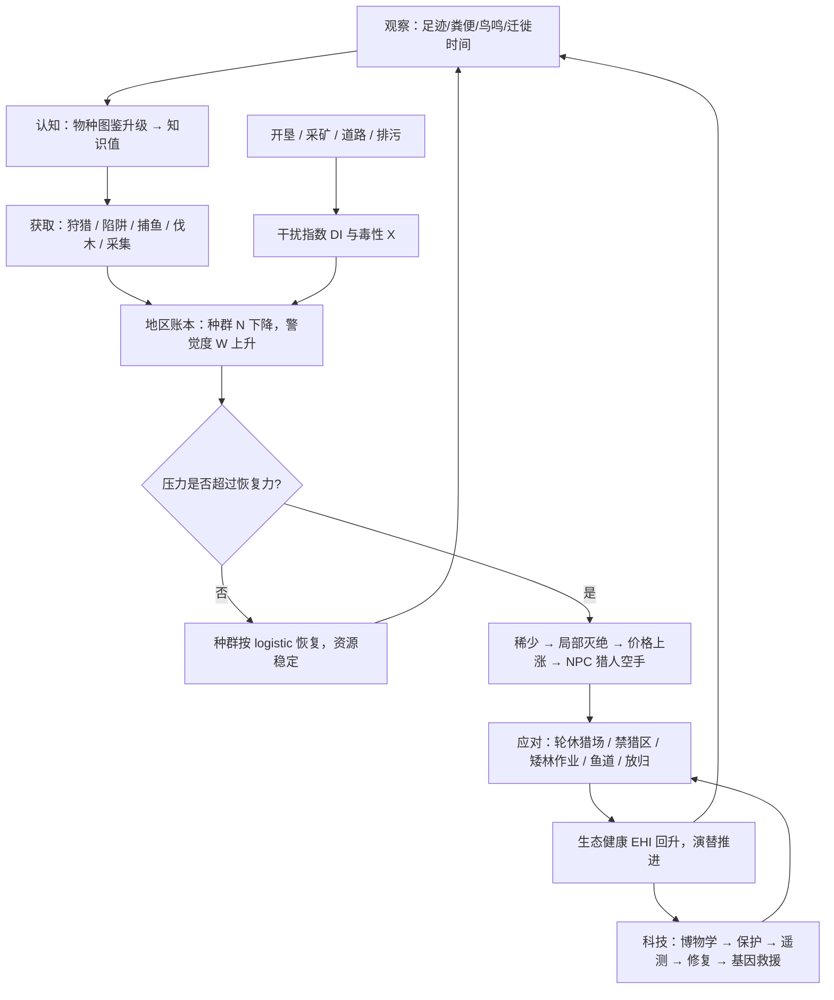
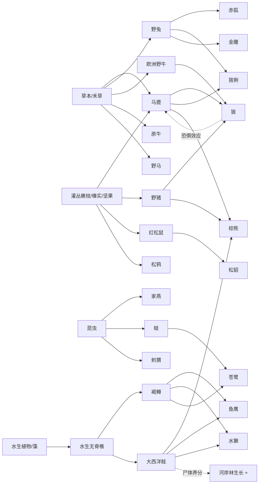

# 11 · 生息 Living Ecology（`tcecology`）

> 文档版本：DD-0.2 · 模组 ID `tcecology` · 包名 `com.nightcity.ecology`（入口类 `TEcology`，事件类 `TEcologyEvents`，已存在）
> 必需依赖：`tcivilization`；可选：全部其他模组（桥接类位于 `com.nightcity.ecology.compat.<other>`）。
> 拥有内容（02 §3）：原木与树苗（新增树种）、野生植物、野生动物、生态附加层 `tcecology:ecosystem`、追踪与观察、林业、野生种群模拟。
> 不拥有：驯化作物与家畜、食物、肥料（Cultivation）；天气、季节、山火与洪水的物理过程（Wildlands）；原版**怪物**生成规则（Beyond）；皮革与金属工具（Industry）；E0-E1 矛与弓（Technology Core）；法律区（Commons）；地图与图层绘制（Atlas）。

---

## 1. 定位与设计支柱

### 1.1 一句话定位

**让世界上的每一头鹿、每一群雁、每一片次生林都是一个有来历、有数量、会对你的行为作出反应的种群。**生息把野生动植物从“随机刷新的装饰”改成“以地区为单位持续演化的生态系统”：狩猎会让猎物变少、变警觉；砍伐会让林地退成灌丛再慢慢长回来；工厂排污会让下游的鳟鱼消失；而禁猎区、鱼道和生态修复能让它们回来。

### 1.2 设计支柱（本模组）

| 编号 | 支柱 | 具体含义 | 对应全局支柱/决策 |
| --- | --- | --- | --- |
| EP-1 | 种群是账本，不是刷怪表 | 每个地区、每个物种都有一个数量 `N`；玩家看到的动物是这个数字的“实体化”，杀死一只就少一只 | 支柱 1、3；DR-18 |
| EP-2 | 后果慢而可见 | 过度狩猎、开垦、采矿、污染的影响以“季-年”为尺度显现，并且能在世界中被看见（兽群变小、林线后退、河里没鱼） | 支柱 7；DR-14 |
| EP-3 | 读懂自然是一种能力 | 追踪足迹、辨认粪便、观察迁徙时间，带来知识与科技；E0 的猎人与 E8 的生态学家用不同工具做同一件事 | 支柱 1、6 |
| EP-4 | 可逆但有代价 | 局部灭绝可由扩散、放归与基因救援恢复；全球灭绝只发生在少数“孑遗物种”上，且 E9 可凭样本救回 | 支柱 7 |
| EP-5 | 写实而克制 | 物种、栖息地、迁徙与演替遵循真实生态学规律的简化版；数值以“游戏个体”计，不按 1:250 面积折算真实密度 | DR-06 |
| EP-6 | 不给玩家加生存条 | 生态只影响资源、聚落与世界状态，不影响玩家个人的饥饿/体温/疾病 | DR-19 |

### 1.3 设计边界

1. 生息不制造“怪物”：所有野生动物都是真实动物；狼、熊、狮等大型捕食者的**威胁行为**由本模组的 AI 决定，但“危险区域等级”由 Frontiers 汇总（`tcfrontiers:danger`）。
2. 原版动物实体（狼、狐、兔、山羊、北极熊、海豚、鳕鱼、鲑鱼等）在可能时**直接复用**，只附加数据组件 `WildlifeComponent`，不重复注册同类实体。
3. 驯化动物（牛、羊、猪、鸡、马等）属于 Cultivation；生息只提供它们的**野生祖先**与“驯化入口”。
4. 生态模拟不得在玩家不在场时造成“玩家不可接受的损失”（02 §4.2）：不会因为 L2 结算而让已命名的驯养动物死亡，也不会在未加载区块里砍掉玩家种的树。

---

## 2. 独立玩法（只安装 `tcivilization` + `tcecology`）

只安装核心与生息时，玩家仍然面对一个“会记账的荒野”。独立玩法分 5 条主线：

### 2.1 追踪与狩猎

- **潜行静止 1 秒**进入“追踪姿态”：半径 12 格（随 `hunting` 熟练度最高 24 格）内显示最近 2 MC 日的足迹、粪便、刮痕、啃食痕迹贴花。足迹带方向、新鲜度和群体规模提示。
- 沿足迹可找到兽群；兽群的警觉度取决于本地区的狩猎压力。被频繁猎杀的地区，鹿在 48 格外就会逃跑；无人打扰的地区可接近到 16 格。
- 设置陷阱：套索 `tcecology:snare`（兔、雉、松鸡）、陷坑 `tcecology:pit_trap`（鹿、野猪）、鱼梁 `tcecology:fish_weir`（河道中拦截洄游鱼）。陷阱每 MC 日按“附近种群密度 × 陷阱效率”结算一次，而不是等实体恰好走进去。
- 每一次猎杀都会写入地区账本。玩家在营地周围一个季节内猎杀 40 头马鹿，会看到“马鹿：稀少（下降中）”，并不得不走得更远。

### 2.2 季节与迁徙

- 驯鹿、野牛、角马成群季节性迁徙；灰雁春北秋南；鲑鱼秋季溯河产卵，熊和金雕随之聚集。
- 迁徙路线由地形、栖息地与障碍计算，每年大致相同。E0 的部族可以“在渡口等待驯鹿群”，这是最高效的狩猎方式之一。
- 冬季食草动物向低海拔、背风林地聚集；夏季上山。

### 2.3 生态演替

- 砍光的林地按“裸地 → 先锋草本 → 草地 → 灌丛 → 先锋林 → 中龄林 → 成熟林 → 原始林”逐级恢复，世界中**真实地长出**草、灌丛和树苗（每个已加载区块每 MC 日少量放置，见 5.8）。
- 计划烧除（E1 科技）可以把灌丛“重置”为草地，提升食草动物承载力——这是真实的史前景观管理方式。

### 2.4 物种图鉴与认知

- 文明面板“生态”页签 `tcecology:ecology` 中的**物种图鉴**记录每个物种的认知等级（未知 → 目击 → 熟悉 → 研究 → 精通）。认知等级提升给出知识值（推进本模组科技）与 `scholarship`/`hunting` 熟练度。
- 种群数量的显示精度随科技提高：E0 只有“常见/少见/稀少/罕见”；E5 博物学给出 ±50% 估计；E8 无线电遥测 ±10%；E10 卫星监测 ±3%。

### 2.5 林业与保护

- E4 矮林作业：在冬季砍伐栗、榛、橡后留下“萌桩”，5-7 年（游戏年）后再次收获细杆，不毁林。
- E3 猎苑、E7 保护区：放置 `tcecology:reserve_marker` 划定保护范围，范围内的狩猎/伐木会降低“生态信誉”并在面板中报警；生物在其中更快恢复。没有 Commons 时只是“自律提示 + NPC 遵守”，有 Commons 时成为可执法的法律区。
- E9 生态修复、基因救援：用本地种子混合物加速演替，用组织样本与圈养繁育让已灭绝物种重回野外。

### 2.6 独立安装时的降级规则

| 缺失模组 | 生息的处理 |
| --- | --- |
| Cultivation | 野生祖先被围养并喂食 6 MC 日后，按 `standalone_domestic_fallback` 转化为对应原版家畜（原牛 → `minecraft:cow`，盘羊 → `minecraft:sheep`，野猪 → `minecraft:pig`，原鸡 → `minecraft:chicken`，野马 → `minecraft:horse`，野驴 → `minecraft:donkey`，原驼 → `minecraft:llama`）；猎物掉落原版肉类与皮革 |
| Wildlands | 季节由核心按日历发布 `SeasonChangedEvent`；气候适宜度改用原版生物群系温度/降水；流域改为“同一区块内连通的水体”近似 |
| Technology Core | 科技解锁的功能（陷阱、计划烧除等）全部默认可用；知识值丢弃 |
| Discovery | 观察信息通过核心 `tcivilization:target_info` 显示；图鉴只在生态页签中 |
| Atlas | 迁徙路线与种群分布以生态页签内的 `TcMapSnippet` 文字/坐标形式显示 |

---

## 3. 联动玩法

每条联动都有降级行为；桥接类在 `com.nightcity.ecology.compat.<other>`。

### 3.1 山河 Wildlands（`tcwildlands`）

- **读取**：`tcwildlands:climate`（年均温、降水、季节振幅、环境负荷造成的气候偏移）决定每个物种的气候适宜度；`tcwildlands:hydro`（流域、河流等级、湖泊）决定鱼类栖息地与洄游路线；`tcwildlands:geo`（岩性）决定湖泊对酸雨的缓冲能力（石灰岩/白垩/大理石流域缓冲强，花岗岩/片麻岩/石英岩流域敏感）。
- **写回**：森林覆盖率、湿地面积通过 `EcologyApi.landCover(region)` 提供给 Wildlands，用于计算蒸散、径流、洪峰削减与地方气候偏移（DR-14 的慢速部分）。河狸坝作为真实方块会抬高局部水位，Wildlands 的河流动态读取它。
- **灾害**：山火（Wildlands 物理过程）把烧过的区块演替阶段重置为 S0，并对种群造成一次性死亡；干旱降低承载力；洪水把鱼类扩散到相邻水系。

### 3.2 田园 Cultivation（`tccultivation`）

- **驯化入口**：生息的野生植物（`tcecology:wild_emmer` 等）与野生祖先动物（`tcecology:aurochs` 等）是 Cultivation 驯化流程的起点；野生植物在 Cultivation 安装时掉落“野生型基因组”的种子。
- **生态服务**：野生蜂类与鸟类为农田提供授粉与虫害控制（`EcologyApi.pollinatorIndex`、`pestPredationIndex`），树篱与林缘提高这两个指数；农药（Cultivation E8）通过生物放大毒害猛禽。
- **冲突**：野猪、鹿、雀群会取食农田（产量损失按附近种群密度计算）；狼与狮会袭击家畜。开垦把地区土地覆盖从森林/草地转成农田，排干湿地（圩田）减少迁徙鸟类的停歇地。
- **猎物产物**：Cultivation 的战利品修饰器把生息动物掉落的原版肉替换为具体物种肉（鹿肉、野猪肉等），并接入食物保存系统。

### 3.3 工坊 Industry（`tcindustry`）

- 读取 `tcindustry:emission`（空气 SO₂/NOₓ/颗粒物，水体有机负荷、重金属、持久性有机物，土壤污染），按 5.9 节计算毒性效应；水污染沿流域向下游传播。
- 鱼道 `tcecology:fish_ladder` 安装在 Industry 的水坝/水车堰旁才能恢复洄游；电气时代起 Industry 的电网为遥测接收站、基因库供电（缺失时基因库使用自带的“液氮补给”物品逻辑）。
- 橡胶树 `tcecology:rubber_tree` 的乳胶、矮林细杆、木材供应 Industry；可持续采伐量显示在生态页签中，过度采伐使供应下降。

### 3.4 通途 Networks（`tcnetworks`）

- `tcnetworks:transport` 中的道路/铁路密度与交通量增加迁徙路线成本与路杀死亡；E7 起可在道路上建野生动物通道（`tcecology:wildlife_crossing_marker` 放在 Networks 的桥/涵洞上）恢复连通性。
- 船只运输可能造成“外来种扩散”（老鼠、兔子到海岛），由生息在港口地区触发小概率事件。

### 3.5 聚落 Settlements（`tcsettlements`）

- 聚落人口与面积构成“人类干扰”；NPC 猎人、樵夫、渔夫的产量来自生息的种群账本（L2 结算时调用 `EcologyApi.harvest(...)`），过度捕猎会让 NPC 猎人空手而归。
- 大型捕食者靠近聚落时向 Settlements 发出 `WildlifeThreatEvent`，NPC 守卫与居民按其规则反应。
- 鼠类与野生动物作为聚落疾病宿主的风险系数提供给 Settlements（不作用于玩家）。

### 3.6 契约 Commons（`tccommons`）

- `tcecology:reserve_marker` 在 Commons 安装时注册为法律区类型“禁猎区/保护林/自然保护区”，违规由 Commons 记录与处罚；狩猎季节、捕捞配额作为政策选项提供给 Commons。
- 生态健康指数 EHI 低于阈值时向 Commons 提供“环境治理”公共工程模板（植树、湿地恢复、排污处理）。

### 3.7 求知 Discovery（`tcdiscovery`）

- 观察模式 `V`（`key.tcdiscovery.observe`）对准动植物时显示生息提供的 `TargetInfoProvider` 详细信息；物种图鉴条目同步为 Discovery 日志中的观察记录。
- 粪便样本 `tcecology:spoor_sample`、组织样本 `tcecology:tissue_sample` 可放入 Discovery 标本设施，作为实验与知识来源；E5 博物学需要 Discovery 的研究设施产出 RP。

### 3.8 舆图 Atlas（`tcatlas`）

- 生息向 Atlas 提供“生态”专题图层数据：物种分布热图、迁徙路线、演替阶段、EHI、保护区边界；数据精度随测绘等级与生态科技提高。
- 遥测项圈（E8）把动物个体位置作为移动标记显示在地图上。

### 3.9 舆图之外的其他联动

| 模组 | 联动 |
| --- | --- |
| 市集 Exchange | 毛皮、象牙（E2-E6）、鲸脂（E5-E6）、木材的区域价格随种群丰度变化；稀缺→涨价→更强的捕猎激励（经典“公地悲剧”反馈）。保护政策会把这些商品标为“禁售” |
| 遗响 Echoes | 世界历史模拟中的古文明会留下“已灭绝物种”记录（例如古文明猎尽了某大陆的猛犸象）；遗迹中可找到冻土遗骸作为基因救援样本；玩家导致的灭绝写入传说 |
| 远征 Frontiers | 大型捕食者密度贡献危险等级；远征队需要按生息的种群数据规划狩猎补给 |
| 列国 Nations | AI 文明同样消耗种群账本（L3 每日按人口计算狩猎/伐木压力）；跨境迁徙物种的保护可以成为条约条款 |
| 异界 Beyond | 原版怪物生成规则归 Beyond；异界影响区内野生动物承载力降低 50%，并出现“逃离”行为 |
| 寰宇 Orbit | E10 卫星生态监测（种群精度 ±3%）；轨道站与火星基地的封闭生物圈使用生息的物种/演替数据（生物圈工程科技） |
| 技能 Skills | 见第 15 节与附录 D |

---

## 4. 核心玩法循环



时间尺度上的三层循环：

| 层 | 尺度 | 玩家行为 | 系统反馈 |
| --- | --- | --- | --- |
| 微循环 | 分钟 | 追踪、潜行接近、射击、设陷阱、观察鸟群 | 足迹新鲜度、动物警觉、掉落、熟练度 |
| 中循环 | 季（12 MC 日） | 选择猎场、等迁徙、伐木与轮休、计划烧除 | 种群季报、承载力变化、演替阶段推进、价格 |
| 宏循环 | 年-时代 | 设立保护区、建鱼道、治理污染、生态修复、基因救援 | EHI 与生物多样性指数、局部灭绝/再定殖、编年史条目、生态科技 |

---

## 5. 系统规则与公式

### 5.1 空间与时间单位

| 概念 | 定义 |
| --- | --- |
| 地区 Region | 512×512 方块（02 §4.1），所有种群账本以“地区 × 物种”为键 |
| 生态格 EcoCell | 64×64 方块，与 Wildlands 气候格对齐；记录土地覆盖与演替统计，一个地区 64 格 |
| 区块演替记录 | 每个已生成区块 1 个 `ChunkSuccession`（8 字节） |
| 种群步长 | 1 MC 日（`DAYS_PER_SEASON = 12`、`DAYS_PER_YEAR = 48`） |
| 繁殖脉冲 | 哺乳类、鸟类在其繁殖季的第 1 日一次性计算出生；鱼类在产卵洄游结束日；昆虫/小型兽每季一次 |
| 游戏个体 | 账本中的 1 个单位 = 世界中可被实体化的 1 只动物。数值经过压缩（一个地区的马鹿 K 约 40-120，而不是真实的上千头），以保证“杀一只少一只”可被玩家感知 |

### 5.2 物种定义（数据驱动）

物种以数据包 JSON 定义：`data/<ns>/tcecology/species/<id>.json`，内置物种见第 7 节。关键字段：

| 字段 | 含义 | 例（马鹿 `red_deer`） |
| --- | --- | --- |
| `trophic` | 营养级 1 植物 / 2 食草 / 3 食肉 / 4 顶级捕食者；杂食取 2.5 | 2 |
| `mass_class` | 体型 XS/S/M/L/XL，决定掉落、射击难度与追踪痕迹尺寸 | L |
| `group` | 群体规模 [min, max] 与社会结构 solitary/pair/herd/flock/school/colony | [3, 12] herd |
| `k_base` | 地区满栖息地承载力（游戏个体） | 96 |
| `r_max` | 年内禀增长率 | 0.35 |
| `allee` | Allee 常数 A（个体） | 4 |
| `mvp` | 最小可存活种群 | 8 |
| `climate` | `t_opt`、`t_width`（℃），`p_opt`、`p_width`（mm/年） | 8, 9, 800, 600 |
| `habitat` | 对 8 类土地覆盖的偏好 0-1 | forest 0.8, edge 1.0, grass 0.7, shrub 0.6 |
| `migration` | none / altitudinal / seasonal_range / flyway / anadromous / nomadic | altitudinal |
| `breeding_season` | spring/summer/autumn/winter | spring |
| `diet` | 食物网边：目标物种或资源及偏好权重 | grass 0.6, browse 0.4 |
| `tolerance` | 对干扰的耐受 0-1（1 = 城市适应者） | 0.3 |
| `sensitivity` | 对 air/water/soil/pop（持久性有机物）的敏感度 | 0.2/0.1/0.2/0.3 |
| `wariness_base` | 基础逃跑距离（格） | 24 |
| `relict` | 孑遗物种：可全球灭绝 | false |
| `entity` | 实体 ID（原版复用或本模组） | `tcecology:red_deer` |
| `tech_relevance` | 相关时代（仅用于图鉴排序与说明） | E0-E6 |

### 5.3 土地覆盖与栖息地质量

每个生态格维护 8 类土地覆盖比例 `cover[h]`，h ∈ {forest, edge, shrub, grass, wetland, freshwater, farmland, built}（海洋物种使用独立的海洋格：coastal、reef、pelagic、ice）。覆盖比例来自区块生成时的生物群系与地表方块采样，并随玩家/NPC 行为增量更新：

| 行为 | 覆盖变化（按方块计，聚合到生态格） |
| --- | --- |
| 砍伐原木（玩家/NPC） | 该区块树冠方块数减少 → forest 向 edge/shrub/grass 迁移 |
| 耕地 `minecraft:farmland` / Cultivation 农田 | grass/shrub → farmland |
| 放置建筑方块（玻璃、砖、混凝土等 `#tcecology:built_surface`） | → built |
| 排干湿地（Cultivation 圩田、填水） | wetland → farmland/grass |
| 演替推进 | grass → shrub → forest |

栖息地质量（物种 s、地区 R）：

```text
H_s   = Σ_h pref_s[h] · cover_R[h]                                   // 栖息地匹配 0..1
C_s   = exp(-((T_R - t_opt)/t_width)²) · exp(-((P_R - p_opt)/p_width)²)  // 气候适宜度
D_s   = 1 - (1 - tolerance_s) · DI_R                                  // 干扰折减
X_s   = Π_k (1 - sensitivity_s[k] · TOX_R[k])                         // 毒性折减，k ∈ {air, water, soil, pop}
F_s   = 1 + 0.25 · protected_fraction_R                               // 保护区加成（上限 1.25）
HQ_s  = clamp(H_s · C_s · D_s · X_s · F_s, 0, 1)
K_s,R = round(k_base_s · HQ_s · (landArea_R / 262144))               // 地区陆地面积占比；海洋物种用水面积
```

`T_R`、`P_R` 取 Wildlands `tcwildlands:climate` 的地区年均值（含环境负荷造成的偏移）；无 Wildlands 时由原版生物群系温度 `temperature × 25 ℃`、降水 `downfall × 1600 mm` 近似。

### 5.4 干扰指数 DI

```text
DI_R = clamp( 0.35·clearRecent_R + 0.20·mineSpoil_R + 0.15·roadDensity_R
            + 0.20·builtFrac_R   + 0.10·noise_R , 0, 1)

clearRecent_R  = 最近 2 年被砍伐的原木数 / 地区成熟林原木估计数        (0..1)
mineSpoil_R    = 采矿移除方块数 / 200,000，上限 1（废石堆放在地表时 ×1.5）
roadDensity_R  = Networks 道路+铁路格数 / 地区格数 × 20，上限 1；无 Networks 时取 0
builtFrac_R    = cover_R[built]
noise_R        = 爆炸、工厂、机车噪声事件计数（每季衰减 50%）/ 500，上限 1
```

DI 以 0.5%/MC 日的速度自然衰减（被拆除的建筑与长回来的林地会逐渐降低 DI）；`clearRecent` 按 2 年滑动窗口自动遗忘。

### 5.5 种群动态

每个 (物种 s, 地区 R) 每 MC 日执行一次离散步（L1/L2 地区）：

```text
// 1. 出生（仅繁殖季第 1 日）
B = r_max · N · (1 - N/K) · N/(N + A) · HQ^0.5        // logistic × Allee
    若 N < 2 或（性别比例记录显示单性）则 B = 0

// 2. 自然死亡（每日）
M_nat = N · m_s / 48,  m_s = r_max · 0.6                // 年基础死亡率摊到每日
       冬季 ×(1 + 0.8·(1 - HQ_winter))                     // 恶劣冬季额外死亡

// 3. 捕食（Holling II，对每个捕食者 p）
M_pred = Σ_p  a_p,s · N · P_p / (1 + a_p,s · h_p · N_prey_total_p) / 48

// 4. 人类收获（已记账的猎杀、陷阱、捕捞、NPC 收获）
M_harv = H_day                                          // 由事件精确累计

// 5. 扩散（与 4 邻地区 j）
Disp_in  = Σ_j d_s · N_j · max(0, 1 - N/K) · conn_j→R
Disp_out = Σ_j d_s · N   · max(0, N/K - 0.8) · conn_R→j

N' = max(0, N + B - M_nat - M_pred - M_harv + Disp_in - Disp_out)
```

常量：`d_s` 扩散率（大型兽 0.02/日、鸟类 0.05/日、鱼类按水系连通 0.03/日），`conn` 为连通度（0-1，受道路、铁路、水坝、城市阻隔，见 5.7）。

**非整数处理**：账本存储 `float N`；实体化时取 `floor(N)`，小数部分作为“下一只出现的概率”。

**未加载地区追赶**：L2/L3 地区不逐日计算，而是在被唤醒或每季检查点时用解析解一次推进 Δt 日：

```text
N(Δt) = K / (1 + ((K - N0)/N0) · exp(-r_eff · Δt/48)) - H_total(Δt)
r_eff = r_max - m_s - predation_mean        // 用上季平均捕食率
```

结果按 `[0, K·1.1]` 截断；`H_total` 来自 Nations/Settlements 在该期间上报的抽象收获。

### 5.6 局部灭绝、再定殖与全球灭绝

| 状态 | 判定 | 后果 |
| --- | --- | --- |
| 常见 Common | N ≥ 0.5K | 正常 |
| 少见 Uncommon | 0.2K ≤ N < 0.5K | 群体变小，警觉度 +0.1 |
| 稀少 Rare | MVP ≤ N < 0.2K | 生成概率降低，图鉴显示“下降中” |
| 濒危 Critical | 1 ≤ N < MVP | 每年按 `p_ext = 0.25 · (1 - N/MVP)` 判定局部灭绝；Allee 效应使出生率极低 |
| 局部灭绝 Extirpated | N < 1 或判定失败 | 账本置 0，标记 `extirpated_since` |
| 全球灭绝 Extinct | 仅 `relict = true` 物种，所有地区 N = 0 且无圈养个体 | 写入编年史，停止再定殖；保留基因救援入口 |

再定殖：局部灭绝地区只要某邻地区 N_j ≥ 0.5K_j 且连通度 ≥ 0.3，扩散公式自然生效；岛屿与被城市完全包围的地区不会自然恢复，只能放归（`tcecology:captive_breeding_pen` 产出的个体放生）。

孑遗物种（默认：猛犸象 `woolly_mammoth`、原牛 `aurochs`、大海雀 `great_auk`、渡渡鸟样鸟 `island_dodo`、旅鸽 `passenger_pigeon`、袋狼样兽 `marsupial_wolf`）的全球种群初始就很低，且分布在少数地区。世界生成时由种子决定其是否出现（约 70% 的世界拥有 ≥ 4 种）。

### 5.7 连通度与迁徙

地区图：每个地区为节点，与 8 邻地区相连。边成本：

```text
cost(R→j) = 1/(0.1 + HQ_s,j) + slope_j · 0.5 + barrier_j
barrier_j = 2·roadDensity_j + 4·railDensity_j + 6·builtFrac_j + damBarrier_j(鱼类)
           - 1.5·wildlifeCrossings_j (下限 0)
conn(R→j) = clamp(1 - barrier_j / 8, 0, 1)
```

| 迁徙类型 | 物种例 | 路线计算 | 时间 |
| --- | --- | --- | --- |
| altitudinal 垂直迁移 | 马鹿、岩羊、北山羊 | 在本地区与相邻地区之间按海拔带移动；夏季高带，冬季低带 | 春季第 1 日上山，秋季第 6 日下山 |
| seasonal_range 季节性草场 | 驯鹿、野牛、角马、高鼻羚羊 | 每年初在“夏季区”“冬季区”（栖息地最适合的 2 组地区）之间用 A* 求路线，缓存一年 | 春季北上（南半球反相），秋季返回；每日移动 0.25-0.5 地区 |
| flyway 鸟类迁飞 | 灰雁、鹤、家燕 | 沿大陆尺度的南北走廊（世界生成时按海岸与河谷确定 2-4 条），停歇于湿地地区 | 春/秋季，每日 1-2 地区；湿地减少会降低停歇地质量与成活率 |
| anadromous 溯河洄游 | 大西洋鲑、鲟鱼、鳗鲡（降海） | 沿 Wildlands 河流网由河口到上游产卵地；水坝 `damBarrier = 8`（不可通过），鱼道降为 1 | 秋季第 1-8 日上溯，产卵后成鱼大量死亡（营养进入河岸林） |
| nomadic 游荡 | 狼群、狮群、鸦群 | 跟随猎物密度梯度，每季重选领地 | 连续 |

迁徙中的兽群作为 L1 `HerdRecord` 沿路线移动；当路线经过玩家附近（≤ 192 格）时实体化并真实移动（使用 `MigrationGoal`，见 5.11），离开后回到记录。渡口、山口等狭窄点会被标为“迁徙要冲”（Atlas 图层中可见），这是 E0 狩猎的最佳伏击点。

### 5.8 生态演替

每个区块有一个演替记录：

```text
ChunkSuccession { byte stage; short ageDays; byte disturbanceType; byte seedSourceMask; byte flags; }
```

| 阶段 | 名称 | 标志植被（随生物群系变化） | 进入下一阶段所需天数（温带基准） |
| --- | --- | --- | --- |
| S0 | 裸地 Bare | 裸土、砾石、烧焦地表 | 6 |
| S1 | 先锋草本 Pioneer herbs | 一年生草本、蕨类 `tcecology:fireweed` | 12 |
| S2 | 草地 Grassland | 短草、高草、野花 | 48 |
| S3 | 灌丛 Shrubland | `tcecology:hazel_shrub`、悬钩子、山楂 | 96 |
| S4 | 先锋林 Pioneer forest | 桦、杨、松（喜光树种）幼树 | 192 |
| S5 | 中龄林 Young forest | 混交，郁闭度 60% | 384 |
| S6 | 成熟林 Mature forest | 顶极树种（山毛榉、橡、云杉等）主导 | 960 |
| S7 | 原始林 Old growth | 大径木、倒木、林下苔藓 `tcecology:forest_floor_moss`；不再推进 | — |

```text
progressRate = clamp(C_growth · moisture · (1 - 0.5·TOX_soil) · seedSource, 0.1, 2.0)
C_growth     = 生长季长度 / 32 日（寒带 0.4，温带 1.0，热带 1.6）
seedSource   = 1.0（邻近 64 格内有 S5+ 区块）/ 0.6（128 格内）/ 0.3（无）
              生态修复科技 + 撒播种子混合物 → 2.0
ageDays 按 progressRate 每 MC 日增加；达到阈值后 stage++，ageDays = 0
```

**世界中的可见变化**：已加载（L0）区块每 MC 日按阶段目标执行 `succession_blocks_per_chunk_day`（默认 3）次方块变更：在草方块上放草、花、灌丛、树苗（树苗之后按原版/本模组树木生长规则长大）。只在**非玩家建造**的位置放置：目标方块 2 格内没有 `#tcecology:built_surface`、不在 Commons 私有领地中（无 Commons 时：距离玩家放置过方块的位置 ≥ 8 格，依据 `PlayerPlacedMask`）、不在农田中。

**倒退**：砍伐使所在区块按剩余树冠比例退到 S1-S3；山火退到 S0（disturbanceType = FIRE，S0→S1 时间减半，火烧地更快长草）；采矿弃土覆盖地表退到 S0；过度放牧（Cultivation 报告）把 S3+ 退到 S2；计划烧除把 S3 退到 S2 并标记 `managed_burn`，此后 2 年 S2→S3 时间 ×1.5。

**区块卸载期间**：区块重新加载时按经过天数一次性计算 stage/ageDays，但方块放置最多补 `succession_catchup_blocks`（默认 24）次，其余变化以“演替偏差”记录，后续每日缓慢补齐，避免加载卡顿。

### 5.9 污染、毒性与生物放大

生息不产生污染，只读取 Industry 的 `tcindustry:emission` 附加层（缺失时全部为 0）以及本模组自己计算的酸性矿山排水。每地区 4 个毒性分量 `TOX[k] ∈ [0,1]`：

```text
TOX_air   = clamp(SO2_R/40 + NOx_R/60 + PM_R/80, 0, 1)              // 单位为 Industry 定义的地区年均指数
TOX_water = clamp(organic_R/50 + metals_R/10 + AMD_R + upstream_R, 0, 1)
TOX_soil  = clamp(soilContam_R/30 + 0.5·acidDeposition_R, 0, 1)
TOX_pop   = clamp(POP_R/5, 0, 1)                                     // 持久性有机物（含 Cultivation 农药 DDT 类）
// organic_R、POP_R 另加 Cultivation 经 reportDisturbance(NUTRIENT_RUNOFF / AGROCHEMICAL) 上报的地区年累计量（12 章 5.16），Industry 缺失时仅含该部分

upstream_R = Σ_{上游地区 u} TOX_water_u · 0.7^(河段距离/地区)   // 沿 Wildlands 河流网向下游衰减传播
acidDeposition_R = 0.6·TOX_air_R · (1 - buffer_R)
buffer_R   = 流域岩性缓冲：limestone/chalk/dolomite/marble = 0.9；mudstone/shale = 0.5；
             minecraft:granite/gneiss/quartzite/sandstone_rock = 0.1；其余 0.4
```

**酸性矿山排水 AMD**：开采或暴露含硫化物矿物的方块（`tcwildlands:chalcopyrite`、`tcwildlands:galena`、`tcwildlands:sphalerite`、`tcwildlands:pentlandite`、`tcwildlands:molybdenite` 矿石方块，以及煤层 `bituminous_coal`、`lignite`）且废石堆放在地表露天时：

```text
AMD_R += 0.00002 × 暴露硫化物方块数 × (1 - buffer_R)     // 每季结算，上限 0.6
废石被掩埋（覆土 ≥ 2 格）或放入 Industry 尾矿库：该部分不计
生态修复科技后可放置 tcecology:constructed_wetland：每个使 AMD_R 每季 ×0.9
```

**生物放大**（持久性有机物与汞）：

```text
body_burden(tl) = TOX_pop · BMF^(tl - 1),  BMF = 3.0      // tl = 营养级
若 body_burden ≥ 0.5：繁殖率 r_max ×(1 - (body_burden - 0.5))   // 猛禽蛋壳变薄、鱼类繁殖失败
若 body_burden ≥ 1.2：每日额外死亡 1%
```

因此 TOX_pop = 0.15 时，鱼鹰（tl 4）`body_burden = 0.15·27 = 4.05`，几乎不能繁殖，而鹿（tl 2）只有 0.45，无可见影响。这对应真实的 DDT 历史，玩家会先看到“白头海雕样猛禽消失”，然后才意识到问题。

**恢复**：Industry 排放下降后，TOX 分量每季按 `TOX ×= 0.85`（POP 为 0.95，残留更久）衰减；生态修复使衰减系数再 ×0.9。

### 5.10 食物网

食物网是物种 `diet` 字段构成的有向图。内置的温带陆地-淡水网（简化）：



规则：

1. **猎物转换**：捕食者出生率乘以 `food_s = min(1, Σ_prey a·N_prey / demand_s)`；猎物不足时捕食者先下降，之后扩散出去或在下一季饿死。
2. **营养级联**：狼存在时，马鹿在河岸地带的觅食时间减少（恐惧效应），河岸生态格的演替 progressRate ×1.2，鸟类与河狸承载力 +10%（黄石公园狼重引入的简化版）。
3. **关键种**：河狸（建坝 → 湿地 +）、大西洋鲑（尸体养分 → 河岸林 +）、野牛/原牛（啃食维持草地 → S2 停留更久）有专门的生态效应，图鉴中标记“关键种”。
4. 原版海洋网（鳕鱼、鲑鱼、热带鱼、鱿鱼、海豚、海龟、美西螈）复用原版实体，补充 `tcecology:herring`、`tcecology:atlantic_cod_stock`（不新增实体，只作为原版鳕鱼的地区种群键）、`tcecology:grey_seal`、`tcecology:right_whale`、`tcecology:great_auk`。
5. 外来物种：当 Networks 船只把老鼠/兔子带到无捕食者的岛屿地区，该物种 K ×3，本土地面筑巢鸟类（大海雀、渡渡鸟样鸟）出生率 ×0.3。

### 5.11 实体化、AI 与原版刷怪替代

**实体化**：

```text
对每个 L0/L1 地区、每个兽群 HerdRecord h：
  若有玩家距离 h.pos ≤ embody_radius（默认 128 格）且 h.pos 所在区块已加载：
      spawnCount = min(h.count, groupMax_s, 剩余全局额度)
      在 h.pos 附近合法地表生成 spawnCount 个实体，每个实体带 WildlifeComponent(herdId, speciesId)
  若兽群全部实体离玩家 > despawn_radius（默认 176 格）或区块卸载：
      h.count = 存活实体数 + 未实体化部分；实体移除（不掉落）
全局上限 MAX_EMBODIED_WILDLIFE = 300（02），按距离玩家由近到远分配
```

一个地区的种群 N 被拆为若干 HerdRecord（群居物种按 `group` 随机分群；独居物种每只 1 条记录，但只为距玩家最近的 32 条维持精确位置，其余用“地区内随机位置”懒生成）。

**行为（Goal）**，所有野生动物共享以下 AI 组件，按物种参数化：

| Goal | 说明 |
| --- | --- |
| `GrazeBrowseGoal` | 食草：低头进食；草方块被啃食的概率 0.002/实体/分钟（只把 `short_grass` 变为空气，不破坏玩家方块） |
| `HerdCohesionGoal` | 跟随群首，保持 3-8 格间距 |
| `WaryFleeGoal` | 检测玩家/捕食者；逃跑距离 `flee = wariness_base · (1 + 2·W_R) · (潜行 ? 0.5 : 1) · (下风 ? 0.6 : 1)` |
| `StalkHuntGoal` | 捕食者：潜近、冲刺、只在饥饿值 < 0.5 时狩猎；可攻击原版及 Cultivation 家畜（围栏 + 牧羊犬 + 夜间圈舍可防） |
| `DefendGoal` | 野猪、原牛、棕熊、母兽带幼崽时在 6 格内反击 |
| `MigrationGoal` | 沿 HerdRecord 路线移动，避开围栏与村庄 |
| `RoostNestGoal` | 鸟类黄昏归巢、清晨鸣唱（触发 `tcecology:ambient.dawn_chorus`） |

风向由 Wildlands 天气提供（无 Wildlands 时固定西风），“下风接近”使逃跑距离 ×0.6，这是 `hunting` 技能的核心技巧之一。

**警觉度 W**：

```text
每次在地区 R 内被玩家/NPC 猎杀某物种：W_R,s += 0.04（被同群目击时 +0.08）
每 MC 日：W_R,s ×= 0.985（约 46 日，即一年，降到一半）
禁猎区内衰减为 ×0.96
```

**原版刷怪替代**：

1. 通过 NeoForge 生物群系修饰器 `tcecology:remove_vanilla_wildlife` 移除主世界所有生物群系中 `creature`、`ambient`、`water_creature`、`water_ambient`、`underground_water_creature`、`axolotls` 类别的原版自然生成；**`monster` 类别完全不动**（归 Beyond）。
2. 区块生成时的初始动物（原版 `spawnInitialMobs`）也被关闭，改由生息在区块首次加载时按 HerdRecord 实体化。
3. 原版繁殖（喂小麦繁殖牛等）不受影响；属于 Cultivation 的家畜范畴。
4. 原版的鳕鱼/鲑鱼/热带鱼/鱿鱼/发光鱿鱼/海豚/海龟/美西螈/蝌蚪/青蛙/蝙蝠/狐狸/狼/兔/山羊/北极熊/熊猫/鹦鹉/豹猫/犰狳/嗅探兽（仅遗迹孵化）作为生息物种复用，不再由原版生成而由账本实体化。
5. 下界、末地中的动物（炽足兽等）不归本模组处理。

### 5.12 追踪

**痕迹记录**：每个区块维护一个 16 条的环形缓冲 `TrackRing`：

```text
TrackEntry { short speciesIdx; byte localX, localZ; short y; byte dirAndKind; byte groupSize; int dayTick; }
// kind: FOOTPRINT / SCAT / RUB / BROWSE / FEATHER / DEN_ENTRANCE
```

- 实体化动物每 40 tick 采样一次位置，与上次采样距离 ≥ 3 格时写入足迹；食草动物进食处写入 BROWSE；捕食者领地边界写入 RUB/SCAT。
- 未实体化但经过的 HerdRecord 每 MC 日在其路线所经区块写入 1-3 条合成足迹。这样玩家能在迁徙路线上发现“昨天有 12 头驯鹿经过”。
- 痕迹寿命 2 MC 日（雨天 1 日，雪地 3 日且更清晰）。

**追踪姿态**：玩家潜行且移动速度 < 0.01 持续 20 tick 后，客户端请求附近 `track_radius` 内区块的 TrackRing（`tcecology:track_request` → `tcecology:track_sync`），并以贴花粒子显示：

| 显示内容 | 解锁条件 |
| --- | --- |
| 痕迹位置与类型 | 始终 |
| 方向箭头 | `hunting` ≥ 10 或科技 `stone/game_tracking` |
| 物种名 | 图鉴等级 ≥ 熟悉 |
| 新鲜度（小时）与群体规模 | 图鉴等级 ≥ 研究，或 `hunting` ≥ 40 |
| 个体性别/年龄 | E5 博物学 + 图鉴精通 |

```text
track_radius = 12 + floor(hunting_level / 10) × 2，上限 24
```

追踪是一种“知识行为”：沿同一物种痕迹走 ≥ 48 格并找到个体，图鉴进度 +1 次“追踪”。

### 5.13 物种图鉴与知识

每个文明（单人时即玩家）对每个物种有一个认知等级与进度：

| 等级 | 名称 | 达成条件（任一组） | 一次性知识值 |
| --- | --- | --- | --- |
| 0 | 未知 | — | — |
| 1 | 目击 Sighted | 在 32 格内看到一次（视线检查，客户端报告由服务端校验距离） | 1 |
| 2 | 熟悉 Familiar | 观察（V 或潜行注视 5 秒）3 次 / 猎获 1 次 / 追踪 1 次 | 3 |
| 3 | 研究 Studied | 跨 2 个不同季节观察 / 在 Discovery 设施中检验粪便或组织样本 1 次 / 遥测项圈 1 个 | 8 |
| 4 | 精通 Mastered | 已解锁 `renaissance/natural_history` 且研究 3 次以上，且观察过其繁殖或迁徙 | 15 |

知识值按 Technology Core 的知识接口计入本模组科技的“知识阈值”（附录 B）；没有 Technology 时丢弃。图鉴等级同时决定种群显示精度：

| 科技 / 等级 | 种群显示 |
| --- | --- |
| E0 默认 | 常见 / 少见 / 稀少 / 罕见 / 未见 |
| 研究等级 + `iron/hunting_reserves`（猎苑簿记） | 上述 + 趋势箭头（↑ → ↓），并附文字“上升/持平/下降” |
| `renaissance/natural_history` | 数量估计 ±50% |
| `electric/wildlife_conservation`（普查方法） | ±25%，按季普查报告 |
| `atomic/radio_telemetry` | ±10%，迁徙路线实时 |
| Orbit 卫星监测（`tcorbit` 联动） | ±3% |

估计误差为确定性伪随机（以地区坐标+物种+季节为种子），防止玩家反复打开面板“平均掉误差”。

### 5.14 生态健康指数 EHI 与生物多样性

```text
richness_R   = 当前 N ≥ 1 的本土物种数 / 该地区潜在物种数（世界生成时按气候与栖息地计算）
status_R     = 平均 min(1, N_s / (0.5·K_pot_s))                  // K_pot = 无干扰无污染时的 K
maturity_R   = 区块演替阶段均值 / 潜在顶极阶段
cleanliness_R= 1 - max(TOX[k])
connect_R    = 平均 conn(R→j)

EHI_R = 100 × (0.30·richness + 0.25·status + 0.20·maturity + 0.15·cleanliness + 0.10·connect)
```

| EHI | 等级 | 文字 | 效果 |
| --- | --- | --- | --- |
| 80-100 | A | 繁荣 | Settlements 的“自然景观”舒适度 +；Echoes 可生成“圣林”传说 |
| 60-79 | B | 健康 | 无 |
| 40-59 | C | 受损 | 警报（扩展等级 HUD）；Commons 获得治理模板 |
| 20-39 | D | 退化 | 野生蜂授粉指数 ×0.6；Wildlands 地方气候偏移加剧 |
| 0-19 | E | 崩溃 | 编年史记录；Nations 中关注环境的 AI 文明关系 -10 |

**文明生态信誉**（Eco-standing，-100..100）：按领地内 EHI 年变化、保护区面积、灭绝事件（-30/个全球灭绝，-5/个局部灭绝）、放归成功（+10）累积。供 Nations（AI 态度）与 Echoes（传说基调）读取；生息本身不对玩家施加惩罚。

### 5.15 驯化入口（与 Cultivation 的接口）

```text
野生祖先 → 驯化条件：
  1. 围栏内（Cultivation 的围场判定；无 Cultivation 时 9×9 以内封闭围栏）
  2. 每日喂食偏好食物（原牛：小麦/干草；盘羊：草/小麦；野猪：橡实/块根；原鸡：种子）
  3. 无捕食者惊扰（W 本地 < 0.3）
  每满足一日：tameProgress += 1/6
  tameProgress ≥ 1 → 发出 WildAncestorPennedEvent；
     有 Cultivation：由 Cultivation 接管（驯化指数、品种起源，见 12 章）
     无 Cultivation：若 standalone_domestic_fallback = true，转化为对应原版家畜
```

捕获幼兽（潜行 + 空手右键幼崽，需 `hunting` ≥ 15）可跳过 3 日。驯化入口只对标记 `domestication_target` 的物种开放。

### 5.16 林业

| 作业 | 科技 | 规则 |
| --- | --- | --- |
| 择伐 | 无 | 区块内保留 ≥ 50% 树冠时只退一级（S6→S5） |
| 计划烧除 | `neolithic/controlled_burning` | 手持火把对 S2-S3 区块中的草方块右键并确认（`TcConfirmDialog`），点燃 8×8 低强度地表火（Wildlands 火焰规则 ×0.3 蔓延，不点燃原木）；无 Wildlands 时直接把区块内的灌丛方块换成草 |
| 矮林作业 | `medieval/coppicing` | 冬季砍伐 `#tcecology:coppiceable`（橡、栗、榛、柳、白蜡）根部原木时，留下 `tcecology:coppice_stool`（萌桩方块）；萌桩 5 年（240 日）长出 4-8 根细杆 `tcecology:coppice_pole`，可反复收获，区块演替不倒退 |
| 科学林业 | `industrial/scientific_forestry` | 解锁林场标记 `tcecology:forest_stand_marker`：显示林分蓄积量、可持续年采伐量 `AAC = Σ 生长量`；NPC 樵夫按 AAC 收获 |
| 植树造林 | `industrial/scientific_forestry` | 苗圃 `tcecology:tree_nursery` 培育树苗（含新树种），种植成活率 90%；单一树种造林使 richness 贡献 ×0.5 |

```text
蓄积量 V_stand = Σ 区块内原木方块数（缓存，砍伐/生长时增量更新）
年生长量 G = V_stand · g_species · C_growth,  g = 0.03（针叶）/ 0.02（阔叶）/ 0.05（桉、杨）
可持续年采伐量 AAC = G；实际采伐 > AAC 时“林业警报”
```

### 5.17 圈养繁育、基因库与基因救援

| 设施 | 科技 | 规则 |
| --- | --- | --- |
| 圈养繁育栏 `captive_breeding_pen` | `electric/wildlife_conservation` | 多方块（核心方块 + 围栏 7×7+）；放入同种雌雄个体后按 `r_max × 1.5` 繁殖；每代遗传多样性 `Hdiv ×= (1 - 1/(2·Ne))`，Ne = 有效种群；Hdiv < 0.6 时出现“近交衰退”（出生率 ×Hdiv） |
| 组织样本 `tissue_sample` | `atomic/radio_telemetry` 或 `information/genetic_rescue` | 对活体（麻醉镖，Frontiers/Technology 的弓弩可用；无则用遥测项圈装配时附带）、新鲜尸体或 Echoes 冻土遗骸右键获取；记录物种与个体基因签名 |
| 基因库 `gene_bank` | `information/genetic_rescue` | 存储样本；每个样本 +0.05 物种 Hdiv 上限；需供电 2 kW（无 Industry 时每 48 日消耗 1 个 `liquid_nitrogen_flask`，由本模组配方以低效率提供） |
| 复原 | `information/genetic_rescue` | 基因库中同一物种 ≥ 6 个不同个体样本 → 在圈养繁育栏中“复原”1 对个体；全球灭绝物种因此回到“仅圈养”状态，放归后成为常规种群 |

放归：在 HQ ≥ 0.6 的地区用繁育栏的“放归”按钮选择 ≥ 6 个个体；首年死亡率 ×1.5（软放归围栏可降为 ×1.1）。

### 5.18 生物圈工程（E10）

`space/biosphere_engineering` 让玩家为 Orbit 的封闭栖息地（轨道站、月面/火星基地）配置“生物圈模板”：选择 6-20 个物种（植物、传粉者、分解者、小型动物）。生息按 5.10 的食物网规则检查闭合性：

```text
closure = 有生产者 ∧ 有分解者 ∧ 每个消费者的 food_s ≥ 0.8 ∧ 传粉需求被满足
stability = 1 - 方差(季节模拟 4 年 N_s / K_s)            // 后台线程跑快照模拟
氧气/食物/废物循环效率 = 0.5 + 0.4·closure·stability   （供 Orbit 生命维持计算）
```

无 Orbit 时该科技只解锁“生态缸” `tcecology:terrarium` 装饰性多方块与一次性知识奖励，并在科技树中提示“需要寰宇以完整使用”。

---

## 6. 数值表

### 6.1 代表性物种参数（完整参数在数据包中）

| 物种 | k_base | r_max | 群体 | 体型 | 基础逃跑距离 | 迁徙 | 关键掉落（无 Cultivation 时） |
| --- | --- | --- | --- | --- | --- | --- | --- |
| 马鹿 red_deer | 96 | 0.35 | 3-12 | L | 24 | altitudinal | 生牛肉×2-3、皮革×1-2、鹿角（雄，秋冬） |
| 狍 roe_deer | 120 | 0.45 | 1-3 | M | 20 | none | 生羊肉×1-2、皮革×1 |
| 驯鹿 reindeer | 160 | 0.30 | 20-60 | L | 32 | seasonal_range | 生牛肉×2、皮革×2、鹿角 |
| 原牛 aurochs | 40 | 0.20 | 4-15 | XL | 20（会反击） | none | 生牛肉×4、皮革×3 |
| 野猪 wild_boar | 80 | 0.60 | 3-10 | M | 16（会反击） | none | 生猪肉×2-3 |
| 野马 wild_horse | 60 | 0.25 | 5-15 | L | 40 | nomadic | 皮革×2 |
| 欧洲野牛 bison | 50 | 0.22 | 8-30 | XL | 28 | seasonal_range | 生牛肉×4、皮革×3 |
| 猛犸象 woolly_mammoth | 8 | 0.08 | 3-8 | XL | 24（会反击） | seasonal_range | 生牛肉×8、毛皮、象牙×2 |
| 河狸 beaver | 30 | 0.40 | 2-6 | S | 12 | none | 毛皮 |
| 狼 wolf（原版） | 12 | 0.30 | 4-8 | M | 32 | nomadic | 毛皮 |
| 棕熊 brown_bear | 6 | 0.12 | 1 | XL | 12（领地内攻击） | altitudinal | 毛皮、生猪肉×3 |
| 猞猁 lynx | 8 | 0.25 | 1 | M | 36 | none | 毛皮 |
| 灰雁 greylag_goose | 200 | 0.50 | 10-40 | S | 28 | flyway | 生鸡肉、羽毛×3 |
| 大西洋鲑（原版鲑鱼） | 400/河段 | 1.20 | 10-40 | S | 6 | anadromous | 生鲑鱼 |
| 露脊鲸 right_whale | 10/海洋地区 | 0.04 | 1-3 | XL | 16 | seasonal_range | 鲸脂×12、鲸须 |

### 6.2 狩猎与陷阱

| 方式 | 每 MC 日判定 | 成功率公式 | 备注 |
| --- | --- | --- | --- |
| 套索 snare | 1 次 | `0.15 + 0.6·density(S/XS 物种)`，上限 0.6 | 同区块 ≥ 3 个套索时每个效率 ×0.6；只捕兔、雉、松鸡、松鼠 |
| 陷坑 pit_trap | 1 次 | `0.05 + 0.3·density(M/L)` | 被捕动物每日 30% 概率逃脱（未检查时） |
| 鱼梁 fish_weir | 1 次 | `0.2 + 0.8·flow·density(鱼)`；洄游期 ×3 | 鱼梁所在河段 conn ×0.7（阻碍洄游） |
| 捕获网 capture_net | 每次投掷 | `0.5·(1 - W)`（对 S/XS 或幼崽） | 活捉，用于驯化或放归 |

```text
density(s) = N_s,R / K_pot_s,R           // 相对密度 0..1+
```

### 6.3 掉落与可持续收获参考

| 类别 | 可持续年收获上限（占 N） | 说明 |
| --- | --- | --- |
| 小型兽（兔、松鸡） | 40% | 高繁殖率 |
| 中型兽（狍、野猪） | 25% | |
| 大型兽（马鹿、驯鹿） | 15% | |
| 超大型兽（原牛、野牛、象、猛犸） | 4% | 很容易猎尽 |
| 大型捕食者 | 5% | |
| 洄游鱼类 | 30%（洄游期） | 鱼梁 + 水坝极易造成崩溃 |
| 鲸类 | 2% | E5-E6 捕鲸的历史性崩溃 |

**骨头**（30 §7.1）：本模组不做尸骸分解，也不在物种掉落表里另写骨头。数据包向核心实体类型标签 `#tcivilization:bone_bearing` 追加（`replace: false`）全部 `mass_class` ≥ M 的陆生哺乳类物种（马鹿、狍、驯鹿、原牛、野猪、盘羊、野山羊、野马、野驴、原驼、棕熊等；不含鱼类、鸟类与鲸类），由核心 GLM `tcivilization:scarcity_bones` 在有效怪物策略 ≠ `VANILLA` 时按 35%（抢夺每级 +10%）掉落 1 根骨头（03 §16）。兽穴 `tcecology:animal_den` 的战利品箱含骨头 ×3-8。这样骨头只有一个掉落来源，不会与核心修改器叠加。

生态页签对每个物种显示“本年度收获 / 可持续上限”进度条（`TcProgressBar`，文字同时给出百分比与“安全/超额”）。

### 6.4 HUD 与面板刷新

| 数据 | 刷新 |
| --- | --- |
| `tcecology:ecosystem_health` HUD 数据通道 | 200 tick（或进入新地区时立即） |
| `tcecology:tracking` HUD | 客户端 10 tick，基于已同步 TrackRing |
| 生态页签快照 | 打开时 + 40 tick 增量（核心规则） |
| 种群季报通知 | 每季第 1 日，仅对“有变化 ≥ 1 级”的已知物种 |

---

## 7. 内容清单

### 7.1 野生动物（新增实体，`tcecology:`）

“时代”为主要相关时代（世界中始终存在，直到灭绝）。“驯化”列为 Cultivation 中的驯化去向（无 Cultivation 时的原版回退见 2.6）。

| ID | 中文 | 群系/栖息地 | 相关时代 | 营养级 | 驯化 | 备注 |
| --- | --- | --- | --- | --- | --- | --- |
| `red_deer` | 马鹿 | 温带林、林缘 | E0-E6 | 2 | — | 秋季发情吼叫 |
| `roe_deer` | 狍 | 林缘、灌丛 | E0-E6 | 2 | — | |
| `reindeer` | 驯鹿 | 苔原、北方林 | E0-E7 | 2 | Cultivation 驯鹿放牧 | 大规模迁徙 |
| `moose` | 驼鹿 | 北方林湿地 | E0-E7 | 2 | — | |
| `bison` | 野牛 | 草原、林地 | E0-E6 | 2 | — | 关键种 |
| `aurochs` | 原牛 | 温带林地、河谷 | E0-E4 | 2 | `minecraft:cow` | 孑遗 |
| `wild_boar` | 野猪 | 阔叶林 | E0-E7 | 2.5 | `minecraft:pig` | 毁坏农田 |
| `mouflon` | 盘羊 | 山地 | E0-E3 | 2 | `minecraft:sheep` | |
| `bezoar_ibex` | 野山羊 | 干旱山地 | E0-E3 | 2 | `tccultivation:goat` | |
| `wild_horse` | 野马 | 草原 | E0-E4 | 2 | `minecraft:horse` | |
| `wild_ass` | 野驴 | 荒漠草原 | E0-E3 | 2 | `minecraft:donkey` | |
| `guanaco` | 原驼 | 高原草地 | E0-E3 | 2 | `minecraft:llama` | |
| `wild_yak` | 野牦牛 | 高寒草甸 | E0-E4 | 2 | `tccultivation:yak` | |
| `wild_water_buffalo` | 野水牛 | 热带湿地 | E0-E3 | 2 | `tccultivation:water_buffalo` | |
| `saiga` | 高鼻羚羊 | 干草原 | E0-E7 | 2 | — | |
| `wildebeest` | 角马 | 热带稀树草原 | E0-E8 | 2 | — | 大迁徙 |
| `zebra` | 斑马 | 热带稀树草原 | E0-E8 | 2 | — | |
| `gazelle` | 瞪羚 | 荒漠草原 | E0-E7 | 2 | — | |
| `elephant` | 象 | 热带林、稀树草原 | E0-E8 | 2 | — | 象牙贸易 |
| `woolly_mammoth` | 猛犸象 | 猛犸草原（寒冷草原） | E0-E2 | 2 | — | 孑遗 |
| `beaver` | 河狸 | 河流、湖泊 | E0-E7 | 2 | — | 关键种，筑坝 |
| `red_squirrel` | 红松鼠 | 针叶林 | E0-E10 | 2 | — | 种子传播 |
| `hedgehog` | 刺猬 | 林缘、聚落 | E0-E10 | 3 | — | 城市适应者 |
| `brown_bear` | 棕熊 | 山地林 | E0-E8 | 3.5 | — | |
| `lynx` | 猞猁 | 北方林 | E0-E8 | 3.5 | — | |
| `lion` | 狮 | 稀树草原 | E0-E8 | 4 | — | |
| `tiger` | 虎 | 季风林 | E0-E8 | 4 | — | |
| `pine_marten` | 松貂 | 针叶林 | E0-E8 | 3 | — | 毛皮 |
| `otter` | 水獭 | 河流 | E0-E8 | 3.5 | — | 污染指示种 |
| `marsupial_wolf` | 袋狼样兽 | 岛屿林地 | E0-E7 | 3.5 | — | 孑遗 |
| `brown_rat` | 褐家鼠 | 聚落、港口 | E1-E10 | 2.5 | — | 储粮害兽，外来种 |
| `red_junglefowl` | 原鸡 | 热带林下 | E0-E2 | 2 | `minecraft:chicken` | |
| `wild_turkey` | 野火鸡 | 温带林 | E0-E4 | 2 | `tccultivation:turkey` | |
| `mallard` | 绿头鸭 | 湿地 | E0-E10 | 2 | `tccultivation:duck` | |
| `greylag_goose` | 灰雁 | 湿地 | E0-E10 | 2 | `tccultivation:goose` | 迁飞 |
| `pheasant` | 雉 | 林缘、农田 | E0-E10 | 2 | — | |
| `grouse` | 松鸡 | 北方林、荒原 | E0-E8 | 2 | — | |
| `common_crane` | 灰鹤 | 湿地 | E0-E10 | 3 | — | 迁飞 |
| `barn_swallow` | 家燕 | 农田、聚落 | E1-E10 | 3 | — | 害虫控制 |
| `passenger_pigeon` | 旅鸽 | 温带阔叶林 | E0-E6 | 2 | — | 孑遗，巨群 |
| `great_auk` | 大海雀 | 北方海岸 | E0-E5 | 3 | — | 孑遗 |
| `island_dodo` | 岛鸠 | 热带岛屿 | E0-E5 | 2 | — | 孑遗，无警觉 |
| `golden_eagle` | 金雕 | 山地 | E0-E10 | 4 | — | 鹰猎 |
| `peregrine_falcon` | 游隼 | 悬崖、城市 | E0-E10 | 4 | — | 鹰猎；DDT 指示种 |
| `osprey` | 鱼鹰 | 河湖 | E0-E10 | 4 | — | DDT 指示种 |
| `grey_heron` | 苍鹭 | 湿地 | E0-E10 | 3.5 | — | |
| `brown_trout` | 褐鳟 | 冷水溪流 | E0-E10 | 3 | — | 水质指示种 |
| `sturgeon` | 鲟鱼 | 大河、河口 | E0-E8 | 3 | — | 洄游，鱼子 |
| `european_eel` | 鳗鲡 | 河流-海洋 | E0-E9 | 3 | — | 降海洄游 |
| `common_carp` | 鲤鱼 | 静水 | E0-E10 | 2.5 | Cultivation 鱼塘 | |
| `herring` | 鲱鱼 | 近海 | E0-E10 | 3 | — | 鱼群 |
| `grey_seal` | 灰海豹 | 海岸 | E0-E10 | 4 | — | |
| `right_whale` | 露脊鲸 | 海洋 | E0-E10 | 3 | — | 捕鲸 |

**复用原版实体**（不重复注册，账本键为 `tcecology:<key>`、实体为 `minecraft:<id>`）：狼、狐、兔、山羊（野生北山羊角色）、北极熊、熊猫、鹦鹉、豹猫、犰狳、蝙蝠、青蛙/蝌蚪、海龟、海豚、鳕鱼、鲑鱼、热带鱼、河豚、鱿鱼、发光鱿鱼、美西螈、蜜蜂（野生蜂巢）。

**刷怪蛋**：每个新实体注册 `tcecology:<id>_spawn_egg`（附录 A 不逐一列出，按此规则生成）。

### 7.2 野生植物（`tcecology:`，方块；作物祖先由 Cultivation 驯化）

| ID | 中文 | 原产气候 | 相关时代 | 驯化为（Cultivation） |
| --- | --- | --- | --- | --- |
| `wild_emmer` | 野生二粒小麦 | 地中海型、温带半干旱 | E0-E1 | 二粒小麦 → 小麦 |
| `wild_einkorn` | 野生一粒小麦 | 同上 | E0-E1 | 一粒小麦 |
| `wild_barley` | 野大麦 | 同上 | E0-E1 | 大麦 |
| `wild_lentil` | 野生小扁豆 | 同上 | E0-E1 | 小扁豆 |
| `wild_rice` | 普通野生稻 | 亚热带季风湿地 | E0-E1 | 稻 |
| `green_foxtail` | 狗尾草 | 温带季风 | E0-E1 | 粟 |
| `teosinte` | 大刍草 | 热带高原季节性干湿 | E0-E1 | 玉米 |
| `wild_potato` | 野生马铃薯 | 热带高山 | E0-E1 | 马铃薯 |
| `wild_bean` | 野生菜豆 | 热带高原 | E0-E1 | 菜豆 |
| `wild_squash` | 野生南瓜 | 热带干湿 | E0-E1 | 南瓜 |
| `wild_sorghum` | 野高粱 | 热带稀树草原 | E0-E1 | 高粱 |
| `wild_flax` | 野亚麻 | 温带 | E0-E1 | 亚麻 |
| `wild_grape` | 野葡萄 | 温带林缘 | E0-E2 | 葡萄 |
| `wild_cabbage` | 野甘蓝 | 海岸悬崖 | E0-E2 | 甘蓝 |
| `wild_carrot` | 野胡萝卜 | 温带草地 | E0-E2 | 胡萝卜 |
| `sea_beet` | 海甜菜 | 海岸 | E0-E2 | 甜菜根 |
| `wild_cotton` | 野棉 | 热带干旱 | E0-E2 | 棉 |
| `fireweed` | 柳兰 | 火烧地先锋 | E0-E10 | — |
| `hazel_shrub` | 榛灌丛 | 林缘 | E0-E10 | —（坚果，可矮林作业） |
| `bramble` | 悬钩子 | 灌丛 | E0-E10 | — |
| `wild_garlic` | 熊葱 | 林下 | E0-E10 | — |
| `nettle` | 荨麻 | 林缘、富营养地 | E0-E10 | —（纤维，Industry 可用） |
| `cattail` | 香蒲 | 湿地 | E0-E10 | — |
| `forest_floor_moss` | 林地苔藓 | 原始林 | E0-E10 | — |

无 Cultivation 时，野生谷物掉落 `minecraft:wheat_seeds`，野马铃薯掉落 `minecraft:potato`，野胡萝卜掉落 `minecraft:carrot`，海甜菜掉落 `minecraft:beetroot_seeds`，悬钩子掉落 `minecraft:sweet_berries`，其余掉落自身（作为装饰）。有 Cultivation 时掉落其“野生基因组”种子与具体食物。

### 7.3 树种（`tcecology:`）

| 树种 ID | 中文 | 气候 | 特性 |
| --- | --- | --- | --- |
| `beech` | 山毛榉 | 温带湿润 | 耐阴顶极种；坚果喂猪 |
| `chestnut` | 欧洲栗 | 温带 | 可矮林作业；栗子 |
| `walnut` | 胡桃 | 温带 | 优质家具木材 |
| `maple` | 槭 | 温带大陆 | E5 起可采糖浆（Cultivation 加工） |
| `pine` | 欧洲赤松 | 北方/山地 | 先锋，松脂（Industry 焦油） |
| `larch` | 落叶松 | 北方/山地 | 先锋，耐腐木材 |
| `cedar` | 雪松 | 山地地中海型 | 建筑、造船木材 |
| `eucalyptus` | 桉 | 热带/亚热带 | 速生（g = 0.05），单一造林降低多样性 |
| `teak` | 柚木 | 热带季风 | 造船 |
| `rubber_tree` | 橡胶树 | 热带雨林 | 割胶得 `tcecology:latex`（Industry 橡胶原料） |
| `willow` | 柳 | 河岸 | 矮林作业，编织（Industry） |
| `ash` | 白蜡 | 温带 | 矮林作业，工具柄 |

每个树种注册 `<tree>_log`、`<tree>_leaves`、`<tree>_sapling`、`<tree>_planks`（附录 A 列出），以及按原版木材套件规则生成的 `stripped_<tree>_log`、`<tree>_wood`、`stripped_<tree>_wood`、`<tree>_stairs`、`<tree>_slab`、`<tree>_fence`、`<tree>_fence_gate`、`<tree>_door`、`<tree>_trapdoor`、`<tree>_button`、`<tree>_pressure_plate`、`<tree>_sign`、`<tree>_hanging_sign`、`<tree>_boat`（附录 A 不逐一列出）。原版树种（橡、白桦、云杉、丛林、金合欢、深色橡、红树、樱花、苍白橡）保留并纳入演替。

### 7.4 功能方块与物品

| ID | 类型 | 中文 | 时代 | 科技 | 用途 |
| --- | --- | --- | --- | --- | --- |
| `snare` | 方块 | 套索 | E0 | `stone/snare_trapping` | 5.2/6.2 |
| `pit_trap` | 方块 | 陷坑 | E0 | `stone/snare_trapping` | 覆盖树枝的坑，玩家踩入受 2 点伤害 |
| `fish_weir` | 方块 | 鱼梁 | E0 | `stone/snare_trapping` | 放在流水中，3 格小物品栏 |
| `capture_net` | 物品 | 捕获网 | E0 | `stone/snare_trapping` | 活捉小兽与幼崽 |
| `salt_lick` | 方块 | 舔盐块 | E1 | `neolithic/game_management` | 吸引食草动物，32 格内 HerdRecord 倾向停留；消耗 `c:dusts/salt` |
| `nest_box` | 方块 | 巢箱 | E3 | `iron/hunting_reserves` | 鸟类承载力 +；有入住时显示鸟种 |
| `reserve_marker` | 方块 | 保护界碑 | E3 | `iron/hunting_reserves` | 定义保护区（5.14、3.6） |
| `bird_blind` | 方块 | 观鸟掩体 | E5 | `renaissance/natural_history` | 掩体内观察：动物不察觉，观察计数 ×2 |
| `coppice_stool` | 方块 | 萌桩 | E4 | `medieval/coppicing` | 5.16 |
| `coppice_pole` | 物品 | 矮林细杆 | E4 | `medieval/coppicing` | 燃料、篱笆、Industry 木炭 |
| `forest_stand_marker` | 方块 | 林分标桩 | E6 | `industrial/scientific_forestry` | 显示蓄积与 AAC |
| `tree_nursery` | 方块 | 苗圃 | E6 | `industrial/scientific_forestry` | 培育树苗 |
| `fish_ladder` | 方块 | 鱼道 | E6 | `industrial/scientific_forestry` | 与水坝相邻的阶梯水槽结构 |
| `wildlife_crossing_marker` | 方块 | 动物通道标志 | E7 | `electric/wildlife_conservation` | 放在桥下/涵洞内 |
| `captive_breeding_pen` | 方块 | 圈养繁育栏 | E7 | `electric/wildlife_conservation` | 5.17 |
| `camera_trap` | 方块 | 红外相机 | E8 | `atomic/radio_telemetry` | 记录 16 格内经过的物种，计入观察 |
| `radio_collar` | 物品 | 无线电项圈 | E8 | `atomic/radio_telemetry` | 对活体使用，个体出现在地图与面板中 |
| `telemetry_receiver` | 方块 | 遥测接收站 | E8 | `atomic/radio_telemetry` | 覆盖半径 4 地区 |
| `biopsy_kit` | 物品 | 活检工具 | E8 | `atomic/ecotoxicology` | 取组织样本、测体内负荷 |
| `tissue_sample` | 物品 | 组织样本 | E8 | `atomic/ecotoxicology` | 数据组件：物种、个体签名、污染负荷 |
| `spoor_sample` | 物品 | 粪便样本 | E0 | `stone/game_tracking` | 对 SCAT 痕迹右键获取 |
| `constructed_wetland` | 方块 | 人工湿地 | E9 | `information/ecosystem_restoration` | 降低 AMD/水体毒性 |
| `native_seed_mix` | 物品 | 乡土种子混合物 | E9 | `information/ecosystem_restoration` | 撒播使区块 seedSource = 2.0 |
| `gene_bank` | 方块 | 基因库 | E9 | `information/genetic_rescue` | 5.17 |
| `liquid_nitrogen_flask` | 物品 | 液氮瓶 | E9 | `information/genetic_rescue` | 无 Industry 时基因库补给 |
| `terrarium` | 方块 | 生态缸 | E10 | `space/biosphere_engineering` | 5.18 |
| `beaver_dam` | 方块 | 河狸坝 | E0 | — | 河狸自动建造（树枝+泥） |
| `fur_pelt` | 物品 | 毛皮 | E0 | — | 数据组件 `tcecology:species`；Industry 视同生皮鞣制（13 §8.3） |
| `antler` | 物品 | 鹿角 | E0 | — | 工具（Technology 骨角器） |
| `ivory` | 物品 | 象牙 | E0 | — | 雕刻、贸易（保护政策可禁售） |
| `blubber` | 物品 | 鲸脂 | E5 | — | Industry 熬成油脂 `tcindustry:tallow`（13 §8.3） |
| `latex` | 物品 | 胶乳 | E6 | — | 橡胶原料 |

### 7.5 结构与声音

结构：`tcecology:beaver_lodge`（河狸巢，河湖中生成）、`tcecology:animal_den`（熊/狼巢穴，山坡生成，内有骨头与痕迹）。

声音：`tcecology:ambient.dawn_chorus`（清晨鸟鸣合唱，强度 = 当地鸟类丰度）、`tcecology:ambient.frog_chorus`、`tcecology:ambient.wolf_howl`、`tcecology:ambient.deer_rut`、`tcecology:ambient.crane_call`、`tcecology:entity.generic_wild.flee`；各实体的 `entity.<id>.ambient/hurt/death` 按规则生成（附录 A 只列环境声）。**寂静本身是反馈**：EHI 低的地区清晨没有鸟鸣合唱。

---

## 8. 配方与生产链

生息的配方以“工具与设施”为主；产品链大多交给其他模组加工。

| 产物 | 配方/方式 | 工作站 | 备注 |
| --- | --- | --- | --- |
| `snare` ×2 | 3 × `minecraft:string`（或 Industry 纤维绳 `c:ropes`）+ 2 × 木棍 | 手工 | E0 |
| `pit_trap` | 在挖出的 2 格深坑上放 4 木棍 + 2 树叶后右键“伪装” | 世界交互 | |
| `fish_weir` | 6 木棍 + 2 `coppice_pole`/原木 + 1 绳 | 手工 | |
| `capture_net` | 4 绳 + 1 木棍 | 手工 | |
| `salt_lick` | 4 × `c:dusts/salt` + 1 黏土 | 手工 | 盐由 Cultivation/Wildlands 提供 |
| `nest_box` | 5 木板 + 1 斧（不消耗） | 工作台 | |
| `reserve_marker` | 1 石材 + 1 木牌；E7 起可用金属牌 | 工作台 | |
| `bird_blind` | 6 `coppice_pole` + 3 树叶块 | 工作台 | |
| `fish_ladder` ×4 | 6 石砖/混凝土（`c:` 标签）+ 3 木板 | 工作台 | |
| `tree_nursery` | 4 木板 + 2 泥土 + 1 水桶 + 1 树苗 | 工作台 | |
| `captive_breeding_pen` 核心 | 4 铁锭 + 2 栅栏 + 1 干草块 + 1 `nest_box` | 工作台 | 外围用任意栅栏 |
| `camera_trap` | Industry 电路板 `c:circuits/basic` + 玻璃 + 电池 `c:batteries` | 工作台 | 无 Industry：4 铜锭 + 玻璃 + 红石 |
| `radio_collar` | 皮革 + 晶体管 `c:transistors` + 电池 | 工作台 | 无 Industry：皮革 + 红石 + 铜 |
| `telemetry_receiver` | 天线 + 电路 + 铁块 | 工作台 | |
| `gene_bank` | 不锈钢 `c:ingots/stainless_steel` ×4 + 冷却单元 + 电路 | 工作台 | 无 Industry：铁块 + 冰 |
| `native_seed_mix` ×4 | 从 S5+ 区块采集的任意 4 种野生植物 + 1 骨粉 | 手工 | |
| `constructed_wetland` ×4 | 4 香蒲 + 4 砾石 + 1 黏土 | 手工 | |
| 各树种木材套件 | 与原版木材配方一致 | 原版 | |
| `latex` | 对 `rubber_tree_log`（带割口状态）使用碗，每 MC 日 1 次 | 世界交互 | |

**猎物产物链**（有 Cultivation/Industry 时）：

```text
野生动物 ─猎获→ [Cultivation] 野味肉 → 熏制/腌制（12 章）
          └→ fur_pelt / 生皮 rawhide → [Industry] 鞣制（13 §8.3）→ 皮革制品
          └→ antler / 骨 → [Technology] 骨角器（E0-E1）
          └→ blubber → [Industry] 熬成油脂 tallow（润滑、蜡烛；13 §8.3）
树木 → 原木 → 木材套件；矮林细杆 → [Industry] 木炭、编织；latex → [Industry] 橡胶
```

---

## 9. 交互规范

| 操作 | 条件 | 结果 | 反馈 |
| --- | --- | --- | --- |
| 潜行并静止 1 秒 | 地面上、未骑乘 | 进入追踪姿态，显示痕迹贴花与 `tcecology:tracking` HUD | 声音：轻微呼吸声；HUD 出现 |
| 对痕迹右键（空手） | 追踪姿态中，准星对准贴花 | 显示该痕迹详情（物种、新鲜度、方向）；对 SCAT 用空桶/空瓶获取 `spoor_sample` | 目标信息 `tcivilization:target_info` |
| 观察（V 观察模式，Discovery） | 对准动物 ≥ 3 秒 | 图鉴观察 +1，显示种群状态与行为 | 观察完成音效 + 熟练度 |
| 潜行注视 5 秒（无 Discovery） | 32 格内、视线通畅 | 同上，但信息只进入 `target_info` | 同上 |
| 放置 `snare`/`pit_trap`/`fish_weir` | 已解锁科技 | 每 MC 日结算；有猎物时方块状态变化（套索收紧、鱼梁水花粒子） | 状态可见，不依赖颜色 |
| 右键陷阱 | 有猎物 | 收取活体（小型）或尸体掉落 | |
| 投掷 `capture_net` | 目标 S/XS 或幼崽 | 成功则生成“网中动物”物品（带实体数据）；对其右键释放 | |
| 手持火把右键草方块（S2-S3 区块） | `neolithic/controlled_burning` | 弹出 `TcConfirmDialog`：“在此计划烧除约 8×8 区域？风向：东。附近 2 处玩家建筑将被保护。” | 确认后点火 |
| 右键 `reserve_marker` | 有 Commons：需要治理权限 | 打开生态页签的保护区编辑（深链接 `tc:tcecology/reserve/<id>`） | |
| 对活体使用 `radio_collar` | 动物被网住/麻醉或已驯服 | 个体获得 `CollarComponent`，加入面板追踪列表；可“固定到追踪栏”（`TrackerApi`，占 3 个固定位之一） | 成功音效 |
| 对动物使用 `biopsy_kit` | 同上或新鲜尸体 | 得到 `tissue_sample`；显示该个体体内负荷 | |
| 冬季砍伐可矮林树种的根部原木 | `medieval/coppicing` | 生成 `coppice_stool` 而不是空气 | 方块状态显示萌条生长阶段（0-4） |
| 指令轮盘（Z）“生态”项 | 已安装本模组 | 快捷项：“查看本地区生态”（打开生态页签当前地区）、“追踪姿态说明” | |
| 对网住的幼年游隼/金雕每日喂生肉，连续 3 MC 日 | `bronze/falconry` | 驯服为猎鹰：跟随玩家，右键空中发出指令后标记并捕获 48 格内 S/XS 猎物（计入地区账本） | 驯服粒子 + 成功通知 |
| 生态页签“本地区”中点击“设为休猎” | `neolithic/game_management` | 本地区休猎 1 年：NPC 猎人不在此狩猎，W 衰减按保护区速率；玩家自己狩猎会弹出提示但不禁止（无 Commons） | 地区卡片显示“休猎中”文字标签 |

**多人规则**：痕迹、种群账本按文明共享；图鉴进度以文明为单位（同一文明的玩家共享），观察计数按玩家累积后汇总。陷阱属于放置者，有 Commons 时遵循其权限；无 Commons 时他人可查看但不能收取。

---

## 10. UI 线框描述

本模组遵守 31 章 UI 契约：不创建独立管理界面，不注册入口快捷键；管理内容全部在文明面板（J）的一个页签中。全部使用核心共享控件（`TcTable`、`TcChart`、`TcMapSnippet`、`TcItemChip`、`TcProgressBar`、`TcEraBadge`、`TcSearchField`、`TcConfirmDialog`），状态均同时以图标 + 文字表达，不单靠颜色。

### 10.1 注册的 HUD 控件

| 控件 ID | 本地化键 | 默认显示 | 最低等级 | 默认锚点 | 尺寸 | 出现条件 | 解锁科技 | 内容 |
| --- | --- | --- | --- | --- | --- | --- | --- | --- |
| `tcecology:ecosystem_health` | `hud.tcecology.ecosystem_health` | 是 | 扩展 | 左上（`local_conditions` 下方） | 96×24 | 位于主世界地表且已掌握 ≥ 5 个物种的“熟悉”等级 | `stone/game_tracking` | “生态 B 健康 ▲” + 演替阶段名 + 本地区最受压物种（“马鹿：稀少 ▼”） |
| `tcecology:tracking` | `hud.tcecology.tracking` | 是 | 标准 | 上中（`target_info` 下方） | 160×24 | 处于追踪姿态 | — | 最新痕迹摘要：“马鹿 ×5 · 约 3 小时前 · 向东北”；未知物种显示“？大型偶蹄类” |

### 10.2 文明面板页签 `tcecology:ecology`

分组 WORLD，排序 650，本地化键 `civtab.tcecology.ecology`，图标为单色鹿角。页签内部子导航（`TcTabBar`）：本地区 / 图鉴 / 种群趋势 / 迁徙 / 保护与林业 / 圈养与基因库（后两个子页在未解锁科技时显示锁定与解锁条件）。

```text
┌ 生态 ──────────────────────────────────────────────────────────────────────────┐
│ [本地区] 图鉴  种群趋势  迁徙  保护与林业  圈养与基因库        [搜索 Ctrl+F]   │
├───────────────────────────────┬────────────────────────────────────────────────┤
│ 地区 r.3.-2「青川上游」        │  TcMapSnippet：地区演替阶段 / EHI / 迁徙要冲   │
│ 生态健康：B 健康 (68) ▼ -4/年  │  ┌──────────────────────────────────────────┐  │
│ 演替：S5 中龄林 ▮▮▮▮▮▯▯        │  │  ▒▒▓▓██  图例：形状+文字（不依赖颜色）     │  │
│ 干扰 DI 0.31  毒性 水 0.12     │  │  ×渡口（驯鹿要冲）  ◇保护界碑             │  │
│ 保护区覆盖 12%                │  └──────────────────────────────────────────┘  │
├───────────────────────────────┴────────────────────────────────────────────────┤
│ TcTable 物种                      数量估计     状态      趋势  本年收获/上限     │
│ 马鹿 red_deer      [研究]          40±20       稀少      ▼ 下降  ████████░ 92%  │
│ 狍  roe_deer       [熟悉]          常见        常见      → 持平  ███░░░░░░ 31%  │
│ 褐鳟 brown_trout   [研究]          少见        少见      ▼ 下降  —  (水质: 有机负荷)│
│ 狼  wolf           [目击]          ？          罕见      ？      —               │
├────────────────────────────────────────────────────────────────────────────────┤
│ 建议：马鹿收获已达可持续上限的 92%。 [设为禁猎季]（需 Commons） [在地图上查看]  │
└────────────────────────────────────────────────────────────────────────────────┘
```

图鉴子页：左侧 `TcSearchField` + 物种列表（按营养级/时代/认知等级筛选，未知物种显示剪影与“？”），右侧详情（立绘、栖息地、食性、天敌、迁徙、已知分布 `TcMapSnippet`、认知等级 `TcProgressBar` 与下一级条件）。种群趋势子页：`TcChart` 折线，最多同时比较 4 个物种（线型 + 标记形状区分），可导出 CSV。

**总览卡片**（200×100，贡献给 `tcivilization:overview`）：“生态：领地平均 EHI 64（B）▼；受威胁物种 3；本季局部灭绝 0”，点击跳转本页签。

### 10.3 目标信息、追踪、警报、通知、深链接

| 机制 | 注册内容 |
| --- | --- |
| `TargetInfoProvider` | 野生动物：物种名（未知时“？”）、种群状态、认知等级；陷阱：状态与上次结算；萌桩：生长阶段；`forest_stand_marker`：蓄积/AAC；`captive_breeding_pen`：个体数与 Hdiv |
| `TrackerApi` | 可固定：戴项圈的个体（距离与方向文字）、某物种的种群恢复目标（“马鹿恢复到 0.5K：62%”） |
| `AlertProvider` | 持续警报：“马鹿收获超出可持续上限”“河流毒性导致褐鳟下降”“保护区内有伐木”“基因库断电” |
| `TcNotifications` | info：季报、新物种目击；success：物种认知升级、放归成功；warning：局部灭绝；critical：无；ceremony：全球灭绝物种被复原 |
| 深链接 | `tc:tcecology/species/<species>`、`tc:tcecology/region?rx=&rz=`、`tc:tcecology/reserve/<id>`、`tc:tcecology/collar/<uuid>`；通过 `DeepLinkRegistry.register("tcecology", handler)` 注册 |

无 Discovery 时，观察信息由核心 `tcivilization:target_info` 显示（字段同上，但不含行为描述）。

---

## 11. 数据结构与存档

### 11.1 地区附加层 `tcecology:ecosystem`

按 02 §4 的地区层机制存入 `tc/regions/r.<rx>.<rz>.tcr` 的 `tcecology:ecosystem` 段，schema 版本 1。

```java
public record EcosystemLayer(
        int schema,
        Map<Identifier, PopulationRecord> populations,   // 键：物种 ID
        List<HerdRecord> herds,
        float[] landCover,          // 64 生态格 × 8 类 = 512 float（海洋地区为 4 类）
        float disturbance,          // DI
        float[] toxicity,           // air, water, soil, pop
        float amd,
        float protectedFraction,
        short ehi,
        long lastStepDay) {

    public static final Codec<EcosystemLayer> CODEC = RecordCodecBuilder.create(i -> i.group(
            Codec.INT.fieldOf("schema").forGetter(EcosystemLayer::schema),
            Codec.unboundedMap(Identifier.CODEC, PopulationRecord.CODEC).fieldOf("pop").forGetter(EcosystemLayer::populations),
            HerdRecord.CODEC.listOf().fieldOf("herds").forGetter(EcosystemLayer::herds),
            TcCodecs.FLOAT_ARRAY.fieldOf("cover").forGetter(EcosystemLayer::landCover),
            Codec.FLOAT.fieldOf("di").forGetter(EcosystemLayer::disturbance),
            TcCodecs.FLOAT_ARRAY.fieldOf("tox").forGetter(EcosystemLayer::toxicity),
            Codec.FLOAT.fieldOf("amd").forGetter(EcosystemLayer::amd),
            Codec.FLOAT.fieldOf("protected").forGetter(EcosystemLayer::protectedFraction),
            Codec.SHORT.fieldOf("ehi").forGetter(EcosystemLayer::ehi),
            Codec.LONG.fieldOf("day").forGetter(EcosystemLayer::lastStepDay)
    ).apply(i, EcosystemLayer::new));
}

public record PopulationRecord(float n, float k, float wariness, float harvestThisYear,
                               float hdiv, int extirpatedSinceDay, byte status) { /* CODEC 略 */ }

public record HerdRecord(UUID id, Identifier species, int count, BlockPos pos,
                         Optional<Identifier> routeId, int routeIndex, byte flags) { /* CODEC 略 */ }
```

### 11.2 区块数据（NeoForge data attachment，随区块保存）

| 附加数据 | 结构 | 大小 |
| --- | --- | --- |
| `tcecology:succession` | `ChunkSuccession`（5.8） | 8 B |
| `tcecology:tracks` | `TrackRing`：16 × 14 B | 224 B（无痕迹时不保存） |
| `tcecology:stand` | 原木计数缓存、上次增量日 | 12 B |
| `tcecology:player_placed` | 4 位分辨率的“玩家放置方块”位图（4×4×4 格为 1 位） | ≤ 1 KB，压缩 |

### 11.3 世界级数据（`tc/data/tcecology/`）

| 文件 | 内容 |
| --- | --- |
| `species_status.dat` | 全球种群汇总、全球灭绝记录、孑遗物种初始分布 |
| `codex/<civ_uuid>.dat` | 文明图鉴：每物种认知等级、观察计数、首次目击日与位置 |
| `routes.dat` | 当年迁徙路线缓存（每年重算） |
| `reserves.dat` | 保护区多边形（无 Commons 时；有 Commons 时由 Commons 保存法律区，本文件只存生态属性） |
| `gene_bank.dat` | 样本个体签名（每样本 32 B） |

### 11.4 实体与物品数据组件

| 组件 | 挂载 | 字段 |
| --- | --- | --- |
| `WildlifeComponent`（`tcecology:wildlife`） | 野生动物实体（含复用的原版实体） | herdId、species、age 阶段、性别、hunger、bodyBurden |
| `CollarComponent`（`tcecology:collar`） | 戴项圈个体 | collarId、佩戴日、电池剩余日 |
| `tcecology:species` 数据组件 | `fur_pelt`、`tissue_sample`、网中动物物品 | 物种 ID |
| `tcecology:sample_data` 数据组件 | `tissue_sample` | 个体签名 long、bodyBurden、采集地区 |

### 11.5 迁移与兼容

- 首次在旧存档中加载：每个地区按生物群系与 `k_base` 初始化 N = 0.7K，HerdRecord 随机分布；已存在的原版动物实体被“收编”为对应物种的 HerdRecord（家畜除外：带名字、被拴、在围栏内或已驯服的实体视为 Cultivation/原版家畜，不收编）。
- 卸载本模组：地区层与附加数据被忽略；已实体化的野生动物作为普通原版/缺失实体处理（新增实体缺失时由 NeoForge 移除）。

---

## 12. 公共 API、事件、网络负载

### 12.1 API（`com.nightcity.ecology.api`，模组入口模式，33 §3.2）

```java
package com.nightcity.ecology.api;

public interface EcologyApi {
    static EcologyApi get() { return EcologyApiHolder.get(); }   // 公共初始化前调用抛 IllegalStateException；读者经 compat.ecology 桥接类在 isLoaded 守卫内调用

    /** 种群（只读快照，可在后台线程调用）。 */
    float population(ServerLevel level, RegionPos region, Identifier species);
    PopulationStatus status(ServerLevel level, RegionPos region, Identifier species);
    float habitatQuality(ServerLevel level, RegionPos region, Identifier species);
    int ecosystemHealth(ServerLevel level, RegionPos region);           // EHI 0-100
    LandCover landCover(ServerLevel level, RegionPos region);           // 供 Wildlands、Atlas
    float pollinatorIndex(ServerLevel level, BlockPos pos);             // 0..1.5，供 Cultivation
    float pestPredationIndex(ServerLevel level, BlockPos pos);          // 0..1.5，供 Cultivation
    float cropRaidPressure(ServerLevel level, BlockPos pos);            // 野猪/鹿/雀群取食压力 0..1

    /** 抽象收获（Settlements NPC、Nations L3）：主线程调用，返回实际获得数量（不超过 N 的上限比例）。 */
    HarvestResult harvest(ServerLevel level, RegionPos region, Identifier species, float requested, HarvestSource source);
    /** 记录干扰（伐木、采矿、建造之外的自定义来源，例如 Frontiers 战斗）。 */
    void reportDisturbance(ServerLevel level, BlockPos pos, DisturbanceKind kind, float amount);
    /** 放归或引入物种（Cultivation 家畜野化、Networks 外来种、Orbit 生物圈）。 */
    void introduce(ServerLevel level, RegionPos region, Identifier species, int count, IntroductionKind kind);

    SpeciesDef species(Identifier id);
    Collection<SpeciesDef> allSpecies();
    int codexLevel(UUID civId, Identifier species);
}

public enum PopulationStatus { COMMON, UNCOMMON, RARE, CRITICAL, EXTIRPATED, EXTINCT }
public enum HarvestSource { PLAYER, NPC_HUNTER, NPC_FISHER, NPC_FORESTER, AI_CIV, PREDATOR_OTHER }
/** NUTRIENT_RUNOFF 计入 organic_R（富营养化），AGROCHEMICAL 计入 POP_R；均由 Cultivation 按地区每日汇总上报。 */
public enum DisturbanceKind { LOGGING, MINING, CONSTRUCTION, COMBAT, NOISE, NUTRIENT_RUNOFF, AGROCHEMICAL }
```

### 12.2 事件（NeoForge 游戏总线，服务端，主线程发布）

| 事件 | 可取消 | 时机 | 字段 | 主要订阅者 |
| --- | --- | --- | --- | --- |
| `PopulationStatusChangedEvent` | 否 | 状态等级变化 | level, region, species, old, new | Exchange（价格）、Settlements（猎人产量）、Discovery |
| `SpeciesExtirpatedEvent` | 否 | 局部灭绝 | level, region, species, cause | Echoes、Commons、Atlas |
| `SpeciesExtinctEvent` | 否 | 全球灭绝 | species, causeCiv（可空） | Echoes（传说）、核心编年史、Nations |
| `SpeciesRestoredEvent` | 否 | 全球灭绝物种被复原 | species, civ | 核心编年史（典礼通知） |
| `MigrationEvent` | 否 | 迁徙开始/经过要冲 | species, herdId, from, to, chokepoint | Atlas、Frontiers |
| `WildlifeThreatEvent` | 否 | 大型捕食者进入聚落 48 格内或袭击家畜 | entity, target, settlementId | Settlements、Cultivation |
| `WildAncestorPennedEvent` | 否 | 驯化入口满足条件（5.15） | entity, species, owner | Cultivation |
| `SuccessionStageChangedEvent` | 否 | 区块阶段变化（只对 L0 区块发布，批量） | level, chunks, newStages | Wildlands、Atlas |
| `CodexLevelChangedEvent` | 否 | 认知升级 | civ, species, level | Technology（知识值）、Discovery、Skills |

可取消事件：`WildlifeEmbodyEvent`（实体化前，Beyond 可在异界影响区取消或替换）。

**向核心注册的地区压力分量**：`RegionPressureContributor` `tcecology:harvest`（建议权重 0.20，见 03 §5.2.4），取值 `min(1, 上一年地区狩猎+采伐收获量 / (Σ 物种 K × 0.3 + 林木蓄积 × 0.05))`，即“人类收获占可持续产量的比例”。

**订阅的外部事件**：`SeasonChangedEvent`（核心）、`RegionLoadPressureEvent`（核心：LOW 起该地区所有物种内禀增长率 r ×0.9，MEDIUM ×0.8，HIGH ×0.7，CRITICAL ×0.6，并在生态页签提示“人类活动强度”；滞回由核心处理）、`BlockEvent.BreakEvent`（伐木与采矿计数）、`LivingDeathEvent`（猎杀记账）、核心 `EmissionRecordedEvent`（03 §12.3；地方污染物计入毒性）、Wildlands `DisasterStartedEvent`（`hazard` 为野火或洪水时）与 `RiverFloodStageChangedEvent`、Cultivation `PastureDegradedEvent`、`LandReclaimedEvent`。

### 12.3 网络负载

| ID | 方向 | 内容 | 频率限制 |
| --- | --- | --- | --- |
| `tcecology:track_request` | C2S | 中心区块、半径 | ≤ 1 次/10 tick/玩家 |
| `tcecology:track_sync` | S2C | 区块 → TrackEntry 列表（仅玩家可见字段，按认知等级裁剪） | 应答 |
| `tcecology:codex_sighting` | C2S | 实体 ID 列表（客户端视线检测结果） | ≤ 1 次/40 tick；服务端校验距离与视线 |
| `tcecology:codex_update` | S2C | 物种、新等级、进度 | 事件驱动 |
| `tcecology:burn_confirm` | C2S | 位置、确认令牌 | 每次交互 |
| `tcecology:reserve_edit` | C2S | 保护区 ID、多边形顶点、规则 | 权限校验 + 版本号 |
| `tcecology:collar_update` | S2C | 项圈个体位置（仅打开面板/固定追踪时） | 每 100 tick |
| `tcecology:pen_action` | C2S | 繁育栏操作（配对、放归、复原） | 权限校验 |

HUD 数据走核心 `tcivilization:hud_data` 通道 `tcecology:ecosystem_health`；页签数据走核心 `tcivilization:panel_snapshot`，不另设负载。

---

## 13. 配置项

服务端 `config/tcecology-server.toml`：

| TOML 键 | 默认 | 范围 | 说明 |
| --- | --- | --- | --- |
| `population.k_scale` | 1.0 | 0.25-4.0 | 全局承载力倍率 |
| `population.growth_scale` | 1.0 | 0.25-4.0 | 繁殖率倍率 |
| `population.global_extinction` | true | bool | false 时孑遗物种最少保留 1 个地区 N = MVP |
| `population.relict_species_enabled` | true | bool | 是否生成孑遗物种 |
| `embody.radius` | 128 | 64-256 | 实体化半径（格） |
| `embody.despawn_radius` | 176 | 96-320 | 回收半径 |
| `embody.max_entities` | 300 | 50-600 | 对应 `MAX_EMBODIED_WILDLIFE` |
| `spawning.replace_vanilla_wildlife` | true | bool | false 时保留原版被动生物生成（种群仍记账，但不再“杀一只少一只”） |
| `succession.enabled` | true | bool | 关闭后不在世界中放置方块（仍记录阶段） |
| `succession.blocks_per_chunk_day` | 3 | 0-16 | 5.8 |
| `succession.catchup_blocks` | 24 | 0-128 | 区块加载时补放上限 |
| `succession.speed` | 1.0 | 0.1-10.0 | 演替速度倍率 |
| `tracking.track_lifetime_days` | 2 | 1-5 | 痕迹寿命 |
| `migration.enabled` | true | bool | 关闭后迁徙物种视为 none |
| `pollution.effects_enabled` | true | bool | 关闭毒性对种群的影响 |
| `hunting.wariness_gain` | 0.04 | 0-0.2 | 每次猎杀警觉增量 |
| `fallback.standalone_domestic_fallback` | true | bool | 2.6 无 Cultivation 的原版家畜回退 |
| `fallback.vanilla_drops` | true | bool | 无 Cultivation 时掉落原版肉/种子 |
| `performance.region_step_budget_ms` | 0.5 | 0.1-2.0 | 每 tick 地区种群步预算 |

客户端 `config/tcecology-client.toml`：`tracking.decal_style`（`footprint`/`marker`，默认 `footprint`；`marker` 为高对比度图标）、`tracking.max_decals`（默认 96，16-256）、`audio.dawn_chorus_volume`（默认 1.0，0-1）。

---

## 14. 性能预算

本模组预算（02 §8）：服务端平均 0.8 ms/tick，峰值 2.5 ms/tick。

| 子系统 | 线程 | 平均 | 峰值 | 手段 |
| --- | --- | --- | --- | --- |
| 地区种群日步（L1） | 主线程 | 0.20 ms | 0.8 ms | 每个地区每 MC 日一次，分散到 24,000 tick 的不同时刻（按地区哈希错峰）；约 30 个物种 × 数学运算，单地区 ≤ 15 µs |
| L2/L3 追赶 | 后台（读快照）→ 主线程应用 | 0.02 ms | 0.3 ms | 解析解；每季检查点 |
| 迁徙路线 A* | 后台 | 0 | — | 每年每物种一次，结果缓存 |
| 实体 AI（≤ 300 实体） | 主线程 | 0.35 ms | 1.0 ms | 远于 64 格的实体每 4 tick 运行一次 Goal；群居跟随用群首缓存 |
| 实体化/回收 | 主线程 | 0.05 ms | 0.4 ms | 每 tick 最多生成 8 个实体 |
| 演替方块放置 | 主线程 | 0.05 ms | 0.3 ms | 每 tick 最多 4 次方块变更（全服），不触发光照大范围更新（只放非全方块植物与树苗） |
| 痕迹写入 | 主线程 | 0.03 ms | 0.1 ms | 每实体 40 tick 采样 |
| 伐木/采矿事件计数 | 主线程 | 0.02 ms | 0.1 ms | 只累加计数，结算延迟到日步 |
| **合计** | | **0.72 ms** | **2.5 ms** | 连续 20 tick 超过平均预算时：日步改为每 2 日、实体 AI 远距降频至 8 tick（由核心性能监视器触发，与 `RegionLoadPressureEvent` 无关） |

客户端：痕迹贴花 ≤ 96 个，绘制 ≤ 0.1 ms/帧；两个 HUD 控件各 ≤ 0.05 ms/帧。

内存：每地区 `EcosystemLayer` 约 4-6 KB（512 float 土地覆盖 + 约 40 个种群记录 + 兽群）；1,000 个已知地区约 6 MB。

网络：`track_sync` 单次 ≤ 4 KB；HUD 通道每 200 tick ≤ 64 B。

---

## 15. 技能熟练度挂钩

只使用 tcskills 的权威技能 ID。数值见附录 D；规则：

1. 狩猎类经验与猎物稀缺度挂钩：对“稀少/濒危”物种的猎杀经验 ×0.5（不鼓励猎尽），对“常见”物种 ×1.0。
2. 观察类经验（`scholarship`、`exploration`）每物种每认知等级只发一次，无法刷取。
3. 陷阱收获经验按“每 MC 日每玩家”上限，防止大规模陷阱阵刷经验。
4. 技能等级效果（由本模组读取 `SkillsApi`）：`hunting` 增加追踪半径（5.12）、降低逃跑距离（每 10 级 -3%，上限 -30%）、提高陷阱成功率（每 10 级 +2%）；`woodcutting` ≥ 30 时可识别矮林树种并获得萌桩保留率 100%（否则 80%）；`foraging` 提高野生植物掉落（每 10 级 +5%）；`surveying` 提高种群估计精度（每 20 级误差 ×0.9）。
5. **回退挂钩**：本模组不调用 `SkillsApi.claimFallback`。`hunt_animal` 还计入玩家饲养的原版牲畜；`fell_log`、`fish` 没有对应的本模组行为；`forage` 的原版目标（甜浆果、发光浆果、蘑菇、可可、甘蔗）不全由“采集野生植物”覆盖。这些挂钩保持开启，重叠由 05 15.2 第 4 条去重。

---

## 16. 原版改动

| 改动 | 方式 | 可关闭 |
| --- | --- | --- |
| 移除主世界被动/环境/水生生物的自然生成与初始生成 | 生物群系修饰器 `tcecology:remove_vanilla_wildlife` | `spawning.replace_vanilla_wildlife` |
| **不改动** `monster` 类别生成规则 | — | 归 Beyond |
| 原版野生动物实体附加 `WildlifeComponent`，替换其逃跑/警觉 AI 参数 | 实体加入世界事件 + Goal 注入 | 否（随上条一起关闭时恢复原版 AI） |
| 原版树种纳入演替；砍伐计数 | 事件监听 | `succession.enabled` |
| 原版动物掉落 | 战利品修饰器（按物种加入 `fur_pelt`、`antler`） | 数据包可覆盖 |
| 原版狼不再自然成群生成于所有森林，而由账本分布 | 同第一条 | 同上 |
| 遵守游戏规则 `minecraft:spawn_mobs`（30 §6）：为 `false` 时账本照常模拟（增长、迁徙、收获统计不变），但不实体化新个体；已实体化的个体保留，规则恢复后按 5.11 补足 | 实体化前读取游戏规则 | 由游戏规则本身控制 |
| 向核心标签 `#tcivilization:bone_bearing` 追加体型 M 及以上的陆生哺乳类（6.3） | 数据包标签（`replace: false`） | 数据包可覆盖 |
| 原版蜜蜂野生蜂巢生成保留（世界生成特征），但蜂群计入授粉指数 | — | — |
| 不改动原版繁殖、拴绳、驯服、骑乘规则 | — | — |
| 不新增玩家属性、不改变饥饿值（DR-19） | — | — |

---

## 17. 验收标准

| 编号 | 场景 | 通过条件 |
| --- | --- | --- |
| AC-ECO-01 | 新世界温带地区 | 首次加载区块 1 MC 日内可见马鹿/狍/兔/鸟类实体，且 `/tcecology status` 显示地区种群表 |
| AC-ECO-02 | 在同一地区一个季节内猎杀 40 头马鹿 | 状态降为“稀少”或更低；逃跑距离明显增大（≥ 1.5 倍）；季报通知出现 |
| AC-ECO-03 | 停止狩猎 2 年 | 马鹿从“稀少”恢复到“少见”或更高 |
| AC-ECO-04 | 杀死一只动物后离开并返回 | 该兽群数量减少 1，不会被原版刷新补齐 |
| AC-ECO-05 | 追踪姿态 | 潜行静止 1 秒后在 12 格内显示足迹；`hunting` 提高后半径扩大；未知物种显示“？” |
| AC-ECO-06 | 砍光 1 个区块的森林 | 区块退到 S1-S2；之后每 MC 日可见新增草/灌丛；约 S4 所需时间后出现树苗 |
| AC-ECO-07 | 演替不破坏玩家建筑 | 在玩家建筑 2 格内、农田上、领地内从不放置方块（自动化测试 1,000 日模拟） |
| AC-ECO-08 | Industry 排放 POP 使 TOX_pop = 0.15 | 鱼鹰/游隼繁殖率显著下降，鹿无变化；排放停止后 TOX 按季衰减 |
| AC-ECO-09 | 修建水坝无鱼道 | 上游鲑鱼洄游中断，次年上游鲑鱼 N 下降；加鱼道后恢复 |
| AC-ECO-10 | 猎尽孑遗物种 | `SpeciesExtinctEvent` 发出，编年史记录；E9 收集 6 个样本后可复原 |
| AC-ECO-11 | 只装核心 + 生息 | 全部独立玩法可用；野生祖先可回退为原版家畜；无崩溃、无缺失翻译 |
| AC-ECO-12 | 实体上限 | 任何时候野生动物实体 ≤ `embody.max_entities` |
| AC-ECO-13 | 性能 | 20 名玩家分散在 20 个地区时本模组平均 ≤ 0.8 ms/tick，峰值 ≤ 2.5 ms |
| AC-ECO-14 | UI 契约 | 只注册一个页签 `tcecology:ecology`、两个 HUD 控件；所有状态有文字或形状，不只用颜色 |
| AC-ECO-15 | 怪物不受影响 | 安装/卸载本模组前后，主世界怪物生成率差异 < 2%（无 Beyond 时） |

---

## 18. 开放问题与风险

| 编号 | 问题/风险 | 当前倾向 |
| --- | --- | --- |
| OQ-ECO-1 | 新实体数量多（约 55 个），美术与动画工作量大 | 按路线图分批：P2 只做 E0-E1 狩猎核心 15 种（马鹿、狍、驯鹿、原牛、野猪、盘羊、野山羊、野马、河狸、棕熊、猞猁、原鸡、灰雁、褐鳟、鲟鱼），其余用占位模型 + 数据驱动参数 |
| OQ-ECO-2 | 迁徙可能被路线图削减 | 迁徙数据结构保留；削减时 `migration.enabled = false`，迁徙物种按 altitudinal 处理 |
| OQ-ECO-3 | 盐的归属（`salt_lick` 需要 `c:dusts/salt`） | 只用标签，不注册盐；由 Cultivation 或 Wildlands 提供（见 12 章开放问题） |
| OQ-ECO-4 | 演替自动放置方块可能惹怒建造型玩家 | 默认保守（3 次/区块/日），玩家放置位图保护，可完全关闭；有 Commons 时领地内禁止 |
| OQ-ECO-5 | “游戏个体”压缩比例导致与真实生态比例不一致（如狼 12 只/地区） | 接受；EP-5 明确为写实而克制 |
| OQ-ECO-6 | 原版刷怪替代与其他模组（第三方整合包内模组）新增动物的冲突 | 未知实体类型不处理；提供数据包把第三方动物映射为物种 |
| OQ-ECO-7 | 全球灭绝可能被视为“不可逆惩罚” | 仅孑遗物种，且 E9 可复原；配置可关闭 |
| OQ-ECO-8 | 多人服务器上一名玩家猎尽某地区影响他人 | 这是设计意图（公地悲剧）；Commons 提供禁猎区与配额作为社会解决方案 |
| OQ-ECO-9 | 计划烧除与 Wildlands 山火规则的边界 | 生息只请求点火（低强度参数），火势传播由 Wildlands 计算；双方在 10 章确认参数接口 |
| OQ-ECO-10 | 原版 `minecraft:goat` 同时作为野生北山羊（本模组）与 Cultivation 的家山羊 `tccultivation:goat` 区分 | 家山羊为 Cultivation 新实体；原版山羊只作野生山地物种 |

---

## 附录 A：注册 ID

刷怪蛋 `<entity>_spawn_egg`、木材套件其余形态（7.3）、实体音效 `entity.<id>.*` 按规则生成，不逐行列出。

| 类型 | ID | 中文名 | 英文名 | 时代 | 说明 |
| --- | --- | --- | --- | --- | --- |
| region_layer | tcecology:ecosystem | 生态层 | Ecosystem Layer | — | 种群、兽群、土地覆盖、干扰、毒性、EHI |
| civ_tab | tcecology:ecology | 生态 | Ecology | E0 | 文明面板 WORLD 组，排序 650 |
| hud_widget | tcecology:ecosystem_health | 生态健康 | Ecosystem Health | E0 | 扩展等级，左上 |
| hud_widget | tcecology:tracking | 追踪 | Tracking | E0 | 标准等级，追踪姿态时出现 |
| entity | tcecology:red_deer | 马鹿 | Red Deer | E0 | 温带林 |
| entity | tcecology:roe_deer | 狍 | Roe Deer | E0 | 林缘 |
| entity | tcecology:reindeer | 驯鹿 | Reindeer | E0 | 苔原，迁徙 |
| entity | tcecology:moose | 驼鹿 | Moose | E0 | 北方林湿地 |
| entity | tcecology:bison | 野牛 | Bison | E0 | 草原，关键种 |
| entity | tcecology:aurochs | 原牛 | Aurochs | E0 | 孑遗，牛的祖先 |
| entity | tcecology:wild_boar | 野猪 | Wild Boar | E0 | 猪的祖先 |
| entity | tcecology:mouflon | 盘羊 | Mouflon | E0 | 绵羊祖先 |
| entity | tcecology:bezoar_ibex | 野山羊 | Bezoar Ibex | E0 | 山羊祖先 |
| entity | tcecology:wild_horse | 野马 | Wild Horse | E0 | 马的祖先 |
| entity | tcecology:wild_ass | 野驴 | Wild Ass | E0 | 驴的祖先 |
| entity | tcecology:guanaco | 原驼 | Guanaco | E0 | 羊驼祖先 |
| entity | tcecology:wild_yak | 野牦牛 | Wild Yak | E0 | 牦牛祖先 |
| entity | tcecology:wild_water_buffalo | 野水牛 | Wild Water Buffalo | E0 | 水牛祖先 |
| entity | tcecology:saiga | 高鼻羚羊 | Saiga | E0 | 干草原 |
| entity | tcecology:wildebeest | 角马 | Wildebeest | E0 | 大迁徙 |
| entity | tcecology:zebra | 斑马 | Zebra | E0 | 稀树草原 |
| entity | tcecology:gazelle | 瞪羚 | Gazelle | E0 | 荒漠草原 |
| entity | tcecology:elephant | 象 | Elephant | E0 | 象牙 |
| entity | tcecology:woolly_mammoth | 猛犸象 | Woolly Mammoth | E0 | 孑遗 |
| entity | tcecology:beaver | 河狸 | Beaver | E0 | 关键种，筑坝 |
| entity | tcecology:red_squirrel | 红松鼠 | Red Squirrel | E0 | 种子传播 |
| entity | tcecology:hedgehog | 刺猬 | Hedgehog | E0 | 城市适应者 |
| entity | tcecology:brown_bear | 棕熊 | Brown Bear | E0 | 大型捕食者 |
| entity | tcecology:lynx | 猞猁 | Lynx | E0 | 捕食者 |
| entity | tcecology:lion | 狮 | Lion | E0 | 顶级捕食者 |
| entity | tcecology:tiger | 虎 | Tiger | E0 | 顶级捕食者 |
| entity | tcecology:pine_marten | 松貂 | Pine Marten | E0 | 毛皮 |
| entity | tcecology:otter | 水獭 | Otter | E0 | 污染指示种 |
| entity | tcecology:marsupial_wolf | 袋狼样兽 | Marsupial Wolf | E0 | 孑遗 |
| entity | tcecology:brown_rat | 褐家鼠 | Brown Rat | E1 | 储粮害兽 |
| entity | tcecology:red_junglefowl | 原鸡 | Red Junglefowl | E0 | 鸡的祖先 |
| entity | tcecology:wild_turkey | 野火鸡 | Wild Turkey | E0 | 火鸡祖先 |
| entity | tcecology:mallard | 绿头鸭 | Mallard | E0 | 家鸭祖先 |
| entity | tcecology:greylag_goose | 灰雁 | Greylag Goose | E0 | 家鹅祖先，迁飞 |
| entity | tcecology:pheasant | 雉 | Pheasant | E0 | 林缘 |
| entity | tcecology:grouse | 松鸡 | Grouse | E0 | 北方林 |
| entity | tcecology:common_crane | 灰鹤 | Common Crane | E0 | 迁飞 |
| entity | tcecology:barn_swallow | 家燕 | Barn Swallow | E1 | 害虫控制 |
| entity | tcecology:passenger_pigeon | 旅鸽 | Passenger Pigeon | E0 | 孑遗 |
| entity | tcecology:great_auk | 大海雀 | Great Auk | E0 | 孑遗 |
| entity | tcecology:island_dodo | 岛鸠 | Island Dodo | E0 | 孑遗 |
| entity | tcecology:golden_eagle | 金雕 | Golden Eagle | E0 | 鹰猎 |
| entity | tcecology:peregrine_falcon | 游隼 | Peregrine Falcon | E0 | 鹰猎，DDT 指示 |
| entity | tcecology:osprey | 鱼鹰 | Osprey | E0 | DDT 指示 |
| entity | tcecology:grey_heron | 苍鹭 | Grey Heron | E0 | 湿地 |
| entity | tcecology:brown_trout | 褐鳟 | Brown Trout | E0 | 水质指示 |
| entity | tcecology:sturgeon | 鲟鱼 | Sturgeon | E0 | 洄游 |
| entity | tcecology:european_eel | 鳗鲡 | European Eel | E0 | 降海洄游 |
| entity | tcecology:common_carp | 鲤鱼 | Common Carp | E0 | 静水 |
| entity | tcecology:herring | 鲱鱼 | Herring | E0 | 鱼群 |
| entity | tcecology:grey_seal | 灰海豹 | Grey Seal | E0 | 海岸 |
| entity | tcecology:right_whale | 露脊鲸 | Right Whale | E0 | 捕鲸 |
| block | tcecology:wild_emmer | 野生二粒小麦 | Wild Emmer | E0 | 小麦祖先 |
| block | tcecology:wild_einkorn | 野生一粒小麦 | Wild Einkorn | E0 | 作物祖先 |
| block | tcecology:wild_barley | 野大麦 | Wild Barley | E0 | 作物祖先 |
| block | tcecology:wild_lentil | 野生小扁豆 | Wild Lentil | E0 | 作物祖先 |
| block | tcecology:wild_rice | 普通野生稻 | Wild Rice | E0 | 作物祖先 |
| block | tcecology:green_foxtail | 狗尾草 | Green Foxtail | E0 | 粟祖先 |
| block | tcecology:teosinte | 大刍草 | Teosinte | E0 | 玉米祖先 |
| block | tcecology:wild_potato | 野生马铃薯 | Wild Potato | E0 | 作物祖先 |
| block | tcecology:wild_bean | 野生菜豆 | Wild Bean | E0 | 作物祖先 |
| block | tcecology:wild_squash | 野生南瓜 | Wild Squash | E0 | 作物祖先 |
| block | tcecology:wild_sorghum | 野高粱 | Wild Sorghum | E0 | 作物祖先 |
| block | tcecology:wild_flax | 野亚麻 | Wild Flax | E0 | 作物祖先 |
| block | tcecology:wild_grape | 野葡萄 | Wild Grape | E0 | 作物祖先 |
| block | tcecology:wild_cabbage | 野甘蓝 | Wild Cabbage | E0 | 作物祖先 |
| block | tcecology:wild_carrot | 野胡萝卜 | Wild Carrot | E0 | 作物祖先 |
| block | tcecology:sea_beet | 海甜菜 | Sea Beet | E0 | 甜菜祖先 |
| block | tcecology:wild_cotton | 野棉 | Wild Cotton | E0 | 作物祖先 |
| block | tcecology:fireweed | 柳兰 | Fireweed | E0 | 火烧地先锋 |
| block | tcecology:hazel_shrub | 榛灌丛 | Hazel Shrub | E0 | 灌丛阶段 |
| block | tcecology:bramble | 悬钩子 | Bramble | E0 | 灌丛阶段 |
| block | tcecology:wild_garlic | 熊葱 | Wild Garlic | E0 | 林下 |
| block | tcecology:nettle | 荨麻 | Nettle | E0 | 纤维 |
| block | tcecology:cattail | 香蒲 | Cattail | E0 | 湿地 |
| block | tcecology:forest_floor_moss | 林地苔藓 | Forest Floor Moss | E0 | 原始林 |
| block | tcecology:beech_log | 山毛榉原木 | Beech Log | E0 | 树种 |
| block | tcecology:beech_leaves | 山毛榉树叶 | Beech Leaves | E0 | 树种 |
| block | tcecology:beech_sapling | 山毛榉树苗 | Beech Sapling | E0 | 树种 |
| block | tcecology:beech_planks | 山毛榉木板 | Beech Planks | E0 | 木材套件 |
| block | tcecology:chestnut_log | 栗木原木 | Chestnut Log | E0 | 可矮林 |
| block | tcecology:chestnut_leaves | 栗树叶 | Chestnut Leaves | E0 | 树种 |
| block | tcecology:chestnut_sapling | 栗树苗 | Chestnut Sapling | E0 | 树种 |
| block | tcecology:chestnut_planks | 栗木木板 | Chestnut Planks | E0 | 木材套件 |
| block | tcecology:walnut_log | 胡桃原木 | Walnut Log | E0 | 树种 |
| block | tcecology:walnut_leaves | 胡桃树叶 | Walnut Leaves | E0 | 树种 |
| block | tcecology:walnut_sapling | 胡桃树苗 | Walnut Sapling | E0 | 树种 |
| block | tcecology:walnut_planks | 胡桃木板 | Walnut Planks | E0 | 木材套件 |
| block | tcecology:maple_log | 槭木原木 | Maple Log | E0 | 树种 |
| block | tcecology:maple_leaves | 槭树叶 | Maple Leaves | E0 | 树种 |
| block | tcecology:maple_sapling | 槭树苗 | Maple Sapling | E0 | 树种 |
| block | tcecology:maple_planks | 槭木木板 | Maple Planks | E0 | 木材套件 |
| block | tcecology:pine_log | 松木原木 | Pine Log | E0 | 先锋树种 |
| block | tcecology:pine_leaves | 松针 | Pine Leaves | E0 | 树种 |
| block | tcecology:pine_sapling | 松树苗 | Pine Sapling | E0 | 树种 |
| block | tcecology:pine_planks | 松木木板 | Pine Planks | E0 | 木材套件 |
| block | tcecology:larch_log | 落叶松原木 | Larch Log | E0 | 先锋树种 |
| block | tcecology:larch_leaves | 落叶松针 | Larch Leaves | E0 | 秋季变黄脱落 |
| block | tcecology:larch_sapling | 落叶松树苗 | Larch Sapling | E0 | 树种 |
| block | tcecology:larch_planks | 落叶松木板 | Larch Planks | E0 | 木材套件 |
| block | tcecology:cedar_log | 雪松原木 | Cedar Log | E0 | 建筑造船 |
| block | tcecology:cedar_leaves | 雪松针叶 | Cedar Leaves | E0 | 树种 |
| block | tcecology:cedar_sapling | 雪松树苗 | Cedar Sapling | E0 | 树种 |
| block | tcecology:cedar_planks | 雪松木板 | Cedar Planks | E0 | 木材套件 |
| block | tcecology:eucalyptus_log | 桉木原木 | Eucalyptus Log | E0 | 速生 |
| block | tcecology:eucalyptus_leaves | 桉树叶 | Eucalyptus Leaves | E0 | 树种 |
| block | tcecology:eucalyptus_sapling | 桉树苗 | Eucalyptus Sapling | E0 | 树种 |
| block | tcecology:eucalyptus_planks | 桉木木板 | Eucalyptus Planks | E0 | 木材套件 |
| block | tcecology:teak_log | 柚木原木 | Teak Log | E0 | 造船 |
| block | tcecology:teak_leaves | 柚木树叶 | Teak Leaves | E0 | 树种 |
| block | tcecology:teak_sapling | 柚木树苗 | Teak Sapling | E0 | 树种 |
| block | tcecology:teak_planks | 柚木木板 | Teak Planks | E0 | 木材套件 |
| block | tcecology:rubber_tree_log | 橡胶树原木 | Rubber Tree Log | E0 | 可割胶 |
| block | tcecology:rubber_tree_leaves | 橡胶树叶 | Rubber Tree Leaves | E0 | 树种 |
| block | tcecology:rubber_tree_sapling | 橡胶树苗 | Rubber Tree Sapling | E0 | 树种 |
| block | tcecology:rubber_tree_planks | 橡胶木板 | Rubber Tree Planks | E0 | 木材套件 |
| block | tcecology:willow_log | 柳木原木 | Willow Log | E0 | 可矮林 |
| block | tcecology:willow_leaves | 柳树叶 | Willow Leaves | E0 | 树种 |
| block | tcecology:willow_sapling | 柳树苗 | Willow Sapling | E0 | 树种 |
| block | tcecology:willow_planks | 柳木木板 | Willow Planks | E0 | 木材套件 |
| block | tcecology:ash_log | 白蜡原木 | Ash Log | E0 | 可矮林 |
| block | tcecology:ash_leaves | 白蜡树叶 | Ash Leaves | E0 | 树种 |
| block | tcecology:ash_sapling | 白蜡树苗 | Ash Sapling | E0 | 树种 |
| block | tcecology:ash_planks | 白蜡木板 | Ash Planks | E0 | 木材套件 |
| block | tcecology:snare | 套索 | Snare | E0 | 小型猎物陷阱 |
| block | tcecology:pit_trap | 陷坑 | Pit Trap | E0 | 中大型猎物陷阱 |
| block | tcecology:fish_weir | 鱼梁 | Fish Weir | E0 | 河道捕鱼 |
| block | tcecology:beaver_dam | 河狸坝 | Beaver Dam | E0 | 河狸建造 |
| block | tcecology:salt_lick | 舔盐块 | Salt Lick | E1 | 吸引食草动物 |
| block | tcecology:nest_box | 巢箱 | Nest Box | E3 | 鸟类承载力 |
| block | tcecology:reserve_marker | 保护界碑 | Reserve Marker | E3 | 定义保护区 |
| block | tcecology:coppice_stool | 萌桩 | Coppice Stool | E4 | 矮林作业 |
| block | tcecology:bird_blind | 观鸟掩体 | Bird Blind | E5 | 隐蔽观察 |
| block | tcecology:forest_stand_marker | 林分标桩 | Forest Stand Marker | E6 | 蓄积与 AAC |
| block | tcecology:tree_nursery | 苗圃 | Tree Nursery | E6 | 培育树苗 |
| block | tcecology:fish_ladder | 鱼道 | Fish Ladder | E6 | 恢复洄游 |
| block | tcecology:wildlife_crossing_marker | 动物通道标志 | Wildlife Crossing Marker | E7 | 恢复连通 |
| block | tcecology:captive_breeding_pen | 圈养繁育栏 | Captive Breeding Pen | E7 | 繁育与放归 |
| block | tcecology:camera_trap | 红外相机 | Camera Trap | E8 | 自动观察 |
| block | tcecology:telemetry_receiver | 遥测接收站 | Telemetry Receiver | E8 | 项圈信号 |
| block | tcecology:constructed_wetland | 人工湿地 | Constructed Wetland | E9 | 水体净化 |
| block | tcecology:gene_bank | 基因库 | Gene Bank | E9 | 样本存储与复原 |
| block | tcecology:terrarium | 生态缸 | Terrarium | E10 | 生物圈模板 |
| item | tcecology:capture_net | 捕获网 | Capture Net | E0 | 活捉 |
| item | tcecology:spoor_sample | 粪便样本 | Spoor Sample | E0 | 观察与实验 |
| item | tcecology:fur_pelt | 毛皮 | Fur Pelt | E0 | 带物种组件 |
| item | tcecology:antler | 鹿角 | Antler | E0 | 骨角器原料 |
| item | tcecology:ivory | 象牙 | Ivory | E0 | 贸易品 |
| item | tcecology:coppice_pole | 矮林细杆 | Coppice Pole | E4 | 燃料、编织 |
| item | tcecology:blubber | 鲸脂 | Blubber | E5 | 炼油原料 |
| item | tcecology:latex | 胶乳 | Latex | E6 | 橡胶原料 |
| item | tcecology:radio_collar | 无线电项圈 | Radio Collar | E8 | 个体追踪 |
| item | tcecology:biopsy_kit | 活检工具 | Biopsy Kit | E8 | 取组织样本 |
| item | tcecology:tissue_sample | 组织样本 | Tissue Sample | E8 | 基因救援 |
| item | tcecology:native_seed_mix | 乡土种子混合物 | Native Seed Mix | E9 | 加速演替 |
| item | tcecology:liquid_nitrogen_flask | 液氮瓶 | Liquid Nitrogen Flask | E9 | 基因库补给 |
| block_entity | tcecology:snare | 套索 | Snare | E0 | 结算状态 |
| block_entity | tcecology:pit_trap | 陷坑 | Pit Trap | E0 | 结算状态 |
| block_entity | tcecology:fish_weir | 鱼梁 | Fish Weir | E0 | 3 格物品栏 |
| block_entity | tcecology:forest_stand_marker | 林分标桩 | Forest Stand Marker | E6 | 蓄积缓存 |
| block_entity | tcecology:tree_nursery | 苗圃 | Tree Nursery | E6 | 培育进度 |
| block_entity | tcecology:captive_breeding_pen | 圈养繁育栏 | Captive Breeding Pen | E7 | 个体与 Hdiv |
| block_entity | tcecology:camera_trap | 红外相机 | Camera Trap | E8 | 记录 |
| block_entity | tcecology:telemetry_receiver | 遥测接收站 | Telemetry Receiver | E8 | 覆盖范围 |
| block_entity | tcecology:gene_bank | 基因库 | Gene Bank | E9 | 样本 |
| menu | tcecology:fish_weir | 鱼梁 | Fish Weir | E0 | 收取渔获 |
| menu | tcecology:tree_nursery | 苗圃 | Tree Nursery | E6 | 树苗培育 |
| menu | tcecology:captive_breeding_pen | 圈养繁育栏 | Captive Breeding Pen | E7 | 配对、放归 |
| menu | tcecology:gene_bank | 基因库 | Gene Bank | E9 | 样本与复原 |
| structure | tcecology:beaver_lodge | 河狸巢 | Beaver Lodge | E0 | 河湖 |
| structure | tcecology:animal_den | 兽穴 | Animal Den | E0 | 熊、狼巢穴 |
| payload | tcecology:track_request | 痕迹请求 | Track Request | — | C2S |
| payload | tcecology:track_sync | 痕迹同步 | Track Sync | — | S2C |
| payload | tcecology:codex_sighting | 目击上报 | Codex Sighting | — | C2S |
| payload | tcecology:codex_update | 图鉴更新 | Codex Update | — | S2C |
| payload | tcecology:burn_confirm | 计划烧除确认 | Burn Confirm | — | C2S |
| payload | tcecology:reserve_edit | 保护区编辑 | Reserve Edit | — | C2S |
| payload | tcecology:collar_update | 项圈位置 | Collar Update | — | S2C |
| payload | tcecology:pen_action | 繁育栏操作 | Pen Action | — | C2S |
| sound | tcecology:ambient.dawn_chorus | 晨鸣合唱 | Dawn Chorus | — | 强度随鸟类丰度 |
| sound | tcecology:ambient.frog_chorus | 蛙鸣 | Frog Chorus | — | 湿地夜晚 |
| sound | tcecology:ambient.wolf_howl | 狼嚎 | Wolf Howl | — | 远处狼群 |
| sound | tcecology:ambient.deer_rut | 鹿鸣 | Deer Rut | — | 秋季发情 |
| sound | tcecology:ambient.crane_call | 鹤唳 | Crane Call | — | 迁飞季 |
| sound | tcecology:entity.generic_wild.flee | 惊逃 | Wildlife Flee | — | 兽群受惊 |

## 附录 B：科技

| 科技 ID | 中文名 | 时代 | RP | 知识阈值 | 前置 | 解锁 |
| --- | --- | --- | --- | --- | --- | --- |
| tctechnology:stone/game_tracking | 追踪 | E0 | 20 | 10 | tctechnology:stone/foraging_lore | 痕迹方向箭头、粪便样本、`tcecology:ecosystem_health` HUD |
| tctechnology:stone/snare_trapping | 套索陷阱 | E0 | 25 | 10 | tctechnology:stone/game_tracking、tctechnology:stone/knapping | 套索、陷坑、鱼梁、捕获网 |
| tctechnology:neolithic/controlled_burning | 计划烧除 | E1 | 60 | 20 | tctechnology:stone/fire_making、tctechnology:stone/game_tracking | 计划烧除交互（5.16） |
| tctechnology:neolithic/game_management | 猎场轮休 | E1 | 60 | 20 | tctechnology:stone/snare_trapping | 舔盐块；地区“休猎”标记（NPC 不狩猎，W 衰减加快） |
| tctechnology:bronze/falconry | 鹰猎 | E2 | 140 | 40 | tctechnology:neolithic/animal_husbandry、tctechnology:stone/game_tracking | 驯服游隼/金雕为猎鹰，标记并捕获小型猎物 |
| tctechnology:iron/hunting_reserves | 猎苑与禁伐林 | E3 | 300 | 70 | tctechnology:neolithic/game_management、tctechnology:bronze/writing | 保护界碑、巢箱、种群趋势箭头 |
| tctechnology:medieval/coppicing | 矮林作业 | E4 | 600 | 120 | tctechnology:iron/hunting_reserves | 萌桩、矮林细杆 |
| tctechnology:renaissance/natural_history | 博物学 | E5 | 1200 | 180 | tctechnology:renaissance/scientific_method、tctechnology:stone/game_tracking | 图鉴“精通”等级、种群估计 ±50%、观鸟掩体 |
| tctechnology:industrial/scientific_forestry | 科学林业 | E6 | 2100 | 260 | tctechnology:medieval/coppicing、tctechnology:renaissance/natural_history | 林分标桩、苗圃、鱼道、AAC |
| tctechnology:electric/wildlife_conservation | 野生动物保护 | E7 | 3600 | 360 | tctechnology:industrial/scientific_forestry、tctechnology:renaissance/natural_history | 自然保护区规则、季度普查 ±25%、圈养繁育栏、动物通道 |
| tctechnology:atomic/radio_telemetry | 无线电遥测 | E8 | 5800 | 480 | tctechnology:electric/wildlife_conservation、tctechnology:atomic/transistor | 无线电项圈、遥测接收站、红外相机、±10% |
| tctechnology:atomic/ecotoxicology | 生态毒理学 | E8 | 6000 | 480 | tctechnology:renaissance/natural_history、tctechnology:electric/industrial_chemistry | 活检工具、组织样本、毒性分量显示 |
| tctechnology:information/ecosystem_restoration | 生态修复 | E9 | 9000 | 600 | tctechnology:electric/wildlife_conservation、tctechnology:atomic/ecotoxicology | 人工湿地、乡土种子混合物、毒性衰减加速 |
| tctechnology:information/genetic_rescue | 基因救援 | E9 | 9500 | 600 | tctechnology:atomic/radio_telemetry、tctechnology:information/ecosystem_restoration | 基因库、液氮瓶、灭绝物种复原 |
| tctechnology:space/biosphere_engineering | 生物圈工程 | E10 | 13000 | 750 | tctechnology:information/ecosystem_restoration、tctechnology:space/life_support | 生物圈模板（Orbit）、生态缸 |

## 附录 C：联动登记

| 对方模组 | 方向 | 联动内容 |
| --- | --- | --- |
| tcwildlands | 双向 | 读取气候/水文/岩性决定适宜度、洄游与酸缓冲；向对方提供森林与湿地覆盖用于径流和地方气候；山火洪水重置演替 |
| tccultivation | 双向 | 野生祖先与野生作物是驯化起点；提供授粉、害虫捕食与农田取食压力；读取开垦、排干与过度放牧 |
| tcindustry | 双向 | 读取排放计算毒性与生物放大；提供木材、矮林细杆、胶乳、鲸脂、毛皮原料；鱼道依托水坝 |
| tcnetworks | 对方→本模组 | 道路铁路密度构成迁徙障碍与路杀；船运引起外来种扩散 |
| tcsettlements | 双向 | NPC 猎人樵夫渔夫通过收获 API 消耗种群；大型捕食者威胁事件；鼠类疾病宿主系数 |
| tccommons | 双向 | 保护界碑注册为禁猎区/保护区法律区；狩猎季与配额政策；EHI 低时提供环境治理工程模板 |
| tcdiscovery | 双向 | 观察模式显示生态信息；样本进入实验设施；图鉴同步为观察日志 |
| tcatlas | 本模组→对方 | 物种分布、迁徙路线与要冲、演替、EHI、保护区专题图层；项圈个体标记 |
| tcexchange | 本模组→对方 | 毛皮、象牙、鲸脂、木材价格随种群丰度变化；保护政策下禁售 |
| tcechoes | 双向 | 古文明灭绝记录与冻土遗骸样本；玩家导致的灭绝与复原写入传说 |
| tcfrontiers | 本模组→对方 | 大型捕食者密度贡献危险等级；远征狩猎补给按种群计算 |
| tcnations | 双向 | AI 文明在 L3 消耗种群；跨境迁徙物种保护条约；生态信誉影响 AI 态度 |
| tcbeyond | 对方→本模组 | 异界影响区承载力 -50% 与逃离行为；怪物生成规则归对方 |
| tcorbit | 双向 | 卫星生态监测 ±3%；生物圈工程为封闭栖息地提供物种与循环效率 |
| tctechnology | 双向 | 物种认知提供知识值；15 项生态科技归属科技树 |
| tcskills | 双向 | 狩猎、追踪、观察等行为产生熟练度；技能等级影响追踪半径、逃跑距离与陷阱效率 |
| tcivilization | 双向 | 本模组注册 `ecosystem` 地区层与 `tcecology:harvest` 压力分量、生态页签与 HUD 控件；核心发布 `RegionLoadPressureEvent` 降低野生动物增长率，并把物种灭绝/恢复写入编年史 |

## 附录 D：技能挂钩

| 行为 | 技能 | 数值 | 冷却/上限 |
| --- | --- | --- | --- |
| 猎杀常见野生动物（体型 S/M/L/XL） | hunting | 3/5/10/15 | 稀少或濒危物种 ×0.5；无每日上限 |
| 陷阱或鱼梁收获 | hunting | 2 | 每玩家每 MC 日上限 20 |
| 沿痕迹追踪 ≥ 48 格并找到个体 | hunting | 10 | 每物种每 MC 日 1 次 |
| 物种首次目击 | exploration | 5 | 每物种 1 次 |
| 物种认知升级（熟悉/研究/精通） | scholarship | 10/25/50 | 每物种每等级 1 次 |
| 获取粪便样本 | scholarship | 3 | 每玩家每 MC 日上限 15 |
| 采集野生植物 | foraging | 1 | 每玩家每 MC 日上限 100 |
| 首次采集某作物野生祖先 | foraging | 10 | 每物种 1 次 |
| 完成一次计划烧除 | foraging | 10 | 每地区每季 1 次 |
| 矮林萌桩收获细杆 | woodcutting | 3 | 每萌桩每次收获 |
| 种植树苗并成活至先锋林阶段 | woodcutting | 5 | 每玩家每 MC 日上限 50 |
| 野生祖先完成驯化入口 | husbandry | 25 | 每个体 1 次 |
| 驯服猎鹰 | husbandry | 25 | 每个体 1 次 |
| 放归成功（首年存活 ≥ 50%） | husbandry | 100 | 每次放归 |
| 活检取样 | medicine | 5 | 每玩家每 MC 日上限 25 |
| 佩戴无线电项圈 | scholarship | 15 | 每个体 1 次 |
| 观察一次完整迁徙或标出迁徙要冲 | surveying | 25 | 每物种每年 1 次 |
| 完成地区种群普查 | surveying | 50 | 每地区每年 1 次 |
| 安装鱼道并恢复洄游 | engineering | 50 | 每鱼道 1 次 |
| 设立保护区（≥ 1 生态格） | leadership | 25 | 每保护区 1 次 |
| 击退袭击家畜的捕食者 | combat | 10 | 每玩家每 MC 日上限 30 |
| 复原一个全球灭绝物种 | scholarship | 300 | 每物种 1 次 |
