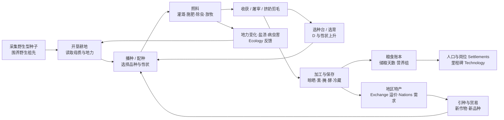

# 12 · 田园 Cultivation（`tccultivation`）

> 文档版本：DD-0.2 · 模组 ID `tccultivation` · 包名 `com.nightcity.cultivation`（入口类 `TCultivation`，事件类 `TCultivationEvents`，已存在；现有命令 `/tccultivation status` 保留）
> 必需依赖：`tcivilization`；可选：全部其他模组（桥接类位于 `com.nightcity.cultivation.compat.<other>`）。
> 拥有内容（02 §3）：驯化作物、种子与品种、耕作土壤的肥力动态、灌溉与水权计量、轮作、病虫害、家畜与牧场、食物与食品保存、营养分类、粮食账本、地区特产；地区附加层 `tccultivation:agri`。
> 不拥有：土壤母质、天气、季节与灾害（Wildlands）；野生动植物与野生祖先（Ecology）；金属农具、陶器、纺织、皮革、磨坊机器与工业化肥（Industry）；聚落粮仓方块与聚落储备计量（Settlements）；车辆与拖拉机整车（Networks）；法律、地权与水权法（Commons）；价格（Exchange）；E0-E1 石器农具 `flint_sickle`、`stone_hoe`（Technology Core）。

---

## 1. 定位与设计支柱

### 1.1 一句话定位

**把“种地”从“右键种子等它长大”改成“经营一块有记忆的土地、一个会进化的品种和一群有来历的牲畜”。**田园让每一块耕地都有氮磷钾、酸碱与有机质；每一袋种子都是一个有遗传多样性的群体；每一头牛都带着驯化指数与品系；每一份粮食都会腐败，需要晾晒、烟熏、盐渍、发酵与冷藏。农业是文明的第一台发动机：粮食盈余养活工匠、学者与军队，地区特产驱动贸易。

### 1.2 设计支柱（本模组）

| 编号 | 支柱 | 具体含义 | 对应全局支柱/决策 |
| --- | --- | --- | --- |
| CP-1 | 土地有记忆 | 连作耗地力、施肥养地力、过度灌溉致盐碱；肥力以“年”为尺度变化，能被读出来、也能被修复 | 支柱 7；DR-14 |
| CP-2 | 种子是群体，不是物品 | 种子批次带有性状均值、方差与等位基因频率；选种、杂交、引种都是群体遗传学的简化版 | 支柱 1、6 |
| CP-3 | 气候决定作物版图 | 每种作物有起源中心与气候包络；E5 引种之前，各大陆作物组合不同，这正是贸易与特产的根源 | 支柱 3；DR-09 |
| CP-4 | 粮食是文明账本 | 只计算文明层面的储粮天数与营养组，不给玩家加饥渴、营养条 | DR-19 |
| CP-5 | 机械化要“看得见” | 犁、播种机、收割机都是由役畜或车辆牵引的实体；不存在无中生有的魔法自动农场 | DR-20 |
| CP-6 | 写实而克制 | 生长、遗传、土壤与腐败遵循真实规律的简化版；数值服务于游戏节奏（一季 12 MC 日） | DR-06、DR-13 |

### 1.3 设计边界

1. 玩家个人饥饿完全保持原版（DR-19）：本模组的食物只修改原版 `FoodProperties` 的饱食度数值并新增食物，不增加口渴、营养缺乏、食物中毒等个人机制。腐败食物只是“不能再吃”的物品（右键无效），不会使玩家中毒。
2. 原版作物产物（小麦、马铃薯、胡萝卜、甜菜根、南瓜、西瓜、可可豆、甜浆果、甘蔗）**复用原版物品 ID**；作物方块与种子由本模组注册（原版种子放置时被替换为对应的田园作物方块，16 节）。
3. 原版家畜（牛、猪、绵羊、鸡、马、驴、羊驼、兔）**复用原版实体**，只附加数据附件 `LivestockData`；新增物种仅限原版没有的家畜：家山羊、水牛、牦牛、家鸭、家鹅、火鸡。
4. L2/L3 抽象模拟不得造成“玩家不可接受的损失”（02 §4.2）：未加载时玩家亲手照料的作物不会死亡（最多停在成熟阶段并开始缓慢降质），命名或拴绳的牲畜不会死亡。
5. 本模组不做价格（Exchange）、不做土地所有权（Commons）、不做聚落人口（Settlements），只通过 API 提供数据。

---

## 2. 独立玩法（只安装 `tcivilization` + `tccultivation`）

只安装核心与田园时，玩家仍能完整体验“从采集到农业社会”的转变。所有依赖其他模组的数据都有回退来源（2.7）。

### 2.1 从野草到庄稼

1. **野生型种子**：破坏草、高草、蕨时，按该位置气候包络（2.7 回退）掉落某种作物的**野生型种子**（概率 4%，`foraging` 等级每 10 级 +1%）。野生型种子的驯化指数 `D = 0.05`：成熟后穗轴易碎（成熟当日起每日 30% 籽粒自行脱落）、休眠率高（40% 的种子当季不发芽）、产量为驯化品种的 25%。
2. **第一次播种**：研究 `neolithic/cultivation` 前，种子只能“撒播”在草地上（不耕地，成活率 30%）；研究后可在耕地上条播，`stone_hoe`（Technology Core）或任意 `minecraft:hoes` 标签工具耕地。
3. **驯化即选择**：玩家用镰刀（`c:tools/sickle`）在成熟早期整株收割、留下饱满的种子再播种，就是在不知不觉中选择“不落粒”和“大粒”性状。每代 `D` 上升（5.4.4），约 4-6 代后成为“地方品种 landrace”，产量与驯化品种相当。
4. 知识来源：收割野生谷物（PRACTICE）、观察营地附近自生的幼苗（OBSERVATION，“垃圾堆假说”）为 `neolithic/cultivation` 提供知识。

### 2.2 土壤与地力

1. 每块耕地都有独立的土壤状态：氮 N、磷 P、钾 K、pH、有机质 OM、盐分 EC、含水量 W（5.2）。新开垦的耕地从“母质基线”初始化：黄土与黑土肥沃、红壤酸瘦、冲积土富含磷钾、沙地保水差。
2. 作物从土壤中带走养分；连作同一科作物会累积病害与地力透支（5.6）；豆科固氮；休耕与绿肥恢复有机质。
3. 补地力的手段随时代演进：草木灰（E0）→ 畜栏粪肥与骨粉（E1）→ 堆肥、绿肥与石灰改良酸土（E3）→ 石膏改良盐碱（E4）→ 海鸟粪（E5）→ 过磷酸钙与钾肥（E6，Industry）→ 合成氮肥（E7）→ 复合肥（E8）→ 变量施肥（E9）。
4. 观察方式：E1 起手持锄头对耕地潜行右键，显示“肥沃/一般/贫瘠”定性描述与颜色无关的文字标签；E6 土壤化验（有 Discovery 时为实验，无 Discovery 时为 `soil_test_kit` 物品）显示精确数值。

### 2.3 选种与育种

1. 每袋种子（物品堆）带有 `SeedLot` 数据组件：品种名、性状均值与方差、驯化指数、来源地区。不同来源的种子不能堆叠。
2. **选种台** `seed_sorting_tray`（E1）：投入一次收获的全部种子，按某一性状（粒重、早熟、抗旱等）挑出前 x%。被选出的种子性状均值上移，方差缩小，数量变少——这就是选择强度与遗传多样性的权衡（5.4.2）。
3. **杂交**（E3 `selective_breeding` 后）：在相邻两行种植两个品种，开花期相邻株有概率异花授粉（玉米、黑麦等异交作物高，小麦、稻等自交作物低），收获得到 F1 杂种，第一代有杂种优势，F2 起分离。
4. **品种命名**：品种稳定（`σ² < 0.1·σ²_wild` 且 `D ≥ 0.8`）后可在选种台命名，名字写入编年史（“首个命名品种”）。命名品种可通过贸易传播。

### 2.4 灌溉

1. E1 起水源 4 格内的耕地湿润（原版规则保留）；E2 `bronze/irrigation` 解锁**灌渠** `irrigation_ditch`，从河流或水源取水，沿渠输送到远处田地；水闸 `sluice_gate` 控制流量。
2. 灌溉用水按“立方格/日”计量（5.5），水源流量有限：一条小溪只能灌溉约 200 块耕地。上游截水会让下游缺水。
3. 过度灌溉且排水不良会抬高地下水位并导致盐渍化（5.2.3、5.5.4），这是 E2-E4 两河流域式文明衰落的经典机制。
4. E3 提水（桔槔、翻车、龙骨水车）与梯田；E4 圩田与排水风车；E7 电泵；E9 滴灌。

### 2.5 畜牧

1. 研究 `neolithic/animal_husbandry` 后，围栏内持续喂食的野生型牲畜（无 Ecology 时为原版自然生成的牛、猪、羊、鸡）开始累积驯化指数；`D ≥ 0.5` 时成为“家养种群”，脾气温顺、繁殖期缩短、产品增加。
2. 每头牲畜有体型、产奶/产毛/产蛋、温顺、耐寒、耐热、抗病 6 个性状；配种时子代性状按亲本中值 + 随机偏差遗传（5.8.3）。
3. 牧场：围栏围成的“围场”自动识别，按草量（干物质）计算载畜量；超载会使草地退化成泥地（5.9）。
4. 役畜：牛、马、驴、水牛、牦牛可以拉犁和车（E2 `bronze/ard_plough`），这是 E2-E6 的主要农业动力。

### 2.6 食物保存与粮食账本

1. 所有食物都有新鲜度（`Freshness` 数据组件）：鲜肉 3 MC 日、鲜鱼 2 日、面包 6 日、谷粒 96 日（2 年）、干果 48 日……储存环境（温度、湿度、容器）改变腐败速度（5.10）。
2. 保存工艺：晾晒、烟熏（E0）、窖藏与陶罐（E1）、发酵（E1）、盐渍（E2）、冰窖（E4）、罐头（E6）、机械冷藏（E7）。保存后的食物新鲜期大幅延长，饱食度略降（5.11）。
3. **粮食账本**：本模组统计文明在其据点范围内所有“已登记储藏”中的食物单位 FU 与营养组，给出“可维持天数”与“3 日内是否耗尽”的预警；这是第一粮仓里程碑与聚落饥荒预警的数据源（5.12）。
4. 无 Settlements 时，“文明成员”仅为玩家与核心 `person` 实体，消耗按 1 FU/人/日计；储藏只统计核心营地标记 64 格内的容器。

### 2.7 独立运行时的回退数据源

| 依赖 | 缺失时的回退 |
| --- | --- |
| Wildlands 土壤母质 | 由原版群系与地表下 3 格方块推断：沙漠/沙滩 → 砂质、草原/平原 → 壤土、沼泽 → 泥炭、河流两侧 16 格 → 冲积、下方为石灰岩类方块（方解石）→ 碱性；pH = 6.5 ± 群系降水修正 |
| Wildlands 气候与季节 | 核心日历给出季节；温度取原版群系温度 × 25 °C + 季节偏移 ±8 °C；降水取原版群系降水标志 |
| Wildlands 河流流量 | 原版水源方块视为无限水源，但每个水源方块的灌渠供水上限 64 m³/日 |
| Ecology 野生祖先 | 原版自然生成的牛、猪、羊、鸡、马、驴、羊驼视为野生型（D = 0.05）；新家畜物种（水牛、牦牛等）的野生型种群在相应群系以原版生成规则少量刷新 |
| Ecology 授粉、虫害捕食 | 常数 1.0；蜜蜂巢 32 格内授粉 ×1.2 |
| Industry 金属农具、陶器 | 石器农具贯穿全程（效率 ×0.6）；陶罐用花盆代替；冷藏用冰窖代替 |
| Settlements 粮仓与人口 | 营地标记 64 格内带 `c:foods` 的容器计入储备；人口 = 在线玩家 + 核心 `person` |
| Technology 科技 | 核心未装 Technology 时按 02 §5 规则：所有内容默认解锁，时代以“已建成里程碑”近似 |

---

## 3. 联动玩法

每条联动写“对方提供什么 → 本模组怎么用 → 缺失时怎么办”。

### 3.1 荒野 Wildlands（`tcwildlands`）

- **土壤母质**：`SuitabilityApi.soilParent(pos)` 返回母质、下伏岩石、质地、有机质、pH、排水与厚度；本模组按 5.2.2 换算为耕地初始 N/P/K/pH/OM。石灰岩、白垩、白云岩风化 → 碱性高钙；花岗岩、片麻岩 → 酸性贫钙富钾；玄武岩与火山灰 → 磷钾丰富；黄土 → 深厚易蚀；`terra_rossa` → 红色黏重宜葡萄与橄榄；`laterite` → 酸瘦富铁铝。
- **气候与季节**：`ClimateApi.sample(pos, dayOfYear)` 给出日均温、降水、日照；`SeasonChangedEvent` 驱动播种窗口与越冬。
- **水文**：`HydroApi` 提供的河段流量 Q（m³/s，10 章河网）换算为灌渠可取水量；`HydroApi.groundwater(pos)` 的地下水深度决定水井产水与盐渍化风险。
- **灾害**：洪水留下的 `tcwildlands:flood_silt` 每层 P +4、K +4、OM +0.3%（5.2.4），淹没期间作物受涝；`HazardApi.droughtIndex` 进入水分胁迫；霜冻与冰雹通过 `WeatherChangedEvent` 造成即时损害；火山灰一季后视为高肥力母质。
- **本模组 → Wildlands**：耕地、灌溉与排干改变地表反照率与蒸散（`agri` 层的灌溉面积、耕地比例），供其局地气候计算。
- 缺失时：2.7 回退。

### 3.2 生息 Ecology（`tcecology`）

- **野生祖先**：`tcecology:wild_emmer`、`wild_rice`、`teosinte` 等野生植物在有本模组时掉落对应作物的野生型种子；`aurochs`、`mouflon`、`bezoar_ibex` 等野生祖先满足驯化入口后发布 `WildAncestorPennedEvent`，本模组接管：原牛 → `minecraft:cow`，野山羊 → `tccultivation:goat`，野牦牛 → `tccultivation:yak`，野水牛 → `tccultivation:water_buffalo`，野火鸡 → `tccultivation:turkey`，绿头鸭 → `tccultivation:duck`，灰雁 → `tccultivation:goose`，其余见 6.2。
- **生态服务**：`EcologyApi.pollinatorIndex` 乘到虫媒作物的结实率，`pestPredationIndex` 降低虫害压力，`cropRaidPressure` 表示野猪、鹿、雀群取食造成的损失；树篱 `hedgerow`、林缘与蜂箱提高前两项。
- **反向影响**：开垦与排干发布 `LandReclaimedEvent`，过度放牧发布 `PastureDegradedEvent`，农药（E8）与化肥径流写入 Ecology 的毒性与富营养化（5.16）；家畜逃逸野化可经 `EcologyApi.introduce` 成为野生种群。
- **储粮害兽**：Ecology 的 `brown_rat` 密度提高储藏损耗；猫（原版 `minecraft:cat`，驯服后）与 `rat_proof_bin` 降低损耗。
- **猎物产物**：本模组的战利品修饰器把 Ecology 动物掉落的原版生肉替换为具体野味（鹿肉、野猪肉、野禽肉等），接入保存系统。
- 缺失时：2.7 回退；野生祖先用原版动物。

### 3.3 其余模组

| 对方模组 | 对方 → 本模组 | 本模组 → 对方 | 对方缺失时 |
| --- | --- | --- | --- |
| tcindustry | 金属锄、镰、犁铧（`c:tools/sickle`、`c:plough_shares`）；陶罐与储粮罐（`c:storage/pottery_jars`）；化肥 `c:fertilizers/nitrogen\|phosphorus\|potassium`；磨坊机器与 `tcindustry:milling` 配方类型（面粉配方由本模组数据包提供）；马口铁 `c:plates/tinplate`；制冷机组 `c:machines/refrigeration_unit`；脱粒机等机器的机械动力 `SU` | 亚麻、棉、羊毛、蚕茧、大麻、皮张、油料、淀粉、甘蔗（乙醇）、天然胶乳；粪肥沼气原料 | 石器农具；花盆代陶罐；无工业化肥（本模组的堆肥、粪肥、绿肥仍可用）；冰窖代冷藏 |
| tcnetworks | 拖拉机与农用车辆底盘（Networks 组装，本模组提供农具挂件）；冷藏车；运河兼作灌渠 | 粮食与特产货流；农具挂件 `implement` 实体 | 农具只能由役畜牵引 |
| tcsettlements | 农夫 `farmer`、牧人 `herder`、厨师 `cook` 岗位；`granary` 方块；人口与消耗 | `WorkplaceProvider`（农田、牧场、加工点）、`FoodStorageProvider`（储藏方块）、营养组分类表、饥荒预警、粪便与腐败垃圾上报 | 2.6 第 4 条 |
| tccommons | 水权法（河岸权/先占权/比例分配）、土地法、休耕与禁牧政策、农业税 | 用水计量数据、地块面积统计 | 默认比例分配；无税收 |
| tcexchange | 价格与需求曲线 | 特产 `origin_region` 与品质数据组件，品质溢价；粮食供给量 | 无价格；特产仅作收藏与外交礼物（有 Nations 时） |
| tcnations | AI 文明的需求与饥荒；粮食援助作为外交礼物 | AI 文明的粮食产量公式（L3，5.15）；引种只能通过接触与贸易 | AI 文明不存在 |
| tcdiscovery | 观察模式（V）、“杂交试验”“土壤化验”“品种试验田”实验 | 遗传真值（实验测量性状遗传比例）、土壤真值；作物与家畜图鉴条目 | 用 `soil_test_kit` 与选种台读数 |
| tctechnology | 科技、知识与 RP；`flint_sickle`、`stone_hoe`、`firebrand` 烧荒事件 | 33 项农业科技；第一粮仓里程碑判定器 `MilestoneChecker` | 内容全部默认解锁 |
| tcatlas | 地图渲染 | 专题图层 `tccultivation:agriculture`（农田、牧场、作物类型）、土壤适宜度、灌区 | 无地图；civ 页签内的小地图片段仍可用 |
| tcfrontiers | 盗匪袭击、远征 | 口粮包封装 `c:foods`；驮兽、战马来自本模组家畜；草料 `c:animal_feeds` | 无袭击 |
| tcechoes | 古代文明遗迹中的“古种子”罐 | 古种子含已灭绝的地方品种基因；“首个命名品种”“大饥荒”写入传说 | 无古种子 |
| tcorbit | 封闭生态循环、月壤/火星土 | 受控环境农业与再生土壤（E10）为生命支持提供食物与氧 | 太空农业不可用 |
| tcbeyond | 异界影响区 | 异界影响区内作物生长 ×0.5、牲畜受惊 | 无 |
| tcskills | 熟练度系统 | 15 节行为产生 `farming`、`husbandry`、`cooking`、`foraging` 等经验；技能影响选种精度、驯化速度、腐败速率 | 无技能加成 |
| tcivilization | 地区层框架、HUD、civ 面板、`person` | `agri` 地区层、`agriculture` 页签与总览卡片、`field_status` 控件、农夫动作集；首次收获、第一粮仓、大饥荒写入编年史 | 必需依赖 |

---

## 4. 核心玩法循环



**短循环（一季 12 MC 日）**：播种 → 照料 → 收获 → 选种 → 储存。
**中循环（一年 48 MC 日）**：轮作安排、越冬作物、畜群繁殖与屠宰计划、储粮度过冬季。
**长循环（多年/跨时代）**：品种驯化与改良、地力的透支与修复、灌区扩张与盐渍化、机械化与绿色革命、引种与特产。

**E0-E1 开局脚本挂钩**（对齐 01 §8）：

| 时间点 | 01 §8 事件 | 本模组内容 |
| --- | --- | --- |
| 3:00 | 制作背篓与熏肉 | `drying_rack` 与篝火烟熏（`stone/smoke_drying`），鲜肉 3 日 → 熏肉 24 日；首次出现“粮食账本”提示 |
| 4:30 | 用观察模式比较两个河谷的土壤 | V 观察耕地/草地：显示母质、质地、定性肥力与洪水淤积标记；无 Discovery 时用锄头潜行右键 |
| 5:30 | 第一次播种，选择种子性状 | 研究 `neolithic/cultivation`；选种台首次使用，弹出性状选择说明 |
| 6:30 | 冬季储存压力 | 粮窖 `grain_pit`、储粮陶罐（Industry）；账本预警“储粮 9 日，冬季需 12 日” |
| 7:30 | 驯化第一群山羊 | `WildAncestorPennedEvent` → `tccultivation:goat`（D = 0.2） |
| 10:00 | 粮仓储满 1 季 | 第一粮仓里程碑判定器通过（5.12.3） |

---

## 5. 系统规则与公式

### 5.1 时间尺度与模拟层级

| 层级（02 §4） | 范围 | 本模组处理 |
| --- | --- | --- |
| L0 方块级 | 已加载区块 | 作物单元每 1,200 tick 批量推进（每 MC 日 20 步）；土壤每日结算；牲畜实体照常运行 |
| L1 地区统计 | 已知地区 | `agri` 层每 MC 日汇总：耕地面积、作物构成、平均地力、灌溉用水、产量预估、病虫害风险 |
| L2 抽象农田 | 未加载但属于玩家文明聚落的农田 | 按季结算期望产量（5.15.1）；土壤变化记为“待补账”，加载时一次性应用 |
| L3 AI 文明 | Nations 文明 | 粮食产量公式（5.15.2），不落地到方块 |

作物不使用原版随机刻生长：本模组作物方块 `isRandomlyTicking = false`，由 `CropScheduler` 统一推进，保证生长速度只取决于气候与管理，而非游戏规则 `minecraft:random_tick_speed`。

### 5.2 土壤模型

#### 5.2.1 土壤状态

只为**耕地**（`minecraft:farmland` 与本模组的 `paddy_field`、`raised_bed`）存储完整状态；每格打包为一个 `long`：

| 字段 | 位 | 取值 | 含义 |
| --- | --- | --- | --- |
| N | 8 | 0-255 | 有效氮（养分单位 NU，约等于 kg/ha 的 1/2） |
| P | 7 | 0-127 | 有效磷 |
| K | 7 | 0-127 ×2 | 有效钾（存储值 ×2 后为 0-254） |
| pH | 7 | 3.5 + 0.05·v | 3.5-9.5 |
| OM | 7 | 0.1·v % | 有机质 0-12.7% |
| EC | 6 | 0.5·v dS/m | 盐分 0-31.5 |
| W | 4 | 0-15 | 含水量，按质地换算为毫米（5.5.1） |
| texture | 3 | SAND/LOAM/CLAY/SILT/PEAT | 质地（来自母质，深耕/掺沙可改变） |
| rot | 9 | 3 × 3 位 | 最近三季作物科（5.6） |
| path | 4 | 0-15 | 土传病原累积 |
| comp | 2 | 0-3 | 压实（重型机械、踩踏） |

耕地被破坏或退化为泥土后，其状态保留 96 MC 日（2 年）的“土地记忆”，重新开垦时恢复；超期后向母质基线漂移。非耕地方块只在被读取时由母质基线即时计算，不存储。

#### 5.2.2 由母质初始化

```text
base = SuitabilityApi.soilParent(pos)        // 缺失时 2.7 回退
N0  = clamp(30 + 250·base.organicMatter, 10, 140)
P0  = P_mat[base.material] × P_rock[base.bedrock]
K0  = K_mat[base.material] × K_rock[base.bedrock]
pH0 = base.ph
OM0 = 100·base.organicMatter                 // %
EC0 = 盐沼/干盐湖 12；海岸 16 格内 2；其余 0
W0  = 降水月均 / 10（截断到 0-15）
```

| 母质 `material` | P_mat | K_mat | 特点 |
| --- | --- | --- | --- |
| `loess` 黄土 | 40 | 60 | 深厚、易耕、易侵蚀（侵蚀 ×1.5） |
| `chernozem` 黑土 | 50 | 70 | OM 高；全时代最佳谷物土壤 |
| `alluvium` 冲积土 | 55 | 65 | 洪水淤积补充 P/K；排水差时易涝 |
| `terra_rossa` 红色石灰土 | 30 | 50 | 碱性黏重；葡萄、橄榄品质 +10 |
| `laterite` 砖红壤 | 10 | 25 | 酸瘦、铝毒（pH < 5 时产量 ×0.6）；需石灰与有机质 |
| `saprolite` 风化层 | 25 | 40 | 随下伏岩石变化 |
| `till` 冰碛 | 30 | 45 | 石块多（耕作时 5% 概率翻出石头） |
| `peat` 泥炭 | 15 | 20 | OM 极高、酸性；排干后下沉、氧化（OM 每年 −1%） |
| `volcanic_ash` 火山灰 | 60 | 75 | 一季后转为火山灰土；全时代最肥 |
| 其他（岩石风化） | 25 | 40 | — |

| 下伏岩石 | P_rock | K_rock | pH 修正 |
| --- | --- | --- | --- |
| 石灰岩、白垩、白云岩、大理岩 | 1.0 | 0.9 | +0.8（上限 8.3） |
| 花岗岩、片麻岩、石英岩 | 0.7 | 1.3 | −0.6 |
| 玄武岩、辉长岩、火山岩 | 1.4 | 1.1 | 0 |
| 页岩、泥岩 | 1.0 | 1.2 | 0 |
| 砂岩 | 0.6 | 0.6 | −0.3 |
| 磷块岩 | 2.0 | 1.0 | +0.2 |

#### 5.2.3 每日过程

每块耕地每 MC 日结算一次（已加载区块在其区块哈希错峰时刻；未加载区块在加载时补账，补账上限 96 日，超出部分按季度平均一次性计算）：

```text
T = 日均气温（°C）；R = 日降水（mm）；f_T = clamp((T − 5)/20, 0, 1.2)；f_W = W/15

矿化     N += 0.04 · OM · f_T · f_W            // 有机质分解释放氮
         OM −= 0.0008 · OM · f_T · (耕作中 ? 1.5 : 1.0)
淋溶     N −= N · 0.004 · (R/10) · leach[texture]          // leach: SAND 2.0 LOAM 1.0 CLAY 0.5 SILT 0.8 PEAT 0.7
         K −= K · 0.001 · (R/10) · leach[texture]
侵蚀     若裸地（无作物、无覆盖、无残茬）且坡度 s > 0.05：
         loss = 0.002 · s · (R/10) · erod[material]      // 损失比例
         N, P, OM ×= (1 − loss)                         // 被冲走的养分记入下游 NUTRIENT_RUNOFF（5.16）
吸收     N,P,K −= 作物当日需求 × ΔGDD/GDD_req（6.1 表的 N/P/K 需求为整季总量）
固氮     豆科：N += 0.6 · ΔGDD/GDD_req · demand_N   // 自身需求的 60% 来自固氮，收获后残茬再 +15
pH 漂移  pH −= 0.0004 · (铵态氮肥 NU 当日施用量) + 0.002 · acidDeposition_R
         pH 向基线回归：pH += (pH0 − pH) · 0.002
盐分     EC += 0.01 · I_mm · EC_water / drainFactor            // I_mm：当日灌溉量
         EC −= EC · 0.02 · (R/10) · drainFactor               // 降雨淋洗；drainFactor: POOR 0.2 MODERATE 0.6 GOOD 1.0 EXCESSIVE 1.2
         地下水位 ≤ 2 格（HydroApi.groundwater）时：EC += 0.03（毛细上升返盐）
病原     path 每季按轮作规则变化（5.6），不按日
```

#### 5.2.4 施肥与改良

| 投入物 | ID / 标签 | 作用（每次右键 1 格，或撒施 3×3 时每格 1/9） | 时代 |
| --- | --- | --- | --- |
| 草木灰 | `#c:dusts/wood_ash`（核心注册的共享副产物 `tcivilization:wood_ash`，02 §3） | K +12、pH +0.15 | E0 |
| 粪肥 | `tccultivation:manure` | N +10、P +4、K +8、OM +0.15 | E1 |
| 堆肥 | `tccultivation:compost` | N +6、P +3、K +5、OM +0.3 | E3 |
| 绿肥（翻压豆科作物） | — | N +25、OM +0.2 | E3 |
| 洪水淤泥 | `tcwildlands:flood_silt` | 每层 P +4、K +4、OM +0.3 | 自然 |
| 农用石灰 | `tccultivation:agricultural_lime` | pH +0.5（上限 7.5）、Ca 改良铝毒 | E3 |
| 泥灰/石膏 | `c:dusts/gypsum` | EC −3（需排水 GOOD 以上）、pH ±0 | E4 |
| 骨粉 | `minecraft:bone_meal` | P +8（原版催熟效果移除，16 节） | E1 |
| 海鸟粪 | `tccultivation:guano` | N +20、P +12 | E5 |
| 工业氮/磷/钾肥 | `c:fertilizers/nitrogen\|phosphorus\|potassium` | N +40 / P +25 / K +30；铵态氮按 5.2.3 酸化 | E6-E7（Industry） |
| 复合肥 | `tccultivation:npk_fertilizer` | N +25、P +15、K +15 | E8 |

过量施肥（施后 N > 200 或 P > 110）：超出部分 70% 在 3 日内淋失，计入 NUTRIENT_RUNOFF；作物倒伏概率 +20%。

### 5.3 作物生长

#### 5.3.1 积温与阶段

```text
ΔGDD_day = clamp(T_mean − T_base, 0, T_opt − T_base) × f_photo × f_light
f_light  = 天空光照 ≥ 9 ? 1 : 0.4（温室内按玻璃透光）
f_photo  = 光周期敏感作物在非适宜日长时 0.7（E8 绿色革命品种携带 photo_insensitive 等位基因后为 1）
GDD_req  = GDD_base(crop) × (1 − 0.06 · z_earliness)                // 早熟性状每 +1σ 缩短 6%
阶段 age = floor(7 × GDD/GDD_req)                                    // 与原版 age 0-7 对应
```

季节窗口：每种作物定义 `sow_window`（可播季节）与 `frost_kill`（是否被霜冻杀死）。越冬作物（冬小麦、冬黑麦、冬大麦）在秋季播种、冬季 GDD 停滞但不死亡（`cold_tol` 不足时有冻害），春季继续。

#### 5.3.2 胁迫

```text
水分胁迫  f_water = clamp(W_avail / W_need, 0.2, 1)，W_need 由作物 Kc 决定（5.5.1）；涝渍（W = 15 连续 3 日，非水稻）f_water = 0.5
高温胁迫  T_max > T_heat(crop) + 2·z_heat_tol：开花期每日 f_heat −= 0.08，其余期 −0.02
低温胁迫  T_min < 0 且 frost_kill：幼苗/开花期死亡概率 0.5 − 0.15·z_cold_tol；其余期 f_cold −= 0.1
干旱指数  有 Wildlands 时 W 的降水输入直接来自气候；HazardApi.droughtIndex 仅用于 HUD 预警
```

胁迫系数在整个生长季内取时间加权平均，收获时结算。

#### 5.3.3 产量（李比希最小因子律）

```text
f_nut   = min( s(N/N_req), s(P/P_req), s(K/K_req), f_pH )
s(x)    = x ≥ 1 ? 1 : 0.3 + 0.7·x^0.7
f_pH    = 1 − clamp((|pH − pH_opt| − tol_pH) / 1.5, 0, 0.7)
f_mgmt  = f_rotation(5.6) × f_pest(5.7) × f_poll × (1 − cropRaidPressure × 0.4)
f_poll  = 虫媒作物：0.4 + 0.6·min(1, pollinatorIndex)；风媒/自花：1
D_fac   = 0.25 + 0.75·D
Y       = Y_pot(crop) × (1 + 0.08·z_yield) × D_fac × f_nut × avg(f_water·f_heat·f_cold) × f_mgmt
产出    = 随机舍入(Y × base_items(crop))；种子另出 seed_items(crop) × (0.8 + 0.4·rand)
```

例：二粒小麦地方品种（D = 0.6，z_yield = 0.5），黄土（N 60/需 50、P 30/需 25、K 50/需 40，pH 7.4/最适 6.8 容差 0.8），水分 0.9，无病虫，`Y = 1 × 1.04 × 0.7 × 1 × 0.9 × 1 = 0.66`，每格产小麦 2 × 0.66 ≈ 1.3 个。

### 5.4 遗传与育种

#### 5.4.1 性状与种子批次

每个作物品种（与每袋种子）用 7 个数量性状描述，单位为相对于野生型的标准差 z（野生型 μ = 0、σ_G = 1）：

| 性状 | 键 | 作用 |
| --- | --- | --- |
| 产量潜力 | `yield` | 每 +1σ 产量 +8% |
| 早熟 | `earliness` | 每 +1σ GDD 需求 −6% |
| 抗旱 | `drought_tol` | W_need ×(1 − 0.07z) |
| 耐寒 | `cold_tol` | 霜冻死亡与冬害降低 |
| 耐热 | `heat_tol` | 高温阈值 +2 °C/σ |
| 抗病 | `disease_res` | 病害风险 ×(1 − 0.12z)，下限 0.3 |
| 品质 | `quality` | 特产品质分 +8/σ（5.13） |

另有：驯化指数 `D`（0-1）、2 个孟德尔位点频率（每种作物定义，如小麦 `rht_dwarf` 矮秆、玉米 `su1` 甜质、稻 `wx` 糯性），以及标志位 `hybrid`、`gm`。

#### 5.4.2 选择（选种台）

```text
p      = 选出比例（玩家选择 50% / 20% / 10% / 5% / 1%）
i, k   = 选择强度与方差缩减系数：
         p=50% → i 0.80, k 0.64；20% → 1.40, 0.78；10% → 1.76, 0.83；5% → 2.06, 0.86；1% → 2.67, 0.90
σ_E²   = 环境方差：0.8（普通田）；0.4（试验田，Discovery 品种试验田实验后）
σ_P²   = σ_G² + σ_E²；h² = σ_G² / σ_P²
μ'     = μ + h² · i · σ_P                     // 育种家方程 R = h²S
σ_G'²  = σ_G² · (1 − h² · k)                  // 选择消耗遗传方差
相关反应：yield 每上升 1σ，disease_res −0.1σ、quality −0.05σ（鼓励多性状权衡）
farming 技能：每 10 级 σ_E² −5%（下限 0.3）
```

一次只能按 1 个性状选择（E6 `pedigree_breeding` 后可按“选择指数”同时选 2 个，权重自定，i 按 0.7 折算到每个性状）。

#### 5.4.3 漂变与突变

```text
Ne     = 播种该批次的格数（上限 1,000）
σ_G²  ←  σ_G² · (1 − 1/(2·Ne)) + 0.01            // 每代：漂变损失 + 突变输入
孟德尔位点频率 q ← Binomial(2Ne, q)/(2Ne)          // 小群体会随机丢失等位基因
```

“遗传瓶颈”提示：σ_G² < 0.15 时选种台显示“遗传多样性低：继续选择收效甚微，建议引入其他品种杂交”。

#### 5.4.4 驯化指数 D

```text
用镰刀在成熟后 2 日内收割：             D += 0.08·(1 − D)
经选种台（任意性状，p ≤ 50%）：          D += 0.15·(1 − D)
从地面拾取自然落粒的种子再播：           D −= 0.05
落粒损失（成熟后每日）  = 0.30·(1 − D)²
休眠率（播种后当季不发芽）= 0.40·(1 − D)
D ≥ 0.5 → 地方品种 landrace；D ≥ 0.8 → 驯化品种（可命名）
```

#### 5.4.5 杂交与杂种优势

```text
异交率 o（6.1 表）：相邻 3 格内不同品种在开花期相遇，后代以概率 o·f_poll 为杂交种
F1：μ = (μ_a + μ_b)/2 + H·[yield]；σ_G² = (σ_a² + σ_b²)/2 + Σ(μ_a − μ_b)²/4
    H = 杂种优势：玉米 1.5σ、黑麦 1.0σ、高粱 0.8σ、向日葵 0.8σ、其余自交作物 0.3σ
F2：H 减半；σ_G² 不变；标记 hybrid=false
```

E6 起“杂交制种田”（两个自交系隔离 ≥ 16 格种植，母本行去雄）可稳定生产 F1 种子；农民每年需重新获得 F1 种子——这是 E8 绿色革命种业的玩法来源。

#### 5.4.6 基因工程（E9）

`gene_editing_station` 直接把某个孟德尔位点频率设为 1，或给数量性状 +1.5σ（每次只改 1 个性状，耗时 2 MC 日、耗电 `J`）。转基因品种 `gm = true`：受 Commons 政策 `tccommons:gmo_policy`（若存在）约束；Nations AI 文明有 30% 概率拒绝进口（贸易品质标签“转基因”）。

### 5.5 灌溉与水利

本章区分两种体积：**游戏体积 m³g**（1 立方格 = 1 格水体积，用于渠道容量、井产水、田块需水）与 Wildlands 的**水文体积 m³**（河段真实流量）。二者以 `κ = 130` 换算（见 5.5.2），使“一条小溪 ≈ 200 块耕地”的游戏尺度成立。

#### 5.5.1 需水量与水分平衡

```text
cap[texture]  根区有效持水量（mm）：SAND 40 · LOAM 90 · CLAY 110 · SILT 100 · PEAT 150
W_mm   = W / 15 · cap                                   // W 为 5.2.1 的 4 位存储值
ET0    = ClimateApi 参考蒸散（mm/日）；缺失时 ET0 = clamp(0.25·T + 1, 0.5, 9)
ETc    = Kc(stage) · ET0                                // Kc：苗期 0.4，中期 Kc_mid（6.1 表），成熟期 0.6；裸地 0.3；水田 1.2
W_need = 0.5 · cap · (1 − 0.07·z_drought)               // 5.3.2 的 f_water = clamp(W_mm / W_need, 0.2, 1)
R_eff  = R · (1 − runoff)；runoff = clamp(0.1 + 2·s − 0.05·OM%, 0, 0.6)   // 梯田 runoff = 0.1、s 视为 0
每日   W_mm += R_eff + I_eff + sub − ETc − drain
drain  = max(0, W_mm − cap) + 0.02 · cap · drainFactor  // drainFactor 同 5.2.3
sub    = 水源 4 格内（原版湿润规则）：min(ETc, 4) mm，不计入取水
W      = round(15 · W_mm / cap)                         // 写回存储
原版 MOISTURE 方块状态 = round(7 · W / 15)                // 单向同步，只供原版渲染与踩踏判定
```

#### 5.5.2 取水、输水与配水

| 取水方式 | 方块 | 取水效率 η | 时代/科技 |
| --- | --- | --- | --- |
| 自然缺口 | 灌渠直接接触河水 | 0.10 | E2 `bronze/irrigation` |
| 水闸 | `sluice_gate`（开度 0/25/50/75/100%） | 0.30 × 开度 | E2 `bronze/irrigation` |
| 拦河堰 | `diversion_weir`（横跨河道，经 `HydroApi.registerWaterWork` 登记） | 0.60 × 开度 | E3 `iron/water_lifting` |
| 原版水源（无 Wildlands 河流） | 任意水源方块 | 每个水源上限 64 m³g/日（2.7） | E2 |

```text
Q_div(m³g/日) = κ · Q(m³/s) · η        κ = 130
上报 Wildlands：HydroApi.withdraw(pos, Q_used · 86400 / κ, consumer)    // 1 m³g ≈ 665 m³
例：小溪 Q = 5，水闸全开 η = 0.3 → 195 m³g/日；每块耕地中期需水 q ≈ 1 m³g/日 → 约 200 块
```

**灌渠** `irrigation_ditch`：1 格宽、下挖 1 格的方块（状态 `water_level 0-3`、`lined`、`mode=irrigate|drain`）。连通的渠段（含水闸、拦河堰、Networks 运河）组成一个**灌溉网络**，每日按以下顺序结算：

```text
cap_ditch   土渠 200 m³g/日 · 衬砌渠（用石/砖/混凝土右键，lined=true）800 · Networks 运河 5,000
seep        每格渠道损失：土渠 0.5% · 衬砌 0.1%（渗漏量计入当地地下水抬升 rise）
供水 S      = min(Σ Q_div, 最窄渠段的 cap_ditch) × Π(1 − seep)
灌区        渠道两侧 4 格内的耕地（与原版 4 格湿润范围一致）
需水 q_i    = max(0, W_target − W_mm) / (5 · E_a)       // 1 m³g 灌到一格耕地 = 5 mm 水深；W_target = 0.8·cap
配水        S ≥ Σq_i：全部满足；否则按水权规则（5.5.5）分配
I_eff       = 5 · q_i · E_a（mm）；其余 (1 − E_a) 部分为深层渗漏，计入 rise
E_a         灌水效率：沟灌（默认）0.55 · 水田漫灌 0.50 · 喷灌 `sprinkler` 0.75 · 滴灌 `drip_line` 0.90
```

#### 5.5.3 提水、梯田、水田与排水

| 设施 | ID | 能力 | 动力 | 科技 |
| --- | --- | --- | --- | --- |
| 桔槔 | `shadoof` | 40 m³g/日，扬程 ≤ 3 格 | 玩家右键（每次 2 m³g）或农夫 NPC | E3 `iron/water_lifting` |
| 筒车 | `noria` | 150 m³g/日，扬程 ≤ 6 格 | 河水流速 `HydroApi.flowVelocity ≥ 0.5 m/s` | E3 `iron/water_lifting` |
| 龙骨水车 | `chain_pump` | 120 m³g/日，扬程 ≤ 2 格；可反向排水 | 拴系役畜，或 ≥ 60 SU（Industry） | E3 `iron/water_lifting` |
| 机械泵 | `tcindustry:pump`（Industry） | 输出流体 1,000 mB = 1 m³g，接入灌渠 | 500 SU | E5（Industry） |
| 管井 | `tube_well` | 300 m³g/日；抽取地下水，经 `HydroApi.withdraw` 计量 | 电力（Industry 电网）或柴油 | E8 `atomic/green_revolution` |
| 喷灌头 | `sprinkler` | 覆盖 7×7，E_a 0.75 | 渠道水压（下游需 ≥ 1 格落差）或泵 | E8 `atomic/green_revolution` |
| 滴灌带 | `drip_line` | 沿行铺设 16 格，E_a 0.90，可随水施肥 | 泵 | E9 `information/precision_agriculture` |
| 暗管 | `tile_drain` | 埋于耕地下 2 格；drainFactor 提高一档；rise 衰减 ×4 | 重力 | E4 `medieval/polder_drainage` |

- **梯田**：不新增方块。坡地耕地的下坡方向紧邻挡土墙（`#minecraft:walls`、石砖、`tcsettlements` 的毛石墙等任何完整石质方块）时，侵蚀公式中坡度 `s` 视为 0，径流系数 0.1。`iron/water_lifting` 提供“梯田”蓝图提示与知识奖励。
- **水田** `paddy_field`（E2 `bronze/irrigation`）：四周田埂（任何完整方块高出 1 格）围合时可保持 5-10 cm 积水（状态 `flooded`）。水稻在非淹水田 `f_water` 上限 0.6；淹水抑制杂草（5.7 杂草增长率 ×0.2）；水田需水按 `Kc = 1.2` 加 2 mm/日渗漏计。
- **排水**：`irrigation_ditch` 切换为 `mode=drain` 后，把两侧 4 格耕地中超过 `cap` 的水导向出口（出口须低于渠底，否则需龙骨水车/泵反向提水）。圩田（`medieval/polder_drainage`）= 围堤 + 排水渠 + 提水设施，可开垦 Wildlands 的沼泽与河口湿地，发布 `LandReclaimedEvent`。

**地下水抬升**（`agri` 层按区块存储）：

```text
rise_chunk += Σ(深层渗漏 + 渠道渗漏)(mm·格) / (256 · 400)      // 单位：格
rise_chunk −= 0.01 · drainFactor · rise_chunk · (暗管覆盖率 > 50% ? 4 : 1)     // 每日
有效地下水深度 gw = HydroApi.groundwater(pos).depthBlocks − rise_chunk
gw ≤ 2 格：触发 5.2.3 的毛细返盐（EC += 0.03/日）；gw ≤ 0：耕地涝渍（W 锁定 15）
```

#### 5.5.4 盐渍化

```text
EC_water：河水/湖水 0.3 dS/m · 普通地下水 0.8 · 干旱气候地下水 1.5 · 海岸 16 格内地下水 3.0
f_salt  = clamp(1 − b · (EC − EC_t), 0, 1)        // FAO 耐盐模型，EC_t 与 b 见 6.1 表“耐盐”列
f_nut   = min( s(N), s(P), s(K), f_pH, f_salt )     // 并入 5.3.3 的最小因子
淋洗    灌水量超过 ETc 的部分（淋洗分数 LF）且 drainFactor ≥ 0.6：EC −= EC · 0.5 · LF
盐碱化  EC ≥ 16 连续 12 日：耕地转为 `saline_soil`（白色盐壳，不可种植）
改良    `saline_soil` 施石膏 `c:dusts/gypsum` ×4 + 连续 2 季淋洗（需排水 GOOD 以上）→ 恢复为耕地
```

| 耐盐等级 | EC_t（dS/m） | b（每 dS/m） | 代表作物 |
| --- | --- | --- | --- |
| S 敏感 | 1.0 | 0.19 | 菜豆、胡萝卜、洋葱、甜浆果 |
| MS 中敏 | 1.7 | 0.12 | 玉米、马铃薯、甘蓝、葡萄、亚麻、水稻（3.0） |
| MT 中耐 | 4.0 | 0.07 | 小麦、大豆、高粱、黑麦、向日葵、橄榄 |
| T 耐盐 | 7.0 | 0.05 | 大麦（8.0）、棉花（7.7）、甜菜根 |

这正是两河流域从小麦转向大麦、最后弃耕的机制：长期沟灌 + 排水不良 → rise 累积 → 返盐 → 只剩大麦能种 → 盐壳。

#### 5.5.5 水权与计量

- 每个取水设施（水闸、拦河堰、管井、泵）在建成时通过 `HydroApi.registerWaterWork(WaterWorkRef)` 登记，每 MC 日主线程调用一次 `HydroApi.withdraw`；Wildlands 据此降低下游河段流量，下游灌溉网络读取到的 Q 随之下降。
- 同一河段多个取水者的总需求超过 `Q · 0.6` 时按水权规则分配：`proportional`（按需求比例，默认）、`prior_appropriation`（先建者优先，按 `WaterWorkRef` 登记时间）、`riparian`（按渠首到河道距离，近者优先）。规则由 Commons 的水权法提供（`tccommons` 存在时经 `WaterRightsProvider` 查询），否则固定为 `proportional`。
- 计量数据（每文明、每流域的日取水量、灌溉面积）写入 `agri` 层，供 Commons 收水费与裁决纠纷、供 Atlas 绘制灌区。
- 下游取水不足 50% 连续 3 日时通知受影响文明（通知类别 `tccultivation:agriculture`，严重度 WARNING，合并键 `water_shortage:<basin>`）。

### 5.6 轮作

`rot` 字段记录最近三季的作物科代码（3 位）：

| 代码 | 科 | 作物 |
| --- | --- | --- |
| 0 | 休耕/绿肥 | — |
| 1 | 禾本科 POACEAE | 所有谷物、甘蔗 |
| 2 | 豆科 FABACEAE | 小扁豆、豌豆、大豆、菜豆 |
| 3 | 茄科 SOLANACEAE | 马铃薯 |
| 4 | 十字花科 BRASSICACEAE | 甘蓝 |
| 5 | 葫芦科 CUCURBITACEAE | 南瓜、西瓜 |
| 6 | 根茎类（藜、旋花、大戟、伞形、石蒜科） | 甜菜根、甘薯、木薯、胡萝卜、洋葱 |
| 7 | 纤维与油料 | 亚麻、棉花、大麻、向日葵 |

多年生作物（葡萄、橄榄、茶、咖啡、桑、可可、甜浆果）不参与轮作，但其 `path` 每年 +1（老果园更新的理由）。

```text
same        = 本季作物科在 rot 三季中出现的次数（0-3）
f_rotation  = (1 − 0.08·same) × (1 − 0.4 · path/15 · susceptible)      // susceptible：6.1 表“土传病”列 0/0.5/1
前作豆科    本季 N_req 视为 −20（残茬与根瘤）
前作休耕    本季 W 起始值 = cap 的 80%；草木灰与杂草残体 OM +0.05
每季收获后更新 path：
  同科连作   path += 3（茄科、十字花科、葫芦科 +4）
  换科       path −= 2
  休耕/绿肥  path −= 4
  土壤熏蒸   path = 0（E8 `atomic/agrochemicals`，写入 AGROCHEMICAL 扰动）
```

| 轮作制度 | 时代 | 规则 | 解锁内容 |
| --- | --- | --- | --- |
| 撂荒（刀耕火种） | E0-E1 | 种 2-3 季后弃耕，草地/林地自然恢复 8+ 季；烧荒（`firebrand`）OM 转为 K +15、N −10 | — |
| 二圃制 | E1-E3 | 一半耕地休耕 | — |
| 轮作与堆肥 | E3 | 谷物—豆科—休耕；堆肥、绿肥、石灰 | `iron/crop_rotation` |
| 三圃制 | E4 | 冬谷—春谷/豆—休耕；冬性品种（秋播） | `medieval/three_field_rotation` |
| 诺福克四圃制 | E5+ | 小麦—芜菁/甜菜—大麦—苜蓿/三叶草，无休耕；饲料作物养畜、畜粪养地 | 由 `renaissance/columbian_exchange` 的“轮作计划”模板提供 |

**轮作计划**：`medieval/three_field_rotation` 起，农业页签的“地块”视图可把相邻耕地划为命名地块并设置多年作物序列；农夫 NPC（Settlements）按计划播种；违反计划的手动播种只提示，不阻止。

### 5.7 病虫害与杂草

以**地块**（同一作物、连通的耕地组，≤ 1,024 格）为单位，每种病虫害一个压力值 `P ∈ [0,1]`，每 MC 日更新：

```text
P'       = P + r·f_T·f_host·P·(1 − P) − m·P
r        = 基础增长率（6.4 表）× (1 − 0.12·z_disease)（下限 0.3 倍）
f_T      = 温度与湿度适宜度（6.4 表的 T、湿度区间内为 1，外侧线性降到 0）
f_host   = min(1, 0.3 + A/512)                     // A：地块面积（格）；单一大片作物更易爆发
m        = 0.05 + 0.25·pestPredationIndex + m_ctrl  // Ecology 缺失时 pestPredationIndex = 1.0
P0       = 每季播种时 0.01 + 0.02·path/15（土传）；气传病害另从相邻地区 `agri` 层的病虫指数输入 0.1·index
f_pest   = max(0.1, 1 − Σ L_k · P_k)              // L_k：最大损失系数
```

| 防治手段 | m_ctrl / 效果 | 时代 | 代价 |
| --- | --- | --- | --- |
| 手工除草/捉虫 | 对杂草与大型害虫：每次右键（锄）P −0.15 | E0 | 玩家时间；农夫 NPC 每日自动 |
| 稻草人 `scarecrow` | 16 格内 `cropRaidPressure` × 0.6；鸟害不累积 | E1 | 4 季后失效（鸟类习惯化），移动后重置 |
| 轮作 | 降低 path（5.6） | E3 | 需要规划 |
| 抗病品种 | r × (1 − 0.12z) | 全程 | 产量相关反应（5.4.2） |
| 波尔多液 `bordeaux_mixture` | 真菌类 m_ctrl +0.4，持续 6 日 | E6 `industrial/soil_chemistry` | 铜在土壤累积（Industry `soil_contam`） |
| 杀虫剂/除草剂 `pesticide` / `herbicide` | 对应类别 m_ctrl +0.6，持续 6 日 | E8 `atomic/agrochemicals` | 写入 Ecology `AGROCHEMICAL`（每 64 格每次 0.05，5.16）与 Industry `pop` |
| 综合防治（IPM） | 诱虫板读数，仅在 P > 0.15 的地块喷药；农药用量 × 0.4 | E9 `information/precision_agriculture` | 需要 `field_sensor` |

**抗药性**：同一地区连续使用同类农药，每季药效 × 0.9；停用一季恢复 5%。这让 E8 的农药成为“越用越贵”的短期解法。

**作物病害举例**（完整表 6.4）：小麦锈病（风传，湿暖）、马铃薯晚疫病（湿凉；E5 前只存在于起源区，随引种扩散，可造成“大饥荒”）、蝗灾（干旱指数 ≤ −1.5 的草原地区按地区事件爆发，跨地区迁移）、葡萄根瘤蚜（E5 后随引种扩散，L = 0.9；嫁接到抗性砧木的葡萄免疫，`bronze/orchard_grafting`）、杂草（所有作物，未除草时 r = 0.12）。

**储粮害兽与霉变**见 5.10.3。

### 5.8 畜牧

#### 5.8.1 `LivestockData` 附件

原版家畜（`minecraft:cow`、`pig`、`sheep`、`chicken`、`horse`、`donkey`、`mule`、`llama`、`rabbit`）、本模组新家畜（`goat`、`water_buffalo`、`yak`、`duck`、`goose`、`turkey`）以及被牧养的 Ecology 驯鹿（`tcecology:reindeer`，不转换实体）都附加数据附件 `tccultivation:livestock`（`LivestockData`，11.1），包含：物种键、性别、驯化指数 D、6 个性状的育种值、近交系数 F、父母 UUID、世代、品系名、体况 BCS、产品计时、劳役疲劳、所属文明与畜群 ID。原版实体的 AI、模型与掉落表不变，本模组只在事件中读写附件。

#### 5.8.2 驯化

```text
入口（有 Ecology）：围栏 + 每日喂食 + 捕食者压力 W < 0.3，持续 6 MC 日 → WildAncestorPennedEvent
     本模组接管：按 6.2 表把野生祖先替换为家畜实体（保留位置、生命、名称），D = D0（6.2 表）
入口（无 Ecology）：原版自然生成的牛、猪、羊、鸡、马、驴、羊驼视为 D = 0.05 的野生型，同样满足 6 日围养条件后 D = D0
个体   围栏内被喂食的每 MC 日：D += 0.002·(1 − D)，上限 = 出生时 D + 0.1
后代   D_child = (D_sire + D_dam)/2 + 0.06·(1 − D_mid)·feed_ratio + (玩家选择配种 ? 0.04 : 0)
野化   在任何围栏/拴绳/牧人范围外连续 3 日：D −= 0.01/日；D < 0.15 时经 EcologyApi.introduce 转为野生种群
```

| D 的作用 | 公式 |
| --- | --- |
| 逃跑距离 | 物种基础 × (1 − 0.9·D) |
| 繁殖冷却 | 原版 6,000 tick × (1.5 − D) |
| 产品量 | × (0.4 + 0.6·D) |
| 可命名品系 | D ≥ 0.8 且畜群 σ_A² < 0.5 |

#### 5.8.3 性状遗传

每头牲畜存储 6 个性状的**育种值** `a`（单位 σ，野生型 0）；表型 `z = a + e`，`e ~ N(0, σ_E)` 在出生时抽取一次并存储（不遗传）。

| 性状 | 键 | h² | 作用 |
| --- | --- | --- | --- |
| 体型 | `size` | 0.40 | 肉产量 × (1 + 0.10z)；牵引力 × (1 + 0.08z)；采食量 × (1 + 0.06z) |
| 产量 | `yield` | 0.30 | 奶/毛/蛋（按物种）× (1 + 0.12z) |
| 温顺 | `docility` | 0.35 | z < −1 的公牛、公猪、公鹅会反击；牧养跟随半径 × (1 + 0.1z) |
| 耐寒 | `cold_tol` | 0.25 | 舒适温度下限 −3 °C/σ |
| 耐热 | `heat_tol` | 0.25 | 舒适温度上限 +3 °C/σ |
| 抗病 | `disease_res` | 0.15 | 畜病风险 × (1 − 0.15z)（下限 0.3） |

```text
σ_E          = σ_A,0 · sqrt((1 − h²)/h²)                 // 由 h² 反推环境标准差，σ_A,0 = 1
a_child      = (a_sire + a_dam)/2 + N(0, sqrt(0.5 · σ_A²_herd · (1 − F_mid)))     // 孟德尔抽样
σ_A²_herd    = 畜群内育种值方差，每代按 5.4.3 的公式以 Ne = 4·Nm·Nf/(Nm + Nf) 漂变，突变输入 +0.01
F_child      = 双亲的共祖系数：共同父/母 0.125、全同胞 0.25、亲子 0.25、其他 0（只追溯 3 代）
近交衰退     所有性状 −2σ·F；繁殖成功率 × (1 − 2F)
```

- E1 起只显示定性表型（“高大”“温顺”）；`iron/selective_breeding` 起配种栏显示估计育种值（EBV，准确度 `sqrt(h²)`）；`industrial/pedigree_breeding` 起 `herd_book` 显示完整系谱、F 与 EBV（准确度 0.9）。
- 杂交：不同品系配种的后代体型与产量 +0.3σ 杂种优势（只此一代）。

#### 5.8.4 饲养、体况与产品

```text
DMI(kg 干物质/日) = DMI_base(物种, 6.2) × (1 + 0.06·z_size)
饲料满足率 φ     = (放牧采食 + 饲槽供给) / DMI       // 饲槽 `feed_trough` 每 64 tick 喂一次 8 格内的牲畜
体况 BCS          每日 += 0.05·(φ − 0.8)，0..1
BCS < 0.3         不发情；产品 × 0.5
BCS = 0 连续 3 日 死亡（命名或拴绳的个体不死亡，停在 BCS 0.05 并显示“虚弱”）
温度胁迫          日均温超出 [T_low − 3·z_cold, T_high + 3·z_heat]：BCS 每日额外 −0.03；有遮蔽（顶上 4 格内有方块）时减半
畜病              每日概率 0.002 × 密度系数 × (1 − 0.15·z_disease)；密度系数 = max(1, 每头占地 < 物种最小面积 ? 3 : 1)
```

| 产品 | 原版机制 | 本模组改写（事件，不改原版逻辑结构） |
| --- | --- | --- |
| 奶 | 桶右键无限挤奶 | 每头每日产奶量 `milk_L`（6.2）；桶右键取 1 桶 = 4 L，不足时无效并提示“今日已挤完” |
| 羊毛 | 剪毛后吃草再生 | 再生仍走原版吃草；剪毛掉落数 = round(2 × (1 + 0.12z_yield) × (0.4 + 0.6D))，羊毛品质写入 `wool_grade` 组件（细毛/粗毛，供 Industry） |
| 蛋 | `eggTime` 计时 | 每 20 tick 检查一次，把 `Chicken.eggTime` 限制为 `目标间隔 = 6,000 × (1.6 − 0.6D) / (1 + 0.12z_yield)`；鸭、鹅、火鸡用同一逻辑 |
| 粪肥 | — | 每头每日按 6.2 `manure` 量进入 8 格内的 `manure_heap` |
| 肉与皮 | 掉落表 | 全局战利品修饰器按 `size` 与 BCS 调整数量，并给原版皮革附加 `hide_grade` |

#### 5.8.5 役畜与农具

- `bronze/ard_plough` 起，D ≥ 0.5 且 `docility ≥ 0` 的牛、水牛、牦牛可上轭 `yoke`；马与骡需要 Networks 的颈圈科技（Networks 缺失时 E4 起直接可用）。
- 本模组通过 `NetworksApi.registerTraction` 为 `tccultivation:water_buffalo`（4.5 kN / 2.0 m/s / 0 / 0.8）、`tccultivation:yak`（3.0 / 2.5 / 2 / 1.2）、`minecraft:cow`（阉牛，4.0 / 2.5 / 0 / 0.8）、`tccultivation:goat`（驮兽 0.5 / 3.0 / 1 / 1.0）登记牵引参数；马、驴、骡、羊驼由 Networks 自行登记。个体牵引力另乘 `CultivationApi.tractionMultiplier(entity) = (1 + 0.08z_size)·(0.5 + 0.5·BCS)`，Networks 在计算拉力时查询。
- **农具挂件** `tccultivation:implement`（实体，组件 `implement_kind`）：`ard` 犁（1 格宽，E2）、`heavy_plough` 重犁（2 格宽，可耕 CLAY 与草皮，E4）、`seed_drill` 条播机（2 行，E5 起由 `renaissance/columbian_exchange` 附带的“农学”知识解锁，播种损耗 −30%）、`reaper` 收割机（3 格宽，E6 `industrial/mechanical_reaper`）、`combine` 联合收割机头（5 格宽，需拖拉机，E7 `electric/tractor_farming`）。挂件需要 Industry 的犁铧 `c:plough_shares` 或金属零件；拉力需求见 6.5。木犁在 CLAY 上耕地速度 × 0.5，重犁 × 1.0。

#### 5.8.6 鱼塘、桑基与驯鹿牧养

- **鱼塘**（`iron/aquaculture`）：≥ 16 格、深 ≥ 2 的静水，被 `fish_pond_marker` 标记后放养 Ecology 的 `tcecology:common_carp`（无 Ecology 时用原版鳕鱼作为种苗）。产量 = 水面格数 × 0.05 条/日 × 投饵满足率（蚕沙、谷糠、`c:animal_feeds`），收获为 `tccultivation:carp`。每年清塘得塘泥（`pond_silt`：P +3、OM +0.2）。
- **桑基鱼塘**：鱼塘 8 格内有桑树、蚕匾时，蚕沙自动作为饵料（投饵 +50%），塘泥自动肥桑（桑叶产量 +20%）——一个经典的闭合循环。
- **驯鹿牧养**：驯鹿不转换实体。`neolithic/animal_husbandry` 后，手持 `herding_crook` 右键 Ecology 驯鹿群首领，整群附加 `LivestockData`（D = 0.1）并跟随牧人的季节迁移；可挤奶、取皮、作驮兽。牧人离开 64 格超过 3 日，畜群恢复野生迁徙但保留附件。

### 5.9 牧场与载畜量

**围场识别**：被 `#minecraft:fences`、`#minecraft:walls`、栅栏门或 `tcsettlements` 篱笆围合、面积 ≤ 4,096 格的地表区域自动识别为围场（`agri` 层登记，围栏变动后下一 MC 日重算）。开放草场上由牧人 NPC 或玩家持 `herding_crook` 放牧时，以牧人 32 格为临时“放牧圈”。

```text
B          每格牧草生物量（kg 干物质），0..B_max；B_max = 2.0 × 气候系数（草原 1.0、湿润温带 1.3、干旱 0.5、苔原 0.4）
生长       ΔB = 0.08 · f_T · f_W · (1 − B/B_max) + 0.002                 // kg/格/日；冬季 f_T ≈ 0
采食       每头牲畜每日从所在围场均匀取走 DMI，单格取食后 B ≥ 0
载畜量     K_season = Σ_格 Σ_日 ΔB / (DMI × 12)                           // 头·季
退化       单格 B < 0.15·B_max 连续 3 日：草方块 → 砂土（降水 < 500 mm/年）或泥巴 `minecraft:mud`（≥ 500）
恢复       退化格相邻草方块时，原版草蔓延照常（原版随机刻，不受本模组影响）；补播 `pasture_seed` 立即恢复为 B = 0.2·B_max 的草地
事件       围场退化面积 > 25%：发布 PastureDegradedEvent（Ecology 据此把 S3+ 演替阶段降为 S2）
```

- **干草**：手持镰刀（`c:tools/sickle`）收割高草、草丛或 B > 0.6·B_max 的草地得 `hay`（每份 2 kg 干物质）；在 `drying_rack` 或田间 3 日无雨晾干，否则霉变为 `spoiled_food`。9 `hay` ↔ `minecraft:hay_block`（追加配方，不删除原版小麦配方）。干草是冬季与役畜的主要饲料，也满足 Networks `tcnetworks:fodder` 标签。
- **转场放牧**（游牧）：夏季把畜群赶到高海拔草场（`agri` 层记录季节围场对），冬季回到低地；牧人 NPC 自动执行。Nations 的游牧文化以此为生产方式（L3 公式中的牧业项，5.15.2）。

### 5.10 新鲜度与腐败

#### 5.10.1 `Freshness` 组件

所有带 `#c:foods` 标签的物品，以及谷物、种子以外的作物产物（6.3 表中 `shelf` 列有值者）在首次进入物品栏、容器或掉落时写入 `tccultivation:freshness` 数据组件。采用**惰性计算**：只存“上次结算时刻”和“已消耗比例”，读取时再算。

```text
Freshness = (long anchorTick, float spent, byte env)      // spent ∈ [0,1]，env 为结算时所处的储藏环境
spent(now) = spent + (now − anchorTick) / (24000 · shelf_days) · rate(env)
shelf_days = shelf_base(item, 6.3) × Π 工艺系数（5.11）
rate(env)  = f_temp · f_env
f_temp     = clamp(2^((T_store − 20)/10), 0.25, 2.5)      // Q10 = 2；T_store：环境指定温度，否则为所在位置日均气温
f_env      ：露天/玩家物品栏 1.0 · 普通容器 0.9 · 地窖（天空光 0 且低于地表 3 格，T_store 取年均温）0.8
             · 密封陶罐（干货）0.6 · 冰窖 `ice_chest` 0.25 · Networks 冰冷藏车 0.25
             · 冰箱 `refrigerator` 0.05 · Networks 机械冷藏 0.05 · 冷冻柜 `deep_freezer` 0.01
```

- 物品在环境之间移动（放入/取出本模组储藏方块、提供 `StorageEnvironment` 能力的方块或载具）时**重新锚定**：先按旧环境结算 `spent`，再记录新 `env` 与 `anchorTick`。没有该能力的容器按“普通容器”处理。
- 合并堆叠时 `spent` 取加权平均并重新锚定；因此新鲜度相近的物品可以堆叠（`spent` 按 0.05 分档后参与堆叠比较）。
- 状态：`spent < 0.5` 新鲜；0.5-0.8 尚可；0.8-1.0 将腐（提示框橙色 + 文字“将腐”）；≥ 1 腐败——下次被读取时转为 `tccultivation:spoiled_food`（数量不变；可作堆肥、粪堆原料）。腐败物品不能食用（右键无效），不产生任何玩家状态效果（DR-19）。
- 谷物、干豆、种子、干草不写组件，按 5.10.3 的储粮损耗计算（避免数以万计的粮食堆叠被打散）。

#### 5.10.2 储藏方块

| 方块 | 时代/科技 | 容量 | f_env | 说明 |
| --- | --- | --- | --- | --- |
| `grain_pit` 粮窖 | E1 `neolithic/cultivation` | 27 格（只收谷物、豆、种子） | 0.5（储粮损耗） | 必须挖入地下：放置面下方 ≥ 2 格为泥土/石头 |
| `rat_proof_bin` 防鼠粮仓 | E3 `iron/crop_rotation` | 54 格（只收谷物、豆、种子、干草） | 0.5（储粮损耗） | 架空石柱 + 陶片围板；`ratproof = 1`；可登记为 Settlements 储粮点 |
| 密封容器 | E1 `neolithic/fermentation` | 原版 `minecraft:barrel`、Industry `#c:storage/pottery_jars` | 0.6 干货；用于发酵 | 本模组给其方块实体附加 `tccultivation:vessel` 附件，不替换方块 |
| `ice_chest` 冰柜 | E4 `medieval/ice_house` | 27 格 | 0.25 | 每 MC 日消耗冰 `max(0, (T − 0)/10)` 块（`minecraft:ice`/`packed_ice` 折 9 倍）；冰尽后 f_env = 0.9 |
| `refrigerator` 冰箱 | E7 `electric/refrigeration` | 27 格 | 0.05 | 配方需 Industry 制冷机组 `c:machines/refrigeration_unit`，耗电 2 kW（Industry 电网）；Industry 缺失时改用铁 + 红石缺省配方，以红石信号视为供电 |
| `deep_freezer` 冷冻柜 | E7 `electric/refrigeration` | 54 格 | 0.01 | 耗电 4 kW；解冻后的肉/鱼 shelf_base × 0.7 |

#### 5.10.3 储粮损耗（谷物、豆、种子、干草）

```text
日损耗率 L = L_base(env) + L_rat + L_mould
L_base   ：露天 1.0% · 普通容器 0.5% · `grain_pit` 0.25% · 密封陶罐 0.1%
L_rat    = 0.4% · ratDensity · (1 − ratproof) · (16 格内有驯服的猫 ? 0.4 : 1)
           ratDensity：Ecology `brown_rat` 地区相对密度（0..2），缺失时 0.5；ratproof：密封容器、`rat_proof_bin` = 1，其余 0
L_mould  = 0.6% · max(0, H − 0.7)/0.3                // H：所在位置日均相对湿度（Wildlands），缺失时按降水标志 0.5/0.8；密封容器免疫
种子额外：储藏超过 96 MC 日，发芽率每 48 日 −10%（播种时按发芽率抽样）
```

Settlements 的 `granary` 仍用其自身损耗（0.3%/日、E4 防鼠 0.1%）；本模组的储藏方块经 `FoodStorageProvider.dailySpoilage` 返回上式或 5.10.1 的折算值（15 章“Cultivation 冷藏/罐头取其数值”）。

### 5.11 食品加工与保存工艺

| 工艺 | 站点 | 输入 → 输出 | shelf 系数 | FU 变化 | 科技 |
| --- | --- | --- | --- | --- | --- |
| 晾晒 | `drying_rack`（露天，3 日无雨，日照 ≥ 9） | 生肉/鱼 → `dried_meat`/`dried_fish`；浆果、葡萄 → `dried_fruit`；草 → `hay` | × 8 | × 0.9 | E0 `stone/smoke_drying` |
| 烟熏 | 篝火正上方 1-2 格的 `drying_rack`；或 `smokehouse`（16 格批量，燃料 1 原木/日） | 生肉/鱼 → `smoked_meat`/`smoked_fish` | × 8 | × 0.95 | E0 `stone/smoke_drying`；熏房 E2 `bronze/salting` |
| 窖藏 | `grain_pit`、地窖 | — | 5.10 | — | E1 |
| 发酵 | 密封容器 + 配方，静置 3-6 日 | 甘蓝 + 盐 → `sauerkraut`；奶 → `yogurt`；大麦/麦芽 → `beer`；葡萄 → `wine`；米 → `rice_wine`；大豆 + 盐 → `soy_sauce`/`miso`（另需 E2 `bronze/salting`） | × 16 | × 1.0（+1 营养组规则不变） | E1 `neolithic/fermentation` |
| 乳品 | `churn`、`cheese_press` | 奶 → `butter`；奶 + 凝乳酶（犊牛胃/无花果汁，抽象为 `rennet`）→ `cheese_wheel`（陈化：每 12 日品质 +2，上限 +15） | 黄油 × 6；奶酪 × 40 | × 0.9 | E1 `neolithic/dairying` |
| 盐渍 | 密封容器 + `c:dusts/salt` | 肉 → `salted_meat`；鱼 → `salted_fish`；蔬菜 → 腌菜 | × 32 | × 0.9 | E2 `bronze/salting` |
| 制糖与糖渍 | 坩埚（原版炼药锅置于篝火上） | 枫树汁 `maple_sap` → `maple_syrup`；水果 + 糖 → `fruit_preserves` | × 24 | × 1.0 | E2 `bronze/salting`（糖渍）；枫糖 E5 `renaissance/columbian_exchange` |
| 磨粉 | Industry `tcindustry:millstone` / `saddle_quern`（`tcindustry:milling` 配方由本模组数据包提供） | 谷物 → `flour`（1:1）；面粉 + 水瓶 → `dough` → 熔炉/烟熏炉 → 原版面包 | 面粉 × 0.25（相对谷物） | 面包 1.25（谷物 1.0） | E3（Industry 石磨） |
| 罐头 | Industry `tcindustry:canning_machine`（配方类型 `tcindustry:canning`，食物配方由本模组数据包提供）+ `c:plates/tinplate` | 任意食物 → `tcindustry:canned_food`（内容物记录在 `tcindustry:can_contents`，腐败与 FU 由本模组解释） | 固定 480 MC 日 | × 0.9 | E6 `industrial/canning`；Industry 缺失时无罐头 |
| 冷藏/冷冻 | 5.10.2 | — | 见 f_env | — | E4/E7 |

- 野味：Ecology 野生动物的原版生肉掉落经全局战利品修饰器替换为 `venison`（鹿类、驯鹿）或 `game_bird`（野禽）；野猪、原牛、野牛仍掉原版猪肉/牛肉。野味与家畜肉同样进入保存链。
- 鱼塘鲤鱼 `carp` 与原版鱼同样可晒、熏、腌。
- 饮料（`beer`、`wine`、`rice_wine`）作为普通食物：饥饿 2、饱和 0.2，无任何状态效果。

### 5.12 粮食账本

#### 5.12.1 食物单位与营养组

- **FU（食物单位）**：1 FU = 1 名成人 1 MC 日的口粮。每种食物的 FU 与营养组由数据包 `data/<ns>/tccultivation/food_values/*.json` 定义（6.3）；未定义的 `#c:foods` 物品按 `原版饥饿值 / 4` 计（与 15 章独立模式一致：面包 1.25、熟牛排 2.0）。玩家个人饥饿与 FU 无关（DR-19）。
- **营养组**（6 组，供 Settlements 的食物多样性 `G_target` 使用）：

| 组 | 键 | 例 |
| --- | --- | --- |
| 谷物 | `grain` | 小麦、大麦、稻、玉米、面包、面粉 |
| 豆类 | `legume` | 小扁豆、豌豆、大豆、菜豆、味噌 |
| 蔬菜与块根 | `vegetable` | 马铃薯、胡萝卜、甘蓝、洋葱、甘薯、木薯、酸菜 |
| 水果 | `fruit` | 苹果、浆果、葡萄、西瓜、干果、果酱 |
| 肉与鱼 | `meat_fish` | 所有肉、鱼、熏/腌/干制品 |
| 乳与蛋 | `dairy_egg` | 奶、黄油、奶酪、酸奶、蛋 |

调味品、饮料、糖与油不属于任何组（FU 照算）。一种食物只属于一个组；罐头继承内容物的组。

#### 5.12.2 账本结算（每 MC 日 1 次，L1）

```text
Stock     = Σ_已登记储藏 Σ_物品 FU(item) × count × (spent < 1 ? 1 : 0)
            已登记储藏：Settlements `FoodStorageProvider`（granary 等）+ 本模组储藏方块 + 密封容器
            + 无 Settlements 时营地标记 64 格内带 #c:foods 的容器（2.7）
Need      = Σ_成员 FU/日（15 章生命阶段表；无 Settlements 时每名玩家与 person 1.0）
Days      = Stock / Need
Harvest   = 未来 12 日内预计成熟作物的期望产量（按 5.3.3 用当前胁迫均值估算）× FU
Bridge    = 距下一个“主要收获季”（秋季结束）的天数；冬季 = 剩余冬季天数 + 12
Groups    = 储量 ≥ 总 FU 5% 的营养组数
预警      Days < 3 → CRITICAL “3 日内耗尽”；Days < Bridge → WARN “储粮不足以过冬（需 Bridge 日）”
饥荒      Stock = 0 且 Need > 0 连续 3 日 → FamineEvent(civ, severity = 缺口比例)；持续 ≥ 6 日或由病害绝收引发 → 编年史“大饥荒”
```

账本是 Settlements 饥荒提前预警、Technology 第一粮仓里程碑、Frontiers 盗匪目标选择（储粮最多的聚落）与 Nations 外交（粮食援助）的共同数据源。

#### 5.12.3 第一粮仓里程碑判定器

```text
milestone = tctechnology:first_granary（01 §5：E1 → E2，“储粮可供全体居民 1 季”）
通过条件  Need > 0
          且 Σ_已登记储藏 FU（只计剩余保质期 ≥ 12 MC 日的物品；谷物/豆类恒满足）≥ Need × 12
          且 状态持续 1 个完整 MC 日（防止刷物品瞬时达成）
返回      MilestoneStatus(progress = min(1, Stock_12 / (Need × 12)), passed, detail = "储粮 X 日 / 需 12 日")
注册      RegisterMilestoneCheckersEvent → new FirstGranaryChecker()
```

Technology 缺失时不注册；Settlements 缺失时 Need 用 2.6 第 4 条的成员数。

### 5.13 地区特产与品种地理

#### 5.13.1 起源中心与作物版图

E5 之前，每种作物的野生型只在其**起源中心**出现（Vavilov 中心的简化）。Wildlands 生成的每块大陆在世界创建时按气候抽取 1-3 个起源中心类型：

| 起源中心 | 气候要求 | 作物 |
| --- | --- | --- |
| 新月沃地 `fertile_crescent` | 地中海/温带半干旱 | 二粒/一粒小麦、大麦、黑麦、燕麦、小扁豆、豌豆、亚麻、葡萄、橄榄、甘蓝、胡萝卜、甜菜根 |
| 东亚 `east_asia` | 季风温带-亚热带 | 稻、粟、大豆、茶、桑、大麻 |
| 非洲 `sahel` | 热带稀树草原 | 高粱、咖啡、西瓜 |
| 中美 `mesoamerica` | 热带-亚热带高原 | 玉米、菜豆、南瓜、可可、棉花、向日葵 |
| 安第斯 `andes` | 高原凉温 | 马铃薯、甘薯、木薯 |
| 南亚 `south_asia` | 热带季风 | 甘蔗、棉花、甜瓜（并入西瓜） |

- 无 Wildlands 时按原版群系分区：用世界种子把主世界划成 6 个 2,048 格宽的扇区，每个扇区一个中心；甜浆果、苹果等原版野生物不受限。
- 跨中心的作物只能通过**引种**获得：贸易（Exchange/Nations）、远征带回（Frontiers）、Echoes 古种子罐，或 E5 `renaissance/columbian_exchange` 解锁的“引种园”（`acclimatization_garden`：每季从已接触文明的作物中随机获得 1 批 D = 0.8 的地方品种种子）。
- **驯化适应**：品种记录“适应地区”的气候指纹（年均温、年降水、纬度带）。在差异显著的地区种植时 `f_adapt = 0.7 + 0.3 · min(1, 在当地种植的代数 / 4)`，乘入 `f_mgmt`。

#### 5.13.2 品质与产地组件

只有**特产类产物**（葡萄酒、茶、咖啡、可可、橄榄油原料、奶酪、蚕茧、棉花、羊毛、水果、烟熏/腌制品）带 `tccultivation:provenance` 组件，记录产地地区 ID 与品质档（Q1-Q5），同产地同档可堆叠。

```text
Q        = 50 + 8·z_quality + terroir + process + 2·floor(cooking 或 farming 等级 / 10)
terroir  = 30·(S − 0.5) + 母质奖励（terra_rossa 葡萄/橄榄 +10；volcanic_ash 葡萄 +8；loess 小米 +5）
           + 地形奖励（茶：海拔 > 海平面 + 60 格 +10；咖啡：+40 格 +8）      // S：`agri` 层该作物适宜度 0..1
process  = 陈化（酒、奶酪）每 12 日 +2，上限 +15；茶鲜叶 `tea` 在 `drying_rack` 上杀青/揉捻成 `cured_tea`（翻动次数）+0..+10；咖啡果 `coffee` 晾晒脱壳成 `coffee_beans` +0..+5
档位     Q ≥ 85 Q5 珍品 · 70-84 Q4 上品 · 55-69 Q3 · 40-54 Q2 · < 40 Q1
```

**特产认定**：某地区某产品近 48 MC 日（1 年）产量 ≥ 64 且平均 Q ≥ 70 → `agri` 层登记特产（如“<地区名>葡萄酒”），Atlas 图层显示图标，Exchange 价格乘 `1 + 0.02·(Q − 50)`，Nations 中缺乏该作物气候的文明对其产生需求。首次认定写入编年史。

#### 5.13.3 古种子与遗产品种

Echoes 的“古种子罐”战利品含 `SeedLot`（D = 0.85，σ_G² = 0.6，带一个已灭绝的地方品种名与 1 个特殊孟德尔等位基因，例如耐盐 `hkt1`：EC_t +3）。播种成功写入编年史“复活的古种”。Discovery 的“种质库”实验可把任意品种存入 `seed_vault` 方块（不再漂变、不再损耗发芽率）。

### 5.14 农具与机械化

| 时代 | 耕作 | 播种 | 收获 | 动力 |
| --- | --- | --- | --- | --- |
| E0-E1 | 掘棒/石锄（`tctechnology:stone_hoe`，耕 1 格） | 撒播（损耗 30%）、点播 | 手摘、`tctechnology:flint_sickle`（3×3 收割，种子 +1，04 章） | 人力 |
| E2-E3 | `ard` 犁（1 格宽） | 条播（手工，损耗 15%） | 金属镰 `c:tools/sickle`；扇车扬场（抽象） | 牛、水牛、驴 |
| E4 | `heavy_plough`（2 格，CLAY、草皮） | — | 铁镰（Industry `tcindustry:<mat>_sickle`，标签 `c:tools/sickle`，3×3） | 牛、马（颈圈） |
| E5 | — | `seed_drill`（2 行，损耗 5%） | — | 马 |
| E6 | 钢犁 | — | `reaper`（3 格） | 马、蒸汽（Industry SU） |
| E7 | 拖拉机挂犁（Networks 整车） | 播种机挂件 | `combine`（5 格，收割+脱粒） | 内燃 |
| E9 | 自动导航（`field_sensor` 网格） | 变量播种 | 产量地图 | 内燃/电 |

- 脱粒与扬场在收获时**抽象完成**，不增加中间物品；收获损失：手摘 10%、镰 5%、收割机 4%、联合收割机 2%（损失部分落地，可被鸟与鼠取食，也可再拾取）。
- 挂件按 `implement_kind` 读取拉力需求（6.5）；牵引不足时速度按 `F_have / F_need` 线性下降，低于 0.3 则无法工作。
- NPC 农夫（Settlements）优先使用 16 格内可用的挂件与役畜；没有时手工作业。

### 5.15 抽象模拟（L2/L3）

#### 5.15.1 L2：未加载的玩家农田（按季结算）

```text
触发     SeasonChangedEvent；只处理 agri 层“田块索引”中属于玩家文明、且区块未加载的地块
生长     用地区日气候缓存累计 GDD；达到成熟后停止（不越季继续生长）
损失     成熟后落粒按 5.4.4，但累计上限 20%；病虫害取平衡值 P_eq = max(0, 1 − m/r) × 0.5
产量     Y_L2 = 5.3.3 公式，其中 f_nut 取入季快照，avg(f_water·f_heat·f_cold) 取地区气候日序列重算值
有农夫   Settlements 的 L2 农夫岗位“收获并补种”：产量 × FU 直接计入该聚落储备（FoodStorageProvider 抽象账），种子按 seed_items 留种
无农夫   作物停在成熟（age 7），加载时按 5.10 计入最多 20% 落粒
土壤     N/P/K/OM/EC/path 变化写入“待补账”，区块加载时一次性应用（上限 96 日，5.2.3）
牲畜     未加载畜群：BCS 按围场 B 与饲槽存量估算；命名/拴绳个体不死亡；繁殖只在加载时结算（每季最多 1 胎）
一致性   同一农田 L0 连续运行与 L2 结算的产量差 ≤ 10%（验收 AC-CUL-15）
```

#### 5.15.2 L3：AI 文明粮食产量

```text
Food_L3(季) = Σ_地区 A_crop(r) · y_era(e) · S_best(r) · w(r) · (1 − π_r) + Herd_L3
A_crop      = AI 文明在该地区的耕地格数（Nations 土地利用；缺省 = 人口 × a(e)，a ≈ 16.5 / y_era：E1 28 · E2 21 · E3 17 · E4 14 · E5 11 · E6 8.5 · E7 5.5 · E8 3.7 · E9 3.3 · E10 3.0；E0 采集经济不用；典型条件下口粮覆盖约 100%，35 §7.3）
y_era       = FU/格/季：E0 0.3 · E1 0.6 · E2 0.8 · E3 1.0 · E4 1.2 · E5 1.5 · E6 2.0 · E7 3.0 · E8 4.5 · E9 5.0 · E10 5.5
S_best      = 该地区、该文明已拥有作物中的最高适宜度（E5 前受起源中心限制）
w           = clamp(1 + 0.15 · SPI, 0.4, 1.2)                 // HazardApi.droughtIndex；缺失为 1
π_r         = 地区病虫指数（L1 `agri` 层）× 0.5
Herd_L3     = 牧场格数 · B_max · 0.08 · 12 / DMI_ref · 0.3     // 牧业文明（Nations 游牧文化）主要来源
需求        = 人口 × 12；Food_L3 < 需求 → 通知 Nations：饥荒（扩张倾向 +，外交请求粮食援助）
```

`CultivationApi.estimateFoodProduction(civId)` 对玩家文明返回 L1 账本预测，对 AI 文明返回上式。

### 5.16 对生态与环境的反馈

本模组按**地区**每 MC 日汇总一次，主线程调用 `EcologyApi.reportDisturbance(level, regionCenterPos, kind, amount)`：

```text
NUTRIENT_RUNOFF  amount = Σ(淋溶 N + 侵蚀带走 N/P + 过量施肥淋失)(NU) / 20,000
                 → Ecology organic_R 年累计（TOX_water = organic_R/50）；例：5,000 格集约农田年流失 ~4×10⁵ NU → 20 → TOX_water 0.4
AGROCHEMICAL     amount = Σ 农药施用次数 × 覆盖格数 / 64 × 0.05 × 持久性系数（有机氯 1.0 · E9 靶向施药 0.3 · 波尔多液 0.2）
                 → Ecology POP_R（TOX_pop = POP_R/5）；同量写入 Industry `pop` 污染层（若存在）
其他事件         LandReclaimedEvent(level, chunk, fromKind, cells)：一个区块内新增耕地 ≥ 64 格，或圩田/排干湿地
                 PastureDegradedEvent(level, paddockId, degradedFraction)：5.9
                 家畜野化：EcologyApi.introduce(level, pos, speciesKey, count)（5.8.2）
区域层           agri 层导出 farmland_fraction、irrigated_fraction、crop_diversity、hedgerow_density，供 Ecology 栖息地与 Wildlands 局地蒸散读取
```

`hedgerow`（树篱，E1）是唯一专为生态服务设计的方块：每 16 格树篱使相邻地块的 `pollinatorIndex` 与 `pestPredationIndex` 各 +0.02（上限 +0.3，由 Ecology 读取 `#tccultivation:hedgerows` 标签计算）。

### 5.17 太空与受控环境农业（E10）

- **受控环境农业** `space/controlled_environment_agriculture`：`grow_rack`（垂直水培架，每格 4 层）不需要土壤，`f_nut` 由营养液箱 `nutrient_tank` 的浓度决定（每 MC 日消耗 0.2 份 `npk_fertilizer` / 架）；温度恒为 `T_opt`、`f_light` 由 LED 功率决定（满功率 1.0、0.5 kW/架）；产量 × 1.3，无病虫害（除非 16 格内有未消毒的土壤作物，P0 = 0.005）。
- **温室**：顶部只有玻璃（任何 `#c:glass_blocks`）遮挡的耕地视为温室：日均温 + 8 °C（上限 `T_opt`）、无霜冻、`f_light = 0.8`。不需要科技。
- **Orbit 联动**：
  - Orbit 的 `regolith`（月壤/火星土）经淋洗（去高氯酸盐，需水 4 m³g/格）+ 堆肥 ×4 + 土壤菌剂 `soil_inoculant` 转为本模组耕地，初始 N 10、P 30、K 40、OM 0.2%、texture=SAND；之后按普通土壤演化。
  - Orbit 的温室面板与太空温室模块调用 `CultivationApi.greenhouseYield(crop, GreenhouseEnv)` 取得每 MC 日 FU 产量与氧气产量（`O2 = 0.025 kg/格·日 × f_light`）。
  - 太空口粮按本模组 FU 与营养组计入 Orbit 生命支持。
- Orbit 缺失时：`space/controlled_environment_agriculture` 仍解锁水培架（可用于地下/地堡农场），无外星土壤内容。

### 5.18 异界影响（Beyond）

读取 Beyond 的地区层 `tcbeyond:anomaly`（强度 0-100）。阈值以 21 §5.5.1、§6.1 为准，生长系数经 `GrowthModifier` 接口提供：

| 强度 | 作物 | 牲畜 |
| --- | --- | --- |
| < 20 | 无影响 | 无影响 |
| 20-39 | ΔGDD × 0.75 | 无影响 |
| 40-69 | ΔGDD × 0.5；每季每地块 5% 概率出现“异化作物”：该地块产量 −30%，收获另得 1 个 `tcbeyond:twisted_produce`（Beyond 炼药试剂） | 夜间惊逃（21 §5.5.1）；BCS −0.01/日 |
| ≥ 70 | ΔGDD × 0.5；异化概率 15% | 牲畜受惊：D 不再增长，逃跑距离 × 2，BCS −0.02/日 |

Beyond 的 `翠华护符`（及其他法术/祭坛）通过 `CultivationApi.registerGrowthModifier(GrowthModifier)` 接入：护符半径内 ΔGDD × 1.25，作物吸收养分 × 2（地力消耗加倍）。本模组只提供修饰器接口与上限（所有修饰器乘积限制在 0.25-2.0）。

---

## 6. 数值表

### 6.1 作物

列说明：`Tb/To/Th` 基温/最适温/热害阈值（°C）；`GDD` 整季积温（°C·日，未计早熟性状）；`N/P/K` 整季需求（NU/格）；`Kc` 中期作物系数；`o` 异交率；`Y` 每格基础产量（收获物个数，D = 1、无胁迫）；`种` 留种个数；`盐` 耐盐等级（5.5.4）；`病` 土传病敏感（0/0.5/1）；`FU` 每个收获物；`季` 播种季（春 Sp、夏 Su、秋 Au；W 为越冬）；`霜` 是否霜杀。

| 作物 | 科 | Tb/To/Th | GDD | N/P/K | pH 最适±容差 | Kc | o | Y | 种 | 盐 | 病 | FU | 季 | 霜 | 起源 | 时代 |
| --- | --- | --- | --- | --- | --- | --- | --- | --- | --- | --- | --- | --- | --- | --- | --- | --- |
| 小麦 wheat | 1 | 0/20/32 | 160 | 50/25/40 | 6.8±0.8 | 1.15 | 0.01 | 2 | 1.2 | MT | 0.5 | 1.0 | Sp/Au(W) | 否 | 新月 | E2（由二粒小麦演化） |
| 二粒小麦 emmer_wheat | 1 | 0/20/32 | 150 | 45/22/35 | 6.8±0.8 | 1.1 | 0.01 | 1.6 | 1.2 | MT | 0.5 | 1.0 | Sp/Au(W) | 否 | 新月 | E1 |
| 一粒小麦 einkorn | 1 | 0/18/30 | 140 | 35/18/30 | 6.8±1.0 | 1.05 | 0.01 | 1.3 | 1.2 | MT | 0.5 | 1.0 | Sp/Au(W) | 否 | 新月 | E1 |
| 大麦 barley | 1 | 0/18/30 | 130 | 40/20/35 | 7.0±1.0 | 1.15 | 0.01 | 1.8 | 1.2 | T | 0.5 | 1.0 | Sp/Au(W) | 否 | 新月 | E1 |
| 黑麦 rye | 1 | −2/16/28 | 150 | 35/18/30 | 6.0±1.2 | 1.1 | 0.6 | 1.6 | 1.2 | MT | 0.5 | 1.0 | Au(W) | 否 | 新月 | E2 |
| 燕麦 oats | 1 | 0/17/28 | 140 | 40/20/35 | 6.0±1.0 | 1.15 | 0.01 | 1.6 | 1.2 | MT | 0.5 | 0.9 | Sp | 是 | 新月 | E3 |
| 稻 rice | 1 | 10/27/35 | 220 | 60/25/40 | 6.0±1.0 | 1.2 | 0.01 | 2.2 | 1.2 | MS(3.0) | 0.5 | 1.0 | Sp/Su | 是 | 东亚 | E1 |
| 粟 foxtail_millet | 1 | 8/26/38 | 130 | 30/15/25 | 6.5±1.2 | 1.0 | 0.04 | 1.5 | 1.2 | MT | 0.5 | 1.0 | Su | 是 | 东亚 | E1 |
| 玉米 maize | 1 | 10/28/36 | 210 | 80/35/50 | 6.5±0.8 | 1.2 | 0.95 | 2.5 | 1.1 | MS | 0.5 | 1.2 | Sp | 是 | 中美 | E1 |
| 高粱 sorghum | 1 | 10/30/40 | 190 | 50/25/40 | 6.5±1.2 | 1.0 | 0.10 | 2.0 | 1.1 | MT | 0.5 | 1.0 | Sp/Su | 是 | 非洲 | E1 |
| 小扁豆 lentil | 2 | 2/20/30 | 120 | 20/20/30 | 7.0±0.8 | 1.1 | 0.01 | 1.2 | 1.2 | S | 1 | 0.9 | Sp/Au | 否 | 新月 | E1 |
| 豌豆 pea | 2 | 2/18/28 | 120 | 20/20/30 | 6.8±0.8 | 1.15 | 0.01 | 1.4 | 1.2 | S | 1 | 0.8 | Sp/Au | 否 | 新月 | E1 |
| 大豆 soybean | 2 | 10/26/35 | 180 | 30/25/45 | 6.5±0.8 | 1.15 | 0.01 | 1.6 | 1.2 | MT | 1 | 1.1 | Sp/Su | 是 | 东亚 | E2 |
| 菜豆 common_bean | 2 | 10/24/32 | 150 | 25/20/40 | 6.5±0.8 | 1.15 | 0.03 | 1.4 | 1.2 | S | 1 | 0.9 | Sp/Su | 是 | 中美 | E1 |
| 马铃薯 potato | 3 | 5/18/27 | 170 | 60/30/80 | 5.5±0.8 | 1.15 | 0.01 | 4 | 1 | MS | 1 | 0.5 | Sp | 是 | 安第斯 | E1 |
| 甘薯 sweet_potato | 6 | 12/26/35 | 190 | 40/20/70 | 6.0±1.0 | 1.15 | 0.01 | 3.5 | 1 | MS | 0.5 | 0.5 | Sp/Su | 是 | 安第斯 | E2 |
| 木薯 cassava | 6 | 15/28/38 | 280 | 40/15/60 | 5.5±1.5 | 1.0 | 0.01 | 4 | 1 | MS | 0.5 | 0.6 | Sp（跨 2 季） | 是 | 安第斯 | E2 |
| 胡萝卜 carrot | 6 | 4/18/28 | 130 | 35/20/50 | 6.5±0.8 | 1.05 | 0.6 | 3 | 1 | S | 0.5 | 0.25 | Sp/Su/Au | 否 | 新月 | E1 |
| 甜菜根 beetroot | 6 | 4/18/28 | 140 | 50/25/60 | 6.8±0.8 | 1.2 | 0.7 | 2.5 | 1 | T | 0.5 | 0.3 | Sp/Au | 否 | 新月 | E1 |
| 甘蓝 cabbage | 4 | 4/16/26 | 120 | 70/25/60 | 6.5±0.8 | 1.05 | 0.7 | 1 | 1 | MS | 1 | 0.4 | Sp/Au | 否 | 新月 | E1 |
| 洋葱 onion | 6 | 4/18/28 | 130 | 40/20/40 | 6.5±0.8 | 1.05 | 0.9 | 3 | 1 | S | 1 | 0.2 | Sp/Au | 否 | 新月 | E2 |
| 南瓜 pumpkin | 5 | 10/25/33 | 160 | 50/25/50 | 6.5±1.0 | 1.0 | 0.9 | 0.5（个/茎） | 3 | MS | 1 | 1.5 | Sp | 是 | 中美 | E1 |
| 西瓜 melon | 5 | 12/27/36 | 170 | 50/25/50 | 6.5±1.0 | 1.05 | 0.9 | 0.5（个/茎） | 3 | MS | 1 | 1.5 | Sp | 是 | 非洲 | E2 |
| 甘蔗 sugar_cane | 1 | 12/30/38 | 260 | 70/25/70 | 6.5±1.0 | 1.25 | 0 | 3（节） | 1 | MS | 0.5 | 0.3 | 多年 | 是 | 南亚 | E2 |
| 向日葵 sunflower | 7 | 6/24/34 | 160 | 40/20/40 | 6.5±1.0 | 1.1 | 0.9 | 1.5 | 1 | MT | 0.5 | 0.6 | Sp | 是 | 中美 | E5 |
| 亚麻 flax | 7 | 2/18/28 | 120 | 30/15/30 | 6.5±0.8 | 1.05 | 0.02 | 2（茎） | 1 | MS | 0.5 | — | Sp | 否 | 新月 | E1 |
| 大麻 hemp | 7 | 2/22/32 | 140 | 60/20/40 | 6.8±1.0 | 1.1 | 0.95 | 2（茎） | 1 | MT | 0 | — | Sp | 是 | 东亚 | E1 |
| 棉花 cotton | 7 | 15/28/38 | 220 | 60/25/50 | 6.5±1.0 | 1.15 | 0.1 | 1.5（铃） | 1 | T(7.7) | 0.5 | — | Sp | 是 | 中美/南亚 | E2 |
| 甜浆果 sweet_berries | — | 4/20/30 | 100 | 15/10/20 | 5.5±1.0 | 0.9 | 0 | 2 | — | S | 0 | 0.25 | 多年 | 否 | 原版野生 | E0 |
| 可可 cocoa | — | 18/27/35 | 240 | 30/15/40 | 6.0±1.0 | 1.0 | 0.5 | 2 | — | MS | 0 | 0.3 | 多年 | 是 | 中美 | E2 |
| 葡萄 grape | — | 10/25/35 | 200 | 20/15/40 | 7.0±1.2 | 0.85 | 0 | 2 | — | MS | 0.5 | 0.3 | 多年 | 否 | 新月 | E2 |
| 橄榄 olive | — | 10/24/38 | 220 | 25/15/40 | 7.5±1.0 | 0.7 | 0 | 2 | — | MT | 0 | 0.3 | 多年 | 是 | 新月 | E2 |
| 茶 tea | — | 10/22/32 | 180 | 60/15/30 | 5.0±0.6 | 1.0 | 0 | 2（叶） | — | S | 0 | — | 多年 | 否 | 东亚 | E2 |
| 咖啡 coffee | — | 15/23/30 | 240 | 50/15/50 | 5.5±0.8 | 1.0 | 0.1 | 1.5（果） | — | S | 0 | — | 多年 | 是 | 非洲 | E5 |
| 桑 mulberry | — | 6/22/34 | 150 | 40/15/30 | 6.5±1.2 | 0.9 | 0 | 3（叶） | — | MT | 0 | — | 多年 | 否 | 东亚 | E2 |

- `时代` 为该作物最早可种植（驯化）时代；E5 标记的作物在其起源中心之外只能经 `renaissance/columbian_exchange` 引种，起源中心内可更早驯化（向日葵、咖啡在起源中心 E2）。
- 多年生作物：种植后第 2 年开始结果（葡萄、茶、桑）或第 3 年（橄榄、咖啡、可可）；之后每年按 GDD 结果一次，`path` 每年 +1，产量在第 15 年后每年 −3%。
- 孟德尔位点（每作物 2 个）：小麦 `rht_dwarf`（矮秆，倒伏 −50%，E8 绿色革命基因）与 `vrn`（冬性）；稻 `sd1`（矮秆）与 `wx`（糯性，品质 +5 特产）；玉米 `su1`（甜质）与 `bt`（E9 转基因抗虫，玉米螟 L × 0.1）；大豆 `rr`（E9 抗除草剂）与 `photo`（光周期不敏感）；马铃薯 `rpi`（抗晚疫病，r × 0.2）与 `photo`；其余作物为 `photo` 与 `dwarf`。

### 6.2 家畜

| 物种 | 实体 | 野生祖先（Ecology） | D0 | DMI kg/日 | 舒适温度 °C | 最小面积 格/头 | 主产品（D = 1、z = 0） | 粪 kg/日 | 驯化科技 |
| --- | --- | --- | --- | --- | --- | --- | --- | --- | --- |
| 牛 | `minecraft:cow` | `aurochs` | 0.10 | 10 | −5..25 | 16 | 奶 12 L/日；肉 3；皮 1 | 20 | `neolithic/animal_husbandry` |
| 绵羊 | `minecraft:sheep` | `mouflon` | 0.20 | 1.8 | −10..25 | 4 | 羊毛 2/次；肉 2 | 2 | 同上 |
| 山羊 | `tccultivation:goat` | `bezoar_ibex` | 0.20 | 1.5 | −10..32 | 4 | 奶 3 L/日；肉 2；皮 1 | 1.5 | 同上 |
| 猪 | `minecraft:pig` | `wild_boar` | 0.15 | 2.5（需谷物 50%） | 0..28 | 6 | 肉 3 | 4 | 同上 |
| 鸡 | `minecraft:chicken` | `red_junglefowl` | 0.10 | 0.12 | 5..30 | 1 | 蛋 1/日 | 0.1 | 同上 |
| 马 | `minecraft:horse` | `wild_horse` | 0.05 | 9 | −15..28 | 16 | 役用；奶 2 L/日（游牧） | 15 | E2 `bronze/ard_plough` 后可驯（骑乘仍按原版） |
| 驴 | `minecraft:donkey` | `wild_ass` | 0.10 | 5 | 0..35 | 9 | 役用/驮 | 8 | 同上 |
| 羊驼 | `minecraft:llama` | `guanaco` | 0.10 | 2 | −10..22 | 6 | 驮；羊毛 1/次 | 2 | `neolithic/animal_husbandry` |
| 兔 | `minecraft:rabbit` | 原版野兔 | 0.10 | 0.15 | −10..25 | 1 | 肉 1；兔皮 | 0.1 | `iron/selective_breeding` |
| 牦牛 | `tccultivation:yak` | `wild_yak` | 0.10 | 7 | −30..15 | 16 | 奶 3 L/日；毛 1；役用 | 12 | `neolithic/animal_husbandry` |
| 水牛 | `tccultivation:water_buffalo` | `wild_water_buffalo` | 0.10 | 11 | 10..36 | 16 | 奶 6 L/日；役用（水田不减速） | 22 | `neolithic/animal_husbandry` |
| 火鸡 | `tccultivation:turkey` | `wild_turkey` | 0.10 | 0.3 | 0..30 | 2 | 肉 2；蛋 0.3/日 | 0.3 | `neolithic/animal_husbandry` |
| 鸭 | `tccultivation:duck` | `mallard` | 0.10 | 0.15 | 0..32 | 1（需水 4 格内） | 蛋 0.8/日；羽毛 | 0.15 | `neolithic/animal_husbandry`；稻鸭共作：水田杂草 r × 0.5 |
| 鹅 | `tccultivation:goose` | `greylag_goose` | 0.10 | 0.4 | −5..28 | 2 | 肉 2；羽绒 | 0.4 | `neolithic/animal_husbandry` |
| 驯鹿（牧养） | `tcecology:reindeer` | — | 0.10 | 4 | −40..10 | 32 | 奶 1 L/日；皮 1；驮 | 6 | `neolithic/animal_husbandry` |

- 骡 `minecraft:mule` 由马 × 驴配种，按原版；附件继承双亲均值 + 体型杂种优势 +0.5σ，不育。
- 原版 `minecraft:goat` 保持野生山地物种，不可驯化为家畜（OQ-ECO-10）。
- 无 Ecology 时“野生祖先”列改为原版自然生成个体（2.7）；新物种的野生型在对应群系少量生成（沙漠山地：山羊；冰原/高山：牦牛；沼泽/热带河岸：水牛；森林：火鸡；河流：鸭、鹅）。

### 6.3 食物价值与保质期

数据包 `food_values` 的默认值。`shelf` 为 MC 日（20 °C、露天，5.10.1）；加工产物的 `shelf` 已含 5.11 的工艺系数，5.10.1 公式中的“Π 工艺系数”只作用于通用组件产物（腌菜、果酱、罐头按内容物推导）。`—` 表示不写 `Freshness`（按 5.10.3 储粮损耗）。

| 物品 | FU | 营养组 | shelf | 物品 | FU | 营养组 | shelf |
| --- | --- | --- | --- | --- | --- | --- | --- |
| 小麦/大麦/黑麦/稻/粟/高粱/二粒/一粒 | 1.0 | grain | — | 原版生牛肉/猪排 | 1.5 | meat_fish | 3 |
| 燕麦 | 0.9 | grain | — | 熟牛排/熟猪排 | 2.0 | meat_fish | 6 |
| 玉米 | 1.2 | grain | — | 生/熟羊肉、鸡肉 | 1.0/1.5 | meat_fish | 3/6 |
| `flour` 面粉 | 1.0 | grain | 24 | 生/熟兔肉 | 0.75/1.25 | meat_fish | 3/6 |
| 原版面包 | 1.25 | grain | 6 | 生/熟鳕鱼、鲑鱼、`carp` | 0.75/1.25 | meat_fish | 2/4 |
| `dough` 面团 | 1.0 | grain | 2 | `venison`/`cooked_venison` | 1.5/2.0 | meat_fish | 3/6 |
| 小扁豆/菜豆 | 0.9 | legume | — | `game_bird`/`cooked_game_bird` | 1.0/1.5 | meat_fish | 3/6 |
| 豌豆 | 0.8 | legume | — | `dried_meat`/`dried_fish` | 1.35/1.1 | meat_fish | 24/16 |
| 大豆 | 1.1 | legume | — | `smoked_meat`/`smoked_fish` | 1.4/1.2 | meat_fish | 24/16 |
| `miso` 味噌 | 0.8 | legume | 192 | `salted_meat`/`salted_fish` | 1.35/1.1 | meat_fish | 96/64 |
| 马铃薯/甘薯 | 0.5 | vegetable | 36 | 原版烤马铃薯 | 0.6 | vegetable | 4 |
| 木薯 | 0.6 | vegetable | 8 | 奶桶（4 L） | 1.0 | dairy_egg | 2 |
| 胡萝卜/甜菜根 | 0.25/0.3 | vegetable | 24 | 鸡蛋/鸭蛋/鹅蛋/火鸡蛋 | 0.5 | dairy_egg | 12 |
| 甘蓝 | 0.4 | vegetable | 12 | `butter` 黄油 | 1.0 | dairy_egg | 12 |
| 洋葱 | 0.2 | vegetable | 48 | `yogurt` 酸奶 | 0.75 | dairy_egg | 32 |
| 南瓜（方块） | 1.5 | vegetable | 48 | `cheese_wheel` 奶酪轮 | 3.0 | dairy_egg | 80 |
| `sauerkraut` 酸菜 | 0.4 | vegetable | 96 | 苹果 | 0.5 | fruit | 24 |
| 西瓜片/西瓜（方块） | 0.15/1.2 | fruit | 4/24 | 甜浆果/葡萄/橄榄 | 0.25/0.3/0.3 | fruit | 6/6/24 |
| `dried_fruit` 干果 | 0.5 | fruit | 48 | `fruit_preserves` 果酱 | 0.6 | fruit | 96 |
| `beer` 啤酒 | 0.5 | — | 24 | `wine`/`rice_wine` | 0.3/0.4 | — | 192/96 |
| `maple_syrup`、原版糖 | 0.5/0.2 | — | 480/— | `soy_sauce`、`fish_sauce` | 0 | — | 480 |
| 原版蘑菇煲/甜菜汤/兔肉煲 | 1.5/1.5/2.5 | vegetable/vegetable/meat_fish | 4 | `tcindustry:canned_food` | 内容物 × 0.9 | 内容物 | 480 |

- 冷冻（`deep_freezer` f_env 0.01）后的生肉解冻时 `shelf` × 0.7（5.10.2）。
- `spoiled_food`、`tcbeyond:twisted_produce`、种子与 `hay` 的 FU = 0。

### 6.4 病虫害与杂草

`r` 基础日增长率；`T`、`H`（相对湿度）为适宜区间；`L` 最大损失系数；传播：土（土传，P0 随 path）、气（相邻地区输入）、迁（地区事件，跨地区移动）。数据包路径 `data/<ns>/tccultivation/pests/*.json`。

| 键 | 名称 | 类别 | 寄主 | r | T °C | H | L | 传播 | 首现与扩散 | 主要防治 |
| --- | --- | --- | --- | --- | --- | --- | --- | --- | --- | --- |
| `weeds` | 杂草 | 杂草 | 全部一年生作物 | 0.12 | 5-35 | 任意 | 0.5 | 本地 | 全程 | 锄地、轮作、`herbicide`、稻鸭共作 |
| `wheat_rust` | 小麦锈病 | 真菌 | 麦类 | 0.20 | 10-25 | > 0.7 | 0.6 | 气 | 新月起源区，随贸易扩散 | 抗病品种、`bordeaux_mixture` |
| `rice_blast` | 稻瘟病 | 真菌 | 稻 | 0.22 | 20-30 | > 0.85 | 0.7 | 气 | 东亚 | 抗病品种、排水晒田 |
| `late_blight` | 晚疫病 | 卵菌 | 马铃薯 | 0.35 | 10-24 | > 0.8 | 0.9 | 气 | 安第斯；E5 后随引种扩散 | `rpi` 等位基因、波尔多液、轮作 |
| `coffee_rust` | 咖啡锈病 | 真菌 | 咖啡 | 0.15 | 18-28 | > 0.8 | 0.6 | 气 | 非洲 | 遮荫、波尔多液 |
| `soil_rot` | 根腐/立枯 | 土传病 | 6.1 `病` 列 > 0 的作物 | 0.08 | 10-30 | > 0.6 | 0.5 | 土 | 全程 | 轮作（path）、`tile_drain` |
| `aphid` | 蚜虫 | 刺吸害虫 | 豆科、甘蓝、谷物 | 0.25 | 12-28 | 任意 | 0.3 | 气 | 全程 | 天敌（`pestPredationIndex`）、树篱 |
| `corn_borer` | 玉米螟 | 钻蛀害虫 | 玉米、高粱、粟 | 0.15 | 15-32 | 任意 | 0.4 | 气 | 中美、东亚 | 秸秆清理（收获后 path 不增）、`bt` |
| `bollworm` | 棉铃虫 | 钻蛀害虫 | 棉花、玉米、番茄类 | 0.20 | 20-35 | 任意 | 0.5 | 气 | 全程 | `pesticide`、IPM |
| `phylloxera` | 葡萄根瘤蚜 | 根部害虫 | 葡萄（多年生） | 0.10 | 10-30 | 任意 | 0.9 | 土 | E5 后随引种扩散 | 嫁接抗性砧木（`bronze/orchard_grafting`） |
| `locust` | 蝗灾 | 迁飞害虫 | 全部禾本与豆类 | 0.40 | 25-40 | < 0.5 | 0.95 | 迁 | 地区 SPI ≤ −1.5 的草原；每日迁移 1 个地区（顺风） | 预警 + 抢收、`pesticide`、鸭群（m +0.15） |
| `bird_raid` | 鸟兽取食 | 非 logistic | 成熟谷物、果实 | — | — | — | 0.3 | — | 全程 | `scarecrow`、网罩；损失 = `cropRaidPressure` × 0.3 |
| `livestock_plague` | 畜疫 | 家畜 | 同物种畜群 | 每日 0.002 基率（5.8.4） | — | — | 致死 0.2 | 接触 | 全程；E6 后疫苗（Discovery 医学） | 隔离（≥ 16 格）、`disease_res` 选育 |

### 6.5 农具、役畜与作业速率

| `implement_kind` | 中文 | 宽度 | 拉力需求 kN | 适用动力 | 时代/科技 | 材料 |
| --- | --- | --- | --- | --- | --- | --- |
| `ard` | 木犁 | 1 | 1.5 | 牛、水牛、牦牛、驴、马 | E2 `bronze/ard_plough` | 木 + 任意 `c:plough_shares`（无 Industry 时木质犁头） |
| `heavy_plough` | 重犁 | 2 | 4.0（双牛或单马 + 颈圈） | 牛 ×2、水牛、马 | E4 `medieval/heavy_plough` | `c:plough_shares`（铁） |
| `seed_drill` | 条播机 | 2 行 | 1.0 | 马、驴 | E5 `renaissance/columbian_exchange` | 木 + 铁 |
| `reaper` | 收割机 | 3 | 2.5 | 马 ×2、蒸汽拖拉机 | E6 `industrial/mechanical_reaper` | 铁 + 齿轮 |
| `combine` | 联合收割机头 | 5 | 15 | 拖拉机（Networks 车辆） | E7 `electric/tractor_farming` | 钢 + 发动机部件 |

```text
作业速率（格/秒）= 宽度 × v_eff；v_eff = min(v_max(牵引者), v_max · F_have / F_need)
F_have          = Σ 牵引者 pullKN × CultivationApi.tractionMultiplier(e) × (1 − 疲劳)
疲劳            每作业 1 MC 小时 +0.08（staminaFactor 修正），休息时每小时 −0.15；疲劳 ≥ 0.8 停止工作
人力对照        锄地 1 格/次（约 0.5 格/秒）；联合收割机 ≈ 人力 × 40
```

役畜参数（Networks `TractionProfile` 中本模组登记的部分）：水牛 4.5 kN、牦牛 3.0 kN、阉牛 4.0 kN、山羊（驮）0.5 kN；马、驴、骡、羊驼以 Networks 14 章数值为准。

---

## 7. 内容清单

完整 ID 见附录 A。本节说明每类内容的行为要点。

### 7.1 作物方块与种子

- **35 种作物方块**（6.1）：9 种复用原版产物名（`tccultivation:wheat` 等，原版种子与产物物品不变，种下时替换，§16）；26 种新作物的方块 ID 与收获物 ID 相同，种子为 `<crop>_seeds`；块根、洋葱、向日葵直接种植收获物；多年生用插条/苗（`grape_cutting`、`tea_cutting`、`mulberry_cutting`、`olive_sapling`、`coffee_seedling`）。
- 所有作物方块共用一个方块实体类型 `tccultivation:crop`（存 `SeedLot` 摘要、GDD、胁迫累积、病虫指数）；方块状态只含 `age`（0-7）与 `stage`（营养/生殖/成熟），模型按 `age` 切换。
- 作物方块不接受随机刻（`isRandomlyTicking = false`），由 `CropScheduler` 推进（5.3、§14）。
- 所有种子与可种植收获物携带 `tccultivation:seed_lot` 组件（5.4.1），同一批次可堆叠；品系名显示为物品名后缀。
- 标签：`#c:crops/<crop>`、`#c:seeds/<crop>`、`#tccultivation:cereals`、`legumes`、`tubers`、`perennials`、`oilseeds`（Industry 榨油/生物柴油）、`fibers`（`#c:crops/flax|cotton|hemp`、`#c:silk_cocoons` 供 Industry 纺线）。

### 7.2 土壤、水利与田间方块

| 类别 | 内容 | 行为要点 |
| --- | --- | --- |
| 耕地变体 | `paddy_field` 水田、`raised_bed` 高畦 | 水田保持 2 格淹水、Kc × 1.05、杂草 r × 0.3；高畦排水好（`sub` 上限 −30%），适合 CLAY |
| 退化土 | `saline_soil` 盐碱土 | EC ≥ 16 持续 12 日的耕地转化；不可耕，石膏 + 淋洗恢复（5.5.4） |
| 输水 | `irrigation_ditch` 灌渠（土/衬砌两态 `lined`）、`sluice_gate` 水闸、`diversion_weir` 拦河堰 | 连通网络，按 5.5.2 分配；水闸可红石控制 |
| 提水 | `shadoof` 桔槔、`noria` 筒车、`chain_pump` 龙骨车、`tube_well` 管井、`sprinkler` 喷灌、`drip_line` 滴灌带 | 5.5.3；筒车需流速 > 0.3 |
| 排水 | `tile_drain` 暗管 | 埋于耕地下 1-2 格，`sub` 每日 −20%，盐分淋洗 × 2 |
| 田间设施 | `scarecrow` 稻草人、`hedgerow` 树篱、`field_sensor` 田间传感器、`manure_heap` 粪堆（4 阶段腐熟）、`compost_bin` 堆肥箱（不改原版堆肥桶） | 见 5.2.4、5.7、5.16 |
| 选育 | `seed_sorting_tray` 选种台、`seed_vault` 种质库、`acclimatization_garden` 引种园、`gene_editing_station` 基因编辑台 | 5.4、5.13 |

### 7.3 畜牧

- **实体 6 种**：`goat`、`water_buffalo`、`yak`、`duck`、`goose`、`turkey`（继承 `Animal`，原版风格 AI：吃草/跟随食物/繁殖；鸭鹅可游泳；水牛在水中不减速、夏季泡水降温）；`implement` 农具挂件（无生命实体，由 `Leashable` 连到役畜或 Networks 车辆）。
- **方块**：`feed_trough` 饲槽（9 格，自动喂 8 格内牲畜）、`fish_pond_marker` 鱼塘标记、`silkworm_tray` 蚕匾（桑叶 → `silk_cocoon`，4 MC 日一批）、`beehive` 不新增（复用原版蜂箱作为授粉加成，Ecology 计算）。
- **物品**：`yoke` 轭、`herding_crook` 牧杖、`herd_book` 畜群登记簿（右键牲畜记录系谱）、`hay` 干草、`pasture_seed` 牧草种、`carp`/`cooked_carp`、`pond_silt` 塘泥、`silk_cocoon` 蚕茧；新家畜刷怪蛋按 `<id>_spawn_egg` 规则生成。

### 7.4 肥料与植保

`manure` 粪肥、`compost` 堆肥、`agricultural_lime` 农用石灰、`guano` 海鸟粪、`npk_fertilizer` 复合肥、`soil_test_kit` 土壤速测箱、`bordeaux_mixture` 波尔多液、`pesticide` 杀虫剂、`herbicide` 除草剂、`soil_inoculant` 土壤菌剂。草木灰使用核心的 `tcivilization:wood_ash`（02 §3），本模组只负责其原版篝火/熔炉产出。化肥单质（硫酸铵、过磷酸钙、钾肥）由 Industry 提供（`c:fertilizers/*`）；`npk_fertilizer` 是本模组的配合肥。

### 7.5 储藏与加工

- **方块**：`grain_pit`、`rat_proof_bin`、`drying_rack`、`smokehouse`、`churn`、`cheese_press`、`ice_chest`、`refrigerator`、`deep_freezer`、`tree_tap`（装在 `tcecology:maple_log` 或原版深色橡木替代，5.11）、`grow_rack`、`nutrient_tank`。磨粉、罐头、纺线、鞣革机器归 Industry。
- **食品与中间品**：6.3 表所列本模组物品，外加 `rennet` 凝乳酶、`maple_sap` 枫树汁、`cured_tea` 成品茶、`coffee_beans` 咖啡豆、`spoiled_food` 腐败食物。异化作物 `tcbeyond:twisted_produce` 由 Beyond 注册（5.18）。
- **数据组件**：`seed_lot`、`freshness`、`provenance`、`wool_grade`、`hide_grade`、`implement_kind`；数据附件：`livestock`（实体）、`vessel`（原版木桶与 Industry 陶罐的方块实体）。

---

## 8. 配方与生产链

### 8.1 主要配方

| 产物 | 站点 | 输入 | 科技 |
| --- | --- | --- | --- |
| `drying_rack` | 工作台 | 木棍 ×5 + `tctechnology:cordage` ×2 | E0 `stone/smoke_drying` |
| `grain_pit` | 放置时检测 | 原版木板 ×4 + 黏土球 ×4（内衬）；放入挖好的 1×1×2 坑 | E1 `neolithic/cultivation` |
| `seed_sorting_tray` | 工作台 | 木板 ×3 + `#minecraft:wool` 或亚麻布 ×1 | E1 `neolithic/seed_selection` |
| `scarecrow` | 工作台 | 木棍 ×3 + 干草 `hay` ×2 + 南瓜 ×1 | E1 `neolithic/cultivation` |
| `hedgerow` | 工作台 | 任意树苗 ×2 + 甜浆果 ×1 → ×4 | E1 `neolithic/cultivation` |
| `feed_trough`、`manure_heap` | 工作台 | 木板 ×5；木板 ×4 + 泥土 ×1 | E1 `neolithic/animal_husbandry` |
| `yoke`、`herding_crook`、`herd_book` | 工作台 | 木棍 + 原木 + 绳；木棍 ×2 + 皮革；书 + 墨囊 + 皮革 | E2 `bronze/ard_plough`；E1；E3 `iron/selective_breeding` |
| `churn`、`cheese_press` | 工作台 | 木板 ×6 + 木棍；木板 ×4 + 石头 ×3 | E1 `neolithic/dairying` |
| `irrigation_ditch` | 手持锄头对相邻水源 1 格的泥土潜行右键 | — | E2 `bronze/irrigation` |
| `sluice_gate`、`diversion_weir` | 工作台 | 木板 ×6 + 原木 ×2；石头 ×8 + 原木 ×1 | E2 `bronze/irrigation`；E3 `iron/water_lifting` |
| `shadoof`、`noria`、`chain_pump` | 工作台 | 原木 + 木棍 + 绳 + 石头；木板 ×12 + 陶罐 ×8；木板 ×8 + 木齿轮（Industry，缺失时木棍 ×4） | E3 `iron/water_lifting` |
| `smokehouse` | 工作台 | 砖 ×6 + 原木 ×2 + `drying_rack` | E2 `bronze/salting` |
| `compost_bin` | 工作台 | 木板 ×7 | E3 `iron/crop_rotation` |
| `rat_proof_bin` | 工作台 | 石头 ×4 + 木板 ×4 + 陶罐 ×1 | E3 `iron/crop_rotation` |
| `ice_chest` | 工作台 | 木板 ×6 + 羊毛 ×2（隔热）+ 铁锭 | E4 `medieval/ice_house` |
| `tile_drain` | 窑（Industry `kiln`；缺失时熔炉） | 黏土球 ×4 → ×4 | E4 `medieval/polder_drainage` |
| `implement`（`ard` / `heavy_plough` / `seed_drill` / `reaper` / `combine`） | 工作台（E2-E5）；Industry 机床（E6+） | 6.5 材料列 | 6.5 |
| `refrigerator`、`deep_freezer` | 工作台 | 铁锭 ×7 + `c:machines/refrigeration_unit` ×1（冷冻柜 ×2） | E7 `electric/refrigeration` |
| `tube_well`、`sprinkler` | 工作台 | 铁管/铜管 + 泵（Industry）；缺失时铁锭 + 活塞 | E8 `atomic/green_revolution` |
| `drip_line`、`field_sensor` | 工作台 | 塑料（`c:plastics`，缺失时海带 ×4）；红石比较器 + 阳光传感器 + 铜锭 | E9 `information/precision_agriculture` |
| `gene_editing_station` | 工作台 | 显微镜（Discovery，缺失时玻璃 ×4）+ `c:circuits/advanced` ×2 + 铁块 | E9 `information/genetic_engineering` |
| `grow_rack`、`nutrient_tank` | 工作台 | 铁锭 ×4 + 红石灯 ×2 + 玻璃板；铁锭 ×6 + 桶 | E10 `space/controlled_environment_agriculture` |
| `tree_tap` | 工作台 | 铁锭 ×1 + 桶 | E5 `renaissance/columbian_exchange` |
| `bordeaux_mixture` | 工作台 | 铜锭 ×1 + `agricultural_lime` ×1 + 水瓶 ×3 → ×3 | E6 `industrial/soil_chemistry` |
| `pesticide`、`herbicide` | Industry `tcindustry:chemical_reaction`（配方由本模组提供）；缺失时工作台：发酵蛛眼/毒马铃薯 + 红石 + 玻璃瓶 | — | E8 `atomic/agrochemicals` |
| `npk_fertilizer` | 工作台 | `c:fertilizers/nitrogen` + `phosphorus` + `potassium` → ×3 | E8 `atomic/green_revolution` |
| `soil_test_kit` | 工作台 | 玻璃瓶 ×3 + 纸 + `c:dusts/*` 任一 | E6 `industrial/soil_chemistry` |

所有配方以数据包形式提供，解锁通过 Technology 的配方门控（未解锁时配方书灰显，04 章）；Technology 缺失时全部可用。

### 8.2 生产链

```text
驯化   tcecology:wild_emmer ─采集（4% 带 SeedLot 野生型）─▶ emmer_wheat_seeds（D 0.05）─选种 N 代─▶ 地方品种（D ≥ 0.6）
       emmer_wheat ─E2 起每季每田 0.5%─▶ wheat 品系（原版小麦物品 + SeedLot）
主粮   wheat/barley/rye/rice/maize/cassava ─Industry millstone（tcindustry:milling）─▶ flour ─+水瓶─▶ dough ─熔炉/烟熏炉─▶ minecraft:bread
       （原版 3 小麦 → 面包配方保留；磨粉路线 1 小麦 → 1 面包，FU 1.0 → 1.25）
地力   牲畜 ─每日─▶ manure_heap（4 阶段 × 3 日腐熟）─▶ manure ×N
       作物残茬/落叶/spoiled_food ×8 + manure ×1 ─compost_bin 6 日─▶ compost ×4
       原版篝火/熔炉每消耗 8 燃料 ─▶ tcivilization:wood_ash ×1（Industry 的炉窑由 Industry 产出同一物品）；方解石或 c:stones/limestone ─熔炉─▶ agricultural_lime
       guano_deposit（干旱海岸岛屿世界生成）─镐─▶ guano ×4
乳品   牛/山羊/牦牛/水牛 ─桶（≤ milk_L）─▶ 奶 ─churn 200 tick─▶ butter；奶 ×4 + rennet ─cheese_press─▶ cheese_wheel（陈化）
       幼畜（宰杀，D ≥ 0.5）─▶ rennet ×1（或无花果/荨麻抽象：任意 ×4 花 + 奶 → rennet，E3）
酒与发酵 grape ×6 ─密封容器 6 日─▶ wine ×2（每 12 日陈化品质 +2）；barley ×3 + 水 ─▶ beer ×2；rice ×3 ─▶ rice_wine ×2
       soybean ×3 + c:dusts/salt ─密封容器 12 日─▶ miso ×2 / soy_sauce ×2；鱼 ×4 + 盐 ─▶ fish_sauce
       cabbage ×3 + 盐 ─密封容器 4 日─▶ sauerkraut ×3；奶 ×2 ─密封容器 2 日─▶ yogurt ×2
丝绸   mulberry（叶）─silkworm_tray 4 MC 日─▶ silk_cocoon ─Industry 缫丝/纺线─▶ silk thread ─▶ silk_cloth；蚕沙 → 鱼塘饵料
纤维   flax/hemp/cotton（#c:crops/*）、羊毛（wool_grade）─▶ Industry 纺线/织布；皮张（hide_grade）─▶ tcindustry:rawhide ─鞣制─▶ 皮革
糖     sugar_cane ─▶ minecraft:sugar（原版）；tcecology:maple_log + tree_tap ─春季每日─▶ maple_sap ─炼药锅置篝火上 ×4─▶ maple_syrup
特产   tea ─drying_rack─▶ cured_tea；coffee ─drying_rack─▶ coffee_beans；olive、sunflower、soybean（#tccultivation:oilseeds）─▶ Industry 榨油
鱼塘   鱼苗（tcecology:common_carp）+ 饵料 ─fish_pond_marker─▶ carp ─熟制─▶ cooked_carp；清塘 ─▶ pond_silt
```

---

## 9. 交互规范

| 操作 | 输入 | 效果 | 权限动作（`CivPermissions.check`） | 反馈 |
| --- | --- | --- | --- | --- |
| 耕地 | 锄头右键泥土/草方块 | 原版耕地；首次写入 `SoilCell`（5.2.2） | `tccultivation:till`（他人领地内） | 原版声音 |
| 查看土壤 | 锄头对耕地潜行右键 | 动作栏显示定性/精确土壤信息（5.2.1、知识门控） | 无（只读） | 动作栏 3 行，可选文字转述 |
| 播种/插条 | 种子右键耕地 | 放置作物方块，种子批次写入方块实体；季节不符时允许但提示“将遭霜冻” | `tccultivation:plant` | 时节提示（黄色文字 + 图标） |
| 施肥/改良 | 肥料右键耕地或作物；潜行右键 3×3 撒施 | 5.2.4 | `tccultivation:fertilize` | 粒子 + 动作栏数值 |
| 收获 | 左键成熟作物；镰刀 3×3 | 5.3.3 产出；多年生回到 age 4 | `tccultivation:harvest` | 原版掉落 |
| 选种 | 打开 `seed_sorting_tray` | 10.3 界面 | `tccultivation:select_seeds`（容器所有者） | 分布图 |
| 命名品种 | 选种台“命名” | 写入品种名，`VarietyNamedEvent`，编年史 | `tccultivation:name_variety` | 成功 toast |
| 挤奶/剪毛/取蛋 | 桶/剪刀右键；鸡窝自动 | 5.8.4 | `tccultivation:animal_product`（他人畜群） | 不足时动作栏提示 |
| 配种标记 | 手持饲料潜行右键两头同种牲畜 | 指定配对；下一次繁殖用该对 | `tccultivation:breed` | 两头之间心形粒子线 |
| 上轭/挂农具 | 轭右键役畜；拴绳连接 `implement` | 5.8.5 | `tccultivation:hitch` | 牵引力不足时红色文字 + “需 X kN” |
| 牧杖指挥 | `herding_crook` 右键首领；潜行右键地面 | 跟随/在此放牧（32 格放牧圈） | `tccultivation:herd` | 地面圆圈标注（L1） |
| 水闸 | 右键 `sluice_gate` 或红石 | 开/关、开度 25% 步进 | `tccultivation:water_works` | 水流声 |
| 配水与水权 | 文明面板“水利”页 | 调整 5.5.2 分配权重；水权模式由 Commons 定 | `tccultivation:allocate_water` | `action_result` |
| 轮作计划 | 面板“田块”页或轮盘 | 写入地块的计划序列（共享对象，`VersionedShared`） | `tccultivation:plan_rotation` | `action_result`；冲突返回最新快照 |

**指令轮盘**（`WheelProvider` id `tccultivation:farm`）：

| 目标 | 选项 |
| --- | --- |
| 作物/耕地 | 上：查看地块（深链接到田块页）· 设轮作计划 · 标记为留种田（NPC 不收作口粮）· 指派农夫（Settlements 存在时）· 施肥任务（NPC） |
| 家畜 | 上：查看个体（10.4）· 加入畜群/改分组 · 标记配种 · 设为役畜 · 屠宰（危险，需确认） |
| 无目标（站在围场内） | 查看围场载畜量 · 转场放牧到…（选择季节围场） |

规则：所有 C→S 操作服务器端校验距离 ≤ 8 格与权限，拒绝时返回 `tcivilization:action_result{ok=false, reason}`；轮作计划、配水权重、畜群分组是共享可变对象，带 `version`。屠宰命名牲畜需二次确认（`TcConfirmDialog`）。

---

## 10. UI 线框描述

### 10.1 文明面板页签 `tccultivation:agriculture`

经济分组，排序 400，图标为麦穗；`unlockTech = tctechnology:neolithic/cultivation`（未解锁时锁定显示解锁条件）。子导航：总览 · 田块 · 品种 · 畜群 · 粮食 · 水利。

```text
┌ 总览 │ 田块 │ 品种 │ 畜群 │ 粮食 │ 水利 ────────────────────────────── [搜索] ┐
│ ┌ 粮食储备 ─────────────────┐ ┌ 本季田块 ───────────────────────────────┐ │
│ │ 储量 1,840 FU  ≈ 39 日      │ │ 地块 18 · 2,304 格 · 灌溉 42%          │ │
│ │ 需要 47 FU/日 (46 人 + 1)   │ │ 预计收获 2,950 FU（12 日内 1,100）      │ │
│ │ 过冬需求 34 日  [✓ 足够]    │ │ 胁迫：水分 0.86 · 养分 0.78 · 病虫 0.95 │ │
│ │ 营养组 5/6 [谷 豆 菜 果 肉 ·]│ │ ⚠ 2 块地锈病 P>0.3   [前往 ›]         │ │
│ └───────────────────────────┘ └─────────────────────────────────────────┘ │
│ ┌ 储量趋势（TcChart 面积图，近 48 日，按营养组堆叠）─────────────────────┐ │
│ │ ▁▂▃▅▆▇█▇▆▅▄▃▃▄▅▆▇ …                                                  │ │
│ └──────────────────────────────────────────────────────────────────────┘ │
│ ┌ 畜群 ──────────────────┐ ┌ 特产 ─────────────────┐ ┌ 土壤 ─────────────┐ │
│ │ 牛 12 · 羊 31 · 鸡 40   │ │ 青川葡萄酒 Q4（认定） │ │ 均 OM 2.1% ▼0.1   │ │
│ │ 载畜 0.8 · BCS 0.71     │ │ 茶 Q3（未达 64）      │ │ 盐渍 3 格 ⚠       │ │
│ └────────────────────────┘ └───────────────────────┘ └───────────────────┘ │
└────────────────────────────────────────────────────────────────────────────┘
```

- **田块**：`TcTable`（地块、作物、品种、面积、阶段、GDD%、f_water/f_nut/病虫、预计产量、轮作计划、负责人、本地市价——Exchange 存在时读 `ExchangeApi.price`）+ `TcMapSnippet`。行点击 → 详情侧栏（土壤 N/P/K/pH/OM/EC 柱状图、近 6 季轮作历史、病虫曲线）。
- **品种**：品种卡列表（作物、名称、D、7 性状雷达图——数值同时以文字列出、来源/世代、Ne、种子存量）。按钮“比较”打开两品种并列。
- **畜群**：按物种分组的 `TcTable`（个体、性别、年龄、D、EBV/表型、F、BCS、产量、父母），系谱树（3 代）在 `pedigree_breeding` 后可见。
- **粮食**：账本（5.12）分储藏点列出 FU、营养组、平均剩余保质期；“即将腐败”列表可深链接到储藏方块坐标。
- **水利**：流域列表、取水口、渠网容量与配水权重滑块（`allocate_water`）、本季缺水地块。
- **总览卡片**（`overviewCard`）：储量日数 + 营养组数 + 最严重的农业警报。

### 10.2 HUD 控件 `tccultivation:field_status`

位置遵循 31 §3.3.2 的右中“追踪类”堆叠区：`MIDDLE_RIGHT`，优先级 35，最低等级“标准”，160×36（压缩 160×12），刷新 20 tick，数据通道 `tccultivation:field_status`。`relevant`：玩家站在己方耕地/围场 8 格内**且**手持锄、种子、肥料、镰刀或 `herding_crook`。

```text
┌ 地块 #7 · 二粒小麦「青川早」──────┐
│ 阶段 5/7  GDD 71%   ≈ 4 日成熟     │
│ 水 ▇▇▇▇▁ 0.82  养 ▇▇▇▁▁ 0.64  病 · │
└───────────────────────────────────┘
压缩：二粒小麦 5/7 · 水 0.82 · 养 0.64
```

围场内显示“载畜 12/15 头·季 · 草量 64% · 平均 BCS 0.7”。储粮不足由核心 `tcivilization:alerts` 通过本模组的 `AlertProvider` 显示（“储粮 2.5 日”），不另设控件。准星指向作物/牲畜时由 `TargetInfoProvider` 在 `tcivilization:target_info` 中显示阶段、品种、D、BCS。

### 10.3 选种台界面（`seed_sorting_tray`，菜单 `tccultivation:seed_sorting`）

```text
┌ 选种台 ───────────────────────────────────────── 256×200 ┐
│ [输入 □] 二粒小麦 ×64 · D 0.42 · σ²_G 0.71              │
│ 性状： (•)产量 ( )早熟 ( )抗旱 ( )耐寒 ( )耐热 ( )抗病 ( )品质 │
│ ┌ 分布（直方图，留种部分以斜线填充）──────────────┐      │
│ │      ▂▄▆█▆▄▂ ////                               │      │
│ └─────────────────────────────────────────────────┘      │
│ 留种比例  [—●——————] 20%   → 预计 Δz +0.42 · σ² −18%    │
│ [输出：选出 □ ×13] [淘汰 □ ×51]  [选择]  [命名品种…]      │
└──────────────────────────────────────────────────────────┘
```

E1-E5 直方图只显示定性形状与“较高/较低”；`iron/selective_breeding` 显示 Δz 估计；`industrial/pedigree_breeding` 显示数值。所有颜色信息同时有图案（斜线）区分。

### 10.4 牲畜检视（右键 `herd_book` 或轮盘“查看个体”）

```text
┌ 「红角」 牛 ♀ 3 岁 · 青川黄牛 ───────────────┐
│ D 0.83   BCS ▇▇▇▇▁ 0.74   F 0.06            │
│ 体型 +0.8  产量 +1.1  温顺 +0.2              │
│ 耐寒 −0.1  耐热 +0.4  抗病 +0.3   （EBV）   │
│ 今日奶 6.2/12 L · 下次发情 3 日              │
│ 父：「黑石」  母：「小花」   [系谱 ›]         │
└─────────────────────────────────────────────┘
```

### 10.5 通知与深链接

| 事件 | 级别 | mergeKey | 深链接 |
| --- | --- | --- | --- |
| 作物成熟（一批地块） | INFO | `tccultivation:ripe/<civ>` | `tc:tccultivation/fields?filter=ripe` |
| 病虫害 P > 0.3 / 蝗灾逼近 | WARNING / CRITICAL | `tccultivation:pest/<plot>`；`tccultivation:locust/<region>` | `tc:tccultivation/field/<plotId>` |
| 霜冻/热浪预警（24 h 内） | WARNING | `tccultivation:frost/<civ>` | `tc:tccultivation/fields?filter=at_risk` |
| 储粮 < 过冬需求 / < 3 日 | WARNING / CRITICAL | `tccultivation:granary/<civ>` | `tc:tccultivation/ledger` |
| 饥荒（FamineEvent） | CRITICAL | `tccultivation:famine/<civ>` | `tc:tccultivation/ledger` |
| 缺水（流域） | WARNING | `water_shortage:<basin>` | `tc:tccultivation/water?basin=<id>` |
| 盐渍化/牧场退化 | WARNING | `tccultivation:land/<plot>` | `tc:tccultivation/field/<plotId>` |
| 品种命名、特产认定 | SUCCESS | — | `tc:tccultivation/variety/<id>`、`tc:tccultivation/specialty/<id>` |
| 牲畜虚弱/疫病 | WARNING | `tccultivation:herd/<herdId>` | `tc:tccultivation/herd/<herdId>` |

类别 `tccultivation:agriculture`（31 §7.6）。深链接解析器通过 `DeepLinkRegistry.register("tccultivation", …)` 注册，路径 `fields`、`field/<id>`、`variety/<id>`、`herd/<id>`、`animal/<uuid>`、`ledger`、`water`、`specialty/<id>`。

### 10.6 提示框

种子：第 1 层“二粒小麦种子 · 「青川早」”；第 2 层（悬停）D、发芽率、适宜季节、预计适宜度；第 3 层（Shift）7 性状（按知识门控显示定性或数值）、世代、来源地区。食物：第 1 层名称 + 状态（新鲜/尚可/将腐，文字 + 图标）；第 2 层 FU、营养组、剩余保质期（“约 5 日”）；第 3 层产地与品质档。键名 `tooltip.tccultivation.<subject>.<line>`。

---

## 11. 数据结构与存档

### 11.1 记录与编解码

```java
// 耕地状态：每格一个 long（位布局见 5.2.1），按区块存为数据附件 tccultivation:soil
public final class SoilCell {
    public static int n(long v)   { return (int) (v & 0xFF); }
    public static int p(long v)   { return (int) (v >>> 8) & 0x7F; }
    public static int k(long v)   { return ((int) (v >>> 15) & 0x7F) * 2; }
    public static float ph(long v){ return 3.5f + 0.05f * ((v >>> 22) & 0x7F); }
    // … om 29-35、ec 36-41、w 42-45、texture 46-48、rot 49-57、path 58-61、comp 62-63
    public static long with(long v, Field f, int raw) { … }
}
public record ChunkSoil(Short2LongOpenHashMap cells, Short2LongOpenHashMap memory /* 土地记忆：packed + 过期日 */,
                        long lastSettledDay) {
    public static final Codec<ChunkSoil> CODEC = …;   // 以 LongArray 成对编码 (localPos, packed)
}

public record TraitVector(float yield, float earliness, float droughtTol, float coldTol,
                          float heatTol, float diseaseRes, float quality) {
    public static final Codec<TraitVector> CODEC = Codec.FLOAT.listOf(7, 7).xmap(TraitVector::of, TraitVector::toList);
}
public record SeedLot(Identifier crop, Optional<String> variety, float d, TraitVector mu, TraitVector varG,
                      byte locusA, byte locusB /* 频率 ×255 */, int generation, int ne,
                      boolean hybrid, boolean gm, Optional<Identifier> originRegion, long lineage) {
    public static final Codec<SeedLot> CODEC = RecordCodecBuilder.create(i -> i.group(…).apply(i, SeedLot::new));
    public static final StreamCodec<RegistryFriendlyByteBuf, SeedLot> STREAM_CODEC = …;   // 约 80 B
}
public record Freshness(long anchorTick, float spent, byte env) { … }        // 5.10.1，堆叠时按数量加权合并 spent
public record SpecialtyProvenance(Identifier region, byte tier /* 1-5 */, short year, Optional<UUID> maker) { … }  // Exchange 的 origin_region 即 region，品质档 = tier − 1
public enum WoolGrade { FINE, MEDIUM, COARSE }   public record HideGrade(byte grade /* 0-3 */) {}

public record LivestockData(Identifier species, boolean male, float d, float[] breedingValues /* 6 */,
                            float[] envDeviation /* 6 */, float inbreeding, Optional<UUID> sire, Optional<UUID> dam,
                            int generation, Optional<String> breedName, float bcs, long lastProductTick,
                            float productToday, float fatigue, Optional<UUID> civ, Optional<UUID> herd,
                            int birthDay, boolean draft) {
    public static final Codec<LivestockData> CODEC = …;   // NBT 约 160 B/头
}
public record VesselData(Optional<Identifier> recipe, long startTick, byte sealed) {}   // 原版木桶与陶罐

public final class CropBlockEntity extends BlockEntity {   // tccultivation:crop
    SeedLot lot; float gdd; byte stage; float stressSum; short stressDays;
    float pestP; long plantedDay; long lastScheduledTick; int plotId;
}
```

### 11.2 存档位置

| 数据 | 存储 | 键 | 说明 |
| --- | --- | --- | --- |
| 耕地状态 | 区块数据附件 | `tccultivation:soil` | 仅耕地格；空区块不写 |
| 作物 | 方块实体 `tccultivation:crop` | — | 原版名作物方块同样带方块实体 |
| 牲畜 | 实体数据附件 | `tccultivation:livestock` | `copyOnDeath = false` |
| 密封容器 | 方块实体数据附件 | `tccultivation:vessel` | 原版 `barrel` 与 `#c:storage/pottery_jars` |
| 地块索引 | 主世界 `SavedData` | `tccultivation_plots` | `PlotRecord(id, civ, dim, bounds, crop, rotationPlan, assignee, version)`；Region 层引用 plotId |
| 品种登记 | 主世界 `SavedData` | `tccultivation_varieties` | 命名品种的 `SeedLot` 原型、命名者、命名日、特产认定 |
| 畜群与围场 | 主世界 `SavedData` | `tccultivation_herds` | `HerdRecord(id, civ, species, members, paddock, seasonalPair, version)` |
| 粮食账本 | 主世界 `SavedData` | `tccultivation_ledger` | 每文明 48 日环形缓冲（日储量、日消耗、营养组）+ 储藏点列表 |
| 水利计量 | 主世界 `SavedData` | `tccultivation_water` | `WaterWorkRef`、流域日取水量、配水权重（`version`） |
| 地区附加层 | 核心地区层 `tccultivation:agri` | — | 11.3 |

所有 `SavedData` 带 `data_version`（初始 1）；字段新增用 `optionalFieldOf` 给默认值，结构性变更在 `load` 中按版本迁移。

### 11.3 地区附加层 `tccultivation:agri`

| 字段 | 类型 | 更新 | 读者 |
| --- | --- | --- | --- |
| `farmland_fraction`、`irrigated_fraction`、`pasture_fraction` | float | 每 MC 日 | Wildlands、Ecology、Atlas |
| `crop_mix` | Map<crop, area> | 每 MC 日 | Atlas、Exchange（产量预期）、L2 |
| `soil_mean` | N/P/K/pH/OM/EC 均值 | 每 MC 日 | 面板、Atlas |
| `crop_suitability`、`suitability_mean` | Map<crop, float>（缓存）、float | 气候变化时 | 5.13、Atlas、Settlements 选址 F 项 |
| `pest_index` | Map<pest, float> | 每 MC 日 | 相邻地区传播（5.7）、HUD |
| `groundwater_rise` | 按区块 float | 每 MC 日 | 5.5.3-5.5.4 |
| `water_meter` | 每文明日取水 m³ | 每 MC 日 | Commons |
| `specialties` | List<(product, Q, recognizedDay)> | 每季 | Exchange、Nations、Atlas |
| `seasonal_pastures` | List<(summer, winter)> | 事件 | 5.9、Nations |
| `l2_state` | 抽象地块统计（5.15） | 每季 | L2/L3 |
| `hedgerow_density`、`crop_diversity` | float | 每 MC 日 | Ecology |

单地区层数据 ≤ 4 KB（`crop_mix` 截断为前 16 种）。

---

## 12. 公共 API、事件、网络负载

### 12.1 API

```java
package com.nightcity.cultivation.api;

public interface CultivationApi {
    static CultivationApi get() { return CultivationApiHolder.get(); } // 非空；初始化前抛 IllegalStateException（33 §3.2）。其他模组只在 compat.cultivation 桥接类内、ModList.isLoaded 守卫后调用
    OptionalLong soil(ServerLevel level, BlockPos pos);            // 打包值，用 SoilCell 解析；非耕地返回母质基线
    void registerGrowthModifier(Identifier id, GrowthModifier m);   // Beyond 异常、Orbit 外星土壤、其他模组
    float tractionMultiplier(LivingEntity animal);                 // 供 Networks 牵引（体型 × BCS × D）
    FoodEstimate estimateFoodProduction(UUID civ);                 // 玩家文明：L1 账本预测；AI 文明：L3（5.15.2）
    double greenhouseYield(Identifier crop, GreenhouseEnv env);    // Orbit 居住舱
    LedgerView ledger(UUID civ);                                   // FU 储量、日需求、营养组、过冬需求
    Optional<SeedLot> seedLot(ItemStack stack);
    float freshness(ItemStack stack, long gameTime, StorageEnv env);// 0..1，供 Networks/Exchange 定价
    Optional<LivestockData> livestock(Entity entity);
    float cropSuitability(RegionId region, Identifier crop);
    List<Specialty> specialties(RegionId region);
    void registerWaterRights(WaterRightsProvider provider);        // 仅 Commons 在 compat.cultivation 中调用一次；第二次调用记录 ERROR 并忽略
}
@FunctionalInterface public interface GrowthModifier {
    float apply(ServerLevel level, BlockPos pos, Identifier crop, float baseFactor); // 返回乘数，按注册顺序相乘，结果截断 0..3
}
public enum WaterRule { PROPORTIONAL, PRIOR_APPROPRIATION, RIPARIAN }
public interface WaterRightsProvider {                              // 未注册时：PROPORTIONAL、水费 0（5.5.5）
    WaterRule ruleFor(ServerLevel level, long reachId, UUID civ);  // 河段所在文明（或其地方法规）的现行 tccommons:water_rights
    double feePerCubicMetreVu(UUID civ);                           // 按 agri 层计量收取，写入国库；0 = 不收费
}
```

### 12.2 事件（NeoForge 游戏总线）

| 事件 | 可取消 | 字段 | 触发 |
| --- | --- | --- | --- |
| `CropHarvestedEvent` | 否 | level、pos、crop、seedLot、drops（可修改）、harvester（可空：NPC/机械） | 每次收获 |
| `SeedLotCreatedEvent` | 否 | lot、来源（野生/选种/杂交/编辑）、player | 新批次产生 |
| `VarietyNamedEvent` | 是 | civ、lot、name、player | 命名品种（Echoes 写入编年史） |
| `SpecialtyRecognizedEvent` | 否 | region、product、Q | 5.13 特产认定 |
| `FamineEvent` | 否 | civ、region、severity（SHORTAGE/FAMINE/GREAT_FAMINE）、deficitFU | 5.12 |
| `PastureDegradedEvent` | 否 | region、paddock、level | 草量 < 20% 连续 12 日 |
| `LandReclaimedEvent` | 否 | civ、area、kind（DRAIN/TERRACE/DESALINATE/POLDER） | 改良工程完成 |
| `LivestockBornEvent` | 否 | mother、child、data | 本模组接管的繁殖 |

本模组监听：`BlockEvent.EntityPlaceEvent`、`BabyEntitySpawnEvent`、`LivingDeathEvent`、`PlayerInteractEvent.EntityInteract`、`ItemEntityPickupEvent`、`LevelTickEvent.Post`、核心 `SeasonChangedEvent`、`RegisterMilestoneCheckersEvent`、Ecology `WildAncestorPennedEvent`。

### 12.3 实现的他方接口

| 接口（来源） | 用途 |
| --- | --- |
| `MilestoneChecker`（核心/Technology） | `tctechnology:first_granary` 判定（5.12.3） |
| `AlertProvider`、`TargetInfoProvider`（核心 31） | 储粮警报、准星信息 |
| `WheelProvider`（核心 31） | `tccultivation:farm` |
| `FoodStorageProvider`、`WorkplaceProvider`（Settlements） | 粮仓计数、农夫/牧人/挤奶工岗位 |
| `MapLayerProvider`（Atlas） | 图层 `tccultivation:agriculture` |
| `TrueValueProvider`（Discovery） | 实验 `soil_fertility`（施肥增产比 = 当前地块 f_nut 施肥前后比）与 `heredity_ratio`（孟德尔位点分离比 3:1）的真值；农业岗位效率乘 `DiscoveryApi.adoptionFactor`；甘蔗、亚麻、桑皮作为纸浆原料（`#c:crops/*`） |
| `NetworksApi.registerTraction`、`StorageEnvironment` 能力（Networks） | 役畜牵引；运输中的保鲜环境 |
| `WaterRightsProvider`（本章 12.1 定义，Commons 实现并经 `registerWaterRights` 注册） | 配水规则与水费；转基因政策不走此接口，而是在 compat.commons 中读 `CommonsApi.policy(civ, tccommons:gmo_policy)`，Commons 缺失时用 `gm.default_policy` |
| `HydroApi` 消费方（Wildlands） | 河段流量与取水登记 |

### 12.4 网络负载

| ID | 方向 | 字段 | 大小 | 服务器校验 |
| --- | --- | --- | --- | --- |
| `tccultivation:field_status` | S→C | plotId、crop、variety、stage、gdd%、f_water、f_nut、pest、eta | ≤ 96 B，状态变化时或 20 tick | — |
| `tccultivation:soil_probe` | S→C | packed long + 知识等级 | 16 B | — |
| `tccultivation:animal_inspect` | S→C | entityId、LivestockData 可见部分、父母名 | ≤ 512 B | — |
| `tccultivation:seed_select` | C→S | containerId、trait、p 档 | 8 B | 菜单打开中、距离 ≤ 8、`select_seeds` |
| `tccultivation:name_variety` | C→S | containerId、name（≤ 32 字符） | ≤ 100 B | 同上 + D ≥ 0.8 + 名称过滤 |
| `tccultivation:set_rotation` | C→S | plotId、plan（≤ 6 项）、version | ≤ 120 B | `plan_rotation`；版本冲突 → `reason=conflict` |
| `tccultivation:allocate_water` | C→S | basinId、weights、version | ≤ 256 B | `allocate_water` |
| `tccultivation:herd_action` | C→S | entityIds（≤ 64）、action（join/leave/breed_pair/draft/slaughter/move_to）、herdId、target、version | ≤ 600 B | 每头距离 ≤ 32（牧杖范围）、`herd`；屠宰需确认令牌 |
| `tccultivation:hitch` | C→S | animalId、implementId | 12 B | 距离 ≤ 8、`hitch`、牵引力 |

文明面板各子页使用核心 `tcivilization:panel_request` / `panel_snapshot`，页 ID `tccultivation:agriculture/<sub>`（`overview`、`fields`、`varieties`、`herds`、`ledger`、`water`），分页 50 行、单包 ≤ 64 KB。所有 C→S 拒绝统一回 `tcivilization:action_result`。

---

## 13. 配置项

### 13.1 `tccultivation-common.toml`

| 键 | 默认 | 范围 | 说明 |
| --- | --- | --- | --- |
| `vanilla.replace_seeds_on_place` | true | bool | 原版种子种下时替换为本模组作物方块（16） |
| `vanilla.bone_meal_mode` | `"phosphorus"` | `phosphorus` / `vanilla` | 骨粉 = P +8 且不催熟；`vanilla` 恢复原版催熟 |
| `vanilla.livestock_data` | true | bool | 给原版家畜附加 `LivestockData` |
| `vanilla.food_freshness_on_vanilla_items` | true | bool | 原版食物也写入 FU、营养组与 `freshness`；关闭时只作用于本模组食物（饥饿值与饱和度始终原版，DR-19） |
| `wild_seeds.drop_chance` | 0.04 | 0-0.5 | 草类掉落野生型种子 |
| `world.guano_deposits` | true | bool | 生成海鸟粪矿 |
| `fallback.season_length_days` | 12 | 4-96 | 无 Wildlands 时每季 MC 日数（与核心日历一致时忽略） |

### 13.2 `tccultivation-server.toml`

| 键 | 默认 | 范围 | 说明 |
| --- | --- | --- | --- |
| `growth.speed_multiplier` | 1.0 | 0.1-10 | 全局 GDD 倍率 |
| `growth.scheduler_budget_ms` | 0.25 | 0.05-2.0 | `CropScheduler` 每 tick 预算 |
| `soil.catch_up_max_days` | 96 | 1-480 | 卸载区块重新加载时最多补算天数 |
| `soil.land_memory_days` | 96 | 0-480 | 耕地被破坏后状态保留 |
| `soil.depletion_multiplier` | 1.0 | 0-5 | 养分消耗倍率（0 = 不消耗） |
| `food.spoilage_enabled` | true | bool | 关闭后不写 `Freshness`，粮仓无损耗 |
| `food.spoilage_multiplier` | 1.0 | 0.1-10 | 腐败速度 |
| `pests.enabled` | true | bool | 病虫害总开关 |
| `pests.locust_swarms` | true | bool | 蝗灾 |
| `irrigation.salinization` | true | bool | 盐渍化与地下水抬升 |
| `livestock.milk_limit` | true | bool | 每日产奶上限 |
| `livestock.egg_interval_clamp` | true | bool | 鸡下蛋间隔按 BCS 与季节 |
| `livestock.inbreeding_penalty` | true | bool | 近交衰退 |
| `famine.enabled` | true | bool | 饥荒事件与 NPC 后果（玩家饥饿始终原版） |
| `simulation.l2_enabled`、`simulation.l3_enabled` | true、true | bool | 5.15 |
| `gm.default_policy` | `"allowed"` | `allowed` / `labeled` / `banned` | 无 Commons 时转基因策略 |
| `permissions.protect_fields` | true | bool | 他人田地操作走 `CivPermissions` |

### 13.3 `tccultivation-client.toml`

| 键 | 默认 | 范围 | 说明 |
| --- | --- | --- | --- |
| `hud.field_status` | true | bool | 显示农田 HUD（也可在 31 的 HUD 编辑器中关闭） |
| `tooltip.numeric` | `"knowledge"` | `knowledge` / `always` / `never` | 数值是否按知识门控（`always` 仅单人可用） |
| `tooltip.freshness_icon` | true | bool | 物品槽右下角新鲜度图标 |
| `overlay.soil_particles` | true | bool | 持锄头时耕地缺素粒子 |
| `overlay.paddock_outline` | true | bool | 持牧杖时围场轮廓 |

---

## 14. 性能预算

总预算（02 章分配）：平均 ≤ 0.6 ms/tick，峰值 ≤ 2.0 ms/tick；基准场景 = 4 块 64×64 农田（16,384 株作物）+ 200 头牲畜 + 50 个储藏容器 + 3 名在线玩家。

| 子系统 | 平均 | 峰值 | 手段 |
| --- | --- | --- | --- |
| `CropScheduler` | 0.25 ms | 0.8 ms | 作物按 `(pos.hash) mod 1200` 分桶，每 tick 只推进 1/1200；单株一次推进约 15 µs；超出 `growth.scheduler_budget_ms` 时把剩余顺延到下一 tick（推进的是时间增量，不丢步） |
| 土壤日结算 | 0.10 ms | 0.5 ms | 按区块哈希错峰到 24,000 tick；每区块 ≤ 256 格 × 约 0.5 µs；卸载区块只在加载时补账（≤ 96 日一次性，超出按季平均） |
| 牲畜 | 0.08 ms | 0.3 ms | 附件只在交互/繁殖/死亡事件中读写；BCS 与产品计时按畜群每 MC 日批量；鸡蛋间隔每 200 tick 校正一次 |
| 水利 | 0.05 ms | 0.2 ms | 渠网连通只在方块变动时重算（BFS ≤ 4,096 格）；流域配水每 MC 日一次 |
| L1 汇总、L2 结算 | 0.07 ms（摊销） | 0.5 ms | 日汇总与季结算切片到 200 tick 执行 |
| 新鲜度 | ≈ 0 | 0.05 ms/次 | 惰性：仅在容器打开、物品转移、食用、上市时结算 |
| 网络 | — | — | `field_status` 仅在 `relevant` 时发送，≤ 96 B/次、≤ 1 次/秒；面板快照按需请求 |

内存与存档：每格耕地 8 B（含哈希表开销约 24 B），10 万格约 2.4 MB；作物方块实体的 `SeedLot` 经 `SeedLotInterner` 共享实例（同批次只存一份）；`LivestockData` 约 160 B/头；单区块土壤附件 ≤ 4 KB。

---

## 15. 技能熟练度挂钩

本模组只上报行为（数值见附录 D），并按 05 章 6.7 消费技能效果。全部调用走核心门面 `ProficiencyBridge.add/multiplier` 与 `SkillsApi.hasOp/opValue`；`tcskills` 缺席时倍率为 1.0、op 关闭、等级为 0，规则照常运行。

**接管回退挂钩**：本模组加载时，05 章 5.12 的“收获作物 → `farming`；繁殖/剪毛/挤奶 → `husbandry`；取出熟食 → `cooking`”回退挂钩与 6.7.1 的 `yield/crop`、`speed/crop`、`speed/breeding`、`yield/animal_product` 原版应用器关闭，改由附录 D 与下表对原版与本模组内容统一处理，同一行为只计一次。原版种子种下即成为本模组作物方块（§16），所以“原版作物”也由本模组发放。

### 15.1 效果路径

| 路径（技能） | 本模组应用点 | 规则 |
| --- | --- | --- |
| `yield/crop`（farming） | 收获结算（5.3.3） | 玩家亲手收获时产量 × m；NPC 与机械收获不乘 |
| `speed/crop`（farming） | `CropScheduler`（5.3.1） | 每 100 tick 为每个已加载区块缓存 32 格内在线玩家倍率最大值 m，该区块作物当日 ΔGDD × m；与 `GrowthModifier` 一起受 0.25-2.0 乘积上限约束（5.18）。作物无随机刻，不经 `CropGrowEvent` |
| `speed/breeding`（husbandry） | 繁殖冷却（5.8.2） | 发起繁殖的玩家倍率 m：冷却 = 6,000 × (1.5 − D) / m tick；原版与本模组家畜相同 |
| `yield/animal_product`（husbandry） | 剪毛、挤奶、取蛋（5.8.4） | 羊毛掉落数、每日产奶量、产蛋间隔分别 × m、× m、÷ m |
| `capacity/herd`（husbandry） | 载畜量（5.9） | 该玩家拥有的围场 K_season × m；只影响福利与退化判定，不改实体上限 |
| `quality/food`（cooking） | 加工与陈化（5.11、5.13.2） | 玩家制作的奶酪、葡萄酒、成品茶等带 `provenance` 的产品，品质初值 × m（档位上限 5）；其余食物 shelf × m |

### 15.2 天赋 op

| op（天赋） | 本模组实现 |
| --- | --- |
| `irrigation`（`farming/irrigator`） | 玩家建造的取水与输水设施覆盖半径与输水量 × (1 + opValue) |
| `breed_insight`（`farming/agronomist`） | 选种台与种子工具提示显示隐性等位基因和下一代性状分布（否则需 `industrial/pedigree_breeding`） |
| `breed_traits`（`husbandry/breeder`） | 牲畜检视与配种栏显示亲代育种值与后代性状分布（否则需 `iron/selective_breeding`） |
| `preserve`（`cooking/preserver`） | 玩家制作的保存食品 shelf × (1 + opValue)（腐败速度 −20%） |
| `signature_dish`（`cooking/grand_chef`） | 品质 5 档的加工食品带“某某之作”署名（写入 `provenance` 的 `maker` 字段）；Settlements 宴席读此标记 |
| `remedy_yield`（`medicine/apothecary`） | 本模组药草作物与制剂（若数据包定义）产量 × (1 + opValue)；无药草时无效 |

`auto_replant`、`extra_portion`、`seed_return`、`till_area` 由 `tcskills` 自行实现；本模组加载时 `farming/agronomist`、`cooking/grand_chef` 授予上表 op，不再授予这两个回退 op（05 章天赋表）。

### 15.3 技能等级的直接效果

等级上限 40（专精后 50，05 章 5.8）；以下效果按等级线性取值，与路径倍率相乘。

| 技能 | 影响 |
| --- | --- |
| `farming` | 选种环境方差 σ_E² 每 10 级 −5%（下限 × 0.8）；20 级起无需 `soil_test_kit` 即显示定性 N/P/K；40 级起镰刀收割范围 3×3 → 3×5 |
| `husbandry` | 20 级起看见 BCS 数值；30 级起 `herd_book` 显示 EBV 置信区间 |
| `foraging` | 野生型种子掉落概率 +1%/10 级（2.1） |
| `engineering` | 30 级起渠道、水闸、水车建造材料 −10% |
| `logistics` | 粮仓损耗率 −0.5%/级（上限 −20%） |

### 15.4 回退挂钩接管

本模组在 `FMLCommonSetupEvent` 中调用 `SkillsApi.claimFallback(hook, "tccultivation")` 接管下列回退挂钩（05 15.2 第 3 条）。附录 D 的对应行覆盖全部原版目标：

| 回退挂钩 | 本模组附录 D 行 | 原版目标覆盖 |
| --- | --- | --- |
| `tcskills:hook/harvest_crop` | 收获成熟作物 | 原版作物、南瓜、西瓜、下界疣；种植时被替换的基因作物（30 VO-IT-11）同样计入 |
| `tcskills:hook/shear`、`tcskills:hook/milk` | 剪毛、挤奶、取蛋 | 羊、哞菇剪毛；牛、哞菇、山羊挤奶 |
| `tcskills:hook/cook_food` | 从熔炉、烟熏炉、营火取得熟食 | 全部原版熟食，含营火烤制 |

本模组不接管 `breed`（只覆盖牲畜，原版还有狼、猫、美西螈等可繁殖动物）与 `tame`（本模组没有驯服行为）。两者保持开启，重叠由 05 15.2 第 4 条去重。

---

## 16. 原版改动

| 改动 | 机制 | 配置开关（TOML 键与默认值） | 本模组缺席或开关关闭时 | 理由 |
| --- | --- | --- | --- | --- |
| 原版种子种下时替换为本模组作物方块（VO-IT-11；本章把范围扩展到可可豆、甜浆果、甘蔗） | 玩家：`PlayerInteractEvent.RightClickBlock` 拦截 `#tccultivation:vanilla_seeds` 并放置 `tccultivation:<crop>`，把物品上的 `seed_lot` 写入方块实体（无组件时按 D = 0.6 的“原版地方品种”生成）；村民、发射器、其他模组：`BlockEvent.NeighborNotifyEvent` 捕获原版作物方块，在本 tick 末经 `ReplacementQueue` 替换；世界生成的村庄农田、野生甜浆果与甘蔗：区块首次加载时替换（区块标记 `tccultivation:converted`）。收获物仍为原版物品 ID | `vanilla.replace_seeds_on_place = true` | 原版作物方块照常随机刻生长，不参与土壤/遗传；本模组新作物不受影响 | 遗传与土壤需要方块实体；收获物保持原版 ID 以兼容其他模组配方 |
| 作物不使用随机刻 | 本模组作物方块 `isRandomlyTicking = false`，`CropScheduler` 推进 | 无（固定） | 无本模组时不存在这些方块 | 生长只取决于气候与管理；与游戏规则 `minecraft:random_tick_speed` 无关（30 章不改该规则） |
| 骨粉对本模组作物不催熟，改为土壤 P +8（VO-IT-01） | `BonemealEvent` 对本模组作物取消催熟、写入 SoilCell、消耗 1 个；对树苗、草、花不变 | `vanilla.bone_meal_mode = "phosphorus"`（`vanilla` = 推进一个阶段） | 原版行为 | 避免绕过积温与季节 |
| 原版食物与种子（VO-RC-14） | 原版食物配方（含 3 小麦 → 面包）保留；新增加工食品全部用 `tccultivation:` ID，不覆盖原版；原版食物附加 FU、营养组、`freshness`；饥饿值与饱和度不改（DR-19） | `food.spoilage_enabled = true`；`vanilla.food_freshness_on_vanilla_items = true` | 原版食物不腐败、无 FU | 账本与贸易需要；不增加个人生存负担 |
| 季节回退（VO-WX-07） | 无 Wildlands 时用核心日历季节 + 2.7 回退温度 | `fallback.season_length_days = 12` | Wildlands 存在时不生效 | 作物季节窗口需要季节 |
| 草类掉落附加 `seed_lot` | 全局战利品修饰器作用于 `minecraft:blocks/short_grass`、`tall_grass`、`fern`：原版小麦种子附加野生型 SeedLot（D = 0.05），另按气候 4% 掉落野生型作物种子 | `wild_seeds.drop_chance = 0.04` | 原版掉落 | 驯化从野生型开始（2.1） |
| 挤奶上限 | `PlayerInteractEvent.EntityInteract`：桶 = 4 L，`LivestockData.productToday` 超出日上限时取消并提示 | `livestock.milk_limit = true` | 原版无限挤奶 | 产奶量由体况、品系与哺乳期决定 |
| 下蛋间隔 | 每 200 tick 把公开字段 `Chicken.eggTime` 校正为 `max(eggTime, 按 BCS 与季节计算值)` | `livestock.egg_interval_clamp = true` | 原版 6,000-12,000 tick | 冬季少蛋、营养影响产量 |
| 剪毛数量与品质 | 战利品修饰器作用于 `minecraft:shearing/sheep/*`：数量按 5.8.4，附加 `wool_grade` | `vanilla.livestock_data = true` | 原版 1-3 羊毛 | 育种回报 |
| 肉、皮掉落 | 战利品修饰器作用于原版家畜掉落表：肉按 `size` 与 BCS 调整，皮革附加 `hide_grade`（Industry 的修饰器随后转为 `tcindustry:rawhide` 并保留组件）；`tcecology:*` 野生动物掉落 `venison`、`game_bird` | `vanilla.livestock_data = true` | 原版掉落 | 品系与体况有意义 |
| 原版家畜附加 `LivestockData` | 数据附件，AI、模型、掉落表不替换；新物种（山羊、水牛、牦牛、鸭、鹅、火鸡）是本模组实体 | `vanilla.livestock_data = true` | 原版实体照常；附件数据被忽略 | 复用原版实体，最小侵入 |
| 原版繁殖 | `BabyEntitySpawnEvent`：计算 D、育种值与近交；冷却 × (1.5 − D) | 同上 | 原版繁殖 | 5.8.2-5.8.3 |
| 耕地 `MOISTURE` | 每日结算时写入 `MOISTURE = min(7, W/2)` 作外观；原版随机刻的干湿判定与踩踏照常（踩踏后状态进入“土地记忆”） | 无 | 原版 | 模拟只读 `SoilCell.W`，不需要改原版耕地 |
| 堆肥桶、拴绳、动物繁殖门控（04 章原版物品门控表） | 由 Technology 的配方/交互门控按 `neolithic/cultivation`、`neolithic/animal_husbandry` 实施 | Technology 侧 | 无 Technology 时不门控 | 04 已登记 |
| 新增干草配方 | `hay` ×9 ↔ `minecraft:hay_block` | 无 | — | 饲料账（5.9）以干草计 |
| 亚麻、大麻纺线（30 章线 ③） | Industry 存在时由其纺线配方读 `#c:crops/flax`、`#c:crops/hemp`；Industry 缺失时本模组提供工作台配方 亚麻或大麻 ×2 → `minecraft:string` ×1 | 无 | — | 30 §7.1 已核对 |
| `minecraft:goat` | 不改：原版山羊保持野生山地动物；家山羊是 `tccultivation:goat`（OQ-ECO-10） | 无 | — | 避免改原版实体 |

不使用 Mixin。VO-OQ-05（无酿造时的草药替代）：本模组不提供给玩家的药效或增益（DR-19）；草药医疗由 Settlements 的 `herbal_poultice`（仅对 NPC）承担。

---

## 17. 验收标准

| 编号 | 场景 | 通过条件 |
| --- | --- | --- |
| AC-CUL-01 | 只装核心 + 田园 | 从草类获得野生型种子，经 ≤ 8 代选种得到 D ≥ 0.8 的可命名品种；全部独立玩法可用；无缺失翻译 |
| AC-CUL-02 | `minecraft:random_tick_speed` 设为 0、3、100 | 同一地块的成熟时间相同（误差 ≤ 1 个调度步，即 1,200 tick） |
| AC-CUL-03 | 玩家、发射器、村民分别种下原版小麦种子 | 均变为 `tccultivation:wheat` 并带 SeedLot；收获掉落原版 `minecraft:wheat` 与带 `seed_lot` 的原版种子；开关关闭时为原版方块 |
| AC-CUL-04 | 骨粉 | 对本模组作物阶段不变、P +8；对树苗与草与原版一致 |
| AC-CUL-05 | 5.3.3 示例地块 | 产量系数 0.66 ± 0.01 |
| AC-CUL-06 | 选种台 p = 20% 重复 1,000 次（单元测试） | 平均响应与育种家方程预测相差 ≤ 5%；σ_G² 按 5.4.2 下降 |
| AC-CUL-07 | 下游取水不足 50% 连续 3 日 | 受影响文明收到 `water_shortage:<basin>` 警告，深链接打开水利页 |
| AC-CUL-08 | 干旱区无排水灌溉 2 年 | EC 上升到产量受损；铺设 `tile_drain` 后 EC 逐季下降 |
| AC-CUL-09 | 原版牛存档/读档、跨维度、卸载本模组 | `LivestockData` 完整保留；卸载后原版牛可正常加载 |
| AC-CUL-10 | 每日挤奶 | 不超过日上限；BCS < 0.3 时为 0 |
| AC-CUL-11 | 同一批鲜肉一份放在已加载箱子、一份放在未加载区块 3 日 | 两份 `spent` 相差 ≤ 1% |
| AC-CUL-12 | 第一粮仓条件满足 | `tctechnology:first_granary` 在下一次日结算时达成并写入编年史 |
| AC-CUL-13 | 饥荒 | `FamineEvent` 只影响 NPC 与聚落；玩家饥饿与饱和度规则与原版完全相同（DR-19） |
| AC-CUL-14 | 特产认定 | 满足 5.13.2 条件后登记，Exchange 存在时溢价生效、Atlas 显示图标 |
| AC-CUL-15 | 同一农田 L0 连续运行与 L2 结算各 1 季 | 产量差 ≤ 10% |
| AC-CUL-16 | 性能基准场景（§14） | 平均 ≤ 0.6 ms/tick，峰值 ≤ 2.0 ms/tick |
| AC-CUL-17 | 他人领地收割、9 格外伪造 `set_rotation` | 均被拒绝并返回 `action_result{ok=false}`；版本过期返回 `reason=conflict` |
| AC-CUL-18 | 联动矩阵：逐一移除 3.3 表中的每个模组 | 无崩溃，行为符合该表“缺失时”列与 2.7 |
| AC-CUL-19 | UI 契约 | 只注册 1 个页签与 1 个 HUD 控件；未解锁时页签锁定；所有深链接可打开；状态均有文字或图案，不只用颜色 |

---

## 18. 开放问题与风险

| 编号 | 问题/风险 | 当前倾向 |
| --- | --- | --- |
| OQ-CUL-1 | 粮仓：本模组 `grain_pit`/`rat_proof_bin` 与 Settlements 粮仓建筑的计数重叠 | 储量统一经 `FoodStorageProvider` 汇总，粮仓建筑只提供损耗系数，不重复计数 |
| OQ-CUL-2 | 缩写冲突：本章 FU = 食物单位，Frontiers 用 FU 表示饲料单位 | **已解决**：FU 保留为食物单位（12、15、16 通用）；Frontiers 的草料单位改为 `GU`（20 §5.5.1） |
| OQ-CUL-3 | 卸载本模组时被替换的原版作物方块变为空气 | 接受并在说明中警示；耕地本身是原版方块不受影响 |
| OQ-CUL-4 | 30 章 VO-IT-11 只列 6 种种子，本章扩展到可可豆、甜浆果、甘蔗 | **已解决**：30 VO-IT-11 已扩展并定稿 |
| OQ-CUL-5 | Exchange 示例使用 `tccultivation:sea_salt`，但盐属于 `tcindustry:salt` | **已解决**：本章不注册海盐；16 §11.3 示例已改为 `tcindustry:salt` |
| OQ-CUL-6 | Commons 的 `WaterRightsProvider` 与 `tccommons:gmo_policy` 需在 19 章登记 | **已解决**：接口定义在本章 12.1（`registerWaterRights`），19 §5.7.2 的 `water_rights` 实现它；`gmo_policy` 已列入 19 §5.7.2，经 `CommonsApi.policy` 读取；缺失时用 `proportional` 与 `gm.default_policy` |
| OQ-CUL-7 | 罐头科技 `industrial/canning`（本章）与 Industry `canning_machine` 的解锁科技需一致 | **已解决**：机器与空罐由 13 `industrial/factory_logistics` 解锁，食物罐装配方由本章 `industrial/canning` 门控；本模组缺失时 13 §8.1 启用通用后备配方 |
| OQ-CUL-8 | `compost_bin` 与原版堆肥桶功能重叠 | 原版堆肥桶保留（出骨粉 = 磷肥）；`compost_bin` 产出含 N/P/K 与 OM 的堆肥，定位不同 |
| OQ-CUL-9 | 无 Wildlands 时起源中心按原版群系近似，可能使某些作物在小世界中缺席 | 世界生成时保证出生点 2,000 格内至少 3 个起源中心的野生祖先（回退时散布） |
| OQ-CUL-10 | 作物、品种、性状信息量大，新手可能被淹没 | 知识门控 + 定性显示为默认；E1-E5 不出现数值 |

---

## 附录 A：注册 ID

新家畜刷怪蛋 `<entity>_spawn_egg`、实体音效 `entity.tccultivation.<id>.*` 按规则生成，不逐行列出。数据组件 `seed_lot`、`freshness`、`provenance`、`wool_grade`、`hide_grade`、`implement_kind` 与数据附件 `soil`（区块）、`livestock`（实体）、`vessel`（方块实体）不属于下表类型，见 7.5 与 11.2。

| 类型 | ID | 中文名 | 英文名 | 时代 | 说明 |
| --- | --- | --- | --- | --- | --- |
| region_layer | tccultivation:agri | 农业层 | Agriculture Layer | — | 11.3 |
| civ_tab | tccultivation:agriculture | 农业 | Agriculture | E1 | 经济组，排序 400 |
| hud_widget | tccultivation:field_status | 农田状态 | Field Status | E1 | 右中，标准级 |
| block_entity | tccultivation:crop | 作物 | Crop | E0 | 全部作物方块共用 |
| block_entity | tccultivation:storage | 储藏容器 | Storage | E1 | grain_pit、rat_proof_bin、ice_chest、refrigerator、deep_freezer、seed_vault |
| block_entity | tccultivation:processor | 加工设施 | Processor | E0 | drying_rack、smokehouse、churn、cheese_press、compost_bin、manure_heap、silkworm_tray、tree_tap |
| block_entity | tccultivation:water_works | 水利设施 | Water Works | E2 | sluice_gate、diversion_weir、noria、chain_pump、tube_well、sprinkler |
| block_entity | tccultivation:husbandry_station | 农牧站点 | Husbandry Station | E1 | feed_trough、seed_sorting_tray、acclimatization_garden、gene_editing_station、field_sensor、grow_rack、nutrient_tank |
| menu | tccultivation:seed_sorting | 选种台 | Seed Sorting | E1 | 10.3 |
| menu | tccultivation:storage | 储藏 | Storage | E1 | 27/54 格，显示新鲜度 |
| menu | tccultivation:processing | 加工 | Processing | E0 | 晾架、烟熏房、乳品、蚕匾 |
| menu | tccultivation:feed_trough | 饲槽 | Feed Trough | E1 | 9 格 |
| menu | tccultivation:gene_editing | 基因编辑 | Gene Editing | E9 | 5.4.6 |
| payload | tccultivation:field_status | 农田状态 | Field Status | — | S→C |
| payload | tccultivation:soil_probe | 土壤探查 | Soil Probe | — | S→C |
| payload | tccultivation:animal_inspect | 牲畜检视 | Animal Inspect | — | S→C |
| payload | tccultivation:seed_select | 选种 | Seed Select | — | C→S |
| payload | tccultivation:name_variety | 命名品种 | Name Variety | — | C→S |
| payload | tccultivation:set_rotation | 设定轮作 | Set Rotation | — | C→S，共享对象 |
| payload | tccultivation:allocate_water | 配水 | Allocate Water | — | C→S，共享对象 |
| payload | tccultivation:herd_action | 畜群操作 | Herd Action | — | C→S |
| payload | tccultivation:hitch | 挂接农具 | Hitch Implement | — | C→S |
| block | tccultivation:wheat | 小麦 | Wheat | E2 | 作物；替换原版 `minecraft:wheat` |
| block | tccultivation:potato | 马铃薯 | Potato | E1 | 作物；替换原版 |
| block | tccultivation:carrot | 胡萝卜 | Carrot | E1 | 作物；替换原版 |
| block | tccultivation:beetroot | 甜菜根 | Beetroot | E1 | 作物；替换原版 |
| block | tccultivation:pumpkin_stem | 南瓜茎 | Pumpkin Stem | E1 | 作物；结原版南瓜 |
| block | tccultivation:melon_stem | 西瓜茎 | Melon Stem | E2 | 作物；结原版西瓜 |
| block | tccultivation:cocoa | 可可 | Cocoa | E2 | 作物；替换原版 |
| block | tccultivation:sweet_berry_bush | 甜浆果丛 | Sweet Berry Bush | E0 | 作物；替换原版 |
| block | tccultivation:sugar_cane | 甘蔗 | Sugar Cane | E2 | 作物；替换原版 |
| block | tccultivation:emmer_wheat | 二粒小麦 | Emmer Wheat | E1 | 作物 |
| block | tccultivation:einkorn | 一粒小麦 | Einkorn | E1 | 作物 |
| block | tccultivation:barley | 大麦 | Barley | E1 | 作物 |
| block | tccultivation:rye | 黑麦 | Rye | E2 | 作物 |
| block | tccultivation:oats | 燕麦 | Oats | E3 | 作物 |
| block | tccultivation:rice | 稻 | Rice | E1 | 作物 |
| block | tccultivation:foxtail_millet | 粟 | Foxtail Millet | E1 | 作物 |
| block | tccultivation:maize | 玉米 | Maize | E1 | 作物 |
| block | tccultivation:sorghum | 高粱 | Sorghum | E1 | 作物 |
| block | tccultivation:lentil | 小扁豆 | Lentil | E1 | 作物 |
| block | tccultivation:pea | 豌豆 | Pea | E1 | 作物 |
| block | tccultivation:soybean | 大豆 | Soybean | E2 | 作物 |
| block | tccultivation:common_bean | 菜豆 | Common Bean | E1 | 作物 |
| block | tccultivation:sweet_potato | 甘薯 | Sweet Potato | E2 | 作物 |
| block | tccultivation:cassava | 木薯 | Cassava | E2 | 作物 |
| block | tccultivation:cabbage | 甘蓝 | Cabbage | E1 | 作物 |
| block | tccultivation:onion | 洋葱 | Onion | E2 | 作物 |
| block | tccultivation:sunflower | 向日葵 | Sunflower | E5 | 作物 |
| block | tccultivation:flax | 亚麻 | Flax | E1 | 作物 |
| block | tccultivation:hemp | 大麻 | Hemp | E1 | 作物 |
| block | tccultivation:cotton | 棉花 | Cotton | E2 | 作物 |
| block | tccultivation:grape | 葡萄 | Grape | E2 | 多年生 |
| block | tccultivation:olive | 橄榄 | Olive | E2 | 多年生 |
| block | tccultivation:tea | 茶 | Tea | E2 | 多年生 |
| block | tccultivation:coffee | 咖啡 | Coffee | E5 | 多年生 |
| block | tccultivation:mulberry | 桑 | Mulberry | E2 | 多年生 |
| block | tccultivation:paddy_field | 水田 | Paddy Field | E2 | 耕地变体 |
| block | tccultivation:raised_bed | 高畦 | Raised Bed | E3 | 耕地变体 |
| block | tccultivation:saline_soil | 盐碱土 | Saline Soil | — | 退化土 |
| block | tccultivation:guano_deposit | 海鸟粪矿 | Guano Deposit | E5 | 世界生成 |
| block | tccultivation:compost_bin | 堆肥箱 | Compost Bin | E3 | |
| block | tccultivation:manure_heap | 粪堆 | Manure Heap | E1 | |
| block | tccultivation:scarecrow | 稻草人 | Scarecrow | E1 | 鸟害 −50% |
| block | tccultivation:hedgerow | 树篱 | Hedgerow | E1 | `#tccultivation:hedgerows` |
| block | tccultivation:field_sensor | 田间传感器 | Field Sensor | E9 | |
| block | tccultivation:irrigation_ditch | 灌渠 | Irrigation Ditch | E2 | `lined` 状态 |
| block | tccultivation:sluice_gate | 水闸 | Sluice Gate | E2 | |
| block | tccultivation:diversion_weir | 拦河堰 | Diversion Weir | E3 | |
| block | tccultivation:shadoof | 桔槔 | Shadoof | E3 | |
| block | tccultivation:noria | 筒车 | Noria | E3 | |
| block | tccultivation:chain_pump | 龙骨车 | Chain Pump | E3 | |
| block | tccultivation:tile_drain | 暗管 | Tile Drain | E4 | |
| block | tccultivation:tube_well | 管井 | Tube Well | E8 | |
| block | tccultivation:sprinkler | 喷灌头 | Sprinkler | E8 | |
| block | tccultivation:drip_line | 滴灌带 | Drip Line | E9 | |
| block | tccultivation:seed_sorting_tray | 选种台 | Seed Sorting Tray | E1 | |
| block | tccultivation:seed_vault | 种质库 | Seed Vault | E8 | |
| block | tccultivation:acclimatization_garden | 引种园 | Acclimatization Garden | E5 | |
| block | tccultivation:gene_editing_station | 基因编辑台 | Gene Editing Station | E9 | |
| block | tccultivation:feed_trough | 饲槽 | Feed Trough | E1 | |
| block | tccultivation:fish_pond_marker | 鱼塘标记 | Fish Pond Marker | E3 | |
| block | tccultivation:silkworm_tray | 蚕匾 | Silkworm Tray | E2 | |
| block | tccultivation:grain_pit | 粮窖 | Grain Pit | E1 | |
| block | tccultivation:rat_proof_bin | 防鼠粮仓 | Rat-proof Bin | E3 | |
| block | tccultivation:drying_rack | 晾架 | Drying Rack | E0 | |
| block | tccultivation:smokehouse | 烟熏房 | Smokehouse | E2 | |
| block | tccultivation:churn | 搅乳器 | Butter Churn | E1 | |
| block | tccultivation:cheese_press | 奶酪压榨机 | Cheese Press | E1 | |
| block | tccultivation:ice_chest | 冰柜 | Ice Chest | E4 | |
| block | tccultivation:refrigerator | 冰箱 | Refrigerator | E7 | |
| block | tccultivation:deep_freezer | 冷冻柜 | Deep Freezer | E7 | |
| block | tccultivation:tree_tap | 树液采集器 | Tree Tap | E5 | 装在 `tcecology:maple_log` |
| block | tccultivation:grow_rack | 水培架 | Grow Rack | E10 | |
| block | tccultivation:nutrient_tank | 营养液箱 | Nutrient Tank | E10 | |
| entity | tccultivation:goat | 家山羊 | Domestic Goat | E1 | 原版山羊保持野生 |
| entity | tccultivation:water_buffalo | 水牛 | Water Buffalo | E1 | |
| entity | tccultivation:yak | 牦牛 | Yak | E1 | |
| entity | tccultivation:duck | 家鸭 | Domestic Duck | E2 | |
| entity | tccultivation:goose | 家鹅 | Domestic Goose | E2 | |
| entity | tccultivation:turkey | 火鸡 | Turkey | E2 | |
| entity | tccultivation:implement | 农具挂件 | Farm Implement | E2 | 组件 `implement_kind` |
| item | tccultivation:emmer_wheat | 二粒小麦 | Emmer Wheat | E1 | 收获物（与方块同 ID，下同） |
| item | tccultivation:einkorn | 一粒小麦 | Einkorn | E1 | 收获物 |
| item | tccultivation:barley | 大麦 | Barley | E1 | 收获物 |
| item | tccultivation:rye | 黑麦 | Rye | E2 | 收获物 |
| item | tccultivation:oats | 燕麦 | Oats | E3 | 收获物 |
| item | tccultivation:rice | 稻谷 | Rice | E1 | 收获物 |
| item | tccultivation:foxtail_millet | 粟 | Foxtail Millet | E1 | 收获物 |
| item | tccultivation:maize | 玉米 | Maize | E1 | 收获物 |
| item | tccultivation:sorghum | 高粱 | Sorghum | E1 | 收获物 |
| item | tccultivation:lentil | 小扁豆 | Lentil | E1 | 收获物 |
| item | tccultivation:pea | 豌豆 | Pea | E1 | 收获物 |
| item | tccultivation:soybean | 大豆 | Soybean | E2 | 收获物 |
| item | tccultivation:common_bean | 菜豆 | Common Bean | E1 | 收获物 |
| item | tccultivation:sweet_potato | 甘薯 | Sweet Potato | E2 | 可种植 |
| item | tccultivation:cassava | 木薯 | Cassava | E2 | 可种植；需熟制 |
| item | tccultivation:cabbage | 甘蓝 | Cabbage | E1 | 收获物 |
| item | tccultivation:onion | 洋葱 | Onion | E2 | 可种植 |
| item | tccultivation:sunflower | 向日葵盘 | Sunflower Head | E5 | 可种植；`#tccultivation:oilseeds` |
| item | tccultivation:flax | 亚麻 | Flax | E1 | `#c:crops/flax` |
| item | tccultivation:hemp | 大麻 | Hemp | E1 | `#c:crops/hemp` |
| item | tccultivation:cotton | 棉花 | Cotton | E2 | `#c:crops/cotton` |
| item | tccultivation:grape | 葡萄 | Grape | E2 | 收获物 |
| item | tccultivation:olive | 橄榄 | Olive | E2 | `#tccultivation:oilseeds` |
| item | tccultivation:tea | 茶鲜叶 | Tea Leaves | E2 | 收获物 |
| item | tccultivation:coffee | 咖啡果 | Coffee Cherry | E5 | 收获物 |
| item | tccultivation:mulberry | 桑叶 | Mulberry Leaves | E2 | 蚕饲料 |
| item | tccultivation:emmer_wheat_seeds | 二粒小麦种子 | Emmer Wheat Seeds | E1 | 带 `seed_lot`（下同） |
| item | tccultivation:einkorn_seeds | 一粒小麦种子 | Einkorn Seeds | E1 | |
| item | tccultivation:barley_seeds | 大麦种子 | Barley Seeds | E1 | |
| item | tccultivation:rye_seeds | 黑麦种子 | Rye Seeds | E2 | |
| item | tccultivation:oats_seeds | 燕麦种子 | Oat Seeds | E3 | |
| item | tccultivation:rice_seeds | 稻种 | Rice Seeds | E1 | |
| item | tccultivation:foxtail_millet_seeds | 粟种 | Foxtail Millet Seeds | E1 | |
| item | tccultivation:maize_seeds | 玉米种子 | Maize Seeds | E1 | |
| item | tccultivation:sorghum_seeds | 高粱种子 | Sorghum Seeds | E1 | |
| item | tccultivation:lentil_seeds | 小扁豆种子 | Lentil Seeds | E1 | |
| item | tccultivation:pea_seeds | 豌豆种子 | Pea Seeds | E1 | |
| item | tccultivation:soybean_seeds | 大豆种子 | Soybean Seeds | E2 | |
| item | tccultivation:common_bean_seeds | 菜豆种子 | Common Bean Seeds | E1 | |
| item | tccultivation:cabbage_seeds | 甘蓝种子 | Cabbage Seeds | E1 | |
| item | tccultivation:flax_seeds | 亚麻籽 | Flax Seeds | E1 | |
| item | tccultivation:cotton_seeds | 棉籽 | Cotton Seeds | E2 | |
| item | tccultivation:hemp_seeds | 大麻籽 | Hemp Seeds | E1 | |
| item | tccultivation:grape_cutting | 葡萄插条 | Grape Cutting | E2 | |
| item | tccultivation:tea_cutting | 茶插条 | Tea Cutting | E2 | |
| item | tccultivation:mulberry_cutting | 桑插条 | Mulberry Cutting | E2 | |
| item | tccultivation:olive_sapling | 橄榄苗 | Olive Sapling | E2 | |
| item | tccultivation:coffee_seedling | 咖啡苗 | Coffee Seedling | E5 | |
| item | tccultivation:cured_tea | 成品茶 | Cured Tea | E2 | 特产 |
| item | tccultivation:coffee_beans | 咖啡豆 | Coffee Beans | E5 | 特产 |
| item | tccultivation:implement | 农具 | Farm Implement | E2-E7 | 放置为同名实体；组件 `implement_kind` 取 ard / heavy_plough / seed_drill / reaper / combine（6.5） |
| item | tccultivation:yoke | 轭 | Yoke | E2 | |
| item | tccultivation:herding_crook | 牧杖 | Herding Crook | E1 | |
| item | tccultivation:herd_book | 畜群登记簿 | Herd Book | E3 | |
| item | tccultivation:hay | 干草 | Hay | E1 | 9 个 ↔ `minecraft:hay_block`；`tcnetworks:fodder` |
| item | tccultivation:pasture_seed | 牧草种 | Pasture Seed | E3 | |
| item | tccultivation:carp | 鲤鱼 | Carp | E3 | |
| item | tccultivation:cooked_carp | 熟鲤鱼 | Cooked Carp | E3 | |
| item | tccultivation:pond_silt | 塘泥 | Pond Silt | E3 | 肥料 |
| item | tccultivation:silk_cocoon | 蚕茧 | Silk Cocoon | E2 | `#c:silk_cocoons` |
| item | tccultivation:manure | 粪肥 | Manure | E1 | |
| item | tccultivation:compost | 堆肥 | Compost | E3 | |
| item | tccultivation:agricultural_lime | 农用石灰 | Agricultural Lime | E3 | |
| item | tccultivation:guano | 海鸟粪 | Guano | E5 | |
| item | tccultivation:npk_fertilizer | 复合肥 | NPK Fertilizer | E8 | |
| item | tccultivation:soil_test_kit | 土壤速测箱 | Soil Test Kit | E6 | |
| item | tccultivation:bordeaux_mixture | 波尔多液 | Bordeaux Mixture | E6 | |
| item | tccultivation:pesticide | 杀虫剂 | Pesticide | E8 | |
| item | tccultivation:herbicide | 除草剂 | Herbicide | E8 | |
| item | tccultivation:soil_inoculant | 土壤菌剂 | Soil Inoculant | E10 | |
| item | tccultivation:venison | 生鹿肉 | Raw Venison | E0 | 野味 |
| item | tccultivation:cooked_venison | 熟鹿肉 | Cooked Venison | E0 | |
| item | tccultivation:game_bird | 生野禽 | Raw Game Bird | E0 | |
| item | tccultivation:cooked_game_bird | 熟野禽 | Cooked Game Bird | E0 | |
| item | tccultivation:dried_meat | 肉干 | Dried Meat | E0 | |
| item | tccultivation:dried_fish | 鱼干 | Dried Fish | E0 | |
| item | tccultivation:smoked_meat | 熏肉 | Smoked Meat | E0 | |
| item | tccultivation:smoked_fish | 熏鱼 | Smoked Fish | E0 | |
| item | tccultivation:salted_meat | 咸肉 | Salted Meat | E2 | |
| item | tccultivation:salted_fish | 咸鱼 | Salted Fish | E2 | |
| item | tccultivation:dried_fruit | 干果 | Dried Fruit | E0 | |
| item | tccultivation:fruit_preserves | 果酱 | Fruit Preserves | E2 | |
| item | tccultivation:sauerkraut | 酸菜 | Sauerkraut | E1 | |
| item | tccultivation:cheese_wheel | 奶酪轮 | Cheese Wheel | E1 | 可陈化 |
| item | tccultivation:butter | 黄油 | Butter | E1 | |
| item | tccultivation:yogurt | 酸奶 | Yogurt | E1 | |
| item | tccultivation:rennet | 凝乳酶 | Rennet | E1 | |
| item | tccultivation:beer | 啤酒 | Beer | E1 | |
| item | tccultivation:wine | 葡萄酒 | Wine | E2 | 可陈化；特产 |
| item | tccultivation:rice_wine | 米酒 | Rice Wine | E1 | |
| item | tccultivation:soy_sauce | 酱油 | Soy Sauce | E2 | |
| item | tccultivation:miso | 味噌 | Miso | E2 | |
| item | tccultivation:fish_sauce | 鱼露 | Fish Sauce | E2 | |
| item | tccultivation:flour | 面粉 | Flour | E3 | Industry 石磨产物（`tcindustry:milling` 配方由本模组提供） |
| item | tccultivation:dough | 面团 | Dough | E3 | 熔炉/烟熏炉 → 原版面包 |
| item | tccultivation:maple_sap | 枫树汁 | Maple Sap | E5 | |
| item | tccultivation:maple_syrup | 枫糖浆 | Maple Syrup | E5 | |
| item | tccultivation:spoiled_food | 腐败食物 | Spoiled Food | E0 | 可堆肥 |

---

## 附录 B：科技

| 科技 ID | 中文名 | 时代 | RP | 知识阈值 | 前置 | 解锁 |
| --- | --- | --- | --- | --- | --- | --- |
| tctechnology:stone/smoke_drying | 烟熏与晾晒 | E0 | 20 | 10 | tctechnology:stone/fire_making | `drying_rack`；肉干、鱼干、熏制品、干果 |
| tctechnology:neolithic/cultivation | 农耕 | E1 | 60 | 30 | tctechnology:stone/foraging_lore | 耕地条播、`grain_pit`、`scarecrow`、`hedgerow`、原版堆肥桶；农业页签；第一粮仓里程碑 |
| tctechnology:neolithic/animal_husbandry | 畜牧 | E1 | 60 | 30 | tctechnology:stone/foraging_lore | 围养驯化、`feed_trough`、`manure_heap`、`herding_crook`、`hay`；原版拴绳与繁殖 |
| tctechnology:neolithic/seed_selection | 选种 | E1 | 70 | 30 | tctechnology:neolithic/cultivation | `seed_sorting_tray`、品种命名 |
| tctechnology:neolithic/dairying | 乳品 | E1 | 70 | 30 | tctechnology:neolithic/animal_husbandry | 挤奶上限可提升、`churn`、`cheese_press`、黄油、奶酪、凝乳酶 |
| tctechnology:neolithic/fermentation | 发酵 | E1 | 70 | 30 | tctechnology:neolithic/cultivation、tctechnology:neolithic/pottery | 密封容器（`vessel`）；啤酒、米酒、酸菜、酸奶 |
| tctechnology:bronze/irrigation | 灌溉 | E2 | 150 | 45 | tctechnology:neolithic/cultivation | `irrigation_ditch`、`sluice_gate`、`paddy_field`；配水 |
| tctechnology:bronze/ard_plough | 犁耕 | E2 | 150 | 45 | tctechnology:neolithic/cultivation、tctechnology:neolithic/animal_husbandry | `yoke`、`ard`、役畜 |
| tctechnology:bronze/salting | 腌制 | E2 | 140 | 45 | tctechnology:stone/smoke_drying | `smokehouse`、咸肉、咸鱼、鱼露、果酱、酱油、味噌 |
| tctechnology:bronze/orchard_grafting | 嫁接与果园 | E2 | 150 | 45 | tctechnology:neolithic/cultivation | 葡萄、橄榄、茶插条与苗；葡萄酒；抗性砧木 |
| tctechnology:bronze/sericulture | 蚕桑 | E2 | 150 | 45 | tctechnology:neolithic/cultivation、tctechnology:neolithic/weaving | `mulberry_cutting`、`silkworm_tray`、蚕茧 |
| tctechnology:iron/selective_breeding | 选育 | E3 | 320 | 70 | tctechnology:neolithic/seed_selection、tctechnology:neolithic/animal_husbandry | `herd_book`、EBV、品系命名、兔 |
| tctechnology:iron/crop_rotation | 轮作 | E3 | 320 | 70 | tctechnology:bronze/ard_plough | 轮作计划、绿肥、`compost_bin`、`agricultural_lime`、`raised_bed`、`rat_proof_bin`、`pasture_seed` |
| tctechnology:iron/water_lifting | 提水 | E3 | 320 | 70 | tctechnology:bronze/irrigation | `shadoof`、`noria`、`chain_pump`、`diversion_weir`、梯田 |
| tctechnology:iron/aquaculture | 养鱼 | E3 | 300 | 70 | tctechnology:bronze/irrigation、tctechnology:neolithic/animal_husbandry | `fish_pond_marker`、鲤鱼、塘泥、桑基鱼塘 |
| tctechnology:medieval/three_field_rotation | 三圃制 | E4 | 650 | 100 | tctechnology:iron/crop_rotation | 三圃轮作模板、休耕放牧 |
| tctechnology:medieval/heavy_plough | 重犁 | E4 | 650 | 100 | tctechnology:bronze/ard_plough、tctechnology:iron/bloomery | `heavy_plough`（可耕黏土与草皮） |
| tctechnology:medieval/ice_house | 冰窖 | E4 | 600 | 100 | tctechnology:bronze/salting | `ice_chest`、冰窖储冰 |
| tctechnology:medieval/polder_drainage | 圩田排水 | E4 | 700 | 100 | tctechnology:iron/water_lifting、tctechnology:medieval/water_power | `tile_drain`、圩田、石膏改良盐碱 |
| tctechnology:renaissance/columbian_exchange | 哥伦布交换 | E5 | 1200 | 140 | tctechnology:medieval/three_field_rotation、tctechnology:renaissance/celestial_navigation | `acclimatization_garden`、跨中心引种、诺福克四圃制、`seed_drill`、`tree_tap` 与枫糖 |
| tctechnology:renaissance/guano | 海鸟粪 | E5 | 1100 | 140 | tctechnology:renaissance/columbian_exchange | 海鸟粪矿与 `guano` |
| tctechnology:industrial/pedigree_breeding | 系谱育种 | E6 | 2200 | 190 | tctechnology:iron/selective_breeding、tctechnology:renaissance/scientific_method | 完整系谱、选择指数、杂交制种田、数值性状 |
| tctechnology:industrial/canning | 罐头 | E6 | 2000 | 190 | tctechnology:medieval/ice_house、tctechnology:industrial/steelmaking | Industry `canning_machine` 的食物配方 |
| tctechnology:industrial/mechanical_reaper | 机械收割 | E6 | 2200 | 190 | tctechnology:medieval/heavy_plough、tctechnology:industrial/machine_tools | `reaper` |
| tctechnology:industrial/soil_chemistry | 土壤化学 | E6 | 2200 | 190 | tctechnology:renaissance/guano、tctechnology:renaissance/scientific_method | `soil_test_kit`、`bordeaux_mixture`、土壤数值显示、工业磷钾肥 |
| tctechnology:electric/refrigeration | 制冷 | E7 | 3800 | 250 | tctechnology:industrial/canning、tctechnology:electric/power_grid | `refrigerator`、`deep_freezer`、冷链保鲜等级 |
| tctechnology:electric/tractor_farming | 拖拉机农业 | E7 | 3800 | 250 | tctechnology:industrial/mechanical_reaper、tctechnology:electric/internal_combustion | `combine`、机械牵引 |
| tctechnology:electric/synthetic_fertilizer | 合成氮肥 | E7 | 3600 | 250 | tctechnology:industrial/soil_chemistry、tctechnology:electric/industrial_chemistry | 工业氮肥施用（`c:fertilizers/nitrogen`） |
| tctechnology:atomic/green_revolution | 绿色革命 | E8 | 6000 | 320 | tctechnology:electric/synthetic_fertilizer、tctechnology:industrial/pedigree_breeding | 矮秆位点、`npk_fertilizer`、`tube_well`、`sprinkler`、`seed_vault` |
| tctechnology:atomic/agrochemicals | 农药 | E8 | 5600 | 320 | tctechnology:industrial/soil_chemistry、tctechnology:electric/industrial_chemistry | `pesticide`、`herbicide`、土壤熏蒸 |
| tctechnology:information/genetic_engineering | 基因工程 | E9 | 9000 | 400 | tctechnology:atomic/green_revolution、tctechnology:atomic/transistor | `gene_editing_station`、转基因品种 |
| tctechnology:information/precision_agriculture | 精准农业 | E9 | 9000 | 400 | tctechnology:atomic/agrochemicals、tctechnology:information/integrated_circuit | `drip_line`、`field_sensor`、综合防治、变量施肥 |
| tctechnology:space/controlled_environment_agriculture | 受控环境农业 | E10 | 13000 | 500 | tctechnology:information/precision_agriculture、tctechnology:space/life_support | `grow_rack`、`nutrient_tank`、`soil_inoculant`、外星土壤改良 |

---

## 附录 C：联动登记

| 对方模组 | 方向 | 联动内容 |
| --- | --- | --- |
| tcivilization | 双向 | 本模组提供 `agri` 区域层、农夫/牧人动作集、首次收获与第一粮仓编年史记忆；使用 CivPermissions 动作、页签、HUD、通知、轮盘与准星信息接口 |
| tctechnology | 双向 | 本模组定义 33 项农业科技（含 E1 关键科技 `neolithic/cultivation`、`neolithic/animal_husbandry`）与 `first_granary` 判定器；使用其燧石镰、石锄、`plant_fiber`、`cordage`、配方门控与原版物品门控表 |
| tcskills | 双向 | 本模组发放 `farming`/`husbandry`/`cooking` 等熟练度并接管对应原版回退挂钩；读取 `yield/crop`、`speed/crop`、`speed/breeding`、`yield/animal_product`、`capacity/herd`、`quality/food` 与 6 个 op |
| tcwildlands | 双向 | 读取母质、质地、气候、河段流量（`HydroApi`）初始化土壤与配水；回报取水量、排干与盐渍化供其水文与地貌使用 |
| tcecology | 双向 | 野生祖先与野生作物是驯化起点；读取授粉、天敌与取食压力；回报开垦、排干、过度放牧与野化种群（`EcologyApi.introduce`）；`tree_tap` 用其枫木 |
| tcindustry | 双向 | 使用其石磨、罐头机、冷藏机、犁铧、鞣制与纺线机器，并为 `milling`、`canning`、`chemical_reaction` 提供食物与农药配方；向其提供纤维、蚕茧、油料、`wood_ash`、`wool_grade`/`hide_grade` 与化肥施用效果 |
| tcnetworks | 双向 | 登记役畜牵引参数与 `tractionMultiplier`；易腐货物在途按保鲜等级继续腐败；农场与粮仓作为订单来源；干草满足 `tcnetworks:fodder` |
| tcsettlements | 双向 | 储藏方块经 `FoodStorageProvider` 计入粮食储备；农田与畜栏经 `WorkplaceProvider` 成为岗位；营养组决定食物多样性；`suitability_mean` 用于选址 |
| tcexchange | 双向 | 特产 `provenance` 即其 `origin_region`（品质档 = tier − 1）与季节供给；田块页显示 `ExchangeApi.price` 本地市价 |
| tcdiscovery | 双向 | 提供 `soil_fertility`、`heredity_ratio` 实验真值与纸浆原料；农业岗位效率乘其采纳度；种质库实验写入 `seed_vault` |
| tcechoes | 双向 | 其古种子罐战利品携带遗产品种 `SeedLot`；本模组向其提供古代品种与驯化起源记录 |
| tccommons | 双向 | 读取 `tccommons:gmo_policy`、`WaterRightsProvider`、休耕与禁牧政策、水费；向其提供取水计量（5.5.5）与 `gm = true` 品种的种植面积 |
| tcfrontiers | 双向 | 提供口粮（`c:foods`）、驮兽、战马与草料；盗匪目标选择读取储粮账本 |
| tcbeyond | 双向 | 提供 `GrowthModifier` 接口（翠华护符、异界生长减缓）；异化作物掉落 Beyond 的 `tcbeyond:twisted_produce`（5.18） |
| tcatlas | 本模组→对方 | 提供土壤、作物适宜性与农业图层 `tccultivation:agriculture` |
| tcnations | 本模组→对方 | 提供 AI 文明粮食产量（L3）、饥荒事件与粮食援助所需的账本数据 |
| tcorbit | 双向 | 洗净火星土/月壤可改良为耕地；`greenhouseYield` 供温室舱计算作物与氧气产量；航天口粮营养 |

---

## 附录 D：技能挂钩

| 行为 | 技能 | 数值 | 冷却/上限 |
| --- | --- | --- | --- |
| 收获成熟作物（每格，含原版作物、南瓜、西瓜、下界疣） | farming | 2 | 同一格每季 1 次 |
| 播种 | farming | 1 | 每 MC 日 64 次 |
| 施肥或改良土壤（每格） | farming | 2 | 每 MC 日 64 次 |
| 选种台完成一次选择 | farming | 10 | 同一批次 1 次 |
| 命名作物品种 | farming | 50 | 每品种 1 次 |
| 首次在起源中心之外收获引种作物 | farming | 25 | 每作物 1 次 |
| 第一粮仓里程碑达成 | farming | 200 | 每文明 1 次 |
| 牲畜繁殖成功 | husbandry | 4 | 每 MC 日 32 次 |
| 剪毛、挤奶、取蛋（含原版羊、哞菇、牛、山羊） | husbandry | 2 | 每头每 MC 日 1 次 |
| 驯化野生祖先（6 日围养完成） | husbandry | 25 | 每头 1 次 |
| 命名畜群品系 | husbandry | 50 | 每品系 1 次 |
| 役畜挂接农具完成一次耕作 | husbandry | 3 | 每 MC 日 32 次 |
| 从熔炉、烟熏炉、营火取得熟食（含原版食物） | cooking | 2 | 每 MC 日 64 次 |
| 晾晒、烟熏、腌制、发酵完成并取出 | cooking | 5 | 每 MC 日 32 次 |
| 奶酪或葡萄酒陈化达到品质 5 档 | cooking | 25 | 每批 1 次 |
| 采集获得野生型种子 | foraging | 3 | 每 MC 日 32 次 |
| 建成取水或提水设施（拦河堰、筒车、龙骨车、管井） | engineering | 10 | 每座 1 次 |
| 建成灌渠网络并首次配水 | engineering | 25 | 每网络 1 次 |
| 建成烟熏房、冰柜或粮窖 | construction | 5 | 每座 1 次 |
| 粮仓入库（每 64 FU） | logistics | 2 | 每 MC 日 32 次 |
| 出售带 `provenance` 的特产 | trade | 10 | 每 MC 日 16 次 |
| 使用土壤速测箱或完成土壤化验 | scholarship | 5 | 每区块每季 1 次 |
| 首次采集某起源中心的野生祖先（5.13.1） | surveying | 25 | 每中心 1 次 |
| 调制药草制剂（数据包定义的药草作物） | medicine | 5 | 每 MC 日 16 次 |

---
