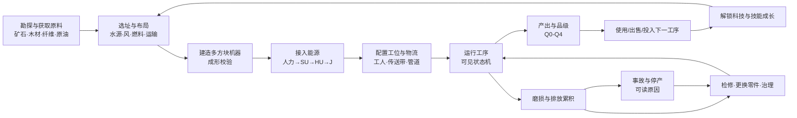
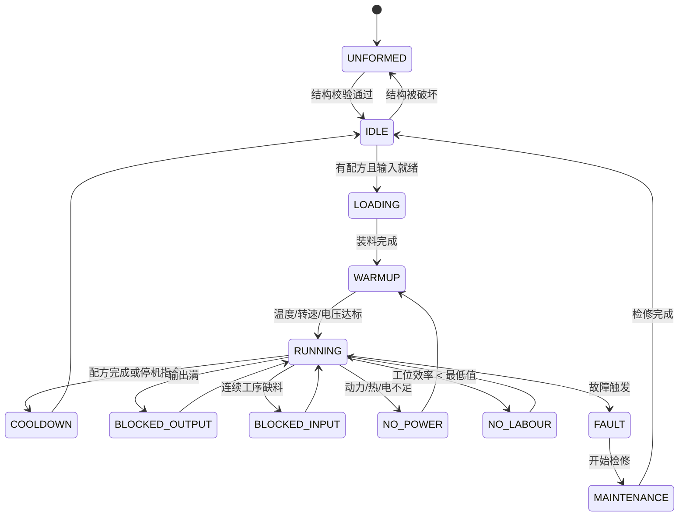
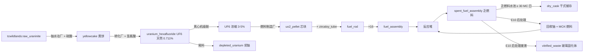

# 13 · 工坊 Industry（`tcindustry`）

本章是“工坊 Industry”模组的完整设计规格，覆盖 E1 到 E10 的材料加工、能源系统、机器、维护、自动化、排放与事故。本章同时是全家族能量单位 `SU`、`J/W`、`HU` 的权威定义（README §5.1、DA-10）。

## 0. 文档信息

| 项 | 内容 |
| --- | --- |
| 模组 ID | `tcindustry` |
| 显示名 | 工坊 Industry |
| Java 包 | `com.nightcity.industry`（主类 `TIndustry`，事件类 `TIndustryEvents`，已有指令 `/tcindustry status`） |
| 必需依赖 | `tcivilization`、`tctechnology`（02 §1.3；v0.1 的 `optional` 在 v0.2 修正为 `required`） |
| 可选依赖 | `tcskills` 及全部主题模组（桥接类放在 `com.nightcity.industry.compat.<other>`） |
| 被依赖 | `tcorbit` 必需依赖本模组（02 §1.2） |
| 配置文件 | `tcindustry-common.toml`、`tcindustry-server.toml`、`tcindustry-client.toml` |
| 文档版本 | DD-0.2 |
| 科技配额 | 70（附录 B 实列 71，含 16 项时代关键科技） |
| 性能预算 | 服务端平均 2.0 ms/tick，峰值 5.0 ms/tick（02 §8） |
| 地区附加层 | `tcindustry:emission`（污染物与碳排放累计） |

术语：

| 术语 | 含义 |
| --- | --- |
| 多方块机器 Multiblock | 由控制方块（带 BlockEntity）与若干结构方块组成；结构校验通过后“成形”，渲染运动部件 |
| 动力网络 Shaft Network | 由轴、齿轮、皮带、离合器连接的机械动力图，单位 SU |
| 热区 Heat Zone | 炉膛、窑室等共享温度的空间，单位 HU 与 °C |
| 电网 Grid | 由发电机、导线、变压器、断路器、负载组成的图，单位 J/W，含电压等级 |
| 工位 Labour Slot | 机器上需要人操作的位置，由玩家或 `tcivilization:person` 填补 |
| 磨损 Wear | 0-1 浮点，累计到阈值触发视觉变化、异常声响与故障概率 |
| 品级 Grade | 产物质量 Q0-Q4（粗、普、良、精、特），影响工具耐久、零件寿命与售价 |
| 工序 Process | 一个配方在一台机器中的一次执行，有状态机（§5.2） |

---

## 1. 定位与设计支柱

### 1.1 定位

Industry 是家族中“把原料变成文明物质基础”的模组：它接收 Wildlands 的矿石与岩石、Cultivation 的纤维与皮张、Ecology 的木材，产出金属、陶瓷、玻璃、建材、纺织品、燃料、化学品、机械零件、金属工具和机器，并提供从人力到核能的全部能源形式。它的标志性体验是 DR-20：**看得见的工业**——转动的传动轴、冒烟的烟囱、发红的炉口、流淌的铁水、在皮带上移动的货物，以及需要人去照看的机器。

一句话：**你建的不是“一个会吐东西的方块”，而是一座有动力、有工人、会磨损、会排烟、需要原料与运输的工厂。**

### 1.2 设计支柱

| 编号 | 支柱 | 含义 | 可验证的体现 |
| --- | --- | --- | --- |
| IND-P1 | 看得见的过程 | 每道工序都有物理可见的状态：运动部件、火光、烟、流体、物品在传送带上移动 | 每台机器至少 3 种可区分的视觉状态（停机/运行/故障）；状态不只靠颜色表达（31 UP 原则） |
| IND-P2 | 写实比例 | 燃料热值比、熔点、工艺温度、转换效率、线损遵循现实；绝对数值做游戏化缩放 | §5.1 缩放规则；§6 数值表与现实比值误差 ≤ 30% |
| IND-P3 | 布局即设计 | 产能由布局、动力、物流、劳力与维护决定，而不是 GUI 里的“升级槽” | 不存在速度升级物品；同一机器的产能只受 §5.10 公式中的因子影响 |
| IND-P4 | 维护与失效 | 磨损、故障、检修是持续循环；每次停产都有可读原因 | 每个停机状态都有原因码与本地化文本（EC-P5-6） |
| IND-P5 | 能源是一条链 | 人力 → 畜力 → 水/风 → 蒸汽 → 内燃/电 → 核能与可再生能源；旧能源不作废，只是被更划算的取代 | 每个时代至少新增一种能源；E10 仍可使用水车 |
| IND-P6 | 工业有代价 | 排放、事故、资源消耗进入地区层，影响聚落与生态（DR-14） | 每台燃烧/化工机器有排放系数；事故只作用于地区与聚落（EC-P6-5） |

### 1.3 职责边界

| 内容 | 归属 | 说明 |
| --- | --- | --- |
| 金属锭、板、线、棒、管、合金、机械零件 | **Industry** | 原版铁锭、金锭、铜锭不重复注册，由 Industry 工艺产出（02 §3） |
| 陶器、纺织品、皮革制品、玻璃、砖、砂浆、混凝土 | **Industry** | 简报 §2.4 |
| 木炭（复用 `minecraft:charcoal`）、焦炭、精炼燃料 | **Industry** | 原煤、泥炭、褐煤、无烟煤原矿由 Wildlands 注册 |
| 流体 `tcindustry:crude_oil`、`tcindustry:natural_gas` 及全部炼化产物 | **Industry** | 储层位置是 `tcwildlands:geo` 数据 |
| 所有金属工具（铜、青铜、熟铁、钢、合金钢、动力工具） | **Industry** | E0-E1 石器工具归 tctechnology |
| 能量单位 `SU`、`J/W`、`HU` 与相应网络 | **Industry** | 其他模组通过 `IndustryEnergyApi` 接入 |
| 工厂内的管道、传送带、溜槽、泵、阀门 | **Industry** | 长距离管线、铁路、车辆归 Networks |
| 化肥（氨、硝酸铵、过磷酸钙、钾肥） | **Industry** | 以 `c:fertilizers/*` 标签供 Cultivation 使用；粪肥与堆肥归 Cultivation（开放问题 OQ-1） |
| 武器、护甲、攻城器械 | Frontiers | Industry 只提供材料（钢板、火药、黄铜壳体材料） |
| 车辆、铁路、长距离管道、电报 | Networks | Industry 提供发动机、钢轨钢材 |
| 火箭、航天器、太空服 | Orbit | Industry 提供燃料、合金、电子件 |
| 研究设施、仪器、书籍 | Discovery | Industry 提供光学玻璃、精密黄铜、电子件 |
| 矿石、岩石、原矿物品 | Wildlands | Industry 只加工 `tcwildlands:raw_<mineral>` 与 `c:` 标签物品 |
| 食物、面粉、作物 | Cultivation | Industry 提供 `tcindustry:milling` 配方类型与磨坊机器（OQ-2） |
| 房屋与公共工程功能 | Settlements / Commons | Industry 提供建材 |

### 1.4 体验目标

1. **E1-E3 手作期**：玩家亲手揉泥、拉坯、鼓风、锤打；每件东西都“费劲”，技能熟练度提升明显。
2. **E4-E5 动力期**：第一根水车主轴转起来的时刻是里程碑；从此“布局”成为核心玩法。
3. **E6 蒸汽期**：工厂成形，天轴横贯厂房，烟囱林立；维护和燃料物流成为日常。
4. **E7-E8 电气与化工期**：能源与工厂解耦，电网跨越聚落；化工链长而复杂，事故风险出现。
5. **E9-E10 自动化期**：PLC 与机器人接管重复劳动，玩家角色从“操作工”变为“工厂设计师与调度员”。

---

## 2. 独立玩法（只安装本模组与必需核心时）

### 2.1 安装组合

独立模式 = `tcivilization` + `tctechnology` + `tcindustry`（`tcskills` 可选）。此时：

1. 主世界使用原版生成，原版矿石**照常生成**（只有 Wildlands 才会移除原版矿石，简报 §2.3）。
2. 科技树中 Industry 的 71 项科技完整可用；跨模组前置只引用 tctechnology 的 `stone/fire_making`、`stone/knapping`、`stone/foraging_lore`，因此独立模式下科技树没有断链。
3. 时代跃迁所需的其他模组关键科技按 01 §4.1 替代条件处理（本章不定义）。
4. 不存在 Settlements 时，工位由“抽象雇工”或玩家本人填补（§2.4）。

### 2.2 原料来源映射

Industry 所有配方只引用 `c:` 标签。标签由 Wildlands（若安装）和 Industry 自带的回退数据包共同填充。独立模式下的来源如下：

| 需要的原料（标签） | 有 Wildlands 时 | 无 Wildlands 时的来源 | 最早时代 |
| --- | --- | --- | --- |
| `c:raw_materials/copper` | `raw_native_copper`、`raw_malachite`、`raw_chalcopyrite` | `minecraft:raw_copper` | E1 冷锻 / E2 冶炼 |
| `c:raw_materials/tin` | `raw_cassiterite` | 河床砂砾淘洗得 `tcindustry:tin_concentrate`（§2.3） | E2 |
| `c:raw_materials/lead`、`silver` | `raw_galena`、`raw_native_silver` | 破碎 `minecraft:raw_copper` 副产 `tcindustry:lead_concentrate`（含银） | E2 |
| `c:raw_materials/zinc` | `raw_sphalerite`、`raw_calamine` | 破碎 `minecraft:raw_copper` 副产 `tcindustry:zinc_concentrate` | E3 |
| `c:raw_materials/iron` | `raw_bog_iron`、`raw_hematite`、`raw_magnetite` | `minecraft:raw_iron` | E3 |
| `c:raw_materials/gold` | `raw_native_gold` | `minecraft:raw_gold`；河床淘金 | E1 |
| `c:raw_materials/mercury` | `raw_cinnabar` | 不提供；依赖汞的工艺都有无汞替代（隔膜电解槽、氰化提金改为重选） | E4 |
| `c:raw_materials/aluminum` | `raw_bauxite` | 黏土酸浸提取氧化铝，收率为铝土矿的 40% | E7 |
| `c:raw_materials/chromium`、`nickel`、`tungsten`、`molybdenum`、`cobalt` | 对应原矿 | E7 浮选机处理 `minecraft:raw_iron`、`raw_copper` 时的副产精矿（比例见 §8.13） | E7-E9 |
| `c:raw_materials/uranium` | `raw_uraninite` | E8 花岗岩大宗堆浸（`minecraft:granite` 1,000 块 ≈ 1 份 `uranium_concentrate`） | E8 |
| `c:raw_materials/titanium`、`rare_earths` | `raw_ilmenite`、`raw_rutile`、`raw_monazite` | 海滩沙重矿物分选（`minecraft:sand` 在海滩群系淘洗） | E8 / E9 |
| `c:raw_materials/lithium` | `raw_spodumene` | 沙漠/盐沼卤水蒸发池（`tcindustry:evaporation_pond`） | E9 |
| `c:raw_materials/sulfur` | `raw_sulfur` | 焙烧铜精矿与煤气脱硫副产 | E5 |
| `c:raw_materials/niter` | `raw_niter` | 硝石床 `tcindustry:nitre_bed`（腐肉/骨粉/麦秆 + 泥土，熟化 2 MC 日） | E5 |
| `c:raw_materials/potash` | `raw_sylvite` | 草木灰浸取（`tcivilization:wood_ash` → `potash`） | E1 起少量 / E7 大宗 |
| `c:raw_materials/phosphate` | `raw_phosphorite` | 骨灰（`minecraft:bone_meal` 煅烧） | E7 |
| `c:raw_materials/graphite` | `raw_graphite` | E7 艾奇逊电炉石墨化（煤或焦炭） | E5 / E7 |
| `c:clays/kaolin` | `raw_kaolinite` | 淘洗 `minecraft:clay_ball` 得 `tcindustry:washed_clay`（瓷器品级上限 Q3） | E4 |
| `c:sands/quartz` | `raw_quartz_sand` | `minecraft:sand` | E3 |
| `c:stones/limestone` | `tcwildlands:limestone`、`chalk`、`marble` | `minecraft:calcite`、`minecraft:dripstone_block` | E3 |
| `c:stones/gypsum` | `tcwildlands:gypsum_rock` | 缺省：水泥配方中石膏为可选，缺少时初凝时间 ×0.5、强度品级 −1 | E6 |
| `c:coals/*` | `peat`、`lignite`、`bituminous_coal`、`anthracite` | `minecraft:coal` 视为烟煤 | E1 泥炭 / E6 |
| 原油、天然气储层 | `tcwildlands:geo` 储层数据 | Industry 回退储层图 `IndustryFallbackReservoirs`（种子确定的 2D 噪声，每 512×512 地区 0-2 个储层，存于本模组 SavedData） | E7 |

### 2.3 独立模式专属方块

| 方块 | 作用 | 存在条件 |
| --- | --- | --- |
| `tcindustry:panning_station` 淘洗台 | 手持 `tcindustry:gold_pan` 对河床砂砾右键也可；淘洗台可放 1 个工位，产出锡精矿、金粒、重矿物 | 总是注册；Wildlands 存在时产出改为其砂矿表 |
| `tcindustry:sluice_box` 溜槽淘洗器 | 水流驱动的连续淘洗，E3 起 | 同上 |
| `tcindustry:nitre_bed` 硝石床 | 生成硝酸钾 | 总是注册 |
| `tcindustry:evaporation_pond` 蒸发池 | 卤水 → 盐、锂盐、钾盐 | 总是注册 |

淘洗台在独立模式下的产出表（每次操作，河流/海滩群系的砂砾或沙子）：

| 产物 | 河流砂砾 | 海滩沙 | 其他群系 |
| --- | --- | --- | --- |
| `tcindustry:tin_concentrate` | 6% | 1% | 0.5% |
| `minecraft:gold_nugget` | 3% | 0.5% | 0.2% |
| `tcindustry:heavy_mineral_sand`（钛、锆、稀土） | 1% | 8% | 0% |
| `minecraft:flint` | 10% | 2% | 5% |
| 无产出 | 其余 | 其余 | 其余 |

### 2.4 无 Settlements 时的劳力

配置 `standalone.labour_mode`（server）：

| 模式 | 行为 |
| --- | --- |
| `ABSTRACT`（默认） | 每个工位视为由“抽象雇工”填补，工位效率固定为 0.75；无技能成长、无工资；机器 GUI 显示“雇工（抽象）” |
| `PLAYER_ONLY` | 只有玩家本人站在工位上才算填补；适合硬核单机 |
| `NONE` | 关闭工位要求，所有机器效率 1.0（创造测试用） |

若安装了 Nations 但没有 Settlements，AI 文明的 `tcivilization:person` 不会进入玩家工厂；规则同上。

### 2.5 独立模式的完整循环

1. E1：在火堆旁捏泥坯 → 露天坑烧 → 升焰窑 → 陶罐、砖坯；纺锤与织机产布；鞣制皮革。
2. E2：炭窑烧木炭 → 竖炉冶炼原版粗铜 → 淘洗得锡精矿 → 坩埚合金青铜 → 失蜡铸造青铜工具。
3. E3：块炼炉 + 风箱炼原版粗铁 → 锻焊 → 渗碳 → 熟铁工具；玻璃吹制；石灰砂浆。
4. E4：水车与风车驱动磨坊、锻锤、锯木机、漂洗机；高炉出铸铁。
5. E5-E6：火药、精密黄铜、轧机、抽水机 → 蒸汽机 → 机床、天轴工厂、贝塞麦转炉。
6. E7 以后：发电、电网、炼油、化工、电炉；E8 核裂变、晶体管；E9 集成电路与自动化；E10 先进能源与增材制造。

所有阶段的排放写入 `tcindustry:emission` 地区层；没有 Ecology 时，排放只影响本模组的“烟尘”视觉与 `/tcindustry status` 统计，并在超过阈值时降低附近工位效率（§5.13）。

---

## 3. 联动玩法（逐个列出与其他模组的联动）

所有联动通过核心接口或 `ModList.isLoaded()` 守卫的桥接类实现（02 §1.4）。下表“缺失时”一列说明对方未安装时本模组的行为。

### 3.1 tcivilization（核心，必需）

- 使用核心共享实体 `tcivilization:person` 作为工人；工位分配通过核心 `PersonRecord` 的“职业槽”接口，不直接操作 Settlements 内部数据。
- 写入地区附加层 `tcindustry:emission`（§11.4），按 L2 周期汇总。
- 发布事件：`IndustryMachineFormedEvent`、`IndustryMachineFailureEvent`、`IndustryAccidentEvent`、`IndustryGridOverloadEvent` 等（§12.2），核心编年史记录“第一座高炉点火”“第一座核反应堆临界”等里程碑。
- 文明面板页签 `tcindustry:production`（经济组，排序 450）；HUD 情境控件 `tcindustry:network_status`；为机器注册 `TargetInfoProvider`，为持续问题注册 `AlertProvider`，一次性事件走 `TcNotifications`（§10）。
- 世界历史与模拟调度：机器的 L1/L2 抽象运行由核心调度器驱动（02 §4），本模组只提供 `IndustryAbstractSimulator`。

### 3.2 tctechnology（核心，必需）

- 本模组拥有 71 项科技（附录 B），数据文件随 JAR 发布于 `data/tctechnology/tc_tech/<era>/<tech>.json`。
- 每台机器、每个配方带 `required_tech`；未解锁时 JEI/EMI 中显示锁定，机器无法成形（结构校验通过但控制器显示“未掌握：xx”）。
- **实践知识**：本模组在 `RegisterKnowledgeTriggersEvent` 中注册触发器 `tcindustry:process_completed`、`tcindustry:machine_formed`、`tcindustry:energy_produced`、`tcindustry:quality_reached`；科技 JSON 的 `knowledge.sources` 引用它们（`PRACTICE` 来源，NPC 工人按 04 的 `actor_mult` 计）。各科技的触发器与数量见 §6.12。
- E0-E1 石器工具由 tctechnology 注册；本模组从 E1 冷锻铜起接手金属工具。

### 3.3 tcskills（可选）

- 行为挂钩见 §15 与附录 D；主用 `smithing`、`engineering`、`crafting`、`construction`、`mining`、`logistics`、`scholarship`、`aeronautics`。
- 熟练度影响：手工工序速度、品级判定加成、维修效率、故障诊断信息深度（§5.8、§5.9）。
- 缺失时：所有技能倍率取 1.0，品级判定使用基础分布。

### 3.4 tcwildlands（可选）

- **Wildlands → Industry**：原矿物品 `tcwildlands:raw_<mineral>`、岩石、煤种；储层数据（原油、天然气、地热）来自 `tcwildlands:geo`；河流流量、风速来自 `tcwildlands:hydro` 与 `tcwildlands:climate`，决定水车与风车输出（§5.4）。
- **Industry → Wildlands**：采油/采气会降低储层压力（写回 `geo` 层的储层余量字段，通过 Wildlands 公开 API）；大坝改变下游流量（通知 `hydro` 层）。
- 地热电站：读取 `geo` 层地热梯度。
- 缺失时：使用原版矿石、本模组回退储层图、固定风速表与基于方块的水流检测（§2.2）。

### 3.5 tcecology（可选）

- **Industry → Ecology**：`tcindustry:emission` 层中的 SO₂、NOx、颗粒物、重金属、放射性、热污染供 Ecology 计算生态健康；水体排放影响鱼类种群。
- **Ecology → Industry**：木材与矮林细杆 `tcecology:coppice_pole`、胶乳 `tcecology:latex`（橡胶）、鲸脂 `tcecology:blubber`（熬成 `tallow`）、毛皮 `tcecology:fur_pelt`（视同生皮鞣制）；森林被过度砍伐时木炭原料短缺。
- 缺失时：木材使用原版原木；排放只作用于聚落与本模组视觉。

### 3.6 tccultivation（可选）

- **Cultivation → Industry**：亚麻、棉花、羊毛、蚕丝、麻、皮张、油料、淀粉、甘蔗（乙醇）、橡胶乳。
- **Industry → Cultivation**：金属农具（锄、镰、犁铧）；化肥 `c:fertilizers/nitrogen|phosphorus|potassium`；磨坊机器与 `tcindustry:milling` 配方类型（面粉配方由 Cultivation 数据包提供，OQ-2）；拖拉机发动机（由 Networks 组装为车辆）；冷藏机。
- 缺失时：纤维与皮张用原版羊毛、线、皮革、麦秆；化肥仍可产出，作为原版骨粉的高效替代（右键作物，效果 ×2）。

### 3.7 tcnetworks（可选）

- **Industry → Networks**：钢轨钢材、蒸汽机/内燃机/电动机组件、燃料、电力（电气化铁路通过电网接口取电）。
- **Networks → Industry**：长输管道 `tcnetworks:pipeline`、铁路货车、卡车。物品交界是 Networks 的装卸台 `tcnetworks:loading_bay`（向相邻容器与 Industry 机器暴露 `IItemHandler`）；流体交界是本模组的装液臂 `tcindustry:fluid_loading_arm`（向罐车/油轮与管道终端暴露 `IFluidHandler`）。
- 边界：工厂内部（同一工业区，§5.11）的管道、传送带、溜槽与机械手归 Industry；≥ 256 格的长距离管道与一切车辆归 Networks。工厂缺料时本模组发布 `IndustryProductionDemandEvent`，玩家开启“自动补料”后 Networks 生成物流订单。
- 电力牵引：接触网与牵引变电所作为本模组电网负载，经 NeoForge `IEnergyStorage` 取电（换算 `1 FE/tick = 100 W`，即 `1 FE = 5 J`，§12.6）。
- 缺失时：物料靠玩家搬运、溜槽、传送带与工厂内管道；无长距离运输。

### 3.8 tcsettlements（可选）

- **Settlements → Industry**：工人（`tcivilization:person` 职业：陶工、织工、冶炼工、铁匠、磨坊工、司炉、机械工、电工、化学家、核工程师、技术员）、教育等级影响工位效率、住房距离影响通勤（工位效率衰减）。
- **Industry → Settlements**：建材、工具、电力供应（聚落用电需求作为电网负载）、工业事故与污染导致的公共卫生事件、就业岗位。
- 区域电网验收（EC-P5-4）：同一电网为 5 座聚落供电即触发 E7→E8 里程碑判定，由本模组上报。
- 缺失时：§2.4 抽象雇工。

### 3.9 tcexchange（可选）

- 机器与产品有基准价值（VU），供市场定价；工厂可挂“销售订单”，产物自动进入市场仓库。
- 原料价格信号显示在生产页签（“锡价上涨 18%，青铜成本 +12%”）。
- 劳动工资由 Exchange 结算；未安装时不计工资。
- 缺失时：无价格，生产页签隐藏成本列。

### 3.10 tcdiscovery（可选）

- **Industry → Discovery**：光学玻璃（望远镜、显微镜）、精密黄铜（仪器）、电子件、化学试剂。
- **Discovery → Industry**：实验观察解锁配方细节（例如观察“淬火颜色”后熔炉 GUI 显示温度刻度；E1-E5 熔炉不显示数字温度，只显示火色，除非已掌握测温知识，§5.3.5）。
- 观察模式（V）下，Industry 机器向观察面板提供可观察属性（转速、温度、磨损），由 `TargetInfoProvider` 扩展字段提供。
- 缺失时：温度显示规则按科技解锁判定。

### 3.11 tcechoes（可选）

- 遗迹中出现古代工业遗址（废弃炉址、矿渣堆、古水车基座），可修复为可用多方块的“半成品”。
- 古代文物中的“失传工艺”（如大马士革钢纹）作为品级 Q4 的稀有配方解锁。
- 缺失时：无遗址与失传工艺。

### 3.12 tccommons（可选）

- 工厂选址受土地权限与分区法律约束（工业区、居住区）；排放超出法规上限时触发罚款或停产令。
- 公共工程：大坝、发电站、区域电网可作为公共工程立项，由 Commons 管理投票与出资。
- 缺失时：无分区限制。

### 3.13 tcfrontiers（可选）

- **Industry → Frontiers**：钢、黄铜、火药、硝化炸药、合金钢、钛、复合材料作为武器护甲材料；Industry 不注册任何武器或护甲。
- **Frontiers → Industry**：攻城与破坏可损坏机器（增加磨损或直接 FAULT），盗匪可袭击仓库。
- 缺失时：火药与炸药只用于采矿爆破与工程。

### 3.14 tcbeyond（可选）

- 异界资源（异质矿物）可在 E8+ 的电弧炉与离心机中处理，产物归 Beyond 定义。
- 异界影响区内机器磨损速度 ×1.5（磁场干扰），由 Beyond 通过 `MachineWearModifier` 接口注入。
- Beyond 的余烬坩埚 `tcbeyond:ember_crucible` 经 `IndustryApi.registerHeatSource`（§12.1）向正上方炉窑或锅炉的燃烧室供热 200 HU/s，不需要燃料，也不产生排放。
- 缺失时：无。

### 3.15 tcatlas（可选）

- 专题地图图层：工业设施、电网线路、管道、排放热力图（读取 `tcindustry:emission` 层）。
- 测绘仪器需要的精密黄铜、光学玻璃由 Industry 提供。
- 缺失时：生产页签使用 `TcMapSnippet` 的坐标文字回退。

### 3.16 tcnations（可选）

- AI 文明的工业能力按其科技与人口抽象计算，使用本模组的 `IndustryAbstractSimulator` 产能公式（§5.15），生成军需与贸易品。
- 战争可以“工业目标”为攻击对象（Nations 决策，Frontiers 执行）。
- 缺失时：无。

### 3.17 tcorbit（依赖本模组）

- Orbit 必需依赖 Industry：火箭燃料（煤油 RP-1、液氢、液氧、偏二甲肼替代品 `hypergolic_propellant`）、铝锂合金、钛合金、碳纤维、耐热陶瓷、集成电路、太阳能电池、RTG、燃料电池。
- 燃烧类机器在无大气维度（`tcorbit:low_orbit`、`tcorbit:moon`）中不运行，状态 `FAULT/NO_OXIDIZER`；火星低压 CO₂ 大气中燃烧机器效率 ×0（无氧），电与核机器正常。
- 月面原位资源（月壤、氦-3）由 Orbit 注册，Industry 提供通用电解与熔炼机器配方类型。

---

## 4. 核心玩法循环（含 mermaid 流程图）

### 4.1 主循环



### 4.2 一次典型的 E4 会话

1. 在河湾处测流量：手持 `tcindustry:wrench` 右键河水方块，HUD `tcindustry:network_status` 显示“流速 1.4 格/秒，可用落差 3 格 → 下射水车约 960 SU”。
2. 建 5×5 下射水车，主轴穿墙进入磨坊，经木制灯笼齿轮升速到 30 RPM。
3. 磨坊配 1 名磨坊工（`tcivilization:person`），同时用离合器把同一主轴分给锻锤；锻锤在打铁时磨坊转速下降（共享网络，§5.4.4），玩家看见水车与磨盘同时变慢。
4. 运行 3 MC 日后，木齿轮磨损进入“已使用”状态（齿面发白），声音出现“咔哒”层；玩家安排检修，更换 `tcindustry:wooden_gear`。
5. 磨坊出口接溜槽到仓库，粮食与铁器进入聚落储备；编年史记录“第一座水力磨坊”。

### 4.3 时代节奏

| 时代 | 核心动作 | 新的“限制因素” | 玩家情绪目标 |
| --- | --- | --- | --- |
| E1 | 手作陶、布、皮 | 体力与时间 | 亲手造物的满足 |
| E2 | 炭窑、竖炉、合金 | 燃料与锡源 | 第一块金属的惊喜 |
| E3 | 块炼、锻焊、玻璃 | 品级与技能 | 手艺精进 |
| E4 | 水车、风车、高炉 | 选址（水/风） | 自然力为我所用 |
| E5 | 火药、黄铜、轧机、抽水 | 精度 | 精密与扩张 |
| E6 | 蒸汽、机床、钢、天轴 | 燃料物流与维护 | 工厂轰鸣 |
| E7 | 电网、炼油、化工、内燃 | 化工链复杂度与安全 | 能源解放 |
| E8 | 核裂变、晶体管、塑料 | 风险管理 | 巨大能量与责任 |
| E9 | 集成电路、自动化 | 系统设计 | 从操作工到设计师 |
| E10 | 先进裂变、空间能源、增材制造 | 质量与可靠性 | 走向太空 |

---

## 5. 系统规则与公式

### 5.1 单位与缩放规则（全家族权威）

| 量 | 单位 | 定义 | 说明 |
| --- | --- | --- | --- |
| 机械功率 | `SU`（Stress Unit） | `SU = RPM × τ`，τ 以游戏扭矩单位 `gt` 计 | 取 `1 gt = 60/(2π) N·m ≈ 9.549 N·m`，使 **1 SU ≡ 1 W 机械功率** |
| 热功率 / 热量 | `HU`（Heat Unit） | `1 HU = 1 kJ`（游戏能量）；热功率写 `HU/s` | 燃料、炉膛、锅炉、化学反应热都以 HU 计 |
| 电能 / 电功率 | `J` / `W` | `1 J = 1 W·s` | 电压 `V`、电流 `A`、电阻 `Ω` 按现实定义 |
| 时间 | 秒（s） | 1 s = 20 tick | 所有功率均按“每实时秒”计算 |
| 物品质量 | 名义 kg | 1 个锭、1 块燃料、1 块砖 = 1 名义 kg | 只用于能量换算，不显示给玩家 |
| 液体体积 | mB | 1,000 mB = 1 桶 = 名义 1 L；熔融金属 1 锭 = 144 mB | 1 kg 铁 ≈ 0.143 L，与 144 mB 惯例吻合 |
| 气体体积 | mB | 1 mB 气体 = 1 L 标准状态（0 °C、1 atm）；1,000 mB = 1 m³ STP | 天然气、煤气、氢、氧、氮、蒸汽以外的气体 |
| 蒸汽 | mB | 1 mB 蒸汽 = 1 g 水汽化所得，附带压力等级（§5.5） | |
| 温度 | °C | 环境温度 `T_amb` 来自 Wildlands 气候，缺失时 15 °C | E1-E5 默认不显示数字（§5.3.5） |

缩放原则（IND-P2）：

```text
功率：按现实量级（人 ≈ 75 SU，水车 2-10 kSU，车床 1-2 kW，火电机组 MW 级）
能量：ENERGY_SCALE = 0.1
      游戏所需热量/电量 = 现实每名义 kg 的能耗 × ENERGY_SCALE
      燃料 HU/物品     = 现实热值(MJ/kg) × 1000 × ENERGY_SCALE
结果：同样功率下工序比现实快 10 倍；燃料燃烧时间比现实短 10 倍；
      所有“燃料比”“效率”“温度”“热值比”与现实一致
```

示例：烟煤现实热值约 28 MJ/kg → `28 × 1000 × 0.1 = 2,800 HU/块`；焦炭高炉炼 1 kg 生铁现实约耗 13 MJ 焦炭热 → 游戏 1,300 HU ≈ 0.45 块焦炭（现实焦比约 0.5 kg/kg）。

### 5.2 工序状态机

每台机器（多方块控制器）有一个工序状态。状态决定渲染动画、声音、粒子和 HUD 文本；每个非运行状态都带**原因码**（EC-P5-6）。



| 状态 | 枚举 | 可见表现 | 声音 | 原因码示例 |
| --- | --- | --- | --- | --- |
| 未成形 | `UNFORMED` | 结构方块不连接，无动画 | 无 | `missing_block@x,y,z`、`tech_locked:<tech>` |
| 空闲 | `IDLE` | 部件静止，炉口暗 | 无 | `no_recipe`、`disabled_by_signal` |
| 装料 | `LOADING` | 工人搬运动画、料斗内物品可见 | 装料声 | — |
| 预热 | `WARMUP` | 火色由暗红渐变；轴加速 | 低频起转 | `heating:<T>/<T_min>` |
| 运行 | `RUNNING` | 完整动画、烟、火花、产物移动 | `machine.<subject>.run` | — |
| 冷却 | `COOLDOWN` | 火色渐暗；轴减速 | 减速声 | — |
| 缺料 | `BLOCKED_INPUT` | 部件空转或静止，料斗空 | 空转声 | `input_missing:<tag>` |
| 输出满 | `BLOCKED_OUTPUT` | 产物堆积在出口 | 无 | `output_full:<slot>` |
| 缺动力 | `NO_POWER` | 部件减速至停；火变暗；电机嗡声 | 下沉音 | `rpm_low:<rpm>/<min>`、`heat_low`、`voltage_low` |
| 缺人 | `NO_LABOUR` | 工位空着（可见空凳/空操作台） | 无 | `labour:<ratio>/<min>` |
| 故障 | `FAULT` | 冒黑烟/蒸汽喷出/零件歪斜/火花 | `machine.fault.*` | `fault:<mode>`（§5.8） |
| 检修 | `MAINTENANCE` | 工人检修动画，外壳打开 | 敲击声 | `maintenance:<progress>` |

规则：

1. 状态切换最少间隔 10 tick（防抖），视觉过渡 ≤ 20 tick。
2. 非运行状态持续 > 200 tick 时向核心 `AlertProvider` 报告持续问题（同一工业区合并），恢复后撤销。
3. `NO_POWER` 与 `NO_LABOUR` 不增加磨损；`RUNNING` 与 `WARMUP` 增加磨损（§5.8）。

### 5.3 热系统（HU 与温度）

#### 5.3.1 燃料

| 燃料 | 物品 ID / 标签 | HU/物品 | 自然通风火焰温度 | 鼓风火焰温度 | 灰渣 | 烟气等级 |
| --- | --- | --- | --- | --- | --- | --- |
| 木棍 | `minecraft:stick` | 185 | 600 °C | — | 无 | 2 |
| 木板 | `#minecraft:planks` | 375 | 800 °C | 1,000 °C | 无 | 2 |
| 原木（风干） | `#minecraft:logs` | 1,500 | 900 °C | 1,100 °C | `tcivilization:wood_ash` 10% | 3 |
| 泥炭 | `c:coals/peat` | 1,400 | 800 °C | 1,000 °C | 灰 15% | 4 |
| 褐煤 | `c:coals/lignite` | 1,500 | 900 °C | 1,150 °C | 灰 20% | 5 |
| 木炭 | `minecraft:charcoal` | 3,000 | 1,100 °C | 1,350 °C（风箱）/ 1,450 °C（水力鼓风） | 灰 3% | 1 |
| 烟煤 | `c:coals/bituminous`（含 `minecraft:coal`） | 2,800 | 1,100 °C | 1,400 °C | `tcindustry:clinker` 10% | 5 |
| 无烟煤 | `c:coals/anthracite` | 3,000 | 1,150 °C | 1,500 °C | 灰 8% | 3 |
| 焦炭 | `tcindustry:coke` | 2,900 | 1,200 °C | 1,550 °C（冷风）/ 1,750 °C（热风） | 灰 10% | 3 |
| 燃料油 | `tcindustry:fuel_oil` | 4,000 / 1,000 mB | 1,300 °C | 1,700 °C | 无 | 4 |
| 柴油 | `tcindustry:diesel` | 3,800 / 1,000 mB | 内燃机专用 | — | 无 | 4 |
| 汽油 | `tcindustry:gasoline` | 3,400 / 1,000 mB | 内燃机专用 | — | 无 | 3 |
| 煤油 | `tcindustry:kerosene` | 3,700 / 1,000 mB | 1,250 °C | — | 无 | 3 |
| 乙醇 | `tcindustry:ethanol` | 2,100 / 1,000 mB | 1,200 °C | — | 无 | 1 |
| 煤气 | `tcindustry:coal_gas` | 1,800 / 1,000 mB | 1,500 °C | 1,800 °C（蓄热） | 无 | 2 |
| 天然气 | `tcindustry:natural_gas` | 3,800 / 1,000 mB | 1,600 °C | 1,950 °C（蓄热） | 无 | 1 |
| 氢 | `tcindustry:hydrogen` | 1,080 / 1,000 mB | 2,000 °C | — | 无 | 0 |
| 原油（直接燃烧） | `tcindustry:crude_oil` | 3,800 / 1,000 mB | 1,100 °C | 1,400 °C | 油烟 | 6 |

烟气等级 0-6 决定排放系数（§5.13）与烟囱粒子颜色深浅（并配合形状差异，不只靠颜色）。

#### 5.3.2 炉膛热模型

每个热区（炉膛、窑室、锅炉火室）是一个集总热容：

```text
P_fuel   = burn_rate × HU_per_item × η_comb                   // HU/s
P_in     = P_fuel × (T_flame − T) / (T_flame − T_amb)          // 越接近火焰温度，传热越少
P_loss   = K_LOSS × (T − T_amb)                                 // 炉壁散热
P_proc   = 正在进行的工序吸热（§5.3.4）
dT/dt    = (P_in − P_loss − P_proc) / C_HEAT
T_flame  = 燃料表温度（按 air_mode 选列）+ 预热空气加成
稳态（无工序）：T_ss = T_amb + P_fuel × ΔF / (P_fuel + K_LOSS × ΔF)，ΔF = T_flame − T_amb
```

| 参数 | 含义 | 典型值 |
| --- | --- | --- |
| `burn_rate` | 燃料消耗速度（物品/s），由炉型与鼓风决定 | 坑窑 0.004；竖炉 0.02；高炉 0.2；锅炉 0.05-2 |
| `η_comb` | 燃烧效率 | 露天 0.5；有炉壁 0.7；鼓风 0.85；蓄热 0.92 |
| `C_HEAT` | 热容（HU/°C） | 坑窑 4；升焰窑 8；竖炉 6；高炉 120；平炉 300 |
| `K_LOSS` | 散热系数（HU/s/°C） | 坑窑 0.06；升焰窑 0.03；竖炉 0.05；高炉 0.4；平炉 0.6 |

鼓风模式 `air_mode`：

| 模式 | 来源 | 火焰温度加成 | `burn_rate` 倍率 | 解锁 |
| --- | --- | --- | --- | --- |
| `NATURAL` | 自然通风（烟囱高度 h ≥ 3 时每多 1 格 +10 °C，最多 +80 °C） | 0 | 1.0 | E1 |
| `BLOWPIPE` | 吹管（玩家/工人持续操作） | +150 °C | 1.3 | E2 |
| `BELLOWS` | 皮囊风箱（工位） | +250 °C | 1.6 | E2 |
| `WATER_BELLOWS` | 水力风箱（需 ≥ 400 SU） | +350 °C | 2.5 | E4 |
| `BLOWING_ENGINE` | 蒸汽鼓风机（需 ≥ 8,000 SU） | +450 °C | 4.0 | E6 |
| `HOT_BLAST` | 热风炉预热（Cowper 蓄热炉） | +200 °C（叠加） | ×0.75 燃料 | E6 |
| `OXYGEN` | 纯氧吹炼 | 由化学放热决定 | — | E8 |

#### 5.3.3 炉衬

炉衬材料决定炉膛允许的最高温度。`T > T_lining_max` 时炉衬磨损 ×10，超过 50 °C 持续 200 tick 触发 `fault:lining_failure`（§5.8）。

| 炉衬 | 方块 | `T_lining_max` | 解锁 |
| --- | --- | --- | --- |
| 黏土抹面 | `tcindustry:clay_lining` | 1,150 °C | E1 `neolithic/updraft_kiln` |
| 普通砖 | `minecraft:bricks` | 1,250 °C | E1 |
| 耐火砖 | `tcindustry:fire_bricks` | 1,550 °C | E4 `medieval/brickmaking` |
| 硅砖 | `tcindustry:silica_bricks` | 1,680 °C | E6 `industrial/steelmaking` |
| 镁砖 | `tcindustry:magnesia_bricks` | 1,850 °C | E7 `electric/electric_arc_furnace` |
| 石墨/高铝 | `tcindustry:graphite_block` / `tcindustry:alumina_bricks` | 2,200 °C | E7 |

#### 5.3.4 工序吸热

每个热工序配方给出 `min_temp`、`max_temp`（可选，超过时品级下降或产物报废）、`heat_required`（HU，全批次）与 `max_draw`（HU/s）。

```text
当 T ≥ min_temp：
    P_proc   = min(max_draw, P_in − P_loss + C_HEAT × (T − min_temp) / 20)
    progress += P_proc / heat_required                       // 每秒
当 T < min_temp：P_proc = 0，状态回到 WARMUP，原因码 heating:<T>/<min_temp>
品级窗口：T 在 [min_temp, ideal_temp_hi] 的时间占比 ≥ 80% 时品级分 +1（§5.9）
```

关键工艺温度（与现实一致）：

| 工艺 | `min_temp` | 理想上限 | 说明 |
| --- | --- | --- | --- |
| 素烧陶器 | 600 °C | 900 °C | 坑烧可达 |
| 炻器 | 1,150 °C | 1,250 °C | 需升焰窑 + 鼓风 |
| 瓷器 | 1,250 °C | 1,350 °C | 需耐火砖窑 |
| 石灰煅烧 | 900 °C | 1,100 °C | |
| 硅酸盐水泥熟料 | 1,400 °C | 1,500 °C | 回转窑 |
| 钠钙玻璃熔制 | 1,100 °C | 1,300 °C | |
| 锡熔化 | 232 °C | 400 °C | |
| 铜冶炼（孔雀石还原） | 1,100 °C | 1,250 °C | |
| 青铜熔铸 | 950 °C | 1,100 °C | 锡 10% |
| 黄铜（菱锌矿渗锌） | 900 °C | 1,000 °C | 锌易挥发 |
| 块炼铁（固态还原） | 1,100 °C | 1,250 °C | 不熔化，得海绵铁块 |
| 铸铁出铁 | 1,200 °C | 1,350 °C | 高炉 |
| 钢水 | 1,550 °C | 1,650 °C | 坩埚/转炉/平炉/电炉 |
| 锻造（铁） | 900 °C | 1,250 °C | 低于下限需回炉 |
| 锻焊 | 1,250 °C | 1,350 °C | 窗口窄，品级关键 |
| 淬火前奥氏体化 | 800 °C | 900 °C | |

#### 5.3.5 温度可读性

| 条件 | 熔炉/窑炉 GUI 与目标信息显示 |
| --- | --- |
| E1-E5，未掌握 `renaissance/optical_glass` | 只显示火色条（暗红→樱红→橙→黄→白，并附文字“樱红”），不显示数字 |
| 已掌握 `renaissance/optical_glass`（测温锥/比色） | 显示 ±50 °C 区间 |
| 已掌握 `electric/dynamo`（热电偶） | 显示精确数字 |
| 安装 Discovery 且观察过“火色与温度”线索 | 提前显示 ±100 °C 区间 |

火色对照（与 32 章发光材质一致）：525 °C 暗红、700 °C 暗樱红、800 °C 樱红、900 °C 亮樱红、1,000 °C 橙、1,100 °C 黄橙、1,200 °C 黄、1,300 °C 以上 黄白至白。

### 5.4 机械动力网络（SU）

#### 5.4.1 组成

动力网络是一个无向图：节点是**传动部件**（轴段、齿轮、皮带轮、离合器、飞轮）和**端点**（动力源、负载）。相邻部件按接口方向连接；齿轮在接触时啮合，皮带在两个皮带轮之间手动连接（扳手点击两端）。

| 部件 | ID | 最大扭矩 `τ_max`（gt） | 最大转速 | 传动效率 η | 粘性摩擦 `f`（gt/RPM） | 解锁 |
| --- | --- | --- | --- | --- | --- | --- |
| 木轴 | `tcindustry:wooden_shaft` | 1,500 | 60 RPM | 1.00 | 0.020 | E3 `iron/rotary_quern` |
| 铁轴 | `tcindustry:iron_shaft` | 2,500 | 200 RPM | 1.00 | 0.010 | E5 `renaissance/rolling_mill` |
| 钢轴 | `tcindustry:steel_shaft` | 12,000 | 600 RPM | 1.00 | 0.005 | E6 `industrial/line_shafting` |
| 木灯笼齿轮 | `tcindustry:lantern_gear` | 1,500 | 60 RPM | 0.85 | 0.040 | E3 |
| 木冠齿轮（直角） | `tcindustry:crown_gear` | 1,500 | 60 RPM | 0.82 | 0.040 | E3 |
| 铸铁齿轮 | `tcindustry:cast_iron_gear` | 2,500 | 200 RPM | 0.93 | 0.015 | E4 `medieval/blast_furnace` |
| 钢直齿轮 | `tcindustry:steel_gear` | 12,000 | 1,200 RPM | 0.96 | 0.008 | E6 `industrial/machine_tools` |
| 钢斜齿轮 | `tcindustry:helical_gear` | 20,000 | 3,000 RPM | 0.98 | 0.005 | E7 `electric/assembly_line` |
| 齿轮箱（2 级可调） | `tcindustry:gearbox` | 12,000 | 1,200 RPM | 0.94 | 0.010 | E6 |
| 皮带轮 | `tcindustry:pulley` | 2,500 | 600 RPM | — | 0.005 | E4 `medieval/fulling_mill` |
| 皮革传动带 | `tcindustry:leather_belt`（物品） | 1,500 | 600 RPM | 0.96 | — | E4；跨度 ≤ 16 格 |
| 橡胶帆布带 | `tcindustry:rubber_belt`（物品） | 4,000 | 1,500 RPM | 0.97 | — | E7；跨度 ≤ 24 格 |
| 离合器 | `tcindustry:clutch` | 同轴材料 | — | 1.00 | 0.010 | E4 |
| 安全滑动联轴器 | `tcindustry:slip_coupling` | 可设定 | — | 0.99 | 0.010 | E6 |
| 飞轮 | `tcindustry:flywheel` | 12,000 | 300 RPM | 1.00 | 0.010 | E6；惯量 `J = 2,000` |
| 调速器（离心） | `tcindustry:governor` | — | — | — | — | E6；连接蒸汽机阀门 |

齿轮比：相啮合的两个齿轮 `r = 齿数_主 / 齿数_从`。齿轮有大小两种（大 = 32 齿占 3×3，小 = 8 齿占 1×1），因此单级可得 1:1、1:4、4:1；齿轮箱提供 1:2、1:3、2:1、3:1 档，Shift+右键扳手切换（§9）。

#### 5.4.2 动力源

动力源采用线性扭矩-转速特性：

```text
τ_src(ω) = τ_stall × (1 − ω / ω_free)
P_src(ω) = τ_src(ω) × ω
P_rated  = τ_stall × ω_free / 4           // 在 ω = ω_free / 2 时取得最大功率
```

| 动力源 | ID | 额定 `P_rated`（SU） | 额定转速 | 条件与系数 | 解锁 |
| --- | --- | --- | --- | --- | --- |
| 手摇曲柄 | `tcindustry:hand_crank` | 75 | 30 RPM | 玩家或工人持续操作；玩家操作时只占用双手，不新增个人消耗（DR-19） | E3 |
| 畜力绞盘（马/牛/驴） | `tcindustry:animal_gin` | 马 500 / 牛 400 / 驴 250 | 4 RPM（经冠齿轮可升速） | 需 Cultivation 役畜或原版马/驴拴绳；无 Cultivation 时原版马 | E3 `iron/rotary_quern` |
| 踏车 | `tcindustry:treadwheel` | 150（2 人） | 6 RPM | 2 个工位 | E3 |
| 下射水车 | `tcindustry:undershot_waterwheel` | 2,000 | 8 RPM | `f_flow`、`f_season` | E4 `medieval/water_power` |
| 上射水车 | `tcindustry:overshot_waterwheel` | 5,000（落差 3 格） | 6 RPM | `f_flow`、`f_head`、`f_season` | E4 |
| 柱式风车 | `tcindustry:post_windmill` | 由风速计算（§5.4.5），典型 3,000 | 15 RPM | 需手动转向（工位）或尾翼（E5） | E4 `medieval/windmill` |
| 塔式风车 | `tcindustry:tower_windmill` | 典型 12,000 | 20 RPM | 扇尾自动对风 | E5 `renaissance/mine_drainage` |
| 纽科门常压机 | `tcindustry:newcomen_engine` | 4,000 | 12 冲程/分 → 摇杆 | 只直接驱动泵；接曲柄后输出 SU ×0.8 | E6 `industrial/steam_engine` |
| 瓦特回转蒸汽机 | `tcindustry:watt_engine` | 10,000 | 40 RPM | 离心调速器 | E6 `industrial/steam_engine` |
| 高压复合蒸汽机 | `tcindustry:compound_engine` | 40,000 | 90 RPM | 需钢轴 | E6 `industrial/machine_tools` |
| 电动机（小/中/大） | `tcindustry:electric_motor_small` / `_medium` / `_large` | 2,000 / 15,000 / 75,000 | 1,500 RPM | η 0.85 / 0.90 / 0.94 | E7 `electric/dynamo` |
| 内燃机（固定式） | `tcindustry:stationary_engine` | 8,000（汽油）/ 20,000（柴油） | 1,200 RPM | 需进气面 | E7 `electric/internal_combustion` |
| 燃气轮机 | `tcindustry:gas_turbine` | 2,000,000 | 3,000 RPM | 直连发电机 | E8 `atomic/gas_turbine` |

#### 5.4.3 网络求解

以网络中任一轴段为参考轴（root），每个部件 i 相对参考轴的速比 `r_i = ω_i / ω_root`。求解在拓扑或负载变化时执行（不是每 tick）：

```text
A = Σ_src   r_i × τ_stall_i
B = Σ_src   r_i² × τ_stall_i / ω_free_i
L = Σ_load  r_j × τ_load_j / η_path_j             // η_path：负载到源路径上所有齿轮/皮带效率之积
F = Σ_parts r_k² × f_k
ω_eq = max(0, (A − L) / (B + F))                  // 参考轴的平衡转速
任何负载 j 若 r_j × ω_eq < ω_min_j：该负载判为“失速”，从 L 中移除并进入 NO_POWER，重新求解（最多 3 轮）
```

传递扭矩校核：以参考轴为根做一次 DFS，计算每个轴段两侧的净扭矩 `τ_seg`。

```text
若 |τ_seg| > τ_max_seg：
    如果路径上有滑动联轴器且设定值 < τ_seg → 联轴器打滑（该支路负载断开，声音“吱”）
    否则 → 该轴段断裂：方块变为 tcindustry:broken_shaft，掉落 50% 材料，网络分裂
若 ω_k > ω_max_k（超速）→ 部件磨损 ×(ω_k/ω_max_k)³，超过 1.25 倍时断裂
```

实际转速随时间逼近平衡值（体现惯量，飞轮的作用）：

```text
J_total = Σ J_k（飞轮 2,000；水车 800；风车 600；其他部件 10）
ω(t+1s) = ω(t) + (ω_eq − ω(t)) × min(1, K_RESP / J_total)       // K_RESP = 400
冲击负载（锻锤、冲床、轧机咬钢）每次冲击使 L 瞬时增加 τ_impact，持续 10 tick；
若 J_total 足够大，转速只下降 (τ_impact × 0.5 s) / J_total 比例，否则相关负载短暂失速
```

性能约束：单个网络部件上限 `network.max_parts = 512`；求解复杂度 O(n)；求解结果缓存，负载变化通过“脏标记”合并到下一个整 20 tick 处理（EC-P4-4：100 个机械部件在预算内）。

#### 5.4.4 负载

| 负载 | 额定扭矩需求 | 额定转速 `ω_nom` | 最低转速 `ω_min` | 额定功率 |
| --- | --- | --- | --- | --- |
| 石磨（磨坊） | 50 gt | 30 RPM（经齿轮升到磨盘 120） | 10 RPM | 1,500 SU |
| 水力锻锤 | 100 gt | 20 RPM | 8 RPM | 2,000 SU（冲击 τ_impact 300） |
| 锯木机（往复锯） | 125 gt | 20 RPM | 8 RPM | 2,500 SU |
| 漂洗机 | 50 gt | 30 RPM | 10 RPM | 1,500 SU |
| 水力风箱 | 40 gt | 20 RPM | 6 RPM | 800 SU |
| 抽水泵（链泵/活塞泵） | 按扬程 | 15 RPM | 5 RPM | `ρ g Q h / 0.6` |
| 碎矿机（捣矿机） | 150 gt | 20 RPM | 8 RPM | 3,000 SU |
| 走锭纺纱机 | 10 gt | 120 RPM | 60 RPM | 1,200 SU |
| 动力织机 | 3.3 gt | 120 RPM | 80 RPM | 400 SU |
| 车床 | 10 gt | 150 RPM | 60 RPM | 1,500 SU |
| 牛头刨/龙门刨 | 20 gt | 150 RPM | 60 RPM | 3,000 SU |
| 铣床 | 13 gt | 150 RPM | 60 RPM | 2,000 SU |
| 钻床 | 5 gt | 160 RPM | 60 RPM | 800 SU |
| 轧机（板/线） | 300 gt | 100 RPM | 40 RPM | 30,000 SU（咬钢冲击 τ_impact 600） |
| 拉丝机 | 20 gt | 100 RPM | 40 RPM | 2,000 SU |
| 鼓风机（蒸汽） | 200 gt | 40 RPM | 15 RPM | 8,000 SU |
| 发电机（直连） | 由电负载反算 | 1,500 RPM | 1,350 RPM | 电功率 / 0.95 |

转速与产能：

```text
f_speed = clamp(ω / ω_nom, 0, 1.25)
产能 ∝ f_speed；磨损率 ∝ f_speed²（超速运行可以换产能，但更快磨损）
```

#### 5.4.5 自然动力源的输出

水车：

```text
P_wheel = P_rated × f_flow × f_head × f_season
f_flow  = clamp(Q / Q_rated, 0, 1.25)
          有 Wildlands：Q 取 tcwildlands:hydro 中该河段流量（m³/s），Q_rated：下射 1.0，上射 0.25
          无 Wildlands：Q = 取水区（水车前方 3×宽×6）中流动水方块数 × 0.02 m³/s × 流速因子(0.5-1.5)
f_head  = 上射：clamp(h_drop / 3, 0, 2)；下射：1
f_season = 有 Wildlands：冬季冰封 0（河面结冰时）、春汛 1.3、夏旱 0.6、其他 1；无 Wildlands：1（冰冻群系冬季概念不存在）
现实校核：P = ρ g Q h η；上射水车 η ≈ 0.65，下射 ≈ 0.25
```

风车与风机：

```text
P_wind = 0.5 × ρ_air × A × v³ × Cp × availability
ρ_air  = 1.225 × exp(−(y − 63) / 8,000)（以 1 格 = 1 m 近似）
A      = π × L²（L = 叶片长度，格）
v      = 有 Wildlands：tcwildlands:climate 的地区平均风速 × 日内噪声 × 高度修正 (h/10)^(1/7)
         无 Wildlands：v = clamp(4 + 4 × (y − 63) / 100, 2, 12) × 天气系数（晴 1.0，雨 1.2，雷暴 1.6）
Cp     = 柱式 0.18；塔式 0.25；E9 现代三叶 0.45
availability = 对风误差修正：cos²(Δθ)；柱式需工人转向，Δθ 每 MC 小时漂移 ±30°
v > v_cut_out（柱式 14、塔式 18、现代 25 m/s）：必须收帆/顺桨，否则风轮损坏（fault:overspeed）
```

示例：柱式风车 L = 6、v = 6 m/s：`0.5 × 1.225 × 113 × 216 × 0.18 ≈ 2,690 SU`；E9 风机 L = 20、v = 10 m/s：约 346 kW 电（经发电机 η 0.95）。

### 5.5 蒸汽

#### 5.5.1 锅炉

| 锅炉 | ID | 最高压力 | 蒸汽等级 | η_boiler | 最大产汽 | 解锁 |
| --- | --- | --- | --- | --- | --- | --- |
| 草堆式锅炉 | `tcindustry:haystack_boiler` | 1.5 bar | `LP` | 0.50 | 1,000 mB/s | E6 `industrial/steam_engine` |
| 康沃尔火管锅炉 | `tcindustry:cornish_boiler` | 4 bar | `MP` | 0.65 | 3,000 mB/s | E6 `industrial/steam_engine` |
| 兰开夏双火管锅炉 | `tcindustry:lancashire_boiler` | 10 bar | `HP` | 0.70 | 8,000 mB/s | E6 `industrial/machine_tools` |
| 水管锅炉（带过热器） | `tcindustry:water_tube_boiler` | 40 bar | `SH` | 0.82 | 40,000 mB/s | E7 `electric/power_grid` |
| 核蒸汽发生器 | `tcindustry:steam_generator` | 70 bar | `SH` | 0.98（热交换） | 200,000 mB/s | E8 `atomic/nuclear_fission` |
| 余热锅炉 | `tcindustry:heat_recovery_boiler` | 40 bar | `SH` | 0.75（取燃机排气） | 20,000 mB/s | E9 `information/smart_grid` |

蒸汽等级与每 mB 携带的热量（从 15 °C 给水算起，×ENERGY_SCALE）：

| 等级 | 压力 | 温度 | `h_steam`（HU/mB） |
| --- | --- | --- | --- |
| `LP` 低压 | ≤ 2 bar | 120 °C | 0.270 |
| `MP` 中压 | ≤ 4 bar | 145 °C | 0.275 |
| `HP` 高压 | ≤ 10 bar | 180 °C | 0.280 |
| `SH` 过热 | ≤ 70 bar | 450-540 °C | 0.330 |

锅炉公式：

```text
steam_rate (mB/s) = min(max_steam, P_heat × η_boiler × f_scale / h_steam)
f_scale   = 1 − 0.5 × scale_level              // 水垢 0-1，硬水每运行 1 MC 日 +0.02；软化给水（E7 化工）为 +0.002
给水消耗  = steam_rate（mB 水/s）；冷凝回收率：无冷凝器 0，有冷凝器 0.95
压力      p = p_set × steam_stock / steam_capacity
安全阀    p ≥ p_relief（= 0.9 × p_max）时开启，排汽可见白色汽柱与啸叫
爆炸条件  p ≥ p_max × (1 − 0.4 × wear) 持续 40 tick，且安全阀处于故障 fault:valve_stuck，或给水中断导致干烧（fault:dry_fire）后再进水
```

#### 5.5.2 蒸汽机与汽轮机

```text
P_shaft = steam_flow × h_steam × η_engine × f_condenser
steam_flow_needed = P_demand / (h_steam × η_engine × f_condenser)
f_condenser = 1.0（有冷凝器且冷却水充足）；0.6（排空）；纽科门必须有喷水冷凝，否则不工作
```

| 原动机 | 允许蒸汽 | η_engine | 总效率（含锅炉） | 冷却水 | 现实对照 |
| --- | --- | --- | --- | --- | --- |
| 纽科门常压机 | LP | 0.020 | ≈ 1% | 喷水 50 mB/s | 0.5-1% |
| 瓦特机（分离冷凝器） | LP/MP | 0.12 | ≈ 7.8% | 300 mB/s | 3-8% |
| 高压复合机 | HP | 0.20 | ≈ 14% | 600 mB/s | 10-15% |
| 三胀式船用机（供 Networks） | HP | 0.24 | ≈ 17% | — | 15-18% |
| 汽轮机 | SH | 0.42 | ≈ 34% | 冷凝器 8,000 mB/s/MW | 30-40% |
| 再热汽轮机（E9） | SH | 0.48 | ≈ 39% | 同上 | 38-45% |

燃料消耗示例：10 kW（10,000 SU）瓦特机 → 热输入 `10 kW / 0.078 ≈ 128 kW = 128 HU/s`（1 HU = 1 kJ），烟煤 2,800 HU/块 → 每 22 秒 1 块，每 MC 日（1,200 s）约 55 块。纽科门机同功率每 MC 日约 430 块——它只适合建在煤矿口（与历史一致）。

#### 5.5.3 冷却

汽轮机与冷凝器需要冷却水：取自水体（河、湖、海；Wildlands 存在时读取水温）或冷却塔 `tcindustry:cooling_tower`（蒸发损失 2%，可见水汽云）。直排水体产生热污染（`emission.thermal`，§5.13），水温 > 30 °C 时冷凝效率 ×0.85。

### 5.6 内燃机

| 机型 | ID | 额定功率 | η | 燃料 | 排放（每 MJ 燃料） | 解锁 |
| --- | --- | --- | --- | --- | --- | --- |
| 煤气机（奥托四冲程） | `tcindustry:gas_engine` | 6 kW | 0.20 | 煤气、天然气 | CO₂ 55 g、NOx 0.4 g | E7 `electric/internal_combustion` |
| 汽油机 | `tcindustry:gasoline_engine` | 8 kW | 0.25 | 汽油、乙醇 | CO₂ 70 g、NOx 0.6 g、CO 4 g | E7 `electric/internal_combustion` |
| 柴油机 | `tcindustry:diesel_engine` | 20 kW | 0.35 | 柴油、生物柴油 | CO₂ 74 g、NOx 1.2 g、PM 0.05 g | E7 `electric/internal_combustion` |
| 大型柴油发电机组 | `tcindustry:diesel_genset` | 500 kW（电） | 0.38 | 柴油、燃料油 | 同上 | E7 `electric/power_grid` |
| 燃气轮机 | `tcindustry:gas_turbine` | 2 MW | 0.32 | 天然气、煤油 | CO₂ 56 g、NOx 0.3 g | E8 `atomic/gas_turbine` |
| 联合循环（燃机 + 余热锅炉 + 汽轮机） | 组合 | 3 MW | 0.55 | 天然气 | CO₂ 56 g | E9 `information/smart_grid` |

规则：

1. 内燃机需要“进气面”：控制器的进气口一侧必须是空气或接通风管 `tcindustry:air_duct`；否则 `NO_POWER/no_oxidizer`。在 `tcorbit:low_orbit`、`tcorbit:moon`、`tcorbit:mars` 中所有燃烧机器为 `FAULT/no_oxidizer`。
2. 燃料消耗 `fuel_mB_per_s = P_out / (η × HU_per_mB)`；柴油 3.8 HU/mB → 20 kW 柴油机每秒 15 mB，约 67 秒 1 桶。
3. 启动：E7 早期手摇启动（玩家/工人右键 3 次）；掌握 `electric/assembly_line` 后电起动。
4. 发动机作为物品组件（`tcindustry:gasoline_engine` 等的物品形态）供 Networks 组装车辆、船舶，供 Orbit 不使用（火箭发动机归 Orbit）。
5. 涡轮核心 `tcindustry:turbine_core`（E8）供 Networks 组装喷气发动机。

### 5.7 电网（J / W）

#### 5.7.1 发展阶段

| 阶段 | 科技 | 内容 |
| --- | --- | --- |
| 直流照明 | E7 `electric/dynamo` | 直流发电机 110 V、铜线、白炽灯、电动机；供电半径约 150 格 |
| 交流电网 | E7 `electric/power_grid` 🔑 | 交流发电机 50 Hz、变压器、中压/高压线路、变电站、断路器、电表 |
| 水电 | E7 `electric/hydroelectricity` | 水轮机、大坝、抽水蓄能 |
| 核电 | E8 `atomic/nuclear_fission` 🔑 | 反应堆 + 蒸汽发生器 + 汽轮机 |
| 新能源 | E9 `information/photovoltaics`、`information/wind_turbine`、`information/lithium_battery` | 光伏、风机、锂电储能 |
| 智能电网 | E9 `information/smart_grid` | 超高压、直流输电、自动调度、自动重合闸 |

#### 5.7.2 电压等级与导线

一个“母线” Bus = 同一电压等级下通过导线连通的所有方块；母线之间只能通过变压器或换流站连接。

| 导线 | ID | 电压等级 | 往返电阻（Ω/格） | 载流量 | 最大输送功率 | 架设 | 解锁 |
| --- | --- | --- | --- | --- | --- | --- | --- |
| 低压铜线 | `tcindustry:copper_wire` | DC 110 V / LV 230 V | 0.0060 | 40 A | 9.2 kW（230 V） | 墙面、电线杆 | E7 `electric/dynamo` |
| 低压电缆 | `tcindustry:copper_cable` | LV 230 V | 0.0004 | 250 A | 57 kW | 地埋/墙面 | E7 `electric/power_grid` |
| 中压架空线 | `tcindustry:mv_line` | MV 11 kV | 0.0006 | 300 A | 3.3 MW | 木杆/混凝土杆 `tcindustry:utility_pole`，跨距 ≤ 32 格 | E7 `electric/power_grid` |
| 高压架空线 | `tcindustry:hv_line` | HV 110 kV | 0.0002 | 800 A | 88 MW | 钢塔 `tcindustry:transmission_tower`，跨距 ≤ 64 格 | E7 `electric/power_grid` |
| 超高压线 | `tcindustry:ehv_line` | EHV 400 kV | 0.00006 | 2,000 A | 800 MW | 钢塔，跨距 ≤ 96 格 | E9 `information/smart_grid` |
| 直流输电 | `tcindustry:hvdc_line` | ±500 kV DC | 0.00005 | 2,000 A | 2,000 MW | 两端换流站 | E9 `information/smart_grid` |

```text
I_edge     = P_downstream / V                       // 单相等效，功率因数取 1（设计简化）
P_loss     = Σ_edge I_edge² × R_edge
V_drop     = Σ_path I_edge × R_edge
V_load     = V_nom − V_drop；V_load < 0.9 V_nom → 负载 voltage_low：电动机输出 ×(V_load/V_nom)²，灯光变暗（亮度等级 −2，可见）
```

示例：200 kW 送 2,000 格。用 11 kV：I = 18.2 A，R = 1.2 Ω，损耗约 0.40 kW（0.2%）；若直接用低压电缆 230 V：I = 870 A，超过载流量——这正是“必须升压输电”的教学点。

求解：每个母线以最大发电机为根做 BFS 生成树，沿树分配潮流（径向近似，网状部分按并联支路电阻反比分流，最多迭代 2 次）。复杂度 O(n)。

#### 5.7.3 变压器与换流站

| 设备 | ID | 额定容量 | 变比 | η（满载） | 空载损耗 | 解锁 |
| --- | --- | --- | --- | --- | --- | --- |
| 杆上变压器 | `tcindustry:pole_transformer` | 50 kVA | 11 kV ↔ 230 V | 0.980 | 0.3% 额定 | E7 `electric/power_grid` |
| 配电变压器 | `tcindustry:distribution_transformer` | 1 MVA | 11 kV ↔ 230 V | 0.985 | 0.2% | E7 |
| 变电站（多方块） | `tcindustry:substation` | 40 MVA | 110 kV ↔ 11 kV | 0.990 | 0.1% | E7 |
| 升压站（多方块） | `tcindustry:step_up_station` | 200 MVA | 发电机 11 kV → 110/400 kV | 0.995 | 0.05% | E7 / E9 |
| 换流站（多方块） | `tcindustry:converter_station` | 1,000 MW | AC ↔ ±500 kV DC | 0.985 | 0.3% | E9 |

#### 5.7.4 发电、调度与频率

```text
P_avail  = Σ 在线发电机可用出力（受燃料、水量、风光、维护影响）
P_demand = Σ 负载需求 + P_loss
无调度员（E7）：各发电机按额定容量比例分担（下垂 4%）
有调度（E9 smart_grid）：优先级 = 风光（必须消纳）→ 核电（基荷）→ 水电 → 煤电 → 燃机 → 柴油调峰；考虑爬坡速率
频率     f = 50 × (1 − 0.04 × (P_demand − P_avail) / P_cap)     // 只在缺额时下降
f < 49.0 Hz：低频减载，每级切除 10% 最低优先级负载（共 4 级，每级间隔 2 s）
f < 47.5 Hz 持续 5 s：全部发电机跳闸 → 全网停电（blackout）；只能由具备“黑启动”的机组（水电、柴油）重新带电
```

负载优先级（玩家在生产页签设定，0 最高）：0 医院与安全设备（Settlements 申报）、1 反应堆冷却与关键工艺、2 聚落照明与生活、3 工厂、4 充电与储能。

#### 5.7.5 保护

```text
断路器/保险丝反时限：t_trip = K_TRIP / ((I / I_rated)² − 1)   秒，K_TRIP = 10
I ≥ 8 × I_rated（短路）：瞬时跳闸（≤ 2 tick）
保险丝熔断后需更换 tcindustry:fuse（消耗品）；断路器 tcindustry:circuit_breaker 手动右键复位；E9 自动重合闸最多 3 次
无保护的导线过载 > 150% 持续 30 s：导线起火（事故 accident:cable_fire），烧毁该段并按原版火焰规则蔓延（受 accidents.fire_spread 控制）
```

EC-P5-4 验收：一条电网为 5 座聚落供电时，任一线路过载会按上式跳闸、隔离故障段，其余聚落继续供电；HUD 与警报给出“线路 xx 过载跳闸”的可读原因。

#### 5.7.6 储能

| 储能 | ID | 容量 | 最大功率 | 往返效率 | 自放电 | 解锁 |
| --- | --- | --- | --- | --- | --- | --- |
| 铅酸电池组 | `tcindustry:lead_acid_battery` | 2 MJ | 20 kW | 0.80 | 1%/MC 日 | E7 `electric/electrochemistry` |
| 飞轮储能 | `tcindustry:flywheel_storage` | 5 MJ | 500 kW | 0.85 | 10%/MC 日 | E8 `atomic/titanium_metallurgy` |
| 抽水蓄能（大坝可逆机组） | 大坝多方块 | 由上水库体积决定：`m g h × 0.1` | 2-20 MW | 0.75 | 蒸发 | E7 `electric/hydroelectricity` |
| 锂离子储能柜 | `tcindustry:lithium_battery_bank` | 20 MJ | 200 kW | 0.92 | 0.1%/MC 日 | E9 `information/lithium_battery` |

电量显示：J 数值较大时用 kJ、MJ、GJ；面向玩家同时给出“可供某负载 x 秒/分钟”的换算。

### 5.8 磨损、维护与故障

#### 5.8.1 磨损累积

每台机器（及每个机械部件、导线段、锅炉）有磨损值 `wear ∈ [0, 1]`，保存在方块实体中。

```text
每秒 dw = W_BASE[type] × f_load² × f_speed² × f_env × f_lube × (1 − b_skill) × M_external
f_load   = 实际负载 / 额定负载（0-1.5）
f_speed  = §5.4.4（电机与锅炉取 1）
f_env    = 1.0；潮湿/雨中露天 1.2；沙尘（Wildlands 干旱区）1.3；海边盐雾 1.4；Beyond 异常区由 MachineWearModifier 叠加
f_lube   = 有润滑 0.6；润滑耗尽 1.5；不需润滑的机器 1.0
b_skill  = 1 − ProficiencyBridge.multiplier(最近一次检修者, "engineering", "wear/machine")
           （50 级 0.25，含天赋 ≤ 0.40，05 §6.4；Skills 缺席 0；工人取 Settlements craftLevel × 0.08，上限 0.4）
M_external = Π 已注册 MachineWearModifier（默认 1.0；Beyond 异常区 ×1.5）
```

| 机器类别 | `W_BASE`（/s，满载满速） | 无检修到 wear = 1 的运行时间 | 说明 |
| --- | --- | --- | --- |
| 木质传动、水车、风车 | 1/36,000 | 30 MC 日 | 木齿磨损、木轴开裂 |
| 炉窑（耐火衬） | 1/48,000 | 40 MC 日 | 炉衬侵蚀；高于衬温上限 ×10 |
| 铁质传动、蒸汽机 | 1/72,000 | 60 MC 日 | 轴承、活塞环 |
| 锅炉 | 1/60,000 | 50 MC 日 | 水垢另计（§5.5.1） |
| 机床 | 1/60,000 | 50 MC 日 | 导轨、主轴 |
| 内燃机 | 1/48,000 | 40 MC 日 | 换机油可复位 |
| 电机、发电机、变压器 | 1/144,000 | 120 MC 日 | 绝缘老化 |
| 化工设备 | 1/60,000 | 50 MC 日 | 腐蚀 |
| 反应堆、半导体设备 | 1/96,000 | 80 MC 日 | 由维护日程强制停堆检修 |

#### 5.8.2 磨损的可见状态（与 32 美术一致）

| 区间 | 状态名 | 模型/贴图 | 声音 | 性能惩罚 `f_wear` |
| --- | --- | --- | --- | --- |
| 0-0.33 | 良好 `GOOD` | 原贴图 | 正常 | 1.00 |
| 0.33-0.66 | 磨损 `WORN` | 锈迹/油污贴图层，齿轮轻微抖动 | 附加轻微摩擦声 | 0.95 |
| 0.66-1.0 | 需检修 `NEEDS_REPAIR` | 明显锈蚀、蒸汽/油滴粒子、部件晃动 | 吱嘎、敲缸声 | 0.85 |
| 1.0 | 损坏 `BROKEN` | 部件歪斜或断裂模型（如 `broken_shaft`） | 停止 | 0 |

#### 5.8.3 故障概率

```text
wear < 0.5：不随机故障（只有超额定与人为原因才会故障）
wear ≥ 0.5：每 MC 小时（1,000 tick）判定一次
    p_fail = P0[type] × ((wear − 0.5) / 0.5)² × f_overload
    f_overload = 1 + 4 × max(0, f_load − 1)
P0 默认：木质 0.10、铁质 0.06、锅炉 0.04、电气 0.03、化工 0.05、反应堆 0.02
wear = 1.0：必定进入 FAULT（模式 = 该机器的“磨损终局”模式）
```

规则：故障前至少给出一次可读预警——wear 跨过 0.66 时发出 `TcNotifications` warning（同一工业区每 MC 日合并为一条），并进入 `AlertProvider` 维护清单。玩家从来不会看到“毫无征兆的爆炸”（IND-P3）。

#### 5.8.4 故障模式表

| 机器 | 模式 `fault:<mode>` | 触发 | 可见表现 | 后果 | 修复 |
| --- | --- | --- | --- | --- | --- |
| 所有传动 | `shaft_break` | 扭矩超额定（§5.4.3）或磨损终局 | 轴断裂模型、木屑/火花 | 下游停转；该方块变为 `broken_shaft` | 更换轴（掉落 50% 材料） |
| 齿轮 | `tooth_strip` | 磨损终局 | 齿轮缺齿模型、咔嗒声 | 传动效率 ×0.5 直至修复 | 更换齿轮 |
| 水车 | `wheel_jam` | 河水带冰（Wildlands 冬季）或杂物 | 轮停、水溅 | 停转 | 扳手清理 |
| 风车 | `sail_torn` | 风速 > 切出风速仍未收帆 | 帆布撕裂贴图 | 输出 ×0.3 | 更换帆布 `tcindustry:sail_cloth` |
| 炉窑 | `lining_erosion` | 衬温超限或磨损终局 | 炉壁红斑、熔渣渗出 | 热损 K_LOSS ×2 | 重砌炉衬 |
| 高炉 | `furnace_breakout` | 衬侵蚀未修 + 满炉 | 铁水与熔渣从炉壁流出（可见熔岩样流体） | 事故（§5.13），点燃周围可燃物 | 停炉、清理、重砌 |
| 高炉 | `hanging` | 炉料不透气（细料过多） | 炉顶不冒烟、压力表升高 | 产量 0，随后“崩料”喷火 | 调整料比，扳手捅料 |
| 锅炉 | `valve_stuck` | 磨损终局 | 安全阀不再喷汽（反常的安静） | 爆炸前置条件 | 更换安全阀 |
| 锅炉 | `dry_fire` | 给水中断仍在烧火 | 锅炉发红、无蒸汽 | 进水时可能爆炸 | 先熄火冷却再进水 |
| 蒸汽机 | `cylinder_knock` | 冷凝水进缸 | 敲击声、活塞抖动 | 输出 ×0.6 | 排水阀 |
| 内燃机 | `seized` | 机油耗尽 | 黑烟后停机 | 停机 | 大修（耗零件） |
| 电机/发电机 | `winding_burnout` | 长期过载 / 电压过低 | 冒烟、焦味粒子 | 停机 | 重绕线圈（铜线 4） |
| 导线 | `cable_fire` | 过载无保护（§5.7.5） | 火 | 线段烧毁 | 重新架设 |
| 变压器 | `transformer_fire` | 过载 > 150% 持续 60 s | 爆闪、油火 | 停电、火灾 | 更换 |
| 化工 | `leak` | 腐蚀磨损终局 | 有色烟雾/液滴 | 排放 ×10（§5.13） | 更换管段 |
| 化工 | `runaway` | 硝化/聚合温度失控 | 冒泡、白烟、警报声 | 可能爆炸 | 冷却水、紧急泄放 |
| 反应堆 | `scram` | 任何安全参数越限 | 控制棒全部插入（可见） | 停堆，衰变热仍需冷却 | 排除原因后重启 |
| 反应堆 | `loca` | 冷却剂管道破裂 | 蒸汽喷出、警报 | 若应急冷却失败 → 堆芯损伤（§5.14） | 应急冷却、检修 |
| 机床/自动化 | `tool_break` | 刀具磨损终局 | 刀具断裂、火花 | 当前件报废 | 更换刀具 |
| 机器人臂 | `misalign` | 磨损 + 未校准 | 手臂抓空 | 吞吐 ×0.5 | 校准（工程师） |

#### 5.8.5 维护

1. **检修动作**：手持 `tcindustry:wrench`（或工人）对控制器 Shift + 右键“开始检修”，机器进入 `MAINTENANCE`，持续 `T_maint = 200 tick × (1 + 2 × wear)`；消耗维护包：

| 时代 | 维护包 | 配方要点 | 每次恢复 |
| --- | --- | --- | --- |
| E1-E4 | 木料 + 皮绳 + 油脂 `tcindustry:tallow` | 木工台 | wear −0.5 |
| E5-E6 | `tcindustry:maintenance_kit_iron`（铁件、油脂、麻绳） | 铁匠台 | wear −0.7 |
| E7-E8 | `tcindustry:maintenance_kit_steel`（钢件、矿物油、垫片） | 机床 | wear −0.85 |
| E9-E10 | `tcindustry:maintenance_kit_precision`（精密件、电子模块） | 数控 | wear −0.95，并清零水垢 |

2. **润滑**：机械与发动机有润滑槽。油脂（E1-E6，`tallow`，由生肉或 Ecology 鲸脂熬制，§8.3）每 500 SU·MC 日消耗 1；矿物油 `tcindustry:lubricating_oil`（E7 炼油）每 2,000 SU·MC 日消耗 100 mB。
3. **大修**：wear = 1.0 后检修需要双倍维护包并返还 75% 新部件价值；损坏的部件方块可拆下送铁匠/机修作坊翻新。
4. **维护队列**：每个工业区维护一个按 wear 降序的维护队列。Settlements 存在时，职业 `tcsettlements:machinist`（E6+）、`tcsettlements:blacksmith`（E3-E5）、`tcsettlements:electrician`（电气，E7+）、`tcsettlements:technician`（E9+）按队列巡检，wear ≥ `maintenance.auto_threshold`（默认 0.5）时自动检修，维护包从工业区仓库取。
5. **预防性维护**（E9 `information/automation`）：传感器自动排程，在负载低谷停机检修，故障率再 ×0.5。

### 5.9 质量等级

产品质量是可选深度：只有标记 `quality: true` 的配方（工具、机器零件、玻璃、钢材、陶瓷、电子元件）有质量；大宗中间品（矿砂、燃料、砖）没有。

| 等级 | 枚举 | 名称 | 分数区间 | 对工具/零件的效果 |
| --- | --- | --- | --- | --- |
| Q0 | `CRUDE` | 粗劣 | < 20 | 耐久 ×0.7；零件装入机器使 `W_BASE` ×1.4 |
| Q1 | `COMMON` | 普通 | 20-49 | 耐久 ×1.0 |
| Q2 | `FINE` | 精良 | 50-74 | 耐久 ×1.25；`W_BASE` ×0.85 |
| Q3 | `EXCELLENT` | 优秀 | 75-94 | 耐久 ×1.5；`W_BASE` ×0.7；Exchange 价格 ×1.6 |
| Q4 | `MASTERWORK` | 杰作 | ≥ 95 | 耐久 ×2.0；`W_BASE` ×0.6；可署名（Echoes 记为文物候选） |

```text
score = base_recipe + skill_term + input_term + window_term + tool_term + noise
base_recipe  = 30（手工） / 40（机械） / 55（机床） / 65（数控、自动化）
skill_term   = 0.10 × 操作者相关技能等级（smithing、crafting 或 engineering；工人为 craftLevel × 4）   上限 +25
input_term   = 8 × (输入平均质量等级 − 1)                                                          −8 … +24
window_term  = 工艺窗口：+10 若全程温度/转速落在“最佳窗口”内；每偏离窗口 10% 的时间 −4         −20 … +10
tool_term    = 使用的工具/夹具质量 × 3                                                             0 … +12
noise        = 三角分布 [−8, +8]（机械以上 [−4, +4]，数控以上 [−2, +2]）
```

质量以物品数据组件 `tcindustry:quality`（int 0-4）存储；不同质量不能堆叠的问题用“质量只影响工具、零件与成品”限制在少数物品上。HUD 与工具提示用文字 + 星形图标数（☆~★★★★）表示，不只靠颜色。

**Discovery 实验效果**（17 §实验，`effects` 字段由本模组解释）：

| 效果类型 | 参数 | 本模组解释 |
| --- | --- | --- |
| `tcindustry:alloy_quality` | `alloy`：`bronze`、`brass`、`steel` | 该文明对应合金配方 `base_recipe` +8（实验准确度 A ≥ 0.5）或 +16（A ≥ 0.85），相当于质量 +1/+2 档的中位提升 |
| `tcindustry:boiler_safety` | — | 锅炉 `p_fail` ×0.7，爆炸预兆提前 100 tick |
| `tcindustry:process_window` | `recipe_type` | 指定工序的“最佳窗口”在 GUI 中以数字显示（否则只有“偏冷/合适/偏热”文字） |

未安装 Discovery 时这些效果不存在，也不需要：基础值已可达到 Q2-Q3。

### 5.10 劳力、工位与吞吐

#### 5.10.1 工位

每个多方块声明 `LabourSlot` 列表（数据驱动，见 §11）。工位是一个可见的站位方块（凳子、操作台、炉前平台），工人站在那里播放对应动画（DR-20）。

| 字段 | 含义 |
| --- | --- |
| `role` | 工位角色：`operator` 操作、`stoker` 司炉、`loader` 装料、`supervisor` 监工、`inspector` 质检 |
| `professions` | 可接受的 Settlements 职业 ID（字符串，未安装时忽略），如 `tcsettlements:smelter`、`tcsettlements:blacksmith` |
| `skill` | 玩家顶岗时参考的技能（22 技能之一） |
| `required` | 是否必需（必需工位空缺 → `NO_LABOUR`） |
| `weight` | 对 `f_labour` 的权重 |

#### 5.10.2 劳力系数

```text
e_i = 工人效率：Settlements craftLevel 倍率 0.60-1.20；玩家顶岗 0.8 + 0.008 × 技能等级（等级 0-50，50 级 1.2；Skills 缺席按 0 级）；
      standalone.labour_mode = ABSTRACT 时每个空工位按 0.75 计
f_labour = Σ(weight_i × e_i) / Σ weight_i                // 只计非空工位；空的非必需工位 e = 0
f_labour 上限 1.0；若 role = supervisor 的工人 craftLevel = 5（师傅）则上限 1.1
f_labour < LABOUR_MIN（默认 0.3）→ NO_LABOUR
```

自动化（§5.15）以“机械工位”替代人：E6 自动加料器替代 `loader`；E7 继电器控制替代部分 `operator`；E9 机器人臂 / PLC 替代全部常规工位，只保留 `supervisor`（可选）与维护。被替代的工位 `e = 1.0`，不受人员影响。

#### 5.10.3 吞吐公式

```text
rate = base_rate × f_power × f_labour × f_heat × f_wear × f_env_proc × f_bonus
f_power   = §5.4.4 的 f_speed（机械）；电机 = min(1, V_load²/V_nom²)；无动力机器 = 1
f_heat    = 炉窑：clamp((T − T_min)/(T_opt − T_min), 0, 1)；非热工序 = 1
f_wear    = §5.8.2
f_env_proc= 特定工序的环境影响：晒盐 = 蒸发率；砖坯自然干燥 ×(1 − 湿度 0.5)；无 Wildlands 时 1
f_bonus   = 科技与技能加成之积，上限 1.5（Skills 未安装时 1）
批次时间  = recipe_time / rate
```

吞吐在 L0 逐 tick 推进进度；在 L1/L2 按 §5.15.3 抽象计算，结果与 L0 一致（同一公式），只是离散度不同。

### 5.11 多方块成形与工业区

#### 5.11.1 多方块

1. **控制器 + 结构模板**：每台多方块机器有一个控制器方块（如 `tcindustry:blast_furnace_controller`）与数据驱动的结构定义 `data/tcindustry/tc_multiblock/<id>.json`（§11.3）。结构定义允许可变尺寸（如高炉炉身高 5-9 格，容量随高度变化）与可替换方块标签（如炉衬 `#tcindustry:linings_1250c`）。
2. **成形检查**：放置控制器、用扳手右键控制器、或结构内方块变化（10 tick 防抖）时进行；在控制器朝向确定的包围盒（≤ 16 × 24 × 16）内逐方块匹配，O(体积)。失败时控制器浮动文字与 HUD 给出第一个不匹配的位置与期望方块（`missing_block@x,y,z`），扳手的“结构预览”模式以半透明幽灵方块显示缺失部分。
3. **成形后仍是真实方块**：DR-20 要求过程可见，因此成形不替换为单一大模型；只把相关方块切换到 `formed=true` 方块状态（连接纹理、炉门、管口），动画部件（锤头、活塞、飞轮、行车）由控制器的方块实体渲染器绘制。
4. **科技门槛**：结构匹配但对应科技未掌握 → `UNFORMED/tech_locked:<tech>`，并深链到科技树。
5. **破坏**：任何结构方块被破坏，机器回到 `UNFORMED`；炉内高温物料（熔融金属、炉渣）按 §5.13 以“熔融流体”溢出；锅炉有压时破坏结构 = 立即泄压（喷汽 20 tick，无爆炸）。

#### 5.11.2 工业区 `IndustrialZone`

工业区是把若干机器视为“一座工厂”的逻辑单元，用于劳力、仓储、维护、统计、排放与声音合并。

| 项 | 规则 |
| --- | --- |
| 建立 | 放置 `tcindustry:works_office`（工坊账房，E1 起；E6 后外观为厂部办公室）。没有账房的机器自动归入“散户作坊”区（以区块为单位聚类，仍可运行，但没有共享仓库与自动维护） |
| 范围 | 以账房为中心水平半径 `zone.radius`：E1-E5 24 格，E6-E8 48 格，E9-E10 64 格；垂直 ±32 格。两个工业区不得重叠 |
| 共享仓库 | 区内被标记为“厂库”的容器（含原版箱子、木桶）构成一个虚拟库存，供工人装料、维护包领取与统计；物品不会瞬移——工人/传送带仍须实际搬运（L0 可见），只在 L1/L2 抽象 |
| 劳力 | 区内全部工位作为一个 `WorkplaceProvider` 组向 Settlements 申报，班次统一 |
| 统计 | 产量、能耗、排放、维护队列、事故记录按区汇总，显示在 `tcindustry:production` 页签 |
| 排放 | 区内排放源合并为一个区域排放点写入 `tcindustry:emission`（§5.13），烟囱高度取区内最高烟囱 |
| 物流边界 | 区内的传送带、溜槽、厂内管道、行车、机械手归 Industry；跨区与 ≥ 256 格的运输归 Networks。厂内管道总长 ≤ 256 格/区 |
| 声音 | 区内 4 台以上同型机器在 8 格内共享一个声源（32 §声音规则） |

#### 5.11.3 厂内物流设备

| 设备 | ID | 速度/容量 | 动力 | 解锁 |
| --- | --- | --- | --- | --- |
| 木溜槽 | `tcindustry:wooden_chute` | 4 物品/s，只能向下或水平 ≤ 3 格 | 重力 | E1 `neolithic/pottery` |
| 斗式提升机 | `tcindustry:bucket_elevator` | 2 物品/s，垂直 ≤ 24 格 | 300 SU | E4 `medieval/water_power` |
| 皮带输送机 | `tcindustry:conveyor_belt` | 4 物品/s（皮带）/ 8 物品/s（橡胶带） | 100 SU/格 或 电动 0.2 kW/10 格 | E6 `industrial/factory_logistics` |
| 行车 | `tcindustry:overhead_crane` | 1 次/4 s，起重 1 托盘（64 物品或 1 熔融钢包） | 3 kW | E6 `industrial/factory_logistics` |
| 分拣器 | `tcindustry:sorter` | 按物品/标签/质量分流 | 0.1 kW | E7 `electric/assembly_line` |
| 机械手 | `tcindustry:robot_arm` | 1 次/1 s，半径 3 格 | 1 kW | E9 `information/automation` |
| 陶管 | `tcindustry:clay_pipe` | 200 mB/s，水与常温液体 | — | E3 `iron/lime_mortar` |
| 铁管 | `tcindustry:iron_pipe` | 2,000 mB/s；蒸汽 ≤ HP | — | E6 `industrial/steam_engine` |
| 钢管 | `tcindustry:steel_pipe` | 8,000 mB/s；蒸汽 SH、油气、≤ 400 °C | — | E6 `industrial/steelmaking` |
| 不锈钢管 | `tcindustry:stainless_pipe` | 8,000 mB/s；酸、碱、UF₆、冷却剂 | — | E8 `atomic/uranium_enrichment` |
| 泵 | `tcindustry:pump` | 2,000 mB/s × 扬程系数 | 机械 500 SU 或电 0.5 kW | E5 `renaissance/mine_drainage` |
| 储罐 | `tcindustry:tank` | 多方块，每格 16,000 mB | — | E6 |

### 5.12 金属工具与工具等级

本模组拥有全部金属工具（简报 §2.4）；E0-E1 石器归 tctechnology，武器护甲归 Frontiers。原版铜、铁工具作为对应等级复用，只能通过本模组的锻造工序获得（DR-15）；钻石、下界合金工具仅作战利品，金工具仅装饰。

| 等级 | 材料 | 镐/斧/锹/锄 ID | 耐久 | 挖掘速度 | 挖掘等级（不可挖标签） | 附魔性 | 时代 | 科技 |
| --- | --- | --- | --- | --- | --- | --- | --- | --- |
| T1 铜 | 冷锻/铸造铜 | `minecraft:copper_pickaxe` 等（原版） | 190 | 5.0 | `minecraft:incorrect_for_copper_tool` | 13 | E1 | `neolithic/cold_hammering` |
| T2 青铜 | 锡青铜 | `tcindustry:bronze_pickaxe`、`_axe`、`_shovel`、`_hoe` | 320 | 5.5 | `minecraft:incorrect_for_iron_tool` | 14 | E2 | `bronze/alloying` |
| T3 熟铁 | 块炼铁 | `minecraft:iron_pickaxe` 等（原版） | 250 | 6.0 | `minecraft:incorrect_for_iron_tool` | 14 | E3 | `iron/bloomery` |
| T4 钢 | 渗碳钢/坩埚钢/转炉钢 | `tcindustry:steel_pickaxe`、`_axe`、`_shovel`、`_hoe` | 750 | 7.0 | `minecraft:incorrect_for_diamond_tool` | 12 | E3 | `iron/carburizing` |
| T5 合金钢 | 铬钼钢/高速钢 | `tcindustry:alloy_steel_pickaxe`、`_axe`、`_shovel`、`_hoe` | 1,800 | 8.5 | `minecraft:incorrect_for_netherite_tool` | 12 | E7 | `electric/electric_arc_furnace` |
| P 动力工具 | 合金钢 + 硬质合金刃 | 见下表 | 消耗燃料/电 | 12-16 | `minecraft:incorrect_for_netherite_tool` | 不可附魔 | E6-E9 | 见下表 |

说明：

1. 熟铁（T3）耐久低于青铜是历史事实（早期熟铁不如良好青铜），它的优势是原料普遍、可锻焊修复：熟铁与钢工具在锻造砧上可用 1 锭修复 25% 耐久（青铜只能回炉重铸）。
2. 质量等级（§5.9）乘到耐久上；工具速度不受质量影响（避免“Q4 镐”变成速度怪）。
3. 钢工具的实际硬度在 E6 之后通过淬火/回火质量窗口提高，不新增物品。

**专用工具**（`<mat>` ∈ `copper`（仅部分）、`bronze`、`iron`、`steel`）：

| 工具 | ID 模式 | 用途 | 最低材料 | 时代 |
| --- | --- | --- | --- | --- |
| 锻锤 | `tcindustry:<mat>_hammer` | 锻造砧操作、拆卸机器、敲击检修 | bronze | E2 |
| 火钳 | `tcindustry:<mat>_tongs` | 从炉中取出高温工件（无火钳空手取 = 拒绝） | bronze | E2 |
| 凿子 | `tcindustry:<mat>_chisel` | 石材精加工、刻模、刻铭（Q4 署名） | copper | E1 |
| 锯 | `tcindustry:<mat>_saw` | 木材板材加工（手工 1 原木 → 6 木板，原版工作台 → 4） | bronze | E2 |
| 锉刀 | `tcindustry:<mat>_file` | 精加工、提升零件质量窗口 +5 | iron | E3 |
| 镰刀 | `tcindustry:<mat>_sickle` | 收割谷物与草（Cultivation 存在时为其收割工具标签 `c:tools/sickle`） | copper | E1 |
| 剪刀 | `minecraft:shears`（原版，铁）/ `tcindustry:bronze_shears` | 剪毛、剪叶 | bronze | E2 |
| 淘金盘 | `tcindustry:gold_pan` | 淘洗沉积物（§2.3） | 铁（E3）；E1 用木盘 `tcindustry:wooden_pan`（无门槛） | E1/E3 |
| 扳手 | `tcindustry:wrench` | 机器配置、检修、结构预览、网络概览 | iron | E3 |
| 工程平板 | `tcindustry:engineering_tablet` | E9 扳手升级：远程查看工业区、编程 PLC | 电子 | E9 |

**动力工具**（只在玩家手中使用；工人使用时视为岗位工具）：

| 工具 | ID | 动力 | 消耗 | 速度 | 时代 | 科技 |
| --- | --- | --- | --- | --- | --- | --- |
| 风镐 | `tcindustry:pneumatic_drill` | 压缩空气（背负气瓶 `tcindustry:air_tank`，由空压机充气） | 1 瓶 = 600 次挖掘 | 12 | E6 | `industrial/machine_tools` |
| 油锯 | `tcindustry:chainsaw` | 汽油 1,000 mB 油箱 | 2 mB/原木 | 16（仅木头） | E7 | `electric/internal_combustion` |
| 电钻 | `tcindustry:power_drill` | 锂电池（物品内存 100 kJ） | 400 J/方块 | 14 | E9 | `information/lithium_battery` |
| 角磨机 | `tcindustry:angle_grinder` | 锂电池 | 1 kJ/次 | 拆除金属方块 ×4 | E9 | `information/lithium_battery` |

工具配方在锻造砧上完成（§8.4）：每件工具需要“锻打 N 次”的小游戏式交互——按节奏右键锤击，节奏偏差影响质量窗口（不是快速反应测试，节奏宽容度 ±6 tick；无障碍设置可关闭节奏，改为固定 Q1/Q2 由技能决定）。

### 5.13 排放、事故与清理（DR-14、DR-19）

#### 5.13.1 区域附加层 `tcindustry:emission`

本模组在核心区域网格上注册附加层 `tcindustry:emission`（Atlas 以 Viridis 色带显示，22 §图层；同时显示数值文字，不只靠颜色）。字段：

| 字段 | 含义 | 来源 | 衰减时间常数 τ | 读取方 |
| --- | --- | --- | --- | --- |
| `so2` | 二氧化硫指数 | 含硫燃料、硫化矿焙烧、硫酸厂泄漏 | 8 MC 日 | Ecology TOX_air、Settlements 健康 |
| `nox` | 氮氧化物指数 | 高温燃烧、内燃机、硝酸厂 | 6 MC 日 | Ecology |
| `pm` | 颗粒物指数 | 燃烧、水泥、采石破碎 | 4 MC 日 | Ecology、Settlements 呼吸道疾病 |
| `organic` | 水体有机负荷 | 鞣革、纺织印染、造纸浆、炼焦氨水、城镇工业污水 | 30 MC 日 | Ecology TOX_water |
| `metals` | 重金属指数 | 冶炼渣淋滤、电镀、汞法氯碱、铅冶炼 | 120 MC 日 | Ecology、Settlements |
| `soil_contam` | 土壤污染 | 冶炼废渣堆、化工泄漏、熔融溢出 | 240 MC 日 | Ecology TOX_soil、Cultivation 作物 |
| `pop` | 持久性有机物 | 有机氯化工（多氯联苯、DDT 生产）；Cultivation 可通过 API 写入施用量 | 600 MC 日 | Ecology TOX_pop |
| `thermal` | 水体热污染 | 冷凝器直排 | 2 MC 日 | Ecology 水体 |
| `radiation` | 放射性污染 | 反应堆事故、乏燃料泄漏、尾矿 | 见 §5.14.6 | Settlements（撤离建议）、Ecology |
| `pollution` | 归一化综合指数 0-1（派生） | 由上述字段计算 | — | 核心地区压力 `tcindustry:pollution`、Settlements 居住质量 |

```text
每 MC 日结束（L2）：
  X_R ← X_R × exp(−1/τ_X) + E_X,day / (K_INDEX × A_R)
  E_X,day   = 该地区当日排放的名义 kg（燃料燃烧 + 工序排放 − 治理设备去除量）
  K_INDEX   = 2.0（kg/指数单位）
  A_R       = 地区面积 / 默认地区面积（核心区域网格提供）
pollution_R = clamp(so2/40 + nox/60 + pm/80 + 0.5×(organic/50 + metals/10) + 0.3×soil_contam/30 + radiation/5, 0, 1)
CO₂ 不进入本层：每次燃烧/煅烧把名义 kg CO₂ 记入核心 EmissionLedger（10 §5.17 读取），乘 emission.co2_ledger_scale（默认 1.0）
```

参考强度：一座 E6 煤铁工业区（日耗烟煤 2,000 块，无治理）≈ SO₂ 40 kg/日 → 稳态 `so2 ≈ 40 / 2 / (1 − e^(−1/8)) ≈ 170`，远超 TOX_air 阈值（40）；日耗 200 块的小工厂稳态约 17（TOX_air 分量 0.42）——所以 E6 的“黑乡”必然出现，治理设备是 E7-E9 的真实目标。

#### 5.13.2 排放因子（每名义 kg 燃料或每 1,000 mB 液/气体燃料）

| 燃料 | CO₂（kg） | SO₂（g） | NOx（g） | PM（g，未治理） | 备注 |
| --- | --- | --- | --- | --- | --- |
| 木材、木炭 | 0（生物源，记入 Wildlands 砍伐） | 0.1 | 1.0-1.5 | 2-6 | 木材比木炭烟多 |
| 泥炭 | 1.6 | 3 | 1.5 | 8 | |
| 褐煤 | 1.2 | 15 | 2 | 15 | |
| 烟煤 | 2.4 | 20 | 4 | 10 | 煤硫 1% |
| 无烟煤 | 2.7 | 10 | 3 | 5 | |
| 焦炭 | 3.0 | 8 | 2 | 3 | 炼焦时的硫已在焦炉排放 |
| 燃料油 | 3.1 | 30 | 6 | 1 | E9 脱硫后 SO₂ 3 |
| 柴油 | 2.7 | 2（E9 低硫 0.02） | 12 | 0.5 | |
| 汽油、煤油 | 2.3 | 1 | 8 | 0.1 | |
| 天然气（1 m³ = 1,000 mB） | 1.9 | 0 | 1.5 | 0 | |
| 煤气 | 0.9 | 2 | 1 | 0 | |
| 氢 | 0 | 0 | 0.5 | 0 | |

工序排放（每单位产品）：

| 工序 | 排放 | 治理/转化 |
| --- | --- | --- |
| 硫化矿焙烧（黄铜矿、方铅矿、闪锌矿、镍黄铁矿、辉钼矿） | SO₂ 0.6 kg/原矿 | E7 接触法硫酸厂把 SO₂ 转为硫酸（98% 回收）——污染变产品 |
| 石灰煅烧 | CO₂ 0.78 kg/生石灰 | — |
| 水泥熟料 | CO₂ 0.5 kg/熟料 + PM 5 g | 布袋除尘 |
| 高炉 | 炉渣 0.3 kg/生铁（固体副产，`tcindustry:slag`） | 炉渣可制水泥、路基 |
| 路布兰制碱 | HCl 0.5 kg/纯碱（计入 so2 当量 ×0.9）、硫化钙废渣 | E7 盖-吕萨克塔回收；E7 索尔维法替代 |
| 汞法氯碱 | metals 2 g/烧碱 | E8 隔膜/离子膜法 |
| 鞣革 | organic 0.3 kg/皮革；铬鞣另 metals 1 g | E7 污水处理 |
| 印染 | organic 0.1 kg/布 | 污水处理 |
| 炼焦 | organic 0.2 kg/焦炭（氨水、酚） | 副产焦炉回收 |
| 有机氯化工 | pop 0.01 kg/产品 | E9 禁用（Commons 法律）或焚烧炉 |

#### 5.13.3 治理设备

| 设备 | ID | 作用 | 能耗 | 时代 | 科技 |
| --- | --- | --- | --- | --- | --- |
| 高烟囱 | `tcindustry:chimney`（每节 1 格，可堆至 64 格） | 本地区 `pm` ×0.6，其中 30% 转移到下风向邻地区；热风炉与锅炉抽力 +10%/8 格 | — | E4 | `medieval/brickmaking` |
| 旋风除尘器 | `tcindustry:cyclone_separator` | PM −70% | 0.2 kW 或 200 SU | E6 | `industrial/factory_logistics` |
| 静电除尘器 | `tcindustry:electrostatic_precipitator` | PM −98% | 1% 被治理设备出力 | E7 | `electric/power_grid` |
| 污水处理池 | `tcindustry:wastewater_plant`（多方块） | organic −85%，metals −60% | 2 kW | E7 | `electric/industrial_chemistry` |
| 烟气脱硫塔 | `tcindustry:fgd_scrubber`（多方块） | SO₂ −90%，消耗石灰石，产出石膏 | 1.5% 出力 | E8 | `atomic/petrochemicals` |
| 选择性催化还原 | `tcindustry:scr_unit` | NOx −80%，消耗尿素/氨 | 0.5% 出力 | E9 | `information/smart_grid` |
| 尾矿库 | `tcindustry:tailings_dam`（多方块） | 尾矿与冶炼渣不计 AMD、metals −90% | — | E7 | `electric/electrochemistry` |
| 焚烧炉 | `tcindustry:incinerator` | 销毁 pop 类废物 99%，产生少量 CO₂ | 燃料 | E9 | `information/composites` |

#### 5.13.4 事故（只影响地区与聚落，个人只受原版爆炸/火焰伤害——DR-19）

| 事故 | ID `accident:<id>` | 前置条件 | 预兆（≥ 1 次可读警告） | 后果 | 预防 | 清理 |
| --- | --- | --- | --- | --- | --- | --- |
| 锅炉爆炸 | `boiler_explosion` | §5.5.1 爆炸条件 | 安全阀异常安静、压力表指针越红线、啸叫 | 原版爆炸，威力 `2 + 4 × p/p_max_rated`（≤ 6），方块破坏受 `accidents.block_damage` 控制 | 双安全阀、水位计、E7 自动停炉 | 碎片清理、重建 |
| 高炉/转炉穿炉 | `furnace_breakout` | 衬侵蚀 + 满炉 | 炉壳红斑、渗渣 | 熔融金属流体溢出 ≤ 8 格，点燃可燃物；`soil_contam` +5 | 冷却壁、定期重砌 | 熔融物冷凝为可回收的 `tcindustry:solidified_slag` |
| 粉尘爆炸 | `dust_explosion` | 磨坊、锯木厂、煤粉车间无除尘且有明火/火花源在 8 格内 | 空中可见粉尘粒子增多 | 原版爆炸威力 3 | 除尘器、防爆灯（E7 电灯替代明火） | 重建 |
| 化学泄漏 | `chemical_leak` | 化工 `leak` 故障未处理 | 有色烟雾（氯气黄绿、氨白雾），并附文字标签 | 地区 `so2`/`organic` 当日 +50；Settlements 发起“工业中毒”公共卫生事件（只作用于聚落人口统计） | 定期检修、围堰 | 中和剂、关阀 |
| 反应失控爆炸 | `runaway_explosion` | 硝化甘油、硝铵等 `runaway` 未处理 | 冒泡、白烟、警报 | 原版爆炸威力 4-8 | 冷却水、远程操作室、批量限制 | 重建 |
| 工厂火灾 | `factory_fire` | 电缆/变压器火、油罐泄漏遇火 | 冒烟 | 原版火焰蔓延 | 防火墙、水喷淋（E7）、`accidents.fire_spread` | 原版灭火 |
| 电网大停电 | `blackout` | §5.7.4 频率崩溃 | 灯光闪烁、低频减载通知 | 全网停电；冷却依赖电力的设备转入应急 | 备用容量 ≥ 15%、调度 | 黑启动 |
| 反应堆事故 | `reactor_accident` | §5.14.5 | 多级告警 | 分级后果（§5.14.6） | 安全壳、应急冷却、多重保护 | §5.14.6 |

事故发生时发布 `IndustryAccidentEvent`（§12.3）：Echoes 记为事件、Commons 可据此出台安全法、Settlements 计入公共卫生、Exchange 产生保险/赔付事件。`TcNotifications` 的严重度：锅炉爆炸、穿炉、反应失控为 `critical`；反应堆 3 级以上为 `critical` 并允许打断（31 通知规则）。

### 5.14 核燃料循环与反应堆（E8-E10）

#### 5.14.1 燃料链



| 步骤 | 设备 | 输入 | 输出 | 时间（基础） | 能耗 | 科技 |
| --- | --- | --- | --- | --- | --- | --- |
| 水冶 | `tcindustry:uranium_mill`（多方块：破碎、浸出槽、萃取） | 8 `raw_uraninite` + 1,000 mB 硫酸 | 1 `yellowcake` + 8 `uranium_tailings` | 1,200 tick | 30 kW | `atomic/uranium_enrichment` |
| 转化 | `tcindustry:conversion_plant` | 1 `yellowcake` + 500 mB 氢氟酸 | 1,000 mB `uranium_hexafluoride` | 600 tick | 20 kW | `atomic/uranium_enrichment` |
| 浓缩 | `tcindustry:gas_centrifuge` 级联（每台 1×1×3，可见高速旋转） | UF6 | 浓缩 UF6 + 贫料 | 见 §5.14.2 | 每台 0.5 kW | `atomic/uranium_enrichment` |
| 芯块 | `tcindustry:fuel_fabricator` | 1,000 mB 浓缩 UF6 | 4 `uo2_pellet` | 400 tick | 15 kW | `atomic/nuclear_fission` |
| 燃料棒 | `tcindustry:fuel_fabricator` | 4 `uo2_pellet` + 1 `zircaloy_tube` | 1 `fuel_rod` | 100 tick | 5 kW | `atomic/nuclear_fission` |
| 组件 | `tcindustry:fuel_fabricator` | 16 `fuel_rod` + 2 不锈钢板 | 1 `fuel_assembly` | 400 tick | 5 kW | `atomic/nuclear_fission` |

氢氟酸由磷块岩制磷酸的副产物获得（§8.9），锆管来自重矿物砂中的锆英石（`heavy_mineral_sand` → 锆英石 → 锆海绵 → `zircaloy_tube`）。

#### 5.14.2 浓缩（分离功 SWU）

```text
V(x)       = (2x − 1) × ln(x / (1 − x))
F / P      = (x_p − x_w) / (x_f − x_w)              x_f = 0.00711，默认 x_w = 0.0025
SWU / P    = V(x_p) + (W/P)·V(x_w) − (F/P)·V(x_f)
示例 x_p = 0.04：F/P = 8.13，SWU/P ≈ 6.9（每 1 名义 kg 浓缩铀）
每台离心机 1 SWU / MC 日（E9 `information/cnc_machining` 后 ×2）
级联需 ≥ 8 台串联才能达到 3%，≥ 16 台达到 5%；级联最高浓缩度上限 20%（`nuclear.max_enrichment`，不可调高）
```

本模组不提供武器级浓缩、钚分离用于武器，也不提供核武器（不属任何模组的范围，见 §18 风险）。

#### 5.14.3 反应堆类型

| 反应堆 | 控制器 ID | 燃料 | 慢化/冷却 | 组件数 | 热功率 | 空泡系数 | 安全壳 | 时代 | 科技 |
| --- | --- | --- | --- | --- | --- | --- | --- | --- | --- |
| 石墨研究堆 | `tcindustry:research_pile` | 天然铀棒 | 石墨/空气 | 1-4 | ≤ 1 MWt | — | 不需要 | E8 | `atomic/nuclear_fission` |
| 石墨水冷堆 | `tcindustry:graphite_water_reactor` | 2% 燃料 | 石墨/沸水 | 8-24 | 80-240 MWt | **正**（+5 pcm/% 空泡） | 可选 | E8 | `atomic/nuclear_fission` |
| 压水堆 | `tcindustry:pwr_reactor` | 3-5% 燃料 | 轻水/轻水 | 4-16 | 40-160 MWt | 负（−10 pcm/%） | 必需 | E8 | `atomic/nuclear_fission` |
| 先进压水堆（非能动安全） | `tcindustry:advanced_pwr_reactor` | 4-5% 燃料 | 轻水 | 8-24 | 80-240 MWt | 负 | 必需 | E10 | `space/advanced_fission` |
| 钠冷快堆 | `tcindustry:fast_reactor` | MOX | 无/液钠 | 8-16 | 80-160 MWt | 小负 | 必需 | E10 | `space/advanced_fission` |
| 实验聚变装置 | `tcindustry:tokamak_controller` | 氘、氚（锂增殖） | 磁约束 | — | Q ≤ 1.5 | — | 不需要（无链式反应） | E10 | `space/fusion_experiment` |

石墨水冷堆更便宜（不需要浓缩到 4%，不强制安全壳），但它的正空泡系数让失去冷却时功率上升——这是本章唯一“可选的危险设计”，帮助玩家理解为什么现代堆型采用负反馈（IND-P3、EC-P6-5）。

#### 5.14.4 反应堆模型（L0/L1 每 20 tick 求解）

```text
k_eff  = k_inf(enrich, burnup) × P_nl(core_size) − ρ_rods − ρ_xe − ρ_temp − ρ_void
ρ      = (k_eff − 1) / k_eff                         // 以 pcm 显示（1 pcm = 1e−5）
dP/dt  = P × ρ / Λ_eff，Λ_eff = 0.08 s（缓发中子等效；ρ ≥ 0.0065 即瞬发临界 → 立即触发保护，未保护则 runaway）
ρ_rods = Σ 控制棒价值 × 插入深度（总价值 8,000 pcm）
ρ_temp = α_fuel × (T_fuel − 300) + α_mod × (T_mod − 290)，α_fuel = −2.5 pcm/°C，α_mod = −20 pcm/°C（压水堆），+2 pcm/°C（石墨堆）
ρ_void = α_void × void%   （压水堆 −10，石墨水冷堆 +5）
ρ_xe   ：停堆后氙 −135 毒性在 0.4 MC 日达峰（约 −2,500 pcm），之后衰减；高功率运行时平衡氙 −2,800 pcm
燃耗   ：每个组件能量 E_asm = 1.44 TJ（= 10 MWt × 120 MC 日）；剩余燃耗决定 k_inf
衰变热 ：停堆后 P_decay = P_0 × (0.065 → 1 MC 小时 0.015 → 1 MC 日 0.005 → 30 MC 日 0.001)，分段线性插值
排热   ：P_removed = Σ 主泵流量 × Δh；失去全部主泵 → 自然循环 5%；应急堆芯冷却系统 ECCS 提供 3%（需备用柴油机或蓄电池）
T_fuel ：dT/dt = (P + P_decay − P_removed) / C_core
包壳损伤：T_fuel > 1,200 °C；堆芯熔化：T_fuel > 2,800 °C
```

保护系统（逐级）：

| 级别 | 触发 | 动作 | 设备 |
| --- | --- | --- | --- |
| 自动调节 | 功率偏离设定 > 2% | 控制棒步进 | `tcindustry:control_rod_drive`（E8 机电，E9 数字） |
| 停堆 SCRAM | 功率 > 110%、周期 < 20 s、T_fuel > 900 °C、主泵失电、地震（Wildlands）、手动 | 全部控制棒落下（可见） | 同上 |
| 应急冷却 ECCS | 冷却剂压力/水位低 | 注水 | `tcindustry:eccs_pump` + 备用电源 |
| 安全壳 | 任何释放 | 把释放限制在安全壳内 | `tcindustry:containment_dome`（多方块，钢衬 + 钢筋混凝土） |
| 氢复合器 | 包壳 > 1,200 °C 产氢 | 防止氢爆破坏安全壳 | `tcindustry:hydrogen_recombiner` |

#### 5.14.5 事故分级

| 级 | 名称 | 条件 | 后果（只作用于地区与聚落） |
| --- | --- | --- | --- |
| 1 | 异常 | 任何 SCRAM | 通知 info；无排放 |
| 2 | 事件 | 冷却短暂丧失但 T < 1,200 °C | 厂区内 `radiation` +0.2 |
| 3 | 严重事件 | 燃料破损（包壳损伤）但安全壳完好 | 厂区 `radiation` +0.5；Settlements 记录工人受照（健康事件） |
| 4 | 堆芯损伤 | T > 2,800 °C 且安全壳完好、无氢爆 | 反应堆永久损坏；地区 `radiation` +0.5 |
| 5 | 有限释放 | 4 级 + 安全壳失效或氢爆 | 地区 `radiation` +2；下风向邻地区 +0.5 |
| 6 | 重大释放 | 无安全壳的堆芯熔化 | 地区 +5；邻地区 +1.5 |
| 7 | 特大释放 | 正空泡堆瞬发临界爆炸，或乏燃料水池失水火灾 | 原版爆炸（威力 6）+ 生成 `radioactive_debris` ≤ 64 块；地区 +10；下风向 2 个地区 +3 |

#### 5.14.6 放射性污染与清理（EC-P6-5）

```text
radiation_R(t+1 日) = radiation_R × exp(−1 / τ_rad)，τ_rad = 720 MC 日（可配置）
去污站 tcindustry:decontamination_station（区域内每座使 τ_rad ×0.5，最多 3 座）
石棺：用 ≥ 512 块混凝土方块完全包覆损毁堆芯 → 停止持续释放（否则每日 +0.05）
碎片：radioactive_debris 方块不可被玩家直接挖掘进背包；只能用 robot_arm 或远程机械手 tcindustry:remote_manipulator 装入 tcindustry:lead_cask
radiation_R ≥ 2：Settlements 收到“建议撤离”；≥ 5：该地区禁止新建聚落、Ecology 繁殖率 ×0.5（由 Ecology 解释）
```

DR-19：没有个人辐射计量、没有个人辐射病。玩家站在事故区只承受爆炸与火焰的原版伤害；辐射以地区数值、Atlas 图层、聚落健康与撤离事件体现。乏燃料与碎片“不能进入玩家背包”是规则约束而非伤害机制。Discovery 安装时其盖革计数器可读出地区数值；否则 `TargetInfoProvider` 在乏燃料与碎片上显示“高放射性——需屏蔽搬运”。

### 5.15 自动化与模拟层级

#### 5.15.1 自动化演进（全部可见）

| 时代 | 技术 | 设备 | 替代 |
| --- | --- | --- | --- |
| E4-E5 | 凸轮与水力 | 水力锤、风箱的凸轮轴（运行即自动） | 力工 |
| E6 | 离心调速器、自动加煤机、提花卡 | `tcindustry:governor`、`tcindustry:mechanical_stoker`、`tcindustry:punched_card` | `stoker`、`loader` 工位 |
| E7 | 继电器逻辑、传感器 | `tcindustry:relay_panel`、`tcindustry:control_cable`、`tcindustry:thermostat`、`tcindustry:pressure_switch`、`tcindustry:float_switch`、`tcindustry:sorter` | 部分 `operator` |
| E8 | 模拟控制 | `tcindustry:pid_controller`（P/I/D 三个旋钮） | 温度/压力调节 |
| E9 | 可编程控制与机器人 | `tcindustry:plc`（梯形图）、`tcindustry:robot_arm`、`tcindustry:cnc_mill`、`tcindustry:control_room`（SCADA 多方块） | 全部常规工位 |
| E10 | 增材制造 | `tcindustry:additive_printer` | 复杂零件一体成形 |

#### 5.15.2 信号

1. **原版红石兼容**：所有控制器接受红石（有信号 = 停机，可在 GUI 中反转），比较器读出“进度 0-15”或“库存填充 0-15”（GUI 切换）。
2. **控制电缆** `control_cable`：16 个通道，每通道 0-15 模拟量，每 4 tick 更新；`tcindustry:signal_converter` 在红石与通道之间转换。
3. **PLC**：≤ 64 级梯形，每级 ≤ 8 个触点；指令：常开/常闭触点、线圈、定时器 TON、计数器 CTU、比较、传送、PID；扫描周期 4 tick。程序存为物品数据组件 `tcindustry:plc_program`（≤ 4 KB），可复制、可在 Exchange 出售。
4. 无 Wildlands 时原版红石矿照常生成；安装 Wildlands 后原版矿石不生成，`minecraft:redstone` 由辰砂研磨获得（§8.6，E4；`tcwildlands:raw_cinnabar` → 4 红石粉 + 汞），使红石兼容在整个流程中可用。

#### 5.15.3 L0 / L1 / L2

| 层级 | 范围 | 节奏 | 内容 |
| --- | --- | --- | --- |
| L0 | 玩家 128 格内 | 每 tick | 完整状态机、动画、粒子、声音、工人可见搬运；机械网络每 tick；电网 20 tick |
| L1 | 已加载但 > 128 格 | 每 20 tick | 进度按 `rate × 20` 推进；无粒子；机械网络每 20 tick；工人以 Settlements L1 方式抽象 |
| L2 | 未加载区块 | 每 1,000 tick（`IndustryAbstractSimulator`） | 以工业区为单位：`output = min(输入可用, 动力可用, 劳力) × rate × Δt`；从工业区虚拟库存扣料、加产物；动力取最近一次网络解的缓存值；电网作为数据继续求解 |

```text
重新加载补算：catchup = min(离线 tick, 72,000)（3 MC 日，02 架构上限）
超过部分：工业区标记 stale，状态 IDLE/no_supervision，直到玩家或工人回到 L0/L1
磨损在 L2 照常累积（按平均负载），故障在 L2 不随机触发，改为在重新进入 L1 时一次性判定
```

Nations 的 AI 文明不建实体工厂：`IndustryAbstractSimulator.estimate(AbstractFactorySpec)` 按同一公式返回产能，供 Nations 计算“工业等级”与战略资源需求（23 §联动）。

## 6. 数值表

### 6.1 主要机器总表

“基础速率”为 `rate = 1` 时每批次时间；工位格式为“必需/可选”。

| 机器 | 控制器 ID | 时代 | 结构（宽×高×深） | 动力/热 | 基础速率 | 工位 | 磨损类 |
| --- | --- | --- | --- | --- | --- | --- | --- |
| 坑烧 | `tcindustry:pit_kiln` | E1 | 1×1×1 | 柴 4 根/批 | 8 坯/1,200 tick | 0/1 `potter` | — |
| 升焰窑 | `tcindustry:updraft_kiln` | E1 | 3×3×3 | 木材，≤ 1,000 °C | 16 坯/1,600 tick | 1/1 `potter` | 炉窑 |
| 坠石织机 | `tcindustry:warp_weighted_loom` | E1 | 2×3×1 | 人力 | 1 布/400 tick | 1/0 `weaver` | 木质 |
| 鞣制坑 | `tcindustry:tanning_pit` | E1 | 2×1×2 | — | 4 皮/3 MC 日 | 0/1 `worker` | — |
| 土堆炭窑 | `tcindustry:charcoal_clamp` | E2 | 3×2×3（原木堆 + 覆土） | 自燃 | 16 原木 → 4 木炭/2 MC 日 | 0/1 | — |
| 砖砌炭窑 | `tcindustry:charcoal_kiln` | E2 | 3×3×3 | 自燃 | 16 → 5/1.5 MC 日 | 0/1 | 炉窑 |
| 坩埚炉 | `tcindustry:crucible_furnace` | E2 | 3×2×3 | 木炭 + 吹管/风箱 | 1 坩埚（4 锭）/600 tick | 1/1 `smelter` | 炉窑 |
| 铸造台 | `tcindustry:casting_table` | E2 | 1×1×1 | — | 冷却 100-400 tick | 0/1 | — |
| 锻炉 | `tcindustry:forge_hearth` | E2 | 2×2×2 | 木炭 + 风箱 | 加热工件 | 0/1 | 炉窑 |
| 锻造砧 | `tcindustry:forging_anvil` | E2 | 1×1×1（邻接锻炉） | 锻炉 | 节奏锻打 N 次（§9.4） | 玩家或 1 `blacksmith` | 铁质 |
| 陶轮 | `tcindustry:potters_wheel` | E2 | 1×1×1 | 脚踏 | 1 坯/80 tick | 1/0 `potter` | 木质 |
| 块炼炉 | `tcindustry:bloomery` | E3 | 3×4×3 | 木炭 + 风箱 | 1 铁坯/2,400 tick | 1/1 `smelter` | 炉窑 |
| 玻璃窑 | `tcindustry:glass_furnace` | E3 | 3×3×3 | 木炭，≥ 1,100 °C | 8 玻璃/1,200 tick | 1/1 `potter` | 炉窑 |
| 石灰窑 | `tcindustry:lime_kiln` | E3 | 3×4×3 | 木炭/煤 | 8 生石灰/1,600 tick | 0/1 `mason` | 炉窑 |
| 石磨 | `tcindustry:millstone` | E3 | 1×1×1（手推）/ 3×2×3（动力） | 手推或 1,500 SU | 1 粮/40 tick | 1/0 `miller` | 木质 |
| 水力锤 | `tcindustry:trip_hammer` | E4 | 2×3×5 | 2,000 SU | 锻打 ×4 速 | 0/1 `blacksmith` | 木质 |
| 水力风箱 | `tcindustry:water_bellows` | E4 | 2×2×3 | 800 SU | 炉 `air_mode = WATER_BELLOWS` | — | 木质 |
| 木炭高炉 | `tcindustry:blast_furnace_controller` | E4 | 5×(5-9)×5 | 木炭 + 水力风箱 | 1 生铁/120 tick（高 7） | 2/2 `smelter`、`stoker` | 炉窑 |
| 砖窑 | `tcindustry:brick_kiln` | E4 | 5×4×5 | 木/煤 | 64 砖/2,400 tick | 1/1 `mason` | 炉窑 |
| 漂洗机 | `tcindustry:fulling_mill` | E4 | 2×3×3 | 1,500 SU | 1 呢/200 tick | 0/1 `weaver` | 木质 |
| 水力锯木厂 | `tcindustry:sawmill` | E4 | 2×3×5 | 2,500 SU | 1 原木 → 6 木板/40 tick | 1/0 `worker` | 木质 |
| 轧机 | `tcindustry:rolling_mill` | E5 | 3×3×5 | 3,000 SU（E6 起 30,000） | 1 锭 → 1 板/60 tick | 1/1 `machinist` | 铁质 |
| 拉丝台 | `tcindustry:wire_drawing_bench` | E5 | 1×2×4 | 2,000 SU | 1 锭 → 2 线/80 tick | 1/0 `machinist` | 铁质 |
| 火药碾 | `tcindustry:powder_mill` | E5 | 3×2×3 | 1,500 SU | 4 火药/400 tick | 1/0 `chemist` | 木质 |
| 龙窑 | `tcindustry:dragon_kiln` | E5 | 3×3×9 | 木材，≥ 1,280 °C | 64 坯/4,800 tick | 2/2 `potter` | 炉窑 |
| 泵 | `tcindustry:pump` | E5 | 1×1×1 | 500 SU | 2,000 mB/s × 扬程系数 | — | 铁质 |
| 蜂巢焦炉 | `tcindustry:beehive_coke_oven` | E6 | 3×3×3 | 自燃 | 8 煤 → 5 焦/2,000 tick | 0/1 `stoker` | 炉窑 |
| 副产焦炉组 | `tcindustry:coke_oven_battery` | E6 | 7×5×7 | 煤气回烧 | 32 煤 → 20 焦 + 副产/2,000 tick | 1/2 `stoker` | 炉窑 |
| 搅炼炉 | `tcindustry:puddling_furnace` | E6 | 3×3×5 | 煤 | 4 生铁 → 3 熟铁/1,200 tick | 1/1 `smelter` | 炉窑 |
| 焦炭高炉 | 同 `blast_furnace_controller` | E6 | 7×(9-15)×7 | 焦炭 + 鼓风机 | 1 生铁/30 tick（高 12，热风） | 2/4 | 炉窑 |
| 贝塞麦转炉 | `tcindustry:bessemer_converter` | E6 | 3×4×3（可倾转） | 鼓风 8,000 SU | 8 生铁 → 7 钢/400 tick | 1/1 `smelter` | 炉窑 |
| 平炉 | `tcindustry:open_hearth_furnace` | E6 | 7×4×5 | 煤气 + 蓄热室 | 32 生铁 + 废钢 → 32 钢/4,800 tick | 2/2 | 炉窑 |
| 车床 | `tcindustry:lathe` | E6 | 1×2×3 | 1,500 SU / 1.5 kW | 1 零件/100 tick | 1/0 `machinist` | 机床 |
| 龙门刨床 | `tcindustry:planer` | E6 | 3×2×5 | 3,000 SU | 1/200 tick | 1/0 `machinist` | 机床 |
| 铣床 | `tcindustry:milling_machine` | E6 | 2×2×2 | 2,000 SU | 1/120 tick | 1/0 `machinist` | 机床 |
| 钻床 | `tcindustry:drill_press` | E6 | 1×2×1 | 800 SU | 1/60 tick | 1/0 `machinist` | 机床 |
| 走锭纺纱机 | `tcindustry:spinning_mule` | E6 | 2×2×6 | 1,200 SU | 8 纱/200 tick | 1/1 `worker` | 机床 |
| 动力织机 | `tcindustry:power_loom` | E6 | 2×2×3 | 400 SU | 1 布/100 tick | 0/1 `worker` | 机床 |
| 水泥回转窑 | `tcindustry:rotary_kiln` | E6 | 3×3×12（旋转筒体） | 煤，1,450 °C | 16 熟料/800 tick | 1/2 `stoker` | 炉窑 |
| 煤气发生炉 | `tcindustry:gas_producer` | E6 | 3×4×3 | 煤 | 1 煤 → 2,000 mB 煤气 | 0/1 `stoker` | 炉窑 |
| 电弧炉 | `tcindustry:electric_arc_furnace` | E7 | 5×4×5（三根石墨电极升降） | 1 MW | 64 废钢 → 62 钢/400 tick | 1/1 `smelter` | 炉窑 |
| 铝电解槽 | `tcindustry:hall_heroult_cell` | E7 | 3×2×5 | 150 kW/槽 | 1 铝锭/36 s/槽 | 0/1 `electrician` | 化工 |
| 氯碱电解槽 | `tcindustry:chlor_alkali_cell` | E7 | 3×2×3 | 50 kW | 盐水 → 氯 + 烧碱 + 氢 | 0/1 `chemist` | 化工 |
| 化学反应釜 | `tcindustry:chemical_reactor` | E7 | 3×3×3 | 电 20 kW + 热 | 见 §8.9 | 1/1 `chemist` | 化工 |
| 常压蒸馏塔 | `tcindustry:distillation_tower` | E7 | 3×(8-16)×3 | 燃料油加热 | 1,000 mB 原油/100 tick | 1/2 `chemist` | 化工 |
| 哈伯合成塔 | `tcindustry:haber_reactor` | E7 | 3×6×3 | 200 bar，电 0.5 MW | 氢 + 氮 → 氨 | 1/1 `chemist` | 化工 |
| 汽轮发电机组 | `tcindustry:turbine_generator` | E7 | 3×3×7 | 蒸汽 SH | 2-60 MWe | 0/2 `engineer` | 电气 |
| 水轮发电机 | `tcindustry:hydro_turbine` | E7 | 3×5×3 | 水头 × 流量 | 0.5-20 MW | 0/1 `engineer` | 电气 |
| 催化裂化装置 | `tcindustry:catalytic_cracker` | E8 | 5×10×5 | 2 MW 热 | 重油 → 汽油 | 1/2 `chemist` | 化工 |
| 单晶炉 | `tcindustry:crystal_puller` | E8 | 2×4×2 | 30 kW | 1 单晶硅锭/2,400 tick | 1/0 `technician` | 半导体 |
| 光刻机 | `tcindustry:lithography_stepper` | E9 | 3×3×3 + 洁净室 | 100 kW | 1 晶圆 → 64 芯片/1,200 tick | 1/0 `technician` | 半导体 |
| 光伏板 | `tcindustry:solar_panel` | E9 | 1×1×1 | 日照 | 180 W 峰值/块 | — | 电气 |
| 风力发电机 | `tcindustry:wind_turbine` | E9 | 1×24×1 + 3 叶片 | 风 | ≤ 2 MW | 0/1 `technician` | 电气 |

**铝电解速率推导**：实际约 15 kWh/kg，乘 ENERGY_SCALE 0.1 后，一锭（按 1 kg 计）为 5.4 MJ。150 kW 的槽需要 36 s（720 tick）出一锭；一排 8 槽即 1.2 MW。铝是 E7 电网最大的单项负荷，这是有意设计。

鞣皮工和玻璃工不在 Settlements 15 的职业表中。本模组暂以 `worker`/`potter` 代替，并在 §18 建议新增。

### 6.2 金属与合金

| 材料 | 锭 ID | 熔点 | 浇铸温度 | 熔融液体 ID | 来源 | 时代 |
| --- | --- | --- | --- | --- | --- | --- |
| 铜 | `minecraft:copper_ingot` | 1,085 °C | 1,150 °C | `tcindustry:molten_copper` | 自然铜冷锻（E1）、孔雀石/黄铜矿冶炼 | E1 |
| 金 | `minecraft:gold_ingot` | 1,064 °C | 1,100 °C | `tcindustry:molten_gold` | 自然金 | E1 |
| 锡 | `tcindustry:tin_ingot` | 232 °C | 300 °C | `tcindustry:molten_tin` | 锡石 | E2 |
| 铅 | `tcindustry:lead_ingot` | 327 °C | 400 °C | `tcindustry:molten_lead` | 方铅矿 | E2 |
| 银 | `tcindustry:silver_ingot` | 962 °C | 1,050 °C | `tcindustry:molten_silver` | 自然银、方铅矿灰吹 | E2 |
| 青铜 Cu90Sn10 | `tcindustry:bronze_ingot` | 950 °C | 1,050 °C | `tcindustry:molten_bronze` | 合金 | E2 |
| 砷青铜 | `tcindustry:arsenical_bronze_ingot` | 1,000 °C | 1,080 °C | `tcindustry:molten_bronze` | 无锡时以含砷铜矿替代 | E2 |
| 熟铁 | `minecraft:iron_ingot` | 1,538 °C（块炼不熔化） | — | `tcindustry:molten_iron`（≥ E6） | 块炼、搅炼 | E3 |
| 黄铜 Cu70Zn30 | `tcindustry:brass_ingot` | 920 °C | 1,000 °C | `tcindustry:molten_brass` | 渗锌法（E3 菱锌矿）、熔合（E4+） | E3 |
| 钢 | `tcindustry:steel_ingot` | 1,450-1,520 °C | 1,580 °C | `tcindustry:molten_steel` | 渗碳、坩埚、转炉、平炉、电弧 | E3 |
| 生铁 | `tcindustry:pig_iron` | 1,150-1,200 °C | 1,250 °C | `tcindustry:molten_pig_iron` | 高炉 | E4 |
| 锌 | `tcindustry:zinc_ingot` | 420 °C | 480 °C | `tcindustry:molten_zinc` | 闪锌矿罐蒸馏 | E4 |
| 汞 | 液体 `tcindustry:mercury` | −39 °C | — | — | 辰砂焙烧 | E4 |
| 焊锡 Sn60Pb40 | `tcindustry:solder` | 190 °C | — | — | 合金 | E5 |
| 铝 | `tcindustry:aluminium_ingot` | 660 °C | 720 °C | `tcindustry:molten_aluminium` | 铝土矿 → 氧化铝 → 电解 | E7 |
| 镍 | `tcindustry:nickel_ingot` | 1,455 °C | — | — | 镍黄铁矿 | E7 |
| 铬 | `tcindustry:chromium_ingot` | 1,907 °C | — | — | 铬铁矿（铝热/电炉） | E7 |
| 钨 | `tcindustry:tungsten_ingot` | 3,422 °C | 粉末冶金 | — | 黑钨矿 | E7 |
| 不锈钢 18-8 | `tcindustry:stainless_steel_ingot` | 1,400 °C | 1,550 °C | `tcindustry:molten_steel` | 电弧炉 + 铬 + 镍 | E7 |
| 合金钢 | `tcindustry:alloy_steel_ingot` | 1,430 °C | 1,560 °C | `tcindustry:molten_steel` | 电弧炉 + 铬/钼/钨 | E7 |
| 钼 | `tcindustry:molybdenum_ingot` | 2,623 °C | 粉末冶金 | — | 辉钼矿 | E8 |
| 钛 | `tcindustry:titanium_ingot` | 1,668 °C | 克罗尔法海绵 | — | 钛铁矿、金红石 | E8 |
| 锆 | `tcindustry:zirconium_ingot` | 1,855 °C | 海绵 | — | 重矿物砂中的锆英石 | E8 |
| 钛合金 Ti-6Al-4V | `tcindustry:titanium_alloy_ingot` | 1,650 °C | 真空电弧重熔 | — | 钛 + 铝 + 钒 | E8 |
| 锂 | `tcindustry:lithium_ingot` | 181 °C | — | — | 锂辉石 | E9 |
| 钴 | `tcindustry:cobalt_ingot` | 1,495 °C | — | — | 辉砷钴矿 | E9 |

每种金属按需注册 `nugget`、`block`、`plate`、`rod`、`wire`、`gear` 形态，ID 规则为 `tcindustry:<metal>_<form>`。原版已有的锭、粒、块（铁、金、铜）不重复注册。全部加入 `c:` 标签（如 `c:ingots/bronze`、`c:plates/steel`）。

### 6.3 钢种

| 钢种 | 碳含量 | 工艺 | 科技 | 时代 | 用途 | 质量基数修正 |
| --- | --- | --- | --- | --- | --- | --- |
| 熟铁 | < 0.08% | 块炼、搅炼 | `iron/bloomery`、`industrial/puddling` | E3 | 原版铁工具、钉、链 | 0 |
| 渗碳钢（泡钢） | 0.5-1.0%，不均匀 | 熟铁与木炭密封渗碳 | `iron/carburizing` | E3 | 刃具、钢工具 | −5 |
| 坩埚钢 | 0.8-1.5% | 泡钢入坩埚熔化 | `industrial/steelmaking` | E6 | 工具钢、弹簧 | +5 |
| 贝塞麦钢 | 0.1-0.6% | 酸性转炉吹炼 | `industrial/steelmaking` | E6 | 钢轨（Networks）、结构钢 | 0；高磷矿 −10，除非碱性炉衬 |
| 平炉钢 | 0.1-0.8%，可控 | 蓄热平炉 | `industrial/steelmaking` | E6 | 船板、锅炉板 | +5 |
| 电炉钢 | 任意 | 电弧炉 | `electric/electric_arc_furnace` | E7 | 合金钢、不锈钢、废钢回收 | +10 |
| 氧气顶吹钢 | 0.05-0.8% | 碱性氧气转炉（需空分制氧） | `atomic/petrochemicals` | E8 | 大宗钢 | +8 |

### 6.4 冶炼比

| 工序 | 输入 | 产出 | 炉渣/副产 | 温度 |
| --- | --- | --- | --- | --- |
| 自然铜冷锻 | 4 `raw_native_copper` | 1 铜锭 | — | 常温 |
| 孔雀石坩埚 | 4 `raw_malachite` + 2 木炭 | 2 铜锭 | 1 渣 | ≥ 1,100 °C |
| 黄铜矿（焙烧、冰铜、吹炼） | 8 `raw_chalcopyrite` + 4 木炭/焦 | 3 铜锭 | 4 渣；SO₂（或制硫酸） | ≥ 1,200 °C |
| 锡石 | 4 `raw_cassiterite` + 2 木炭 | 3 锡锭 | — | ≥ 900 °C |
| 方铅矿（焙烧、还原、灰吹） | 8 `raw_galena` + 2 木炭 | 6 铅锭 + 3 银粒 | SO₂ | ≥ 900 °C |
| 块炼铁 | 8 赤铁/磁铁/沼铁原矿 + 8 木炭 | 1 铁坯 → 锻打 → 4 铁锭 | 3 渣 | 1,150-1,250 °C |
| 木炭高炉 | 2 铁原矿 + 1 木炭 + 0.25 石灰石 | 1 生铁 | 0.3 渣 | 1,350 °C |
| 焦炭高炉（热风） | 2 铁原矿 + 0.5 焦炭 + 0.25 石灰石 | 1 生铁 | 0.3 渣 | 1,500 °C |
| 闪锌矿罐蒸馏 | 4 `raw_sphalerite` + 2 木炭 | 2 锌锭 | SO₂ | 1,000 °C |
| 铝 | 4 `raw_bauxite` + 烧碱 → 2 氧化铝；2 氧化铝 + 冰晶石 + 电 | 1 铝锭 | 2 赤泥（metals 污染） | 960 °C 电解 |
| 钛（克罗尔法） | 2 金红石/钛铁矿 + 氯 + 2 镁 | 1 钛锭 | 氯化镁（可电解回收） | 900 °C |

### 6.5 炭化与炼焦产率

| 方法 | 输入 | 主产物 | 副产物 | 时间 | 时代 |
| --- | --- | --- | --- | --- | --- |
| 泥炭晾干 | 1 湿泥炭 | 1 `tcindustry:peat` | — | 1 MC 日 | E1 |
| 土堆炭窑 | 16 原木 | 4 `minecraft:charcoal` | — | 2 MC 日 | E2 |
| 砖砌炭窑 | 16 原木 | 5 木炭 | — | 1.5 MC 日 | E2 |
| 干馏釜 | 16 原木 | 5 木炭 | 500 mB `wood_tar` + 1,000 mB `pyroligneous_acid` | 1 MC 日 | E6 |
| 蜂巢焦炉 | 8 烟煤 | 5 `tcindustry:coke` | 烟气直排（PM） | 2,000 tick | E6 |
| 副产焦炉组 | 32 烟煤 | 20 焦炭 | 10,000 mB `coal_gas` + 1,000 mB `coal_tar` + 500 mB `ammonia_liquor` | 2,000 tick | E6 |

### 6.6 典型电站

| 电站类型 | 核心设备 | 典型出力 | 燃料/资源消耗（×0.1 缩放后） | 时代 | 备注 |
| --- | --- | --- | --- | --- | --- |
| 直流照明站 | `watt_engine` + `dc_dynamo` | 10-50 kW | 10 kW 时约 1 煤/28 s（η 0.10） | E7 | 半径约 150 格 |
| 燃煤电站（小） | `water_tube_boiler` ×2 + `turbine_generator` | 1-4 MW | 4 MW 时约 4.8 煤/s（η 0.30），需传送带或料仓连续加煤 | E7 | 需冷却塔或河水 |
| 燃煤电站（大） | `steam_generator` + 再热汽轮机 | 20-60 MW | — | E8 | 需 `fgd_scrubber` 才能满足 Commons 排放法规 |
| 水电站 | 大坝 + `hydro_turbine` ×N | 2-20 MW | 水头 × 流量（§5.4.5） | E7 | 可黑启动；Ecology 河流连通惩罚 |
| 柴油电站 | `diesel_genset` | 0.5 MW/台 | 柴油 | E7 | 黑启动、偏远聚落 |
| 燃气轮机 | `gas_turbine` | 2 MW/台 | 天然气 | E8 | 调峰，爬坡快 |
| 联合循环 | `gas_turbine` + `heat_recovery_boiler` + 汽轮机 | 3 MW/套 | 天然气 | E8 | η 0.55 |
| 核电站 | `pwr_reactor` + 蒸汽发生器 + `turbine_generator` | 14-54 MWe | 1 燃料组件 ≈ 1.44 TJ | E8 | 基荷 |
| 光伏阵列 | `solar_panel` ×N + `inverter` | 0.18 kW × 块数 × 日照 | — | E9 | 夜间为 0 |
| 风电场 | `wind_turbine` ×N | ≤ 2 MW/台 | 风速 | E9 | 需 Wildlands 风场，或使用原版高度近似 |

### 6.7 用电需求

```text
P_settlement = pop × p_capita[era] × f_hour × f_electrified
p_capita     = E7 100 W | E8 250 W | E9 400 W | E10 500 W         // 功率按现实量级（不缩放），含公共照明
f_hour       = 夜间 1.4，白天 0.8，平均约 1.0
f_electrified= Settlements 报告的 home_electrification 比例（0-1）
```

| 负载 | 典型功率 | 优先级缺省 | 来源 |
| --- | --- | --- | --- |
| 白炽灯 `tcindustry:incandescent_lamp` | 60 W | 2 | 本模组 |
| 荧光灯/LED 灯 | 20 W / 8 W | 2 | 本模组 |
| 50 人 E7 聚落 | 5 kW | 2 | Settlements 申报 |
| 200 人 E9 城镇 | 80 kW | 2 | Settlements 申报 |
| 电动机（按需） | 输出 SU / η | 3 | 本模组 |
| 电弧炉 | 1 MW | 3 | 本模组 |
| 一排 8 槽铝电解 | 1.2 MW | 3 | 本模组 |
| 有轨电车 | 4 kW（40 FE/tick） | 3 | Networks |
| 电力机车 | 40 kW（400 FE/tick） | 3 | Networks |
| 主机房 | 2 kW | 2 | Discovery |
| 反应堆冷却泵 | 额定热功率的 1% | 1 | 本模组 |
| 医院与安全设备 | 2-20 kW | 0 | Settlements |

**区域电网（Regional Grid，EC-P5-4、E7→E8 过渡条件）**：同一张交流电网（可含多个电压母线）同时满足下列条件时，本模组向核心报告里程碑 `tcindustry:regional_grid`：

1. 至少连接 5 座不同聚落（Settlements 安装时按 `SettlementApi` 判定；未安装时为 5 个各含 ≥ 1 张已通电床或 `incandescent_lamp` 的独立“用电点”，相距 ≥ 96 格）；
2. 连续 1 MC 日内负载满足率 ≥ 90%；
3. 至少含一座变电站（`substation`）。

### 6.8 建材

| 材料 | ID | 时代 | 硬度 | 爆炸抗性 | 承重/作用 | 原料 |
| --- | --- | --- | --- | --- | --- | --- |
| 泥砖 | `tcindustry:mud_brick` | E1 | 1.0 | 2 | 住宅墙，雨中缓慢损耗（仅外观） | 黏土 + 草 |
| 烧结砖 | `minecraft:bricks`（复用） | E4 | 2.0 | 6 | 炉窑外墙 | 砖窑 |
| 耐火砖 | `tcindustry:fire_bricks` | E3 | 2.5 | 8 | 炉衬 ≤ 1,600 °C | 耐火黏土 |
| 硅砖/镁砖 | `tcindustry:silica_bricks` / `magnesia_bricks` | E6 | 2.5 | 8 | 平炉、碱性转炉炉衬 | 石英岩/菱镁矿 |
| 石灰砂浆 | `tcindustry:lime_mortar` | E3 | — | — | 砌筑多方块结构的“粘接剂”（物品） | 生石灰 + 沙 + 水 |
| 罗马混凝土 | `tcindustry:roman_concrete` | E3 | 3.0 | 9 | 港口、穹顶 | 石灰 + 火山灰 |
| 波特兰水泥 | `tcindustry:portland_cement` | E6 | — | — | 物品，制混凝土 | 熟料 + 石膏 |
| 混凝土 | 原版 `concrete` 系列复用 | E6 | 1.8 | 6 | 由水泥 + 沙 + 砾石搅拌后浇筑 | 搅拌机 |
| 钢筋混凝土 | `tcindustry:reinforced_concrete` | E6 | 4.0 | 18 | 大坝、反应堆安全壳、高楼 | 混凝土 + 钢筋 |
| 预制板 | `tcindustry:precast_panel` | E7 | 3.0 | 12 | 快速建造（Settlements 住宅） | 钢筋混凝土 |
| 平板玻璃 | 原版 `glass_pane` 复用 | E3/E7 | — | — | 吹制（E3）→ 浮法（E8） | 玻璃窑 |

本模组不改原版混凝土粉的“遇水凝固”行为；只是在 `tcindustry.vanilla.concrete_powder_recipe = false` 时，把原版混凝土粉配方替换为“搅拌机 + 水泥”路线。

### 6.9 陶瓷、纺织、皮革与玻璃产率

| 工序 | 输入 | 产出 | 时间 | 时代 | 备注 |
| --- | --- | --- | --- | --- | --- |
| 淘洗黏土 | 4 黏土球 + 水 | 3 `washed_clay` | 200 tick | E1 | 淘洗槽 |
| 手捏陶坯 | 2 `washed_clay` | 1 `unfired_pot` | 玩家塑形 | E1 | 原版黏土交互扩展 |
| 坑烧 | 8 坯 + 4 柴 | 8 陶器，Q0-Q1，破损率 25% | 1,200 tick | E1 | 坑烧温度 ≤ 800 °C |
| 升焰窑 | 16 坯 + 6 木材 | 16 陶器，破损率 8% | 1,600 tick | E1 | ≤ 1,000 °C |
| 陶轮拉坯 | 2 `washed_clay` | 1 坯，Q 基数 +10 | 80 tick | E2 | |
| 瓷器 | 2 高岭土 + 1 长石粉 + 釉 | 1 瓷坯 → 龙窑 1,280 °C | 4,800 tick | E5 | Exchange 高价商品 |
| 纺锤纺线 | 2 纤维（亚麻/羊毛/棉） | 1 `thread` | 100 tick | E1 | 手持纺锤 |
| 坠石织机 | 4 线 | 1 `linen_cloth` / `wool_cloth` | 400 tick | E1 | |
| 动力织机 | 4 纱 | 1 布 | 100 tick | E6 | |
| 帆布 | 6 亚麻线 + 焦油 | 1 `sail_cloth` | 600 tick | E4 | 供风车与 Networks 帆船 |
| 鞣皮（植物鞣） | 1 生皮 + 2 树皮 + 水 | 1 `minecraft:leather` | 3 MC 日 | E1 | `tanning_pit` |
| 鞣皮（铬鞣） | 1 生皮 + 铬盐 | 1 皮革，Q 基数 +15 | 1 MC 日 | E7 | 废水含 metals 污染 |
| 吹制玻璃 | 4 沙 + 1 苏打/草木灰 + 1 石灰 | 4 玻璃 | 1,200 tick | E3 | `glass_furnace` |
| 光学玻璃 | 4 沙 + 铅 + 硼砂 | 1 `optical_glass` | 2,400 tick | E5 | 供 Discovery 透镜 |
| 浮法玻璃 | 沙 + 苏打 + 锡浴 | 16 玻璃板/200 tick | 连续 | E8 | `float_glass_line` |

### 6.10 机器耐久参考

以 §5.8.1 的 `W_BASE` 计算，在额定负载、额定转速、无润滑修正（`f_lube` = 1）、无维护时机器从 0 到 `w = 1.0`（BROKEN）的时间。建议维护间隔 ≈ 寿命 / 3，使 `wear` 在进入 `WORN`（0.33，§5.8.2）前复位；有润滑时寿命 ÷ 0.6，间隔同比延长。

| 磨损类（§5.8.1） | 无维护寿命 | 建议维护间隔 | 维护包 |
| --- | --- | --- | --- |
| 木质传动、水车、风车 | 30 MC 日 | 10 MC 日 | `maintenance_kit_iron` 或木料 + 油脂 |
| 炉窑（耐火衬） | 40 MC 日 | 炉衬每 13 MC 日检查 | 耐火砖 |
| 铁质传动、蒸汽机 | 60 MC 日 | 20 MC 日 | `maintenance_kit_iron` |
| 锅炉 | 50 MC 日 | 17 MC 日（除垢另计，§5.5.1） | `maintenance_kit_iron` |
| 机床 | 50 MC 日 | 17 MC 日 | `maintenance_kit_steel` |
| 内燃机 | 40 MC 日 | 13 MC 日（换机油复位） | `maintenance_kit_steel` |
| 电机、发电机、变压器 | 120 MC 日 | 40 MC 日 | `maintenance_kit_precision` |
| 化工设备 | 50 MC 日 | 17 MC 日 | `maintenance_kit_steel` |
| 反应堆、半导体设备 | 80 MC 日 | 27 MC 日（反应堆按维护日程停堆） | `maintenance_kit_precision` |

按此间隔，一座 E6 蒸汽工厂（§6.11：15–40 台机器）每 MC 日约需 2–3 次维护动作（35 §8.2）。

### 6.11 产业规模参考（用于平衡）

| 时代 | 典型工业区 | 机器数 | 工人数 | 动力 | 主要产品 |
| --- | --- | --- | --- | --- | --- |
| E1 | 窑场 + 织坊 | 3-5 | 1-3 | 人力 | 陶器、布、皮 |
| E2 | 铸铜坊 | 4-8 | 2-4 | 人力 + 风箱 | 青铜工具、器皿 |
| E3 | 铁匠铺 + 块炼炉 | 5-10 | 3-6 | 人力、畜力 | 铁工具、钉、砖瓦、玻璃 |
| E4 | 水力作坊 | 8-15 | 5-10 | 1-3 台水车，2-10 kSU | 生铁、木板、呢、砖 |
| E5 | 工场手工业 | 10-20 | 8-15 | 水车、风车，10-30 kSU | 黄铜器、火药、瓷器、板材 |
| E6 | 蒸汽工厂 | 15-40 | 15-40 | 蒸汽机，50-300 kSU | 钢、机床、布匹、水泥 |
| E7 | 电气化工厂 | 20-60 | 20-60 | 电网 1-10 MW | 铝、化工品、汽油、电子管 |
| E8 | 联合企业 | 30-80 | 30-80 | 10-60 MW | 塑料、晶体管、核燃料 |
| E9 | 自动化工厂 | 30-100 | 10-30（自动化替代） | 20-100 MW | 芯片、数控件、锂电池 |
| E10 | 先进制造 | 30-100 | 10-20 | 50-200 MW | 碳纤维、增材件、RTG |

### 6.12 实践知识触发器

本模组注册的触发器（`RegisterKnowledgeTriggersEvent`）：

| 触发器 | 参数 | 触发时机 |
| --- | --- | --- |
| `tcindustry:process_completed` | `process`（工序 ID 或 `#` 标签）、`min_quality`（可选） | 机器或手工工序完成一批 |
| `tcindustry:machine_formed` | `machine`（控制器 ID） | 多方块首次成形或修复后重新成形 |
| `tcindustry:energy_produced` | `source`（动力源类型）、`kj`（累计阈值） | 动力源累计输出达到 `kj` |
| `tcindustry:quality_reached` | `item`（物品或标签）、`quality`（Q0-Q4） | 首次产出不低于该品级的物品 |
| `tcindustry:experiment_window` | `process`、`variable`（温度/配比/风量） | 工序在“工艺窗口”内完成（与 Discovery 实验互补） |

下表给出每项科技的主要实践来源（JSON 中还可追加 Discovery 观察/实验、Echoes 遗迹等来源）。`阈值 ≈ 0.25 × RP`；日上限缺省 `ceil(阈值 × 0.5)`。“先会做后理解”：许多工序在科技完成前即可用原始方式进行（如坑烧先于 `pottery`，块炼炉试烧先于 `bloomery`），以此积累知识。

| 科技 | RP | 阈值 | 实践来源（触发器：参数） | 每次 |
| --- | --- | --- | --- | --- |
| `neolithic/pottery` | 60 | 15 | `process_completed: pit_fire` | 2 |
| `neolithic/weaving` | 60 | 15 | `process_completed: spin_thread` | 1 |
| `neolithic/tanning` | 50 | 12 | `process_completed: scrape_hide` | 2 |
| `neolithic/updraft_kiln` | 70 | 18 | `process_completed: pit_fire`，`min_quality: Q1` | 2 |
| `neolithic/cold_hammering` | 60 | 15 | `tctechnology:strike_block: #c:raw_materials/native_copper` | 1 |
| `bronze/charcoal_burning` | 120 | 30 | `process_completed: open_fire_charcoal` | 2 |
| `bronze/smelting` | 160 | 40 | `process_completed: campfire_crucible` | 3 |
| `bronze/alloying` | 180 | 45 | `process_completed: copper_smelt`；`experiment_window: copper_smelt/ratio` | 3 |
| `bronze/lost_wax_casting` | 150 | 38 | `process_completed: sand_casting` | 2 |
| `bronze/potters_wheel` | 130 | 32 | `quality_reached: #tcindustry:pottery Q2` | 4 |
| `iron/bloomery` | 360 | 90 | `process_completed: crucible_smelt`，参数 `temp ≥ 1,100` | 4 |
| `iron/forge_welding` | 300 | 75 | `process_completed: anvil_forge` | 3 |
| `iron/carburizing` | 340 | 85 | `process_completed: bloom_forge` | 4 |
| `iron/glassblowing` | 300 | 75 | `process_completed: glaze_fire` | 3 |
| `iron/lime_mortar` | 260 | 65 | `process_completed: lime_burn_open` | 3 |
| `iron/rotary_quern` | 260 | 65 | `tctechnology:use_item: #tcindustry:saddle_quern` | 1 |
| `medieval/water_power` | 700 | 175 | `energy_produced: hand_crank/animal_gin, kj 5,000` | 10 |
| `medieval/windmill` | 620 | 155 | `energy_produced: undershot_waterwheel, kj 20,000` | 10 |
| `medieval/trip_hammer` | 640 | 160 | `process_completed: anvil_forge`，`min_quality: Q2` | 5 |
| `medieval/blast_furnace` | 760 | 190 | `process_completed: bloomery_smelt`，参数 `temp ≥ 1,250` | 8 |
| `medieval/brickmaking` | 560 | 140 | `process_completed: updraft_fire: #tcindustry:bricks_raw` | 4 |
| `medieval/fulling_mill` | 560 | 140 | `process_completed: hand_fulling` | 3 |
| `medieval/sawmill` | 600 | 150 | `energy_produced: waterwheel, kj 50,000` | 10 |
| `renaissance/gunpowder` | 1,200 | 300 | `process_completed: nitre_harvest` | 10 |
| `renaissance/precision_brass` | 1,100 | 275 | `quality_reached: #c:ingots/brass Q2` | 20 |
| `renaissance/optical_glass` | 1,200 | 300 | `quality_reached: minecraft:glass Q3` | 20 |
| `renaissance/rolling_mill` | 1,250 | 312 | `process_completed: trip_hammer_plate` | 8 |
| `renaissance/mine_drainage` | 1,150 | 288 | `energy_produced: windmill/waterwheel, kj 200,000` | 15 |
| `renaissance/porcelain` | 1,100 | 275 | `process_completed: brick_kiln`，参数 `temp ≥ 1,200` | 8 |
| `industrial/steam_engine` | 2,600 | 650 | `process_completed: pump_drainage`；`energy_produced: newcomen_engine` | 20 |
| `industrial/coke_ironmaking` | 2,200 | 550 | `process_completed: coal_coking_open` | 15 |
| `industrial/puddling` | 2,000 | 500 | `process_completed: pig_iron_fining` | 15 |
| `industrial/steelmaking` | 2,800 | 700 | `process_completed: carburize`；`quality_reached: #c:ingots/steel Q2` | 20 |
| `industrial/machine_tools` | 2,600 | 650 | `process_completed: lathe_pole`（手动车床） | 15 |
| `industrial/line_shafting` | 1,800 | 450 | `energy_produced: watt_engine, kj 500,000` | 20 |
| `industrial/mechanized_textiles` | 2,000 | 500 | `process_completed: spinning_jenny` | 10 |
| `industrial/portland_cement` | 1,900 | 475 | `process_completed: lime_burn`，参数 `temp ≥ 1,300` | 15 |
| `industrial/coal_gas` | 1,800 | 450 | `process_completed: coke_oven` | 15 |
| `industrial/factory_logistics` | 1,800 | 450 | `machine_formed: #tcindustry:steam_powered`（第 5 台起） | 30 |
| `electric/dynamo` | 3,600 | 900 | `energy_produced: watt_engine/compound_engine, kj 2,000,000` | 30 |
| `electric/power_grid` | 4,500 | 1,125 | `energy_produced: dc_dynamo, kj 1,000,000` | 40 |
| `electric/vacuum_tube` | 3,800 | 950 | `process_completed: lamp_assembly` | 25 |
| `electric/oil_refining` | 3,800 | 950 | `process_completed: crude_distill_batch`（釜式） | 30 |
| `electric/internal_combustion` | 4,200 | 1,050 | `energy_produced: gas_engine, kj 500,000` | 40 |
| `electric/electrochemistry` | 3,400 | 850 | `process_completed: electroplate` | 25 |
| `electric/industrial_chemistry` | 4,400 | 1,100 | `process_completed: #tcindustry:acid_alkali` | 30 |
| `electric/hydroelectricity` | 3,600 | 900 | `energy_produced: overshot_waterwheel, kj 5,000,000` | 30 |
| `electric/electric_arc_furnace` | 3,600 | 900 | `process_completed: open_hearth`；`energy_produced: #electric` | 30 |
| `electric/assembly_line` | 3,400 | 850 | `process_completed: #tcindustry:machined_part` | 10 |
| `atomic/uranium_enrichment` | 6,500 | 1,625 | `process_completed: uranium_milling` | 50 |
| `atomic/nuclear_fission` | 7,500 | 1,875 | `process_completed: uf6_conversion`；`machine_formed: research_pile` | 60 |
| `atomic/semiconductor_materials` | 5,500 | 1,375 | `process_completed: zone_refining` | 40 |
| `atomic/transistor` | 7,000 | 1,750 | `quality_reached: tcindustry:silicon_wafer Q2` | 60 |
| `atomic/petrochemicals` | 5,500 | 1,375 | `process_completed: crude_distill` | 40 |
| `atomic/plastics` | 5,200 | 1,300 | `process_completed: #tcindustry:polymerization` | 40 |
| `atomic/gas_turbine` | 5,600 | 1,400 | `energy_produced: diesel_engine, kj 10,000,000` | 50 |
| `atomic/titanium_metallurgy` | 5,200 | 1,300 | `process_completed: chlorination` | 40 |
| `information/integrated_circuit` | 10,500 | 2,625 | `process_completed: transistor_assembly`，`min_quality: Q2` | 60 |
| `information/automation` | 10,000 | 2,500 | `machine_formed: #tcindustry:relay_controlled` | 80 |
| `information/cnc_machining` | 8,500 | 2,125 | `process_completed: #tcindustry:machined_part`，`min_quality: Q3` | 30 |
| `information/composites` | 8,000 | 2,000 | `process_completed: fiberglass_layup` | 60 |
| `information/photovoltaics` | 8,500 | 2,125 | `quality_reached: tcindustry:silicon_wafer Q3` | 80 |
| `information/wind_turbine` | 8,000 | 2,000 | `energy_produced: tower_windmill, kj 50,000,000` | 80 |
| `information/lithium_battery` | 8,500 | 2,125 | `process_completed: battery_assembly` | 60 |
| `information/smart_grid` | 9,500 | 2,375 | `energy_produced: #grid, kj 1,000,000,000` | 100 |
| `space/advanced_fission` | 14,000 | 3,500 | `energy_produced: pwr_reactor, kj 1e10` | 150 |
| `space/radioisotope_generator` | 12,000 | 3,000 | `process_completed: spent_fuel_reprocess` | 120 |
| `space/space_solar` | 13,000 | 3,250 | `quality_reached: tcindustry:solar_cell Q4` | 150 |
| `space/fusion_experiment` | 18,000 | 4,500 | `machine_formed: #tcindustry:superconducting` | 200 |
| `space/carbon_fiber` | 11,000 | 2,750 | `process_completed: composite_cure`，`min_quality: Q3` | 100 |
| `space/additive_manufacturing` | 12,000 | 3,000 | `process_completed: cnc_mill`，`min_quality: Q4` | 100 |

NPC 工人在岗完成工序同样触发，按 04 §5.3 的 `actor_mult`（0.25，技艺传承后 0.75）折算。

---

## 7. 内容清单

本节按类别列出内容、时代与用途。机器的结构尺寸、动力、速率与工位见 §6.1；传动件、动力源、锅炉、内燃机、导线、变压器与储能的参数见 §5.4-§5.7；每个 ID 在附录 A 逐条登记（含中英文名与时代）。§7 的表格为了可读省略 `tcindustry:` 前缀，附录 A 一律写全称。

### 7.1 注册约定

1. **金属形态**：ID 为 `tcindustry:<metal>_<form>`，只注册下表中打勾的形态。原版已有的锭、粒、块不重复注册（DR-15 复用原则）。`c:` 标签沿用社区拼写 `aluminum`（如 `c:ingots/aluminum`），物品 ID 沿用本模组拼写 `aluminium`。

| 金属 | 锭 | 粒 | 块 | 板 | 棒 | 线 | 齿轮 |
| --- | --- | --- | --- | --- | --- | --- | --- |
| 铜 | 原版 | 原版 | 原版 | `copper_plate` | — | `copper_wire`（方块物品） | — |
| 锡 | `tin_ingot` | `tin_nugget` | `tin_block` | `tin_plate` | — | — | — |
| 铅 | `lead_ingot` | `lead_nugget` | `lead_block` | `lead_plate` | — | — | — |
| 银 | `silver_ingot` | `silver_nugget` | `silver_block` | — | — | — | — |
| 青铜 | `bronze_ingot` | `bronze_nugget` | `bronze_block` | `bronze_plate` | — | — | — |
| 砷青铜 | `arsenical_bronze_ingot` | — | — | — | — | — | — |
| 黄铜 | `brass_ingot` | `brass_nugget` | `brass_block` | `brass_plate` | `brass_rod` | — | `brass_gear`（物品） |
| 熟铁 | 原版 | 原版 | 原版 | `iron_plate` | `iron_rod` | — | `cast_iron_gear`（方块） |
| 生铁 | `pig_iron` | — | — | — | — | — | — |
| 钢 | `steel_ingot` | `steel_nugget` | `steel_block` | `steel_plate` | `steel_rod` | — | `steel_gear`、`helical_gear`（方块） |
| 锌 | `zinc_ingot` | — | `zinc_block` | — | — | — | — |
| 铝 | `aluminium_ingot` | — | `aluminium_block` | `aluminium_plate` | — | `aluminium_wire`（物品，E8 高压线材料） | — |
| 不锈钢 | `stainless_steel_ingot` | — | `stainless_steel_block` | `stainless_steel_plate` | — | — | — |
| 合金钢 | `alloy_steel_ingot` | — | — | `alloy_steel_plate` | `alloy_steel_rod` | — | — |
| 钛 / 钛合金 | `titanium_ingot` / `titanium_alloy_ingot` | — | — | `titanium_plate` / `titanium_alloy_plate` | — | — | — |
| 铝锂合金 | `al_li_alloy_ingot` | — | — | `al_li_alloy_plate` | — | — | — |
| 钨 | `tungsten_ingot` | — | — | — | — | `tungsten_wire` | — |
| 镍、铬、钼、锆、锂、钴、镁 | `nickel_ingot`、`chromium_ingot`、`molybdenum_ingot`、`zirconium_ingot`、`lithium_ingot`、`cobalt_ingot`、`magnesium_ingot` | — | — | — | — | — | — |
| 焊锡、马口铁 | `solder`（物品） | — | — | `tinplate` | — | — | — |

2. **复用原版而不重复注册**：`minecraft:iron_ingot`、`iron_nugget`、`iron_block`、`gold_ingot`、`gold_nugget`、`gold_block`、`copper_ingot`、`copper_block`、`raw_*` 三种、`charcoal`、`brick`、`bricks`、`glass`、`glass_pane`、16 色 `concrete`、`leather`、`string`、`gunpowder`、`redstone`、`shears`、铜与铁的四种工具。原版铜粒（26.x 已有 `minecraft:copper_nugget`）同样复用。
3. **实体：无**。工人是核心共享实体 `tcivilization:person`；锤头、活塞、飞轮、行车与钢包的运动由控制器方块实体渲染器绘制（DR-20），不是实体；熔融溢出是流体方块；放射性碎片是方块。
4. **维度、生物群系、结构：无**。古代工业遗址的结构归 Echoes（§3.11）；原油与天然气储层位置是 Wildlands 地质数据（`tcwildlands:geo`），缺席时为本模组 SavedData 中的回退储层图（§2.2），都不是世界生成结构。
5. **流体容器**：常温液体（`crude_oil`、`fuel_oil`、`diesel`、`gasoline`、`kerosene`、`naphtha`、`lubricating_oil`、`ethanol`、`biodiesel`、`wood_tar`、`coal_tar`）注册 `<fluid>_bucket`；气体只能进管道、储罐或 `gas_cylinder`；酸只能进 `acid_carboy`、不锈钢管与储罐；熔融金属只能进 `clay_crucible`（E2-E5）与 `ladle`（E6+）。

### 7.2 方块

| 类别 | 方块 | 时代 | 用途 |
| --- | --- | --- | --- |
| 采集与独立模式 | `panning_station`、`sluice_box`、`washing_trough`、`nitre_bed`、`evaporation_pond` | E1-E5 | 淘洗砂矿、淘洗黏土、硝石熟化、蒸发制盐与提锂（§2.3） |
| 工位与工业区 | `labour_post`（凳/操作台/炉前平台三种状态）、`works_office` | E1 | 可见工位（§5.10）；工业区账房（§5.11.2） |
| 陶瓷与建材 | `pit_kiln`、`updraft_kiln`、`potters_wheel`、`pottery_jar`、`large_storage_jar`、`brick_kiln`、`dragon_kiln`、`lime_kiln`、`mixing_vat`、`rotary_kiln`、`concrete_mixer`、`mud_brick`、`fire_bricks`、`silica_bricks`、`magnesia_bricks`、`alumina_bricks`、`clay_lining`、`graphite_block`、`roman_concrete`、`reinforced_concrete`、`precast_panel` | E1-E7 | 烧陶、储粮、制砖、炉衬、砂浆与混凝土 |
| 手工与纺织 | `saddle_quern`、`millstone`、`warp_weighted_loom`、`tanning_pit`、`fulling_mill`、`spinning_mule`、`power_loom`、`sawmill`、`powder_mill`、`stamp_mill` | E1-E6 | 磨粉、织布、鞣革、漂洗、纺纱、锯木、火药、捣矿 |
| 炭化与冶金 | `charcoal_clamp`、`charcoal_kiln`、`retort`、`crucible_furnace`、`casting_table`、`forge_hearth`、`forging_anvil`、`hand_bellows`、`bloomery`、`glass_furnace`、`water_bellows`、`blast_furnace_controller`、`hot_blast_stove`、`blowing_engine`、`beehive_coke_oven`、`coke_oven_battery`、`puddling_furnace`、`bessemer_converter`、`open_hearth_furnace`、`ladle`、`electric_arc_furnace`、`hall_heroult_cell`、`basic_oxygen_furnace`、`float_glass_line`、`solidified_slag` | E2-E8 | 炭、铜、锡、铅、铁、钢、铝、玻璃 |
| 加工机械 | `trip_hammer`、`rolling_mill`、`wire_drawing_bench`、`lathe`、`planer`、`milling_machine`、`drill_press`、`air_compressor`、`canning_machine`、`refrigeration_unit`、`cnc_mill`、`additive_printer` | E4-E10 | 锻打、轧板、拉丝、零件、压缩空气、罐头、冷藏、数控与增材 |
| 机械传动 | `wooden_shaft`、`iron_shaft`、`steel_shaft`、`broken_shaft`、`lantern_gear`、`crown_gear`、`cast_iron_gear`、`steel_gear`、`helical_gear`、`gearbox`、`pulley`、`clutch`、`slip_coupling`、`flywheel`、`governor` | E3-E7 | §5.4.1 |
| 人畜与自然动力 | `hand_crank`、`animal_gin`、`treadwheel`、`undershot_waterwheel`、`overshot_waterwheel`、`sluice_gate`、`post_windmill`、`tower_windmill` | E3-E5 | §5.4.2；`sluice_gate` 控制水渠与坝体放水 |
| 蒸汽 | `haystack_boiler`、`cornish_boiler`、`lancashire_boiler`、`water_tube_boiler`、`heat_recovery_boiler`、`steam_generator`、`newcomen_engine`、`watt_engine`、`compound_engine`、`condenser`、`cooling_tower`、`mechanical_stoker` | E6-E9 | §5.5 |
| 内燃与燃机 | `gas_engine`、`gasoline_engine`、`diesel_engine`、`stationary_engine`、`diesel_genset`、`gas_turbine`、`air_duct` | E7-E8 | §5.6；发动机方块的物品形态供 Networks 组装 |
| 发电 | `dc_dynamo`、`turbine_generator`、`hydro_turbine`、`geothermal_well`、`solar_panel`、`inverter`、`wind_turbine`、`fuel_cell`、`rtg` | E7-E10 | §6.6 |
| 电网 | `copper_wire`、`copper_cable`、`mv_line`、`hv_line`、`ehv_line`、`hvdc_line`、`utility_pole`、`transmission_tower`、`pole_transformer`、`distribution_transformer`、`substation`、`step_up_station`、`converter_station`、`circuit_breaker`、`power_meter` | E7-E9 | §5.7 |
| 储能与用电 | `lead_acid_battery`、`flywheel_storage`、`lithium_battery_bank`、`electric_motor_small`、`electric_motor_medium`、`electric_motor_large`、`incandescent_lamp`、`fluorescent_lamp`、`led_lamp` | E7-E9 | §5.7.6、§6.7 |
| 厂内物流与流体 | `wooden_chute`、`bucket_elevator`、`conveyor_belt`、`overhead_crane`、`sorter`、`robot_arm`、`clay_pipe`、`iron_pipe`、`steel_pipe`、`stainless_pipe`、`pump`、`tank`、`fluid_loading_arm` | E1-E9 | §5.11.3；`fluid_loading_arm` 是与 Networks 的流体交界 |
| 油气开采 | `drilling_rig`、`pumpjack`、`wellhead` | E7 | 在储层上方钻井、抽油、采气（§8.8） |
| 化工 | `lead_chamber`、`gas_producer`、`chemical_reactor`、`chlor_alkali_cell`、`distillation_tower`、`haber_reactor`、`flotation_cell`、`air_separation_unit`、`catalytic_cracker` | E5-E8 | §8.8-§8.9 |
| 排放治理 | `chimney`、`cyclone_separator`、`electrostatic_precipitator`、`wastewater_plant`、`fgd_scrubber`、`scr_unit`、`tailings_dam`、`incinerator` | E4-E9 | §5.13.3 |
| 核燃料与反应堆 | `uranium_mill`、`conversion_plant`、`gas_centrifuge`、`fuel_fabricator`、`research_pile`、`graphite_water_reactor`、`pwr_reactor`、`advanced_pwr_reactor`、`fast_reactor`、`compact_fission_reactor`、`tokamak_controller`、`control_rod_drive`、`eccs_pump`、`containment_dome`、`hydrogen_recombiner`、`spent_fuel_pool`、`dry_cask`、`reprocessing_plant`、`decontamination_station`、`remote_manipulator`、`lead_cask`、`radioactive_debris` | E8-E10 | §5.14 |
| 半导体 | `crystal_puller`、`lithography_stepper`、`cleanroom_panel` | E8-E9 | §8.10 |
| 自动化与信号 | `relay_panel`、`control_cable`、`signal_converter`、`thermostat`、`pressure_switch`、`float_switch`、`pid_controller`、`plc`、`control_room` | E6-E9 | §5.15 |

### 7.3 物品

| 类别 | 物品 | 时代 | 用途 |
| --- | --- | --- | --- |
| 金属形态 | §7.1 表中全部 | E1-E10 | 合金、零件、Networks/Orbit/Frontiers 原料 |
| 熔铸中间品 | `iron_bloom`、`workpiece`、`unfired_crucible`、`clay_crucible`、`unfired_clay_mold`、`clay_mold`、`wax_model`、`graphite_electrode` | E2-E7 | 块炼铁坯、锻件、坩埚、铸模、失蜡模、电炉电极 |
| 矿物加工 | `tin_concentrate`、`lead_concentrate`、`zinc_concentrate`、`chromium_concentrate`、`nickel_concentrate`、`tungsten_concentrate`、`molybdenum_concentrate`、`cobalt_concentrate`、`titanium_concentrate`、`rare_earth_concentrate`、`zircon`、`heavy_mineral_sand`、`uranium_concentrate`、`slag`、`clinker`、`red_mud`、`alumina`、`cryolite` | E2-E8 | 独立模式副产精矿（§8.13）与冶炼副产 |
| 燃料与炭化 | `coke`、`peat`、`bitumen`（草木灰由核心注册，本模组只产出） | E1-E7 | §5.3.1、§6.5 |
| 化工固体 | `salt`、`potash`、`quicklime`、`pozzolana`、`gypsum`、`saltpeter`、`sulfur`、`soda_ash`、`caustic_soda`、`superphosphate`、`ammonium_sulfate`、`ammonium_nitrate`、`polysilicon` | E1-E8 | 砂浆、水泥、玻璃、化肥、火药、电子 |
| 建材物品 | `lime_mortar`、`portland_cement`、`unfired_brick`、`unfired_fire_brick`、`fire_clay`、`washed_clay` | E1-E6 | §6.8 |
| 陶瓷与玻璃 | `unfired_pot`、`unfired_porcelain`、`porcelain`、`optical_glass` | E1-E5 | 容器、贸易品、透镜 |
| 纺织与皮革 | `drop_spindle`、`thread`、`linen_cloth`、`wool_cloth`、`cotton_cloth`、`silk_cloth`、`broadcloth`、`sail_cloth`、`rawhide`、`leather_belt`、`rubber_belt`、`tallow`、`nylon_thread` | E1-E8 | 布、帆、传动带、润滑 |
| 聚合物与复合材料 | `rubber`、`synthetic_rubber`、`polyethylene`、`fiberglass`、`carbon_fiber`、`carbon_fiber_panel`、`heat_shield_tile`、`wind_turbine_blade` | E7-E10 | 密封、绝缘、叶片、Orbit 结构与热防护 |
| 机械零件 | `wooden_gear`、`brass_gear`、`piston_assembly`、`turbine_core`、`fuse`、`punched_card` | E3-E8 | 维修件、仪器齿轮、发动机、喷气核心、保险丝、提花卡 |
| 电子 | `vacuum_tube`、`circuit_board`、`transistor`、`silicon_boule`、`silicon_wafer`、`integrated_circuit`、`solar_cell`、`lead_acid_cell`、`lithium_cell` | E7-E9 | §8.10；电池单体供 Ecology 设备与动力工具 |
| 核 | `yellowcake`、`uranium_tailings`、`depleted_uranium`、`uo2_pellet`、`zircaloy_tube`、`natural_uranium_rod`、`fuel_rod`、`fuel_assembly`、`spent_fuel_assembly`、`mox_fuel_assembly`、`vitrified_waste`、`pu238_heat_source` | E8-E10 | §5.14 |
| 容器与食品 | `gas_cylinder`、`acid_carboy`、`tin_can`、`canned_food`、11 种 `<fluid>_bucket`（§7.1 第 5 条） | E5-E7 | 气体、酸、罐头 |
| 维护 | `maintenance_kit_iron`、`maintenance_kit_steel`、`maintenance_kit_precision` | E5-E10 | §5.8.5 |
| 工具 | 12 件 T2/T4/T5 工具；`<mat>_hammer`、`_tongs`、`_chisel`、`_saw`、`_file`、`_sickle` 共 19 件；`bronze_shears`、`blowpipe`、`wooden_pan`、`gold_pan`、`iron_plough_share`、`steel_plough_share`、`wrench`、`engineering_tablet`、`pneumatic_drill`、`air_tank`、`chainsaw`、`power_drill`、`angle_grinder` | E1-E9 | §5.12；犁铧供 Cultivation（`c:plough_shares`） |

专用工具的材料组合（逐条见附录 A）：锻锤、火钳、锯为 `bronze`、`iron`、`steel`；凿子与镰刀为 `copper`、`bronze`、`iron`、`steel`；锉刀为 `iron`、`steel`。

### 7.4 流体

| 流体 | 时代 | 来源 | 主要用途 | 容器 |
| --- | --- | --- | --- | --- |
| `crude_oil` 原油 | E7 | 储层抽油（§8.8） | 蒸馏 | 桶、罐、管 |
| `natural_gas` 天然气 | E7 | 储层采气、油田伴生气 | 燃料、制氢、合成氨 | 罐、管、气瓶 |
| `fuel_oil`、`diesel`、`gasoline`、`kerosene`、`naphtha`、`lubricating_oil` | E7 | 常压蒸馏、催化裂化 | 燃料、润滑、化工原料 | 桶、罐、管 |
| `biodiesel` 生物柴油 | E7 | 植物油 + 乙醇（Cultivation 油料） | 柴油机 | 桶、罐 |
| `ethanol` 乙醇 | E6 | 糖/淀粉发酵蒸馏（Cultivation 甘蔗、谷物） | 燃料、溶剂 | 桶、罐 |
| `wood_tar`、`pyroligneous_acid` | E6 | 干馏釜 | 防腐、帆布、醋酸 | 桶（木焦油）、罐 |
| `coal_gas`、`coal_tar`、`ammonia_liquor` | E6 | 副产焦炉、煤气发生炉 | 燃气、染料与沥青、硫酸铵 | 管、罐、桶（煤焦油） |
| `steam` 蒸汽 | E6 | 锅炉；等级 `LP/MP/HP/SH` 存为流体数据组件 `tcindustry:steam_grade` | 蒸汽机、汽轮机、工艺加热 | 管、锅炉汽包 |
| `hydrogen`、`oxygen`、`nitrogen` | E7-E8 | 电解、氯碱副产、空分 | 合成氨、吹氧炼钢、燃料电池 | 管、罐、气瓶 |
| `liquid_hydrogen`、`liquid_oxygen`、`liquefied_natural_gas` | E7-E8 | 空分装置液化模式（液氧 E7，液氢与液化天然气 E8） | Orbit 推进剂（`#tcorbit:propellants/liquid_hydrogen`、`liquid_oxygen`、`methane`） | 绝热储罐（`tank` 不锈钢衬） |
| `argon` 氩 | E7 | 空分副产 | 惰性保护气（钛、铝锂熔炼）；`#tcorbit:propellants/argon` | 罐、气瓶 |
| `hypergolic_propellant` 常温自燃推进剂 | E8 | 化学反应釜（氨 + 氯 + 烧碱路线） | Orbit 姿控与上面级 | 不锈钢罐 |
| `ammonia`、`chlorine`、`ethylene` | E7-E8 | 哈伯合成、氯碱、裂解 | 化肥、硝酸、塑料 | 管、罐、气瓶 |
| `sulfuric_acid`、`nitric_acid`、`hydrochloric_acid`、`phosphoric_acid`、`hydrofluoric_acid` | E5-E8 | §8.9 | 化肥、铀水冶、炸药原料、冶金 | 酸瓶、不锈钢管、罐 |
| `uranium_hexafluoride` | E8 | 转化厂 | 离心浓缩；浓缩度存为 `tcindustry:enrichment` | 不锈钢管、罐 |
| `deuterium`、`tritium` | E10 | 电解重水分离；锂包层增殖 | 聚变装置 | 罐 |
| `mercury` 汞 | E4 | 辰砂焙烧 | 汞齐提金、汞法氯碱、仪表 | 罐、酸瓶 |
| `molten_copper`、`molten_gold`、`molten_tin`、`molten_lead`、`molten_silver`、`molten_bronze`、`molten_brass`、`molten_zinc`、`molten_iron`、`molten_pig_iron`、`molten_steel`、`molten_aluminium` | E2-E7 | 熔炼 | 浇铸（144 mB = 1 锭） | 坩埚、钢包、铸造台 |

原版 `minecraft:water`、`minecraft:lava` 按原样接受（水做冷却、给水、淘洗；岩浆不作为燃料，避免绕过燃料链）。卤水来自 Wildlands 的 `tcwildlands:brine`（标签 `#c:brine`）；无 Wildlands 时，蒸发池在海洋、海滩、沼泽群系直接取原版水作为海水。

### 7.5 方块实体、菜单与客户端注册

- 方块实体类型 28 个，按“共享逻辑”而非按机器划分（附录 A 逐条）：`kiln`、`smelter`、`forge`、`casting_table`、`process_machine`、`handcraft_station`、`power_source`、`kinetic_part`、`steam_engine`、`boiler`、`combustion_engine`、`generator`、`electric_motor`、`grid_node`、`energy_storage`、`electric_consumer`、`fluid_pipe`、`pump`、`tank`、`conveyor`、`extraction_well`、`chemical_plant`、`emission_control`、`reactor`、`nuclear_facility`、`semiconductor_fab`、`automation_device`、`works_office`。
- 菜单 12 个：`machine`、`furnace`、`forging`、`boiler`、`generator`、`reactor`、`grid_node`、`tank`、`works_office`、`plc`、`sorter`、`control_room`（§10.1）。
- 客户端注册：HUD 控件 `tcindustry:network_status`、文明面板页签 `tcindustry:production`、地区附加层 `tcindustry:emission`、按键 `tcindustry:network_overlay`（默认未绑定）、声音 32 个（附录 A）。

### 7.6 标签

| 标签 | 内容 | 读取方 |
| --- | --- | --- |
| `c:ingots/<metal>`、`c:nuggets/<metal>`、`c:storage_blocks/<metal>`、`c:plates/<metal>`、`c:rods/<metal>`、`c:wires/<metal>` | §7.1 全部形态（铝写 `aluminum`） | 全家族；Networks 读 `c:plates/iron\|steel\|aluminum\|titanium`、`c:rods/iron\|steel`、`c:storage_blocks/steel` |
| `c:plates/tinplate` | `tinplate` | Cultivation 罐头 |
| `c:gears`、`c:gears/<metal>` | `wooden_gear`、`brass_gear`、`cast_iron_gear`、`steel_gear`、`helical_gear` | Networks、Atlas |
| `c:pipes` | 四种管 | Networks |
| `c:pistons` | `piston_assembly` | Networks |
| `c:rubbers` | `rubber`、`synthetic_rubber` | Networks |
| `c:concretes` | 原版 16 色混凝土、`roman_concrete`、`reinforced_concrete`、`precast_panel` | Networks、Settlements |
| `c:circuits/basic`、`c:circuits/advanced`、`c:circuits/integrated` | `circuit_board`；`integrated_circuit`；`integrated_circuit` | Ecology、Atlas（22 使用 `#c:circuits/integrated`）；`tc` 不是命名空间，跨模组材料一律用 `c:`（02 §3） |
| `c:batteries` | `lead_acid_cell`、`lithium_cell` | Ecology |
| `c:fuels/diesel`、`c:fuels/gasoline`、`c:fuels/kerosene` | 对应流体 | Networks 车辆 |
| `c:coal_coke`、`c:bitumen`、`c:cloth` | `coke`；`bitumen`；五种布 | Networks |
| `c:dusts/salt`、`c:dusts/gypsum`、`c:dusts/saltpeter`、`c:dusts/sulfur` | `salt`、`gypsum`、`saltpeter`、`sulfur` | Ecology、Cultivation |
| `c:dusts/wood_ash` | 核心的 `tcivilization:wood_ash`（02 §3；本模组配方只认标签） | Cultivation |
| `c:fertilizers/nitrogen`、`c:fertilizers/phosphorus`、`c:fertilizers/potassium` | `ammonium_sulfate`、`ammonium_nitrate`；`superphosphate`；`potash` | Cultivation |
| `c:tools/sickle`、`c:plough_shares`、`c:storage/pottery_jars` | 四种镰刀；两种犁铧；`pottery_jar`、`large_storage_jar` | Cultivation |
| `c:machines/refrigeration_unit` | `refrigeration_unit` | Cultivation |
| `tcindustry:engineering_tools` | `wrench`、`engineering_tablet`、`power_drill`、`angle_grinder` | HUD 控件相关性（§10.3） |
| `tcindustry:linings_1250c`、`tcindustry:linings_1550c`、`tcindustry:linings_1680c` | 按 §5.3.3 的 `T_lining_max` 递进包含 | 多方块结构模板 |
| `tcindustry:pottery`、`tcindustry:bricks_raw`、`tcindustry:saddle_quern` | 陶器产物；`unfired_brick`、`unfired_fire_brick`；`saddle_quern` | §6.12 触发器 |
| `tcindustry:steam_powered`、`tcindustry:relay_controlled`、`tcindustry:superconducting` | 由蒸汽驱动的控制器；装有 `relay_panel` 或 `plc` 的控制器；`tokamak_controller` | §6.12 触发器 |
| `tcindustry:acid_alkali`、`tcindustry:machined_part`、`tcindustry:polymerization` | 酸碱工序产物；机床产物；聚合工序产物 | §6.12 触发器 |
| `tcindustry:hot_items` | 出炉工件、坩埚、熔融容器 | 无火钳取出拒绝（§9.2） |
| `tcindustry:tongs`、`tcindustry:hammers` | `bronze_tongs`、`iron_tongs`、`steel_tongs`；`bronze_hammer`、`iron_hammer`、`steel_hammer` | 取热料、锻打（§9.2、§9.4） |
| `tcindustry:radioactive` | 乏燃料、碎片、玻璃固化体 | 禁止进入玩家背包（§5.14.6） |
| `tcindustry:tannin` | `#c:barks`、`#minecraft:logs`（原木按 2 : 1 折算） | 鞣制坑（§8.3） |
| `tcindustry:dusty` | 运行中会扬尘的机器方块（磨、捣矿机、窑、混凝土搅拌机） | 洁净室判定（§8.10） |

### 7.7 数据组件

| 组件 | 类型 | 附着对象 | 用途 |
| --- | --- | --- | --- |
| `tcindustry:quality` | int 0-4 | 工具、零件、成品 | §5.9 |
| `tcindustry:heat` | `{temp_c: int, until_tick: long}` | 出炉工件、坩埚 | 温度随时间下降；`temp_c ≥ 200` 归入 `#tcindustry:hot_items` 行为 |
| `tcindustry:crucible_contents` | `{fluid: Identifier, amount_mb: int}` | `clay_crucible` | 坩埚内熔融金属 |
| `tcindustry:steam_grade` | enum `LP/MP/HP/SH` | `steam` 流体栈 | §5.5.1 |
| `tcindustry:enrichment` | float（0.00711-0.20） | UF6、芯块、燃料棒、组件 | §5.14.2 |
| `tcindustry:burnup` | float 0-1 | 燃料组件、乏燃料 | §5.14.4 |
| `tcindustry:stored_energy` | long（J） | 电池单体、动力工具 | §5.12 |
| `tcindustry:fluid_contents` | `{fluid, amount_mb}` | `gas_cylinder`、`acid_carboy`、`air_tank` | 便携流体 |
| `tcindustry:can_contents` | `ItemStack`（食物）+ `sealed_tick` | `canned_food` | 罐头内容，腐败由 Cultivation 解释 |
| `tcindustry:plc_program` | 压缩梯形图 ≤ 4 KB | `punched_card`（E6 提花卡为 32 位图样，E9 为 PLC 程序） | §5.15.2 |
| `tcindustry:maker` | `{name: String, uuid}` | Q4 物品 | 署名（Echoes 文物候选） |
| `tcindustry:fiber` | enum `FLAX/WOOL/COTTON/SILK/HEMP/PLANT` | `thread` | 决定织出的布种；不同纤维的线不堆叠 |

---

## 8. 配方与生产链

### 8.1 配方类型

全部配方是数据驱动的 `data/tcindustry/recipe/*.json`，带 `required_tech`（缺省视为无门槛）、`quality: bool`、`labour_role` 与可选 `neoforge:conditions`。

| 配方类型 | 机器 | 关键字段 |
| --- | --- | --- |
| `tcindustry:kiln_firing` | 坑烧、升焰窑、砖窑、龙窑、石灰窑、回转窑 | `min_temp`、`ideal_temp_hi`、`heat_required`、`breakage` |
| `tcindustry:spinning` | 纺锤、走锭纺纱机 | `fiber_tag`、`count` |
| `tcindustry:weaving` | 坠石织机、动力织机、漂洗机 | `warp`、`weft`、`pattern`（提花卡） |
| `tcindustry:tanning` | 鞣制坑 | `tannin_tag`、`days` |
| `tcindustry:charring` | 炭窑、干馏釜、焦炉 | `yield`、`byproducts[]` |
| `tcindustry:smelting` | 坩埚炉、块炼炉、高炉、搅炼炉、转炉、平炉、电弧炉、氧气转炉 | `ore_tag`、`reductant`、`flux`、`slag`、`min_temp` |
| `tcindustry:alloying` | 坩埚炉、电弧炉 | `ratios[]`（容差 ±2%）、`min_temp` |
| `tcindustry:casting` | 铸造台、钢包 | `mold`、`fluid`、`amount_mb`、`cool_ticks` |
| `tcindustry:forging` | 锻炉 + 锻造砧、水力锤 | `strikes`、`temp_window`、`rhythm_ticks` |
| `tcindustry:milling` | 鞍形磨盘、石磨 | `input`、`output`（面粉配方由 Cultivation 提供） |
| `tcindustry:crushing` | 捣矿机、石磨 | `byproducts[]`（§8.13） |
| `tcindustry:rolling`、`tcindustry:wire_drawing` | 轧机、拉丝台 | `passes` |
| `tcindustry:machining` | 车床、刨床、铣床、钻床、数控铣、增材打印机 | `operations[]`、`tolerance_class` |
| `tcindustry:mixing` | 搅拌槽、混凝土搅拌机 | `fluid_in`、`time` |
| `tcindustry:washing` | 淘洗台、溜槽淘洗器、淘洗槽、浮选机 | `table`（概率产出） |
| `tcindustry:electrolysis` | 铝电解槽、氯碱电解槽、化学反应釜（电解模式） | `energy_j`、`current_a` |
| `tcindustry:chemical_reaction` | 铅室、化学反应釜、哈伯合成塔、空分装置 | `inputs[]`、`catalyst`、`temp`、`pressure`、`runaway_threshold` |
| `tcindustry:distillation` | 常压蒸馏塔、催化裂化装置 | `cuts[]` |
| `tcindustry:assembly` | 车床工位、装配工位（`labour_post` 操作台）、光刻机 | `parts[]` |
| `tcindustry:canning` | 罐头机 | `food_tag`、`can` |

罐头的门槛分两层（OQ-CUL-7）：罐装机本身、`tin_can` 与 `canned_food` 由本章 `industrial/factory_logistics` 解锁；具体的食物罐装配方由 Cultivation 数据包提供，统一带 `required_tech: tctechnology:industrial/canning`（12 附录 B）。Cultivation 缺失时，本模组启用一条内置后备配方 `#c:foods` ×4 + `tin_can` ×1 → `canned_food` ×1（条件 `neoforge:not` + `neoforge:mod_loaded tccultivation`，只受 `factory_logistics` 门槛约束）；此时没有腐败模拟，罐头只按内容物恢复饥饿值，作用是可堆叠的远征口粮。
### 8.2 陶瓷链（E1-E5）

```text
minecraft:clay_ball ×4 + 水 ──淘洗槽 200 tick──▶ washed_clay ×3
washed_clay ×2 ──手捏（无门槛）/陶轮（E2）──▶ unfired_pot ×1
unfired_pot ×8 + 木棍/木板 4 ──坑烧 pit_fire（无门槛，≥ 600 °C）──▶ 陶罐 ×8（Q0-Q1，破损 25%）
unfired_pot ×16 + 原木 6 ──升焰窑（neolithic/updraft_kiln，≤ 1,000 °C）──▶ 陶罐 ×16（破损 8%）
陶罐 ×4 + 木盖 ──工作台（neolithic/pottery）──▶ pottery_jar；pottery_jar ×4 + 黏土 ──▶ large_storage_jar
washed_clay ×1 ──塑形──▶ unfired_crucible / unfired_clay_mold（neolithic/pottery，烧成后为 clay_crucible / clay_mold）
c:clays/kaolin ×2 + 长石粉 ×1 + 草木灰釉 ──▶ unfired_porcelain ──龙窑 1,280 °C（renaissance/porcelain）──▶ porcelain
```

坑烧、手捏陶坯、纺锤纺线、刮皮是**实践前置工序**，不需科技即可操作，用来积累 `neolithic/pottery`、`neolithic/weaving`、`neolithic/tanning` 的实践知识（§6.12）。陶罐、陶器的 Q 等级影响 Cultivation 储粮的腐败速率（由 Cultivation 解释）。

### 8.3 纺织与皮革（E1-E6）

```text
纤维 ×2（#c:crops/flax → FLAX；#c:crops/cotton → COTTON；#c:crops/hemp → HEMP；#c:silk_cocoons → SILK）
   或 tctechnology:plant_fiber ×4（PLANT，只能织粗布，Q 上限 Q1）
   或 #minecraft:wool ×1（= 4 纤维当量，→ 2 线，WOOL）
──手持 drop_spindle 右键 100 tick（无门槛，实践工序 spin_thread）──▶ thread ×1（组件 fiber）
thread ×4 ──warp_weighted_loom 400 tick（neolithic/weaving）──▶ linen_cloth（FLAX/HEMP/PLANT）/ wool_cloth / cotton_cloth / silk_cloth
wool_cloth ×4 + 水 ──fulling_mill 600 tick（medieval/fulling_mill）──▶ broadcloth ×3（Exchange 高价）
linen_cloth（FLAX/HEMP 线织成）×4 + wood_tar 100 mB ──工作台（medieval/water_power）──▶ sail_cloth ×1
   E6 之前无木焦油时可用 2 份 minecraft:resin_clump（原版树脂团）或 2 份 tallow 代替
thread ×4 ──spinning_mule（industrial/mechanized_textiles）──▶ 纱，以 25 tick/线计；power_loom 4 线 → 1 布 / 100 tick
punched_card（提花卡）装入 power_loom：花纹布，Exchange 价格 ×1.5
```

线在 `#c:strings` 标签中，因此凡是按标签接受“绳/线”的家族配方都可直接使用；`#tctechnology:cordage`（绳索）仍归 Technology，本模组不重复注册。原版 `minecraft:string` 由蜘蛛掉落，本模组不改。

**生皮与鞣制**：

```text
生皮来源：本模组在场且 vanilla.rawhide_drops = true 时，全局战利品修饰器把原版生物掉落的 minecraft:leather
         换成等量 tcindustry:rawhide，并完整复制原有数据组件（Cultivation 附加的 hide_grade 随之保留；
         本模组修饰器在 global_loot_modifiers 列表中排在 Cultivation 之后）
         tcecology:fur_pelt（Ecology 在场时）在烟熏与鞣制中视同 rawhide（1 : 1，hide_grade 按 0 计，species 组件不保留）
烟熏皮（E0，无门槛）：rawhide ──原版营火 600 tick──▶ minecraft:leather（Q0）
植物鞣（E1，neolithic/tanning）：rawhide ×4 + 树皮 ×8（#tcindustry:tannin：原木剥皮所得 #c:barks，缺失时任意原木 ×2 代 1 树皮）+ 水
                    ──tanning_pit 3 MC 日──▶ minecraft:leather ×4（Q 基数 = 30 + 10 × hide_grade）
铬鞣（E7，electric/industrial_chemistry）：rawhide ×4 + 铬盐（chromium_concentrate ×1 + sulfuric_acid 250 mB）
                    ──tanning_pit 1 MC 日──▶ leather ×4（Q 基数 +15，废水 metals 1 g/张）
装坑时手持刮削器（tctechnology:flint_scraper 或 #c:tools/knife）右键：每张生皮刮一次（耐久 −1，触发 scrape_hide）
原版兔子皮 ×4 → 皮革的配方不变。
熬油（E1，无门槛）：#c:foods/raw_meat ×4 ──pit_kiln 一批 1,200 tick──▶ tallow ×1；
                  tcecology:blubber ×1 同法 ──▶ tallow ×4（鲸油按油脂计，不另设流体）
```

皮革质量用 `tcindustry:quality` 表示；`leather_belt`（传动带）要求 Q1 以上皮革：`leather ×3 + tallow ×1 → leather_belt ×4`（工作台，`medieval/fulling_mill`）。`rubber_belt`：`rubber ×2 + cotton_cloth ×1 → rubber_belt ×4`（E7，`electric/electrochemistry`，硫化在 `chemical_reactor` 中完成）。

### 8.4 工具锻造（E1-E7）

锻造在 `forge_hearth`（加热）+ `forging_anvil`（锻打）上完成；青铜工具主要靠铸造。

```text
冷锻铜（E1，neolithic/cold_hammering）：铜锭 ×N 直接放上砧，冷锻 strikes × 1.5，不需加热
铸造青铜（E2，bronze/alloying）：molten_bronze 144 mB × N ──clay_mold（铸模形状 = 工具类型）──▶ workpiece
                          ──砧上冷作硬化 4 击──▶ 工具头 + 柄 ──▶ 青铜工具
热锻铁/钢（E3+）：锭 ×N ──forge_hearth 加热到 temp_window──▶ workpiece（组件 heat）
                ──砧上节奏锻打 strikes 击──▶ 工具头 + 柄 ──▶ 工具
淬火（钢、合金钢）：锻打完成后 60 tick 内把 workpiece 浸入水（水源方块、炼药锅或 tank）；超时只得 Q 窗口 −4
修复：熟铁、钢工具 + 1 锭在砧上锻打 4 击 → 恢复 25% 耐久（§5.12 注 1）；青铜工具只能回炉
```

| 产物 | 输入 | strikes | temp_window | 淬火 | 科技 |
| --- | --- | --- | --- | --- | --- |
| `minecraft:copper_pickaxe` / `_axe` / `_shovel` / `_hoe` | 铜锭 3/3/1/2 + 木棍 2 | 8/8/4/6（冷锻 ×1.5） | 常温 | 否 | `neolithic/cold_hammering` |
| `tcindustry:copper_chisel`、`copper_sickle` | 铜锭 1 / 2 + 木棍 1 | 4 / 6（冷锻 ×1.5） | 常温 | 否 | `neolithic/cold_hammering` |
| `tcindustry:bronze_pickaxe` / `_axe` / `_shovel` / `_hoe` | 青铜 432/432/144/288 mB 铸件 + 木棍 2 | 4 | 常温 | 否 | `bronze/alloying` |
| 青铜锻锤、火钳、凿、锯、镰、剪刀 | 青铜铸件 2/2/1/2/2/1 锭当量 | 4 | 常温 | 否 | `bronze/alloying` |
| `minecraft:iron_pickaxe` / `_axe` / `_shovel` / `_hoe` | 铁锭 3/3/1/2 + 木棍 2 | 12/12/6/9 | 900-1,250 °C | 否 | `iron/bloomery` |
| `minecraft:shears`、铁锻锤、火钳、凿、锯、锉、镰 | 铁锭 2/2/2/1/2/1/2 | 6-10 | 900-1,250 °C | 否 | `iron/bloomery` |
| 钢工具 4 件 + 钢专用工具 6 件 | 钢锭，件数同铁 | 铁的 1.25 倍 | 800-1,150 °C | 是 | `iron/carburizing` |
| 合金钢工具 4 件 | 合金钢锭，件数同铁 | 铁的 1.5 倍 | 850-1,200 °C | 是 | `electric/electric_arc_furnace` |
| `iron_plough_share` / `steel_plough_share` | 铁锭 3 / 钢锭 3 | 10 / 12 | 同材料 | 钢是 | `iron/bloomery` / `iron/carburizing` |
| `wrench` | 铁锭 3 | 8 | 900-1,250 °C | 否 | `iron/forge_welding` |

`#c:rods/wooden` 用作工具柄。武器（剑、矛等）归 Frontiers：Frontiers 的数据包可以使用 `tcindustry:forging` 配方类型，本模组只提供机器与规则；Frontiers 缺席时原版剑由 Technology 的回退门槛恢复（04 §5），本模组不接手。

**配方 JSON 示意**：

```json
{
  "type": "tcindustry:forging",
  "required_tech": "tctechnology:iron/bloomery",
  "input": { "tag": "c:ingots/iron", "count": 3 },
  "handle": { "tag": "c:rods/wooden", "count": 2 },
  "temp_window": [900, 1250],
  "strikes": 12,
  "rhythm_ticks": 16,
  "quench": false,
  "quality": true,
  "labour_role": "blacksmith",
  "result": { "id": "minecraft:iron_pickaxe" }
}
```

节奏锻打的判定（交互见 §9.4）：

```text
节拍周期 P = rhythm_ticks；锻锤材质修正：青铜 +2，铁 0，钢 −2（钢锤更快）
每击偏差 d = |t_click − t_beat|（服务器 tick，客户端只播放提示，判定在服务器）
有效度 e = 1.0（d ≤ 2）；0.7（d ≤ 6）；0.3（d > 6，且所需击数 +1）
T < temp_min：本击无效，提示“温度过低，回炉”；T > temp_max：烧损，产物锭当量 −10%（每件限一次）
workpiece 离炉后每 20 tick 降温 25 °C（铜、青铜冷作不计温度）
window_term（§5.9）= clamp(10 − 4 × 未命中击数 − 4 × 离窗时间占比/10%, −20, +10)
辅助模式（§9.4）：不判定节奏；质量直接定为 Q1（smithing < 30）或 Q2（smithing ≥ 30），不掷骰
NPC 铁匠：e 按 craftLevel 取 0.7 + 0.03 × craftLevel（上限 1.0）
```

### 8.5 冶金（E1-E8）

冶炼比、合金比与温度以 §6.2-§6.4 为准；本节补充流程与机器之间的衔接。

```text
E1 自然铜：主手 tctechnology:hammerstone，在任意 #c:stones 方块顶面（“石砧”）锤击 raw_native_copper ×4（冷锻 12 击）
      ──▶ copper_ingot ×1（§6.4）；E1 铜工具与铜凿、铜镰也在石砧上冷锻，forging_anvil（E2）起效率 ×1.5
实践前置工序（无门槛，只产出低品质结果，用来积累 §6.12 的实践知识）：
   open_fire_charcoal：原木 ×8 堆成柴堆点燃后盖土 → 木炭 ×1-2（产率 15%）
   campfire_crucible：clay_crucible 置于营火上，装孔雀石 ×2 + 木炭 ×2 → 铜锭 ×1（50% 失败）
   sand_casting：熔融铜倒入沙地挖出的槽 → 铜锭（Q0），用于在 lost_wax_casting 前积累铸造经验
E2 坩埚冶炼：raw_malachite ×4 + 木炭 ×2 ──crucible_furnace（≥ 1,100 °C，hand_bellows 鼓风）──▶ molten_copper 288 mB + slag
      → clay_crucible 盛出（需火钳）→ casting_table 浇铸 → 锭
   “竖炉”构型：crucible_furnace 向上叠 2 层耐火黏土（clay_lining）后成为竖炉，一次装 16 原矿，
      同一 ID，结构模板 crucible_furnace_shaft（§11.3），吞吐 ×2、燃料 ×0.85
E2 合金：molten_copper + molten_tin 按 9:1（容差 ±2%）在坩埚内自动成为 molten_bronze；
      砷青铜：含砷铜矿（raw_chalcopyrite 中 10% 带 arsenical 标记）单独冶炼得 molten_bronze → arsenical_bronze_ingot
E2 失蜡铸造（bronze/lost_wax_casting）：minecraft:honeycomb（原版蜜脾，作蜂蜡）→ wax_model（凿子雕刻，选择造型）
      → 包 washed_clay → 烧失（升焰窑）→ clay_mold（一次性）→ 浇铸金/青铜 → 礼器、雕像、金工具（仅装饰，§16）
E3 块炼：赤铁/磁铁/沼铁原矿 ×8 + 木炭 ×8 ──bloomery 1,150-1,250 °C──▶ iron_bloom ×1 + slag ×3
      iron_bloom ──砧上锻打 16 击（去渣）──▶ minecraft:iron_ingot ×4
E3 渗碳：iron_ingot ×4 + 木炭 ×4 ──forge_hearth 密封箱 2 MC 日（iron/carburizing）──▶ steel_ingot ×4（泡钢，Q 基数 −5）
E3 黄铜（渗锌法）：copper_ingot ×7 + 菱锌矿/zinc_concentrate ×3 + 木炭 ──crucible_furnace──▶ molten_brass
E4 高炉：原矿 ×2 + 木炭 ×1 + 石灰石 ×0.25 ──blast_furnace_controller──▶ molten_pig_iron 144 mB + slag ×0.3
      → 出铁口经铸床（casting_table 阵列）得 pig_iron；生铁 + 鼓风精炼（forge_hearth 精炼模式）→ iron_ingot
E6 焦炭高炉：燃料改为焦炭 ×0.5，hot_blast_stove（热风炉）提供 HOT_BLAST 模式（§5.3.2）
E6 搅炼：pig_iron ×4 ──puddling_furnace（工人 puddler 搅拌）──▶ iron_ingot ×4（熟铁）
E6 炼钢：molten_pig_iron ──bessemer_converter（20 min 吹炼，可见火焰颜色变化）/ open_hearth_furnace──▶ molten_steel
      → ladle（钢包，由 overhead_crane 吊运）→ casting_table 铸锭 / rolling_mill 轧板
E7 电弧炉：废钢（#c:scrap/steel，含旧钢工具）×64 ──electric_arc_furnace──▶ steel_ingot ×62；
      加 chromium_ingot + nickel_ingot（18:8）→ stainless_steel；加 chromium/molybdenum/tungsten → alloy_steel
E7 铝：raw_bauxite ×4 + caustic_soda ──chemical_reactor（拜耳法）──▶ alumina ×2 + red_mud ×2
      alumina ×2 + cryolite ×0.1 ──hall_heroult_cell 960 °C，50 kWh/锭当量──▶ aluminium_ingot ×1
E8 氧气顶吹：molten_pig_iron + oxygen ──basic_oxygen_furnace──▶ molten_steel（大宗，§6.3）
E8 钛：raw_rutile/raw_ilmenite ×2 + chlorine + magnesium_ingot ×2 ──chemical_reactor（克罗尔法）──▶ titanium_ingot
      镁来自 brine 电解（chlor_alkali_cell 镁模式）；钛 + 铝 + 钒（以 #c:dusts/vanadium 或 molybdenum 代替）──EAF 真空重熔──▶ titanium_alloy_ingot
E8 铝锂：aluminium_ingot ×9 + lithium_ingot ×1 → al_li_alloy_ingot（EAF，惰性气氛 argon）
```

板材、棒材与线材：`rolling_mill` 每锭 → 1 板（E5；铜、黄铜、锡、铅、铁）；钢、铝、不锈钢、钛等需要 E6 蒸汽轧机（功率 ≥ 20 kSU）。`trip_hammer` 可代替轧机得板（每锭 2 次冲压，质量 −1 档）。`wire_drawing_bench` 每锭 → 4 `copper_wire` / 2 `tungsten_wire`；`aluminium_wire` 在电网中用作 E8 以后的高压线材料（`hv_line` 可选铝材，成本 −30%）。

### 8.6 辰砂、汞与红石（E4）

```text
tcwildlands:raw_cinnabar ×1 ──millstone 或 stamp_mill 研磨（tcindustry:crushing，medieval/water_power）──▶ minecraft:redstone ×4
tcwildlands:raw_cinnabar ×4 ──lime_kiln 焙烧（≥ 600 °C）──▶ mercury 250 mB + redstone ×8（so2 0.1 kg）
```

条件：配方带 `neoforge:mod_loaded tcwildlands` 与 `tcindustry:config recipes.cinnabar_redstone`。Wildlands 缺席时原版红石矿照常生成（VO-WG-03），本配方不存在。汞用于汞齐提金（`panning_station` 加汞，金回收 +50%，`metals` 污染）与汞法氯碱（E7，E8 起被隔膜法取代）。

### 8.7 建材

```text
石灰：石灰石（tcwildlands:limestone 或无 Wildlands 时 minecraft:calcite/方解石、#c:stones/limestone）
      ──lime_kiln 900 °C 1,200 tick（iron/lime_mortar）──▶ quicklime ×1
lime_mortar：quicklime ×1 + 沙 ×2 + 水 250 mB ──mixing_vat──▶ lime_mortar ×4
罗马混凝土：quicklime ×1 + pozzolana ×2 + 砾石 ×2 + 水 ──mixing_vat──▶ roman_concrete ×4
      pozzolana：tcwildlands:tuff/火山灰（无 Wildlands 时 minecraft:tuff）经 millstone 研磨
泥砖：泥土/黏土 ×2 + 草/麦秆 ×1 ──工作台（无门槛）──▶ mud_brick ×2（晾干 1 MC 日）
烧结砖：minecraft:clay_ball ×1 ──塑形 unfired_brick──▶ brick_kiln 1,000 °C 1,600 tick（medieval/brickmaking）──▶ minecraft:brick
耐火砖：fire_clay（耐火黏土 = washed_clay ×2 + 石英砂/沙 ×1）→ unfired_fire_brick → brick_kiln 1,250 °C → fire_bricks
      （§6.8 标为 E3：E3 可用 updraft_kiln 长时间烧成，破损 30%；E4 砖窑破损 5%）
硅砖 / 镁砖 / 高铝砖：石英岩 / 菱镁矿 / alumina ──rotary_kiln 1,450 °C──▶ silica_bricks / magnesia_bricks / alumina_bricks
波特兰水泥：石灰石 ×3 + 黏土 ×1 ──rotary_kiln 1,450 °C（industrial/portland_cement）──▶ clinker ×2
      clinker ×4 + gypsum ×1 ──millstone/stamp_mill 研磨──▶ portland_cement ×4（CO₂ 计入 emission）
混凝土：portland_cement ×1 + 沙 ×4 + 砾石 ×4 + 染料（可选）──concrete_mixer──▶ 原版 concrete_powder ×8
      浇筑后遇水凝固为原版 concrete（原版行为不变）
钢筋混凝土：原版 concrete ×4 + steel_rod ×1 ──工作台──▶ reinforced_concrete ×4
预制板：reinforced_concrete ×4 ──concrete_mixer 预制模式（electric/assembly_line）──▶ precast_panel ×4
石膏：tcwildlands:gypsum_rock 研磨，或 fgd_scrubber 副产（脱硫石膏）
```

### 8.8 燃料、油气与炼制（E1-E8）

```text
泥炭：湿泥炭（tcwildlands:raw_peat 或无 Wildlands 时沼泽群系的泥土方块 minecraft:mud 用锹挖得）晾干 1 MC 日 → peat
炭化与炼焦：§6.5
干馏：原木 ×16 ──retort（industrial/coal_gas）──▶ 木炭 ×5 + wood_tar 500 mB + pyroligneous_acid 1,000 mB
煤气：煤 ×4 ──gas_producer──▶ coal_gas 4,000 mB（E6 照明与燃气发动机）
钻井：drilling_rig 放在储层投影上方（Atlas/勘探给出位置），钻深 = 储层顶深；每 10 格 600 tick、钢管 ×1
      → 完井后换装 pumpjack（原油，2 kW）或 wellhead（天然气，自喷，压力随采出量衰减）
原油产量 = 50 mB/s × f_pressure；f_pressure = max(0.1, 剩余储量 / 初始储量)^0.5
常压蒸馏：crude_oil 1,000 mB ──distillation_tower（electric/oil_refining）──▶
      naphtha 200 + gasoline 250 + kerosene 120 + diesel 200 + fuel_oil 180 + lubricating_oil 30 mB + bitumen ×1
催化裂化：fuel_oil 1,000 mB ──catalytic_cracker（atomic/petrochemicals）──▶ gasoline 450 + ethylene 300 + naphtha 150 mB
乙醇：#c:crops/sugarcane / 谷物 + 水 ──mixing_vat 发酵 2 MC 日 + distillation──▶ ethanol 250 mB
生物柴油：#c:vegetable_oils 1,000 mB + ethanol 100 mB + caustic_soda ──chemical_reactor──▶ biodiesel 900 mB
```

储层由 Wildlands 的 `geo` 层定义（构造圈闭位置、深度、储量）；Wildlands 缺席时本模组在 SavedData 中按种子生成回退储层图（每 512×512 区域 0-2 个，深度 −40 至 −120），只读不改世界生成（§2.2）。原版 `minecraft:lava` 不能作为燃料或冶炼热源（避免绕过燃料链），但岩浆块可作为地热电站的“高温源”加成（`geothermal_well` 下方 8 格内每格岩浆 +5% 出力）。

### 8.9 化工（E1-E8）

| 产物 | 路线 | 设备 | 输入 → 输出 | 科技 | 副产与排放 |
| --- | --- | --- | --- | --- | --- |
| `potash` | 草木灰淋洗 | `mixing_vat` | `#c:dusts/wood_ash` ×4 + 水 → `potash` ×1 | 无门槛（E1） | — |
| `potash` | 钾盐溶解结晶 | `chemical_reactor` | `raw_sylvite` ×2 → `potash` ×3 | `electric/industrial_chemistry` | `salt` ×1 |
| `salt` | 晒盐 | `evaporation_pond` | `brine`/海水 1,000 mB + 日照 1 MC 日 → `salt` ×4 | 无门槛（E1） | 卤水模式另得 `lithium_ingot` 前驱（E9，见下） |
| `saltpeter` | 硝石床 | `nitre_bed` | 粪肥/腐殖质 + 草木灰，30 MC 日 → `saltpeter` ×4 | `renaissance/gunpowder` | — |
| `minecraft:gunpowder` | 黑火药 | `powder_mill` | `saltpeter` ×6 + 木炭 ×1 + `sulfur` ×1 → 火药 ×8 | `renaissance/gunpowder` | 粉尘爆炸风险（§5.13） |
| `sulfuric_acid` | 铅室法 | `lead_chamber` | `sulfur` ×2 + `saltpeter` ×0.2 + 水 → 1,000 mB（稀，65%） | `renaissance/gunpowder` | `so2` 泄漏 0.05 kg |
| `sulfuric_acid` | 接触法 | `chemical_reactor` | SO₂（焙烧烟气或 `sulfur`）+ 空气 + 水 → 1,000 mB（98%） | `electric/industrial_chemistry` | 回收焙烧 SO₂ 98%（§5.13.2） |
| `soda_ash`、`hydrochloric_acid` | 路布兰法 | `chemical_reactor` | `salt` ×2 + `sulfuric_acid` 500 + 石灰石 ×1 + 煤 ×1 → `soda_ash` ×1 + HCl 400 mB | `industrial/coal_gas` | 硫化钙渣（`so2` 当量 ×0.9） |
| `soda_ash` | 索尔维法 | `chemical_reactor` | `brine` 1,000 + `ammonia` 100（循环）+ 石灰石 ×1 → `soda_ash` ×2 | `electric/industrial_chemistry` | 氯化钙废液（`organic` 0.1） |
| `chlorine`、`caustic_soda`、`hydrogen` | 氯碱电解 | `chlor_alkali_cell` | `brine` 1,000 mB（或 `salt` ×4 + 水）+ 50 kW × 200 tick → Cl₂ 500 + `caustic_soda` ×2 + H₂ 500 mB | `electric/electrochemistry` | 汞法 `metals` 2 g；E8 隔膜法无 |
| `magnesium_ingot` | 熔盐电解 | `chlor_alkali_cell`（镁模式） | 卤水浓缩物（`brine` 4,000 mB 蒸发残液）→ `magnesium_ingot` ×1 + Cl₂ 200 | `electric/electrochemistry` | — |
| `hydrogen` | 蒸汽重整 | `chemical_reactor` | `natural_gas` 500 + `steam` 1,000 → H₂ 1,500 mB | `electric/industrial_chemistry` | CO₂ 计入核心 `EmissionLedger` |
| `oxygen`、`nitrogen`、`argon` | 空气分离 | `air_separation_unit` | 空气（无输入）+ 200 kW → O₂ 400 + N₂ 1,500 + Ar 20 mB / 100 tick | `electric/industrial_chemistry` | 液化模式：液氧（E7）、液氢与液化天然气（`atomic/petrochemicals`） |
| `ammonia` | 哈伯法 | `haber_reactor` | N₂ 1,000 + H₂ 3,000 mB，450 °C、200 bar、铁催化 → NH₃ 2,000 mB | `electric/industrial_chemistry` | 超压失控（§5.13.4） |
| `nitric_acid` | 硝石法 / 奥斯特瓦尔德法 | `chemical_reactor` | `saltpeter` ×2 + `sulfuric_acid` 500 → 500 mB（E5）；NH₃ 1,000 + O₂ 2,000 → 1,000 mB（E7） | `renaissance/gunpowder` / `electric/industrial_chemistry` | `nox` 0.1 kg |
| `ammonium_sulfate` | 煤气氨水 | `chemical_reactor` | `ammonia_liquor` 1,000 + `sulfuric_acid` 250 → ×2 | `industrial/coal_gas` | — |
| `superphosphate` | 酸化磷矿 | `chemical_reactor` | `raw_phosphorite` ×2（或骨粉 ×6）+ `sulfuric_acid` 500 → ×3 | `industrial/coal_gas` | `hydrofluoric_acid` 25 mB（湿法） |
| `phosphoric_acid`、`hydrofluoric_acid`、`gypsum` | 湿法磷酸 | `chemical_reactor` | `raw_phosphorite` ×4（无 Wildlands 时骨粉 ×12，HF 产量 ×0.5）+ `sulfuric_acid` 1,000 → H₃PO₄ 1,000 + HF 100 mB + `gypsum` ×4 | `electric/industrial_chemistry` | HF 是核燃料转化的唯一来源（§5.14.1） |
| `ammonium_nitrate` | 中和 | `chemical_reactor` | NH₃ 500 + HNO₃ 1,000 → ×2 | `electric/industrial_chemistry` | 只作化肥，本模组不提供炸药配方；Commons 可通过法律把它列为管制物 |
| `cryolite` | 冰晶石合成 | `chemical_reactor` | `alumina` ×1 + HF 300 + `soda_ash` ×1 → `cryolite` ×1 | `electric/electrochemistry` | — |
| `rubber` | 硫化 | `chemical_reactor` | `#c:latex`（成员 `tcecology:latex`，Ecology 缺席时为空，橡胶改由 `synthetic_rubber` 替代） ×1 + `sulfur` ×0.1 → `rubber` ×1 | `electric/electrochemistry` | — |
| `ethylene` 等 | 裂解 | `catalytic_cracker` | 见 §8.8 | `atomic/petrochemicals` | — |
| `polyethylene` | 聚合 | `chemical_reactor` | `ethylene` 1,000 mB → ×4 | `atomic/plastics` | 触发 `#tcindustry:polymerization` |
| `synthetic_rubber` | 共聚 | `chemical_reactor` | `naphtha` 500 + `ethylene` 500 → ×4 | `atomic/petrochemicals` | — |
| `nylon_thread` | 缩聚 + 熔纺 | `chemical_reactor` → `spinning_mule` | `naphtha` 500 + NH₃ 250 → ×8 | `atomic/plastics` | — |
| `hypergolic_propellant` | 合成 | `chemical_reactor` | NH₃ 1,000 + Cl₂ 250 + `caustic_soda` ×1 → 1,000 mB | `atomic/petrochemicals` | 有毒泄漏为 `organic` + `nox` |

锂：`raw_spodumene` ×4 + `sulfuric_acid` 500 → 锂盐 → `chlor_alkali_cell` 熔盐电解 → `lithium_ingot` ×1；卤水路线为 `evaporation_pond` 浓缩 `brine` 8,000 mB 后同样电解（`information/lithium_battery`）。

### 8.10 电子（E7-E9）

```text
copper_wire ×4 + 铁板 ×1 + rubber ×1 ──assembly（electric/dynamo）──▶ electric_motor_small ×1
vacuum_tube：玻璃 ×1 + tungsten_wire ×1 + 铜线 ×1 ──glass_furnace 吹制 + 抽真空（electric/vacuum_tube）──▶ ×2
circuit_board：#c:plates/copper ×1 + 酚醛树脂/木板 ×1 + 刻蚀 hydrochloric_acid 50 mB ──assembly──▶ ×2
polysilicon：石英砂 ×4 + 焦炭 ×2 ──electric_arc_furnace──▶ 冶金硅 ──chemical_reactor（HCl 提纯）──▶ polysilicon ×1
silicon_boule：polysilicon ×8 ──crystal_puller（atomic/semiconductor_materials）2,400 tick──▶ silicon_boule ×1
silicon_wafer：silicon_boule ×1 ──cnc_mill 或 lathe（切片）──▶ silicon_wafer ×16
transistor：silicon_wafer ×1 + 金粒 ×1 ──assembly（atomic/transistor）──▶ transistor ×16
integrated_circuit：silicon_wafer ×1 + hydrofluoric_acid 50 mB ──lithography_stepper（洁净室，information/integrated_circuit）──▶ ×64
solar_cell：silicon_wafer ×1 + 银粒 ×1 ──assembly（information/photovoltaics）──▶ ×4；solar_panel = solar_cell ×9 + 玻璃板 + 铝板
lead_acid_cell：lead_plate ×2 + sulfuric_acid 250 mB ──assembly（electric/electrochemistry）──▶ ×1（10 kJ/单体）
lithium_cell：lithium_ingot ×1 + cobalt_ingot ×1 + 铝板 ×1 ──assembly（information/lithium_battery）──▶ ×4（100 kJ/单体）
```

洁净室：`lithography_stepper` 所在房间的墙、地、顶全部为 `cleanroom_panel`，且房间内无 `#tcindustry:dusty`（工作中的磨、炉、混凝土搅拌机）方块；不满足时良率 ×0.3。良率 `yield = 0.95 × Q_tool_term × cleanroom`，不足 1 的部分按概率舍入。

### 8.11 核燃料链

流程、设备与参数见 §5.14.1。补充：

```text
zircon：heavy_mineral_sand ──washing（flotation_cell）──▶ zircon ×1 + titanium_concentrate ×1 + rare_earth_concentrate（10%）
zircaloy_tube：zircon ×4 + Cl₂ 500 + magnesium_ingot ×2 ──chemical_reactor（克罗尔法）──▶ zirconium_ingot ×1 ──rolling_mill/lathe──▶ zircaloy_tube ×2
natural_uranium_rod：yellowcake ×2 + 铝板 ×1 ──fuel_fabricator──▶ ×1（research_pile 与 graphite_water_reactor 用天然铀）
mox_fuel_assembly：spent_fuel_assembly ×4 ──reprocessing_plant（space/advanced_fission）──▶ 回收铀 UF6 + mox_fuel_assembly ×1 + vitrified_waste ×2
dry_cask：spent_fuel_assembly ×4（在 spent_fuel_pool 中 ≥ 30 MC 日）+ steel_plate ×8 + 原版 concrete ×16 ──▶ dry_cask 方块
pu238_heat_source：fast_reactor 辐照 depleted_uranium/镎靶（每组件 + 1 MC 日）──reprocessing_plant──▶ ×1（rtg 与 Orbit 用）
```

本模组不提供武器级浓缩（`nuclear.max_enrichment` 硬上限 20%），也不提供用于武器的钚分离配方；后处理只输出 MOX 组件与 Pu-238 热源（§18 风险 R-1）。

### 8.12 Orbit 材料与推进剂

| Orbit 标签 | 本模组 ID | 科技 |
| --- | --- | --- |
| `#tcorbit:propellants/kerosene` | `tcindustry:kerosene` | `electric/oil_refining` |
| `#tcorbit:propellants/liquid_oxygen` | `tcindustry:liquid_oxygen` | `electric/industrial_chemistry` |
| `#tcorbit:propellants/liquid_hydrogen` | `tcindustry:liquid_hydrogen` | `atomic/petrochemicals` |
| `#tcorbit:propellants/methane` | `tcindustry:liquefied_natural_gas`（气态 `natural_gas` 也在标签中） | `atomic/petrochemicals` |
| `#tcorbit:propellants/hypergolic` | `tcindustry:hypergolic_propellant` | `atomic/petrochemicals` |
| `#tcorbit:propellants/argon` | `tcindustry:argon` | `electric/industrial_chemistry` |
| `#tcorbit:materials/aluminium`、`aluminium_lithium` | `aluminium_ingot`；`al_li_alloy_ingot` | `electric/electrochemistry`；`atomic/titanium_metallurgy` |
| `#tcorbit:materials/titanium` | `titanium_ingot`、`titanium_alloy_ingot` | `atomic/titanium_metallurgy` |
| `#tcorbit:materials/carbon_fiber` | `carbon_fiber`、`carbon_fiber_panel` | `space/carbon_fiber` |
| `#tcorbit:materials/heat_ceramic` | `heat_shield_tile` | `information/composites` |
| `#tcorbit:electronics/integrated_circuit` | `integrated_circuit` | `information/integrated_circuit` |
| `#tcorbit:power/solar_panel`、`solar_cell` | `solar_panel`、`solar_cell` | `information/photovoltaics` |
| `#tcorbit:power/battery` | `lithium_battery_bank` | `information/lithium_battery` |
| `#tcorbit:power/rtg` | `rtg` | `space/radioisotope_generator` |
| `#tcorbit:power/fuel_cell` | `fuel_cell` | `information/lithium_battery` |
| `#tcorbit:power/fission_reactor` | `compact_fission_reactor` | `space/advanced_fission` |
| `#tcorbit:nuclear_fuel` | `fuel_assembly` | `atomic/nuclear_fission` |

标签文件由本模组随 JAR 提供在 `data/tcorbit/tags/...`（Orbit 必需依赖本模组，因此总是同时存在）。`carbon_fiber`：`nylon_thread`（作前驱体）×8 ──`rotary_kiln` 惰性气氛 1,200 °C──▶ ×4；`carbon_fiber_panel` = 碳纤维 ×4 + `polyethylene` ×1（树脂）；`heat_shield_tile` = 石英砂 ×4 + `alumina` ×1 ──`rotary_kiln` 1,450 °C──▶ ×4。`fuel_cell` 消耗 H₂ 与 O₂ 发电 5 kW，产水 10 mB/s（Orbit 生命维持读取）。`space_ration` 由 Orbit 数据包定义为 `tcindustry:canning` 配方（`canning_machine`），本模组只提供机器与配方类型。

### 8.13 独立模式副产精矿比例

无 Wildlands 时，原版三种原矿通过 `stamp_mill`/`millstone`（`tcindustry:crushing`）与 `flotation_cell`（E7）得到副产精矿，使锡、铅、锌、镍、铬等仍可获得（§2.2）。比例按“每 1 个原矿”计，副产以概率掷出：

| 原矿 | 工序 | 主产物 | 副产精矿（概率） | 时代 |
| --- | --- | --- | --- | --- |
| `minecraft:raw_copper` | 捣矿 | 铜矿砂（计 1.1 原矿当量） | `tin_concentrate` 8%、`lead_concentrate` 6%、`zinc_concentrate` 6% | E2（捣矿机 E4 前可用 `saddle_quern` 手工，概率 ×0.5） |
| `minecraft:raw_iron` | 捣矿 | 铁矿砂（1.1） | `zinc_concentrate` 3% | E2 |
| `minecraft:raw_gold` | 坩埚冶炼 | 金粒 ×5 | `lead_concentrate` 4%（含银方铅矿） | E2 |
| 河床砂砾/沙 | 淘洗（`panning_station`、`sluice_box`） | — | `tin_concentrate` 2%、`heavy_mineral_sand` 3%、金粒 1% | E1 |
| `minecraft:raw_iron` | 浮选 | 铁精矿（1.2） | `nickel_concentrate` 4%、`chromium_concentrate` 3%、`cobalt_concentrate` 1% | E7 |
| `minecraft:raw_copper` | 浮选 | 铜精矿（1.2） | `molybdenum_concentrate` 3%、`tungsten_concentrate` 2%、`cobalt_concentrate` 1% | E7 |
| `heavy_mineral_sand` | 浮选 | `zircon` ×1 | `titanium_concentrate` 50%、`rare_earth_concentrate` 10%、`uranium_concentrate` 3% | E7 |
| `minecraft:ancient_debris` | 不参与 | — | — | — |

无 Wildlands 时的其他替代：铝土矿 = 原版黏土方块经 `chemical_reactor` 酸浸（每 4 黏土 → 1 `alumina`，收率为 Wildlands 铝土矿的 40%，§2.2）；铀 = `uranium_concentrate` 代替 `raw_uraninite`（水冶时 4 精矿 = 8 原矿）；硫 = 焙烧铜精矿与煤气脱硫副产；石灰石 = `minecraft:calcite` 或 `#c:stones/limestone`。

精矿冶炼：`tin_concentrate` ×4 + 木炭 ×2 → 锡锭 ×3（同锡石）；`lead_concentrate` ×8 + 木炭 ×2 → 铅锭 ×6 + 银粒 ×3（同方铅矿）；`zinc_concentrate` ×4 → 锌锭 ×2；其余精矿走电弧炉或化工路线（§8.5）。装有 Wildlands 时这些副产仍存在，但概率 ×0.25（Wildlands 原矿是主要来源）。

### 8.14 原版配方与低收率熔炼

本模组在场时对原版熔炉、高炉、烟熏炉与工具配方的处理（机制与开关见 §16）：

| 原版配方 | 处理 | 门槛/替代 |
| --- | --- | --- |
| 熔炉（工作台合成） | 门槛 | `neolithic/updraft_kiln` |
| 高炉（工作台合成） | 门槛 | `industrial/steelmaking` |
| 锻造台（工作台合成） | 门槛 | `industrial/machine_tools`（与 04 §8 后备表一致，Industry 在场与否门槛相同） |
| 烟熏炉 | 不改 | — |
| 熔炉/高炉：原矿 → 锭（铁、铜、金及其矿石方块） | `vanilla.furnace_ore_smelting = LOW_YIELD`：1 原矿 → 2 粒，烹饪时间 ×2；铜、金需 `bronze/smelting`，铁需 `iron/bloomery` | 本模组路线约 4.5 粒/原矿（块炼 8 原矿 → 4 锭 = 36 粒） |
| 熔炉：沙 → 玻璃（含 `tcwildlands:quartz_sand` 的回退配方） | 门槛 | `iron/glassblowing` |
| 熔炉：黏土球 → 砖 | 门槛 | `medieval/brickmaking` |
| 熔炉：黏土 → 陶瓦 | 门槛 | `neolithic/pottery` |
| 熔炉：原木 → 木炭 | 门槛 | `bronze/charcoal_burning` |
| 熔炉/烟熏炉/营火：食物 | 不改 | — |
| 高炉：工具与盔甲 → 粒 | 保留 | — |
| 铜、铁镐/斧/锹/锄，剪刀 | 由 `tcindustry:forging` 产出；原版合成配方的移除归 Technology（VO-RC-01） | §8.4 |
| 钻石工具 | 不提供配方（只作战利品） | `tools.diamond_tools_loot_only = false` 时在 `industrial/machine_tools` 增加锻造配方 |
| 下界合金工具升级（锻造台模板） | 移除镐、斧、锹、锄四个 `smithing_transform` | `vanilla.netherite_tool_upgrade = false` |
| 金工具 | 原版合成移除；只能经 `bronze/lost_wax_casting` 铸成礼器 | 仅装饰（VO-IT-13） |
| 混凝土粉 | `vanilla.concrete_powder_recipe = false`：替换为 `concrete_mixer` 路线 | §8.7 |
| 花盆、饰纹陶罐 | 门槛 | `neolithic/pottery` |
| 线 → 羊毛 | 门槛 | `neolithic/weaving` |
| 红石 | 辰砂研磨（仅 Wildlands 在场） | §8.6 |

---

## 9. 交互规范

本章不新增默认按键。所有交互使用原版键位（右键、Shift + 右键、左键）、核心指令轮盘（默认 Z）与文明面板（默认 J）。改变世界或共享状态的操作都先调用 `CivPermissions.check(player, action, scope)`，结果以 `tcivilization:action_result` 返回（§9.8）。

### 9.1 放置

| 对象 | 放置规则 | 失败反馈 |
| --- | --- | --- |
| 单方块机器 | 正面朝向玩家；需要动力的机器在任一面接轴/电缆即可 | — |
| 传动轴、齿轮 | 轴向取点击面的法线；相邻同轴自动连接；冠齿轮、灯笼齿轮与相邻垂直轴自动啮合 | 齿轮无法啮合时方块显示红色齿面 2 秒，动作栏“齿轮未啮合” |
| 皮带 | 手持 `leather_belt` 或 `rubber_belt`，依次右键两个 `pulley`：两轮轴向平行、中心距 2-16 格、不穿过固体方块；消耗 1 条/4 格 | 不合规时提示原因（“轴向不平行”“距离 18 > 16”“被方块阻挡”） |
| 多方块 | 先放控制器，再按结构预览摆放；每次放置结构方块后 10 tick 防抖成形检查（§5.11.1） | 控制器浮字 `missing_block@x,y,z` |
| 管道、电缆 | 相邻同类自动连接；扳手右键管口切换“开/闭”；电缆跨电压等级直接相连时拒绝 | “电压等级不匹配：中压 ↔ 低压，需要变压器” |
| `labour_post` | 放在机器结构声明的工位坐标上（结构预览中以人形幽灵标出），右键循环凳/操作台/炉前平台外观 | 不在工位坐标上时方块显示灰色，工位无效 |
| `works_office` | 与已有工业区的范围不得重叠（§5.11.2） | “与工业区 ‘北岸铁厂’ 重叠 12 格” |

### 9.2 高温物料与火钳

1. 带 `tcindustry:heat` 组件且 `temp_c ≥ 200` 的物品属于 `#tcindustry:hot_items` 行为：从炉、坩埚、铸台槽位取出时，玩家副手或主手必须持有 `#tcindustry:tongs`（`<mat>_tongs`）；否则取出被拒绝，返回 `tcindustry:needs_tongs`，动作栏显示“太烫了，需要火钳”，播放 `block.forge.quench` 的短促嘶声。**不造成伤害**（DR-19）。
2. 用火钳取出的工件留在火钳“夹持”状态（物品栏中显示为火钳 + 工件的复合图标），可直接放到砧上、淬火槽或铸台；Shift + 右键空地放下工件实体（热工件掉落物不点燃方块，只发光冒烟，`temp_c` 每 20 tick 下降 2%）。
3. 漏斗、溜槽、机械手搬运热物料不受限制（它们是工具）。若其他模组把热物料塞进玩家背包，物品照常冷却，不造成任何效果。
4. 熔融金属只能装在 `clay_crucible`、`ladle` 或流体容器中；用勺/坩埚浇铸见 §8.5。

### 9.3 扳手

扳手 `tcindustry:wrench` 有 3 个模式，通过指令轮盘 `tcindustry:machine` 的“扳手模式”扇区切换（当前模式显示在扳手物品名后缀与 HUD 控件上）：

| 模式 | 右键 | Shift + 右键 | 左键 |
| --- | --- | --- | --- |
| 调整 | 旋转轴/齿轮/机器朝向；切换管口开闭；对控制器触发成形检查 | 齿轮箱：循环 1:2 → 1:3 → 2:1 → 3:1；控制器：开始检修（§5.8.5）；离合器：接合/分离 | 原版挖掘 |
| 预览 | 控制器：显示结构幽灵方块（§10.6），再次右键切换下一种可变尺寸 | 关闭预览 | 原版挖掘 |
| 拆卸 | 拆下方块并返还物品，内部物品/流体留在方块物品的组件中（≤ 16,000 mB，超出部分拒绝拆卸） | 拆下整台多方块（需 `demolish` 权限与确认对话框） | 原版挖掘 |

手持扳手时显示机器连接标注（31 §5.10“机器连接”）与 HUD 控件 `tcindustry:network_status`。`engineering_tablet`（E9）兼有扳手的全部功能，并可远程打开 64 格内本工业区机器的界面。

### 9.4 节奏锻打与辅助模式

1. **开始**：用火钳把热工件放到 `forging_anvil` 上（E1 冷锻不需加热，把 `raw_native_copper` 直接放在 `#c:stones` 方块顶面），手持 `#tcindustry:hammers`（E1 为 `tctechnology:hammerstone`）右键砧，打开 `forging` 菜单并选择目标（锻件列表只列出已解锁且工件材料满足的配方）。
2. **节拍**：界面中央横条上一个标记按 `rhythm_ticks = P` 往返；同时砧上的工件随节拍发光、播放低音提示（31 无障碍：声音与视觉双通道，节拍点用形状 ◆ 标示，不依赖颜色）。
3. **击打**：选定目标后界面收起为半透明叠层（不遮挡锤的第一人称动画），在世界中右键砧击打（与 §5.12 一致）。客户端发送 `forge_strike{tick, assisted=false}`；服务器以收到时刻减去 `min(4, ping/50)` tick 的补偿计算偏差 `d`，按 §8.4 的 `e` 累积。共需击打 `N` 次（配方给出）；工件 `temp_c` 低于该金属锻造下限时节拍暂停，需放回 `forge_hearth` 重新加热（每次回炉氧化损失 2% 质量）。
4. **辅助模式**：`forging.allow_assisted = true` 时，界面右上角有“辅助锻打”开关；开启后按住右键即按节拍自动击打（`forge_strike{assisted=true}`），不判定节奏，质量固定为 Q1（`smithing < 30`）或 Q2（`smithing ≥ 30`），不掷骰。该开关为每个玩家记忆。
5. **NPC 锻工**：Settlements 的 `blacksmith` 在工位上按其 `craftLevel` 直接掷质量（§5.9），播放同样的锤击动画。

### 9.5 工位与顶岗

1. 玩家右键一个空的 `labour_post` 即顶岗：站在工位 1.5 格内持续计为该工位工人（`e = 0.8 + 0.008 × 技能等级`，§5.10.2），离开 1.5 格或右键工位退出。顶岗时 HUD 控件显示所在机器的 `f_labour`。
2. Settlements 在场时，工位通过 `WorkplaceProvider`（工业区为一组）申报，NPC 按班次前往；工位上方显示占用者的 `TcPersonChip` 名牌（距离 ≤ 16 格）。
3. Settlements 缺席时按 `standalone.labour_mode`：`ABSTRACT`（默认，空工位按 0.75 计）或 `PLAYER_ONLY`（只有玩家顶岗才计入）。

### 9.6 指令轮盘 `tcindustry:machine`

准星对准本模组机器（或手持扳手）时，指令轮盘出现以下扇区；没有权限的扇区灰显并在悬停时说明原因：

| 扇区 | 动作 | 权限 |
| --- | --- | --- |
| 查看 | 打开该机器界面（多方块为控制器界面） | — |
| 启停 | 运行 ↔ 待机 | `tcindustry:operate` |
| 检修 | 等同 Shift + 右键扳手 | `tcindustry:maintain` |
| 结构预览 | 等同扳手“预览”模式 | — |
| 显示网络 | 开关该机器所在网络的连接标注（与按键 `tcindustry:network_overlay` 相同） | — |
| 优先级 | 电网/蒸汽网中的切负荷优先级 1-5 | `tcindustry:configure` |
| 扳手模式 | 调整 / 预览 / 拆卸（仅手持扳手时） | — |
| 生产页签 | 深链 `tc:tcindustry/zone/<zone_id>` | — |

### 9.7 按键

| 按键 ID | 默认 | 作用 |
| --- | --- | --- |
| `tcindustry:network_overlay` | 默认未绑定 | 不持扳手时开关网络连接标注（轴、带、管、缆、流向箭头）；同功能也在指令轮盘与生产页签中提供 |

### 9.8 权限动作

| 动作 | 范围 | 说明 | 拒绝原因码 |
| --- | --- | --- | --- |
| `tcindustry:operate` | 方块/工业区 | 启停、装卸料、选择配方 | `tcivilization:no_permission` |
| `tcindustry:configure` | 方块/工业区 | 齿轮比、优先级、分拣器过滤、管口开闭 | 同上 |
| `tcindustry:maintain` | 方块/工业区 | 检修、领取维护包 | 同上；`tcindustry:no_maintenance_kit` |
| `tcindustry:demolish` | 方块/工业区 | 扳手拆卸、拆整台多方块 | 同上；`tcindustry:machine_running`（运行中须先停机） |
| `tcindustry:grid_dispatch` | 电网 | 投切发电机组、拉闸、调整切负荷顺序 | 同上 |
| `tcindustry:reactor_control` | 反应堆 | 控制棒、紧急停堆、换料 | 同上；`tcindustry:not_in_control_room`（E9 起只能在控制室操作） |
| `tcindustry:program_plc` | 方块 | 上传 PLC 程序、写打孔卡 | 同上 |

Commons 缺席时 `CivPermissions` 回落为“方块放置者及其队伍成员允许，其他人拒绝”（01 核心规则）。其他失败原因码：`tcindustry:needs_tongs`、`tcindustry:tech_locked`、`tcindustry:structure_incomplete`、`tcindustry:voltage_mismatch`、`tcindustry:zone_overlap`。

---

## 10. UI 线框描述

### 10.1 机器界面

全部菜单使用核心 `TcMachineScreen`（31 §5.8，256×200）：标题栏（名称、状态 ● ○ ◐ ✖ ▲、磨损等级）、左侧 72×72 示意图（按真实状态转动、液位、火焰）、中部槽位与进度、右侧数值面板、维护栏、原版物品栏。温度等数值只有在玩家掌握对应测量科技后才显示具体数字，否则显示文字档位（§5.3.5）。

| 菜单 | 使用者 | 中部 | 右侧数值面板 |
| --- | --- | --- | --- |
| `machine` | 一般工序机器（磨、机床、纺织、化工、装配、罐头） | 输入槽 1-6、流体槽 0-2、输出槽 1-4、进度条 | 动力（SU 或 W）、`f_labour`、`f_wear`、批次时间 |
| `furnace` | 窑、炉、高炉、转炉、电弧炉 | 燃料/料柱槽、产物/渣槽、温度曲线（`TcChart`，近 600 tick） | 炉温、目标温度、炉衬寿命、送风量 |
| `forging` | 锻砧 | 工件、目标锻件列表、节拍横条（§9.4） | 工件温度、已击打 n/N、当前质量预估 |
| `boiler` | 各类锅炉 | 燃料槽、给水与蒸汽流体条 | 压力表（文字档位或 bar）、水位、蒸汽等级、安全阀状态 |
| `generator` | 发动机、发电机、汽轮机、水轮机 | 输入流体/燃料 | 转速、输出 SU/W、频率、负载率 |
| `reactor` | 研究堆、各类反应堆 | 燃料组件网格（按堆型 3×3-7×7）、控制棒插入深度滑条 | 热功率、`k_eff`（E9 前为“次临界/临界/超临界”文字）、冷却剂温度、氙毒；红色“紧急停堆”按钮（`TcConfirmDialog`） |
| `grid_node` | 变电站、换流站、配电盘 | 母线单线图（`TcChart` 之外的专用绘制，元件形状区分开关状态） | 电压、频率、负载、断路器状态与“合闸/拉闸” |
| `tank` | 储罐 | 液位竖条、流体名 | 容量、温度、压力 |
| `works_office` | 工坊账房 | 工业区名称、成员机器列表、维护队列 | 区内产量、能耗、排放、工位占用 |
| `plc` | PLC | 8 × 16 梯形图网格编辑器（触点、线圈、定时器、计数器） | 输入/输出地址表、扫描周期 |
| `sorter` | 分拣器 | 9 个过滤槽（物品、标签、质量下限） | 每个出口的流量 |
| `control_room` | 控制室 | 已链接机器的卡片网格（反应堆、电网、产线） | 告警列表（按严重度） |

示例：`furnace` 菜单（高炉控制器）：

```text
┌────────────────────────────────── 256 ──────────────────────────────────┐
│ [▣] 高炉 #2（炉身 7 格）   状态：运行中 ●   磨损：中度（等级 2）          │
├────────────────┬──────────────────────────────┬────────────────────────┤
│ 示意图 72×72   │ 料柱 [矿][焦][石灰石]         │ 炉温 1,480 °C          │
│ 炉身剖面：料层 │        ↓                     │ 目标 1,500 °C          │
│ 下降、风口火光 │ 铁水 ▓▓▓▓▓░ 3,240 mB  渣 ▓░  │ 送风 热风 820 °C        │
│ 、出铁口流动   │ 温度曲线 ╱╲╱── 近 30 秒       │ 炉衬 1550c 剩余 63%     │
│                │ 出铁 [开口]（需钢包在位）     │ 焦比 0.52              │
├────────────────┴──────────────────────────────┴────────────────────────┤
│ 维护：建议 1.4 日内检修  [开始检修]（需要 maintenance_kit_steel ×2）     │
├─────────────────────────────────────────────────────────────────────────┤
│                       玩家物品栏（原版 9×4）                            │
└─────────────────────────────────────────────────────────────────────────┘
```

结构不完整时，中部替换为缺失清单（方块图标 × 数量 + “在世界中显示”按钮），右侧显示 `UNFORMED` 原因（`structure_incomplete` / `tech_locked:<tech>`，后者带科技树深链）。

### 10.2 文明面板页签 `tcindustry:production`

经济分组，排序 450（31 §4）。页签内左侧为子页导航：

| 子页 | 内容 |
| --- | --- |
| 概览 | 本文明全部工业区卡片（名称、时代外观、运行/待机/故障机器数、今日产量前 5 项、总能耗、排放趋势）；顶部汇总“本日产出价值”（Exchange 缺席时显示件数） |
| 工业区 | 选中工业区的机器表（状态、磨损、`f_labour`、吞吐）、工位占用、仓库库存、维护队列（可拖动调整顺序，需 `maintain`） |
| 网络 | 机械网、蒸汽网、电网列表；电网显示发电/负荷/备用、频率曲线、切负荷顺序（需 `grid_dispatch` 才能编辑） |
| 生产链 | 选择一个目标产品，显示上游配方树与瓶颈（吞吐最低的环节标 ▲）；数据来自 `IndustryAbstractSimulator`，不改变世界 |
| 事故与排放 | 近 30 MC 日事故记录（等级、位置、损失）；本文明在 `tcindustry:emission` 层的贡献 |

```text
┌ 文明面板 ─ 经济 ─ 生产 ─────────────────────────────────────────────────┐
│ [概览] [工业区] [网络] [生产链] [事故与排放]                              │
├──────────────────────────────────────────────────────────────────────────┤
│ 本日产出 1,284 件   能耗 3.2 MW   排放 ▲ 较昨日 +6%                      │
│ ┌ 北岸铁厂 E6 ───────┐ ┌ 河湾纺织厂 E6 ─────┐ ┌ 窑场 E4 ─────────┐   │
│ │ ● 14  ○ 3  ✖ 1     │ │ ● 22  ○ 0  ✖ 0     │ │ ● 5  ◐ 2         │   │
│ │ 钢锭 96  生铁 210  │ │ 呢绒 64  棉布 128  │ │ 砖 512  瓦 128   │   │
│ │ 维护队列 4         │ │ 维护队列 1         │ │ 缺料：黏土       │   │
│ └────────────────────┘ └────────────────────┘ └──────────────────┘   │
└──────────────────────────────────────────────────────────────────────────┘
```

快照分页（每页 50 条），单次快照 ≤ 64 KiB；页签打开时每 40 tick 增量刷新。

### 10.3 HUD 控件 `tcindustry:network_status`

| 项 | 值 |
| --- | --- |
| 最低等级 | `EXPANDED` |
| 锚点 | 右中（排在 `tcivilization:pinned_tracker` 之后） |
| 尺寸 | 160 × 36 |
| 刷新 | 10 tick |
| 出现条件 | 主手持 `#tcindustry:engineering_tools`（扳手、工程平板、电钻、角磨机），或顶岗中 |
| 内容 | 准星所指网络：类型图标（齿轮 = SU、闪电 = 电、水滴 = 流体、火焰 = 热）+ 供/需（如“2,400 / 1,870 SU”）+ 负载条 + 状态形状；电网另显频率；第二行显示扳手模式 |
| 无目标时 | 显示最近一次查看的网络，3 秒后淡出 |

### 10.4 通知

类别 `tcindustry:production`（31 §7）。同一工业区同类通知 60 秒内合并；每名玩家每分钟最多 6 条警告。

| 事件 | 级别 | 文本示例 | 深链 |
| --- | --- | --- | --- |
| 机器故障 | 警告 | “北岸铁厂：2 号高炉风口烧穿（✖）” | `tc:tcindustry/machine/<pos>` |
| 维护到期（wear ≥ 0.75） | 提示 | “河湾纺织厂有 3 台机器需要检修” | `tc:tcindustry/zone/<id>/maintenance` |
| 产线停工 > 1 MC 日 | 提示 | “窑场缺料：黏土” | `tc:tcindustry/zone/<id>` |
| 电网切负荷/全黑 | 警告/严重 | “城北电网频率跌至 48.6 Hz，已切除优先级 5 负荷” | `tc:tcindustry/grid/<id>` |
| 事故 | 严重 | “锅炉爆炸：北岸铁厂（A2 级）” | `tc:tcindustry/accident/<id>` |
| 反应堆状态变化 | 严重 | “1 号反应堆紧急停堆” | `tc:tcindustry/reactor/<pos>` |
| 里程碑（第一座高炉点火等） | 提示 | 由核心编年史显示 | — |

### 10.5 物品提示

| 组件 | 提示行 |
| --- | --- |
| `quality` | “品质：精良（Q3）”+ 星形图标（形状区分，不只靠颜色） |
| `heat` | “炽热（约 900 °C）”；未掌握测温科技时只显示“炽热/很烫/温热” |
| `steam_grade` | “蒸汽：高压” |
| `enrichment`、`burnup` | “丰度 4.2%”“燃耗 63%” |
| `stored_energy` | “电量 72 / 100 kJ” |
| `maker` | “锻造者：<名字>” |
| `fiber` | “纤维：亚麻” |

### 10.6 世界内标注（L1）

| 标注 | 何时 | 上限 |
| --- | --- | --- |
| 机器连接（输入/输出箭头、轴连接线、皮带走向） | 手持扳手、`network_overlay` 开启 | 半径 128 格、≤ 256 个标注 |
| 结构幽灵方块 | 扳手预览模式；结构不完整时点“在世界中显示” | 1 个结构 |
| 工位人形幽灵 | 结构预览中 | 随结构 |
| 网络流向箭头（蒸汽、流体、电力潮流） | `network_overlay` 开启 | 同机器连接 |
| 排放羽流强度 | Atlas 地图层或手持 `engineering_tablet` | 区域层渲染（§11.4） |

### 10.7 缺席与降级

| 情况 | 表现 |
| --- | --- |
| Settlements 缺席 | 工位卡显示“抽象劳力 0.75”或“需玩家顶岗” |
| Skills 缺席 | 锻造辅助模式固定 Q1；节拍判定不受技能影响 |
| Exchange 缺席 | 产出价值显示为件数 |
| Atlas 缺席 | 排放层只在生产页签以表格显示 |
| HUD 等级低于 `EXPANDED` | `network_status` 不显示；扳手模式改在物品名后缀显示 |

---

## 11. 数据结构与存档

### 11.1 存档位置

| 数据 | 位置 | 说明 |
| --- | --- | --- |
| 机器状态（工序、库存、温度、磨损、工位占用） | 各方块实体 NBT | 由方块实体 Codec 读写；多方块状态只存在控制器上 |
| 工业区、维护队列、厂库登记 | `data/tcindustry_zones.dat`（每维度一个 `SavedData`） | `schemaVersion` + `zones[]` |
| 电网、蒸汽网、机械网的持久部分（名称、切负荷顺序、调度设定） | `data/tcindustry_networks.dat`（每维度） | 拓扑本身不存：加载区块时从方块重建 |
| 反应堆长期状态（燃耗、氙、累计剂量） | 反应堆控制器 NBT + `tcindustry_networks.dat` 中的反应堆索引 | 卸载时由 L2 继续推进 |
| 事故记录 | `data/tcindustry_accidents.dat`（全局，环形缓冲 512 条） | Echoes/Commons 读取 |
| 排放 | 核心区域网格附加层 `tcindustry:emission`（§11.4） | 不放在本模组 `.dat` 中 |
| 储层剩余量（无 Wildlands 回退储层） | `data/tcindustry_reservoirs.dat` | 有 Wildlands 时写入其 `geo` 层（通过 Wildlands API） |
| 玩家里程碑记录（已首次冶炼的金属、已首次成形的多方块类型、反应堆首次临界、账房首份日报） | 玩家数据附件 `tcindustry:player_records`（NeoForge `AttachmentType`，`copyOnDeath = true`） | 保证附录 D 中 `MILESTONE` 挂钩“每对象 1 次”（05 §5.2 要求调用方负责）；附件不属于附录 A 的登记类型 |

全部 `.dat` 带 `schemaVersion`（初始 1）；升级时按版本逐步迁移，未知字段保留（02 §7）。

### 11.2 主要记录

```java
package com.nightcity.industry.data;

public record LabourSlot(String role, List<String> professions, String skill,
                         boolean required, float weight, BlockPos offset) {
    public static final Codec<LabourSlot> CODEC = ...;           // role ∈ operator/stoker/loader/supervisor/inspector
}

public record IndustrialZone(UUID id, String name, ResourceKey<Level> dimension, BlockPos office,
                             int radius, UUID civId, Set<BlockPos> machines, Set<BlockPos> warehouses,
                             List<MaintenanceTicket> maintenanceQueue, ZoneStats stats,
                             long version) implements VersionedShared { }

public record MaintenanceTicket(BlockPos machine, float wear, long queuedTick, Optional<UUID> assignee) { }

public record ZoneStats(Map<Identifier, Long> outputToday, long energyJToday, Map<String, Float> emissionToday,
                        int running, int idle, int starved, int faulted) { }

public record PowerGridRecord(UUID id, String name, VoltageLevel level, float frequencyHz,
                              List<BlockPos> generators, List<ShedGroup> shedOrder,
                              Map<BlockPos, Boolean> breakers, long version) implements VersionedShared { }

public record ShedGroup(int priority, List<BlockPos> loads) { }                 // priority 1（最后切）- 5（最先切）

public record ReactorState(BlockPos controller, ReactorType type, float rodInsertion, double thermalMw,
                           double keff, double xenon, float coolantTempC, ReactorStatus status,
                           long version) implements VersionedShared { }

public record AccidentRecord(UUID id, AccidentType type, int grade, BlockPos pos, long gameTime,
                             Optional<UUID> zoneId, Optional<UUID> civId, float damageValue) { }

public record ProcessRecipeRef(Identifier recipe, int batches, float progress) { }
```

枚举：`VoltageLevel { LV, MV, HV, EHV, HVDC }`；`ReactorType { RESEARCH_PILE, GRAPHITE_WATER, PWR, ADVANCED_PWR, FAST, COMPACT, TOKAMAK }`；`ReactorStatus { SHUTDOWN, SUBCRITICAL, CRITICAL, POWER, SCRAM, MELTDOWN }`；`AccidentType { BOILER_EXPLOSION, DUST_EXPLOSION, MOLTEN_SPILL, CHEMICAL_LEAK, FIRE, GRID_BLACKOUT, REACTOR_INCIDENT }`；`MachineStatus`（§5.2 状态机）。

共享可变对象（`IndustrialZone`、`PowerGridRecord`、`ReactorState`）实现 `VersionedShared`：客户端修改（改名、维护队列排序、切负荷顺序、控制棒）附带所见版本，冲突处理按 31 §16.3。

### 11.3 多方块结构定义 `data/<ns>/tc_multiblock/<id>.json`

```json
{
  "id": "tcindustry:crucible_furnace_shaft",
  "controller": "tcindustry:crucible_furnace",
  "tech": "tctechnology:bronze/smelting",
  "bounds": { "x": [3, 3], "y": [3, 5], "z": [3, 3] },
  "variable_axis": "y",
  "layers": [
    ["LLL", "LCL", "LBL"],
    ["LLL", "L L", "LLL"],
    ["LLL", "L L", "LLL"]
  ],
  "repeat_layer": 1,
  "key": {
    "L": { "tag": "tcindustry:linings_1250c" },
    "C": { "block": "tcindustry:crucible_furnace", "role": "controller" },
    "B": { "block": "tcindustry:hand_bellows", "alt": ["tcindustry:water_bellows"] },
    " ": { "air": true }
  },
  "labour_slots": [
    { "role": "stoker", "professions": ["tcsettlements:smelter"], "skill": "smithing", "required": true, "weight": 1.0, "offset": [0, 0, -2] },
    { "role": "loader", "professions": ["tcsettlements:worker"], "skill": "logistics", "required": false, "weight": 0.5, "offset": [-2, 2, 0] }
  ],
  "modifiers": { "throughput": 2.0, "fuel": 0.85, "capacity_per_layer_mb": 432 }
}
```

规则：`bounds` 每轴为 `[最小, 最大]`，总包围盒 ≤ 16 × 24 × 16；`repeat_layer` 指出可重复的层；`key` 可用 `block`、`tag`、`alt`、`air`、`any`；`offset` 相对控制器且随朝向旋转。其他模组（如 Orbit 的发射台）可用同一格式并以自己的命名空间注册。数据包重载后已成形的机器在下次检查时重新匹配。

### 11.4 区域附加层 `tcindustry:emission`

```java
public record EmissionLayer(float so2, float nox, float pm, float organic, float metals, float soilContam,
                            float pop, float thermal, float radiation, float pollution,
                            Map<UUID, Float> civContribution, long lastDay) {
    public static final Codec<EmissionLayer> CODEC = ...;
}
// RegionLayer<EmissionLayer>：id = tcindustry:emission，syncPriority = 2（只同步给打开 Atlas 图层或生产页签的客户端）
```

当日排放先在每个工业区内累加，L2 日结时按 §5.13.1 写入；`civContribution` 记录各文明当日贡献（Commons 追责、生产页签显示），只保留前 8 名。

### 11.5 网络与同步数据

`machine_sync` 只发送界面可见字段（状态、进度、数值面板项、示意图参数），只给打开该界面的玩家；世界动画（转速、火焰强度、液位）由方块状态与 `machine_anim` 低频（≤ 4 Hz）同步给 64 格内玩家。

---

## 12. 公共 API、事件、网络负载

### 12.1 服务器端 API（`com.nightcity.industry.api`）

```java
public final class IndustryApi {
    static Optional<MachineView> machine(Level level, BlockPos pos);
    static List<IndustrialZoneView> zones(UUID civId);
    static Optional<IndustrialZoneView> zoneAt(Level level, BlockPos pos);
    static float productionRate(UUID civId, Identifier itemOrTag, int days);    // 近 n MC 日均产量
    static boolean isFormed(Level level, BlockPos controller);
    static void registerMultiblockModifier(Identifier id, MultiblockModifier mod); // 其他模组修改成形结果（如 Orbit 发射台）
    static void registerHeatSource(Block block, ExternalHeatSource source);   // 外部热源方块（Beyond 余烬坩埚）向正上方炉窑/锅炉的燃烧室供热
}

public final class IndustryEnergyApi {
    static double gridSupplyW(Level level, BlockPos anyNode);
    static double gridDemandW(Level level, BlockPos anyNode);
    static boolean isPowered(Level level, BlockPos consumer);                  // Settlements home_electrification 读取
    static double drawElectric(Level level, BlockPos at, double watts, int ticks, boolean simulate);
    static double drawKinetic(Level level, BlockPos shaftEnd, double su, boolean simulate);
    static void registerConsumer(Identifier id, ElectricConsumerSpec spec);    // 其他模组的用电方块（Networks 电力机车、Orbit 发射台）
}

public final class IndustryAbstractSimulator {
    static AbstractFactoryResult estimate(AbstractFactorySpec spec);           // 生产链子页、Settlements 规划、Exchange 产能预估；纯函数，不改世界
}

public interface MachineWearModifier { float modify(MachineView machine, float wearPerTick); } // Ecology 腐蚀、Wildlands 湿度
public interface IndustryFallbackReservoirs { Optional<ReservoirInfo> reservoirAt(ServerLevel level, ChunkPos chunk, Identifier fluid); }
public interface ExternalHeatSource { double offerHuPerSecond(ServerLevel level, BlockPos source); } // 计入 §5.3 的 P_fuel；不产生排放
```

核心提供的接口由本模组实现：`TargetInfoProvider`（准星信息：机器名、状态、磨损）、`AlertProvider`（持续问题：缺料、维护到期、电网低频）、`WheelProvider`（`tcindustry:machine`，§9.6）、`TrackerApi` 追踪项（“高炉出铁 3/5 次”）、`DeepLinkRegistry`（`tc:tcindustry/zone|machine|grid|reactor|accident/<id>`）。本模组实现 Settlements 的 `WorkplaceProvider`（软依赖，反射隔离）。

CO₂ 记账：调用核心 `EmissionLedger.record(level, pos, EmissionLedger.CO2E, kgCo2e × emission.co2_ledger_scale, source)`（03 §12.5；10 §5.17 读取全球累计）；SO₂、NOx、颗粒物等地方污染物在写入本模组区域层的同时也经 `record` 上报，由核心合批发布 `EmissionRecordedEvent`（Ecology 毒性、Settlements 健康订阅）。

### 12.2 事件（NeoForge 事件总线，服务器端）

| 事件 | 时机 | 可取消 | 主要监听者 |
| --- | --- | --- | --- |
| `IndustryMachineFormedEvent` | 多方块成形/解体 | 否 | 核心编年史（首座高炉等里程碑）、Settlements（新增岗位） |
| `IndustryProcessCompletedEvent` | 每批次完成（L0 逐批；L1/L2 合并为一次，带 `batches`） | 否 | Technology 实践知识（§6.12）、Skills（§15）、Exchange 产量 |
| `IndustryQualityRolledEvent` | 产出带质量的物品时 | 否（可修改质量 ±1，Skills 天赋） | Skills、Echoes |
| `IndustryMachineFailureEvent` | 机器进入 `FAULT` | 否 | Settlements（维修岗位）、通知 |
| `IndustryAccidentEvent` | 事故发生（§5.13.4） | 否 | Echoes、Commons、Settlements、Exchange |
| `IndustryGridOverloadEvent` | 切负荷或保护跳闸 | 否 | Settlements（停电）、Networks（电力机车） |
| `IndustryGridBlackoutEvent` | 整网失电/恢复 | 否 | Settlements、Networks |
| `IndustryReactorStateChangedEvent` | 反应堆状态迁移 | 否 | Commons（核安全法）、Echoes |
| `IndustryProductionDemandEvent` | 每 L2 日结，工业区报告缺口物料 | 否 | Exchange（订单）、Networks（货运） |

### 12.3 事件载荷字段

| 事件 | 字段 |
| --- | --- |
| `IndustryMachineFormedEvent` | `level`、`controller`、`multiblockId`、`formed`、`civId` |
| `IndustryProcessCompletedEvent` | `level`、`pos`、`recipeId`、`batches`、`outputs`、`workers`（UUID 列表）、`playerOperator`（可空） |
| `IndustryQualityRolledEvent` | `pos`、`item`、`quality`（可改）、`maker`（可空） |
| `IndustryMachineFailureEvent` | `pos`、`failureMode`（§5.8.4）、`wear` |
| `IndustryAccidentEvent` | `record`（`AccidentRecord`）、`affectedRegionCells`、`casualtyEstimate`（只供 Settlements 统计，无玩家伤害） |
| `IndustryGridOverloadEvent` / `IndustryGridBlackoutEvent` | `gridId`、`frequencyHz`、`shedPriority` / `blackout` |
| `IndustryReactorStateChangedEvent` | `state`（`ReactorState`）、`from`、`to`、`cause` |
| `IndustryProductionDemandEvent` | `zoneId`、`shortages`（`Identifier → 数量/日`） |

### 12.4 网络负载

全部负载在 `RegisterPayloadHandlersEvent` 中以协议版本 `1` 注册；C→S 负载在服务器端校验权限（§9.8）、距离（≤ 8 格，`engineering_tablet` ≤ 64 格）与版本号。

| 负载 ID | 方向 | 内容 | 频率上限 |
| --- | --- | --- | --- |
| `tcindustry:machine_sync` | S→C | 打开界面的机器状态增量 | 4 Hz/界面 |
| `tcindustry:network_annotations` | S→C | 网络标注（≤ 256 项） | 开启时 1 Hz |
| `tcindustry:multiblock_preview` | S→C | 结构模板与缺失位置 | 按请求 |
| `tcindustry:accident_fx` | S→C | 事故特效（爆炸、蒸汽、熔融溢出）位置与强度 | 事件 |
| `tcindustry:machine_anim` | S→C | 64 格内机器动画参数 | 4 Hz |
| `tcindustry:production_snapshot` | S→C | 生产页签快照（≤ 64 KiB，分页） | 页签打开时 1/40 tick |
| `tcindustry:machine_config` | C→S | 配方选择、齿轮比、优先级、管口 | 10/s |
| `tcindustry:forge_strike` | C→S | `{pos, clientTick, assisted}` | 20/s |
| `tcindustry:plc_upload` | C→S | 梯形图（≤ 4 KB） | 1/s |
| `tcindustry:sorter_filter` | C→S | 过滤槽设置 | 10/s |
| `tcindustry:reactor_command` | C→S | 控制棒、停堆、换料 + `version` | 5/s |
| `tcindustry:grid_dispatch` | C→S | 投切机组、断路器、切负荷顺序 + `version` | 5/s |
| `tcindustry:production_action` | C→S | 页签操作：改区名、维护队列排序、请求快照 + `version` | 5/s |

平均带宽 ≤ 2 KiB/s/玩家，峰值 ≤ 16 KiB/s（31 §14）。

### 12.5 数据包扩展点

| 路径 | 内容 |
| --- | --- |
| `data/<ns>/recipe/*.json` | §8.1 的 21 种配方类型 |
| `data/<ns>/tc_multiblock/*.json` | §11.3 |
| `data/<ns>/tcindustry/fuel/*.json` | 燃料热值、火焰温度、排放因子（§5.3.1、§5.13.2） |
| `data/<ns>/tcindustry/material/*.json` | 金属与合金参数（§6.2） |
| `data/tcindustry/tc_recipe_gate/vanilla_*.json` | 原版配方门槛（§16） |
| `data/<ns>/tcindustry/fallback_reservoir/*.json` | 无 Wildlands 时的油气储层规则（§8.8） |

自定义配方条件 `tcindustry:config`（`{"key": "vanilla.furnace_ore_smelting", "equals": "LOW_YIELD"}`），用于按配置启用/停用数据包配方。

### 12.6 外部能量兼容

| 外部单位 | 换算 | 方向 |
| --- | --- | --- |
| NeoForge `IEnergyStorage`（FE） | `1 FE/tick = 100 W`，即 `1 FE = 5 J` | 双向：`inverter` 与 `dc_dynamo` 暴露 FE 能力；外部 FE 机器从电网取电 |
| 机械 SU ↔ 电 | 1 SU = 1 W（发电机/电机效率见 §5.7） | — |
| 热 HU ↔ 电 | 1 HU = 1 kJ | 电炉、电锅炉 |

FE 只在网络边界换算，网内一律用 J/W。外部 FE 机器从电网取电时按 `electric_consumer` 计入负荷与切负荷顺序（默认优先级 3）。

---

## 13. 配置项

### 13.1 `tcindustry-server.toml`

| 键 | 默认 | 范围/取值 | 说明 |
| --- | --- | --- | --- |
| `standalone.labour_mode` | `"ABSTRACT"` | `ABSTRACT` / `PLAYER_ONLY` / `NONE` | 无 Settlements 时的工位规则（§2.4） |
| `labour.min` | `0.3` | 0.0-1.0 | `LABOUR_MIN`，低于即 `NO_LABOUR`（§5.10.2） |
| `network.max_parts` | `512` | 64-4,096 | 单个机械/蒸汽网络部件上限 |
| `zone.radius` | `[24, 48, 64]` | 每项 8-128 | E1-E5 / E6-E8 / E9-E10 工业区半径 |
| `zone.pipe_length_max` | `256` | 64-1,024 | 每区厂内管道总长 |
| `maintenance.auto_threshold` | `0.5` | 0.1-1.0 | NPC 自动检修阈值 |
| `maintenance.wear_multiplier` | `1.0` | 0.0-5.0 | 全局磨损倍率（0 = 不磨损） |
| `accidents.block_damage` | `true` | 布尔 | 事故爆炸是否破坏方块（关闭时只有特效与地区后果） |
| `accidents.fire_spread` | `true` | 布尔 | 事故是否点火（仍受 `minecraft:fire_spread_radius_around_player` 约束） |
| `emission.co2_ledger_scale` | `1.0` | 0.0-10.0 | 写入核心 `EmissionLedger` 的倍率 |
| `emission.index_scale` | `2.0` | 0.5-20.0 | `K_INDEX`（kg/指数单位） |
| `emission.thermal` | `true` | 布尔 | 是否计算冷凝器热污染 |
| `nuclear.enabled` | `true` | 布尔 | 关闭时 E8-E10 核设施不可成形，相关科技仍可研究（显示“服务器已禁用”） |
| `nuclear.max_enrichment` | `20` | 0.711-20（硬上限 20） | 浓缩丰度上限（%）；大于 20 的值按 20 处理 |
| `nuclear.tau_rad` | `720` | 30-7,200 | 放射性污染衰减时间常数（MC 日） |
| `nuclear.severe_accidents` | `true` | 布尔 | 关闭时事故最高到 4 级（无释放） |
| `forging.allow_assisted` | `true` | 布尔 | 允许辅助锻打（§9.4） |
| `forging.rhythm_tolerance` | `6` | 2-12 tick | 节奏宽容度 |
| `simulation.catchup_ticks` | `72000` | 0-72,000 | 重新加载补算上限 |
| `simulation.l0_radius` | `128` | 32-256 | L0 半径 |
| `recipes.cinnabar_redstone` | `true` | 布尔 | 辰砂产红石（§8.6） |
| `tools.forge_vanilla_tools` | `true` | 布尔 | 原版铜、铁工具只经本模组锻造产出 |
| `tools.diamond_tools_loot_only` | `true` | 布尔 | 钻石工具只作战利品 |
| `vanilla.gate_workstations` | `true` | 布尔 | 熔炉、高炉合成配方按科技门槛 |
| `vanilla.gate_furnace_recipes` | `true` | 布尔 | 熔炉制玻璃、砖、陶瓦、木炭按科技门槛 |
| `vanilla.furnace_ore_smelting` | `"LOW_YIELD"` | `LOW_YIELD` / `DISABLED` / `VANILLA` | 原版熔炉/高炉炼原矿（§8.14） |
| `vanilla.netherite_tool_upgrade` | `false` | 布尔 | 下界合金工具的锻造台升级 |
| `vanilla.concrete_powder_recipe` | `false` | 布尔 | 原版混凝土粉合成 |
| `vanilla.rawhide_drops` | `true` | 布尔 | 生物掉落皮革改为生皮 |
| `vanilla.gate_crafting_recipes` | `true` | 布尔 | 花盆、饰纹陶罐、线 → 羊毛的门槛 |
| `compat.forge_energy` | `true` | 布尔 | 暴露 FE 能力（§12.6） |

### 13.2 `tcindustry-client.toml`

| 键 | 默认 | 范围/取值 | 说明 |
| --- | --- | --- | --- |
| `client.machine_animation` | `"FULL"` | `FULL` / `REDUCED` / `STATIC` | 机器动画细节（`REDUCED` 半频，`STATIC` 只有状态灯与转动标记） |
| `client.annotation_radius` | `128` | 32-128 | 网络标注半径 |
| `client.forge_beat_cue` | `"BOTH"` | `SOUND` / `VISUAL` / `BOTH` | 锻打节拍提示 |
| `client.smoke_particles` | `1.0` | 0.0-1.0 | 烟囱与蒸汽粒子密度 |

### 13.3 `tcindustry-common.toml`

| 键 | 默认 | 说明 |
| --- | --- | --- |
| `debug.log_network_solve` | `false` | 记录网络求解耗时 |
| `debug.multiblock_trace` | `false` | 记录成形检查失败位置 |

本模组不定义游戏规则。

---

## 14. 性能预算

总预算：服务端平均 2.0 ms/tick，峰值 5.0 ms/tick（02 §8）。

| 子系统 | 节奏 | 基准场景 | 预算 |
| --- | --- | --- | --- |
| L0 机器状态机 | 每 tick | 200 台机器在 128 格内 | ≤ 0.8 ms（≤ 4 µs/台） |
| 机械网络求解 | 脏标记合并，最多每 tick | 100 部件（EC-P4-4） / 512 部件 | ≤ 0.1 ms / ≤ 0.4 ms |
| 电网潮流 | 每 20 tick | 1,000 节点、50 台发电机 | ≤ 0.6 ms（摊薄 0.03 ms/tick） |
| 反应堆模型 | 每 20 tick | 4 座反应堆 | ≤ 0.05 ms |
| 多方块成形检查 | 10 tick 防抖 | 16 × 24 × 16 包围盒 | ≤ 0.3 ms/次，每 tick 最多 2 次 |
| L1 机器 | 每 20 tick | 1,000 台 | ≤ 1.0 ms/次（摊薄 0.05 ms/tick） |
| L2 工业区 | 每 1,000 tick，分摊到 20 个 tick | 64 个工业区 | ≤ 0.2 ms/tick |
| 重新加载补算 | 区块加载时 | 72,000 tick、单区 200 台 | ≤ 4 ms，超出分帧 |
| 排放日结 | 每 MC 日 | 1,024 个区域单元 | ≤ 3 ms，分 10 tick |

| 客户端 | 预算 |
| --- | --- |
| 机器方块实体渲染（锤、活塞、飞轮、行车） | 64 台动画机器 ≤ 1.5 ms/帧；超过 32 格距离降为半频；超过 64 格只渲染静态模型 |
| 粒子 | 每工业区 ≤ 256 个活跃粒子 |
| 网络标注 | ≤ 256 项，合批绘制 |
| 声音 | 同型机器 8 格内合并为 1 个声源（§5.11.2） |

| 内存与网络 | 预算 |
| --- | --- |
| 方块实体 NBT | 普通机器 ≤ 2 KB；控制器 ≤ 16 KB |
| `tcindustry_zones.dat` | 64 个工业区 ≤ 1 MB |
| 网络带宽 | 平均 ≤ 2 KiB/s/玩家，峰值 ≤ 16 KiB/s |

测量方法：用核心 `/tcivilization perf` 的分项计时与 `/tcindustry status` 输出（每个子系统的平均与 P99）。

---

## 15. 技能熟练度挂钩

Skills 在场时通过 `SkillsApi.addProficiency(player, skill, amount, source, flags)` 给予（缺席时调用被忽略）；来源 ID 细化到对象（如 `tcindustry:forge_strike/iron`）。机器自动运转只在玩家 32 格内、120 秒内有输入时以 `PASSIVE` 标志给予（05 §5.2）。完整数值见附录 D。

| 行为 | 技能 | 数值 | 标志 |
| --- | --- | --- | --- |
| 手工工序（制陶、纺线、织布、鞣革）完成 1 批 | `crafting` | 2 | — |
| 锻打完成 1 件 | `smithing` | 3-10（按材料等级） | — |
| 冶炼出锭（来源 `tcindustry:smelt_metal`，含原版熔炉/高炉取出的锭） | `smithing` | 2/锭（原版熔炉/高炉 1/锭；单次最多计 16） | — |
| 锻造台下界合金盔甲升级 / 盔甲纹饰（来源 `tcindustry:smithing_table`） | `smithing` | 10 / 3 | — |
| 放置红石机械元件（来源 `tcindustry:redstone_place`） | `engineering` | 1 | — |
| 装配 `turbine_core`（燃气轮机、喷气发动机部件） | `aeronautics` | 8 | — |
| 首次冶炼某种金属 | `smithing` | 50 | `MILESTONE` |
| 多方块首次成形（每种） | `engineering` | 25 | `MILESTONE` |
| 检修机器 | `engineering` | 5 | — |
| 搭建网络部件（轴、带、管、缆） | `engineering` | 1 | — |
| 放置结构方块使多方块成形 | `construction` | 10 | — |
| 顶岗工位 | 工位声明的技能 | 1/600 tick | `PASSIVE` |
| 搭建厂内物流（传送带、溜槽、分拣器） | `logistics` | 1 | — |
| 用风镐/电钻采矿 | `mining` | `mine_ore` 来源的给予量 ×0.5（监听 05 `ProficiencyGainEvent.Pre`） | — |
| 油锯伐木 | `woodcutting` | `fell_log` 来源的给予量 ×0.5（同上） | — |
| 编写并运行 PLC 程序 | `engineering` | 15 | — |
| 反应堆首次临界 | `scholarship` | 200 | `MILESTONE` |
| 工业区账房首次结算日报 | `leadership` | 10 | — |

本模组读取的 Skills 能力：

| 能力 | 用途 |
| --- | --- |
| `SkillsApi.getLevel(player, smithing)` | 辅助锻打 Q1/Q2 分界（30 级）；顶岗效率 `0.8 + 0.008 × 等级` |
| 乘数 `speed/handcraft`、`cost/handcraft`、`quality/tool`、`cost/fuel`、`wear/machine`、`speed/assembly` | 手工速度、手工耗材、工具品质、炉窑燃料、机器磨损、装配速度；合乘后受 `f_bonus ≤ 1.5` 约束 |
| op `cast_yield` | 浇铸完成时按概率返还 1 锭当量金属液 |
| op `alloy_insight` | 合金配比界面显示各成分对品质的影响 |
| op `masterwork` | 判定为 Q3（`EXCELLENT`）时按 opValue 概率升为 Q4（`MASTERWORK`）；辅助锻打不适用 |
| op `diagnose_depth` | 故障诊断多显示 n 层原因链 |
| op `network_insight` | 网络标注中标出瓶颈节点 |
| op `overhaul` | 大修耗材减少 |

Skills 在场时，本模组在 `FMLCommonSetupEvent` 中调用 `SkillsApi.claimFallback` 接管 05 章为 Industry 缺席准备的回退挂钩 `tcskills:hook/smelt_metal`、`tcskills:hook/smithing_table`、`tcskills:hook/redstone_place`（05 15.2 第 3 条）。上表与附录 D 的同名来源覆盖全部原版目标（原版熔炉/高炉取出的锭、锻造台两种操作、`#tcskills:redstone_components`），不重复给予。本模组不接管 `mine_ore`、`fell_log`：风镐与油锯只修正已有给予量。

---

## 16. 原版改动

| 改动 | 机制 | 配置开关（TOML 键与默认值） | 本模组缺席或开关关闭时 | 理由 |
| --- | --- | --- | --- | --- |
| 熔炉的工作台配方需 `neolithic/updraft_kiln` | 数据包 `data/tcindustry/tc_recipe_gate/vanilla_furnace.json`（Technology 配方门槛格式） | `vanilla.gate_workstations = true` | 原版配方；04 规定 Industry 缺席时由 Technology 恢复原版熔炉与工具配方 | 熔炉是“窑”的成熟形态，不应在石器时代出现 |
| 高炉的工作台配方需 `industrial/steelmaking` | 同上 `vanilla_blast_furnace.json` | `vanilla.gate_workstations = true` | 原版配方 | 原版高炉的“快速冶炼”对应近代炉型 |
| 烟熏炉 | 不改 | — | — | 食物加工归 Cultivation，原版烟熏炉无工业含义 |
| 熔炉/高炉炼原矿（铁、铜、金、矿石方块）改为低收率：1 原矿 → 2 粒，烹饪时间 ×2；铜、金需 `bronze/smelting`，铁需 `iron/bloomery` | 数据包覆盖原版 `minecraft:recipe/*_from_smelting\|blasting` 中的原矿配方，带 `tcindustry:config` 条件选择三套之一 | `vanilla.furnace_ore_smelting = "LOW_YIELD"`（`DISABLED` 删除；`VANILLA` 原样） | 原版 1 原矿 → 1 锭 | 让本模组的冶炼链成为主要来源，同时保留低效后备 |
| 熔炉制玻璃（含 Wildlands `quartz_sand` 回退配方）、砖、陶瓦、木炭按科技门槛 | 门槛数据包 `vanilla_smelting.json` | `vanilla.gate_furnace_recipes = true` | 原版 | 对应 §8.14 的科技 |
| 原版铜、铁镐/斧/锹/锄与剪刀只能经 `tcindustry:forging` 产出（复用原版物品） | 原版合成配方移除归 Technology（VO-RC-01）；本模组提供 `forging` 配方 | `tools.forge_vanilla_tools = true` | 04 回退：Technology 恢复原版合成 | 金属工具归本模组（DR-15） |
| 钻石工具只作战利品 | 数据包移除钻石镐/斧/锹/锄合成配方 | `tools.diamond_tools_loot_only = true`（`false` 时在 `industrial/machine_tools` 提供锻造配方） | 原版合成 | 与 30 VO-RC-02 一致（C-2 已解决） |
| 下界合金工具锻造台升级移除（盔甲升级不动，归 Frontiers） | 数据包删除 4 个 `netherite_*_smithing` 工具配方 | `vanilla.netherite_tool_upgrade = false` | 原版升级 | 下界合金工具仅作战利品 |
| 金工具仅装饰：原版合成移除，`bronze/lost_wax_casting` 铸造 | 数据包 | `tools.forge_vanilla_tools = true` | 原版 | VO-IT-13 |
| 原版混凝土粉合成移除，改由 `concrete_mixer` | 数据包 | `vanilla.concrete_powder_recipe = false` | 原版 | 混凝土是 E6 的建材（§8.7） |
| 红石由辰砂研磨/焙烧产出 | 数据包配方，条件 `neoforge:mod_loaded tcwildlands` + `tcindustry:config` | `recipes.cinnabar_redstone = true` | Wildlands 缺席：原版红石矿照常生成（VO-WG-03），配方不存在；本模组缺席：Wildlands 熔炉回退配方（1 辰砂 → 2 红石） | VO-RC-13 |
| 原版生物掉落的皮革改为 `tcindustry:rawhide`（保留组件） | 全局战利品修饰器 `tcindustry:rawhide_drops`，排序在 Cultivation 的 `hide_grade` 修饰器之后 | `vanilla.rawhide_drops = true` | 原版直接掉皮革 | 鞣制链（§8.3） |
| 花盆、饰纹陶罐需 `neolithic/pottery`；线 → 羊毛需 `neolithic/weaving` | 门槛数据包 | `vanilla.gate_crafting_recipes = true` | 原版 | 陶器与纺织归本模组 |
| 铁砧、砂轮、锻造台（除上述工具升级外） | 不改 | — | — | VO-RC-15 |
| 原版矿石生成 | 本模组不改；Wildlands 星球启用时由 Wildlands 关闭 | — | 未装 Wildlands 时原版矿石照常生成，本模组以 §8.13 副产补全其他金属 | 归属 Wildlands |
| 原版铁锭、金锭、铜锭、粒、块、砖、玻璃、混凝土、皮革、木炭、火药、线、红石 | 不改，不重复注册；由本模组配方产出 | — | — | 兼容其他模组与原版红石 |

不使用 mixin。门槛数据包使用 Technology 的配方门槛格式；Technology 是必需依赖，不存在“只缺 Technology”的情形。

---

## 17. 验收标准

**独立模式（只装 `tcivilization`、`tctechnology`、`tcindustry`）**

1. AC-13-01：新世界中，玩家能从敲石、制陶开始，不借助其他主题模组走到 `information/automation`；每个时代至少有一条可完成的动力链与一条材料链（§2.2）。
2. AC-13-02：未装 Wildlands 时原版矿石照常生成；锡、锌、铅、镍、铝土、铀等金属能经 §8.13 副产精矿获得，并在 JEI/REI 与百科中可查。
3. AC-13-03：未装 Settlements 时，`standalone.labour_mode = ABSTRACT` 下所有机器能以效率 0.75 运转；改为 `PLAYER_ONLY` 后，玩家离开工位的机器在 20 tick 内进入 `NO_LABOUR`。
4. AC-13-04：未研究 `neolithic/updraft_kiln` 时无法合成原版熔炉；未研究 `bronze/smelting` 时熔炉炼原铜失败；`LOW_YIELD` 下 1 原铁 → 2 铁粒，烹饪 400 tick。
5. AC-13-05：卸载本模组后，原版熔炉、高炉、工具、混凝土粉、花盆、羊毛配方恢复原版；世界仍能加载（本模组方块按 NeoForge 缺失注册处理）。

**过程与安全（DR-19、DR-20）**

6. AC-13-06：每台机器的每个工作状态都有可见的部件运动或材料变化（锤起落、窑口火色、传送带上的物品实体、管道流动标记）；随机抽查 20 台机器，状态与 31 §5.8 状态灯一致。
7. AC-13-07：玩家空手或不用 `#tcindustry:tongs` 取高温物品时，操作被拒绝并提示“需要火钳”；任何机器、事故与放射性都不扣玩家生命、不施加药水效果；事故后果只写入方块、地区数据与产能。
8. AC-13-08：核事故最高等级只改变地区 `radiation` 值并使区域内工位停工；`nuclear.max_enrichment` 设为 90 时实际上限仍为 20%；不存在任何核武器或爆炸装置配方。
9. AC-13-09：锅炉超压时先触发安全阀（`block.boiler.safety_valve`），安全阀被拆除后才可能爆炸；`accidents.block_damage = false` 时爆炸不破坏方块。

**系统与数值**

10. AC-13-10：100 个机械部件的网络（EC-P4-4）在 L0 下满足 §14 预算；512 部件网络的第 513 个部件无法连入并提示 `network.max_parts`。
11. AC-13-11：同一工业区在 L0 运行 1 MC 日与在 L2 运行 1 MC 日的产量差 ≤ 5%（§5.15.3 同一公式）。
12. AC-13-12：离线 5 MC 日后重新加载，只补算 72,000 tick，超出部分工业区显示 `stale`。
13. AC-13-13：机器磨损到 `f_wear` 区间切换时，模型/贴图与声音同步切换；检修后磨损归零；`maintenance.wear_multiplier = 0` 时永不磨损。
14. AC-13-14：电网负荷超过发电能力时按优先级切负荷，`event.grid.breaker_trip` 播放，切负荷的消费者状态为 `NO_POWER`；恢复后按优先级逆序重新接入。
15. AC-13-15：排放日结写入 `tcindustry:emission` 区域层；Ecology 缺席时数值仍可在地图层与 J 面板中查看；`emission.co2_ledger_scale = 0` 时不写入 `EmissionLedger`。

**联动**

16. AC-13-16：装有 Orbit 时，24 章引用的全部标签（推进剂、材料、电子、电源、核燃料）都有本模组成员，Orbit 的所有火箭部件配方可完成。
17. AC-13-17：装有 Settlements 时，工位由 `tcivilization:person` 填补，效率随其技能变化；工人可见地从厂库搬运物料。
18. AC-13-18：装有 Skills 时，首次冶炼青铜给予 `smithing` 50（`MILESTONE`）；同一来源重复动作的收益按 05 §5.2 递减；05 的回退挂钩 `smelt_metal` 不再重复给予。
19. AC-13-19：装有 Wildlands 时，辰砂可产红石，原油与天然气储层只在 Wildlands 地质数据标出的位置可抽取。

**UI 与网络**

20. AC-13-20：J 面板出现 `tcindustry:production` 页签，位于经济分组、排序 450；无工业区时显示空状态与引导文案。
21. AC-13-21：手持 `#tcindustry:engineering_tools` 中的物品时，右中出现 `tcindustry:network_status`；切换为其他物品 10 tick 内隐藏；HUD 设置中可关闭。
22. AC-13-22：`tcindustry:network_overlay` 默认未绑定；绑定后切换网络标注，标注数 ≤ 256。
23. AC-13-23：所有 C→S 负载在服务端经 `CivPermissions.check` 校验；非成员修改他人机器配置时返回 `action_result` 拒绝，客户端显示原因。
24. AC-13-24：网络带宽在 200 台 L0 机器场景下平均 ≤ 2 KiB/s/玩家。

---

## 18. 开放问题与风险

### 18.1 与其他章节的冲突（待协调者处理）

| 编号 | 冲突 | 本章取向 |
| --- | --- | --- |
| C-1 | 10 章以 `tctechnology:medieval/mine_drainage` 引用矿井排水；本章定义为 `renaissance/mine_drainage`（纽科门之前的排水泵与风车排水属于 E5） | 建议 10 改为 `renaissance/mine_drainage`。**已关闭**：10 已不引用 `medieval/mine_drainage`，中世纪排水平硐是 10 的 `medieval/drainage_adits`（10 §18.1 C-11） |
| C-2 | 30 VO-RC-02 让钻石工具在 `medieval/gem_cutting` 可合成；本章默认钻石工具只作战利品、下界合金工具升级移除 | 按简报“钻石与下界合金工具只作战利品”；建议 30 修正 VO-RC-02。**已解决**：30 VO-RC-02 已按本章改写，锻造台门槛补入 §8.14 |
| C-3 | 14 章写“1 煤 = 8,000 FE”；本章烟煤 2,800 HU/块 = 2.8 MJ，按 1 FE = 5 J 为 560,000 FE（发电效率前） | 建议 14 改为引用本章 §5.1 与 §12.6 |
| C-4 | 11 OQ-ECO-3 只用标签 `c:dusts/salt`，期望盐由 Cultivation 或 Wildlands 提供；12 也只用标签；本章注册 `tcindustry:salt`（晒盐池 E1 无门槛，并作氯碱原料） | 建议协调者确定本模组为盐的拥有者；本章物品已加入 `c:dusts/salt` |
| C-5 | `wood_ash` 由 12（`tccultivation:wood_ash`）与本章（`tcindustry:wood_ash`）分别注册 | **已解决**：改由核心注册 `tcivilization:wood_ash`（02 §3 共享副产物），12 与本章只产出、配方只认 `#c:dusts/wood_ash` |
| C-6 | 本章生皮修饰器与 12 的 `hide_grade` 修饰器作用于同一掉落 | 本章排在其后，只把“皮革”替换为同等级的生皮；需 12 确认组件名 |
| C-7 | 03 未定义 `EmissionLedger`（全球 CO₂ 账本） | **已解决**：03 §12.5 定义核心 `EmissionLedger`（`record`、`globalTotalKg` 等），并由它合批发布 `EmissionRecordedEvent` |
| C-8 | 05 天赋 `smithing/grand_smith` 写“最高档时升为杰作档”；本章 Q4 已是 `MASTERWORK`（杰作） | 本章解释为 Q3 → Q4（§15）；建议 05 措辞对齐 |
| C-9 | 04 §3 与附录 C 写“Industry 自 E2 接管全部工具”；本章 §5.12 从 E1 冷锻铜（`neolithic/cold_hammering`，原版铜工具）起接管金属工具，石器仍归 04 | 建议 04 改为“自 E1 冷锻铜起接管全部金属工具” |

### 18.2 开放问题

| 编号 | 问题 | 当前处理 |
| --- | --- | --- |
| OQ-1 | 粪肥与化肥（哈伯法产物）在 Cultivation 中的效果数值 | 本章只产出化肥并加入 `c:fertilizers/nitrogen\|phosphorus\|potassium`，效果由 12 定义 |
| OQ-2 | 面粉配方归属 | 石磨只提供工序 `tcindustry:milling`，面粉配方由 Cultivation 数据包登记 |
| OQ-3 | 制革匠、玻璃匠是否成为 15 章职业 | 已在附录 C 向 15 提议；未采纳时工位使用 `crafting` 技能 |
| OQ-4 | 太空口粮罐头的配方位置 | 已定：罐装机工序由本章提供，`space_ration` 配方由 Orbit 数据包登记 |
| OQ-5 | Orbit 的甲烷推进剂 | 已定：`#tcorbit:propellants/methane` 收录 `liquefied_natural_gas` 与 `natural_gas` |
| OQ-6 | 聚变实验是否在 E10 后续版本发电 | 本版 Q ≤ 1.5，扣除转换效率后无净电输出，只作科研设施（满足 §6.12 触发器） |

### 18.3 风险

| 编号 | 风险 | 缓解 |
| --- | --- | --- |
| R-1 | 核链被理解为武器链 | 无任何武器配方；丰度硬上限 20%；不注册钚物品，后处理厂只输出 `mox_fuel_assembly` 与 `pu238_heat_source`（§8.11） |
| R-2 | 大型工厂超出性能预算 | 脏标记合并、L1/L2 抽象、`network.max_parts`、动画降级（§14）；`/tcindustry status` 暴露分项耗时 |
| R-3 | 配方链过长使独立模式门槛过高 | 每个时代保留低效后备（原版熔炉低收率、手工工序）；JEI 中标出最短链 |
| R-4 | 与其他技术模组（FE 生态）混装时平衡失控 | FE 只在边界换算；`compat.forge_energy` 可关闭 |
| R-5 | 原版配方门槛与整合包其他模组冲突 | 所有门槛都有独立开关（§13.1），关闭即原版 |

---

## 附录 A：注册 ID

约定：方块的同名方块物品（BlockItem）不另列；可装桶流体与熔融金属的流体方块列在 A.1 末尾，其流动态列在 A.3。复用的原版 ID 见 §7.1 第 2 条，不在此登记。

### A.1 方块

| 类型 | ID | 中文名 | 英文名 | 时代 | 说明 |
| --- | --- | --- | --- | --- | --- |
| block | `tcindustry:panning_station` | 淘洗台 | Panning Station | E1 | 独立模式淘洗（§2.3） |
| block | `tcindustry:sluice_box` | 溜槽淘洗器 | Sluice Box | E3 | 水流连续淘洗 |
| block | `tcindustry:washing_trough` | 洗泥槽 | Washing Trough | E1 | 淘洗黏土（无门槛） |
| block | `tcindustry:nitre_bed` | 硝石床 | Nitre Bed | E5 | 硝石熟化 |
| block | `tcindustry:evaporation_pond` | 蒸发池 | Evaporation Pond | E1 | 晒盐；E9 提锂 |
| block | `tcindustry:labour_post` | 工位 | Labour Post | E1 | 可见工位，三种外观状态 |
| block | `tcindustry:works_office` | 工业区账房 | Works Office | E1 | 定义工业区（§5.11） |
| block | `tcindustry:pit_kiln` | 坑窑 | Pit Kiln | E1 | 坑烧陶器 |
| block | `tcindustry:updraft_kiln` | 升焰窑 | Updraft Kiln | E1 | 多方块控制器 |
| block | `tcindustry:potters_wheel` | 陶轮 | Potter's Wheel | E2 | 拉坯 |
| block | `tcindustry:pottery_jar` | 陶罐 | Pottery Jar | E1 | 小型储物 |
| block | `tcindustry:large_storage_jar` | 大储罐 | Large Storage Jar | E1 | 储粮 |
| block | `tcindustry:brick_kiln` | 砖窑 | Brick Kiln | E4 | 多方块控制器 |
| block | `tcindustry:dragon_kiln` | 龙窑 | Dragon Kiln | E5 | 瓷器 |
| block | `tcindustry:lime_kiln` | 石灰窑 | Lime Kiln | E3 | 生石灰 |
| block | `tcindustry:mixing_vat` | 搅拌槽 | Mixing Vat | E3 | 砂浆 |
| block | `tcindustry:rotary_kiln` | 回转窑 | Rotary Kiln | E6 | 水泥熟料 |
| block | `tcindustry:concrete_mixer` | 混凝土搅拌机 | Concrete Mixer | E6 | 取代原版混凝土粉合成 |
| block | `tcindustry:mud_brick` | 泥砖 | Mud Brick | E1 | 建材 |
| block | `tcindustry:fire_bricks` | 耐火砖 | Fire Bricks | E4 | 炉衬 1,550 °C（§5.3.3） |
| block | `tcindustry:silica_bricks` | 硅砖 | Silica Bricks | E6 | 炉衬 1,550 °C |
| block | `tcindustry:magnesia_bricks` | 镁砖 | Magnesia Bricks | E7 | 炉衬 1,680 °C |
| block | `tcindustry:alumina_bricks` | 高铝砖 | Alumina Bricks | E7 | 炉衬 1,680 °C |
| block | `tcindustry:clay_lining` | 黏土炉衬 | Clay Lining | E1 | 低温炉衬 |
| block | `tcindustry:graphite_block` | 石墨块 | Graphite Block | E7 | 慢化剂、电极原料 |
| block | `tcindustry:roman_concrete` | 罗马混凝土 | Roman Concrete | E3 | 建材 |
| block | `tcindustry:reinforced_concrete` | 钢筋混凝土 | Reinforced Concrete | E6 | 建材 |
| block | `tcindustry:precast_panel` | 预制板 | Precast Panel | E7 | 建材 |
| block | `tcindustry:saddle_quern` | 鞍形磨盘 | Saddle Quern | E1 | 手工磨粉 |
| block | `tcindustry:millstone` | 石磨 | Millstone | E3 | 磨粉、破碎 |
| block | `tcindustry:warp_weighted_loom` | 经重织机 | Warp-Weighted Loom | E1 | 手工织布 |
| block | `tcindustry:tanning_pit` | 鞣制坑 | Tanning Pit | E1 | 鞣革 |
| block | `tcindustry:fulling_mill` | 漂洗磨坊 | Fulling Mill | E4 | 呢绒漂洗 |
| block | `tcindustry:spinning_mule` | 走锭纺纱机 | Spinning Mule | E6 | 机械纺纱 |
| block | `tcindustry:power_loom` | 动力织机 | Power Loom | E6 | 机械织布 |
| block | `tcindustry:sawmill` | 锯木厂 | Sawmill | E4 | 锯木 |
| block | `tcindustry:powder_mill` | 火药磨 | Powder Mill | E5 | 火药 |
| block | `tcindustry:stamp_mill` | 捣矿机 | Stamp Mill | E4 | 破碎矿石 |
| block | `tcindustry:charcoal_clamp` | 炭堆 | Charcoal Clamp | E2 | 烧炭 |
| block | `tcindustry:charcoal_kiln` | 炭窑 | Charcoal Kiln | E2 | 烧炭 |
| block | `tcindustry:retort` | 干馏釜 | Retort | E6 | 木焦油、木醋液 |
| block | `tcindustry:crucible_furnace` | 坩埚炉 | Crucible Furnace | E2 | 熔炼 |
| block | `tcindustry:casting_table` | 铸造台 | Casting Table | E2 | 浇铸 |
| block | `tcindustry:forge_hearth` | 锻炉 | Forge Hearth | E2 | 加热工件 |
| block | `tcindustry:forging_anvil` | 锻造砧 | Forging Anvil | E2 | 锻打 |
| block | `tcindustry:hand_bellows` | 手风箱 | Hand Bellows | E2 | 鼓风 |
| block | `tcindustry:bloomery` | 块炼炉 | Bloomery | E3 | 块炼铁 |
| block | `tcindustry:glass_furnace` | 玻璃窑 | Glass Furnace | E3 | 玻璃 |
| block | `tcindustry:water_bellows` | 水力风箱 | Water Bellows | E4 | 水力鼓风 |
| block | `tcindustry:blast_furnace_controller` | 高炉控制器 | Blast Furnace Controller | E4 | 多方块控制器 |
| block | `tcindustry:hot_blast_stove` | 热风炉 | Hot Blast Stove | E6 | 热风 |
| block | `tcindustry:blowing_engine` | 鼓风机 | Blowing Engine | E6 | 蒸汽鼓风 |
| block | `tcindustry:beehive_coke_oven` | 蜂窝焦炉 | Beehive Coke Oven | E6 | 炼焦 |
| block | `tcindustry:coke_oven_battery` | 焦炉组 | Coke Oven Battery | E6 | 炼焦并回收煤气 |
| block | `tcindustry:puddling_furnace` | 搅炼炉 | Puddling Furnace | E6 | 熟铁 |
| block | `tcindustry:bessemer_converter` | 贝塞麦转炉 | Bessemer Converter | E6 | 炼钢 |
| block | `tcindustry:open_hearth_furnace` | 平炉 | Open Hearth Furnace | E6 | 炼钢 |
| block | `tcindustry:ladle` | 钢包 | Ladle | E6 | 熔融金属转运 |
| block | `tcindustry:electric_arc_furnace` | 电弧炉 | Electric Arc Furnace | E7 | 合金钢、不锈钢 |
| block | `tcindustry:hall_heroult_cell` | 霍尔-埃鲁电解槽 | Hall-Héroult Cell | E7 | 电解铝 |
| block | `tcindustry:basic_oxygen_furnace` | 氧气顶吹转炉 | Basic Oxygen Furnace | E8 | 大宗炼钢 |
| block | `tcindustry:float_glass_line` | 浮法玻璃线 | Float Glass Line | E8 | 平板玻璃 |
| block | `tcindustry:solidified_slag` | 凝固熔渣 | Solidified Slag | E2 | 溢出熔渣凝固 |
| block | `tcindustry:trip_hammer` | 水力锻锤 | Trip Hammer | E4 | 锻打、冲压 |
| block | `tcindustry:rolling_mill` | 轧机 | Rolling Mill | E5 | 轧板 |
| block | `tcindustry:wire_drawing_bench` | 拉丝台 | Wire Drawing Bench | E5 | 拉丝 |
| block | `tcindustry:lathe` | 车床 | Lathe | E6 | 机加工 |
| block | `tcindustry:planer` | 刨床 | Planer | E6 | 机加工 |
| block | `tcindustry:milling_machine` | 铣床 | Milling Machine | E6 | 机加工 |
| block | `tcindustry:drill_press` | 钻床 | Drill Press | E6 | 机加工 |
| block | `tcindustry:air_compressor` | 空压机 | Air Compressor | E6 | 压缩空气、充气瓶 |
| block | `tcindustry:canning_machine` | 罐装机 | Canning Machine | E6 | 罐头 |
| block | `tcindustry:refrigeration_unit` | 冷藏机 | Refrigeration Unit | E7 | Cultivation 冷藏 |
| block | `tcindustry:cnc_mill` | 数控铣床 | CNC Mill | E9 | 数控加工 |
| block | `tcindustry:additive_printer` | 增材打印机 | Additive Printer | E10 | 增材制造 |
| block | `tcindustry:wooden_shaft` | 木轴 | Wooden Shaft | E3 | 传动 |
| block | `tcindustry:iron_shaft` | 铁轴 | Iron Shaft | E5 | 传动 |
| block | `tcindustry:steel_shaft` | 钢轴 | Steel Shaft | E6 | 传动 |
| block | `tcindustry:broken_shaft` | 断轴 | Broken Shaft | E3 | 过载断裂后的残件 |
| block | `tcindustry:lantern_gear` | 灯笼齿轮 | Lantern Gear | E3 | 传动 |
| block | `tcindustry:crown_gear` | 冠状齿轮 | Crown Gear | E3 | 直角传动 |
| block | `tcindustry:cast_iron_gear` | 铸铁齿轮 | Cast Iron Gear | E4 | 传动 |
| block | `tcindustry:steel_gear` | 钢齿轮 | Steel Gear | E6 | 传动 |
| block | `tcindustry:helical_gear` | 斜齿轮 | Helical Gear | E7 | 高速传动 |
| block | `tcindustry:gearbox` | 齿轮箱 | Gearbox | E6 | 变速 |
| block | `tcindustry:pulley` | 皮带轮 | Pulley | E4 | 带传动 |
| block | `tcindustry:clutch` | 离合器 | Clutch | E4 | 断开传动 |
| block | `tcindustry:slip_coupling` | 滑差联轴器 | Slip Coupling | E6 | 过载保护 |
| block | `tcindustry:flywheel` | 飞轮 | Flywheel | E6 | 平滑转速 |
| block | `tcindustry:governor` | 调速器 | Governor | E6 | 离心调速 |
| block | `tcindustry:hand_crank` | 手摇曲柄 | Hand Crank | E3 | 人力动力 |
| block | `tcindustry:animal_gin` | 畜力绞盘 | Animal Gin | E3 | 畜力动力 |
| block | `tcindustry:treadwheel` | 踏车 | Treadwheel | E3 | 人力动力 |
| block | `tcindustry:undershot_waterwheel` | 下射水车 | Undershot Waterwheel | E4 | 水力 |
| block | `tcindustry:overshot_waterwheel` | 上射水车 | Overshot Waterwheel | E4 | 水力 |
| block | `tcindustry:sluice_gate` | 闸门 | Sluice Gate | E4 | 控制水渠 |
| block | `tcindustry:post_windmill` | 柱式风车 | Post Windmill | E4 | 风力 |
| block | `tcindustry:tower_windmill` | 塔式风车 | Tower Windmill | E5 | 风力 |
| block | `tcindustry:haystack_boiler` | 干草堆锅炉 | Haystack Boiler | E6 | 低压蒸汽 |
| block | `tcindustry:cornish_boiler` | 康沃尔锅炉 | Cornish Boiler | E6 | 中压蒸汽 |
| block | `tcindustry:lancashire_boiler` | 兰开夏锅炉 | Lancashire Boiler | E6 | 中压蒸汽 |
| block | `tcindustry:water_tube_boiler` | 水管锅炉 | Water-Tube Boiler | E7 | 高压与过热蒸汽 |
| block | `tcindustry:heat_recovery_boiler` | 余热锅炉 | Heat Recovery Boiler | E9 | 燃气-蒸汽联合循环 |
| block | `tcindustry:steam_generator` | 蒸汽发生器 | Steam Generator | E8 | 压水堆二回路 |
| block | `tcindustry:newcomen_engine` | 纽科门蒸汽机 | Newcomen Engine | E6 | 大气式蒸汽机 |
| block | `tcindustry:watt_engine` | 瓦特蒸汽机 | Watt Engine | E6 | 分离冷凝器蒸汽机 |
| block | `tcindustry:compound_engine` | 复式蒸汽机 | Compound Engine | E6 | 多级膨胀 |
| block | `tcindustry:condenser` | 冷凝器 | Condenser | E6 | 回收凝结水 |
| block | `tcindustry:cooling_tower` | 冷却塔 | Cooling Tower | E6 | 散热，降低热污染 |
| block | `tcindustry:mechanical_stoker` | 机械加煤机 | Mechanical Stoker | E6 | 自动加煤 |
| block | `tcindustry:gas_engine` | 煤气机 | Gas Engine | E7 | 内燃 |
| block | `tcindustry:gasoline_engine` | 汽油机 | Gasoline Engine | E7 | 内燃，供 Networks |
| block | `tcindustry:diesel_engine` | 柴油机 | Diesel Engine | E7 | 内燃，供 Networks |
| block | `tcindustry:stationary_engine` | 固定式发动机 | Stationary Engine | E7 | 驱动轴网 |
| block | `tcindustry:diesel_genset` | 柴油发电机组 | Diesel Genset | E7 | 发电 |
| block | `tcindustry:gas_turbine` | 燃气轮机 | Gas Turbine | E8 | 发电、驱动 |
| block | `tcindustry:air_duct` | 进气风道 | Air Duct | E7 | 发动机进排气 |
| block | `tcindustry:dc_dynamo` | 直流发电机 | DC Dynamo | E7 | 发电 |
| block | `tcindustry:turbine_generator` | 汽轮发电机 | Turbine Generator | E7 | 发电 |
| block | `tcindustry:hydro_turbine` | 水轮机 | Hydro Turbine | E7 | 水力发电 |
| block | `tcindustry:geothermal_well` | 地热井 | Geothermal Well | E7 | 地热发电 |
| block | `tcindustry:solar_panel` | 太阳能板 | Solar Panel | E9 | 光伏 |
| block | `tcindustry:inverter` | 逆变器 | Inverter | E9 | 直流并网；FE 边界 |
| block | `tcindustry:wind_turbine` | 风力机 | Wind Turbine | E9 | 风力发电 |
| block | `tcindustry:fuel_cell` | 燃料电池 | Fuel Cell | E9 | 氢发电；Orbit 电源 |
| block | `tcindustry:rtg` | 放射性同位素发电机 | Radioisotope Thermoelectric Generator | E10 | Orbit 电源 |
| block | `tcindustry:copper_wire` | 铜线 | Copper Wire | E7 | 低压导线 |
| block | `tcindustry:copper_cable` | 铜电缆 | Copper Cable | E7 | 绝缘电缆 |
| block | `tcindustry:mv_line` | 中压线 | MV Line | E7 | 配电 |
| block | `tcindustry:hv_line` | 高压线 | HV Line | E7 | 输电 |
| block | `tcindustry:ehv_line` | 超高压线 | EHV Line | E9 | 输电 |
| block | `tcindustry:hvdc_line` | 高压直流线 | HVDC Line | E9 | 远距离输电 |
| block | `tcindustry:utility_pole` | 电线杆 | Utility Pole | E7 | 架线 |
| block | `tcindustry:transmission_tower` | 输电塔 | Transmission Tower | E7 | 架线 |
| block | `tcindustry:pole_transformer` | 杆上变压器 | Pole Transformer | E7 | 降压 |
| block | `tcindustry:distribution_transformer` | 配电变压器 | Distribution Transformer | E7 | 降压 |
| block | `tcindustry:substation` | 变电站 | Substation | E7 | 多方块 |
| block | `tcindustry:step_up_station` | 升压站 | Step-Up Station | E7 | 升压 |
| block | `tcindustry:converter_station` | 换流站 | Converter Station | E9 | 交直流转换 |
| block | `tcindustry:circuit_breaker` | 断路器 | Circuit Breaker | E7 | 保护与切负荷 |
| block | `tcindustry:power_meter` | 电表 | Power Meter | E7 | 计量 |
| block | `tcindustry:lead_acid_battery` | 铅酸蓄电池组 | Lead-Acid Battery | E7 | 储能 |
| block | `tcindustry:flywheel_storage` | 飞轮储能 | Flywheel Storage | E8 | 储能 |
| block | `tcindustry:lithium_battery_bank` | 锂电池组 | Lithium Battery Bank | E9 | 储能 |
| block | `tcindustry:electric_motor_small` | 小型电动机 | Small Electric Motor | E7 | 电驱动 |
| block | `tcindustry:electric_motor_medium` | 中型电动机 | Medium Electric Motor | E7 | 电驱动 |
| block | `tcindustry:electric_motor_large` | 大型电动机 | Large Electric Motor | E7 | 电驱动 |
| block | `tcindustry:incandescent_lamp` | 白炽灯 | Incandescent Lamp | E7 | 照明负荷 |
| block | `tcindustry:fluorescent_lamp` | 荧光灯 | Fluorescent Lamp | E8 | 照明负荷 |
| block | `tcindustry:led_lamp` | LED 灯 | LED Lamp | E9 | 照明负荷 |
| block | `tcindustry:wooden_chute` | 木溜槽 | Wooden Chute | E1 | 重力输送 |
| block | `tcindustry:bucket_elevator` | 斗式提升机 | Bucket Elevator | E4 | 垂直输送 |
| block | `tcindustry:conveyor_belt` | 传送带 | Conveyor Belt | E6 | 水平输送 |
| block | `tcindustry:overhead_crane` | 行车 | Overhead Crane | E6 | 吊运 |
| block | `tcindustry:sorter` | 分拣器 | Sorter | E7 | 过滤分流 |
| block | `tcindustry:robot_arm` | 机械臂 | Robot Arm | E9 | 自动上下料 |
| block | `tcindustry:clay_pipe` | 陶管 | Clay Pipe | E3 | 低压水管 |
| block | `tcindustry:iron_pipe` | 铁管 | Iron Pipe | E6 | 流体管道 |
| block | `tcindustry:steel_pipe` | 钢管 | Steel Pipe | E6 | 高压管道 |
| block | `tcindustry:stainless_pipe` | 不锈钢管 | Stainless Pipe | E8 | 耐酸管道 |
| block | `tcindustry:pump` | 泵 | Pump | E5 | 流体输送 |
| block | `tcindustry:tank` | 储罐 | Tank | E6 | 流体储存 |
| block | `tcindustry:fluid_loading_arm` | 流体装卸臂 | Fluid Loading Arm | E7 | 与 Networks 的流体交界 |
| block | `tcindustry:drilling_rig` | 钻机 | Drilling Rig | E7 | 钻井 |
| block | `tcindustry:pumpjack` | 抽油机 | Pumpjack | E7 | 采油 |
| block | `tcindustry:wellhead` | 井口装置 | Wellhead | E7 | 采气 |
| block | `tcindustry:lead_chamber` | 铅室 | Lead Chamber | E5 | 硫酸 |
| block | `tcindustry:gas_producer` | 煤气发生炉 | Gas Producer | E6 | 发生炉煤气 |
| block | `tcindustry:chemical_reactor` | 化学反应釜 | Chemical Reactor | E7 | 通用化工 |
| block | `tcindustry:chlor_alkali_cell` | 氯碱电解槽 | Chlor-Alkali Cell | E7 | 氯、烧碱、氢 |
| block | `tcindustry:distillation_tower` | 蒸馏塔 | Distillation Tower | E7 | 原油蒸馏 |
| block | `tcindustry:haber_reactor` | 合成氨塔 | Haber Reactor | E7 | 合成氨 |
| block | `tcindustry:flotation_cell` | 浮选槽 | Flotation Cell | E7 | 选矿 |
| block | `tcindustry:air_separation_unit` | 空分装置 | Air Separation Unit | E7 | 氧、氮、氩与液化 |
| block | `tcindustry:catalytic_cracker` | 催化裂化装置 | Catalytic Cracker | E8 | 裂化、乙烯 |
| block | `tcindustry:chimney` | 烟囱 | Chimney | E4 | 排烟扩散 |
| block | `tcindustry:cyclone_separator` | 旋风除尘器 | Cyclone Separator | E6 | 除尘 |
| block | `tcindustry:electrostatic_precipitator` | 静电除尘器 | Electrostatic Precipitator | E7 | 除尘 |
| block | `tcindustry:wastewater_plant` | 污水处理站 | Wastewater Plant | E7 | 废水治理 |
| block | `tcindustry:fgd_scrubber` | 烟气脱硫塔 | FGD Scrubber | E8 | 脱硫 |
| block | `tcindustry:scr_unit` | 选择性催化还原装置 | SCR Unit | E9 | 脱硝 |
| block | `tcindustry:tailings_dam` | 尾矿坝 | Tailings Dam | E7 | 尾矿储存 |
| block | `tcindustry:incinerator` | 焚烧炉 | Incinerator | E9 | 有机废物处理 |
| block | `tcindustry:uranium_mill` | 铀水冶厂 | Uranium Mill | E8 | 黄饼 |
| block | `tcindustry:conversion_plant` | 转化厂 | Conversion Plant | E8 | 六氟化铀 |
| block | `tcindustry:gas_centrifuge` | 气体离心机 | Gas Centrifuge | E8 | 浓缩（≤ 20%） |
| block | `tcindustry:fuel_fabricator` | 燃料制造厂 | Fuel Fabricator | E8 | 芯块与组件 |
| block | `tcindustry:research_pile` | 研究堆 | Research Pile | E8 | 首个临界装置 |
| block | `tcindustry:graphite_water_reactor` | 石墨水冷堆 | Graphite Water Reactor | E8 | 发电堆 |
| block | `tcindustry:pwr_reactor` | 压水堆 | PWR Reactor | E8 | 发电堆 |
| block | `tcindustry:advanced_pwr_reactor` | 先进压水堆 | Advanced PWR Reactor | E10 | 非能动安全 |
| block | `tcindustry:fast_reactor` | 钠冷快堆 | Fast Reactor | E10 | MOX 燃料 |
| block | `tcindustry:compact_fission_reactor` | 紧凑型裂变堆 | Compact Fission Reactor | E10 | Orbit 电源 |
| block | `tcindustry:tokamak_controller` | 托卡马克控制器 | Tokamak Controller | E10 | 实验聚变装置 |
| block | `tcindustry:control_rod_drive` | 控制棒驱动机构 | Control Rod Drive | E8 | 反应堆部件 |
| block | `tcindustry:eccs_pump` | 应急堆芯冷却泵 | ECCS Pump | E8 | 反应堆安全 |
| block | `tcindustry:containment_dome` | 安全壳 | Containment Dome | E8 | 反应堆安全 |
| block | `tcindustry:hydrogen_recombiner` | 氢复合器 | Hydrogen Recombiner | E8 | 反应堆安全 |
| block | `tcindustry:spent_fuel_pool` | 乏燃料水池 | Spent Fuel Pool | E8 | 乏燃料冷却 |
| block | `tcindustry:dry_cask` | 干式贮存罐 | Dry Cask | E8 | 乏燃料长期储存 |
| block | `tcindustry:reprocessing_plant` | 后处理厂 | Reprocessing Plant | E10 | MOX、Pu-238 热源 |
| block | `tcindustry:decontamination_station` | 去污站 | Decontamination Station | E8 | 清理放射性碎片 |
| block | `tcindustry:remote_manipulator` | 遥控机械手 | Remote Manipulator | E8 | 操作放射性物品 |
| block | `tcindustry:lead_cask` | 铅罐 | Lead Cask | E8 | 放射性物品容器 |
| block | `tcindustry:radioactive_debris` | 放射性碎片 | Radioactive Debris | E8 | 事故产物 |
| block | `tcindustry:crystal_puller` | 单晶炉 | Crystal Puller | E8 | 单晶硅 |
| block | `tcindustry:lithography_stepper` | 光刻机 | Lithography Stepper | E9 | 集成电路 |
| block | `tcindustry:cleanroom_panel` | 洁净室墙板 | Cleanroom Panel | E9 | 洁净室结构 |
| block | `tcindustry:relay_panel` | 继电器盘 | Relay Panel | E7 | 逻辑控制 |
| block | `tcindustry:control_cable` | 控制电缆 | Control Cable | E7 | 16 通道信号 |
| block | `tcindustry:signal_converter` | 信号转换器 | Signal Converter | E7 | 红石与通道互转 |
| block | `tcindustry:thermostat` | 温控器 | Thermostat | E7 | 传感器 |
| block | `tcindustry:pressure_switch` | 压力开关 | Pressure Switch | E7 | 传感器 |
| block | `tcindustry:float_switch` | 浮球开关 | Float Switch | E7 | 传感器 |
| block | `tcindustry:pid_controller` | PID 控制器 | PID Controller | E8 | 闭环控制 |
| block | `tcindustry:plc` | 可编程控制器 | PLC | E9 | 梯形图程序 |
| block | `tcindustry:control_room` | 控制室 | Control Room | E9 | 集中监控 |
| block | `tcindustry:tin_block` | 锡块 | Block of Tin | E2 | 储存 |
| block | `tcindustry:lead_block` | 铅块 | Block of Lead | E2 | 储存、屏蔽 |
| block | `tcindustry:silver_block` | 银块 | Block of Silver | E2 | 储存 |
| block | `tcindustry:bronze_block` | 青铜块 | Block of Bronze | E2 | 储存 |
| block | `tcindustry:brass_block` | 黄铜块 | Block of Brass | E3 | 储存 |
| block | `tcindustry:steel_block` | 钢块 | Block of Steel | E3 | 储存；Networks 结构材料 |
| block | `tcindustry:zinc_block` | 锌块 | Block of Zinc | E4 | 储存 |
| block | `tcindustry:aluminium_block` | 铝块 | Block of Aluminium | E7 | 储存 |
| block | `tcindustry:stainless_steel_block` | 不锈钢块 | Block of Stainless Steel | E7 | 储存 |
| block | `tcindustry:crude_oil` | 原油（流体方块） | Crude Oil | E7 | 可装桶流体 |
| block | `tcindustry:fuel_oil` | 燃料油（流体方块） | Fuel Oil | E7 | 可装桶流体 |
| block | `tcindustry:diesel` | 柴油（流体方块） | Diesel | E7 | 可装桶流体 |
| block | `tcindustry:gasoline` | 汽油（流体方块） | Gasoline | E7 | 可装桶流体 |
| block | `tcindustry:kerosene` | 煤油（流体方块） | Kerosene | E7 | 可装桶流体 |
| block | `tcindustry:naphtha` | 石脑油（流体方块） | Naphtha | E7 | 可装桶流体 |
| block | `tcindustry:lubricating_oil` | 润滑油（流体方块） | Lubricating Oil | E7 | 可装桶流体 |
| block | `tcindustry:ethanol` | 乙醇（流体方块） | Ethanol | E6 | 可装桶流体 |
| block | `tcindustry:biodiesel` | 生物柴油（流体方块） | Biodiesel | E7 | 可装桶流体 |
| block | `tcindustry:wood_tar` | 木焦油（流体方块） | Wood Tar | E6 | 可装桶流体 |
| block | `tcindustry:coal_tar` | 煤焦油（流体方块） | Coal Tar | E6 | 可装桶流体 |
| block | `tcindustry:molten_copper` | 熔融铜（流体方块） | Molten Copper | E1 | 溢出时凝固为对应金属块或熔渣 |
| block | `tcindustry:molten_gold` | 熔融金（流体方块） | Molten Gold | E1 | 同上 |
| block | `tcindustry:molten_tin` | 熔融锡（流体方块） | Molten Tin | E2 | 同上 |
| block | `tcindustry:molten_lead` | 熔融铅（流体方块） | Molten Lead | E2 | 同上 |
| block | `tcindustry:molten_silver` | 熔融银（流体方块） | Molten Silver | E2 | 同上 |
| block | `tcindustry:molten_bronze` | 熔融青铜（流体方块） | Molten Bronze | E2 | 同上 |
| block | `tcindustry:molten_brass` | 熔融黄铜（流体方块） | Molten Brass | E3 | 同上 |
| block | `tcindustry:molten_zinc` | 熔融锌（流体方块） | Molten Zinc | E4 | 同上 |
| block | `tcindustry:molten_iron` | 熔融铁（流体方块） | Molten Iron | E3 | 同上 |
| block | `tcindustry:molten_pig_iron` | 熔融生铁（流体方块） | Molten Pig Iron | E4 | 同上 |
| block | `tcindustry:molten_steel` | 熔融钢（流体方块） | Molten Steel | E3 | 同上 |
| block | `tcindustry:molten_aluminium` | 熔融铝（流体方块） | Molten Aluminium | E7 | 同上 |

### A.2 物品

| 类型 | ID | 中文名 | 英文名 | 时代 | 说明 |
| --- | --- | --- | --- | --- | --- |
| item | `tcindustry:copper_plate` | 铜板 | Copper Plate | E4 | 水力锻锤冲压 |
| item | `tcindustry:tin_ingot` | 锡锭 | Tin Ingot | E2 | `c:ingots/tin` |
| item | `tcindustry:tin_nugget` | 锡粒 | Tin Nugget | E2 | `c:nuggets/tin` |
| item | `tcindustry:tin_plate` | 锡板 | Tin Plate | E4 | `c:plates/tin` |
| item | `tcindustry:lead_ingot` | 铅锭 | Lead Ingot | E2 | `c:ingots/lead` |
| item | `tcindustry:lead_nugget` | 铅粒 | Lead Nugget | E2 | `c:nuggets/lead` |
| item | `tcindustry:lead_plate` | 铅板 | Lead Plate | E4 | 铅室、屏蔽 |
| item | `tcindustry:silver_ingot` | 银锭 | Silver Ingot | E2 | `c:ingots/silver` |
| item | `tcindustry:silver_nugget` | 银粒 | Silver Nugget | E2 | `c:nuggets/silver` |
| item | `tcindustry:bronze_ingot` | 青铜锭 | Bronze Ingot | E2 | `c:ingots/bronze` |
| item | `tcindustry:bronze_nugget` | 青铜粒 | Bronze Nugget | E2 | `c:nuggets/bronze` |
| item | `tcindustry:bronze_plate` | 青铜板 | Bronze Plate | E4 | `c:plates/bronze` |
| item | `tcindustry:arsenical_bronze_ingot` | 砷青铜锭 | Arsenical Bronze Ingot | E2 | 早期合金 |
| item | `tcindustry:brass_ingot` | 黄铜锭 | Brass Ingot | E3 | `c:ingots/brass` |
| item | `tcindustry:brass_nugget` | 黄铜粒 | Brass Nugget | E3 | `c:nuggets/brass` |
| item | `tcindustry:brass_plate` | 黄铜板 | Brass Plate | E4 | 仪器 |
| item | `tcindustry:brass_rod` | 黄铜棒 | Brass Rod | E4 | 仪器 |
| item | `tcindustry:brass_gear` | 黄铜齿轮 | Brass Gear | E5 | 仪器齿轮、钟表 |
| item | `tcindustry:iron_plate` | 铁板 | Iron Plate | E4 | `c:plates/iron` |
| item | `tcindustry:iron_rod` | 铁棒 | Iron Rod | E4 | `c:rods/iron` |
| item | `tcindustry:pig_iron` | 生铁 | Pig Iron | E4 | 高炉产物 |
| item | `tcindustry:steel_ingot` | 钢锭 | Steel Ingot | E3 | `c:ingots/steel` |
| item | `tcindustry:steel_nugget` | 钢粒 | Steel Nugget | E3 | `c:nuggets/steel` |
| item | `tcindustry:steel_plate` | 钢板 | Steel Plate | E6 | `c:plates/steel` |
| item | `tcindustry:steel_rod` | 钢棒 | Steel Rod | E6 | `c:rods/steel` |
| item | `tcindustry:zinc_ingot` | 锌锭 | Zinc Ingot | E4 | `c:ingots/zinc` |
| item | `tcindustry:aluminium_ingot` | 铝锭 | Aluminium Ingot | E7 | `c:ingots/aluminum` |
| item | `tcindustry:aluminium_plate` | 铝板 | Aluminium Plate | E7 | `c:plates/aluminum` |
| item | `tcindustry:aluminium_wire` | 铝线 | Aluminium Wire | E8 | 高压线材料 |
| item | `tcindustry:stainless_steel_ingot` | 不锈钢锭 | Stainless Steel Ingot | E7 | 耐酸设备 |
| item | `tcindustry:stainless_steel_plate` | 不锈钢板 | Stainless Steel Plate | E7 | 耐酸设备 |
| item | `tcindustry:alloy_steel_ingot` | 合金钢锭 | Alloy Steel Ingot | E7 | T5 工具 |
| item | `tcindustry:alloy_steel_plate` | 合金钢板 | Alloy Steel Plate | E7 | 压力容器 |
| item | `tcindustry:alloy_steel_rod` | 合金钢棒 | Alloy Steel Rod | E7 | 高速轴 |
| item | `tcindustry:titanium_ingot` | 钛锭 | Titanium Ingot | E8 | `c:ingots/titanium` |
| item | `tcindustry:titanium_alloy_ingot` | 钛合金锭 | Titanium Alloy Ingot | E8 | 航空航天 |
| item | `tcindustry:titanium_plate` | 钛板 | Titanium Plate | E8 | 航空航天 |
| item | `tcindustry:titanium_alloy_plate` | 钛合金板 | Titanium Alloy Plate | E8 | Orbit 结构 |
| item | `tcindustry:al_li_alloy_ingot` | 铝锂合金锭 | Al-Li Alloy Ingot | E8 | Orbit 贮箱 |
| item | `tcindustry:al_li_alloy_plate` | 铝锂合金板 | Al-Li Alloy Plate | E8 | Orbit 贮箱 |
| item | `tcindustry:tungsten_ingot` | 钨锭 | Tungsten Ingot | E7 | 灯丝、电极 |
| item | `tcindustry:tungsten_wire` | 钨丝 | Tungsten Wire | E7 | 白炽灯、电子管 |
| item | `tcindustry:nickel_ingot` | 镍锭 | Nickel Ingot | E7 | 不锈钢原料 |
| item | `tcindustry:chromium_ingot` | 铬锭 | Chromium Ingot | E7 | 不锈钢原料 |
| item | `tcindustry:molybdenum_ingot` | 钼锭 | Molybdenum Ingot | E8 | 合金钢 |
| item | `tcindustry:zirconium_ingot` | 锆锭 | Zirconium Ingot | E8 | 锆合金包壳 |
| item | `tcindustry:lithium_ingot` | 锂锭 | Lithium Ingot | E9 | 锂电池、铝锂合金 |
| item | `tcindustry:cobalt_ingot` | 钴锭 | Cobalt Ingot | E9 | 锂电池正极 |
| item | `tcindustry:magnesium_ingot` | 镁锭 | Magnesium Ingot | E8 | 克罗尔法还原剂 |
| item | `tcindustry:solder` | 焊锡 | Solder | E5 | 电路、罐头 |
| item | `tcindustry:tinplate` | 马口铁 | Tinplate | E6 | 罐头 |
| item | `tcindustry:iron_bloom` | 铁坯 | Iron Bloom | E3 | 块炼产物，需锻打 |
| item | `tcindustry:workpiece` | 锻件 | Workpiece | E2 | 锻造中间品，带温度与锻打状态 |
| item | `tcindustry:unfired_crucible` | 坩埚坯 | Unfired Crucible | E2 | 待烧 |
| item | `tcindustry:clay_crucible` | 陶坩埚 | Clay Crucible | E2 | 盛熔融金属 |
| item | `tcindustry:unfired_clay_mold` | 铸模坯 | Unfired Clay Mold | E2 | 待烧 |
| item | `tcindustry:clay_mold` | 陶铸模 | Clay Mold | E2 | 浇铸 |
| item | `tcindustry:wax_model` | 蜡模 | Wax Model | E2 | 失蜡铸造 |
| item | `tcindustry:graphite_electrode` | 石墨电极 | Graphite Electrode | E7 | 电弧炉消耗 |
| item | `tcindustry:tin_concentrate` | 锡精矿 | Tin Concentrate | E2 | 独立模式副产 |
| item | `tcindustry:lead_concentrate` | 铅精矿 | Lead Concentrate | E2 | 独立模式副产 |
| item | `tcindustry:zinc_concentrate` | 锌精矿 | Zinc Concentrate | E3 | 独立模式副产 |
| item | `tcindustry:chromium_concentrate` | 铬精矿 | Chromium Concentrate | E7 | 独立模式副产 |
| item | `tcindustry:nickel_concentrate` | 镍精矿 | Nickel Concentrate | E7 | 独立模式副产 |
| item | `tcindustry:tungsten_concentrate` | 钨精矿 | Tungsten Concentrate | E7 | 独立模式副产 |
| item | `tcindustry:molybdenum_concentrate` | 钼精矿 | Molybdenum Concentrate | E7 | 独立模式副产 |
| item | `tcindustry:cobalt_concentrate` | 钴精矿 | Cobalt Concentrate | E7 | 独立模式副产 |
| item | `tcindustry:titanium_concentrate` | 钛精矿 | Titanium Concentrate | E8 | 独立模式副产 |
| item | `tcindustry:rare_earth_concentrate` | 稀土精矿 | Rare Earth Concentrate | E8 | 独立模式副产 |
| item | `tcindustry:zircon` | 锆英砂 | Zircon | E8 | 锆原料 |
| item | `tcindustry:heavy_mineral_sand` | 重矿砂 | Heavy Mineral Sand | E8 | 钛、锆、稀土原料 |
| item | `tcindustry:uranium_concentrate` | 铀精矿 | Uranium Concentrate | E8 | 独立模式副产 |
| item | `tcindustry:slag` | 熔渣 | Slag | E2 | 冶炼副产；水泥掺料 |
| item | `tcindustry:clinker` | 水泥熟料 | Clinker | E6 | 回转窑产物 |
| item | `tcindustry:red_mud` | 赤泥 | Red Mud | E7 | 拜耳法废料 |
| item | `tcindustry:alumina` | 氧化铝 | Alumina | E7 | 电解铝原料 |
| item | `tcindustry:cryolite` | 冰晶石 | Cryolite | E7 | 电解质 |
| item | `tcindustry:coke` | 焦炭 | Coke | E6 | 燃料、还原剂 |
| item | `tcindustry:peat` | 泥炭 | Peat | E1 | 燃料 |
| item | `tcindustry:bitumen` | 沥青 | Bitumen | E7 | 防水、筑路 |
| item | `tcindustry:salt` | 盐 | Salt | E1 | `c:dusts/salt`（见 §18 C-4） |
| item | `tcindustry:potash` | 钾碱 | Potash | E1 | 玻璃、化肥 |
| item | `tcindustry:quicklime` | 生石灰 | Quicklime | E3 | 砂浆、熔剂 |
| item | `tcindustry:pozzolana` | 火山灰 | Pozzolana | E3 | 罗马混凝土 |
| item | `tcindustry:gypsum` | 石膏 | Gypsum | E7 | 水泥缓凝剂 |
| item | `tcindustry:saltpeter` | 硝石 | Saltpeter | E5 | 火药 |
| item | `tcindustry:sulfur` | 硫磺 | Sulfur | E5 | 火药、硫酸 |
| item | `tcindustry:soda_ash` | 纯碱 | Soda Ash | E6 | 玻璃 |
| item | `tcindustry:caustic_soda` | 烧碱 | Caustic Soda | E7 | 拜耳法、化工 |
| item | `tcindustry:superphosphate` | 过磷酸钙 | Superphosphate | E6 | 化肥 |
| item | `tcindustry:ammonium_sulfate` | 硫酸铵 | Ammonium Sulfate | E6 | 化肥 |
| item | `tcindustry:ammonium_nitrate` | 硝酸铵 | Ammonium Nitrate | E7 | 化肥、炸药原料 |
| item | `tcindustry:polysilicon` | 多晶硅 | Polysilicon | E8 | 单晶硅原料 |
| item | `tcindustry:lime_mortar` | 石灰砂浆 | Lime Mortar | E3 | 砌筑 |
| item | `tcindustry:portland_cement` | 硅酸盐水泥 | Portland Cement | E6 | 混凝土 |
| item | `tcindustry:unfired_brick` | 砖坯 | Unfired Brick | E4 | 待烧 |
| item | `tcindustry:unfired_fire_brick` | 耐火砖坯 | Unfired Fire Brick | E4 | 待烧 |
| item | `tcindustry:fire_clay` | 耐火黏土 | Fire Clay | E4 | 耐火砖原料 |
| item | `tcindustry:washed_clay` | 洗净黏土 | Washed Clay | E1 | 陶坯、瓷器、砖原料 |
| item | `tcindustry:unfired_pot` | 陶坯 | Unfired Pot | E1 | 待烧 |
| item | `tcindustry:unfired_porcelain` | 瓷坯 | Unfired Porcelain | E5 | 待烧 |
| item | `tcindustry:porcelain` | 瓷器 | Porcelain | E5 | 贸易品、绝缘子 |
| item | `tcindustry:optical_glass` | 光学玻璃 | Optical Glass | E5 | 透镜 |
| item | `tcindustry:drop_spindle` | 纺锤 | Drop Spindle | E1 | 手工纺线工具 |
| item | `tcindustry:thread` | 线 | Thread | E1 | 织布原料 |
| item | `tcindustry:linen_cloth` | 亚麻布 | Linen Cloth | E1 | 布 |
| item | `tcindustry:wool_cloth` | 毛布 | Wool Cloth | E1 | 布 |
| item | `tcindustry:cotton_cloth` | 棉布 | Cotton Cloth | E6 | 布 |
| item | `tcindustry:silk_cloth` | 丝绸 | Silk Cloth | E4 | 贸易品 |
| item | `tcindustry:broadcloth` | 呢绒 | Broadcloth | E4 | 漂洗毛布 |
| item | `tcindustry:sail_cloth` | 帆布 | Sail Cloth | E4 | 风车帆、船帆 |
| item | `tcindustry:rawhide` | 生皮 | Rawhide | E1 | 鞣制原料（见 §18 C-6） |
| item | `tcindustry:leather_belt` | 皮带 | Leather Belt | E4 | 带传动 |
| item | `tcindustry:rubber_belt` | 橡胶带 | Rubber Belt | E7 | 带传动、传送带 |
| item | `tcindustry:tallow` | 牛油 | Tallow | E1 | 润滑、蜡烛 |
| item | `tcindustry:nylon_thread` | 尼龙线 | Nylon Thread | E8 | 合成纤维 |
| item | `tcindustry:rubber` | 橡胶 | Rubber | E7 | 密封、绝缘 |
| item | `tcindustry:synthetic_rubber` | 合成橡胶 | Synthetic Rubber | E8 | 密封、轮胎 |
| item | `tcindustry:polyethylene` | 聚乙烯 | Polyethylene | E8 | 绝缘、容器 |
| item | `tcindustry:fiberglass` | 玻璃纤维 | Fiberglass | E9 | 复合材料 |
| item | `tcindustry:carbon_fiber` | 碳纤维 | Carbon Fiber | E10 | 复合材料 |
| item | `tcindustry:carbon_fiber_panel` | 碳纤维板 | Carbon Fiber Panel | E10 | Orbit 结构 |
| item | `tcindustry:heat_shield_tile` | 隔热瓦 | Heat Shield Tile | E9 | Orbit 再入防护 |
| item | `tcindustry:wind_turbine_blade` | 风机叶片 | Wind Turbine Blade | E9 | 风力机部件 |
| item | `tcindustry:wooden_gear` | 木齿轮 | Wooden Gear | E3 | 维修件 |
| item | `tcindustry:piston_assembly` | 活塞组件 | Piston Assembly | E6 | 蒸汽机与内燃机部件 |
| item | `tcindustry:turbine_core` | 涡轮核心 | Turbine Core | E8 | 燃气轮机、喷气发动机部件 |
| item | `tcindustry:fuse` | 保险丝 | Fuse | E7 | 低压保护 |
| item | `tcindustry:punched_card` | 穿孔卡 | Punched Card | E6 | 提花织机花样 |
| item | `tcindustry:vacuum_tube` | 电子管 | Vacuum Tube | E7 | 早期电子 |
| item | `tcindustry:circuit_board` | 电路板 | Circuit Board | E7 | 电子组件 |
| item | `tcindustry:lead_acid_cell` | 铅酸电池单体 | Lead-Acid Cell | E7 | 蓄电池组件 |
| item | `tcindustry:transistor` | 晶体管 | Transistor | E8 | 固态电子 |
| item | `tcindustry:silicon_boule` | 单晶硅棒 | Silicon Boule | E8 | 切片原料 |
| item | `tcindustry:silicon_wafer` | 硅片 | Silicon Wafer | E8 | 光刻原料 |
| item | `tcindustry:integrated_circuit` | 集成电路 | Integrated Circuit | E9 | 控制与计算 |
| item | `tcindustry:solar_cell` | 太阳能电池片 | Solar Cell | E9 | 太阳能板部件 |
| item | `tcindustry:lithium_cell` | 锂电池单体 | Lithium Cell | E9 | 动力工具、储能 |
| item | `tcindustry:yellowcake` | 黄饼 | Yellowcake | E8 | 铀浓缩物 |
| item | `tcindustry:uranium_tailings` | 铀尾矿 | Uranium Tailings | E8 | 放射性废料 |
| item | `tcindustry:depleted_uranium` | 贫铀 | Depleted Uranium | E8 | 浓缩副产 |
| item | `tcindustry:uo2_pellet` | 二氧化铀芯块 | UO₂ Pellet | E8 | 燃料原料 |
| item | `tcindustry:zircaloy_tube` | 锆合金管 | Zircaloy Tube | E8 | 包壳 |
| item | `tcindustry:natural_uranium_rod` | 天然铀棒 | Natural Uranium Rod | E8 | 研究堆、石墨堆燃料 |
| item | `tcindustry:fuel_rod` | 燃料棒 | Fuel Rod | E8 | 组件原料 |
| item | `tcindustry:fuel_assembly` | 燃料组件 | Fuel Assembly | E8 | 压水堆燃料 |
| item | `tcindustry:spent_fuel_assembly` | 乏燃料组件 | Spent Fuel Assembly | E8 | 需冷却贮存 |
| item | `tcindustry:mox_fuel_assembly` | MOX 燃料组件 | MOX Fuel Assembly | E10 | 快堆燃料 |
| item | `tcindustry:vitrified_waste` | 玻璃固化废物 | Vitrified Waste | E8 | 长期贮存 |
| item | `tcindustry:pu238_heat_source` | 钚-238 热源 | Pu-238 Heat Source | E10 | RTG 热源 |
| item | `tcindustry:gas_cylinder` | 气瓶 | Gas Cylinder | E7 | 气体容器 |
| item | `tcindustry:acid_carboy` | 酸瓶 | Acid Carboy | E5 | 酸容器 |
| item | `tcindustry:tin_can` | 空罐 | Tin Can | E6 | 罐头容器 |
| item | `tcindustry:canned_food` | 罐头 | Canned Food | E6 | 长期保存食物 |
| item | `tcindustry:crude_oil_bucket` | 原油桶 | Crude Oil Bucket | E7 | 流体桶 |
| item | `tcindustry:fuel_oil_bucket` | 燃料油桶 | Fuel Oil Bucket | E7 | 流体桶 |
| item | `tcindustry:diesel_bucket` | 柴油桶 | Diesel Bucket | E7 | 流体桶 |
| item | `tcindustry:gasoline_bucket` | 汽油桶 | Gasoline Bucket | E7 | 流体桶 |
| item | `tcindustry:kerosene_bucket` | 煤油桶 | Kerosene Bucket | E7 | 流体桶 |
| item | `tcindustry:naphtha_bucket` | 石脑油桶 | Naphtha Bucket | E7 | 流体桶 |
| item | `tcindustry:lubricating_oil_bucket` | 润滑油桶 | Lubricating Oil Bucket | E7 | 流体桶 |
| item | `tcindustry:ethanol_bucket` | 乙醇桶 | Ethanol Bucket | E6 | 流体桶 |
| item | `tcindustry:biodiesel_bucket` | 生物柴油桶 | Biodiesel Bucket | E7 | 流体桶 |
| item | `tcindustry:wood_tar_bucket` | 木焦油桶 | Wood Tar Bucket | E6 | 流体桶 |
| item | `tcindustry:coal_tar_bucket` | 煤焦油桶 | Coal Tar Bucket | E6 | 流体桶 |
| item | `tcindustry:maintenance_kit_iron` | 铁制维护包 | Iron Maintenance Kit | E5 | wear −0.7（§5.8.5） |
| item | `tcindustry:maintenance_kit_steel` | 钢制维护包 | Steel Maintenance Kit | E7 | wear −0.85 |
| item | `tcindustry:maintenance_kit_precision` | 精密维护包 | Precision Maintenance Kit | E9 | wear −0.95，并清零水垢 |
| item | `tcindustry:bronze_pickaxe` | 青铜镐 | Bronze Pickaxe | E2 | T2 |
| item | `tcindustry:bronze_axe` | 青铜斧 | Bronze Axe | E2 | T2 |
| item | `tcindustry:bronze_shovel` | 青铜锹 | Bronze Shovel | E2 | T2 |
| item | `tcindustry:bronze_hoe` | 青铜锄 | Bronze Hoe | E2 | T2 |
| item | `tcindustry:steel_pickaxe` | 钢镐 | Steel Pickaxe | E3 | T4 |
| item | `tcindustry:steel_axe` | 钢斧 | Steel Axe | E3 | T4 |
| item | `tcindustry:steel_shovel` | 钢锹 | Steel Shovel | E3 | T4 |
| item | `tcindustry:steel_hoe` | 钢锄 | Steel Hoe | E3 | T4 |
| item | `tcindustry:alloy_steel_pickaxe` | 合金钢镐 | Alloy Steel Pickaxe | E7 | T5 |
| item | `tcindustry:alloy_steel_axe` | 合金钢斧 | Alloy Steel Axe | E7 | T5 |
| item | `tcindustry:alloy_steel_shovel` | 合金钢锹 | Alloy Steel Shovel | E7 | T5 |
| item | `tcindustry:alloy_steel_hoe` | 合金钢锄 | Alloy Steel Hoe | E7 | T5 |
| item | `tcindustry:bronze_hammer` | 青铜锻锤 | Bronze Hammer | E2 | `#tcindustry:hammers` |
| item | `tcindustry:iron_hammer` | 铁锻锤 | Iron Hammer | E3 | 同上 |
| item | `tcindustry:steel_hammer` | 钢锻锤 | Steel Hammer | E3 | 同上 |
| item | `tcindustry:bronze_tongs` | 青铜火钳 | Bronze Tongs | E2 | `#tcindustry:tongs`，夹持热工件 |
| item | `tcindustry:iron_tongs` | 铁火钳 | Iron Tongs | E3 | 同上 |
| item | `tcindustry:steel_tongs` | 钢火钳 | Steel Tongs | E3 | 同上 |
| item | `tcindustry:bronze_saw` | 青铜锯 | Bronze Saw | E2 | 木工 |
| item | `tcindustry:iron_saw` | 铁锯 | Iron Saw | E3 | 木工 |
| item | `tcindustry:steel_saw` | 钢锯 | Steel Saw | E3 | 木工、金工 |
| item | `tcindustry:copper_chisel` | 铜凿 | Copper Chisel | E1 | 石工、木工 |
| item | `tcindustry:bronze_chisel` | 青铜凿 | Bronze Chisel | E2 | 同上 |
| item | `tcindustry:iron_chisel` | 铁凿 | Iron Chisel | E3 | 同上 |
| item | `tcindustry:steel_chisel` | 钢凿 | Steel Chisel | E3 | 同上 |
| item | `tcindustry:copper_sickle` | 铜镰 | Copper Sickle | E1 | 收割；`c:tools/sickle` |
| item | `tcindustry:bronze_sickle` | 青铜镰 | Bronze Sickle | E2 | 同上 |
| item | `tcindustry:iron_sickle` | 铁镰 | Iron Sickle | E3 | 同上 |
| item | `tcindustry:steel_sickle` | 钢镰 | Steel Sickle | E3 | 同上 |
| item | `tcindustry:iron_file` | 铁锉 | Iron File | E3 | 精修、维护 |
| item | `tcindustry:steel_file` | 钢锉 | Steel File | E3 | 精修、维护 |
| item | `tcindustry:bronze_shears` | 青铜剪 | Bronze Shears | E2 | 剪羊毛 |
| item | `tcindustry:blowpipe` | 吹管 | Blowpipe | E3 | 吹制玻璃 |
| item | `tcindustry:wooden_pan` | 木淘盘 | Wooden Pan | E1 | 淘洗 |
| item | `tcindustry:gold_pan` | 淘金盘 | Gold Pan | E3 | 铁制淘盘，淘洗收得率更高（§5.12） |
| item | `tcindustry:iron_plough_share` | 铁犁铧 | Iron Plough Share | E3 | `c:plough_shares`，供 Cultivation |
| item | `tcindustry:steel_plough_share` | 钢犁铧 | Steel Plough Share | E3 | 同上 |
| item | `tcindustry:wrench` | 扳手 | Wrench | E3 | 工程工具；显示 HUD 控件 |
| item | `tcindustry:engineering_tablet` | 工程平板 | Engineering Tablet | E9 | 远程诊断；工程工具 |
| item | `tcindustry:pneumatic_drill` | 风镐 | Pneumatic Drill | E6 | 动力工具，需气罐 |
| item | `tcindustry:air_tank` | 气罐 | Air Tank | E6 | 风镐气源 |
| item | `tcindustry:chainsaw` | 链锯 | Chainsaw | E7 | 动力工具，耗汽油 |
| item | `tcindustry:power_drill` | 电钻 | Power Drill | E9 | 动力工具，锂电池 |
| item | `tcindustry:angle_grinder` | 角磨机 | Angle Grinder | E9 | 动力工具，锂电池 |

### A.3 流体

| 类型 | ID | 中文名 | 英文名 | 时代 | 说明 |
| --- | --- | --- | --- | --- | --- |
| fluid | `tcindustry:crude_oil` | 原油 | Crude Oil | E7 | 储层抽取；可装桶 |
| fluid | `tcindustry:natural_gas` | 天然气 | Natural Gas | E7 | 储层采气；气体 |
| fluid | `tcindustry:fuel_oil` | 燃料油 | Fuel Oil | E7 | 蒸馏产物；可装桶 |
| fluid | `tcindustry:diesel` | 柴油 | Diesel | E7 | `c:fuels/diesel`；可装桶 |
| fluid | `tcindustry:gasoline` | 汽油 | Gasoline | E7 | `c:fuels/gasoline`；可装桶 |
| fluid | `tcindustry:kerosene` | 煤油 | Kerosene | E7 | `c:fuels/kerosene`；可装桶 |
| fluid | `tcindustry:naphtha` | 石脑油 | Naphtha | E7 | 裂化原料；可装桶 |
| fluid | `tcindustry:lubricating_oil` | 润滑油 | Lubricating Oil | E7 | 维护；可装桶 |
| fluid | `tcindustry:biodiesel` | 生物柴油 | Biodiesel | E7 | 柴油替代；可装桶 |
| fluid | `tcindustry:ethanol` | 乙醇 | Ethanol | E6 | 发酵蒸馏；可装桶 |
| fluid | `tcindustry:wood_tar` | 木焦油 | Wood Tar | E6 | 干馏；可装桶 |
| fluid | `tcindustry:pyroligneous_acid` | 木醋液 | Pyroligneous Acid | E6 | 干馏副产 |
| fluid | `tcindustry:coal_gas` | 煤气 | Coal Gas | E6 | 焦炉、发生炉；气体 |
| fluid | `tcindustry:coal_tar` | 煤焦油 | Coal Tar | E6 | 焦炉副产；可装桶 |
| fluid | `tcindustry:ammonia_liquor` | 氨水 | Ammonia Liquor | E6 | 焦炉副产 |
| fluid | `tcindustry:steam` | 蒸汽 | Steam | E6 | 等级存于 `tcindustry:steam_grade`；气体 |
| fluid | `tcindustry:hydrogen` | 氢气 | Hydrogen | E7 | 气体 |
| fluid | `tcindustry:oxygen` | 氧气 | Oxygen | E7 | 气体 |
| fluid | `tcindustry:nitrogen` | 氮气 | Nitrogen | E7 | 气体 |
| fluid | `tcindustry:liquid_hydrogen` | 液氢 | Liquid Hydrogen | E8 | Orbit 推进剂 |
| fluid | `tcindustry:liquid_oxygen` | 液氧 | Liquid Oxygen | E7 | Orbit 推进剂 |
| fluid | `tcindustry:liquefied_natural_gas` | 液化天然气 | Liquefied Natural Gas | E8 | Orbit 甲烷推进剂 |
| fluid | `tcindustry:argon` | 氩气 | Argon | E7 | 保护气；Orbit 电推进 |
| fluid | `tcindustry:hypergolic_propellant` | 自燃推进剂 | Hypergolic Propellant | E8 | Orbit 姿控 |
| fluid | `tcindustry:ammonia` | 氨 | Ammonia | E7 | 合成氨；气体 |
| fluid | `tcindustry:chlorine` | 氯气 | Chlorine | E7 | 氯碱；气体 |
| fluid | `tcindustry:ethylene` | 乙烯 | Ethylene | E8 | 裂解；气体 |
| fluid | `tcindustry:sulfuric_acid` | 硫酸 | Sulfuric Acid | E5 | 酸 |
| fluid | `tcindustry:nitric_acid` | 硝酸 | Nitric Acid | E5 | 酸 |
| fluid | `tcindustry:hydrochloric_acid` | 盐酸 | Hydrochloric Acid | E6 | 酸 |
| fluid | `tcindustry:phosphoric_acid` | 磷酸 | Phosphoric Acid | E7 | 酸 |
| fluid | `tcindustry:hydrofluoric_acid` | 氢氟酸 | Hydrofluoric Acid | E7 | 酸 |
| fluid | `tcindustry:uranium_hexafluoride` | 六氟化铀 | Uranium Hexafluoride | E8 | 浓缩度存于 `tcindustry:enrichment` |
| fluid | `tcindustry:deuterium` | 氘 | Deuterium | E10 | 聚变燃料 |
| fluid | `tcindustry:tritium` | 氚 | Tritium | E10 | 聚变燃料 |
| fluid | `tcindustry:mercury` | 汞 | Mercury | E4 | 辰砂焙烧 |
| fluid | `tcindustry:molten_copper` | 熔融铜 | Molten Copper | E1 | 144 mB = 1 锭 |
| fluid | `tcindustry:molten_gold` | 熔融金 | Molten Gold | E1 | 同上 |
| fluid | `tcindustry:molten_tin` | 熔融锡 | Molten Tin | E2 | 同上 |
| fluid | `tcindustry:molten_lead` | 熔融铅 | Molten Lead | E2 | 同上 |
| fluid | `tcindustry:molten_silver` | 熔融银 | Molten Silver | E2 | 同上 |
| fluid | `tcindustry:molten_bronze` | 熔融青铜 | Molten Bronze | E2 | 同上 |
| fluid | `tcindustry:molten_brass` | 熔融黄铜 | Molten Brass | E3 | 同上 |
| fluid | `tcindustry:molten_zinc` | 熔融锌 | Molten Zinc | E4 | 同上 |
| fluid | `tcindustry:molten_iron` | 熔融铁 | Molten Iron | E3 | 同上 |
| fluid | `tcindustry:molten_pig_iron` | 熔融生铁 | Molten Pig Iron | E4 | 同上 |
| fluid | `tcindustry:molten_steel` | 熔融钢 | Molten Steel | E3 | 同上 |
| fluid | `tcindustry:molten_aluminium` | 熔融铝 | Molten Aluminium | E7 | 同上 |
| fluid | `tcindustry:flowing_crude_oil` | 原油（流动） | Flowing Crude Oil | E7 | 流动态 |
| fluid | `tcindustry:flowing_fuel_oil` | 燃料油（流动） | Flowing Fuel Oil | E7 | 流动态 |
| fluid | `tcindustry:flowing_diesel` | 柴油（流动） | Flowing Diesel | E7 | 流动态 |
| fluid | `tcindustry:flowing_gasoline` | 汽油（流动） | Flowing Gasoline | E7 | 流动态 |
| fluid | `tcindustry:flowing_kerosene` | 煤油（流动） | Flowing Kerosene | E7 | 流动态 |
| fluid | `tcindustry:flowing_naphtha` | 石脑油（流动） | Flowing Naphtha | E7 | 流动态 |
| fluid | `tcindustry:flowing_lubricating_oil` | 润滑油（流动） | Flowing Lubricating Oil | E7 | 流动态 |
| fluid | `tcindustry:flowing_ethanol` | 乙醇（流动） | Flowing Ethanol | E6 | 流动态 |
| fluid | `tcindustry:flowing_biodiesel` | 生物柴油（流动） | Flowing Biodiesel | E7 | 流动态 |
| fluid | `tcindustry:flowing_wood_tar` | 木焦油（流动） | Flowing Wood Tar | E6 | 流动态 |
| fluid | `tcindustry:flowing_coal_tar` | 煤焦油（流动） | Flowing Coal Tar | E6 | 流动态 |
| fluid | `tcindustry:flowing_molten_copper` | 熔融铜（流动） | Flowing Molten Copper | E1 | 流动态 |
| fluid | `tcindustry:flowing_molten_gold` | 熔融金（流动） | Flowing Molten Gold | E1 | 流动态 |
| fluid | `tcindustry:flowing_molten_tin` | 熔融锡（流动） | Flowing Molten Tin | E2 | 流动态 |
| fluid | `tcindustry:flowing_molten_lead` | 熔融铅（流动） | Flowing Molten Lead | E2 | 流动态 |
| fluid | `tcindustry:flowing_molten_silver` | 熔融银（流动） | Flowing Molten Silver | E2 | 流动态 |
| fluid | `tcindustry:flowing_molten_bronze` | 熔融青铜（流动） | Flowing Molten Bronze | E2 | 流动态 |
| fluid | `tcindustry:flowing_molten_brass` | 熔融黄铜（流动） | Flowing Molten Brass | E3 | 流动态 |
| fluid | `tcindustry:flowing_molten_zinc` | 熔融锌（流动） | Flowing Molten Zinc | E4 | 流动态 |
| fluid | `tcindustry:flowing_molten_iron` | 熔融铁（流动） | Flowing Molten Iron | E3 | 流动态 |
| fluid | `tcindustry:flowing_molten_pig_iron` | 熔融生铁（流动） | Flowing Molten Pig Iron | E4 | 流动态 |
| fluid | `tcindustry:flowing_molten_steel` | 熔融钢（流动） | Flowing Molten Steel | E3 | 流动态 |
| fluid | `tcindustry:flowing_molten_aluminium` | 熔融铝（流动） | Flowing Molten Aluminium | E7 | 流动态 |

### A.4 方块实体

| 类型 | ID | 中文名 | 英文名 | 时代 | 说明 |
| --- | --- | --- | --- | --- | --- |
| block_entity | `tcindustry:kiln` | 窑 | Kiln | E1 | 坑窑、升焰窑、砖窑、龙窑、石灰窑、回转窑、炭窑、玻璃窑 |
| block_entity | `tcindustry:smelter` | 熔炼炉 | Smelter | E2 | 坩埚炉、块炼炉、高炉、焦炉、炼钢炉、电弧炉、电解槽 |
| block_entity | `tcindustry:forge` | 锻造 | Forge | E2 | 锻炉、锻造砧 |
| block_entity | `tcindustry:casting_table` | 铸造台 | Casting Table | E2 | 浇铸 |
| block_entity | `tcindustry:process_machine` | 加工机器 | Process Machine | E3 | 磨、锤、轧机、机床、搅拌、罐装 |
| block_entity | `tcindustry:handcraft_station` | 手工工作站 | Handcraft Station | E1 | 磨盘、织机、鞣制坑、淘洗台、陶轮 |
| block_entity | `tcindustry:power_source` | 动力源 | Power Source | E3 | 人力、畜力、水车、风车 |
| block_entity | `tcindustry:kinetic_part` | 传动件 | Kinetic Part | E3 | 轴、齿轮、皮带轮、离合器、飞轮 |
| block_entity | `tcindustry:steam_engine` | 蒸汽机 | Steam Engine | E6 | 三种蒸汽机 |
| block_entity | `tcindustry:boiler` | 锅炉 | Boiler | E6 | 全部锅炉与蒸汽发生器 |
| block_entity | `tcindustry:combustion_engine` | 内燃机 | Combustion Engine | E7 | 煤气机、汽油机、柴油机、燃气轮机 |
| block_entity | `tcindustry:generator` | 发电机 | Generator | E7 | 全部发电设备 |
| block_entity | `tcindustry:electric_motor` | 电动机 | Electric Motor | E7 | 三种电动机 |
| block_entity | `tcindustry:grid_node` | 电网节点 | Grid Node | E7 | 线、杆、变压器、变电站、断路器、电表 |
| block_entity | `tcindustry:energy_storage` | 储能 | Energy Storage | E7 | 三种储能 |
| block_entity | `tcindustry:electric_consumer` | 电力负荷 | Electric Consumer | E7 | 灯与通用电负荷 |
| block_entity | `tcindustry:fluid_pipe` | 管道 | Fluid Pipe | E3 | 四种管 |
| block_entity | `tcindustry:pump` | 泵 | Pump | E5 | 泵 |
| block_entity | `tcindustry:tank` | 储罐 | Tank | E6 | 储罐、陶罐、装卸臂 |
| block_entity | `tcindustry:conveyor` | 输送 | Conveyor | E1 | 溜槽、提升机、传送带、行车、分拣器、机械臂 |
| block_entity | `tcindustry:extraction_well` | 采掘井 | Extraction Well | E7 | 钻机、抽油机、井口、地热井 |
| block_entity | `tcindustry:chemical_plant` | 化工装置 | Chemical Plant | E5 | 铅室、反应釜、蒸馏塔、合成氨塔、空分、浮选、裂化 |
| block_entity | `tcindustry:emission_control` | 排放治理 | Emission Control | E4 | 烟囱、除尘、脱硫、脱硝、污水、尾矿、焚烧 |
| block_entity | `tcindustry:reactor` | 反应堆 | Reactor | E8 | 裂变堆与托卡马克 |
| block_entity | `tcindustry:nuclear_facility` | 核设施 | Nuclear Facility | E8 | 燃料循环与乏燃料设施 |
| block_entity | `tcindustry:semiconductor_fab` | 半导体厂 | Semiconductor Fab | E8 | 单晶炉、光刻机 |
| block_entity | `tcindustry:automation_device` | 自动化设备 | Automation Device | E7 | 继电器盘、传感器、PID、PLC、控制室 |
| block_entity | `tcindustry:works_office` | 工业区账房 | Works Office | E1 | 工业区数据 |

### A.5 菜单

| 类型 | ID | 中文名 | 英文名 | 时代 | 说明 |
| --- | --- | --- | --- | --- | --- |
| menu | `tcindustry:machine` | 机器界面 | Machine | E1 | 31 §5.8 机器模板（§10.1） |
| menu | `tcindustry:furnace` | 炉窑界面 | Furnace | E1 | 温度曲线、炉衬 |
| menu | `tcindustry:forging` | 锻造界面 | Forging | E2 | 节拍条（§9.4） |
| menu | `tcindustry:boiler` | 锅炉界面 | Boiler | E6 | 压力、水位、安全阀 |
| menu | `tcindustry:generator` | 发电机界面 | Generator | E7 | 出力、频率 |
| menu | `tcindustry:reactor` | 反应堆界面 | Reactor | E8 | 控制棒、功率、安全系统 |
| menu | `tcindustry:grid_node` | 电网节点界面 | Grid Node | E7 | 电压、负荷、切负荷顺序 |
| menu | `tcindustry:tank` | 储罐界面 | Tank | E6 | 流体、管口 |
| menu | `tcindustry:works_office` | 账房界面 | Works Office | E1 | 工业区汇总 |
| menu | `tcindustry:plc` | PLC 编程界面 | PLC | E9 | 梯形图编辑 |
| menu | `tcindustry:sorter` | 分拣器界面 | Sorter | E7 | 过滤槽 |
| menu | `tcindustry:control_room` | 控制室界面 | Control Room | E9 | 集中监控 |

### A.6 网络负载

| 类型 | ID | 中文名 | 英文名 | 时代 | 说明 |
| --- | --- | --- | --- | --- | --- |
| payload | `tcindustry:machine_sync` | 机器状态同步 | Machine Sync | — | S→C，4 Hz/界面 |
| payload | `tcindustry:network_annotations` | 网络标注 | Network Annotations | — | S→C，开启时 1 Hz |
| payload | `tcindustry:multiblock_preview` | 多方块预览 | Multiblock Preview | — | S→C，按请求 |
| payload | `tcindustry:accident_fx` | 事故特效 | Accident FX | — | S→C，事件 |
| payload | `tcindustry:machine_anim` | 机器动画 | Machine Animation | — | S→C，4 Hz |
| payload | `tcindustry:production_snapshot` | 生产快照 | Production Snapshot | — | S→C，页签打开时 |
| payload | `tcindustry:machine_config` | 机器设置 | Machine Config | — | C→S，10/s |
| payload | `tcindustry:forge_strike` | 锻打 | Forge Strike | — | C→S，20/s |
| payload | `tcindustry:plc_upload` | PLC 上传 | PLC Upload | — | C→S，1/s |
| payload | `tcindustry:sorter_filter` | 分拣过滤 | Sorter Filter | — | C→S，10/s |
| payload | `tcindustry:reactor_command` | 反应堆指令 | Reactor Command | — | C→S，5/s |
| payload | `tcindustry:grid_dispatch` | 电网调度 | Grid Dispatch | — | C→S，5/s |
| payload | `tcindustry:production_action` | 生产页签操作 | Production Action | — | C→S，5/s |

### A.7 客户端注册

| 类型 | ID | 中文名 | 英文名 | 时代 | 说明 |
| --- | --- | --- | --- | --- | --- |
| keybind | `tcindustry:network_overlay` | 网络标注开关 | Toggle Network Overlay | — | 默认未绑定 |
| hud_widget | `tcindustry:network_status` | 网络状态 | Network Status | — | 扩展等级，右中；手持 `#tcindustry:engineering_tools` 时出现 |
| civ_tab | `tcindustry:production` | 生产 | Production | — | 经济分组，排序 450 |
| region_layer | `tcindustry:emission` | 排放 | Emissions | — | 地区排放指数图层 |

### A.8 声音

| 类型 | ID | 中文名 | 英文名 | 时代 | 说明 |
| --- | --- | --- | --- | --- | --- |
| sound | `tcindustry:machine.steam_engine.run` | 蒸汽机运转 | Steam Engine Running | E6 | 循环 |
| sound | `tcindustry:machine.steam_engine.chuff` | 蒸汽机排汽 | Steam Engine Chuff | E6 | 随转速 |
| sound | `tcindustry:machine.gear_whine` | 齿轮啸叫 | Gear Whine | E3 | 高转速传动 |
| sound | `tcindustry:machine.belt_slip` | 皮带打滑 | Belt Slip | E4 | 过载 |
| sound | `tcindustry:machine.bearing_squeal` | 轴承尖啸 | Bearing Squeal | E3 | 磨损 `NEEDS_REPAIR` |
| sound | `tcindustry:machine.fault.generic` | 机器故障 | Machine Fault | E1 | `FAULT` 状态 |
| sound | `tcindustry:block.boiler.safety_valve` | 安全阀泄压 | Safety Valve | E6 | 超压 |
| sound | `tcindustry:block.boiler.hiss` | 锅炉嘶声 | Boiler Hiss | E6 | 运行 |
| sound | `tcindustry:block.furnace.roar` | 炉火轰鸣 | Furnace Roar | E2 | 熔炼炉运行 |
| sound | `tcindustry:block.forge.strike` | 锻打 | Forge Strike | E2 | 锤击 |
| sound | `tcindustry:block.forge.quench` | 淬火 | Quench | E3 | 工件入水 |
| sound | `tcindustry:block.grid.transformer_hum` | 变压器嗡鸣 | Transformer Hum | E7 | 循环 |
| sound | `tcindustry:event.grid.breaker_trip` | 断路器跳闸 | Breaker Trip | E7 | 切负荷 |
| sound | `tcindustry:event.reactor.alarm` | 反应堆警报 | Reactor Alarm | E8 | 安全系统动作 |
| sound | `tcindustry:event.accident.explosion` | 事故爆炸 | Industrial Explosion | E6 | 锅炉、化工、粉尘事故 |
| sound | `tcindustry:machine.jam` | 卡料 | Machine Jam | E3 | 输出堵塞 |
| sound | `tcindustry:machine.waterwheel.turn` | 水车转动 | Waterwheel Turning | E4 | 循环 |
| sound | `tcindustry:machine.windmill.creak` | 风车吱嘎 | Windmill Creak | E4 | 循环 |
| sound | `tcindustry:machine.trip_hammer.strike` | 水力锻锤击打 | Trip Hammer Strike | E4 | 随节拍 |
| sound | `tcindustry:machine.loom.clack` | 织机咔嗒 | Loom Clack | E1 | 随节拍 |
| sound | `tcindustry:machine.lathe.cut` | 车削 | Lathe Cutting | E6 | 机床运行 |
| sound | `tcindustry:machine.centrifuge.whine` | 离心机尖鸣 | Centrifuge Whine | E8 | 循环 |
| sound | `tcindustry:machine.conveyor.run` | 传送带运转 | Conveyor Running | E6 | 循环 |
| sound | `tcindustry:machine.pump.run` | 泵运转 | Pump Running | E5 | 循环 |
| sound | `tcindustry:machine.diesel_engine.run` | 柴油机运转 | Diesel Engine Running | E7 | 循环 |
| sound | `tcindustry:machine.gas_turbine.run` | 燃气轮机运转 | Gas Turbine Running | E8 | 循环 |
| sound | `tcindustry:machine.turbine.run` | 汽轮机运转 | Turbine Running | E7 | 循环 |
| sound | `tcindustry:block.kiln.crackle` | 窑火噼啪 | Kiln Crackle | E1 | 窑运行 |
| sound | `tcindustry:block.converter.blow` | 转炉吹炼 | Converter Blow | E6 | 贝塞麦与氧气转炉 |
| sound | `tcindustry:block.pipe.leak` | 管道泄漏 | Pipe Leak | E3 | 管道故障 |
| sound | `tcindustry:event.process.complete` | 工序完成 | Process Complete | E1 | 批次完成 |
| sound | `tcindustry:event.multiblock.formed` | 结构成形 | Multiblock Formed | E1 | 多方块首次成形 |

---

## 附录 B：科技

本模组定义 71 项科技（配额 70 ± 3），其中 16 项为 04 指定的关键科技：`neolithic/pottery`、`neolithic/weaving`、`bronze/smelting`、`bronze/alloying`、`iron/bloomery`、`medieval/water_power`、`industrial/steam_engine`、`industrial/steelmaking`、`industrial/machine_tools`、`electric/power_grid`、`electric/internal_combustion`、`electric/industrial_chemistry`、`atomic/nuclear_fission`、`atomic/transistor`、`information/integrated_circuit`、`information/automation`。RP 与知识阈值同 §6.12（阈值约为 0.25 × RP，实践来源见 §6.12）。跨模组前置只用 Technology 的关键科技（`stone/fire_making`、`stone/knapping`、`stone/foraging_lore`）。

“解锁”列列出该科技新开放的方块、物品与配方；未列出的中间物品随生产它的机器所属科技开放，实际门槛以配方 JSON 的 `required_tech` 为准（§8.1）。以下内容**无科技门槛**，用作实践前置工序（§8.2、§8.3）：`pit_kiln`（坑烧）、`washing_trough`、`washed_clay`、`unfired_pot`、`mud_brick`、`drop_spindle`、`thread`、`saddle_quern`、`panning_station`、`wooden_pan`、`evaporation_pond`、`salt`、`potash`、`wood_ash`、`peat`、`rawhide`、`tallow`、烟熏皮、`labour_post`、`works_office`。

| 科技 ID | 中文名 | 时代 | RP | 知识阈值 | 前置 | 解锁 |
| --- | --- | --- | --- | --- | --- | --- |
| tctechnology:neolithic/pottery | 制陶 | E1 | 60 | 15 | tctechnology:stone/fire_making | `pottery_jar`、`large_storage_jar`、`wooden_chute`、`unfired_crucible`、`unfired_clay_mold`（烧成 `clay_crucible`、`clay_mold`）；原版花盆、饰纹陶罐、陶瓦熔炉配方（§16） |
| tctechnology:neolithic/weaving | 纺织 | E1 | 60 | 15 | tctechnology:stone/foraging_lore | `warp_weighted_loom`；`linen_cloth`、`wool_cloth`；原版线 → 羊毛配方（§16） |
| tctechnology:neolithic/tanning | 鞣革 | E1 | 50 | 12 | tctechnology:stone/knapping | `tanning_pit`；植物鞣皮革（§8.3） |
| tctechnology:neolithic/updraft_kiln | 升焰窑 | E1 | 70 | 18 | tctechnology:neolithic/pottery | `updraft_kiln`、`clay_lining`；原版熔炉的工作台配方（§16） |
| tctechnology:neolithic/cold_hammering | 冷锻铜 | E1 | 60 | 15 | tctechnology:stone/knapping | 石砧冷锻：原版铜镐、铜斧、铜锹、铜锄（T1），`copper_chisel`、`copper_sickle` |
| tctechnology:bronze/charcoal_burning | 烧炭 | E2 | 120 | 30 | tctechnology:neolithic/updraft_kiln | `charcoal_clamp`、`charcoal_kiln`；原版熔炉原木 → 木炭配方（§16） |
| tctechnology:bronze/smelting | 冶炼 | E2 | 160 | 40 | tctechnology:neolithic/cold_hammering、tctechnology:bronze/charcoal_burning | `crucible_furnace`、`casting_table`、`forge_hearth`、`forging_anvil`、`hand_bellows`；`tin_ingot`、`lead_ingot`、`silver_ingot`、`arsenical_bronze_ingot`、`tin_block`、`lead_block`、`silver_block`；原版熔炉铜、金原矿低收率配方（§16） |
| tctechnology:bronze/alloying | 合金 | E2 | 180 | 45 | tctechnology:bronze/smelting | `bronze_ingot`、`bronze_block`；青铜镐、斧、锹、锄（T2）与 `bronze_hammer`、`bronze_tongs`、`bronze_chisel`、`bronze_saw`、`bronze_sickle`、`bronze_shears`；黄铜配比（`brass_ingot`、`brass_block`，需 E3 起的 `zinc_concentrate`） |
| tctechnology:bronze/lost_wax_casting | 失蜡铸造 | E2 | 150 | 38 | tctechnology:bronze/alloying | `wax_model`；礼器、雕像与原版金工具（仅装饰，§16） |
| tctechnology:bronze/potters_wheel | 陶轮 | E2 | 130 | 32 | tctechnology:neolithic/updraft_kiln | `potters_wheel`（拉坯 Q 基数 +10） |
| tctechnology:iron/bloomery | 块炼铁 | E3 | 360 | 90 | tctechnology:bronze/smelting、tctechnology:bronze/alloying | `bloomery`、`iron_bloom`；原版铁锭、铁镐、铁斧、铁锹、铁锄（T3）、剪刀；`iron_hammer`、`iron_tongs`、`iron_chisel`、`iron_saw`、`iron_file`、`iron_sickle`、`iron_plough_share`、`gold_pan`；原版熔炉铁原矿低收率配方（§16） |
| tctechnology:iron/forge_welding | 锻焊 | E3 | 300 | 75 | tctechnology:iron/bloomery | `wrench`、`sluice_box`；锻焊接长工件 |
| tctechnology:iron/carburizing | 渗碳 | E3 | 340 | 85 | tctechnology:iron/forge_welding | `steel_ingot`（泡钢）、`steel_nugget`、`steel_block`；钢镐、钢斧、钢锹、钢锄（T4）与 `steel_hammer`、`steel_tongs`、`steel_chisel`、`steel_saw`、`steel_file`、`steel_sickle`、`steel_plough_share` |
| tctechnology:iron/glassblowing | 吹制玻璃 | E3 | 300 | 75 | tctechnology:bronze/potters_wheel、tctechnology:bronze/smelting | `glass_furnace`、`blowpipe`；原版玻璃、玻璃板（吹制）与熔炉沙 → 玻璃配方（§16） |
| tctechnology:iron/lime_mortar | 石灰砂浆 | E3 | 260 | 65 | tctechnology:bronze/charcoal_burning | `lime_kiln`、`mixing_vat`、`clay_pipe`；`quicklime`、`lime_mortar`、`pozzolana`、`roman_concrete` |
| tctechnology:iron/rotary_quern | 转磨 | E3 | 260 | 65 | tctechnology:bronze/potters_wheel | `millstone`、`hand_crank`、`treadwheel`、`animal_gin`、`wooden_shaft`、`lantern_gear`、`crown_gear`、`wooden_gear` |
| tctechnology:medieval/water_power | 水力 | E4 | 700 | 175 | tctechnology:iron/rotary_quern、tctechnology:iron/forge_welding | `undershot_waterwheel`、`overshot_waterwheel`、`sluice_gate`、`bucket_elevator`、`stamp_mill`；辰砂研磨出原版红石（§8.6）；`sail_cloth` |
| tctechnology:medieval/windmill | 风车 | E4 | 620 | 155 | tctechnology:medieval/water_power | `post_windmill` |
| tctechnology:medieval/trip_hammer | 水力锤 | E4 | 640 | 160 | tctechnology:medieval/water_power、tctechnology:iron/forge_welding | `trip_hammer`、`water_bellows`；`copper_plate`、`tin_plate`、`lead_plate`、`bronze_plate`、`brass_plate`、`brass_rod`、`iron_plate`、`iron_rod` |
| tctechnology:medieval/blast_furnace | 高炉 | E4 | 760 | 190 | tctechnology:iron/bloomery、tctechnology:medieval/water_power | `blast_furnace_controller`（木炭高炉规格）、`pig_iron`、`cast_iron_gear`；`zinc_ingot`、`zinc_block`（竖罐炼锌） |
| tctechnology:medieval/brickmaking | 制砖 | E4 | 560 | 140 | tctechnology:iron/lime_mortar | `brick_kiln`、`chimney`；`unfired_brick`、`fire_clay`、`unfired_fire_brick`、`fire_bricks`；原版砖的熔炉配方（§16） |
| tctechnology:medieval/fulling_mill | 漂洗坊 | E4 | 560 | 140 | tctechnology:medieval/water_power、tctechnology:neolithic/weaving | `fulling_mill`、`pulley`、`clutch`、`leather_belt`；`broadcloth`、`silk_cloth` |
| tctechnology:medieval/sawmill | 水力锯木 | E4 | 600 | 150 | tctechnology:medieval/water_power | `sawmill`（1 原木 → 6 木板） |
| tctechnology:renaissance/gunpowder | 火药 | E5 | 1,200 | 300 | tctechnology:medieval/water_power、tctechnology:bronze/charcoal_burning | `powder_mill`、`nitre_bed`、`lead_chamber`、`acid_carboy`；`saltpeter`、`sulfur`、`sulfuric_acid`（铅室法）、`nitric_acid`（硝石法）；原版火药 |
| tctechnology:renaissance/precision_brass | 精密黄铜 | E5 | 1,100 | 275 | tctechnology:bronze/alloying、tctechnology:medieval/trip_hammer | `brass_gear`、`solder`、`maintenance_kit_iron` |
| tctechnology:renaissance/optical_glass | 光学玻璃 | E5 | 1,200 | 300 | tctechnology:iron/glassblowing、tctechnology:medieval/brickmaking | `optical_glass`；炉温数字读数（§5.3） |
| tctechnology:renaissance/rolling_mill | 轧制 | E5 | 1,250 | 312 | tctechnology:medieval/trip_hammer | `rolling_mill`、`wire_drawing_bench`、`iron_shaft` |
| tctechnology:renaissance/mine_drainage | 矿井排水 | E5 | 1,150 | 288 | tctechnology:medieval/windmill、tctechnology:medieval/water_power | `pump`、`tower_windmill` |
| tctechnology:renaissance/porcelain | 瓷器 | E5 | 1,100 | 275 | tctechnology:medieval/brickmaking、tctechnology:bronze/potters_wheel | `dragon_kiln`；`unfired_porcelain`、`porcelain` |
| tctechnology:industrial/steam_engine | 蒸汽机 | E6 | 2,600 | 650 | tctechnology:renaissance/mine_drainage、tctechnology:renaissance/precision_brass、tctechnology:medieval/blast_furnace | `haystack_boiler`、`cornish_boiler`、`newcomen_engine`、`watt_engine`、`condenser`、`cooling_tower`、`mechanical_stoker`、`iron_pipe`、`piston_assembly` |
| tctechnology:industrial/coke_ironmaking | 焦炭炼铁 | E6 | 2,200 | 550 | tctechnology:medieval/blast_furnace | `beehive_coke_oven`、`coke_oven_battery`、`hot_blast_stove`、`blowing_engine`、`coke`；焦炭高炉规格（§6.1） |
| tctechnology:industrial/puddling | 搅炼 | E6 | 2,000 | 500 | tctechnology:industrial/coke_ironmaking | `puddling_furnace`（生铁 → 熟铁） |
| tctechnology:industrial/steelmaking | 炼钢 | E6 | 2,800 | 700 | tctechnology:industrial/puddling、tctechnology:iron/carburizing | `bessemer_converter`、`open_hearth_furnace`、`ladle`、`silica_bricks`、`steel_pipe`、`steel_plate`、`steel_rod`；原版高炉的工作台配方（§16） |
| tctechnology:industrial/machine_tools | 机床 | E6 | 2,600 | 650 | tctechnology:industrial/steam_engine、tctechnology:renaissance/precision_brass、tctechnology:renaissance/rolling_mill | `lathe`、`planer`、`milling_machine`、`drill_press`、`air_compressor`、`pneumatic_drill`、`air_tank`、`tank`、`compound_engine`、`lancashire_boiler`、`steel_gear`；`tools.diamond_tools_loot_only = false` 时的钻石工具锻造配方（§16） |
| tctechnology:industrial/line_shafting | 天轴传动 | E6 | 1,800 | 450 | tctechnology:industrial/steam_engine | `steel_shaft`、`gearbox`、`flywheel`、`governor`、`slip_coupling` |
| tctechnology:industrial/mechanized_textiles | 机械纺织 | E6 | 2,000 | 500 | tctechnology:industrial/line_shafting、tctechnology:medieval/fulling_mill | `spinning_mule`、`power_loom`、`punched_card`；`cotton_cloth` |
| tctechnology:industrial/portland_cement | 波特兰水泥 | E6 | 1,900 | 475 | tctechnology:medieval/brickmaking、tctechnology:industrial/coke_ironmaking | `rotary_kiln`、`concrete_mixer`；`clinker`、`portland_cement`、`reinforced_concrete` |
| tctechnology:industrial/coal_gas | 煤气 | E6 | 1,800 | 450 | tctechnology:industrial/coke_ironmaking | `gas_producer`、`retort`；`coal_gas`、`coal_tar`、`wood_tar`、`pyroligneous_acid`、`ammonia_liquor`；`soda_ash`、`hydrochloric_acid`（路布兰法）、`superphosphate`、`ammonium_sulfate`；`ethanol` |
| tctechnology:industrial/factory_logistics | 工厂物流 | E6 | 1,800 | 450 | tctechnology:industrial/line_shafting | `conveyor_belt`、`overhead_crane`、`canning_machine`、`cyclone_separator`；`tinplate`、`tin_can`、`canned_food` |
| tctechnology:electric/dynamo | 发电机 | E7 | 3,600 | 900 | tctechnology:industrial/steam_engine、tctechnology:industrial/machine_tools | `dc_dynamo`、`electric_motor_small`、`electric_motor_medium`、`electric_motor_large`、`copper_wire`、`incandescent_lamp` |
| tctechnology:electric/power_grid | 电网 | E7 | 4,500 | 1,125 | tctechnology:electric/dynamo | `copper_cable`、`mv_line`、`hv_line`、`utility_pole`、`transmission_tower`、`pole_transformer`、`distribution_transformer`、`substation`、`step_up_station`、`circuit_breaker`、`power_meter`、`fuse`、`turbine_generator`、`water_tube_boiler`、`diesel_genset`、`electrostatic_precipitator` |
| tctechnology:electric/vacuum_tube | 电子管 | E7 | 3,800 | 950 | tctechnology:electric/dynamo、tctechnology:renaissance/optical_glass | `vacuum_tube`、`circuit_board`、`tungsten_wire`、`tungsten_ingot` |
| tctechnology:electric/oil_refining | 炼油 | E7 | 3,800 | 950 | tctechnology:industrial/coal_gas、tctechnology:industrial/steelmaking | `distillation_tower`、`drilling_rig`、`pumpjack`、`wellhead`、`fluid_loading_arm`；`crude_oil`、`natural_gas`、`fuel_oil`、`diesel`、`gasoline`、`kerosene`、`naphtha`、`lubricating_oil`、`biodiesel`、`bitumen` |
| tctechnology:electric/internal_combustion | 内燃机 | E7 | 4,200 | 1,050 | tctechnology:electric/oil_refining、tctechnology:industrial/machine_tools | `gas_engine`、`gasoline_engine`、`diesel_engine`、`stationary_engine`、`air_duct`、`chainsaw` |
| tctechnology:electric/electrochemistry | 电化学 | E7 | 3,400 | 850 | tctechnology:electric/dynamo | `chlor_alkali_cell`、`hall_heroult_cell`、`lead_acid_battery`、`tailings_dam`；`lead_acid_cell`、`alumina`、`cryolite`、`aluminium_ingot`、`aluminium_plate`、`aluminium_block`、`magnesium_ingot`、`rubber`、`rubber_belt`；`chlorine`、`caustic_soda`、`hydrogen` |
| tctechnology:electric/industrial_chemistry | 工业化学 | E7 | 4,400 | 1,100 | tctechnology:electric/electrochemistry、tctechnology:industrial/coal_gas | `chemical_reactor`、`haber_reactor`、`air_separation_unit`、`flotation_cell`、`wastewater_plant`、`refrigeration_unit`、`gas_cylinder`；接触法 `sulfuric_acid`、索尔维法 `soda_ash`、`ammonia`、`nitric_acid`（奥斯特瓦尔德法）、`ammonium_nitrate`、`phosphoric_acid`、`hydrofluoric_acid`、`gypsum`、`oxygen`、`nitrogen`、`argon`、`liquid_oxygen`；铬鞣（§8.3） |
| tctechnology:electric/hydroelectricity | 水力发电 | E7 | 3,600 | 900 | tctechnology:electric/power_grid、tctechnology:industrial/portland_cement | `hydro_turbine`、`geothermal_well` |
| tctechnology:electric/electric_arc_furnace | 电弧炉 | E7 | 3,600 | 900 | tctechnology:electric/power_grid、tctechnology:industrial/steelmaking | `electric_arc_furnace`、`graphite_electrode`、`magnesia_bricks`、`graphite_block`、`alumina_bricks`；`alloy_steel_ingot`、`alloy_steel_plate`、`alloy_steel_rod`、`stainless_steel_ingot`、`stainless_steel_plate`、`stainless_steel_block`、`nickel_ingot`、`chromium_ingot`；合金钢镐、斧、锹、锄（T5） |
| tctechnology:electric/assembly_line | 流水线 | E7 | 3,400 | 850 | tctechnology:industrial/factory_logistics、tctechnology:electric/dynamo | `sorter`、`relay_panel`、`control_cable`、`signal_converter`、`thermostat`、`pressure_switch`、`float_switch`、`helical_gear`、`precast_panel`、`maintenance_kit_steel` |
| tctechnology:atomic/uranium_enrichment | 铀浓缩 | E8 | 6,500 | 1,625 | tctechnology:electric/industrial_chemistry、tctechnology:electric/power_grid | `uranium_mill`、`conversion_plant`、`gas_centrifuge`、`fuel_fabricator`、`stainless_pipe`；`yellowcake`、`uranium_tailings`、`uranium_hexafluoride`、`depleted_uranium`、`uo2_pellet`、`zircaloy_tube`、`zirconium_ingot`、`fuel_rod`、`fuel_assembly` |
| tctechnology:atomic/nuclear_fission | 核裂变 | E8 | 7,500 | 1,875 | tctechnology:atomic/uranium_enrichment | `research_pile`、`graphite_water_reactor`、`pwr_reactor`、`steam_generator`、`control_rod_drive`、`eccs_pump`、`containment_dome`、`hydrogen_recombiner`、`spent_fuel_pool`、`dry_cask`、`decontamination_station`、`remote_manipulator`、`lead_cask`；`natural_uranium_rod`、`spent_fuel_assembly`、`vitrified_waste` |
| tctechnology:atomic/semiconductor_materials | 半导体材料 | E8 | 5,500 | 1,375 | tctechnology:electric/electrochemistry、tctechnology:electric/vacuum_tube | `crystal_puller`、`float_glass_line`、`fluorescent_lamp`；`polysilicon`、`silicon_boule`、`silicon_wafer` |
| tctechnology:atomic/transistor | 晶体管 | E8 | 7,000 | 1,750 | tctechnology:atomic/semiconductor_materials | `transistor`、`pid_controller` |
| tctechnology:atomic/petrochemicals | 石油化工 | E8 | 5,500 | 1,375 | tctechnology:electric/oil_refining、tctechnology:electric/industrial_chemistry | `catalytic_cracker`、`basic_oxygen_furnace`、`fgd_scrubber`；`ethylene`、`synthetic_rubber`、`liquid_hydrogen`、`liquefied_natural_gas`、`hypergolic_propellant` |
| tctechnology:atomic/plastics | 塑料 | E8 | 5,200 | 1,300 | tctechnology:atomic/petrochemicals | `polyethylene`、`nylon_thread` |
| tctechnology:atomic/gas_turbine | 燃气轮机 | E8 | 5,600 | 1,400 | tctechnology:electric/internal_combustion、tctechnology:electric/electric_arc_furnace | `gas_turbine`、`turbine_core` |
| tctechnology:atomic/titanium_metallurgy | 钛冶金 | E8 | 5,200 | 1,300 | tctechnology:electric/electrochemistry、tctechnology:electric/electric_arc_furnace | `flywheel_storage`；`titanium_ingot`、`titanium_alloy_ingot`、`titanium_plate`、`titanium_alloy_plate`、`al_li_alloy_ingot`、`al_li_alloy_plate`、`molybdenum_ingot`、`aluminium_wire` |
| tctechnology:information/integrated_circuit | 集成电路 | E9 | 10,500 | 2,625 | tctechnology:atomic/transistor | `lithography_stepper`、`cleanroom_panel`、`led_lamp`；`integrated_circuit` |
| tctechnology:information/automation | 自动化 | E9 | 10,000 | 2,500 | tctechnology:information/integrated_circuit、tctechnology:electric/assembly_line | `robot_arm`、`plc`、`control_room`；`engineering_tablet`、`maintenance_kit_precision` |
| tctechnology:information/cnc_machining | 数控加工 | E9 | 8,500 | 2,125 | tctechnology:information/automation、tctechnology:industrial/machine_tools | `cnc_mill`；`tolerance_class` 为精密级的机加工配方（§8.1） |
| tctechnology:information/composites | 复合材料 | E9 | 8,000 | 2,000 | tctechnology:atomic/plastics | `incinerator`；`fiberglass`、`heat_shield_tile` |
| tctechnology:information/photovoltaics | 光伏 | E9 | 8,500 | 2,125 | tctechnology:atomic/transistor | `solar_panel`、`inverter`；`solar_cell` |
| tctechnology:information/wind_turbine | 风力发电 | E9 | 8,000 | 2,000 | tctechnology:information/composites | `wind_turbine`；`wind_turbine_blade` |
| tctechnology:information/lithium_battery | 锂电池 | E9 | 8,500 | 2,125 | tctechnology:electric/electrochemistry、tctechnology:atomic/plastics | `lithium_battery_bank`、`fuel_cell`；`lithium_ingot`、`cobalt_ingot`、`lithium_cell`、`power_drill`、`angle_grinder`；`evaporation_pond` 卤水提锂模式 |
| tctechnology:information/smart_grid | 智能电网 | E9 | 9,500 | 2,375 | tctechnology:information/integrated_circuit、tctechnology:electric/power_grid | `ehv_line`、`hvdc_line`、`converter_station`、`heat_recovery_boiler`、`scr_unit` |
| tctechnology:space/advanced_fission | 先进裂变 | E10 | 14,000 | 3,500 | tctechnology:atomic/nuclear_fission、tctechnology:information/automation | `advanced_pwr_reactor`、`fast_reactor`、`compact_fission_reactor`、`reprocessing_plant`；`mox_fuel_assembly` |
| tctechnology:space/radioisotope_generator | 同位素电源 | E10 | 12,000 | 3,000 | tctechnology:atomic/nuclear_fission、tctechnology:information/integrated_circuit | `rtg`；`pu238_heat_source` |
| tctechnology:space/space_solar | 空间太阳能 | E10 | 13,000 | 3,250 | tctechnology:information/photovoltaics | 耐辐照 `solar_cell` 配方（输入须为 Q4 电池片），供 Orbit 空间电源 `#tcorbit:power/solar_panel` |
| tctechnology:space/fusion_experiment | 聚变实验 | E10 | 18,000 | 4,500 | tctechnology:space/advanced_fission、tctechnology:information/smart_grid | `tokamak_controller`；`deuterium`、`tritium` |
| tctechnology:space/carbon_fiber | 碳纤维 | E10 | 11,000 | 2,750 | tctechnology:information/composites | `carbon_fiber`、`carbon_fiber_panel` |
| tctechnology:space/additive_manufacturing | 增材制造 | E10 | 12,000 | 3,000 | tctechnology:information/cnc_machining | `additive_printer` |

按时代统计：E1 5、E2 5、E3 6、E4 7、E5 6、E6 10、E7 10、E8 8、E9 8、E10 6，合计 71。

---

## 附录 C：联动登记

每行对应 §3 的一个小节，接口细节见 §12；“缺失时”行为见 §3 各小节与 §2。内容与对方章节附录 C 中登记 `tcindustry` 的行互为镜像。

| 对方模组 | 方向 | 联动内容 |
| --- | --- | --- |
| tcivilization | 双向 | 本模组注册并写入地区附加层 `tcindustry:emission`（§11.4），按 L2 周期汇总后作为核心污染压力的分量；CO₂ 经核心 `EmissionLedger.record` 记账（03 §12.5）；为机器注册 `TargetInfoProvider`、为持续问题注册 `AlertProvider`、一次性事件走 `TcNotifications`，并发布 §12.2 的事件供编年史记录里程碑。核心提供共享人物 `tcivilization:person` 与职业槽接口、HUD 与提醒框架、面板页签 `tcindustry:production`（经济组，排序 450）与 HUD 情境控件 `tcindustry:network_status`（扩展等级，右中）的宿主、L1/L2 调度器（本模组只实现 `IndustryAbstractSimulator`） |
| tctechnology | 双向 | Technology 提供科技树、`required_tech` 门槛、配方门槛数据格式与实践知识框架；本模组拥有 71 项科技（附录 B）并注册触发器 `tcindustry:process_completed`、`tcindustry:machine_formed`、`tcindustry:energy_produced`、`tcindustry:quality_reached`（§6.12）。本模组自冷锻铜起接管全部金属工具（04 写作“自 E2”，见 C-9），引用 `#tctechnology:cordage`、`#c:strings` 与 `tctechnology:flint_scraper`（鞣制刮皮）；工业生产线经 `electric/corporate_rnd` 向研究池贡献 RP。本模组缺失时 Technology 恢复原版熔炉与原版工具配方 |
| tcskills | 双向 | 本模组的手工工序、冶炼、锻造、机器装配与检修发放 `crafting`、`smithing`、`engineering` 等熟练度（§15、附录 D），并以同名来源 `tcindustry:smelt_metal`、`tcindustry:smithing_table`、`tcindustry:redstone_place` 接管 05 的回退挂钩；Skills 提供乘数 `speed/handcraft`、`cost/handcraft`、`quality/tool`、`quality/metal/weapon`、`cost/fuel`、`wear/machine`、`speed/assembly` 与 op `cast_yield`、`alloy_insight`、`masterwork`、`diagnose_depth`、`network_insight`、`overhaul`（`masterwork` 解释为 Q3 → Q4，C-8） |
| tcwildlands | 双向 | Wildlands 提供原矿 `tcwildlands:raw_<mineral>`、岩石与煤种，地质层 `tcwildlands:geo` 中的原油、天然气、卤水、地热储层与深部钻探数据，`hydro`/`climate` 层的河流流量与风速（决定水车、风车、风力机出力）；本模组注册流体 `tcindustry:crude_oil`、`tcindustry:natural_gas`，开采时经 Wildlands API 写回储层余量，水坝通知 `hydro` 层下游流量变化；Wildlands 的原矿在本模组缺席时使用其自带的原版熔炉回退配方 |
| tcecology | 双向 | 本模组的排放层（SO₂、NOx、颗粒物、重金属、放射性、热污染）供 Ecology 计算毒性、生物放大与水体鱼类影响；Ecology 提供木材、矮林细杆 `tcecology:coppice_pole`、胶乳 `tcecology:latex`（`#c:latex`，橡胶硫化原料）、鲸脂 `tcecology:blubber`（熬成 `tallow`，§8.3）与毛皮 `tcecology:fur_pelt`（视同生皮鞣制，§8.3）；鱼道 `tcecology:fish_ladder` 依托本模组的水坝（`hydro_turbine` 坝体与 `sluice_gate`）和水车堰；可经 `MachineWearModifier` 注入腐蚀磨损 |
| tccultivation | 双向 | Cultivation 使用本模组的石磨 `millstone` 与鞍形磨盘、罐装机 `canning_machine`、冷藏机 `refrigeration_unit`、犁铧 `iron_plough_share`/`steel_plough_share`（`c:plough_shares`）、镰刀（`c:tools/sickle`）、鞣制坑 `tanning_pit` 与纺线机器，并在配方类型 `tcindustry:milling`、`tcindustry:canning`、`tcindustry:chemical_reaction` 中登记面粉、罐头与农药配方（OQ-2、OQ-4）；Cultivation 提供亚麻、棉花、羊毛、麻、蚕茧、皮张、油料、淀粉、甘蔗与 `tccultivation:wood_ash`（C-5），以及 `wool_grade`/`hide_grade` 组件（C-6）；本模组产出的化肥 `c:fertilizers/nitrogen\|phosphorus\|potassium` 的施用效果由 Cultivation 定义（OQ-1） |
| tcnetworks | 双向 | Networks 经 `c:` 标签读取本模组的燃料、钢轨钢材、发动机与电动机组件；电气化铁路的接触网与牵引变电所作为电网负载经 `IndustryEnergyApi.registerConsumer` 取电（1 FE/tick = 100 W，§12.6）；长输管道 `tcnetworks:pipeline` 输送工业流体，交界为本模组装液臂 `tcindustry:fluid_loading_arm`；工业区缺料时本模组发布 `IndustryProductionDemandEvent`，玩家开启自动补料后 Networks 生成物流订单；装卸台 `tcnetworks:loading_bay` 向本模组机器暴露 `IItemHandler`；`turbine_core` 由 Networks 组装为喷气发动机 |
| tcsettlements | 双向 | 本模组实现 Settlements 的 `WorkplaceProvider`，机器工位（工业区为一组）由居民填充，工人数、教育与熟练度影响机器速度；排放层降低居住质量并提高呼吸道疾病率；`IndustryEnergyApi.isPowered` 为 `home_electrification` 提供供电判定；区域电网验收 EC-P5-4 由本模组上报；核事故经 `reportExposure` 上报受照人数。Settlements 提供操作员与维护职业（陶工、织工、冶炼工、铁匠、磨坊工、司炉、机械工、电工、化学家、核工程师、技术员）；本模组提议新增制革匠、玻璃匠两种职业（OQ-3） |
| tcexchange | 双向 | 本模组为机器与产品提供基准价值（VU）、产能预估（`IndustryAbstractSimulator`）与电价依据，工业区可挂销售订单进入市场仓库，`IndustryProductionDemandEvent` 生成采购订单；Exchange 给出工业品、原料与电力价格，结算工人工资，并提供价格趋势（生产页签显示“锡价上涨 18%，青铜成本 +12%”类提示） |
| tcdiscovery | 双向 | 本模组为 Discovery 提供动力、电力、石灰、金属、光学玻璃、精密黄铜、电子件与化学试剂，后期仪器作为电网负载接入；Discovery 的实验 effects 改善合金品质并解锁配方细节（如观察淬火颜色后炉窑界面显示温度刻度，§5.3.5）；观察模式读取机器经 `TargetInfoProvider` 扩展字段提供的转速、温度、磨损 |
| tcechoes | 双向 | 本模组发布 `IndustryAccidentEvent`、`IndustryReactorStateChangedEvent` 与 Q4 杰作（`IndustryQualityRolledEvent`）供活历史记录；Echoes 提供冶炼遗址 `furnace_site` 的修复（修复后为本模组多方块的“半成品”）、古矿渣 `tcechoes:ancient_slag`（`c:slag`，Echoes 数据包在本模组 `tcindustry:smelting` 中登记回收配方）与失传工艺（Q4 稀有配方） |
| tccommons | 双向 | Commons 提供分区（工业区、居住区）、排放标准与停产令、劳动与工业安全法规（含核安全法，监听 `IndustryReactorStateChangedEvent`）；大坝、发电站、区域电网可作为公共工程立项；本模组的事故（`IndustryAccidentEvent`）生成议案 |
| tcfrontiers | 双向 | Frontiers 的武器护甲使用本模组的钢、黄铜、火药、炸药、合金钢、钛与复合材料，并使用锻造砧 `forging_anvil` 等工作站（本模组不注册武器护甲）；军需订单进入工业区订单队列，装备修理在工作站排队；攻城与破坏增加机器磨损或直接 `FAULT` |
| tcbeyond | 双向 | Beyond 经 `MachineWearModifier` 让异界影响区内机器磨损 ×1.5；余烬坩埚 `tcbeyond:ember_crucible` 经 `IndustryApi.registerHeatSource` 向正上方炉窑/锅炉供热 200 HU/s；Beyond 数据包在 E8 的电弧炉 `electric_arc_furnace` 与离心机配方中处理异质矿物，产物归 Beyond |
| tcatlas | 双向 | 本模组为 Atlas 提供电网电力与零件（齿轮、铜线 `copper_wire`、电动机 `electric_motor_small`/`_medium`/`_large`）以及测绘仪器所需的精密黄铜与光学玻璃；Atlas 专题地图显示工业设施、电网线路、管道与排放热力图（读取 `tcindustry:emission`）；Atlas 缺失时生产页签用 `TcMapSnippet` 的坐标文字回退 |
| tcnations | 本模组→对方 | Nations 以本模组 `IndustryAbstractSimulator` 的产能公式（§5.15）计算 AI 文明的工业等级，决定其装备、军需与贸易品；原油、铀、钨等战略资源的争夺可成为宣战理由；以工业设施为目标的战争由 Nations 决策、Frontiers 执行 |
| tcorbit | 双向 | Orbit 必需依赖本模组：本模组提供铝锂合金、钛合金、碳纤维、耐热陶瓷、集成电路、太阳能电池、RTG、燃料电池、推进剂流体（`kerosene`、`liquid_hydrogen`、`liquid_oxygen`、`hypergolic_propellant`；`#tcorbit:propellants/methane` 收录 `natural_gas` 与 `liquefied_natural_gas`）与电力；Orbit 提供月面金属渣 `tcorbit:lunar_metal_slag`、镍铁 `tcorbit:nickel_iron_chunk`、铂族精矿 `tcorbit:pgm_concentrate` 与氦-3 `tcorbit:helium_3`，由 Orbit 数据包在本模组的熔炼与电解配方类型中登记处理配方；燃烧类机器在无氧维度不运行 |

---

## 附录 D：技能挂钩

全部经 `SkillsApi.addProficiency(player, skill, amount, source, flags)` 发放（Skills 缺席时忽略）；来源 ID 细化到对象（如 `tcindustry:forge_strike/iron`）。由机器自动完成的批次只在玩家位于 32 格内、120 秒内有输入时以 `PASSIVE` 标志发放（05 §5.2）。`MILESTONE` 挂钩“每对象 1 次”的记录保存在玩家附件 `tcindustry:player_records`（§11.1）。

| 行为 | 技能 | 数值 | 冷却/上限 |
| --- | --- | --- | --- |
| 手工工序（制陶、纺线、织布、鞣革、磨粉）完成 1 批 | crafting | 2 | 机器自动完成时为 `PASSIVE`；每 MC 日 ≤ 60 批计入 |
| 锻造砧锻打完成 1 件 | smithing | 3-10（铜 3、青铜 4、熟铁 5、钢 7、合金钢 10） | 每 MC 日 ≤ 40 件计入；辅助锻打（关闭节奏）同值 |
| 冶炼出锭（`tcindustry:smelt_metal`，本模组炉窑或浇铸取出） | smithing | 2/锭 | 单次取出最多计 16 锭；粒不计；机器自动完成时为 `PASSIVE` |
| 原版熔炉/高炉取出锭（`tcindustry:smelt_metal`） | smithing | 1/锭 | 单次取出最多计 16 锭；粒不计 |
| 锻造台下界合金盔甲升级 / 盔甲纹饰（`tcindustry:smithing_table`） | smithing | 10 / 3 | 无 |
| 放置红石机械元件（`tcindustry:redstone_place`，`#tcskills:redstone_components`） | engineering | 1 | 该玩家最近 64 个放置位置不重复计 |
| 首次冶炼某种金属 | smithing | 50（`MILESTONE`） | 每玩家每金属 1 次 |
| 多方块首次成形（每种类型） | engineering | 25（`MILESTONE`） | 每玩家每多方块类型 1 次 |
| 检修机器（扳手检修、更换磨损件、大修） | engineering | 5 | 同一机器每 MC 日 1 次 |
| 搭建网络部件（轴、带、管、缆） | engineering | 1 | 最近 64 个放置位置不重复计；每 MC 日 ≤ 100 |
| 放置结构方块使多方块成形（完成成形的那次放置） | construction | 10 | 同一控制器每 MC 日 1 次（防拆装刷取） |
| 顶岗手工类工位（陶工、织工、磨坊工、制革） | crafting | 1/600 tick（`PASSIVE`） | 玩家 120 秒内有输入；每 MC 日 ≤ 30 |
| 顶岗冶炼、锻造类工位（冶炼工、铁匠、司炉） | smithing | 1/600 tick（`PASSIVE`） | 同上 |
| 顶岗机器操作类工位（机械工、电工、化学家、核工程师、技术员） | engineering | 1/600 tick（`PASSIVE`） | 同上 |
| 搭建厂内物流（传送带、溜槽、分拣器） | logistics | 1 | 最近 64 个放置位置不重复计；每 MC 日 ≤ 100 |
| 用风镐/电钻采矿 | mining | ×0.5（作用于 `mine_ore` 来源的给予量） | 监听 `ProficiencyGainEvent.Pre`，四舍五入，最小 1 |
| 油锯伐木 | woodcutting | ×0.5（作用于 `fell_log` 来源的给予量） | 同上 |
| 装配 `turbine_core` | aeronautics | 8 | 每 MC 日 ≤ 8 件计入 |
| 编写并运行 PLC 程序 | engineering | 15 | 每个程序（按内容哈希）1 次；每 MC 日 ≤ 3 |
| 反应堆首次临界（控制室内或 32 格内的玩家） | scholarship | 200（`MILESTONE`） | 每玩家 1 次 |
| 工业区账房结算当日日报 | leadership | 10 | 每工业区每 MC 日 1 次；只给工业区负责人 |

防刷：除 `MILESTONE` 外的挂钩都受 05 §5.2 的重复递减（同一来源半衰期，`PASSIVE` 加倍）与每日软上限约束；上表的冷却与次数上限在此之上独立生效。L1/L2 抽象运行合并的批次不发放熟练度（玩家不在场）。