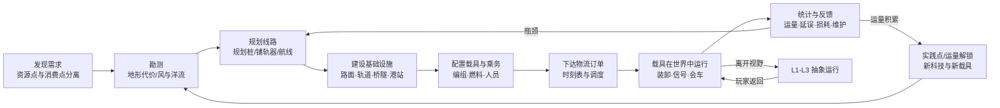

# 14 · 通途 Networks（`tcnetworks`）

> 模组：通途 Networks · 命名空间 `tcnetworks` · 主类 `com.nightcity.networks.TNetworks`
> 必需依赖：`tcivilization`；可选依赖：其余全部（软联动规则见 02 §1.4）
> 拥有：小径、道路、桥梁、隧道、轨道与信号、**全部车辆**（筏、船、驮具、车、火车、电车、汽车、卡车、飞机、无人机）、车站、港口、机场、仓库、物流订单与调度、远距离管道、信息网络（驿传、电报、电话、无线调度、计算机网络）
> 不拥有：火箭、航天器、太空服、月面车（Orbit）；货币、运价、合同与价格（Exchange）；地图物品、路径点、小地图（Atlas）；燃料、金属、通用机械零件（Industry）；驮兽与役畜本体（Cultivation / Ecology）；武器与军事载具功能（Frontiers）
> 设计决策依据：DR-06、DR-19、DR-20、DR-25、DR-27、DR-30；支柱 3（贸易由真实的商队、船和火车在地图上运输）

---

## 1. 定位与设计支柱

### 1.1 定位

通途 Networks 负责“东西和消息怎样从一个地方到另一个地方”。它把文明的空间尺度从营地一路扩展到全球：E0 的木筏让部族第一次越过河流，E2 的牛车让矿石离开山谷，E6 的铁路把三座城连成一条干线，E8 的航线跨越大洋，E9 的计算机网络让调度从人工变成自动。

Networks 的核心对象只有三类：

| 对象 | 英文/代码 | 说明 |
| --- | --- | --- |
| 基础设施 | Infrastructure（`RouteSegment`、`TrackSegment`、`Node`） | 玩家或 NPC 在世界里一块一块建出来的道路、轨道、航道、航线、线缆 |
| 载具 | Vehicle（`VehicleEntity`、`ConsistRecord`） | 在基础设施上运动、真实携带货包与乘客的实体 |
| 物流 | Logistics（`LogisticsOrder`、`Service`、`Timetable`） | 在面板中规划、在世界中执行的运输任务 |

### 1.2 设计支柱

| 编号 | 支柱 | 规则化表述 |
| --- | --- | --- |
| N1 | 路是建出来的 | 每条线路都有方块级实体基础设施；地形（坡度、湿地、河流、积雪）决定修路代价与通行速度。不存在“菜单里连一条线就开通”的线路 |
| N2 | 货物看得见 | 货物以“货包 Package”（箱、袋、桶、托盘、集装箱）形式装在载具上，模型上可见；装卸由起重机、NPC 或玩家实际完成（DR-20、支柱 3） |
| N3 | 规划在面板，运行在世界 | 文明面板 `tcnetworks:logistics` 页签用于规划和监控；载具在世界中真实运行。面板不能“瞬间送达” |
| N4 | 远方不暂停 | 离开玩家视野的线路按 L0-L3 分级继续运行，长期结果与实体运行一致（误差 ≤ 10%，02 §4.2） |
| N5 | 每个时代一种新的移动尺度 | 每个时代新增至少一种载具或基础设施类别，并扩大可经营的物流距离（支柱 6） |
| N6 | 信息也是交通 | 命令、行情与报表沿信息网络传播，有延迟；电报、电话、无线电、计算机网络逐级缩短延迟 |

### 1.3 职责边界

| 内容 | 归属 | Networks 的做法 |
| --- | --- | --- |
| 运价、票价、商品价格、合同 | Exchange | Networks 只给出“运输成本估算”（时间、燃料、维护、人力，单位为物理量）；Exchange 把它换算为 VU 运价 |
| 商队的商业决策（买什么、卖哪里） | Exchange | 商队的**移动**与**载具**归 Networks；Exchange 安装且 Networks 未安装时，商队以抽象方式移动 |
| 地图、路径点、小地图、地图图层 | Atlas | Networks 向 Atlas 提供“交通”图层数据与路线预览；无 Atlas 时面板使用核心 `TcMapSnippet` 的文字/示意回退 |
| 燃料（煤、焦炭、柴油、汽油、航空煤油）、金属与通用零件 | Industry | Networks 通过 `c:` 标签读取；无 Industry 时使用本章第 8.4 节的替代配方 |
| 驮兽、役畜（牛、马、驴、骆驼、羊驼） | Cultivation / Ecology（原版动物保留） | Networks 提供驮鞍、挽具与车辆挂接，读取实体类型标签 `tcnetworks:draft_animals` 与 `tcnetworks:pack_animals` |
| 火箭、航天器、月面车 | Orbit | Networks 提供航天发射场的陆上与海上运输接驳（重型运输车、驳船） |
| 军用载具功能、炮塔、护甲 | Frontiers | 军队调度可征用 Networks 载具运兵运粮；Networks 本身不注册武器 |
| 驾驶员、水手、列车员、飞行员等职业 | Settlements（职业定义） / Networks（`CrewComponent` 行为） | 无 Settlements 时由本模组“雇工站”提供乘务人员（第 2.4 节） |

### 1.4 时代总览

| 时代 | 新动词 | 基础设施 | 代表载具 | 信息网络 | 可经营距离 |
| --- | --- | --- | --- | --- | --- |
| E0 `stone` | 探路、渡河 | 踏出的小径、路标石堆 | 木筏 | 口信（步行） | ≤ 300 格 |
| E1 `neolithic` | 驮运 | 小径、浅滩踏石 | 独木舟、拖橇、驮兽 | 口信 | ≤ 1 kb |
| E2 `bronze` | 运货、行船 | 夯土路、木栈桥、货栈 | 手推车、牛车、河船、近岸帆船 | 信使 | ≤ 3 kb |
| E3 `iron` | 筑路、建港 | 碎石路、石板路、石拱桥、码头、驿站 | 桨帆船 | 驿传 | ≤ 6 kb |
| E4 `medieval` | 开运河、仓储 | 运河、船闸、仓库、踏轮起重机 | 马车、驿车、运河驳船、柯克船 | 驿传 | ≤ 12 kb |
| E5 `renaissance` | 远洋 | 木轨马车道、远洋港、海上航线 | 卡拉维尔船、盖伦船、矿车 | 远洋邮船 | 跨洋 |
| E6 `industrial` | 铁路调度 | 铁轨、臂板信号、车站、桁架桥、隧道 | 蒸汽机车、货车、客车、蒸汽船 | 铁路信号员 | 跨大陆 |
| E7 `electric` | 通信、公路运输 | 电报线、电话交换机、接触网、沥青路、配送中心 | 电车、电力机车、汽车、卡车、客车 | 电报、电话 | 全球通信 |
| E8 `atomic` | 飞行、管道 | 机场、高速公路、长输管道、调度集中 CTC | 螺旋桨飞机、内燃机车、油轮、散货船、半挂车 | 无线调度 | 全球航线 |
| E9 `information` | 自动调度、集装箱 | 集装箱码头、高速铁路、自动化仓库、计算机网络 | 喷气客机、货运喷气机、集装箱船、高速列车、AGV、货运无人机 | 计算机网络 | 全球网络 |
| E10 `space` | 磁浮 | 磁浮导轨、航天港接驳 | 磁浮列车 | 计算机网络（多星球由 Orbit 中继） | 地月系统接驳 |

---

## 2. 独立玩法

### 2.1 安装范围

只安装 `tcivilization` + `tcnetworks`（`tctechnology`、`tcskills` 可选）。此时：

- 世界为原版生成（或第三方生成），地形代价由高度图与方块类别计算（第 5.2 节回退公式）。
- 没有聚落、价格与 AI 文明；运输的意义来自“玩家自己的多个基地之间的物资流动”。
- 风与洋流使用 Networks 内置的确定性回退场（第 5.8.2 节）。
- 乘务人员由本模组的雇工站 `tcnetworks:crew_office` 提供（第 2.4 节）。

### 2.2 独立进度：运量解锁

没有 `tctechnology` 时，Networks 使用“运量解锁 Throughput Unlock”替代科技门槛：玩家文明累计完成的有效运输量（吨·千格，`t·kb`，见公式 5.11.4）达到阈值后，解锁下一档内容。安装 `tctechnology` 时此机制关闭，改为附录 B 的科技门槛。

| 档位 | 对应时代内容 | 解锁条件（累计 t·kb） | 解锁内容（摘要） |
| --- | --- | --- | --- |
| T0 | E0-E1 | 开局 | 小径、路标石堆、木筏、独木舟、拖橇、驮鞍 |
| T1 | E2 | 2 | 车轮、手推车、牛车、夯土路、木栈桥、河船、近岸帆船、货栈、调度板 |
| T2 | E3 | 10 | 筑路规划桩、碎石路、石板路、石拱桥、桨帆船、码头、驿站 |
| T3 | E4 | 40 | 马车、驿车、运河与船闸、柯克船、仓库、踏轮起重机 |
| T4 | E5 | 150 | 卡拉维尔船、盖伦船、木轨马车道、矿车、远洋航线 |
| T5 | E6 | 500 | 铁轨、蒸汽机车、车辆、信号、车站、蒸汽船、桁架桥、隧道 |
| T6 | E7 | 1,500 | 电报、电话、接触网、电车、电力机车、汽车、卡车、沥青路 |
| T7 | E8 | 4,000 | 机场、螺旋桨飞机、高速公路、管道、油轮、内燃机车、CTC |
| T8 | E9 | 10,000 | 计算机网络、集装箱、高铁、喷气机、AGV、无人机 |
| T9 | E10 | 25,000 | 磁浮 |

`tcnetworks-server.toml [standalone] unlock_mode = "throughput" | "open" | "technology"`；`open` 表示全部解锁（创造/建筑玩家）。

### 2.3 独立玩法循环示例

1. **E0-E1 渡河与驮运**：玩家在河对岸发现燧石滩，扎木筏（4 原木 + 2 纤维绳）渡河；反复往返踏出小径（第 5.2.3 节），移动速度提高 15%。驯服原版驴或羊驼，装上驮鞍后可驮 2 个货包。
2. **E2 第一条货运线**：在采石场与营地各放一个货栈 `freight_depot`，用筑路规划桩连出一条 420 格的夯土路。造一辆牛车（无 Cultivation 时由原版牛拉车，见第 16 节），在调度板上建立“采石场 → 营地，石料 64，往返循环”的订单。雇工站雇来的车夫自动执行。
3. **E3-E4 港口与运河**：沿海建码头和桨帆船航线；在两条河之间开 600 格运河，修 2 座船闸翻越 9 格高差。
4. **E6 铁路**：从矿山到港口铺设 2.4 kb 双线铁路，设置 6 个闭塞分区、2 个车站、1 个会让站；编写时刻表，让 3 列货车在单线区间按信号会车。
5. **E7-E9 网络化**：架设电报线后，远处车站的库存与列车位置实时出现在物流页签；E9 计算机网络启用自动调度，系统按订单自动增减列车。
6. **E8 飞行**：在两个大陆的基地之间修 2 座机场，开通货运航线，飞越 9 kb 海洋。

### 2.4 独立替代机制

| 缺失模组 | 替代 |
| --- | --- |
| Settlements（无居民） | 雇工站 `tcnetworks:crew_office`：消耗食物或任意 `c:ingots` 物资雇佣乘务人员（核心 `tcivilization:person` 实体 + `CrewComponent`）；上限 = `2 + 2 × 车站与港口数`，每人每 MC 日需 1 份“工资包”（任意 4 个食物或 1 个铁锭等价物，数据驱动） |
| Exchange（无价格） | 订单只按数量与优先级，不计运价；物流页签不显示“利润”列 |
| Wildlands（无地质/气候层） | 地形代价使用高度图 + 方块标签；风与洋流使用内置回退场 |
| Atlas（无地图） | 物流页签内置示意线路图（节点-边拓扑，按真实坐标比例绘制，无地形底图）；路线预览以世界内粒子线显示 |
| Industry（无燃料与零件） | 蒸汽载具烧原版煤/木炭；内燃与航空载具使用“燃料罐”（第 8.4 节）；电力载具由牵引变电所的内置燃煤模式供电（效率 20%） |
| Cultivation / Ecology（无役畜） | 使用原版马、驴、骡、羊驼、牛作为役畜与驮兽 |
| Technology（无科技） | 运量解锁（第 2.2 节） |

---

## 3. 联动玩法

每条联动均登记在附录 C 与 34 章；“桥接类”位于 `com.nightcity.networks.compat.<module>`，只在目标模组加载时类加载。

### 3.1 与 Wildlands（地理）

1. **地形代价**：读取 `tcwildlands` 的地形、植被、湿地、积雪、冻土图层，生成 16 格分辨率的地形代价网格（第 5.2 节）。修路时，湿地需要垫石基，冻土路基会季节性翻浆（春季该段限速 60%），山区坡度决定是否必须修隧道或之字形路。
2. **风与洋流**：帆船速度由 `WildlandsApi.wind(pos, time)` 与 `oceanCurrent(pos)` 决定（第 5.8 节）；季风区的远洋航线有季节性最优方向，玩家可在航线规划时看到“逆风段”。
3. **河流通航**：通航等级由水深与流速决定，上行航速减去流速；枯水季浅滩可能搁浅。
4. **灾害**：洪水冲毁低洼路段与木桥（标记为“损毁”，需维修）；山体滑坡掩埋轨道并触发前方信号变红；风暴关闭海上航段（船舶在港等待或绕行）；暴雪使道路降级。所有损毁都以世界内方块变化 + `AlertProvider` 持续警报体现。

### 3.2 与 Ecology（生态）

1. 道路与铁路切割栖息地：高等级道路两侧 32 格内野生动物迁移受阻，Ecology 计算种群连通度；玩家可建“动物通道”（`tcnetworks:wildlife_overpass` 结构模板，E8）恢复连通。
2. 车辆撞击动物：速度 > 10 格/秒的载具撞上动物致其死亡，计入 Ecology 的非自然死亡统计。
3. 船舶压舱水与货物把物种带到新大陆：远洋航线每季度按概率产生“入侵物种事件”，由 Ecology 决定具体物种与后果。
4. 内燃载具与飞机的排放计入区域污染图层（Ecology 读取 `tcnetworks:transport` 图层中的燃料消耗量）。

### 3.3 与 Cultivation（农牧）

1. 役畜属性（拉力、耐力、速度）来自 Cultivation 的品种性状；Networks 读取 `TractionProfile`（第 12 节），无 Cultivation 时使用原版动物的固定值。
2. 易腐货物在运输中按 Cultivation 的腐败速率继续变质；E7 冰冷藏车、E8 机械冷藏车/冷藏集装箱把腐败速率降为 25% / 5%。
3. 农场的收获与粮仓可直接成为物流订单的来源点；季节性“秋运高峰”使物流页签出现运力预警。

### 3.4 与 Industry（工业）

1. 燃料、钢材、零件经 `c:` 标签读取；蒸汽、内燃、电力载具的能耗按第 5.9 节结算。
2. 电力牵引直接接入 Industry 电网（接触网与第三轨作为电网负载）；Industry 未安装时由牵引变电所自带发电。
3. 长输管道 `tcnetworks:pipeline` 输送 Industry 流体（原油、天然气、成品油、水）；Industry 的厂内管道负责厂区，Networks 的管道负责 ≥ 256 格的长距离。
4. 工业区在每次 L2 日结报告缺口物料时，Industry 发出 `IndustryProductionDemandEvent`（13 §12），若玩家开启“自动补料”，Networks 自动生成物流订单。
5. 输送带、厂内机械手等“厂内物流”归 Industry；装卸台 `tcnetworks:loading_bay` 是两者的交界：它向相邻容器（含 Industry 机器）暴露 `IItemHandler`。

### 3.5 与 Settlements（聚落）

1. 职业：车夫、船夫、水手、火车司机、信号员、调度员、码头工、飞行员、仓库管理员由 Settlements 定义为岗位，Networks 为岗位上的人物附加 `CrewComponent` 并驱动其驾驶行为。
2. 聚落沿交通线增长：Settlements 的选址与扩张评分读取 `tcnetworks:transport` 图层中的“可达性指数”。车站与港口提升聚落的人口上限与商业评分。
3. NPC 筑路：玩家在面板中提交道路/铁路规划后，聚落的建筑工按方块蓝图施工（Networks 提供 `RoutePlan` → Settlements 的建造任务）。
4. 通勤与客运：E6 起居民可乘客车往返工作地，减少通勤时间、提高满意度。
5. 疫病沿线路传播：Settlements 以本模组的客流统计（`tcnetworks:transport` 图层的客运量）计算聚落间疫病传播概率；Networks 只提供数据。

### 3.6 与 Exchange（市集）

1. **商队实体化**：Exchange 的商队订单由 Networks 生成真实的驮队、车队、船队或列车（DR-20）。Networks 未安装时 Exchange 自行抽象移动。
2. **运输成本进入价格**：Exchange 调用 `NetworksApi.estimateFreight(from, to, mass, volume)` 得到时间、燃料、人工与风险，换算为 VU；区域间价差因此被运输成本约束，不会出现“统一无限回收价”。
3. **合同交付**：Exchange 的交货合同绑定一个 Networks 物流订单；货物实际到达目标仓库才算交付。
4. **里程碑“海外贸易站”（E5→E6）**：Networks 判定“存在一条跨大陆、两个季节内班次间隔 ≤ 6 日的定期海运航线”，Exchange 判定“贸易站持续营业”，Technology 聚合两者。
5. 车票与运费：Exchange 安装时客票与运费收入以货币结算，归线路所有者账户。

### 3.7 与 Discovery、Echoes（知识与历史）

1. 知识沿交通线传播：Discovery 的知识传播速度乘以两地之间信息网络的系数（第 5.12 节）。
2. 观察与线索：观察漂流木与水獭筑坝可获得“筏”的线索；观察滚动的原木获得“车轮”线索；观察海鸟与云带获得“远洋航行”线索（17 章定义具体线索）。
3. Echoes 的古道遗迹、沉船、古港可被修复并重新纳入路网（修复段立即获得石板路品质）；沉船内可能有古代货包。

### 3.8 与 Commons（公共事务）

1. 道路、桥梁、铁路可作为 Commons 的公共工程立项，由多名玩家/居民共同出资出力。
2. 收费站、过路费与货运税由 Commons 的政策决定；Networks 只提供 `TollPointEvent` 与通行记录。
3. 铺轨穿越他人领地需要通行权；交通法规（限速、靠左/靠右行驶）由 Commons 政策设置，Networks 的 NPC 驾驶遵守。

### 3.9 与 Frontiers（边疆）

1. 强盗袭击陆上商队与列车、海盗袭击船舶；遭袭概率与线路偏远度、护卫数量相关，由 Frontiers 计算并生成真实袭击者。
2. 护卫：订单可附加护卫人员或护航船只。
3. 军需补给线：Frontiers 的远征据点可设为物流订单终点，补给中断时远征士气下降。
4. 武装载具：Frontiers 的 `WeaponMountApi` 可在本模组的车辆与船舶上声明武器挂点；Networks 只提供挂点位置与载重扣减，武器行为归 Frontiers。

### 3.10 与 Atlas（地图）

1. Networks 提供交通图层（道路等级、轨道、航线、航空线、通信线）与线路预览；Atlas 负责绘制。
2. 海图：已测绘海域的航线风险降低 50%；未测绘海域的航线需要“探索航行”一次后才能设为定期航线。
3. 路点导航（`tcatlas:waypoint_nav`）在乘坐载具时可显示“下一站”。

### 3.11 与 Nations（AI 文明）

1. AI 文明在 L3 层按其交通科技抽象修路、开航线，接近玩家时才实体化为方块。
2. 跨境线路需要过境条约；禁运时边境车站拒绝放行该文明的货物。
3. 战争时敌方可破坏桥梁与轨道（生成损毁事件）。

### 3.12 与 Orbit（航天）

1. 火箭部件由 Networks 的重型运输车、驳船或铁路运抵发射场。
2. E10 磁浮线可接入航天港，作为发射物资的高速通道；地外基地的车辆归 Orbit。

### 3.13 与 Technology、Skills、Beyond

1. Technology：科技门槛见附录 B；“实践”来源包括完成运输量、建设线路、首次驾驶某类载具。
2. Skills：`logistics`、`engineering`、`construction`、`surveying`、`exploration`、`aeronautics`、`husbandry`、`trade` 获得熟练度并提供中等加成（第 15 节）。
3. Beyond：异界影响区内磁罗盘失灵，未装备无线电导航（E8）的船舶与飞机在区内航向随机偏转；规划航线时自动绕开已知影响区。

---

## 4. 核心玩法循环



| 循环层 | 时长尺度 | 玩家动作 | 反馈 |
| --- | --- | --- | --- |
| 微循环 | 秒-分钟 | 驾驶、装卸、扳道岔、拉汽笛 | 速度表、信号显示、货包上车的可见动画 |
| 中循环 | MC 日 | 规划一条线路、建一个车站、编写时刻表 | 首班车到达通知、线路利用率 |
| 宏循环 | MC 季-年 | 构建跨区域网络、升级到下一代交通 | 运量曲线、区域可达性、时代里程碑（伟大道路、干线铁路、洲际航线） |

---

## 5. 系统规则与公式

### 5.1 尺度与速度约定

1. 世界水平比例 1 格 ≈ 244.6 m（README 全局常量），时间 1 MC 日 = 20 分钟。真实速度按此比例换算会极慢，因此**游戏速度**单独设定，只保持各载具之间的相对顺序与时代递进；文档中速度单位一律为“格/秒”（b/s），距离单位为格或千格（kb）。
2. 玩家直接驾驶或乘坐（L0）时，载具最大速度受 `[vehicles] max_ridden_speed`（默认 40 b/s）限制，避免区块加载跟不上。超过此速度的载具（喷气机、高铁、磁浮）在乘坐时进入**舱内模式 Cabin Mode**：
   - 起飞/发车后达到 40 b/s 时提示“进入巡航”，玩家视角切换到舱内（座位视角 + 窗外低细节远景）；
   - 载具降为 L2 路线代理，按真实巡航速度推进；客户端只加载航线下方 LOD 远景（不生成区块）；
   - 距离目的地 1,500 格时自动退出舱内模式，载具重新实体化并以 40 b/s 进近。
3. 区块加载：载具运行中仅为自身前方 2 个区块保持“票据”加载（`[performance] vehicle_chunk_tickets = 2`），且全服同时持票载具 ≤ 16 辆；其余载具进入 L1/L2。

### 5.2 地形代价与小径

#### 5.2.1 地形代价网格

每个 16×16 格单元（与区块对齐）计算一个通行代价 `C_terrain ∈ [1, 50]`，存入 `tcnetworks:transport` 区域图层：

```text
C_terrain = 1
          + 8   × slope²            // slope = 单元内最大高差 / 16，上限 1.5
          + w_ground[ground]        // 岩石 0, 土 0.5, 沙 1.5, 砾 0.8, 冻土 2（春季 4）
          + w_veg × vegDensity      // w_veg = 3，vegDensity ∈ [0,1]（树木方块占比）
          + 6   × wetland           // 湿地/沼泽占比
          + 20  × deepWater         // 不可涉水占比（水深 ≥ 2）
          + 2   × snowDepth         // 积雪层数 / 8
```

- 有 Wildlands：`ground/vegDensity/wetland/snowDepth` 直接取自其区域图层；
- 无 Wildlands：从高度图与方块标签 `c:stones`、`minecraft:dirt`、`minecraft:sand`、`minecraft:leaves`、`minecraft:snow` 统计（区块首次加载时异步计算并缓存）。

#### 5.2.2 越野速度

无路时步行与载具的速度：

```text
v_offroad = v_base × 1 / (1 + 0.15 × (C_terrain − 1))
```

驮兽 `v_base` 2.8 b/s；轮式车辆越野时额外 × 0.5，且 slope > 0.6 的单元不可通行（车辆停下并提示“坡度过大”）。

#### 5.2.3 踏出的小径（Desire Path，无需科技）

1. 每个草方块/泥土方块保存“踩踏计数”（区块附件，`byte`），玩家、NPC、驮兽每经过一次 +1，每 MC 日衰减 10%。
2. 计数 ≥ 40 时草方块变为原版“土径”（`minecraft:dirt_path`），≥ 120 时变为 `tcnetworks:trodden_trail`（视觉更宽）；小径给予步行与驮兽 ×1.15 速度。
3. 低于 20 且 3 MC 日无人经过的小径方块恢复为草。
4. 性能：只对处于 L0 的移动实体计数，每实体每 10 tick 采样一次脚下方块。

### 5.3 道路

#### 5.3.1 道路段与品质

道路以“路线段 `RouteSegment`”为单位：由筑路规划桩在两点之间生成中心线（折线，节点间距 ≤ 64 格），宽度 3/5/7/9 格。玩家（或 NPC 工人）按投影出的蓝图铺设路面方块。每段的品质 `Q` 由**实际铺设的方块**抽样得出：

```text
Q_segment = Σ(q_block × 覆盖率) − 0.05 × 断口数 − 0.3 × max(0, grade − grade_limit)
q_block：夯土 0.35，碎石 0.5，石板 0.7，碎石沥青 macadam 0.8，沥青 0.95，混凝土 1.0
grade = 纵向高差 / 水平长度；grade_limit：畜力 0.08，汽车 0.06，铁路见 5.5.3
```

覆盖率 < 70% 的段视为“未完成”，不计入路网。

#### 5.3.2 道路等级

| 等级 | 代表路面 | 时代 | 速度系数 `k_road` | 车辆磨损系数 | 每 kb 年维护 |
| --- | --- | --- | --- | --- | --- |
| R0 小径 | 土径 | E0 | 1.15（仅步行/驮兽） | — | 无（自然衰减） |
| R1 土路 | 夯土 | E2 | 1.4 | 1.0 | 32 方块补料 |
| R2 碎石路 | 碎石 | E3 | 1.7 | 0.8 | 24 |
| R3 石板路 | 石板 + 路缘 | E3 | 2.0 | 0.6 | 8 |
| R4 碎石沥青路 | macadam | E6 | 2.3 | 0.5 | 16 |
| R5 沥青路 | 沥青 + 标线 | E7 | 2.8 | 0.35 | 12 |
| R6 高速公路 | 混凝土 + 护栏，双向分离 | E8 | 3.3 | 0.3 | 10 |

实际速度：`v = min(v_vehicle_max, v_base_vehicle × k_road × weatherFactor)`；`weatherFactor`：雨 0.9（土路 0.6）、雪 0.7、冰冻 0.5（沥青与混凝土 0.8）。

#### 5.3.3 磨损

每辆车经过路面方块时，以 `p = 0.0002 × 车重(t) × 磨损系数` 的概率使该方块“磨损度”+1（区块附件），磨损度 ≥ 8 的方块降一级外观（坑洼）且该点速度 × 0.7。维护站 `tcnetworks:road_depot`（E3）或聚落养路工自动修补其 256 格范围内的方块并消耗补料。

### 5.4 桥梁与隧道

| 结构 | 时代 | 最大单跨 | 承重（t） | 建造方式 | 风险 |
| --- | --- | --- | --- | --- | --- |
| 踏石/浅滩 | E1 | 水深 ≤ 1 | 步行 | 放置石块 | 洪水冲走 |
| 木栈桥 `timber_trestle` | E2 | 6 | 8 | 桥墩间距 ≤ 6 | 腐朽：每年 5% 构件需更换；洪水 30% 损毁 |
| 石拱桥 | E3 | 16 | 60 | 结构模板 `stone_arch_bridge`（任意石材按图纸砌筑） | 极低 |
| 吊桥（索） | E4 | 24 | 4（仅行人与驮兽） | 绳索 + 木板 | 强风 > 15 m/s 关闭 |
| 桁架桥 `truss_bridge_segment` | E6 | 40 | 400 | 钢桁架段 + 桥墩 | 需年检，未检时承重 −50% |
| 悬索桥 `suspension_cable` | E8 | 160 | 2,000 | 主塔 + 主缆 + 吊索 | 强风 > 25 m/s 限速 |

1. **承重检查**：载具进入桥段时，`Σ在桥质量 > 承重` 则发出 `warning`；超过 1.5 倍时桥段损毁（实际方块掉落），载具坠落。
2. **桥梁识别**：桥梁是由玩家放置方块构成的结构，Networks 通过“桥段标记”（铺设时由规划桩自动识别跨越水面或深谷的段）登记承重等级，按段内最弱构件取值。
3. **隧道**：E2-E5 可手工挖掘（无内衬，每 32 格有 2% 年塌方率）；E6 起 `tunnel_lining` 内衬消除塌方，`tunnel_portal` 洞门提供照明与通风（蒸汽机车在 > 256 格无通风隧道中使乘员获得“窒息”效果）。盾构机不在本模组（Industry 提供大型挖掘机械，本模组提供内衬方块）。

### 5.5 铁路

#### 5.5.1 轨道图

1. 轨道由节点 `TrackNode`（道岔、端点、信号位置、车站停车点）与边 `TrackEdge`（两节点间的连续轨道）组成，存储在 `TrackGraph`（维度级 SavedData，按区域分片）。
2. 轨道方块：直线与 45° 斜线使用烘焙方块模型；曲线使用标准半径 R ∈ {8, 16, 32, 64, 128}（单位格），由 `track_layer` 一次铺设整段，渲染使用方块实体的模型数据（每段 ≤ 64 个子模型实例）。
3. 坡度：在 1:20、1:40、1:80 三档中选择，铺设时自动生成路基与斜坡方块。
4. 轨距：标准轨一种（不做窄轨/宽轨，见第 18 节）。

#### 5.5.2 轨道类型

| 类型 | 时代 | 允许最高速度 | 最大轴重（t） | 年维护 |
| --- | --- | --- | --- | --- |
| 木轨马车道 `wooden_wagonway` | E5 | 4 b/s | 3 | 高（木轨每年 10% 需更换） |
| 铁轨 `rail_iron` | E6 | 16 b/s | 12 | 中 |
| 钢轨 `rail_steel` | E7 | 24 b/s | 20 | 中 |
| 混凝土轨枕钢轨 `rail_concrete_sleeper` | E8 | 32 b/s | 25 | 低 |
| 无砟轨道 `rail_slab_track` | E9 | 48 b/s（舱内模式内为 80） | 25 | 很低 |
| 磁浮导轨 `maglev_guideway` | E10 | 64 b/s（舱内模式内为 140） | — | 很低 |

#### 5.5.3 曲线与坡度限速

```text
v_curve = sqrt(a_lat × R)        // a_lat = 3.2 b/s²（普通），高铁轨道带超高时 4.5
v_grade：坡度 1:20 时上坡牵引需求 ×2，下坡强制限速 0.75 × 线路速度
```

例：R = 32 时 `v_curve ≈ 10.1 b/s`；R = 128 时约 20.2 b/s。

#### 5.5.4 信号与闭塞

1. **闭塞分区**：相邻两架信号机之间的轨道为一个分区。分区内有任何车辆（或被预约）则入口信号显示“停车”。
2. **信号类型**：
   - 区间信号（`semaphore_signal`/`color_light_signal`，模式 `BLOCK`）：只看前方一个分区；
   - 进路信号（模式 `PATH`）：为通过道岔的整条进路预约，直到出口信号；进路上所有分区空闲才开放；允许多列车在不冲突进路上同时通过咽喉区。
3. **预告**：色灯信号（E7）有三显示（停车/注意/通行）：前方第二分区占用时显示注意，列车提前减速到 `0.5 × v_line`。
4. **联锁**：信号楼 `signal_box`（E6）管理半径 128 格内的道岔与信号，同一时刻只能开放不冲突的进路；无信号楼时道岔只能手动扳动（`switch_stand`）。
5. **调度集中 CTC**（E8）：一个 `ctc_panel` 控制整条线路（≤ 64 个信号楼辖区），自动排列进路。
6. 机车信号 `cab_signal_beacon`（E9）：高速列车不看地面信号，直接接收前方允许速度；无应答器的线路上高铁限速 32 b/s。

#### 5.5.5 进路寻路

列车在每个道岔前计算进路（`TCPathExecutor` 后台线程，基于主线程每 20 tick 生成的轨道图快照）：

```text
cost(edge) = length / v_allowed
           + 30 × occupied(edge)          // 已被占用的分区（秒）
           + 15 × redSignalAhead(edge)
           + 120 × reverseRequired(edge)  // 需要换向
           + platformPenalty              // 目标站台已被预约时 +60
A* 启发函数 h = 直线距离 / v_line_max
```

- 单次寻路节点上限 4,096，超时 50 ms 时返回最短已知进路并标记 `route_degraded`。
- 结果缓存到下一次轨道图版本号变化。

#### 5.5.6 时刻表

时刻表是有序的“停站指令”列表，每条指令包含：目标站台、等待条件（可组合 AND/OR）。

| 等待条件 | 参数 | 说明 |
| --- | --- | --- |
| `time_at` | 全局时钟时刻（MC 日内时间 0-23999）、每 N 日 | 定点发车 |
| `duration` | tick 数 | 停站时长 |
| `cargo_full` / `cargo_empty` | 百分比阈值 | 装满/卸空 |
| `order_ready` | 订单 ID | 订单货物备齐 |
| `signal` | 红石信号或电报指令 | 外部控制 |
| `idle_cargo` | tick 数 | N tick 内无装卸则发车 |

时刻表以 `Codec` 序列化，可复制到多列车。偏离时刻表 > 600 tick 的列车在物流页签显示为“晚点”。

### 5.6 载具运动模型

所有载具共享一个简化的纵向动力学模型（每 tick 在 L0、每 20 tick 在 L1 积分一次）：

```text
F_trac(v) = min(F_max, P / max(v, 1.0))            // kN；P 为“功率当量”，见 6.2
R(v)      = m × (c_rr + grade) × 9.81 + c_aero × v² // kN；m 为总质量（t）
a         = k_a × (F_trac − R − F_brake) / m        // b/s²；k_a = 0.25
v_next    = clamp(v + a × dt, 0, v_limit)
v_limit   = min(v_max_vehicle, v_line, v_curve, v_signal, v_weather)
```

| 参数 | 车轮/道路 | 铁路 | 水面 | 空中 |
| --- | --- | --- | --- | --- |
| `c_rr`（滚动阻力系数） | 土路 0.04、石板 0.025、沥青 0.012 | 0.002 | 由 `c_aero` 代替（船体阻力） | — |
| `c_aero` | 0.02 | 0.005 × 车辆数 | 0.5（船体）+ 风阻 | 见 5.14 |
| 制动减速度 | 1.5 b/s² | 0.6 b/s²（E9 高铁 1.0） | 0.3 b/s²（倒车） | — |

**畜力车辆**：`F_max = Σ animal.pull`，`v_max = min(animal.speed) × (1 − 0.4 × payload/maxPayload)`；役畜有体力 0-100，满载行进每 50 格 −1，在驿站或货栈休息每 MC 小时 +20；体力 < 20 时速度 × 0.5。

**人力**：手推车 `F_max` 1.5 kN、`v_max` 3.2 b/s；推车的玩家饥饿消耗 ×2。桨帆船的划桨手每 MC 小时消耗 1 份食物，冲刺划桨（`v × 1.4`）最多持续 600 tick。

### 5.7 货包与装卸

#### 5.7.1 货包

货物只能以货包形式上车（DR-20 可见过程）。货包是可放置的方块或可手持的物品，内部为物品栏：

| 货包 | ID | 时代 | 容量 | 最大质量 | 占用货位 | 装卸方式 |
| --- | --- | --- | --- | --- | --- | --- |
| 货箱 | `tcnetworks:crate`（方块） | E1 | 9 堆叠，任意物品 | 4 t | 1 货位 | 手工、NPC、起重机 |
| 货袋 | `tcnetworks:cargo_sack`（物品） | E1 | 6 堆叠，限 `c:crops`/`c:ores`/`c:dusts`/沙砾等散料 | 3 t | 1 货位 | 手工、NPC |
| 货桶 | `tcnetworks:cargo_barrel`（物品） | E2 | 1,000 mB 流体 或 9 堆叠同种食物 | 1.2 t | 1 货位 | 手工、NPC、起重机 |
| 托盘 | `tcnetworks:pallet`（物品） | E7 | 36 堆叠 | 12 t | 4 货位 | 叉车、起重机、AGV |
| 集装箱 | `tcnetworks:shipping_container`（物品，放置后为多方块） | E9 | 216 堆叠（= 24 货箱） | 24 t | 1 TEU | 龙门吊、正面吊 |

- 货位（`slot`，代码字段 `slotUnits` / `slot_units`）= 一个标准货包的占位；TEU = 集装箱位。车辆以“货位上限 + 质量上限”双重约束。机械功率单位 SU（Stress Unit）只属于 13，本章不使用。
- 物品质量来自数据映射 `tcnetworks:item_mass`（单位 kg，数据驱动）；未定义物品按标签回退：`c:stones`/方块类 10、`c:ores` 12、`c:ingots` 4、原木 15、木板 3、食物 0.5、其他 1。
- 散装车辆（漏斗车、散货船、油罐车）直接装载散料/流体，不用货包，但只接受对应标签的物品或流体。
- 货包在车辆模型上按货位逐个渲染（货箱、袋、桶、托盘、集装箱外观），空位不渲染；装载率一目了然。

#### 5.7.2 装卸

| 方式 | 时代 | 每货包耗时（tick） | 说明 |
| --- | --- | --- | --- |
| 玩家手工 | E0 | 即时（逐个点击） | 右键车辆货位放入/取出 |
| NPC 码头工/搬运工 | E1 | 40 | 每人一次一个货包，搬运动画可见 |
| 装卸台 `loading_bay` | E2 | 30 | 与相邻容器自动交换；无需人员，但需要 1 名“货栈员”在 16 格内（无 Settlements 时不需要） |
| 踏轮起重机 `treadwheel_crane` | E4 | 80 | 可吊货箱、货桶到船舱 |
| 蒸汽起重机 `steam_crane` | E6 | 50 | 消耗燃料 |
| 龙门吊 `gantry_crane` | E9 | 100 / 集装箱 | 一次 24 货箱当量 |
| AGV/自动化立体仓库 | E9 | 20 | 全自动，消耗电力 |

装卸进度显示在车辆与站台上方（`TargetInfoProvider` 文本 + 进度条），并播放对应声音。

### 5.8 航运

#### 5.8.1 帆船速度

```text
v_water = v_hull_max × polar_rig(θ) × windFactor(w) × crewFactor × hullCondition
v_ground = v_water × heading + current(pos)          // 向量和
windFactor(w) = clamp(w / 8, 0, 1.25)                // w：风速 m/s；>20 m/s 时为风暴，见下
```

θ 为航向与“风去向”之间的夹角（0° = 正顺风）。

| θ | 0° | 45° | 90° | 120° | 135° | 150° | ≥ 160° |
| --- | --- | --- | --- | --- | --- | --- | --- |
| 横帆 `square`（柯克船、盖伦船） | 0.90 | 1.00 | 0.70 | 0.30 | 0.10 | 0 | 0 |
| 纵帆/三角帆 `fore_aft`（帆船、卡拉维尔船） | 0.75 | 0.90 | 1.00 | 0.75 | 0.55 | 0.30 | 0 |

- 不能直接逆风时，NPC 船长自动“之字形”换舷（tack），玩家驾驶时 HUD 给出最优航向提示。
- 风暴（w > 20 m/s）：E5 前船舶在港时不出港；海上遭遇时每 MC 小时 5% 概率损坏船体 10%。E6 起蒸汽船不受风向影响，风暴中速度 × 0.6。
- 洋流：`current(pos)` 通常 0.2-1.2 b/s。顺流的远洋航线可明显快于逆流航线，形成历史上的“信风航线”玩法。
- **回退场**（无 Wildlands）：风向按纬度带确定（赤道 0-±15° 东风信风、±15-±50° 西风、高纬东风），风速 6-10 m/s 按世界种子与季节平滑噪声变化；洋流取沿大陆东岸向极地、西岸向赤道的 0.5 b/s 环流近似（陆地分布由高度图检测）。

#### 5.8.2 吃水与通航

1. 每艘船有吃水 `draft`（格）；航行中每 10 tick 检测船底下方水深，水深 < draft 时搁浅：速度归零、船体 −10%。脱浅方式：卸货（每卸 25% 载重吃水 −0.5）、由拖船或其他船拖拽、等待涨水（有 Wildlands 时河流水位随季节变化）。
2. 航道规划：在 64 格分辨率的水面网格上做 A*，代价 = `1 / v_expected`（用季节平均风与洋流计算）+ 风险项（未测绘 ×1.5、已知风暴区、海盗活动区、异界影响区）。

#### 5.8.3 港口

1. 港口由港务所 `harbor_master` 核心方块 + 码头 `quay` 方块（≥ 8 格连续为一个泊位）+ 系船柱 `bollard` 组成；港口等级 = 泊位数与起重设备的函数。
2. 进港船舶向港务所申请泊位；无空泊位时在锚地（港口外 64 格）等待。
3. 造船：船台 `slipway`（E3）建造木船，干船坞 `dry_dock`（E6）建造与维修钢船。船舶的建造过程可见：船体按阶段逐步出现。

#### 5.8.4 运河与船闸

1. 运河是人工开挖的水道，宽 ≥ 5 格、深 ≥ 2 格才能通航驳船。
2. 船闸为多方块结构：两扇 `canal_lock_gate` 闸门 + 闸室（长 12-24 格）+ `lock_controller`。
3. 过闸周期：`t_lock = 200 + 20 × Δh`（tick），Δh 为上下游水位差（格，≤ 8）。闸室水面以方块状态动画升降，船舶实体随水面平移（实体在闸室内被锁定在 `LockedInChamber` 状态，不受物理推动）。
4. 无人值守的船闸需要红石信号或 E7 后的电报遥控；有 Settlements 时可配置闸工岗位。

### 5.9 能源与燃料

| 动力 | 时代 | 燃料来源（标签） | 消耗 | 补给设施 |
| --- | --- | --- | --- | --- |
| 人力 | E0 | 乘员食物 | 见 5.6 | — |
| 畜力 | E1 | 饲料 `c:crops/wheat`、干草、`tcnetworks:fodder` 标签 | 每头每 1,000 格 1 份 | 驿站、货栈 |
| 风帆 | E2 | — | 无 | — |
| 蒸汽 | E6 | `c:coal`、`c:coke`（固体燃料按原版燃烧刻 FV 计）+ 水 | 满功率 2 FV/tick，水 1 桶/200 tick | 煤台、水塔 |
| 电力（接触网/第三轨） | E7 | Industry 电网或牵引变电所，NeoForge `IEnergyStorage` | 电车 40 FE/tick，电力机车 400 FE/tick | 接触网、牵引变电所 |
| 内燃（汽油/柴油） | E7 | `c:fuels/gasoline`、`c:fuels/diesel` 流体；或 `tcnetworks:fuel_canister` | 每 kb 汽车 60 mB、卡车 150 mB、内燃机车 900 mB | 加油站 `fuel_pump` |
| 航空煤油 | E8 | `c:fuels/kerosene`（无时可用 `c:fuels/diesel` 代替，效率 −20%） | 螺旋桨飞机 400 mB/kb，喷气客机 1,800 mB/kb | 机场油库 |
| 磁浮 | E10 | 电力 | 1,200 FE/tick | 牵引变电所 |

- 功率在部分负载下线性降低消耗：`consumption = c_full × (0.2 + 0.8 × throttle)`。
- 燃料耗尽时载具滑行停车并发出 `AlertProvider` 警报；NPC 驾驶员会在补给点自动加注（若订单允许绕行）。

### 5.10 车况、维护与故障

1. 每辆载具有车况 `condition ∈ [0, 100]`。每行驶 1 kb 降低 `0.4 × 道路磨损系数 × (0.5 + 载重比)`（铁路固定 0.15，船舶 0.2，飞机每次起降 0.5 + 每 kb 0.05）。
2. 车况 < 50：最高速度 × 0.85；车况 < 25：每 kb 有 3% 概率故障停车（需维修工或玩家用 `tcnetworks:repair_kit` 现场修复）；车况 0：无法启动。
3. 维修设施：车棚 `cart_shed`（E2，畜力与木车）、机车库 `engine_shed`（E6）、干船坞（E6）、机库 `hangar`（E8）、卡车站 `truck_depot`（E7）。维修速度 5 点/MC 小时，消耗对应材料（木材、铁锭、零件，数据驱动）。
4. 订单可设置“车况低于 N 时回库检修”。
5. 事故：
   - 脱轨：实际速度 > `1.25 × v_curve` 时 30% 概率/秒脱轨，车辆停在轨旁并损坏 40%，阻塞该分区；
   - 碰撞：两车碰撞时按相对速度造成损坏，> 8 b/s 时乘员受伤；正常运营的信号系统能避免碰撞，碰撞只在玩家违规驾驶、信号故障或“无信号区间”中发生；
   - 事故发出 `critical` 通知（可打断）并在 `tcivilization:alerts` 中保持到清理完成。

### 5.11 物流订单与调度

#### 5.11.1 节点

物流网络的节点是“站点 `Station`”：货栈、驿站、码头/港口、车站、货运站、仓库、配送中心、机场、集装箱码头、管道终端。每个站点有：

- 本地库存（站点方块周围 16 格内登记的容器 + 仓库货架）；
- 虚拟账本 `StationLedger`（第 5.13.3 节）；
- 可用的装卸设备与人员；
- 服务的运输方式集合（道路、铁路、水运、航空、管道）。

#### 5.11.2 订单

```text
LogisticsOrder {
  id, owner(civ/player), from(station), to(station),
  cargo: List<CargoLine(itemOrTag, amount, minQuality?)>,
  mode: ONCE | REPEAT(interval) | STANDING(keep_stock = N),
  priority: LOW | NORMAL | HIGH | URGENT,
  deadline?, escort?, allowedModes, maxCostHint?,
  linkedContract?: Identifier  // Exchange 合同
}
```

- `STANDING`：维持目标站点库存 ≥ N，低于阈值自动生成补货批次。
- 订单被拆分为若干**批次 Shipment**（每批不超过一辆载具或一次编组的容量）；批次分配给**服务 Service**（一条固定线路 + 一组载具 + 时刻表）或临时派车。

#### 5.11.3 调度算法

调度器每 100 tick 在后台线程运行一次（读主线程快照），每个文明独立：

```text
for shipment in pending (按 priority, deadline, age 排序):
    candidates = services covering (from → to) + idle vehicles within 2 kb of from
    score(c) = T_eta(c) × w_time + Cost(c) × w_cost + Risk(c) × w_risk − 50 × sameDirectionBonus
    assign argmin score; 若无候选 → 状态 UNSERVED，生成 AlertProvider 警报“无运力”
多式联运：路径在“站点图”上做 Dijkstra（边 = 已有服务，权重 = 平均行程 + 换装时间）
换装时间：同一站点内 600 tick（E9 集装箱 200 tick）
```

- 权重 `w_time/w_cost/w_risk` 来自订单优先级（URGENT 1/0.2/0.5，NORMAL 0.5/1/1，LOW 0.2/1.5/1）。
- E0-E6 调度需要调度员（有 Settlements）或玩家在调度板 `dispatch_board` 手动确认每个新批次（“人工调度”）；E7 电报后可远程确认；E9 `information/automated_logistics` 后完全自动。
- 信息延迟：调度员看到的站点库存是“信息网络延迟”之前的快照（第 5.12 节），这让早期远距离物流必须预留余量。

#### 5.11.4 运量统计

```text
运量 W = Σ 批次（交付质量 t × 实际路线长度 kb）    // 单位 t·kb
有效运量：起终点直线距离 ≥ 128 格，且货物在起点停留 ≥ 1 MC 小时（防止原地往返刷量）
```

运量用于：独立模式运量解锁（第 2.2 节）、科技实践点（Technology 安装时，每 1 t·kb = 0.5 实践点，单科技每 MC 日上限 40）、区域图层“货运量”。

### 5.12 信息网络

信息网络决定“远处的数据多快到达”。两站点之间的信息延迟：

```text
latency(A, B) = min over 可用信息路径 { Σ 段延迟 }
段延迟：
  口信/信使（E0-E2）  = 距离 / 4 b/s（步行速度）
  驿传 relay_posts（E3）= 距离 / 12 b/s（需每 ≤ 1.5 kb 一个驿站）
  远洋邮船（E5）       = 该航线船期
  电报（E7）           = 20 tick + 每次人工转发 100 tick（每个电报局为一个转发点）
  电话（E7）           = 20 tick（交换机之间需有线路）
  无线调度（E8）       = 20 tick，覆盖电台半径 4 kb
  计算机网络（E9）     = 1 tick
```

影响：

1. 物流页签中远程站点与载具的显示数据带时间戳“截至 x 小时前”；延迟 > 1 MC 日时数据显示为灰色并标注“过时”（文字 + 图标，非仅颜色）。
2. 调度指令（改时刻表、改订单）按同样延迟到达远端站点与载具。
3. Exchange 的远端行情、Atlas 的远端标记、Discovery 的知识传播读取同一 `NetworksApi.informationLatency(a, b)`（§12）。
4. 通信基础设施：电报线（`telegraph_pole` 每 ≤ 32 格一根，可沿铁路架设）、电话交换机（每台 ≤ 64 线）、无线电台 `radio_mast`、光纤 `fiber_optic_cable` 与路由器 `network_router`。线路断开（暴风雪、破坏）时延迟回退到下一档。
5. 电报局可收发玩家消息：在 `telegraph_key` 输入文本，按每字 2 tick 发送，接收端打印成 `tcnetworks:telegram` 纸条物品（多人服务器上的跨基地通信）。

### 5.13 离屏模拟（L0-L3）

| 层级 | 触发条件 | 载具表示 | 更新频率 | 主要规则 |
| --- | --- | --- | --- | --- |
| L0 实体 | 任一玩家 128 格内且区块已加载 | `VehicleEntity` 真实实体 | 每 tick | 完整物理、碰撞、装卸动画、声音 |
| L1 图代理 | 区块已加载但无玩家 128 格内 | 实体移除，`VehicleProxy` 在轨道图/路网/航道上 | 每 20 tick | 5.6 的纵向模型 ×20 步长；信号与闭塞照常；装卸瞬时按时长扣时间 |
| L2 路线代理 | 区块未加载 | 只记录“所在服务 + 进度百分比 + 预计到达” | 每 1,000 tick | 行程时间 = L1 历史平均（无历史时按 6.x 理论速度 ×0.85）；燃料、车况按里程扣除；站点使用虚拟账本 |
| L3 文明流 | 跨文明/AI 文明线路，或玩家所在维度外 | 只有“流量”（t/MC 日） | 每 24,000 tick | 两站点之间按服务容量 × 利用率转移货物 |

#### 5.13.1 层级转换

1. L1 → L0：玩家进入 128 格内，代理在当前位置生成实体（若位置所在区块恰好未就绪，则延迟到就绪后生成，代理冻结 ≤ 40 tick）。
2. L0 → L1：所有玩家离开 160 格（滞后 32 格防抖）。
3. L1 → L2：所在区块卸载。载具不持有区块票据，除非是第 5.1 节的 16 个“持票载具”之一（优先：玩家乘坐的、正在装卸的）。
4. L2 → L1：所在估算位置区块加载时，按进度在路线几何上插值出位置；若该位置上已有其他车辆占用分区，则放在后方最近的空闲分区并补记延误。
5. 追赶：服务器停机后的追赶按 02 §4 上限 3 MC 日，超出部分载具停在最近站点“待命”。

#### 5.13.2 碰撞与信号在 L2 中

L2 不模拟逐车信号，而是按“线路容量”约束：每条线路每个方向的同时在途数量 ≤ 闭塞分区数 − 1；超出的车在起点排队。这保证 L2 不会产生 L0 下不可能的结果（例如两车同处一个分区）。

#### 5.13.3 站点虚拟账本

1. 站点所在区块未加载时，装卸改为对 `StationLedger` 记账（`+入库`、`−出库`，按物品计数），不碰真实容器。
2. 区块加载时进行**对账**：先执行出库（从真实容器扣除；不足时按比例扣除并把差额记为“短缺”，订单状态改为 `SHORTFALL`），再执行入库（放入容器；放不下的进入站点“溢出缓存”，在面板中提示并每 20 tick 尝试再次放入）。
3. 账本单条记录 ≤ 4,096 种物品；每站点溢出缓存上限 64 堆叠，超过时新到货物在起点暂停发运（不会凭空销毁物品，满足 02 §4.2“L2 不造成不可接受损失”）。
4. 对账结果写入站点日志，供玩家审计（“2 日前：入库 铁锭 ×640，出库 煤 ×1,152，短缺 0”）。

### 5.14 航空

1. 机场由机场核心 `airfield_core` + 跑道（玩家铺设的平整硬面，长度见 6.4）+ 跑道灯 `runway_light`（夜间运行必需）+ 塔台 `control_tower`（同时起降 > 1 架时必需）组成。
2. 起飞：在跑道上加速至 `v_rotate`，所需跑道长 `L = v_rotate² / (2 × a_takeoff)` + 20% 余量；跑道不足时起飞失败（中止并减速）。
3. 巡航：航线由“航路点”组成，飞行高度层 y = 200-300（螺旋桨）、y = 300-380（喷气）；巡航时忽略地形代价，只考虑天气（雷暴区绕飞）与禁飞区（Commons/Nations 定义）。
4. 进近与降落：塔台为每架飞机分配降落时隙（间隔 ≥ 300 tick）；无塔台的机场同时只允许一架飞机在跑道上。
5. 直升机（E9）：不需要跑道，起降需 7×7 停机坪；航程短、载重小，用于海上平台与山区。
6. 货运无人机（E9）：由配送中心发出，航程 ≤ 2 kb、载重 ≤ 1 货位，只运送 `crate` 与小件；电池电力。
7. 飞机由玩家驾驶时为 L0（≤ 40 b/s），超过时进入舱内模式（第 5.1 节）。原版鞘翅不受影响。
8. 飞艇：不实现（见第 18 节）。

### 5.15 乘务人员

1. 每类载具需要的乘员：牛车/马车 1 名车夫；桨帆船 1 船长 + 8 桨手；帆船 1 船长 + 2-12 水手；蒸汽机车 1 司机 + 1 司炉；电力/内燃机车 1 司机；卡车/汽车 1 司机；飞机 2 飞行员（大型客机另有 2 乘务）；E9 自动化后 AGV、无人机、地铁式线路可为 0。
2. 乘员是带 `CrewComponent` 的 `tcivilization:person`：属性有驾驶熟练度 `skill ∈ [0, 1]`、疲劳、所属站点。NPC 驾驶：`crewFactor = 0.85 + 0.15 × skill`（速度与燃料效率），新手更易在恶劣天气中出事故（事故概率 × (1.5 − skill)）。
3. 乘员在终点站休息；连续工作超过 1 MC 日疲劳 > 80 时，订单在下一站换班（需要该站有替班人员）。
4. 玩家驾驶时 `crewFactor` 由玩家 `logistics`/`aeronautics` 熟练度决定（第 15 节）。

### 5.16 长输管道

1. `tcnetworks:pipeline` 为长距离流体管道方块（E8），每 ≤ 2 kb 一座加压泵站 `pipeline_pump_station`，两端为管道终端 `pipeline_terminal`。
2. 流量：`Q = min(泵站功率限值, 4,000 mB/tick × 管径系数)`，只输送同一时刻一种流体（批次切换时有 200 tick 混油损失 1%）。
3. 管道在 L2 中按流量×时间结算，与站点账本同样对账。
4. 管道可被破坏（Frontiers 袭击、地震），破损处每 tick 泄漏 1% 流量并产生污染（Ecology）。

### 5.17 里程碑判定（供 Technology 读取）

| 里程碑 | Networks 判定条件 | 无 Networks 时的回退（01 §4.1） |
| --- | --- | --- |
| 伟大道路 Great Road（E3→E4） | 存在一条品质 R3 及以上、连续的道路，连接两个直线距离 ≥ 1,000 格的聚落（或玩家站点） | 放置里程碑标记，步行/骑马往返 |
| 海外贸易站（E5→E6） | 存在一条跨大陆定期海运服务：两个季节内每 6 MC 日至少一个航次到达该贸易站所在港口 | 只判定 Exchange 部分 |
| 干线铁路 Trunk Railway（E6→E7） | 一条总长 ≥ 5,000 格的连续铁路线连接 3 座城市级聚落（或 3 个车站，独立模式） | 在三点间放置里程碑标记并步行/骑行往返（01 §4.1） |
| 洲际航线（E8→E9） | 一条跨洋定期航班服务连续运行 1 年（48 MC 日），航班完成率 ≥ 90% | 同上：在两大陆间放置里程碑标记并往返 |

判定器实现 tctechnology 的 `MilestoneChecker`（04 §12.1），在 `RegisterMilestoneCheckersEvent` 中注册，条件 ID：`tcnetworks:great_road`、`tcnetworks:overseas_route`、`tcnetworks:trunk_railway`、`tcnetworks:intercontinental_air_route`。海外贸易站的 Exchange 部分为 `tcexchange:overseas_trading_post`（16 §5.17），Technology 要求两者同时满足。

---

## 6. 数值表

所有数值为数据包默认值（`data/tcnetworks/vehicle_stats/*.json`、`track_types/*.json`），可被整合包覆盖。速度单位 b/s，质量 t，货位为标准货包占位（§5.7.1）。

### 6.1 役畜与驮兽

| 动物（实体） | 来源 | 拉力 kN | 速度 b/s | 驮载货位 | 体力消耗系数 | 特性 |
| --- | --- | --- | --- | --- | --- | --- |
| 牛 | Cultivation 黄牛/原版牛 | 4.0（原版牛 3.0） | 2.5 | — | 0.8 | 不惧泥泞（湿地代价 ×0.5） |
| 马 | 原版马 / Cultivation 品种 | 3.0 | 5.5 | 2 | 1.2 | 速度随原版马的速度属性 ±30% |
| 驴 | 原版 | 1.5 | 3.5 | 2 | 0.7 | — |
| 骡 | 原版 | 2.5 | 4.0 | 3 | 0.8 | — |
| 羊驼 | 原版 | 1.0（仅驮） | 3.5 | 2 | 0.6 | 山地坡度惩罚 ×0.5；可组成驼队（原版拴绳链） |
| 骆驼 | 原版 | 2.5 | 4.0 | 4 | 0.5 | 沙漠无地形惩罚；驮载时可乘 2 人 |
| 狗（拖橇） | 原版狼（已驯服） | 0.8 | 4.5（雪地） | — | 1.0 | 仅拖橇；雪地 ×1.5 |

驮兽需佩戴 `tcnetworks:pack_saddle`；拉车需 `tcnetworks:harness`（E4 后由颈圈挽具升级为 `horse_collar` 效果：马的拉力 ×1.5）。

### 6.2 道路载具

| 载具 ID | 时代 | 最高速度 | 载货（货位 / t） | 乘员 | 动力 | `F_max` kN | 功率当量 P | 每 kb 车况损耗基数 |
| --- | --- | --- | --- | --- | --- | --- | --- | --- |
| `sledge` 拖橇 | E1 | 3.0（雪/冰 4.5） | 2 / 1.5 | 1 | 人/犬/畜 | 动物之和 | — | 0.6 |
| `handcart` 手推车 | E2 | 3.2 | 1 / 0.6 | 1 | 人力 | 1.5 | — | 0.5 |
| `ox_cart` 牛车 | E2 | 2.5 | 3 / 3 | 1 + 1-2 牛 | 畜力 | 动物之和 | — | 0.4 |
| `horse_wagon` 马车 | E4 | 5.0 | 4 / 3 | 1 + 2-4 马 | 畜力 | 动物之和 | — | 0.4 |
| `coach` 驿车 | E4 | 6.0 | 1 / 0.5，客 6 | 1 + 4 马 | 畜力 | 动物之和 | — | 0.5 |
| `automobile` 汽车 | E7 | 14 | 1 / 0.4，客 4 | 1 | 汽油 | 6 | 80 | 0.3 |
| `truck` 卡车 | E7 | 11 | 8 / 8 | 1 | 柴油/汽油 | 20 | 160 | 0.35 |
| `bus` 公共汽车 | E7 | 11 | 客 30 | 1 | 柴油 | 18 | 150 | 0.35 |
| `semi_truck` 半挂车 | E8 | 16（高速公路）| 16 / 24；E9 起 1 TEU | 1 | 柴油 | 45 | 350 | 0.3 |
| `automated_guided_vehicle` AGV | E9 | 3 | 4 / 12（托盘或 1 TEU） | 0 | 电力 | 30 | 60 | 0.1 |

### 6.3 轨道载具

| 载具 ID | 时代 | 最高速度 | 载荷 | 自重 t | 动力/燃料 | `F_max` kN | 功率当量 P | 乘员 |
| --- | --- | --- | --- | --- | --- | --- | --- | --- |
| `mine_wagon` 矿车（木轨） | E5 | 3.5 | 2 货位 / 2 t 散料 | 0.5 | 人力或 1 马 | 1.5 / 动物 | — | 0-1 |
| `steam_locomotive` 蒸汽机车 | E6 | 16 | 煤水车：9 堆叠固体燃料 + 32 桶水 | 60 | 蒸汽 | 220 | 900 | 2 |
| `freight_wagon` 棚车 | E6 | 16 | 12 货位 / 20 t | 10 | — | — | — | 0 |
| `hopper_wagon` 漏斗车 | E6 | 16 | 散料 30 t | 10 | — | — | — | 0 |
| `tank_wagon` 罐车 | E6 | 16 | 40,000 mB | 12 | — | — | — | 0 |
| `passenger_coach` 客车 | E6 | 16 | 客 40 + 2 货位 行李 | 20 | — | — | — | 0（E7 起 1 列车员） |
| `electric_tram` 有轨电车 | E7 | 10 | 客 40 | 15 | 接触网 | 60 | 300 | 1 |
| `electric_locomotive` 电力机车 | E7 | 24 | — | 80 | 接触网 | 300 | 2,400 | 1 |
| `diesel_locomotive` 内燃机车 | E8 | 24 | 油箱 120,000 mB 柴油 | 90 | 柴油 | 350 | 2,000 | 1 |
| `container_wagon` 集装箱平车 | E9 | 32 | 2 TEU / 48 t | 15 | — | — | — | 0 |
| `high_speed_train` 高速动车组（8 节固定编组） | E9 | 48（舱内 80） | 客 400 + 4 货位 邮件 | 400 | 接触网 | 400 | 9,000 | 1 + 2 |
| `maglev_train` 磁浮列车（6 节） | E10 | 64（舱内 140） | 客 300 + 4 货位 | 300 | 导轨供电 | 500 | 15,000 | 0（全自动） |

编组上限：每列 ≤ 32 辆（含机车），总长 ≤ 160 格；超过车站站台长度的列车无法停靠该站台（时刻表校验时警告）。

### 6.4 水上载具

| 载具 ID | 时代 | 推进 | 最高航速 | 载货（货位 / t） | 乘员 | 吃水 | 帆型 |
| --- | --- | --- | --- | --- | --- | --- | --- |
| `raft` 木筏 | E0 | 撑篙/划桨 | 2.0 | 1 / 0.4 | 1-2 | 0.3 | — |
| `dugout_canoe` 独木舟 | E1 | 划桨 | 3.5 | 1 / 0.3 | 1-2 | 0.4 | — |
| `plank_boat` 河船 | E2 | 划桨 | 3.0 | 4 / 4 | 2 | 0.6 | — |
| `sailing_boat` 近岸帆船 | E2 | 帆 + 桨 | 6.0 | 6 / 6 | 2 | 1.0 | `fore_aft` |
| `galley` 桨帆船 | E3 | 桨（冲刺 ×1.4）+ 帆 | 桨 5.0 / 帆 6.0 | 12 / 15 | 9 | 1.0 | `square` |
| `canal_barge` 运河驳船 | E4 | 纤道上畜力拖曳或撑篙 | 3.0 | 16 / 30 | 1 + 拖曳动物 | 1.0 | — |
| `cog` 柯克船 | E4 | 帆 | 7.0 | 24 / 40 | 6 | 2.0 | `square` |
| `caravel` 卡拉维尔船 | E5 | 帆 | 8.5 | 24 / 50 | 12 | 2.0 | `fore_aft` |
| `galleon` 盖伦船 | E5 | 帆 | 8.0 | 48 / 120 | 24 | 3.0 | `square` |
| `steamship` 蒸汽船 | E6 | 蒸汽 | 12 | 64 / 300 | 12 | 3.0 | — |
| `oil_tanker` 油轮 | E8 | 柴油 | 13 | 2,000,000 mB | 10 | 5.0 | — |
| `bulk_carrier` 散货船 | E8 | 柴油 | 13 | 散料 2,000 t | 10 | 5.0 | — |
| `container_ship` 集装箱船 | E9 | 柴油 | 14 | 48 TEU（甲板可见）/ 1,150 t | 8 | 5.0 | — |

船体实体尺寸上限 48×12 格（盖伦船 40×10，集装箱船 48×12）；大型船舶由多部件实体（`PartEntity`）组成碰撞箱。

### 6.5 航空载具

| 载具 ID | 时代 | 巡航速度 | 载荷 | 航程 kb | 最短跑道 | 乘员 | 燃料 |
| --- | --- | --- | --- | --- | --- | --- | --- |
| `propeller_aircraft` 螺旋桨运输机 | E8 | 30 | 4 货位 / 1 t，客 6 | 12 | 96 格 | 1-2 | 航空煤油 |
| `propeller_airliner` 螺旋桨客机 | E8 | 36 | 客 40 + 4 货位 | 20 | 160 格 | 2 + 1 | 航空煤油 |
| `jet_airliner` 喷气客机 | E9 | 64（舱内模式） | 客 200 + 8 货位 | 60 | 256 格 | 2 + 4 | 航空煤油 |
| `cargo_jet` 货运喷气机 | E9 | 60（舱内模式） | 16 货位（托盘）/ 60 t | 50 | 288 格 | 2 | 航空煤油 |
| `helicopter` 直升机 | E9 | 20 | 客 6 或 2 货位 | 4 | 7×7 停机坪 | 1 | 航空煤油 |
| `delivery_drone` 货运无人机 | E9 | 18 | 1 货箱 / 0.2 t | 2 | 3×3 起降台 | 0 | 电力 |

### 6.6 站点与仓储

| 设施 | 时代 | 同时作业载具 | 本地存储 | 作用半径 | 必需人员（有 Settlements 时） |
| --- | --- | --- | --- | --- | --- |
| 货栈 `freight_depot` | E2 | 2 | 相邻容器 | 16 | 货栈员 1 |
| 驿站 `waystation` | E3 | 4（含役畜换乘） | 27 堆叠 + 饲料槽 | 16 | 驿卒 1 |
| 码头泊位（每 8 格 `quay`） | E3 | 1 艘 | 相邻容器 | 16 | 码头工 2 |
| 仓库 `warehouse_core` + `storage_rack` | E4 | 4 装卸位 | 每货架 54 堆叠，≤ 64 货架 | 32 | 仓管员 1 / 16 货架 |
| 火车站 `railway_station` / 货运站 `freight_station` | E6 | 站台数（每站台 ≥ 24 格） | 货运站 108 堆叠 + 相邻 | 48 | 站长 1 + 每站台 1 |
| 配送中心 `distribution_center` | E7 | 8 卡车位 | 托盘货架 `pallet_rack` 每个 4 托盘 | 48 | 6 |
| 机场 `airfield_core` | E8 | 跑道数 × 1 + 停机位 | 货运区 216 堆叠 | 128 | 塔台 2 + 地勤 4 |
| 集装箱码头 `container_terminal` | E9 | 2 艘船 + 8 卡车/列车位 | 堆场 512 TEU（虚拟 + 可见前 64 个） | 96 | 0（自动化）或 8 |
| 自动化立体仓库 `asrs_rack` | E9 | 8 AGV | 每单元 216 堆叠，≤ 32 单元 | 32 | 0 |

### 6.7 信息设施

| 设施 | 时代 | 覆盖/间距 | 容量 | 供电 |
| --- | --- | --- | --- | --- |
| 驿站（兼驿传） | E3 | 间距 ≤ 1.5 kb | — | — |
| 电报线杆 `telegraph_pole` | E7 | 间距 ≤ 32 格 | 4 条线路/杆 | 电报局自带电池（无需电网） |
| 电报局 `telegraph_office` | E7 | 端点 | 每 MC 小时 60 份电报 | 同上 |
| 电话交换机 `telephone_exchange` | E7 | 端点 | 64 线 | 10 FE/tick |
| 无线电台 `radio_mast` | E8 | 半径 4 kb | 32 个移动台（载具） | 200 FE/tick |
| 网络路由器 `network_router` + 光纤 | E9 | 光纤间距不限（方块连接） | 无限（延迟 1 tick） | 50 FE/tick |

---

## 7. 内容清单

完整注册 ID 见附录 A。本节按类别给出功能概要。

| 类别 | 数量（约） | 内容 | 说明 |
| --- | --- | --- | --- |
| 路面与道路附属方块 | 14 | 踏出小径、路标石堆、夯土路、碎石路、石板路、路缘石、里程碑、路牌、碎石沥青路、沥青路、道路标线、红绿灯、混凝土路、护栏 | 路面方块带“道路”方块标签 `tcnetworks:road_surface`，速度系数由标签 + 数据映射 `tcnetworks:road_quality` 给出；整合包可把第三方方块登记为路面 |
| 桥隧方块 | 5 | 木栈桥构件、桁架桥段、隧道内衬、隧道洞门、悬索桥主缆 | 石拱桥使用任意石材，按结构模板识别 |
| 轨道与信号 | 17 | 木轨、铁轨、钢轨、混凝土轨枕钢轨、无砟轨道、磁浮导轨、道岔扳道器、车挡、臂板信号、色灯信号、信号楼、道口、站台边缘、接触网支柱、转辙机、CTC 控制台、应答器 | 轨道方块只是“锚点”，几何由 `TrackGraph` 决定 |
| 站点与物流设施 | 40 | 货箱、货栈、装卸台、调度板、车棚、雇工站、驿站、码头、港务所、系船柱、船台、养路站、仓库核心、货架、踏轮起重机、船闸闸门、船闸控制器、火车站、货运站、机车库、蒸汽起重机、干船坞、水塔、煤台、公交站、卡车站、配送中心、加油站、托盘货架、牵引变电所、机场核心、塔台、跑道灯、机库、管道、管道泵站、管道终端、集装箱码头、龙门吊、立体仓库 | 多方块结构以“核心方块 + 识别规则”实现，不强制固定形状 |
| 通信设施 | 10 | 电报线杆、电报局、电报键、电话交换机、电话机、无线电台、交换机柜、光纤、路由器、调度终端 | 第 5.12 节 |
| 载具实体 | 39 | 见第 6.2-6.5 节 | 每种载具一个实体类型；放置用物品与实体同 ID |
| 物品 | 30 | 规划工具、零部件、动力总成、货包、维修工具、电报纸条、燃料罐、运单、车票 | 见附录 A |
| 结构模板 | 1 | 动物通道 `tcnetworks:wildlife_overpass` | 第 3 节 Ecology 联动 |
| 方块实体 | 12 | 轨道、信号、站点、仓库、货箱、调度板、电报局、船闸控制器、起重机、管道节点、机场、交换机 | — |
| 菜单 | 6 | 载具、货箱、仓库、站点、电报、船闸 | 管理功能统一在 `tcnetworks:logistics` 页签，菜单只用于方块/载具本身的物品栏与就地设置 |
| HUD 控件 | 2 | `tcnetworks:vehicle_status`、`tcnetworks:route_survey` | 第 10.4 节 |
| 文明面板页签 | 1 | `tcnetworks:logistics` | 第 10.1 节 |
| 声音 | 18 | 车轮、汽笛、蒸汽喘息、船体吱嘎、汽笛、引擎、螺旋桨、喷气、信号转换、电报、起重机、车站环境、调度提示等 | 32 章命名规范；载具声道预算 8 |

### 7.1 方块与实体标签

| 标签 | 类型 | 用途 |
| --- | --- | --- |
| `tcnetworks:road_surface` | 方块 | 计入道路品质抽样的方块 |
| `tcnetworks:draft_animals` | 实体类型 | 可拉车的动物：原版马、驴、骡、骆驼、牛 + Cultivation 役畜 |
| `tcnetworks:pack_animals` | 实体类型 | 可佩戴驮鞍的动物：原版马、驴、骡、羊驼、行商羊驼、骆驼 + Cultivation |
| `tcnetworks:sled_dogs` | 实体类型 | 可拉拖橇的动物：原版狼 |
| `tcnetworks:fodder` | 物品 | 役畜饲料 |
| `tcnetworks:locomotive_fuels` | 物品 | 蒸汽机车可烧的固体燃料，默认 `#c:coal`、`#minecraft:logs`（效率 50%）、`#c:coke` |
| `tcnetworks:perishable` | 物品 | 需冷藏的货物（无 Cultivation 时默认空） |

### 7.2 数据映射与数据包目录

| 路径 | 内容 |
| --- | --- |
| `data/<ns>/data_maps/item/tcnetworks/item_mass.json` | 物品质量 kg |
| `data/<ns>/data_maps/block/tcnetworks/road_quality.json` | 路面品质 `q_block` |
| `data/tcnetworks/vehicle_stats/<vehicle>.json` | 载具参数（第 6 节） |
| `data/tcnetworks/track_types/<type>.json` | 轨道速度、轴重、维护 |
| `data/tcnetworks/traction_profiles/<entity>.json` | 役畜拉力、速度、驮载 |
| `data/tcnetworks/sail_polars/<rig>.json` | 帆型极线表 |
| `data/tcnetworks/unlock_tiers.json` | 独立模式运量解锁阈值 |

---

## 8. 配方与生产链

### 8.1 原则

1. 原版船、矿车、铁轨、动力铁轨、探测铁轨、激活铁轨的配方被移除并由本模组配方替代（第 16 节）；已存在的原版物品与实体照常可用。
2. 跨模组材料只通过 `c:` 标签引用；每个使用 Industry 材料的配方都有“无 Industry”回退版本（条件配方 `neoforge:mod_loaded` / `not`）。
3. 大型载具不在工作台合成，而在**装配场所**分阶段建造：船台/干船坞（船）、机车库（机车与车辆）、机库（飞机）、卡车站（汽车类）。装配过程可见：部件按阶段出现在模型上。

### 8.2 代表配方

| 产物 | 时代 | 输入 | 场所 | 回退（无 Industry） |
| --- | --- | --- | --- | --- |
| `raft` ×1 | E0 | 4 原木 + 2 `#c:strings`（或核心纤维绳） | 徒手合成（2×2） | — |
| `dugout_canoe` ×1 | E1 | 3 原木（同种）+ 石斧耐久 −20 | 工作台 | — |
| `sledge` ×1 | E1 | 4 木板 + 2 木棍 + 1 绳 | 工作台 | — |
| `pack_saddle` ×1 | E1 | 3 皮革 + 2 绳 | 工作台 | — |
| `crate` ×2 | E1 | 8 木板 + 1 绳 | 工作台 | — |
| `wooden_wheel` ×1 | E2 | 4 木板 + 1 木棍 | 工作台 | — |
| `handcart` ×1 | E2 | 1 木轮 + 3 木板 + 2 木棍 | 工作台 | — |
| `ox_cart` ×1 | E2 | 2 木轮 + 5 木板 + 1 挽具 | 工作台 | — |
| `packed_earth_road` ×8 | E2 | 8 泥土 + 1 沙砾（或用夯具在世界中夯实泥土方块） | 工作台/世界 | — |
| `sail` ×1 | E2 | 6 `#c:cloth`（或羊毛）+ 2 绳 + 1 木棍 | 工作台 | 羊毛 |
| `hull_section` ×1 | E2 | 6 木板 + 2 `#c:nuggets/copper`（铜钉） | 工作台 | 铜粒用原版铜锭切分 |
| 船只（帆船至盖伦船） | E2-E5 | N × 船体段 + M × 帆 + 绳 + 帆型对应的桅杆 | 船台（分 4 阶段，见 8.3） | — |
| `stone_paved_road` ×8 | E3 | 4 石砖 + 4 沙砾 | 工作台 | — |
| `spoked_wheel` ×1 | E4 | 4 木板 + 2 `#c:nuggets/iron` | 工作台 | — |
| `rail_iron` ×16 | E6 | 6 `#c:ingots/iron` + 3 `#minecraft:wooden_slabs` | 工作台 | — |
| `railway_wheelset` ×1 | E6 | 2 `#c:plates/iron` + 1 `#c:rods/iron` | 工作台/Industry 车床 | 铁锭 ×3 |
| `bogie` ×1 | E6 | 2 轮对 + 4 `#c:plates/steel` | 工作台 | 铁块 ×1 |
| `steam_powertrain` ×1 | E6 | 1 `#c:storage_blocks/steel`（锅炉壳）+ 4 `#c:pipes` + 2 `#c:gears` | 机车库 | 4 铁块 + 1 高炉 |
| `rail_steel` ×16 | E7 | 6 `#c:ingots/steel` + 3 木台阶 | 工作台 | 无（需 Industry 或 8.4 的坩埚钢替代） |
| `combustion_powertrain` ×1 | E7 | 4 `#c:plates/steel` + 2 `#c:gears` + 1 `#c:pistons`（无时原版活塞） | 卡车站/机车库 | 原版活塞 + 铁块 |
| `pneumatic_tyre` ×4 | E7 | 3 `#c:rubbers` + 1 `#c:rods/steel` | 工作台 | 黏液球 ×2（原版） |
| `asphalt_road` ×8 | E7 | 6 沙砾 + 2 `#c:bitumen` | 熔炉/工作台 | 2 煤 + 1 沙 代替沥青 |
| `aero_engine` ×1 | E8 | 4 `#c:plates/aluminum` + 2 `#c:gears` + 1 燃烧动力总成 | 机库 | 铁块（自重 +40%） |
| `concrete_road` ×8 | E8 | 8 `#c:concretes` + 1 `#c:rods/steel` | 工作台 | 原版混凝土 + 铁锭 |
| `shipping_container` ×1 | E9 | 8 `#c:plates/steel` | 工作台 | 8 铁块 |
| `turbofan` ×1 | E9 | 6 `#c:plates/titanium` + 2 `#c:plates/aluminum` + 1 `#c:circuits` | 机库 | 不可替代（独立模式由运量解锁 T8 时开放“简化涡扇”配方：8 钻石 + 4 铁块） |

### 8.3 船台分阶段建造（示例：卡拉维尔船）

| 阶段 | 投入 | 世界中可见 | 耗时 |
| --- | --- | --- | --- |
| 1 龙骨 | 4 原木 + 8 船体段 | 龙骨与肋骨 | 0.5 MC 日 |
| 2 船壳 | 16 船体段 + 32 `#c:nuggets/copper` | 完整船壳 | 1 MC 日 |
| 3 甲板与桅杆 | 16 木板 + 3 原木（桅杆） | 甲板、3 根桅杆 | 0.5 MC 日 |
| 4 索具与帆 | 4 帆 + 16 绳 | 挂帆 | 0.5 MC 日 |
| 下水 | 打开船台闸门 | 船沿滑道滑入水中（动画 100 tick） | — |

每阶段需要 1 名造船工（有 Settlements）或玩家每阶段手工“敲打”40 次；`engineering` 熟练度降低耗时。

### 8.4 无 Industry 的能源与材料回退

| 需求 | 回退 |
| --- | --- |
| 液体燃料 | `tcnetworks:fuel_canister`：在熔炉中蒸馏 4 原木 + 1 玻璃瓶 → 1 罐（等效 1,000 mB 柴油，汽油/航空煤油同用），效率与“生物燃料”相当；E8 航空载具使用时航程 −30% |
| 钢 | 坩埚钢：1 铁锭 + 1 煤 在高炉中 → 1 `tcnetworks:crucible_steel`（加入 `#c:ingots/steel` 标签，仅在 Industry 缺席时由条件标签加入） |
| 电力 | 牵引变电所内置燃煤发电模式：1 煤 = 8,000 FE，效率 20% |

### 8.5 生产链示例：干线铁路

```text
铁矿 ─(Industry 冶炼)→ 钢锭 ─→ rail_steel ×16 ┐
原木 ─→ 木台阶 ───────────────────────────────┼→ track_layer 铺轨（每格 1 根）→ TrackGraph
沙砾/碎石 ─→ 道砟（铺轨器自动消耗 1 沙砾/格）───┘
钢板 + 轮对 → 转向架 ┐
锅炉 + 管道 + 齿轮 → steam_powertrain ┼→ 机车库装配 → steam_locomotive
煤 → 煤台；水 → 水塔 ───────────────── 运营补给
```

---

## 9. 交互规范

### 9.1 驾驶控制（不新增默认按键）

本模组**不占用任何字母键作为默认绑定**。驾驶使用原版移动与动作键，按载具类别解释；另注册 2 个默认不绑定的可选按键（附录 A）。

| 输入 | 道路车辆 | 列车 | 船舶 | 飞机 |
| --- | --- | --- | --- | --- |
| 前进 W / 后退 S | 油门 / 刹车，停稳后按住 S 倒车 | 手柄级位 +1 / −1（0-8 级；0 级以下为制动 1-4 级）；停稳后按住 S 1 秒切换行车方向 | 加速/减速（帆船为收放帆 0-3 档） | 油门 + / − |
| 左 A / 右 D | 转向 | 选择下一个道岔的左/右进路（仅驾驶员，信号允许时） | 舵 | 横滚 |
| 鼠标 | 视角 | 视角 | 视角 | 俯仰与偏航（类鞘翅） |
| 跳跃（空格） | 喇叭 | 汽笛 | 汽笛/号角 | 起落架收放 |
| 疾跑（Ctrl） | 手刹 | 紧急制动 | 抛锚 | 襟翼 |
| 潜行（Shift） | 下车（原版） | 下车（运行中需按住 1 秒） | 下船 | 下机（仅地面） |
| 物品栏（E） | 打开载具菜单 | 打开载具菜单 | 打开载具菜单 | 打开载具菜单 |

可选按键（默认不绑定，在“控制”设置的“文明与科技”分类 `key.categories.tc` 中，登记于 31 §6.1）：

| 按键 ID（附录 A） | 本地化键 | 作用 |
| --- | --- | --- |
| `tcnetworks:horn` | `key.tcnetworks.horn` | 单独的喇叭/汽笛键（绑定后跳跃键不再鸣笛） |
| `tcnetworks:reverser` | `key.tcnetworks.reverser` | 立即切换行车方向（仅停稳时） |

按键冲突上下文：两键只在“乘坐本模组载具”上下文中生效（NeoForge `IKeyConflictContext` 自定义 `RIDING_TC_VEHICLE`，即 31 §6.2 的“载具”上下文）。玩家自行绑定时，冲突自检（31 §6.3）仍会与 IN_GAME 键互判。

### 9.2 指令轮盘（Z）中的 Networks 选项

通过核心 `WheelProvider` 注册（31 §5.3），按住 Z 显示：

| 目标 | 选项（槽位提示） | 前置 |
| --- | --- | --- |
| 地面/方块 | 规划路线起点、规划路线终点、在此设立站点、设为车站（对站台方块） | 规划起点需手持或背包中有规划工具 |
| 本模组载具 | 上车/驾驶（上槽）、派往…（打开站点选择）、回库检修、挂接/解挂、查看订单、固定追踪 | 需该载具所属文明的权限 |
| 带 `CrewComponent` 的人物 | 分配到所看载具/服务、安排休息 | 有 Settlements 时由其岗位规则校验 |
| 站点方块 | 打开站点（物流页签深链接）、新建订单（起点为此） | — |

不可用选项灰显并显示原因（如“没有空闲车夫”“需要科技：铁路信号”）。

### 9.3 规划工具

| 工具 | 时代 | 操作 |
| --- | --- | --- |
| 筑路规划桩 `road_planner` | E2 | 右键地面放下起点桩；再右键放下途经点/终点桩（潜行右键撤销上一点）；滚轮 + 潜行切换宽度（3/5/7/9）；对空气右键打开工具小窗选择路面类型与坡度上限。确认后生成 `RoutePlan`：地面出现半透明蓝图方块与坡度警告标记（三角形图标 + 坡度数值，非仅颜色），`tcnetworks:route_survey` HUD 显示长度、最大坡度、需要的材料与预计工时 |
| 铺轨器 `track_layer` | E5 | 与规划桩相同的选点方式；选点时自动吸附到现有轨道端点与道岔；曲线半径在 {8,16,32,64,128} 中自动选取可行的最大值，不可行时提示“需要更大转弯空间”。确认后铺轨器以 2 格/秒的速度沿线施工（玩家需在 32 格内），消耗背包或相邻货车中的轨料与道砟 |
| 航线测绘 | E3 | 在港务所/机场使用 `TcMapSnippet` 点选航路点（无需工具）；未测绘水域需要先完成一次“探索航行” |
| 测距仪 `survey_level` | E3 | 右键两点显示高差、坡度、距离；用于规划之前的勘测；获得 `surveying` 熟练度 |

### 9.4 装卸与编组

1. 货包放入载具：手持货包右键载具的货位（目标信息显示“货位 3/12”）；从载具取出：空手潜行右键。
2. 编组：两辆轨道车辆相距 ≤ 1.5 格时，空手潜行右键车钩处挂接/解挂；或用指令轮盘。
3. 役畜套车：手持拴绳右键已套挽具的动物，再右键车辆的辕杆。
4. 起重机：右键起重机核心选择作业对象（相邻载具与堆场），起重机自动执行；玩家也可乘坐起重机驾驶室手动操作（W/S/A/D 移动吊钩，跳跃键起吊/放下）。
5. 信号机：放在轨道旁；手持信号机右键已有信号切换 `BLOCK`/`PATH` 模式（目标信息显示模式文字）。

### 9.5 目标信息、追踪、警报与通知

| 机制（核心） | Networks 内容 |
| --- | --- |
| `TargetInfoProvider` | 载具：名称、类型、速度、货位占用、燃料、车况、所属服务；轨道：线路名、限速、所属闭塞分区状态；信号：显示（文字：停车/注意/通行）、模式；站点：待装卸批次数、库存摘要；路面：道路等级与磨损 |
| `TrackerApi`（最多 3 个固定） | 可固定：一条订单、一辆载具、一个施工中的 `RoutePlan`；显示进度条与预计到达 |
| `AlertProvider` | 持续性：载具燃料耗尽/故障停车、订单无运力（UNSERVED）、站点溢出、基础设施损毁、线路中断（电报/轨道）、船舶搁浅 |
| `TcNotifications` | `info`：批次送达；`success`：新线路首班到达、新航线开通；`warning`：晚点 > 1 MC 日、车况 < 25；`critical`：脱轨、碰撞、沉船、坠机（可打断）；`ceremony`：伟大道路、干线铁路、洲际航线里程碑（可打断） |
| 深链接（`DeepLinkRegistry.register("tcnetworks", …)`） | `tc:tcnetworks/line/<id>`、`tc:tcnetworks/station/<id>`、`tc:tcnetworks/vehicle/<uuid>`、`tc:tcnetworks/order/<id>`、`tc:tcnetworks/plan/<id>`、`tc:tcnetworks/map?layer=rail` |

---

## 10. UI 线框描述

Networks 不创建独立管理界面，也不注册打开界面的按键；所有规划与监控在核心文明面板（J）的页签中进行（31 §4，UP-4）。表格、图表、地图片段、人物与物品芯片、进度条、时代徽记、搜索框与确认框一律使用核心共享控件（`TcTable`、`TcChart`、`TcMapSnippet`、`TcPersonChip`、`TcItemChip`、`TcProgressBar`、`TcEraBadge`、`TcSearchField`、`TcConfirmDialog`）。状态同时用文字/图标与颜色表达。

### 10.1 文明面板页签 `tcnetworks:logistics`

| 属性 | 值 |
| --- | --- |
| 分组 / 排序 | 经济 ECONOMY / 500 |
| 本地化键 | `civtab.tcnetworks.logistics` |
| 解锁 | 无（E0 起可见；E0-E1 只有“概览”与“线路”子页） |
| 子导航（`TcTabBar`） | 概览 · 线路 · 站点 · 载具 · 订单 · 仓储 · 通信 |
| 总览卡片 | 有（10.2） |

```text
┌ 文明面板 ─ 经济 › 物流 ───────────────────────────────────────────── [E6 工业] ┐
│ [概览] [线路] [站点] [载具] [订单] [仓储] [通信]          🔍[搜索线路/站点___]   │
├─────────────────────────────────┬──────────────────────────────────────────────┤
│ 线路（TcTable，可排序）          │ 线路详情：北矿干线（铁路，双线）               │
│ 名称      类型 长度  利用率 状态 │ ┌ TcMapSnippet（Atlas 底图或示意拓扑）──────┐ │
│ ▶北矿干线 铁路 2.4kb 78%   正常  │ │  ◉北矿站 ══■══■══◎会让站══■══■══◉港口站    │ │
│  西河航线 水运 3.1kb 41%   晚点⚠ │ │  ■=闭塞分区（实心=占用，空心=空闲）        │ │
│  驿道一号 道路 1.2kb 22%   正常  │ └────────────────────────────────────────────┘ │
│  盐湖支线 铁路 0.8kb  0%   中断✖ │ 服务 2 · 列车 3 · 限速 16 b/s · 坡度最大 1:40  │
│                                 │ 本季运量 1,240 t·kb  ▁▂▄▆▇▆ (TcChart)         │
│ [+ 新建线路]  [导入规划]         │ 时刻表：G-01 货运  [编辑]  G-02 货运 [编辑]   │
│                                 │ 警报：会让站道岔 2 号故障（文字 + ⚠）          │
├─────────────────────────────────┴──────────────────────────────────────────────┤
│ 信息延迟：本页数据截至 0.2 小时前（电报）                      [固定追踪] [深链接] │
└────────────────────────────────────────────────────────────────────────────────┘
```

#### 10.1.1 时刻表编辑（线路 › 服务 › 编辑）

```text
┌ 时刻表：G-01 货运（3 列车共用） ──────────────────────────────────────────────┐
│ #  停靠站/站台        等待条件                                   操作          │
│ 1  北矿站 · 站台 2    装满 ≥ 90%  或  停站 ≥ 1,200 tick          [↑][↓][✎][✖]  │
│ 2  会让站 · 站台 1    通过（不停）                               [↑][↓][✎][✖]  │
│ 3  港口站 · 站台 1    卸空  且  时刻 ≥ 06:00                     [↑][↓][✎][✖]  │
│ [+ 添加停靠]                       循环：是   发车间隔：每 1 MC 日 2 班          │
│ 校验：✔ 所有站台长度 ≥ 编组长度（24 格）   ⚠ 第 2 站无会让线，单线区间可能阻塞    │
│                                              [取消]  [应用到 3 列车]            │
└────────────────────────────────────────────────────────────────────────────────┘
```

#### 10.1.2 订单子页

```text
┌ 订单 ─ 筛选：[全部▼] [优先级▼] [状态▼]   🔍[______] ─────────────────────────┐
│ ID     起点 → 终点         货物（TcItemChip）   模式     进度         状态     │
│ #0412  北矿站 → 港口站     ⛏铁矿石 ×2,304       持续保量 ███████░ 88%  运输中   │
│ #0415  港口站 → 东湾城     🧱砖 ×640             一次     ██░░░░░ 25%  装货中   │
│ #0418  农庄货栈 → 首府仓库  🌾小麦 ×1,152         每 2 日  ░░░░░░░  0%  无运力 ⚠ │
│ ──────────────────────────────────────────────────────────────────────────── │
│ #0418 详情：可用方式 道路；最近空闲载具 3.4 kb 外；建议：新增 1 辆马车或开通服务  │
│ 关联合同：tcexchange 合同 C-77（有 Exchange 时显示，可点击深链接）              │
│ [新建订单] [暂停] [取消订单（TcConfirmDialog）]                                │
└────────────────────────────────────────────────────────────────────────────────┘
```

站点、载具、仓储子页均为 `TcTable` + 右侧详情栏；载具列表每行有 `TcPersonChip`（驾驶员）、车况 `TcProgressBar`（带百分比文字）。通信子页显示信息网络拓扑与各站点到首府的延迟。

### 10.2 总览卡片（200×100）

```text
┌ 物流 ───────────────────────── ┐
│ 线路 12 · 载具 37 · 在途批次 21  │
│ 本季运量 8,420 t·kb  ▂▃▅▆▇      │
│ ⚠ 2 条订单无运力  ✖ 1 处线路中断 │
└────────────────────────────────┘
```

点击打开 `tcnetworks:logistics` 概览子页。

### 10.3 菜单（就地物品栏与设置）

| 菜单 ID | 打开方式 | 内容 |
| --- | --- | --- |
| `tcnetworks:vehicle` | 乘坐时按物品栏键，或潜行右键载具 | 货位网格（按货包显示）、燃料/水槽、车况、乘员 `TcPersonChip`、“打开物流页签”按钮 |
| `tcnetworks:crate` | 右键货箱 | 9 格物品栏 + 质量读数（`当前 2.6 t / 4 t`） |
| `tcnetworks:warehouse` | 右键仓库核心 | 汇总库存（虚拟滚动）、货架数量、出入库队列 |
| `tcnetworks:station` | 右键站点核心 | 站台列表、本地库存、待处理批次；“在物流页签中打开”深链接 |
| `tcnetworks:telegraph` | 右键电报键 | 收件站选择、文本输入（≤ 256 字）、发送队列、收件箱 |
| `tcnetworks:lock_controller` | 右键船闸控制器 | 闸室状态、上/下行请求、手动/自动模式 |

```text
┌ 载具：蒸汽机车 “北风号”（steam_locomotive） ─────────────────────┐
│ 煤水车  [煤×64][煤×64][煤×64][  ][  ][  ][  ][  ][  ]  水 22/32 桶 │
│ 车况  ████████░░ 81%      司机 [👤 王二] 司炉 [👤 李四]             │
│ 编组：机车 + 棚车×6 + 漏斗车×4    总重 412 t / 牵引上限 520 t       │
│ 服务：G-01 货运  下一站：港口站 · 站台 1   [在物流页签中打开]        │
│ ─ 玩家物品栏 ─────────────────────────────────────────────────── │
└──────────────────────────────────────────────────────────────────┘
```

### 10.4 HUD 控件

| 控件 ID | 本地化键 | 最低等级 | 默认锚点 | 尺寸 | 刷新 | 出现条件 | 解锁科技 |
| --- | --- | --- | --- | --- | --- | --- | --- |
| `tcnetworks:vehicle_status` | `hud.tcnetworks.vehicle_status` | 标准 | 下中（热栏上方，替换原版坐骑血条位置） | 182×24 | 4 tick | 乘坐本模组载具时 | 无 |
| `tcnetworks:route_survey` | `hud.tcnetworks.route_survey` | 标准 | 右中（追踪下方） | 160×44 | 10 tick | 手持 `road_planner`/`track_layer`/`survey_level` 时 | 无 |

```text
vehicle_status（列车）：
┌──────────────────────────────────────────────────────────┐
│ ▶ 14.2 b/s  限 16 │ 手柄 N5 ▲ │ 前方信号：注意 ◐ 210 格 │ 煤 ▆▆▆▅ 水 ▆▆▃ │
└──────────────────────────────────────────────────────────┘
vehicle_status（帆船）：
┌──────────────────────────────────────────────────────────┐
│ ▶ 7.6 b/s │ 风 东北 11 m/s ↙ │ 帆 3/3 │ 最优航向 215° │ 水深 4.2 ✔ │
└──────────────────────────────────────────────────────────┘
route_survey：
┌ 规划：驿道二号（石板路，宽 5） ┐
│ 长度 1,084 格 · 最大坡度 7% ⚠  │
│ 材料：石砖 2,710 / 沙砾 2,710   │
│ 跨水 2 处（需桥） · 隧道 0 处    │
└────────────────────────────────┘
```

- `vehicle_status` 的信号显示同时给出文字（停车/注意/通行）、形状（● ◐ ○）与颜色。
- 舱内模式时 `vehicle_status` 改为“航程进度条 + 预计到达时间”。
- 下一站信息与 `tcatlas:waypoint_nav` 协同：有 Atlas 时下一站作为临时路点推送给 Atlas，避免两个控件重复显示方向箭头。

### 10.5 世界内可视化（L1/L2 叠加层）

| 叠加 | 出现条件 | 表现 |
| --- | --- | --- |
| 路线预览 | 规划中 | 地面路径线 + 坡度警告标记（与 31 §6 一致） |
| 闭塞分区 | 手持信号机或铺轨器 | 轨道上方细线，占用分区显示 ✖ 标记 + 红色，空闲显示 ○ + 绿色 |
| 站台长度 | 手持站台边缘方块 | 标尺数字 |
| 载具名牌 | 准星对准载具 | 由核心 `target_info` 显示，Networks 不另绘名牌 |

---

## 11. 数据结构与存档

### 11.1 存档位置

| 数据 | 位置 | 说明 |
| --- | --- | --- |
| 全局：线路、服务、时刻表、订单、站点索引、L2/L3 代理、运量统计 | `data/tcnetworks.dat`（每维度一份 `SavedData`） | 版本号 `dataVersion`，DataFixer 迁移 |
| 轨道图分片、路线段、地形代价缓存、交通图层 | `tc/regions/r.<rx>.<rz>.tcr` 中的 `tcnetworks:transport` 图层 | 区域 512×512，按需加载 |
| 踩踏计数、路面磨损 | 区块附件 `tcnetworks:chunk_wear`（NeoForge Data Attachment） | 每区块 ≤ 2 KB |
| 载具实体状态 | 实体 NBT（L0）；离屏时转存为 `VehicleProxy` 写入全局数据 | 互斥：同一时刻只存在一种表示 |
| 站点账本 | 站点方块实体 + 全局数据中的 `StationLedger` | 对账规则见 5.13.3 |

### 11.2 核心记录（Codec 草图）

```java
package com.nightcity.networks.api;

import net.minecraft.resources.Identifier;

public record RouteSegment(UUID id, Identifier mode, List<BlockPos> centerline,
                           int width, float quality, float maxGrade, long graphVersion) {}

public record TrackEdge(long id, long fromNode, long toNode, Identifier trackType,
                        float length, int curveRadius, float grade, int blockSection) {}

public record VehicleStats(Identifier type, float maxSpeed, int slotUnits, float payloadT,
                           float massT, float tractiveKN, float powerEq, Identifier fuelTag,
                           float wearPerKb, int crew) {
    public static final Codec<VehicleStats> CODEC = RecordCodecBuilder.create(i -> i.group(
        Identifier.CODEC.fieldOf("type").forGetter(VehicleStats::type),
        Codec.FLOAT.fieldOf("max_speed").forGetter(VehicleStats::maxSpeed),
        Codec.INT.fieldOf("slot_units").forGetter(VehicleStats::slotUnits),
        Codec.FLOAT.fieldOf("payload_t").forGetter(VehicleStats::payloadT),
        Codec.FLOAT.fieldOf("mass_t").forGetter(VehicleStats::massT),
        Codec.FLOAT.optionalFieldOf("tractive_kn", 0f).forGetter(VehicleStats::tractiveKN),
        Codec.FLOAT.optionalFieldOf("power_eq", 0f).forGetter(VehicleStats::powerEq),
        Identifier.CODEC.optionalFieldOf("fuel_tag", Identifier.fromNamespaceAndPath("tcnetworks", "none"))
                        .forGetter(VehicleStats::fuelTag),
        Codec.FLOAT.fieldOf("wear_per_kb").forGetter(VehicleStats::wearPerKb),
        Codec.INT.optionalFieldOf("crew", 0).forGetter(VehicleStats::crew)
    ).apply(i, VehicleStats::new));
}

public record LogisticsOrder(UUID id, UUID ownerCiv, UUID from, UUID to, List<CargoLine> cargo,
                             OrderMode mode, Priority priority, OptionalLong deadlineTick,
                             Set<Identifier> allowedModes, Optional<Identifier> linkedContract,
                             OrderStatus status) {}

public record CargoLine(Either<Identifier, TagKey<Item>> what, int amount) {}

public record VehicleProxy(UUID vehicle, Identifier type, UUID service, SimTier tier,
                           double progress, long etaTick, float fuel, float condition,
                           List<PackageStack> cargo) {}

public record StationLedger(UUID station, Object2LongMap<Identifier> pendingIn,
                            Object2LongMap<Identifier> pendingOut, List<ItemStack> overflow) {}

public enum SimTier { L0_ENTITY, L1_GRAPH, L2_ROUTE, L3_FLOW }
```

### 11.3 区域图层 `tcnetworks:transport`

| 字段 | 分辨率 | 类型 | 用途 |
| --- | --- | --- | --- |
| `terrain_cost` | 16 格 | `byte`（1-50） | 越野与规划（5.2.1） |
| `road_grade` | 16 格 | `byte`（R0-R6 最高等级） | 可达性、Settlements 选址 |
| `rail_density` | 64 格 | `short`（轨道格数） | Atlas 图层、Ecology 栖息地切割 |
| `freight_volume` | 64 格 | `float`（本季 t·kb） | Atlas 热力图、Exchange 区域流量 |
| `fuel_burn` | 64 格 | `float`（本季燃料当量） | Ecology 污染 |
| `accessibility` | 64 格 | `float`（0-1） | Settlements 增长、Nations 扩张评分 |

`accessibility = 1 − min(1, T_to_nearest_hub / 2 MC 小时)`，其中 `T` 为按现有路网到最近区域枢纽（站点等级 ≥ 2）的最短行程时间。

---

## 12. 公共 API、事件、网络负载

### 12.1 API（`com.nightcity.networks.api.NetworksApi`）

其他模组只能通过 ID 字符串与此接口交互；兼容层位于对方模组的 `compat.networks` 包（02 §1.4）。

```java
package com.nightcity.networks.api;

public interface NetworksApi {
    static NetworksApi get() { return NetworksApiHolder.get(); }   // 33 §3.2：非空；读者在 ModList.isLoaded("tcnetworks") 守卫内经桥接类调用

    /** 运输成本估算（物理量）；Exchange 用它换算运价 */
    FreightEstimate estimateFreight(ServerLevel level, BlockPos from, BlockPos to,
                                    double massT, int slotUnits, Set<Identifier> modes);

    /** 两地信息延迟（tick），Exchange/Atlas/Discovery 使用 */
    long informationLatency(ServerLevel level, BlockPos a, BlockPos b);

    /** 可达性指数 0-1 */
    float accessibility(ServerLevel level, BlockPos pos);

    /** 提交物流订单（Exchange 合同、Industry 自动补料、Frontiers 补给） */
    UUID submitOrder(LogisticsOrderRequest request);
    Optional<OrderStatus> orderStatus(UUID orderId);

    /** 站点查询 */
    List<StationInfo> stationsNear(ServerLevel level, BlockPos pos, int radius);

    /** 注册役畜拉力（Cultivation/Ecology 调用） */
    void registerTraction(Identifier entityType, TractionProfile profile);
}

public record FreightEstimate(long ticks, double fuelUnits, double crewHours,
                              double risk, List<Identifier> modesUsed, boolean reachable) {}
public record TractionProfile(float pullKN, float speed, int packSlots, float staminaFactor) {}
```

### 12.2 事件（NeoForge 事件总线，`com.nightcity.networks.api.event`）

| 事件 | 时机 | 可取消 | 典型订阅者 |
| --- | --- | --- | --- |
| `ShipmentDeliveredEvent` | 批次交付（含 L2 对账后） | 否 | Exchange（合同交付）、Technology（实践）、Skills |
| `ShipmentDispatchedEvent` | 批次离开起点 | 否 | Frontiers（袭击概率计算） |
| `VehicleTierChangeEvent` | L0/L1/L2/L3 转换 | 否 | Atlas（标记刷新） |
| `VehicleAccidentEvent` | 脱轨、碰撞、搁浅、沉没、坠毁 | 否 | Ecology、Commons（事故调查）、Echoes（沉船遗迹） |
| `InfrastructureDamagedEvent` | 路段/桥/轨道/线路损毁 | 否 | Settlements（维修任务）、Commons |
| `RouteSegmentBuiltEvent` | 一段道路/轨道完工 | 否 | Ecology（栖息地切割）、Technology（实践） |
| `TollPointEvent` | 载具通过收费点 | 是（拒绝通行） | Commons、Nations（边境） |
| `CargoInspectEvent` | 跨境或进港时检查货物 | 是 | Nations（禁运）、Commons（违禁品） |
| `CrewAssignEvent` | 乘员分配到载具 | 是 | Settlements（岗位校验） |

### 12.3 网络负载（`CustomPacketPayload`，`StreamCodec`）

| 负载 ID | 方向 | 频率上限 | 内容 |
| --- | --- | --- | --- |
| `tcnetworks:vehicle_control` | C2S | 20/s | 油门级位、转向、喇叭、制动、反向；服务端校验驾驶员身份 |
| `tcnetworks:vehicle_state` | S2C | 10/s（附近）| 速度、手柄、信号前瞻、燃料、车况（供 HUD）；只发给乘客 |
| `tcnetworks:track_graph_delta` | S2C | 按需 | 玩家 256 格内的轨道图增量（节点/边/分区状态） |
| `tcnetworks:route_plan_preview` | S2C | 按需 | 规划预览几何与材料统计 |
| `tcnetworks:route_plan_edit` | C2S | 5/s | 规划点增删、宽度、路面类型 |
| `tcnetworks:dispatch_action` | C2S | 5/s | 订单新建/暂停/取消、批次确认（附带数据版本号） |
| `tcnetworks:timetable_edit` | C2S | 2/s | 时刻表整体替换（≤ 64 条指令） |
| `tcnetworks:signal_sync` | S2C | 4/s（区域）| 128 格内信号显示变化 |
| `tcnetworks:telegraph_message` | C2S/S2C | 1/s | 电报文本（≤ 256 字）与收件确认 |
| `tcnetworks:proxy_positions` | S2C | 1/s | 打开物流页签时，L1/L2 载具的估算位置（分页 ≤ 256 条） |

面板数据（线路、站点、订单列表）通过核心 `tcivilization:panel_request`/`panel_snapshot` 获取（31 §4.6），本模组不另设快照负载。

---

## 13. 配置项

平衡数值在数据包中（第 7.2 节）；TOML 只放运行与性能开关。

| 文件 | TOML 键 | 默认 | 范围 | 说明 |
| --- | --- | --- | --- | --- |
| server | `standalone.unlock_mode` | `"throughput"` | `throughput` / `technology` / `open` | 安装 Technology 时自动视为 `technology` |
| server | `vehicles.max_ridden_speed` | 40 | 16-80 | 玩家乘坐时 L0 速度上限（b/s），超过进入舱内模式 |
| server | `vehicles.max_consist_length` | 32 | 4-64 | 每列车辆数上限 |
| server | `vehicles.max_l0_vehicles` | 96 | 16-256 | 同时存在的载具实体上限，超出者降为 L1 |
| server | `performance.vehicle_chunk_tickets` | 2 | 0-4 | 持票载具前方保持加载的区块数 |
| server | `performance.max_ticketed_vehicles` | 16 | 0-64 | 全服持票载具数 |
| server | `performance.l0_radius` | 128 | 64-256 | L0 实体化半径 |
| server | `performance.path_node_limit` | 4096 | 512-32768 | 单次进路/航道寻路节点上限 |
| server | `performance.dispatch_interval` | 100 | 20-1200 | 调度器运行间隔（tick） |
| server | `simulation.catchup_days` | 3 | 0-3 | 停机追赶上限（MC 日，02 §4） |
| server | `wear.desire_paths` | true | 布尔 | 踏出小径 |
| server | `wear.road_wear_multiplier` | 1.0 | 0.0-5.0 | 路面磨损倍率，0 关闭 |
| server | `accidents.derailment` | true | 布尔 | 超速脱轨 |
| server | `accidents.collision_damage` | true | 布尔 | 载具碰撞损坏与伤害 |
| server | `shipping.storm_damage` | true | 布尔 | 风暴损坏船体 |
| server | `logistics.manual_dispatch_until` | `"information"` | `stone`…`space` | 在该时代之前新批次需要人工确认 |
| client | `client.cabin_mode` | `"auto"` | `auto` / `ask` / `off` | `off` 时高速载具在 L0 以上限速度运行 |
| client | `client.vehicle_sound_channels` | 8 | 2-8 | 载具声道预算（32 章） |
| client | `client.render_cargo` | true | 布尔 | 渲染车上货包 |
| client | `client.track_render_distance` | 192 | 64-512 | 轨道曲线模型渲染距离 |
| client | `client.signal_overlay` | `"holding_tool"` | `always` / `holding_tool` / `never` | 闭塞分区叠加层 |

---

## 14. 性能预算

### 14.1 服务端 tick（目标：平均 1.2 ms / 峰值 4.0 ms，02 §5）

| 子系统 | 平均 | 峰值 | 手段 |
| --- | --- | --- | --- |
| L0 载具实体（≤ 96） | 0.45 ms | 1.6 ms | 多部件碰撞只对移动中载具计算；静止载具每 20 tick 才检查 |
| L1 图代理（≤ 2,000） | 0.20 ms | 0.6 ms | 每 20 tick 分批，每 tick 处理 1/20 |
| 信号、闭塞预约 | 0.15 ms | 0.5 ms | 分区状态位图；只在车辆跨越分区边界时更新 |
| 装卸与站点 | 0.12 ms | 0.4 ms | 批量转移，每站点每 10 tick 一次 |
| L2 代理推进（每 1,000 tick 一批，摊销） | 0.08 ms | 0.5 ms | 批次分摊到 50 tick |
| 应用后台结果（寻路、调度、地形代价） | 0.10 ms | 0.3 ms | 每 tick 最多应用 32 条结果 |
| 踩踏与磨损采样 | 0.05 ms | 0.1 ms | 每实体每 10 tick 采样 |
| 信息网络与管道 | 0.05 ms | 0.1 ms | 拓扑变化时才重算延迟表 |
| **合计** | **1.20 ms** | **4.0 ms** | 超出预算时 L1 推进降频（最低每 40 tick） |

后台：进路与航道寻路使用 `TCPathExecutor`（2 线程，共享）；调度与地形代价使用 `TCSimExecutor`，只读主线程快照（02 §3）。

### 14.2 其他预算

| 项 | 预算 |
| --- | --- |
| 内存：轨道图 | 每 1 kb 轨道 ≤ 64 KB；100 kb 路网 ≤ 8 MB |
| 内存：L2/L3 代理 | 每个 ≤ 512 B；10,000 个 ≤ 5 MB |
| 存档：`tcnetworks.dat` | 大型存档 ≤ 16 MB |
| 带宽 | 每玩家平均 ≤ 6 KB/s（乘坐高速载具时 ≤ 12 KB/s） |
| 客户端渲染 | 视野内 32 辆载具（含货包）≤ 2.0 ms/帧；货包使用实例化渲染；128 格外载具使用 LOD 模型 |
| 声音 | 载具同时发声 ≤ 8 个声道，按距离与音量排序裁剪 |

---

## 15. 技能熟练度挂钩

熟练度与加成为“中等”影响（DR-25）：加成上限见附录 D 与下表，均以具体数值显示。

| 技能 | 获得途径 | 加成（满级上限） |
| --- | --- | --- |
| `logistics` | 驾驶载具每 kb、完成订单批次、人工确认调度、装卸货包 | 玩家驾驶的 `crewFactor` 最高 +0.15；装卸耗时 −20%；燃料效率 +8% |
| `engineering` | 装配载具与动力总成、建造船台阶段、安装信号与联锁 | 装配耗时 −20%；载具车况损耗 −10% |
| `construction` | 铺设路面、轨道、桥梁、隧道内衬 | 铺设材料 −10%（返还）；铺轨器速度 +25% |
| `surveying` | 使用测距仪、确认路线规划、测绘新航线 | 规划时显示更多地形信息（湿地、冻土）；地形代价估计误差从 ±20% 降至 ±5% |
| `exploration` | 完成探索航行、开辟新航线、首次抵达新大陆港口 | 未测绘海域风险 −30% |
| `aeronautics` | 驾驶飞机每 kb、起降 | 所需跑道 −10%；燃料效率 +8% |
| `husbandry` | 驮兽与役畜运输每 kb | 役畜体力消耗 −15% |
| `trade` | 客运与货运订单交付（有 Exchange 时按运费） | 无本模组加成（加成由 Exchange 定义） |

**回退挂钩**：本模组不调用 `SkillsApi.claimFallback`。`logistics` 只计本模组载具，原版马、船、矿车仍由 `tcskills:hook/ride` 计入；鞘翅不属于交通网络（16 节），`tcskills:hook/elytra` 保持开启。回退挂钩只处理 `minecraft:` 实体，与本模组挂钩不重叠。

---

## 16. 原版改动

| 原版内容 | 改动 | 理由 |
| --- | --- | --- |
| 各木船、运输船配方 | 改为需要 `bronze/plank_boats`（独立模式 T1）；E0 改用木筏 | 时代递进 |
| 矿车、铁轨、动力/探测/激活铁轨配方 | 改为需要 `renaissance/wagonways`（独立模式 T4） | 矿车视为木轨矿车的原版版本 |
| 原版铁轨与矿车实体 | 保留，可继续使用；Networks 列车不在原版铁轨上运行 | 兼容既有存档与红石装置 |
| 草方块 → 土径 | 增加踩踏自动转换（5.2.3）；铲子手动制造照常 | 踏出的小径 |
| 马、驴、骡、骆驼、羊驼 | 可佩戴驮鞍/挽具；骆驼与羊驼的原版行为不变 | 役畜与驮兽 |
| 原版骑乘生物血条位置 | 乘坐本模组载具时由 `tcnetworks:vehicle_status` 替换 | 31 §3.3.2 |
| 鞘翅 | 不改 | 个人飞行不属于交通网络 |
| 原版沉船结构 | 不改；Echoes 安装时沉船箱子可能出现古代货包（由 Echoes 定义） | — |
| 移除的配方 | 通过数据包 `neoforge:conditions` 移除，可被整合包覆盖 | 02 数据驱动原则 |

---

## 17. 验收标准

1. 只安装核心 + Networks：能从木筏开始，依靠运量解锁在一个存档中逐级解锁到磁浮；每一档至少一种载具可建造并完成一次有效运输。
2. 一列 24 辆编组的货车在 5 kb 双线铁路上按时刻表运行 10 个往返，L0 与 L1/L2 混合运行（玩家随机离开/返回）的总运量与全程 L0 相差 ≤ 10%。
3. 单线区间 3 列车依靠进路信号与会让站运行 1 MC 年，无死锁、无两车同处一个分区。
4. 站点区块卸载期间累计 1,000 批次装卸，重新加载后对账：物品总数守恒（交付 + 溢出缓存 + 短缺记录 = 发出），无物品复制或凭空消失。
5. 帆船沿顺风航线与逆风航线的平均航速比 ≥ 1.5；同一航线在回退风场与 Wildlands 风场下都能完成。
6. 道路品质抽样：把 30% 的石板路方块替换为泥土，该段速度系数下降并在 `route_survey` 中显示原因。
7. 信息延迟：E3 驿传下 6 kb 外站点数据显示“截至 x 小时前”；E9 计算机网络下延迟 ≤ 1 tick。
8. 服务器 20 名玩家、96 辆 L0 载具、2,000 个 L1 代理时，Networks 平均 tick ≤ 1.2 ms，峰值 ≤ 4.0 ms。
9. 喷气客机在 `cabin_mode = auto` 下跨 30 kb 海洋飞行，不触发服务器区块生成高峰（区块生成数 ≤ 舱内模式外的 5%）。
10. 未安装 Exchange/Settlements/Atlas/Industry/Wildlands 时，各替代机制（雇工站、示意线路图、燃料罐、回退风场、高度图地形代价）均可用，且 UI 不出现指向缺失模组的空页签或可点击深链接。
11. 安装 Exchange：`estimateFreight` 返回的成本使两城价差受运输成本约束；合同在货物实际入库时才交付。
12. 四个里程碑条件（伟大道路、海外航线、干线铁路、洲际航线）可在测试世界中分别达成并被 Technology 识别。
13. 所有状态（信号、订单状态、车况）在色盲模拟下仍可通过文字或形状分辨。

---

## 18. 开放问题与风险

| 编号 | 问题/风险 | 当前倾向 |
| --- | --- | --- |
| Q-14-01 | Industry 与 Networks 的发动机边界：通用发动机（蒸汽机、内燃机）由 Industry 拥有，载具专用的动力总成（`steam_powertrain`、`aero_engine`、`turbofan`）由 Networks 拥有并以 `c:` 标签消耗 Industry 零件 | 维持本章划分，13 章确认后在 34 章登记 |
| Q-14-02 | 飞艇（E7）未实现：可填补 E7-E8 航空空白，但增加一种飞行物理 | 不实现；列为后续可选内容 |
| Q-14-03 | 只有标准轨距；窄轨的山地优势缺失 | 不实现，用较小曲线半径替代 |
| Q-14-04 | 高速载具与区块加载：舱内模式可能被玩家视为“传送” | 舱内模式保留窗外 LOD 远景与真实耗时；可配置关闭 |
| Q-14-05 | 海外贸易站里程碑由 Networks 与 Exchange 共同判定，Technology 聚合 | 需 04 章与 16 章确认条件 ID |
| Q-14-06 | 多人服务器中载具所有权与破坏：他人能否扳动道岔、拆除轨道 | 依 Commons 的领地权限；无 Commons 时只有所属文明成员可操作 |
| R-14-01 | 大型船舶多部件实体在客户端与 Iris 光影下的渲染开销 | 船体 LOD + 静止船舶烘焙为方块实体渲染 |
| R-14-02 | L2 对账在极端情况下的物品复制漏洞（区块加载竞态） | 对账在主线程原子执行，验收标准 4 的自动化测试 |
| R-14-03 | 进路寻路在 100 kb 以上路网的延迟 | 分层寻路：先在“枢纽图”上寻路，再在局部轨道图展开 |
| R-14-04 | 曲线轨道模型数据渲染与其他模组（Create 等）的轨道冲突 | Networks 只使用自有方块，不改原版铁轨；与第三方铁路模组无交互 |

---

## 附录 A：注册 ID

| 类型 | ID | 中文名 | 英文名 | 时代 | 说明 |
| --- | --- | --- | --- | --- | --- |
| block | tcnetworks:trodden_trail | 踏出小径 | Trodden Trail | E0 | 草地被反复踩踏后自动生成，速度系数 1.1 |
| block | tcnetworks:trail_cairn | 路标石堆 | Trail Cairn | E0 | 标记小径与路线点，供路线规划识别 |
| block | tcnetworks:packed_earth_road | 夯土路 | Packed Earth Road | E2 | R1 路面；雨天泥泞降速 |
| block | tcnetworks:gravel_road | 碎石路 | Gravel Road | E3 | R2 路面 |
| block | tcnetworks:stone_paved_road | 石板路 | Stone Paved Road | E3 | R3 路面；伟大道路里程碑的主要路面 |
| block | tcnetworks:road_curb | 路缘石 | Road Curb | E3 | 道路边界，计入道路宽度识别 |
| block | tcnetworks:milestone | 里程碑 | Milestone | E3 | 显示到最近站点的距离（kb） |
| block | tcnetworks:road_sign | 路牌 | Road Sign | E3 | 可写目的地，路线规划用作途经点 |
| block | tcnetworks:macadam_road | 碎石沥青路 | Macadam Road | E6 | R4 路面 |
| block | tcnetworks:asphalt_road | 沥青路 | Asphalt Road | E7 | R5 路面 |
| block | tcnetworks:road_marking | 道路标线 | Road Marking | E7 | 车道识别；形状区分实线/虚线 |
| block | tcnetworks:traffic_light | 红绿灯 | Traffic Light | E7 | 路口信号；灯位上下区分状态 |
| block | tcnetworks:concrete_road | 混凝土路 | Concrete Road | E8 | R6 路面，高速公路 |
| block | tcnetworks:guard_rail | 护栏 | Guard Rail | E8 | 降低高速事故严重度 |
| block | tcnetworks:timber_trestle | 木栈桥构件 | Timber Trestle | E2 | 木桥桥墩与桥面支撑 |
| block | tcnetworks:truss_bridge_segment | 桁架桥段 | Truss Bridge Segment | E6 | 钢桁架，单跨 ≤ 16 格 |
| block | tcnetworks:tunnel_lining | 隧道内衬 | Tunnel Lining | E6 | 防止隧道坍塌，计入隧道识别 |
| block | tcnetworks:tunnel_portal | 隧道洞门 | Tunnel Portal | E6 | 隧道两端，命名隧道 |
| block | tcnetworks:suspension_cable | 悬索桥主缆 | Suspension Cable | E8 | 悬索桥，单跨 ≤ 64 格 |
| block | tcnetworks:wooden_wagonway | 木轨 | Wooden Wagonway | E5 | 马拉轨道，最高 6 b/s |
| block | tcnetworks:rail_iron | 铁轨 | Iron Rail | E6 | 早期铁路，最高 16 b/s |
| block | tcnetworks:switch_stand | 道岔扳道器 | Switch Stand | E6 | 手动道岔 |
| block | tcnetworks:buffer_stop | 车挡 | Buffer Stop | E6 | 尽头线终点 |
| block | tcnetworks:semaphore_signal | 臂板信号 | Semaphore Signal | E6 | 闭塞分区边界；臂板角度表示状态 |
| block | tcnetworks:signal_box | 信号楼 | Signal Box | E6 | 联锁与进路控制 |
| block | tcnetworks:level_crossing | 道口 | Level Crossing | E6 | 道路与铁路平交 |
| block | tcnetworks:platform_edge | 站台边缘 | Platform Edge | E6 | 车站站台识别 |
| block | tcnetworks:rail_steel | 钢轨 | Steel Rail | E7 | 干线铁路，最高 32 b/s |
| block | tcnetworks:color_light_signal | 色灯信号 | Color Light Signal | E7 | 多显示信号；灯位与符号表示状态 |
| block | tcnetworks:catenary_mast | 接触网支柱 | Catenary Mast | E7 | 电气化铁路供电 |
| block | tcnetworks:switch_motor | 转辙机 | Switch Motor | E7 | 远程控制道岔 |
| block | tcnetworks:rail_concrete_sleeper | 混凝土轨枕钢轨 | Concrete Sleeper Rail | E8 | 最高 45 b/s |
| block | tcnetworks:ctc_panel | CTC 控制台 | CTC Panel | E8 | 调度集中控制 |
| block | tcnetworks:rail_slab_track | 无砟轨道 | Slab Track | E9 | 高速铁路，最高 80 b/s |
| block | tcnetworks:cab_signal_beacon | 应答器 | Cab Signal Beacon | E9 | 机车信号，取代地面信号 |
| block | tcnetworks:maglev_guideway | 磁浮导轨 | Maglev Guideway | E10 | 磁浮线路，64 b/s（舱内模式 140） |
| block | tcnetworks:crate | 货箱 | Crate | E1 | 1 货位 货包容器，可装车 |
| block | tcnetworks:freight_depot | 货栈 | Freight Depot | E2 | 最早的站点核心 |
| block | tcnetworks:loading_bay | 装卸台 | Loading Bay | E2 | 站点装卸位 |
| block | tcnetworks:dispatch_board | 调度板 | Dispatch Board | E2 | 发布物流订单 |
| block | tcnetworks:cart_shed | 车棚 | Cart Shed | E2 | 停放并维护畜力车 |
| block | tcnetworks:crew_office | 雇工站 | Crew Office | E2 | 无 Settlements 时雇佣乘务员 |
| block | tcnetworks:waystation | 驿站 | Waystation | E3 | 道路站点，换马与补给 |
| block | tcnetworks:quay | 码头 | Quay | E3 | 港口泊位 |
| block | tcnetworks:harbor_master | 港务所 | Harbor Master | E3 | 港口核心，管理泊位与航线 |
| block | tcnetworks:bollard | 系船柱 | Bollard | E3 | 船舶系泊点 |
| block | tcnetworks:slipway | 船台 | Slipway | E3 | 分阶段造船 |
| block | tcnetworks:road_depot | 养路站 | Road Depot | E3 | 自动修复范围内路面磨损 |
| block | tcnetworks:warehouse_core | 仓库核心 | Warehouse Core | E4 | 仓库多方块核心 |
| block | tcnetworks:storage_rack | 货架 | Storage Rack | E4 | 仓库容量单元 |
| block | tcnetworks:treadwheel_crane | 踏轮起重机 | Treadwheel Crane | E4 | 港口装卸 |
| block | tcnetworks:canal_lock_gate | 船闸闸门 | Canal Lock Gate | E4 | 船闸闸门 |
| block | tcnetworks:lock_controller | 船闸控制器 | Lock Controller | E4 | 控制船闸注排水 |
| block | tcnetworks:railway_station | 火车站 | Railway Station | E6 | 客运站点核心 |
| block | tcnetworks:freight_station | 货运站 | Freight Station | E6 | 铁路货运站点核心 |
| block | tcnetworks:engine_shed | 机车库 | Engine Shed | E6 | 装配与维修机车车辆 |
| block | tcnetworks:steam_crane | 蒸汽起重机 | Steam Crane | E6 | 港口与货场装卸 |
| block | tcnetworks:dry_dock | 干船坞 | Dry Dock | E6 | 建造与维修金属船 |
| block | tcnetworks:water_tower | 水塔 | Water Tower | E6 | 蒸汽机车补水 |
| block | tcnetworks:coal_stage | 煤台 | Coal Stage | E6 | 蒸汽机车补煤 |
| block | tcnetworks:bus_stop | 公交站 | Bus Stop | E7 | 公路客运站点 |
| block | tcnetworks:truck_depot | 卡车站 | Truck Depot | E7 | 汽车装配、维修与公路货运站点 |
| block | tcnetworks:distribution_center | 配送中心 | Distribution Center | E7 | 区域分拨仓储 |
| block | tcnetworks:fuel_pump | 加油站 | Fuel Pump | E7 | 液体燃料补给 |
| block | tcnetworks:pallet_rack | 托盘货架 | Pallet Rack | E7 | 托盘化仓储单元 |
| block | tcnetworks:traction_substation | 牵引变电所 | Traction Substation | E7 | 电气化铁路供电，无 Industry 时可燃煤发电 |
| block | tcnetworks:airfield_core | 机场核心 | Airfield Core | E8 | 机场多方块核心 |
| block | tcnetworks:control_tower | 塔台 | Control Tower | E8 | 起降排序 |
| block | tcnetworks:runway_light | 跑道灯 | Runway Light | E8 | 跑道识别与夜间起降 |
| block | tcnetworks:hangar | 机库 | Hangar | E8 | 装配与维修飞机 |
| block | tcnetworks:pipeline | 管道 | Pipeline | E8 | 长距离流体输送线段 |
| block | tcnetworks:pipeline_pump_station | 管道泵站 | Pipeline Pump Station | E8 | 管道加压 |
| block | tcnetworks:pipeline_terminal | 管道终端 | Pipeline Terminal | E8 | 管道进出口 |
| block | tcnetworks:container_terminal | 集装箱码头 | Container Terminal | E9 | TEU 港口核心 |
| block | tcnetworks:gantry_crane | 龙门吊 | Gantry Crane | E9 | 集装箱装卸 |
| block | tcnetworks:asrs_rack | 立体仓库 | AS/RS Rack | E9 | 自动化立体仓储 |
| block | tcnetworks:telegraph_pole | 电报线杆 | Telegraph Pole | E7 | 架设电报线路 |
| block | tcnetworks:telegraph_office | 电报局 | Telegraph Office | E7 | 信息网络节点 |
| block | tcnetworks:telegraph_key | 电报键 | Telegraph Key | E7 | 手动发报 |
| block | tcnetworks:telephone_exchange | 电话交换机 | Telephone Exchange | E7 | 电话网络节点 |
| block | tcnetworks:telephone | 电话机 | Telephone | E7 | 站点间即时通话，降低调度延迟 |
| block | tcnetworks:radio_mast | 无线电台 | Radio Mast | E8 | 无线覆盖，船舶与飞机通信 |
| block | tcnetworks:network_switch | 交换机柜 | Network Switch | E9 | 计算机网络节点 |
| block | tcnetworks:fiber_optic_cable | 光纤 | Fiber Optic Cable | E9 | 计算机网络线路 |
| block | tcnetworks:network_router | 路由器 | Network Router | E9 | 网络间路由 |
| block | tcnetworks:dispatch_terminal | 调度终端 | Dispatch Terminal | E9 | 自动调度与全网实时数据 |
| structure | tcnetworks:wildlife_overpass | 动物通道 | Wildlife Overpass | E8 | 结构模板；恢复 Ecology 种群连通度 |
| entity | tcnetworks:raft | 木筏 | Raft | E0 | 撑篙/划桨，2.0 b/s，1 货位 |
| entity | tcnetworks:dugout_canoe | 独木舟 | Dugout Canoe | E1 | 划桨，3.5 b/s |
| entity | tcnetworks:sledge | 拖橇 | Sledge | E1 | 人/犬/畜拉，雪地 4.5 b/s |
| entity | tcnetworks:handcart | 手推车 | Handcart | E2 | 人力，1 货位 |
| entity | tcnetworks:ox_cart | 牛车 | Ox Cart | E2 | 畜力，3 货位 |
| entity | tcnetworks:plank_boat | 河船 | Plank Boat | E2 | 划桨，4 货位 |
| entity | tcnetworks:sailing_boat | 近岸帆船 | Sailing Boat | E2 | 纵帆，6 货位 |
| entity | tcnetworks:galley | 桨帆船 | Galley | E3 | 桨 + 横帆，12 货位 |
| entity | tcnetworks:horse_wagon | 马车 | Horse Wagon | E4 | 2-4 马，4 货位 |
| entity | tcnetworks:coach | 驿车 | Coach | E4 | 客 6，4 马 |
| entity | tcnetworks:canal_barge | 运河驳船 | Canal Barge | E4 | 纤道拖曳，16 货位 |
| entity | tcnetworks:cog | 柯克船 | Cog | E4 | 横帆，24 货位 |
| entity | tcnetworks:caravel | 卡拉维尔船 | Caravel | E5 | 纵帆，可逆风，24 货位 |
| entity | tcnetworks:galleon | 盖伦船 | Galleon | E5 | 远洋，48 货位 |
| entity | tcnetworks:mine_wagon | 木轨矿车 | Mine Wagon | E5 | 木轨，人力或 1 马 |
| entity | tcnetworks:steam_locomotive | 蒸汽机车 | Steam Locomotive | E6 | 16 b/s，牵引 900 t |
| entity | tcnetworks:freight_wagon | 棚车 | Freight Wagon | E6 | 12 货位 / 20 t |
| entity | tcnetworks:hopper_wagon | 漏斗车 | Hopper Wagon | E6 | 散料 30 t |
| entity | tcnetworks:tank_wagon | 罐车 | Tank Wagon | E6 | 40,000 mB |
| entity | tcnetworks:passenger_coach | 客车 | Passenger Coach | E6 | 客 40 |
| entity | tcnetworks:steamship | 蒸汽船 | Steamship | E6 | 不依赖风，64 货位 |
| entity | tcnetworks:electric_tram | 有轨电车 | Electric Tram | E7 | 城市客运，接触网 |
| entity | tcnetworks:electric_locomotive | 电力机车 | Electric Locomotive | E7 | 24 b/s，牵引 2,400 t |
| entity | tcnetworks:automobile | 汽车 | Automobile | E7 | 客 4，14 b/s |
| entity | tcnetworks:truck | 卡车 | Truck | E7 | 8 货位 |
| entity | tcnetworks:bus | 公共汽车 | Bus | E7 | 客 30 |
| entity | tcnetworks:diesel_locomotive | 内燃机车 | Diesel Locomotive | E8 | 无需电气化，牵引 2,000 t |
| entity | tcnetworks:propeller_aircraft | 螺旋桨运输机 | Propeller Aircraft | E8 | 4 货位，客 6 |
| entity | tcnetworks:propeller_airliner | 螺旋桨客机 | Propeller Airliner | E8 | 客 40 |
| entity | tcnetworks:oil_tanker | 油轮 | Oil Tanker | E8 | 2,000,000 mB |
| entity | tcnetworks:bulk_carrier | 散货船 | Bulk Carrier | E8 | 散料 2,000 t |
| entity | tcnetworks:semi_truck | 半挂车 | Semi Truck | E8 | 16 货位，E9 起 1 TEU |
| entity | tcnetworks:jet_airliner | 喷气客机 | Jet Airliner | E9 | 客 200，舱内模式 |
| entity | tcnetworks:cargo_jet | 货运喷气机 | Cargo Jet | E9 | 16 货位 / 60 t |
| entity | tcnetworks:helicopter | 直升机 | Helicopter | E9 | 垂直起降，7×7 停机坪 |
| entity | tcnetworks:container_ship | 集装箱船 | Container Ship | E9 | 48 TEU，甲板可见 |
| entity | tcnetworks:high_speed_train | 高速动车组 | High-Speed Train | E9 | 8 节固定编组，客 400 |
| entity | tcnetworks:container_wagon | 集装箱平车 | Container Wagon | E9 | 2 TEU |
| entity | tcnetworks:automated_guided_vehicle | 自动导引车 | Automated Guided Vehicle | E9 | 港口与仓库内自动搬运 |
| entity | tcnetworks:delivery_drone | 货运无人机 | Delivery Drone | E9 | 1 货箱，末端配送 |
| entity | tcnetworks:maglev_train | 磁浮列车 | Maglev Train | E10 | 6 节，舱内 140 b/s |
| item | tcnetworks:pack_saddle | 驮鞍 | Pack Saddle | E1 | 使驮兽可驮 1-2 货位 |
| item | tcnetworks:cargo_sack | 货袋 | Cargo Sack | E1 | 1 货位 货包，可背负或驮运 |
| item | tcnetworks:road_planner | 路线规划板 | Road Planner | E2 | 规划道路与路线，显示地形代价 |
| item | tcnetworks:rammer | 夯具 | Rammer | E2 | 把泥土夯实为夯土路 |
| item | tcnetworks:harness | 挽具 | Harness | E2 | 役畜套车 |
| item | tcnetworks:wooden_wheel | 木轮 | Wooden Wheel | E2 | 车辆零件 |
| item | tcnetworks:hull_section | 船体段 | Hull Section | E2 | 造船零件 |
| item | tcnetworks:sail | 帆 | Sail | E2 | 造船零件 |
| item | tcnetworks:mast | 桅杆 | Mast | E2 | 造船零件，帆型决定数量 |
| item | tcnetworks:cargo_barrel | 货桶 | Cargo Barrel | E2 | 1 货位 液体或散料货包 |
| item | tcnetworks:waybill | 运单 | Waybill | E2 | 记录批次发货人、收货人与货物；信息网络前的订单凭证 |
| item | tcnetworks:survey_level | 水准仪 | Survey Level | E3 | 测坡度与地形代价，规划桥隧 |
| item | tcnetworks:spoked_wheel | 辐条轮 | Spoked Wheel | E4 | 马车零件 |
| item | tcnetworks:track_layer | 铺轨器 | Track Layer | E5 | 沿规划曲线铺设轨道 |
| item | tcnetworks:repair_kit | 维修工具包 | Repair Kit | E6 | 恢复载具车况 |
| item | tcnetworks:iron_tyred_wheel | 包铁车轮 | Iron-Tyred Wheel | E6 | 车辆零件 |
| item | tcnetworks:railway_wheelset | 轮对 | Railway Wheelset | E6 | 铁路车辆零件 |
| item | tcnetworks:bogie | 转向架 | Bogie | E6 | 铁路车辆零件 |
| item | tcnetworks:steam_powertrain | 蒸汽动力总成 | Steam Powertrain | E6 | 机车与蒸汽船动力 |
| item | tcnetworks:crucible_steel | 坩埚钢 | Crucible Steel | E6 | 无 Industry 时的钢回退材料 |
| item | tcnetworks:ticket | 车票 | Ticket | E6 | 客运凭证；有 Exchange 时记录票价 |
| item | tcnetworks:pneumatic_tyre | 充气轮胎 | Pneumatic Tyre | E7 | 汽车零件 |
| item | tcnetworks:combustion_powertrain | 内燃动力总成 | Combustion Powertrain | E7 | 汽车与内燃机车动力 |
| item | tcnetworks:electric_traction_motor | 牵引电机 | Electric Traction Motor | E7 | 电力机车与电车动力 |
| item | tcnetworks:pallet | 托盘 | Pallet | E7 | 4 货位 托盘化货包 |
| item | tcnetworks:fuel_canister | 燃料罐 | Fuel Canister | E7 | 1,000 mB 液体燃料；无 Industry 时的燃料回退 |
| item | tcnetworks:telegram | 电报纸条 | Telegram | E7 | 电报消息实体化，可存档 |
| item | tcnetworks:aero_engine | 航空发动机 | Aero Engine | E8 | 螺旋桨飞机动力 |
| item | tcnetworks:turbofan | 涡扇发动机 | Turbofan | E9 | 喷气飞机动力 |
| item | tcnetworks:shipping_container | 集装箱 | Shipping Container | E9 | 1 TEU 货包 |
| block_entity | tcnetworks:track | 轨道 | Track | E5 | 轨道锚点，关联 TrackGraph 边 |
| block_entity | tcnetworks:signal | 信号 | Signal | E6 | 闭塞分区边界与显示状态 |
| block_entity | tcnetworks:station | 站点 | Station | E2 | 站点核心通用方块实体 |
| block_entity | tcnetworks:warehouse | 仓库 | Warehouse | E4 | 仓库库存 |
| block_entity | tcnetworks:crate | 货箱 | Crate | E1 | 货包库存 |
| block_entity | tcnetworks:dispatch_board | 调度板 | Dispatch Board | E2 | 订单与批次 |
| block_entity | tcnetworks:telegraph_office | 电报局 | Telegraph Office | E7 | 消息队列 |
| block_entity | tcnetworks:lock_controller | 船闸控制器 | Lock Controller | E4 | 船闸水位状态 |
| block_entity | tcnetworks:crane | 起重机 | Crane | E4 | 装卸动画与队列 |
| block_entity | tcnetworks:pipeline_node | 管道节点 | Pipeline Node | E8 | 管道网络节点 |
| block_entity | tcnetworks:airfield | 机场 | Airfield | E8 | 跑道与起降排序 |
| block_entity | tcnetworks:telephone_exchange | 电话交换机 | Telephone Exchange | E7 | 电话网络节点 |
| menu | tcnetworks:vehicle | 载具菜单 | Vehicle Menu | E0 | 载具物品栏、燃料、车况、编组 |
| menu | tcnetworks:crate | 货箱菜单 | Crate Menu | E1 | 货箱物品栏 |
| menu | tcnetworks:warehouse | 仓库菜单 | Warehouse Menu | E4 | 就地库存与出入库规则 |
| menu | tcnetworks:station | 站点菜单 | Station Menu | E2 | 就地装卸规则与站名 |
| menu | tcnetworks:telegraph | 电报菜单 | Telegraph Menu | E7 | 收发电报 |
| menu | tcnetworks:lock_controller | 船闸菜单 | Lock Controller Menu | E4 | 船闸注排水 |
| civ_tab | tcnetworks:logistics | 物流 | Logistics | — | 文明面板 ECONOMY 组，顺序 500；语言键 civtab.tcnetworks.logistics |
| hud_widget | tcnetworks:vehicle_status | 载具状态 | Vehicle Status | — | 乘坐时显示，标准级，底部居中；语言键 hud.tcnetworks.vehicle_status |
| hud_widget | tcnetworks:route_survey | 路线勘测 | Route Survey | — | 手持规划工具时显示，标准级，右侧中部；语言键 hud.tcnetworks.route_survey |
| keybind | tcnetworks:horn | 鸣笛 | Horn | — | key.tcnetworks.horn，默认未绑定（默认用跳跃键鸣笛） |
| keybind | tcnetworks:reverser | 换向 | Reverser | — | key.tcnetworks.reverser，默认未绑定 |
| payload | tcnetworks:vehicle_control | 载具控制 | Vehicle Control | — | C→S 驾驶输入 |
| payload | tcnetworks:vehicle_state | 载具状态 | Vehicle State | — | S→C 车况、速度、燃料 |
| payload | tcnetworks:track_graph_delta | 轨道图增量 | Track Graph Delta | — | S→C 轨道图增量同步 |
| payload | tcnetworks:route_plan_preview | 路线预览 | Route Plan Preview | — | S→C 规划路线与代价 |
| payload | tcnetworks:route_plan_edit | 路线编辑 | Route Plan Edit | — | C→S 编辑规划 |
| payload | tcnetworks:dispatch_action | 调度操作 | Dispatch Action | — | C→S 订单与批次操作 |
| payload | tcnetworks:timetable_edit | 时刻表编辑 | Timetable Edit | — | C→S 时刻表编辑 |
| payload | tcnetworks:signal_sync | 信号同步 | Signal Sync | — | S→C 闭塞分区状态 |
| payload | tcnetworks:telegraph_message | 电报消息 | Telegraph Message | — | 双向收发电报 |
| payload | tcnetworks:proxy_positions | 代理位置 | Proxy Positions | — | S→C 地图上 L1/L2 载具位置 |
| region_layer | tcnetworks:transport | 交通层 | Transport Layer | — | 区域可达性、道路密度、运量统计 |
| sound | tcnetworks:vehicle.cart.roll | 车轮滚动 | Cart Roll | E2 | 畜力车与手推车 |
| sound | tcnetworks:vehicle.locomotive.whistle | 机车汽笛 | Locomotive Whistle | E6 | 鸣笛 |
| sound | tcnetworks:vehicle.locomotive.chuff | 蒸汽喘息 | Locomotive Chuff | E6 | 随速度变化 |
| sound | tcnetworks:vehicle.ship.creak | 船体吱嘎 | Ship Creak | E2 | 木船 |
| sound | tcnetworks:vehicle.ship.horn | 船笛 | Ship Horn | E6 | 汽船鸣笛 |
| sound | tcnetworks:vehicle.car.engine | 汽车引擎 | Car Engine | E7 | 随转速变化 |
| sound | tcnetworks:vehicle.car.horn | 汽车喇叭 | Car Horn | E7 | 鸣笛 |
| sound | tcnetworks:vehicle.aircraft.propeller | 螺旋桨 | Propeller | E8 | 螺旋桨飞机 |
| sound | tcnetworks:vehicle.aircraft.jet | 喷气发动机 | Jet Engine | E9 | 喷气飞机 |
| sound | tcnetworks:vehicle.tram.bell | 电车铃 | Tram Bell | E7 | 电车鸣铃 |
| sound | tcnetworks:block.signal.change | 信号转换 | Signal Change | E6 | 臂板/色灯变化 |
| sound | tcnetworks:block.telegraph.key | 电报键 | Telegraph Key | E7 | 发报嘀嗒 |
| sound | tcnetworks:block.crane.operate | 起重机运转 | Crane Operate | E4 | 装卸 |
| sound | tcnetworks:block.lock.water | 船闸水流 | Lock Water | E4 | 注排水 |
| sound | tcnetworks:ambient.station.bustle | 车站嘈杂 | Station Bustle | E6 | 车站环境音 |
| sound | tcnetworks:ambient.port.gulls | 港口海鸥 | Port Gulls | E3 | 港口环境音 |
| sound | tcnetworks:ui.dispatch.alert | 调度提示 | Dispatch Alert | — | 订单异常提示音 |
| sound | tcnetworks:event.milestone.first_train | 首列火车 | First Train | E6 | 第一列火车到站仪式音 |

## 附录 B：科技

| 科技 ID | 中文名 | 时代 | RP | 知识阈值 | 前置 | 解锁 |
| --- | --- | --- | --- | --- | --- | --- |
| tctechnology:stone/raft_building | 木筏制作 | E0 | 20 | 10 | tctechnology:stone/knapping | 木筏、路标石堆 |
| tctechnology:neolithic/dugout_canoe | 独木舟 | E1 | 55 | 25 | tctechnology:stone/raft_building | 独木舟 |
| tctechnology:neolithic/sledges | 拖橇 | E1 | 50 | 25 | tctechnology:stone/raft_building | 拖橇、货袋、货箱 |
| tctechnology:neolithic/pack_animals | 驮兽 | E1 | 70 | 30 | tctechnology:neolithic/animal_husbandry, tctechnology:neolithic/sledges | 驮鞍、驮队订单 |
| tctechnology:bronze/the_wheel | 车轮 | E2 | 160 | 45 | tctechnology:neolithic/sledges, tctechnology:neolithic/pack_animals | 木轮、手推车、牛车、挽具、夯具、夯土路、货栈、装卸台、调度板、车棚、雇工站、路线规划板、运单 |
| tctechnology:bronze/plank_boats | 木板船 | E2 | 140 | 40 | tctechnology:neolithic/dugout_canoe, tctechnology:bronze/smelting | 船体段、河船、木栈桥构件、货桶 |
| tctechnology:bronze/sailing | 航海帆 | E2 | 170 | 50 | tctechnology:bronze/plank_boats, tctechnology:neolithic/weaving | 帆、桅杆、近岸帆船 |
| tctechnology:iron/road_building | 筑路 | E3 | 340 | 70 | tctechnology:bronze/the_wheel | 碎石路、石板路、路缘石、里程碑、路牌、水准仪、养路站、石拱桥识别 |
| tctechnology:iron/galleys | 桨帆船 | E3 | 300 | 65 | tctechnology:bronze/sailing | 桨帆船 |
| tctechnology:iron/harbors | 港口 | E3 | 330 | 70 | tctechnology:iron/galleys, tctechnology:iron/masonry | 码头、港务所、系船柱、船台、港口环境 |
| tctechnology:iron/relay_posts | 驿传 | E3 | 280 | 60 | tctechnology:iron/road_building, tctechnology:bronze/writing | 驿站、驿传信息延迟（5.12） |
| tctechnology:medieval/horse_collar | 挽马颈圈 | E4 | 600 | 95 | tctechnology:iron/road_building | 马车、驿车、辐条轮 |
| tctechnology:medieval/canals | 运河 | E4 | 700 | 105 | tctechnology:iron/harbors | 运河驳船、船闸闸门、船闸控制器、纤道 |
| tctechnology:medieval/cog_ships | 柯克船 | E4 | 650 | 100 | tctechnology:iron/galleys, tctechnology:iron/harbors | 柯克船 |
| tctechnology:medieval/warehousing | 仓储 | E4 | 620 | 100 | tctechnology:iron/harbors, tctechnology:iron/road_building, tctechnology:medieval/guilds | 仓库核心、货架、踏轮起重机 |
| tctechnology:renaissance/caravel | 卡拉维尔船 | E5 | 1,100 | 135 | tctechnology:medieval/cog_ships, tctechnology:medieval/magnetic_compass | 卡拉维尔船、逆风航行 |
| tctechnology:renaissance/galleon | 盖伦船 | E5 | 1,400 | 150 | tctechnology:renaissance/caravel, tctechnology:renaissance/celestial_navigation | 盖伦船、远洋定期航线 |
| tctechnology:renaissance/wagonways | 木轨道 | E5 | 1,000 | 130 | tctechnology:medieval/horse_collar | 木轨、木轨矿车、铺轨器；原版矿车与铁轨配方 |
| tctechnology:industrial/railway | 铁路 | E6 | 2,400 | 200 | tctechnology:renaissance/wagonways, tctechnology:industrial/steam_engine | 铁轨、蒸汽机车、棚车、漏斗车、罐车、客车、轮对、转向架、蒸汽动力总成、火车站、货运站、机车库、水塔、煤台、道岔扳道器、车挡、站台边缘、车票 |
| tctechnology:industrial/railway_signalling | 铁路信号 | E6 | 2,000 | 185 | tctechnology:industrial/railway | 臂板信号、信号楼、道口、闭塞分区与时刻表 |
| tctechnology:industrial/steamships | 蒸汽船 | E6 | 2,200 | 190 | tctechnology:renaissance/galleon, tctechnology:industrial/steam_engine | 蒸汽船、干船坞、蒸汽起重机 |
| tctechnology:industrial/civil_engineering | 土木工程 | E6 | 2,100 | 190 | tctechnology:iron/road_building, tctechnology:industrial/steelmaking | 碎石沥青路、桁架桥段、隧道内衬、隧道洞门、维修工具包、包铁车轮、坩埚钢回退 |
| tctechnology:electric/telegraphy | 电报 | E7 | 3,600 | 240 | tctechnology:industrial/railway_signalling, tctechnology:iron/relay_posts | 电报线杆、电报局、电报键、电报纸条 |
| tctechnology:electric/telephone | 电话 | E7 | 3,800 | 250 | tctechnology:electric/telegraphy | 电话交换机、电话机 |
| tctechnology:electric/electric_traction | 电力牵引 | E7 | 4,000 | 260 | tctechnology:industrial/railway, tctechnology:electric/power_grid | 钢轨、色灯信号、接触网支柱、转辙机、牵引变电所、牵引电机、电力机车、有轨电车 |
| tctechnology:electric/motor_vehicles | 汽车 | E7 | 3,900 | 255 | tctechnology:industrial/civil_engineering, tctechnology:electric/internal_combustion | 汽车、卡车、公共汽车、充气轮胎、内燃动力总成、沥青路、道路标线、红绿灯、公交站、卡车站、加油站、燃料罐、托盘、托盘货架、配送中心 |
| tctechnology:atomic/powered_flight | 动力飞行 | E8 | 6,500 | 330 | tctechnology:electric/motor_vehicles, tctechnology:electric/internal_combustion | 航空发动机、螺旋桨运输机、螺旋桨客机、机场核心、塔台、跑道灯、机库 |
| tctechnology:atomic/highways | 高速公路 | E8 | 5,500 | 310 | tctechnology:electric/motor_vehicles, tctechnology:industrial/civil_engineering | 混凝土路、护栏、悬索桥主缆、半挂车、动物通道 |
| tctechnology:atomic/pipelines | 长输管道 | E8 | 5,000 | 300 | tctechnology:industrial/civil_engineering, tctechnology:electric/industrial_chemistry | 管道、管道泵站、管道终端 |
| tctechnology:atomic/oil_tankers | 大型远洋船 | E8 | 5,800 | 320 | tctechnology:industrial/steamships, tctechnology:electric/internal_combustion | 油轮、散货船、内燃机车、无线电台 |
| tctechnology:atomic/centralized_traffic_control | 调度集中 | E8 | 6,200 | 330 | tctechnology:industrial/railway_signalling, tctechnology:electric/telephone | CTC 控制台、混凝土轨枕钢轨 |
| tctechnology:information/computer_networks | 计算机网络 | E9 | 9,000 | 400 | tctechnology:electric/telephone, tctechnology:atomic/transistor | 交换机柜、光纤、路由器、调度终端、自动调度 |
| tctechnology:information/containerization | 集装箱化 | E9 | 8,500 | 390 | tctechnology:medieval/warehousing, tctechnology:atomic/oil_tankers | 集装箱、集装箱船、集装箱平车、集装箱码头、龙门吊 |
| tctechnology:information/jet_airliners | 喷气客机 | E9 | 9,500 | 410 | tctechnology:atomic/powered_flight | 涡扇发动机、喷气客机、货运喷气机、直升机 |
| tctechnology:information/high_speed_rail | 高速铁路 | E9 | 10,000 | 420 | tctechnology:electric/electric_traction, tctechnology:atomic/centralized_traffic_control | 无砟轨道、应答器、高速动车组 |
| tctechnology:information/automated_logistics | 自动化物流 | E9 | 9,800 | 420 | tctechnology:information/containerization, tctechnology:information/computer_networks, tctechnology:information/automation | 立体仓库、自动导引车、货运无人机 |
| tctechnology:space/maglev | 磁浮 | E10 | 13,000 | 500 | tctechnology:information/high_speed_rail | 磁浮导轨、磁浮列车 |

## 附录 C：联动登记

| 对方模组 | 方向 | 联动内容 |
| --- | --- | --- |
| tcwildlands | 对方→本模组 | 地形、植被、湿地、冻土图层生成地形代价网格；风场与洋流决定帆船航速；河流水深决定通航；洪水、滑坡、风暴、暴雪损毁或关闭线路 |
| tcecology | 双向 | 道路与铁路切割栖息地、动物通道恢复连通；载具撞击计入非自然死亡；远洋航线引入入侵物种；交通燃料消耗计入污染 |
| tccultivation | 双向 | 役畜品种性状决定牵引参数；易腐货物运输中继续腐败、冷藏载具降速腐败；农场与粮仓作为订单来源点 |
| tcindustry | 双向 | 燃料、钢材、零件经 c: 标签读取；电力牵引接入电网；长输管道输送工业流体；缺料事件自动生成物流订单；装卸台向机器暴露物品接口 |
| tcsettlements | 双向 | 交通岗位由聚落居民担任并获得 CrewComponent；可达性指数影响聚落选址与扩张；NPC 按路线规划施工；通勤客运提高满意度；客流数据用于疫病传播 |
| tcivilization | 双向 | 本模组向人物附加 CrewComponent 并提供道路/铁路寻路权重；核心提供 TCPathExecutor 地区图远程寻路、Z 指令轮盘车辆指令入口、文明面板页签与 HUD 注册；人物乘坐载具的乘客关系在抽象化时保留 |
| tcexchange | 双向 | 商队实体化为真实车队船队；estimateFreight 运输成本约束区域价差；合同绑定物流订单；车票与运费以货币结算；共同判定海外贸易站里程碑 |
| tcdiscovery | 双向 | 信息网络系数加快知识传播；观察漂流木、滚木、海鸟获得交通科技线索 |
| tcechoes | 对方→本模组 | 古道、沉船、古港遗迹可修复并纳入路网；沉船内的古代货包 |
| tccommons | 双向 | 道路桥梁铁路作为公共工程立项；收费站与货运税；穿越领地的通行权与交通法规；TollPointEvent 与通行记录 |
| tcfrontiers | 双向 | 强盗与海盗袭击商队、列车、船舶；护卫与护航；远征据点作为补给订单终点；WeaponMountApi 在车辆与船舶上挂载武器 |
| tcatlas | 双向 | 交通图层与线路预览交给 Atlas 绘制；海图降低航线风险；乘坐载具时路点导航显示下一站 |
| tcnations | 双向 | AI 文明在 L3 抽象修路开航线；过境条约与禁运；战争破坏桥梁与轨道 |
| tcorbit | 本模组→对方 | 重型运输把火箭部件运抵发射场；磁浮线接入航天港 |
| tctechnology | 双向 | 本模组 37 项科技与 6 项关键科技；运量、建设线路、首次驾驶作为实践来源；四个交通里程碑条件 |
| tcskills | 本模组→对方 | 驾驶、调度、筑路、勘测、航海、飞行提供 logistics、engineering、construction、surveying、exploration、aeronautics、husbandry 熟练度 |
| tcbeyond | 对方→本模组 | 异界影响区内磁罗盘失灵、船舶与飞机航向偏转；航线规划绕开已知影响区 |

## 附录 D：技能挂钩

| 行为 | 技能 | 数值 | 冷却/上限 |
| --- | --- | --- | --- |
| 驾驶陆上或铁路载具行驶 1 kb | logistics | 2 | 每 MC 日上限 60 |
| 完成一个物流订单批次（玩家驾驶或人工确认） | logistics | 10 | 每 MC 日上限 100 |
| 装卸一个货包（1 货位） | logistics | 1 | 每 MC 日上限 40 |
| 新线路首次开通定期班次 | logistics | 50 | 每条线路一次 |
| 首列火车到站（干线铁路里程碑） | logistics | 200 | 每个世界每人一次 |
| 装配完成一辆载具 | engineering | 15 | 每种载具每 MC 日 3 次 |
| 安装信号或联锁一个闭塞分区 | engineering | 3 | 每 MC 日上限 60 |
| 船台或干船坞完成一个建造阶段 | engineering | 10 | 每 MC 日上限 50 |
| 铺设 16 格道路或轨道 | construction | 2 | 每 MC 日上限 80 |
| 完成一座桥梁或一条隧道 | construction | 25 | 每座结构一次 |
| 使用水准仪或规划板确认一条路线规划 | surveying | 5 | 冷却 600 tick |
| 测绘一段新航线 | surveying | 10 | 每条航线一次 |
| 完成一次探索航行（未测绘海域） | exploration | 25 | 每条航线一次 |
| 首次抵达另一大陆的港口 | exploration | 100 | 每个大陆一次 |
| 驾驶飞机飞行 1 kb | aeronautics | 3 | 每 MC 日上限 90 |
| 完成一次起降 | aeronautics | 5 | 冷却 1,200 tick |
| 首次驾驶喷气客机完成航班 | aeronautics | 150 | 每人一次 |
| 驮兽或役畜运输 1 kb | husbandry | 2 | 每 MC 日上限 40 |
