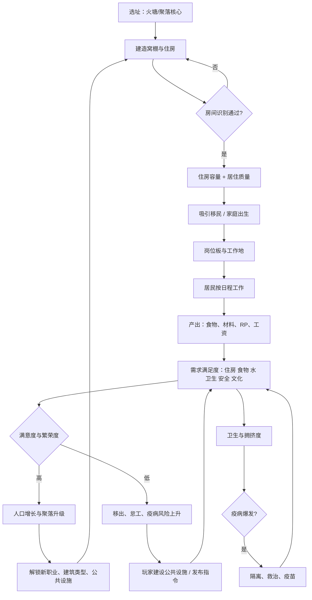

# 15 · 聚落 Settlements（`tcsettlements`）

> 本章是 `tcsettlements` 的完整规格。聚落模组让 NPC 成为“有家庭、有职业、住在玩家建造的房子里、会生老病死”的居民，并把一片房屋与公共设施组织成会成长的聚落。
>
> 冲突裁决顺序：`design-brief.md` 契约 → 00 章 DR/DA → 02 架构 → 31 界面规范 → 本章。本章不定义新的 NPC 实体，所有居民都是核心实体 `tcivilization:person` 加上本模组的 `ResidentComponent`（02 §2.4）。

| 项 | 内容 |
| --- | --- |
| 章节编号 | 15 |
| 模组 ID | `tcsettlements`，根包 `com.nightcity.settlements`（现有入口类 `TSettlements`、`TSettlementsEvents`） |
| 必需依赖 | `tcivilization`（02 §1.3）；`tctechnology`、`tcskills` 为可选 |
| 拥有的领域 | 聚落创建与成长、人口与家庭、住房与房间识别、职业与岗位分配、居民日程、公共设施、教育、公共卫生与疫病（只作用于聚落与 NPC，绝不作用于玩家）、繁荣度 Prosperity |
| 不拥有的领域 | 土地权限、法律、政策、税收、投票（Commons，19 章）；城墙等防御功能方块（Frontiers）；货币与价格（Exchange）；AI 文明（Nations）；粮食作物（Cultivation） |
| 科技配额 | 28（实际 30，在 ±3 内），含关键科技 `tctechnology:stone/shelter_building`、`tctechnology:iron/masonry` |
| 性能预算 | 平均 1.8 ms/tick，峰值 5.0 ms/tick（02 §8） |
| 文明面板页签 | `tcsettlements:settlements`（文明组，排序 200；页内子导航：总览、居民、岗位、住房、设施、卫生、规划），不注册第二个页签 |
| HUD 控件 | `tcsettlements:settlement_status`（标准，右上，仅在己方聚落内） |

---

## 1. 定位与设计支柱

### 1.1 一句话定位

**“你建的每一间屋子都会住进一个有名字的人。”** 聚落把玩家亲手建造的房屋、作坊与公共设施识别为一个整体，用真实可解释的人口、需求与卫生模型驱动它从营地成长为特大城市；NPC 是这个整体中可见、可交谈、会工作的“居民”，而不是一个数字。

### 1.2 设计支柱

| 编号 | 支柱 | 落地规则 |
| --- | --- | --- |
| SP-1 | **建筑即功能** | 不提供“放下即成型”的房屋方块；住房、学校、浴场都由房间识别算法从玩家建造的结构中识别（第 5.6 节）。只有聚落核心、岗位板等少数“功能锚点”是专用方块 |
| SP-2 | **人是具体的** | 每个实体化居民都有姓名、年龄、家庭、住所、岗位、熟练等级与记忆；抽象化后仍保留个人记录（最多 2,000 条/聚落），只有超出部分才以统计“人群池”表示 |
| SP-3 | **需求可解释** | 满意度、繁荣度、出生率、死亡率全部由公开公式计算；聚落页签中任何数值都可展开为“构成因子 + 改善建议”（DR-20 可见过程） |
| SP-4 | **混合管理** | 遵循 DR-21：玩家可以逐个指挥居民，也可以只设定岗位优先级与分区，让居民自行分配；玩家的显式指令（“固定岗位”）永远优先于自动分配 |
| SP-5 | **规模随时代** | 聚落等级上限受时代约束（01 §3.2）：E0 营地，E1 村落，E2 镇，E3-E5 城，E6-E7 都市，E8+ 特大城市；实体化 NPC 全局上限 500（README §3），其余抽象 |
| SP-6 | **疫病只伤聚落** | 疫病、卫生、医疗只作用于 NPC 与聚落统计，玩家角色永不感染（brief §2.4，40 章 EC-P4-5）；玩家的角色是“公共卫生决策者与医者” |
| SP-7 | **缺模组不残缺** | 独立安装时用内置的简化需求来源（任何食物、任何水源、任何工作方块）维持完整循环；联动时用其他模组的真实数据替换这些简化来源 |

### 1.3 与决策记录的对应

| 决策 | 本章体现 |
| --- | --- |
| DR-02 单一玩家文明 | 所有玩家聚落属于 `PLAYER_CIV_ID`；多人服务器上不同玩家建立的聚落是同一文明的不同城市，地方治理差异由 Commons 的“城镇特许状”实现 |
| DR-20 可见过程 | 居民在世界中真实走动、上班、下班、生病卧床；疫情时可见病人与隔离旗 |
| DR-21 混合管理 | 指令轮盘（Z）逐个指挥 + 岗位板/页签批量设置 |
| DR-28 HUD 极简 | 只注册一个情境控件 `tcsettlements:settlement_status`，仅在己方聚落内显示 |
| DA-04 核心人物实体 | 只在 `tcivilization:person` 上附加 `ResidentComponent`，不注册新实体 |

---

## 2. 独立玩法（只安装 `tcivilization` + `tcsettlements`）

只安装核心与本模组时，玩家仍然可以完成“建房 → 吸引居民 → 分配工作 → 满足需求 → 聚落升级”的完整循环。

### 2.1 起步（E0，对应 01 §6 前 10 小时脚本）

1. 新世界生成时核心按 `STARTING_BAND` 生成玩家 + 4 名族人（README §3）。本模组为这 4 人附加 `ResidentComponent`，状态为“无家可归 · 流浪”。
2. 玩家用 `thatch`（茅草）、`hide_cover`（兽皮篷）与任意原木/树枝搭建窝棚，放下 `sleeping_mat`（睡垫）。满足窝棚识别规则（5.6.2）后，窝棚头顶短暂浮现“窝棚 · 可住 2 人”的名称牌。
3. 在窝棚群中心放置 `settlement_core`（E0 形态为“部落火塘”）并点燃，聚落成立，触发核心 `SettlementFoundedEvent`。族人自动认领最近的空窝棚。
4. 放置 `job_board`（岗位板），在上面标记采集、狩猎、打制、守火等岗位；族人开始按日程工作。没有 Technology 时，岗位所需“工作方块”退化为“在岗位板 16 格内的任意工作台/熔炉/箱子”。
5. 聚落吸引力足够时，每隔 0.5-2 MC 日出现流浪者请求加入（01 §6 脚本 2:30），玩家可在对话中接受或拒绝。
6. 人口达到 6 且建成 3 座窝棚 + 部落火塘，满足 E0 里程碑工程（若装有 Technology，则由其判定时代跃迁；否则聚落升级为“小村”）。

### 2.2 中期（无其他主题模组）

| 主题 | 独立模式下的简化来源 |
| --- | --- |
| 食物 | 粮仓（`granary`）或聚落范围内任意容器中带 `c:foods` 标签的物品；食物多样性按不同物品 ID 数计算 |
| 水 | 聚落范围内的水井 `well`、蓄水池 `cistern` 或原版水源方块（离住所 ≤ 32 格）；无水质模型，水质恒为“可饮用”，饮水型疫病风险按水源类型给常数 |
| 岗位产出 | 岗位把“产出表”（`tc_profession` 数据）中的原版物品放入岗位板旁的箱子，例如采集者产出浆果、木棍、燧石 |
| 安全 | 聚落范围内敌对生物数量与夜间照明覆盖率 |
| 文化 | 神龛 `shrine`、公共喷泉、节庆 |
| 时代 | 没有 Technology 时，“聚落等级”代替时代门槛：每升一级，解锁下一组方块配方（第 8 节“无科技回退”列） |

### 2.3 后期（独立）

独立模式下最高可成长到“城”（city）。都市与特大城市需要“时代 ≥ E6/E8”，没有 Technology 时以“聚落人口 + 设施”替代：都市需要人口 ≥ 1,200 且拥有下水道与学校网络；特大城市需要人口 ≥ 6,000。疫病、教育、卫生改革、高层住宅在独立模式下全部可用，因为它们只依赖本模组的方块。

---

## 3. 联动玩法

每条联动都通过 `com.nightcity.settlements.compat.<other>` 桥接类实现，并由 `ModList.isLoaded` 守卫（02 §1.4）。附录 C 是机器可读版本。

| 对方模组 | 联动内容（具体规则） |
| --- | --- |
| `tcivilization`（必需） | 使用 `SettlementRecord` 登记聚落；使用 `PersonRecord`/`PersonEntity` 表示居民；使用核心日程、需求、对话、寻路框架；通过 `RegionLayerRegistry` 注册 `tcsettlements:demography` |
| `tctechnology` | 科技解锁方块配方、职业、需求类型与建筑类型；聚落讨论与教师为研究提供 RP：每名“学者类”岗位居民 0.4 RP/MC 日，学校毕业生使知识阈值获取 +5%/所学校（上限 +25%）；人口统计提供时代跃迁“人口下限”；`settlement_core` 的 E0“部落火塘”形态通过 `ResearchSiteProvider` 注册为火塘研究地点（04 章），与 `fire_pit` 共享可用火塘数 |
| `tcskills` | 玩家建造、指挥、救治行为获得熟练度（第 15 节）；玩家 `leadership` 等级使居民执行玩家指令的效率 +0.5%/级（上限 +25%） |
| `tcwildlands` | 选址评分读取 `tcwildlands:climate` 与 `tcwildlands:hydro`（5.1）；日照长度决定起床时间；季节影响疫病基础传染率（冬季呼吸道 ×1.3，夏季肠道 ×1.4）；洪水、地震摧毁房屋时触发住房重识别与无家可归事件 |
| `tcecology` | 狩猎/采集岗位从 `tcecology:ecosystem` 层读取物种丰度，产出 = 基础产出 × 丰度系数（0.2-1.2）；鼠类种群密度影响鼠传疫病输入率；聚落人口规模反向写入生态压力 |
| `tccultivation` | 农夫、牧人岗位绑定 Cultivation 的农田与畜栏工作地；粮仓读取 Cultivation 的食物营养分类，食物多样性按“营养组”而非物品 ID 计算；饥荒由 Cultivation 的储粮预测触发提前警报 |
| `tcindustry` | 工业机器注册为工作地（`WorkplaceProvider`），机器的“操作员”槽位由居民填充；工人数与熟练度影响机器速度；工业污染（`tcindustry:emission`）降低居住质量并提高呼吸道疾病率；电网为 `home_electrification` 提供供电判定 |
| `tcnetworks` | 道路使 L1/L2 移动速度 ×1.5（铺装 ×2.0）；通勤距离上限随交通工具提升；疫病沿 Networks 的线路在聚落间传播（5.9.4）；车站、码头注册为工作地 |
| `tcexchange` | 商人岗位、市集需求（文化与食物多样性来源之一）；居民工资与消费：`wage` 计入繁荣度的“财富”项；Exchange 价格决定移民期望收入 |
| `tcdiscovery` | 学校、教师与 Discovery 的书籍：教室中每本 `c:books` 使教学效率 +2%（上限 +20%）；医学知识（观察病例）解锁更准确的疫情数据（未掌握时显示“？”档位，31 §8.3） |
| `tcechoes` | 聚落成立、升级、大疫、首批毕业生写入文明记忆（`MemoryRecordedEvent`）；被遗弃的聚落在 Echoes 中成为遗迹候选 |
| `tccommons` | Commons 实现本模组的 `DirectiveGate`：隔离、配给、宵禁、强制入学等“聚落指令”在装有 Commons 时变为法律/政策，需要投票或消耗合法性；Commons 的稳定度读取本模组满意度；公共工程复用本模组的施工系统；领地边界与聚落边界同步 |
| `tcfrontiers` | 安全需求读取 `tcfrontiers:danger` 层与守卫岗位；城墙结构被识别为建筑类型“城墙”（功能方块由 Frontiers 提供）；本模组提供方块标签 `tcsettlements:defensive_wall`（含 `wattle`、原版墙与栅栏）供 Frontiers 的围合度检测（20 章）；盗匪袭击造成伤亡与住房损毁 |
| `tcbeyond` | 异界渗透（`tcbeyond:anomaly` ≥ 40，强度 0-100）使满意度 −10 并引入一种数据驱动的“异质病”（只作用于 NPC） |
| `tcatlas` | 聚落在地图与罗盘条上的标记、边界、人口标签；E7 电报联网后远程聚落数据实时显示（01 §3.2） |
| `tcnations` | AI 文明的聚落同样由本模组规则模拟（L3 只做聚合）；移民可来自 AI 文明；战争掠夺降低人口；Nations 使用本模组的人口结构计算兵源 |
| `tcorbit` | `closed_habitats` 科技使居民可以居住在月球/火星基地；栖息舱 `habitat_bunk` 作为太空住房；生命维持故障进入公共卫生事件 |

---

## 4. 核心玩法循环



### 4.1 三个时间尺度

| 尺度 | 玩家在做什么 | 系统在做什么 |
| --- | --- | --- |
| 秒级（L0） | 指挥某个居民、对话、救治病人、搭建一间房 | 实体化居民逐 tick 寻路与动作；房间识别在放置/破坏方块后 0.5 秒内重算 |
| 日级（MC 日） | 调整岗位、查看需求警报、规划新街区 | 每日结算食物与水消耗、工资、满意度、出生/死亡/迁移掷骰 |
| 季/年级 | 推进时代、建设学校与下水道、应对大疫 | 人口结构老化、教育产出、疫病季节性、聚落升降级（带 2 季滞后） |

### 4.2 一个 E2 的典型日

1. 清晨（日照起始 −30 分钟）：居民起床，从住所走向水井与粮仓，吃早饭（消耗粮仓食物，记录多样性）。
2. 上午：按岗位前往工作地；书吏在 `census_desk` 普查，冶炼工去 Industry 的竖炉。
3. 中午：返回或在工作地附近进食。
4. 下午：继续工作；儿童在 E3 前跟随父母“学徒”，E3 起去学校。
5. 傍晚：社交（神龛、喷泉、市集），满足文化需求。
6. 夜晚：回家睡觉；守卫轮值巡逻。玩家可在聚落页签看到全天“劳动小时”与“需求缺口”。

---

## 5. 系统规则与公式

本节所有常量都可在 `tcsettlements-server.toml`（第 13 节）或数据包中调整；括号中的“[配置]”表示有对应配置键。

### 5.1 选址与建立聚落

#### 5.1.1 选址评分

手持 `settlement_core` 物品（未放置）时，准星指向的地面显示选址预览（L1 世界内标注：半透明圆环 = 营地边界半径 48）与目标信息控件中的评分“选址 72/100 · 良”。`Shift + 右键` 地面执行一次“勘察”，在聊天与日志中写入完整因子表（`surveying` 熟练度，第 15 节）。

```text
S = 100 × (0.25·W + 0.20·F + 0.15·C + 0.15·T + 0.10·R + 0.10·D + 0.05·H)        S ∈ [0, 100]

W 水源   = 1                        若 16 格内有淡水（原版水源或 Wildlands 河流/湖泊）
         = 1 − (d − 16) / 112        16 < d ≤ 128；d > 128 时为 0
         Wildlands 存在时：× (0.8 + 0.1 × min(riverOrder, 2))，地下水深度 ≤ 8 格时 W ≥ 0.6（可打井）
F 食物   = Cultivation 存在：tccultivation:agri 层的作物适宜度均值（0-1）
         否则：半径 64 内可食植物方块数 / 40 + 被动动物数 / 12，封顶 1
C 气候   = clamp(1 − |T_mean − 15| / 25, 0, 1) × clamp(P_year / 600, 0.3, 1)
         T_mean（°C）、P_year（mm）读 tcwildlands:climate；否则用原版生物群系 temperature×25、downfall×1200 近似
T 地形   = 半径 48 内坡度 ≤ 1 的地表列占比
R 资源   = (min(1, 原木方块/200) + min(1, 石质方块/300) + min(1, 黏土类方块/40)) / 3
D 安全   = 1 − tcfrontiers:danger 层危险度（0-1）；否则 1 − min(1, 夜间敌对生物刷怪点密度 / 0.02)
H 灾害   = 1 − (洪水风险 + 构造风险) / 2（读 tcwildlands:hydro / geo）；否则常数 0.8
```

评分档位：0-29 劣、30-49 中下、50-69 良、70-84 优、85-100 绝佳。评分影响：

| 影响 | 公式 |
| --- | --- |
| 初始吸引力加成 `siteBonus` | `(S − 50) / 100`，范围 −0.5…+0.5，进入 5.3.4 吸引力 |
| 基础健康 | `health_base = 0.85 + 0.10 × W + 0.05 × C` |
| 选址记录 | 写入 `SettlementData.siteScore`，聚落页签“选址”卡片永久显示 |

#### 5.1.2 建立规则

1. 放置 `settlement_core` 并对其 `右键`（E0 需手持点燃的火把或核心火种 `minecraft:flint_and_steel`/Technology 生火工具）完成建立。建立前方块处于“未点燃”状态，不计入任何聚落。
2. 新核心必须位于所有已有聚落边界之外，且与最近的已有核心距离 ≥ `min_core_distance`（默认 160，[配置] 64-1,024）。
3. 文明可拥有的聚落数上限随时代：E0 1、E1 2、E2 3、E3 5、E4 8、E5 12、E6 20、E7 30、E8+ 50（[配置] `max_settlements_per_era`）。没有 Technology 时按“已有聚落中最高等级”换算：营地 1、小村/村落 2、镇 3、城 5、都市 20、特大城市 50。
4. 装有 Commons 时，建立动作还需通过 `ClaimPermissionCheck`：目标区块无领地、或属于本文明且玩家拥有 `claim_manage` 标志（19 章）。
5. 建立成功：核心登记 `SettlementRecord`（`PLAYER_CIV_ID`），本模组创建 `SettlementData`，触发 `SettlementFoundedEvent`，并在文明记忆中写入“建立 <名称>”。默认名称取自文化命名表（核心数据），玩家可在核心界面中改名。
6. 边界：以核心为圆心、半径取当前等级的 `boundaryRadius`；两个聚落边界重叠时，重叠区按到两核心距离的中垂线切分（只影响“归属”，不影响已建房屋）。

#### 5.1.3 迁移核心与解散

- **迁移**：破坏核心后 3 MC 日内在原边界内重新放置，聚落数据保留（相当于搬迁中心）；超过 3 日或放到边界外，聚落进入“无核心”状态：满意度 −20，不再接收移民。
- **遗弃**：人口为 0 持续 12 MC 日（1 季），聚落标记为 `ABANDONED`，核心方块变为“熄灭的火塘/废弃市政厅”外观；记录保留供 Echoes 生成遗迹。
- **解散**：玩家在页签中“解散聚落”（`TcConfirmDialog`，需输入聚落名），居民转为流浪者，按 5.3.4 的聚落间迁移规则分流到其他聚落。

### 5.2 聚落等级（成长阶段）

聚落等级由“人口 + 繁荣度 + 必需建筑 + 时代上限”共同决定，每 MC 日结算一次。

| 等级 | 枚举 | 最低人口 | 最低时代 | 繁荣度门槛 | 必需建筑（全部满足） | 边界半径 | 核心外观 |
| --- | --- | --- | --- | --- | --- | --- | --- |
| 营地 | `CAMP` | 1 | E0 | — | 聚落核心 + 1 座窝棚 | 48 | 部落火塘 |
| 小村 | `HAMLET` | 8 | E1 | 20 | 4 处住所（窝棚或房屋）+ 水源设施 + 粮仓 | 64 | 石圈火塘 |
| 村落 | `VILLAGE` | 20 | E1 | 30 | 6 座房屋 + 粮仓 + 神龛 + 厕所 | 96 | 长屋火塘 |
| 镇 | `TOWN` | 50 | E2 | 40 | 普查台 + 镇钟 + 排水覆盖 ≥ 50% 住房 + 2 类公共设施 | 160 | 议事亭 |
| 城 | `CITY` | 150 | E3 | 50 | 学校 + 引水渠或蓄水池 + 砖石房屋 ≥ 30% + （城墙或规划台） | 256 | 市政厅 |
| 都市 | `METROPOLIS` | 1,200 | E6 | 60 | 下水道覆盖 ≥ 70% + 公立学校 + 医院 | 384 | 市政大楼 |
| 特大城市 | `MEGACITY` | 6,000 | E8 | 65 | 水处理厂 + 诊所网络（≥ 1 诊所/2,000 人）+ 高层住宅 ≥ 20% 住房容量 | 512 | 城市中心塔 |

规则：

1. **升级**：全部条件满足时，下一个日结算立即升级，触发 `SettlementTierChangedEvent`、`ceremony` 级通知（31 §7）、核心方块 `stage` 方块状态切换模型（外观由核心方块自身改变，不需要玩家替换方块）。
2. **时代上限**：时代不足时人口可以继续增长，但等级停留在当前时代允许的最高等级（01 §3.2）。没有 Technology 时以第 2.3 节的“人口 + 设施”替代。
3. **降级（滞后）**：人口 < 最低人口 × 0.8，或繁荣度 < 门槛 − 10，或必需建筑缺失，**连续 2 季（24 MC 日）**后降一级；期间页签与 `tcivilization:alerts` 显示“降级风险：剩余 N 日”。营地不再降级。
4. 等级决定：边界半径、移民基数 `IMM_BASE`、可用建筑类型、职业槽位上限、L2 模拟粒度（城以上启用分区统计）。
5. 名称：小村之前在地图上只显示图标；村落及以上显示名称；城以上显示人口档位（“约 300 人”）。

### 5.3 人口模型

#### 5.3.1 年龄与生命阶段

游戏内“生命年 LY”与日历解耦，避免居民在一个游戏年里只长一岁导致长期停滞：

```text
AGE_SCALE = 4 LY / 游戏年                       [配置] 1-8
1 游戏年 = 48 MC 日  →  1 LY = 12 MC 日 = 1 季（默认）
ageLY(t) = ageAtCreation + (t − createdTick) / (TICKS_PER_DAY × DAYS_PER_YEAR / AGE_SCALE)
```

| 阶段 | 年龄（LY） | 劳动力系数 | 可从事 | 说明 |
| --- | --- | --- | --- | --- |
| 婴幼儿 `INFANT` | 0-4 | 0 | — | 计入儿童死亡率 |
| 儿童 `CHILD` | 5-11 | 0（E0-E2 为 0.2，随父母学徒） | E3 起入学 | 学龄 6-11 |
| 少年 `ADOLESCENT` | 12-15 | 0.5 | 学徒岗位 | E5 起可读文法学校 |
| 成年 `ADULT` | 16-59 | 1.0 | 全部岗位 | 可组成伴侣、生育（16-44） |
| 老年 `ELDER` | 60+ | 0.3 | 教师、医者、守火人、长老 | 教学/医疗效率 +15% |

默认设置下，新生儿成长为成年人需要 16 LY = 192 MC 日 ≈ 4 个游戏年。

#### 5.3.2 出生

```text
births_per_day = Σ_households couples_h × B_BASE / DAYS_PER_LY
                 × M_food × M_house × M_health × M_sat × M_era × M_diff × M_children
B_BASE      = 0.32 / LY                                 [配置] 0.05-1.0
DAYS_PER_LY = DAYS_PER_YEAR / AGE_SCALE = 12
couples_h   = 户内“伴侣对”数，且伴侣中至少一人 fertile（核心 PersonRecord 字段，16-44 LY）
M_food      = clamp(foodDays / 12, 0.2, 1.2)           foodDays = 粮食储备可供全体天数
M_house     = 1.0 户内有空床位 | 0.6 恰好满员 | 0.3 超员 | 0 无住所（流浪）
M_health    = 1 − 0.5 × prevalence                      prevalence = 当前患病率（5.9）
M_sat       = 0.5 + sat                                  sat ∈ [0,1]
M_era       = E0-E5 1.0 | E6 0.85 | E7 0.70 | E8 0.60 | E9-E10 0.55   （人口转型）
M_diff      = 难度预设“人口增长”倍率（01 §6，经 DifficultyApi 读取）：沙盒 1.5 | 标准 1.0 | 历史 0.8 | 自定义 0.25-3.0
M_children  = 1.0（户内子女 ≤ 3），每多 1 人 × 0.5
```

L0/L1 下每户每日独立掷骰；L2 下用期望值累加小数部分（`birthAccumulator`），满 1 生成一个新生儿记录。新生儿继承家庭文化、姓氏规则（核心命名表），外观由父母外观集混合。

#### 5.3.3 死亡

```text
q(age)    = min(1, 0.0008 × e^(0.085 × age) × H_mult) + childMort(era) × [age < 5]     每 LY
H_mult    = 1.6 − 0.6 × healthIndex                     healthIndex ∈ [0,1]（5.5.3 卫生 + 医疗）
p_day     = 1 − (1 − q)^(1 / DAYS_PER_LY)
childMort = E0 0.080 | E1 0.070 | E2 0.060 | E3 0.050 | E4 0.045 | E5 0.035
            E6 0.025 | E7 0.015 | E8 0.008 | E9 0.006 | E10 0.005               每 LY
```

参考值（healthIndex = 1）：30 岁 q ≈ 0.010，60 岁 ≈ 0.131，70 岁 ≈ 0.307，80 岁 ≈ 0.72，平均寿命约 68-74 LY。

额外死因（独立掷骰）：

| 死因 | 条件 | 每日概率 |
| --- | --- | --- |
| 饥饿 | 粮食储备为 0 且连续 ≥ 3 MC 日 | 每人 2%，儿童与老人 ×2 |
| 疫病 | 5.9 节病死率 | 按疾病 |
| 暴力 | Frontiers 袭击、Nations 战争 | 由对方模组上报伤亡 |
| 事故 | Industry 机器事故、Networks 交通事故 | 由对方模组上报 |
| 严寒 | 冬季住所无供暖（居住质量“供暖”项 = 0）且 `climate.T_winter < −5 °C` | 老人与婴幼儿 0.3% |

**保护规则**（02 §4）：被玩家命名或标为“重要”（星标）的居民在 L2 永不死亡；L2 中命中死亡判定时改为“病危”状态，等聚落恢复 L0/L1 后由玩家救治（`medicine`）或在 3 MC 日后于玩家在场时死亡。L2 不焚毁建筑、不拆除房屋。

#### 5.3.4 迁入与迁出

```text
attract = 0.30·sat + 0.20·vacancy + 0.20·jobs + 0.15·(prosperity/100) + 0.10·reputation
          + 0.05·(siteBonus + 0.5) − epidemicPenalty                       ∈ [0, 1]
vacancy = min(1, freeBeds / max(4, 0.1 × pop))
jobs    = min(1, openJobs / max(2, 0.1 × pop))
reputation      = Nations 存在时为本文明对外声望（0-1），否则 0.5
epidemicPenalty = 0.30 已知疫情 | 0.15 隔离指令生效中 | 0

immigrants_per_day = max(0, attract − 0.45) × IMM_BASE[tier] × M_diff
IMM_BASE: CAMP 1.0 | HAMLET 1.2 | VILLAGE 1.6 | TOWN 2.5 | CITY 4 | METROPOLIS 10 | MEGACITY 25
```

1. 移民以“户”为单位到达：单身 50%，伴侣 25%，3-4 人家庭 25%；到达前若 `freeBeds` 不足一户，跳过本次。
2. **首位流浪者保底**：聚落建立后 1-2 MC 日内，若有空床位，必定出现 1 名流浪者请求加入（满足 01 §6 脚本 2:30）。
3. E0-E2 移民到达时在聚落边界上生成实体，步行走向核心，玩家对话可“接受/拒绝”；默认 60 秒无响应自动接受（[配置] `auto_accept_immigrants`）。E3 起默认自动接受，可在页签中改为“需批准”。装有 Commons 时，移民政策（开放/配额/关闭）由 Commons 法律覆盖。
4. **迁出**：`sat < 0.35` 时，每名成年居民每日以 `(0.35 − sat) × 0.02` 的概率决定离开，整户随行。被命名的居民离开前 2 MC 日发送 `warning` 通知“<姓名> 一家考虑离开：<主要不满>”。
5. **文明内迁移**：同文明两个聚落 `attract` 差 > 0.2 且两者之间存在 Networks 路线（或无 Networks 时距离 ≤ 2,000 格），每日 0.5% 的居民向高吸引力聚落迁移。

#### 5.3.5 家庭与住户

1. 户 `Household`：1-8 人，共享一处住所，持有共享储物（住所内的箱子视为户内储物）。
2. 伴侣形成：同聚落未配对的成年人（≥ 18 LY），每日 5% 概率尝试，成功率按“文化相同 +20%、同岗位 +10%、关系好感”计算；核心对话框架记录关系。
3. 分户：子女成年后，若聚落有空住所，每日 10% 概率搬出组成新户；否则留在原户导致超员（居住质量“人均面积”下降）。
4. 户主：户内年龄最大的成年人；户主死亡时由伴侣或最年长子女继承。户主决定户的“偏好岗位”与“偏好住所类型”。

### 5.4 居民的三种表示与模拟分级

| 表示 | 存储 | 上限 | 何时使用 |
| --- | --- | --- | --- |
| 实体化居民 | `PersonEntity` + `ResidentComponent` | 全局 `MAX_EMBODIED_NPC` = 500（[配置] 100-1,000，核心常量） | L0/L1，距玩家近、优先级高 |
| 个人记录 | `PersonRecord`（核心）+ `ResidentData`（本模组） | 每聚落 `individual_cap` = 2,000（[配置] 200-10,000） | 抽象但需要“具体的人”：有名字、有关系、被玩家接触过 |
| 人群池 | `CohortPool`：年龄段 × 职业 × 教育程度 的计数矩阵 | 不限 | 超出个人记录上限的人口；纯统计 |

**提升与降级**：

1. 人群池 → 个人记录：需要实体化或事件需要具名人物时，从池中按 `seed = hash(settlementSeed, cohortKey, serial)` 确定性生成姓名、外观与年龄，保证同一存档重复提升得到同一人。
2. 个人记录 → 人群池：个人记录超过上限时，选择“未命名、无玩家关系、30 MC 日内未实体化、非户主”的记录折叠回池，优先最久未访问者。
3. 实体化优先级：核心公式 `priority = distance × importance`（数值越小越优先，02 §4）。本模组在核心系数基础上再乘：被命名 ×0.7，玩家关注户成员 ×0.8，正在医院救治 ×0.9，执行岗位且岗位在玩家 32 格内 ×0.9。
4. 单个聚落实体化份额：`embodiedQuota = min(pop, 200)`，多个聚落同时加载时按与玩家距离反比分配全局 500 的余量（[配置] `max_embodied_per_settlement` 50-500）。

**各级别下的行为**：

| 级别 | 移动 | 工作 | 需求与人口 |
| --- | --- | --- | --- |
| L0（≤ 128 格） | 核心分层寻路，逐 tick | 实际在工作地执行动作，产出逐次结算 | 每日结算；进食、饮水为可见动作 |
| L1（已加载，> 128 格） | 沿缓存路点跳跃，每 20 tick 前进一个路点，不做寻路 | 按工时比例结算产出 | 同 L0 |
| L2（未加载） | 只记录 `locationId`（住所/工作地/设施）与到达时刻，`travelTicks = distance / speed` | 每 1,000 tick 按期望产出结算 | 期望值累加；追赶上限 3 MC 日（02 §4） |
| L3（AI 文明聚合） | 无 | 无 | Nations 只读本模组的人口结构公式做年度聚合 |

一致性要求：同一聚落在 L2 与 L0 下运行 3 MC 日，人口、粮食消耗、产出的差异 ≤ 10%（02 §4，验收 AC-07）。

### 5.5 需求与满意度

#### 5.5.1 需求类型

需求是**聚落级指标**（按户计算后加权平均），不是逐个 NPC 的饥饿条。核心需求框架只负责个体的“吃饭、睡觉、社交”日程动作；本模组把这些动作的结果汇总为下列需求的满足度 `f_i ∈ [0,1]`。

| 需求 | ID | 启用时代 | 满足度 `f_i` 计算 | 主要来源 |
| --- | --- | --- | --- | --- |
| 住房 | `housing` | E0 | 各户居住质量 Q（5.6.5）的平均，无住所的户计 0 | 窝棚、房屋 |
| 食物 | `food` | E0 | `0.5·min(1, foodDays/6) + 0.5·min(1, groups/G_target)` | 粮仓、Cultivation |
| 水 | `water` | E0 | `coverage × quality` | 水井、蓄水池、引水渠、自来水 |
| 卫生 | `sanitation` | E0 | `0.4·latrine + 0.3·drainage + 0.2·waste + 0.1·bath` | 厕所、排水沟、下水道、浴场 |
| 安全 | `safety` | E0 | `0.4·(1 − danger) + 0.3·light + 0.3·min(1, guards/guardTarget)` | 守卫、照明、城墙 |
| 文化 | `culture` | E0 | `min(1, culturePts / (pop × 0.6))` | 神龛、喷泉、浴场、节庆、市集 |
| 医疗 | `healthcare` | E2 | `min(1, careCapacity / (pop / 40))` | 医者席、病床、医院、诊所 |
| 教育 | `education` | E3 | `enrolled / schoolAge × teacherQuality` | 学校、教师 |
| 公用事业 | `utilities` | E7 | `0.5·electrified + 0.5·pipedWater`（无 Industry 时只算自来水） | 入户电力、自来水 |

计算细节：

```text
G_target       = E0 2 | E1-E2 3 | E3-E5 4 | E6+ 5            食物营养组数（Cultivation 的营养分类；独立时 = 不同食物 ID 数 / 2）
coverage(water)= 距住所门口 ≤ W_RANGE 的住所占比；W_RANGE = E0-E2 32 | E3-E5 48 | E6 64；入户自来水恒为 1
quality(water) = 河湖 0.60 | 水井 0.85 | 蓄水池 0.80 | 引水渠 0.90 | 处理厂 1.00；Industry 污染 × (1 − 0.5·emission)
latrine        = min(1, latrines × 10 / pop)；E6 起下水道接入率直接替代
drainage       = 有排水沟/下水道相邻的住所占比
waste          = 1 − 聚落内“垃圾堆积”点数 / max(1, pop/20)（食物腐烂、动物粪便由 Cultivation 上报）
guardTarget    = pop / 25（E0-E5），pop / 50（E6 起）
light          = 聚落道路与公共空间夜间方块光照 ≥ 8 的面积占比（抽样 64 点）
culturePts     = 神龛 10 | 喷泉 5 | 浴场 15 | 市集 8 | 学校 5 | 其他模组 CultureProvider 上报值；节庆期间 ×2
```

#### 5.5.2 满意度

每种需求有随时代上升的**期望值** `e_i(era)`。同样的设施在更晚的时代给出更低的满意度（期望升级），促使玩家持续投资：

```text
s_i     = clamp(0.5 + 1.25 × (f_i − e_i), 0, 1)        达到期望 = 0.5（“满足”）；超出 0.4 = 1.0（“优秀”）
sat_raw = Σ w_i·s_i / Σ w_i                              只对已启用需求求和
sat     = clamp(sat_raw + Σ mods, 0, 1)                  页签显示 round(sat × 100)
```

| 需求 | 权重 w | E0 | E1 | E2 | E3 | E4 | E5 | E6 | E7 | E8 | E9 | E10 |
| --- | --- | --- | --- | --- | --- | --- | --- | --- | --- | --- | --- | --- |
| 住房 | 20 | .20 | .30 | .35 | .40 | .45 | .50 | .50 | .60 | .65 | .70 | .75 |
| 食物 | 20 | .25 | .30 | .35 | .40 | .40 | .45 | .50 | .55 | .60 | .65 | .65 |
| 水 | 15 | .30 | .35 | .40 | .45 | .45 | .50 | .55 | .65 | .70 | .75 | .80 |
| 卫生 | 12 | .10 | .20 | .25 | .30 | .30 | .35 | .45 | .55 | .60 | .65 | .70 |
| 安全 | 13 | .30 | .35 | .40 | .40 | .45 | .45 | .50 | .55 | .55 | .60 | .60 |
| 文化 | 10 | .10 | .15 | .20 | .25 | .30 | .35 | .40 | .45 | .50 | .55 | .55 |
| 医疗 | 10 | — | — | .20 | .25 | .30 | .35 | .40 | .50 | .60 | .65 | .70 |
| 教育 | 8 | — | — | — | .20 | .25 | .35 | .45 | .55 | .60 | .65 | .70 |
| 公用事业 | 8 | — | — | — | — | — | — | — | .30 | .50 | .60 | .70 |

临时修正 `mods`：

| 修正 | 数值 | 持续 |
| --- | --- | --- |
| 节庆（指令或 Commons 政策） | +0.10 | 6 MC 日线性衰减 |
| 亲人死亡 | −0.05/起，封顶 −0.20 | 6 MC 日 |
| 过劳 | `−0.03 × (日工时 − 10)`（工时 > 10） | 持续 |
| 失业 | `−0.10 × 失业率` | 持续 |
| 疫情恐慌 | `−0.15 × prevalence / 0.05`，封顶 −0.15 | 疫情期间 |
| 无核心 | −0.20 | 核心缺失期间 |
| 异界渗透（Beyond） | −0.10 | 渗透 ≥ 0.4 |
| Commons 稳定度回馈 | `+0.05 × (stability − 50) / 50` | 持续（仅装 Commons） |

满意度档位（文字 + 图标，不只用颜色，31 UP-8）：0-19 绝望 ✖，20-34 不满 ▼，35-49 勉强 ◐，50-69 满足 ●，70-84 愉快 ▲，85-100 繁盛 ★。

#### 5.5.3 健康指数

```text
healthIndex = clamp( (0.30 + 0.20·f_water + 0.20·f_sanitation + 0.20·careLevel + 0.10·f_food
                      − 0.25·prevalence − 0.20·emission) × health_base / 0.95, 0, 1)
careLevel   = min(1, careCapacity / (pop / 40)) × CARE_QUALITY
CARE_QUALITY= 无 0.30 | herbal_healing 0.50 | hospitals 0.65 | anatomy 0.75 | vaccination 0.80
              | antibiotics 0.95 | epidemic_surveillance 1.00         （取已解锁的最高项）
careCapacity= 医者席 1 人 × 医者熟练 | 病床 2 | 医院病房床位 3 | 诊所柜 6 （每单位需配 1 名医者岗位才计入）
emission    = tcindustry:emission 层归一化污染指数（0-1），无 Industry 时为 0
```

`healthIndex` 进入死亡率（5.3.3）、出生率（经由 prevalence）与疫病病死率（5.9）。

### 5.6 住房与建筑识别

#### 5.6.1 房间识别算法

房间不是方块，而是由算法从玩家建造的结构中识别出的“封闭空气体积”。

```text
触发：聚落边界内放置/破坏方块 → 标记所在区段为脏（dirty）；去抖 10 tick 后排队扫描
种子：门、床、睡垫、工作方块、学校课桌等“房间锚点”方块（标签 tcsettlements:room_anchors）
洪泛：从种子相邻的可通行空气格出发 6 向扩展
  · 停止于“围合方块”：完整面方块、门、活板门、玻璃/窗、栅栏门、标签 tcsettlements:enclosing
  · 体积 > 2,048 或包围盒 > 32×32×12 → 判定为“非房间”（露天或过大），终止
判定：
  · 地面覆盖 100%（每个空气列底部为完整顶面方块）
  · 屋顶覆盖 ≥ 90%（每列上方 12 格内存在围合方块的列占比）
  · 墙体围合 ≥ 95%（边界侧面中围合方块占比；门、窗计入）
  · 天空可见列 ≤ 2（烟囱、天窗）
输出：RoomInstance { id, 体积、地面面积、包围盒、锚点方块统计、门列表、材料统计、光照抽样 }
```

1. 扫描在后台线程对**区段快照**执行（02 §5：后台只读快照，主线程应用结果）；每 tick 最多提交 4 次扫描，单次扫描平均 ≤ 0.3 ms（后台）。
2. 相邻房间通过门连接为同一“建筑”；共享墙的房间若无门连接，属于不同建筑（排屋）。
3. 识别结果变化时（房间消失、面积变化 > 10%），重新计算受影响的住所与设施，并对受影响的户发出“住房变化”事件；房屋被毁导致无家可归时，`tcivilization:alerts` 显示“<N> 人无家可归”。
4. L2 时不扫描（方块冻结），恢复加载时只重扫冻结期间被其他系统改变的区段（例如 Wildlands 灾害）。

#### 5.6.2 窝棚（E0 宽松规则）

E0 的窝棚使用宽松规则，让玩家用茅草、兽皮与树枝即可搭成：

| 条件 | 窝棚 | 普通房间 |
| --- | --- | --- |
| 地面面积 | 4-16 | ≥ 4 |
| 屋顶覆盖 | ≥ 75% | ≥ 90% |
| 墙体围合 | ≥ 50%（斜顶落地即可视为墙） | ≥ 95% |
| 必需锚点 | 睡垫或床 | 依房间类型 |
| 可住人数 | `min(3, max(1, floor(面积 / 4)))` | 见 5.6.4 |
| 居住质量上限 | 0.35 | 1.0 |

窝棚识别成功时，窝棚上方短暂显示名称牌“窝棚 · 可住 N 人”，并给 `construction` 熟练度（第 15 节）。

#### 5.6.3 房间类型（数据驱动）

`data/tcsettlements/tc_room_type/<id>.json`：

```json
{
  "id": "tcsettlements:classroom",
  "era": "E3",
  "unlock_tech": "tctechnology:iron/schooling",
  "min_floor_area": 20,
  "requires": [
    { "tag": "tcsettlements:school_desks", "min": 4 },
    { "tag": "tcsettlements:teaching_stations", "min": 1 }
  ],
  "capacity": { "per_block_tag": "tcsettlements:school_desks", "per": 1 },
  "facility": "tcsettlements:school"
}
```

| 房间类型 | 时代 | 必需内容 | 功能 |
| --- | --- | --- | --- |
| `bedroom` 卧室 | E0 | ≥ 1 床/睡垫 | 住所容量 |
| `living` 起居 | E1 | ≥ 1 炉灶类（`tcsettlements:cooking_stations`）+ 面积 ≥ 8 | 住所质量“设施”+0.25 |
| `storeroom` 储藏室 | E1 | ≥ 2 容器 | 户储物 |
| `workshop` 作坊 | E1 | ≥ 1 工作地方块（任意模组的 `WorkplaceProvider`） | 岗位地点 |
| `granary_room` 粮仓间 | E1 | `granary` ≥ 1 | 食物储存 |
| `shrine_room` 祭所 | E1 | `shrine` ≥ 1 | 文化 10 |
| `classroom` 教室 | E3 | 课桌 ≥ 4 + 讲台 1 | 学校，容量 = 课桌数 |
| `infirmary` 病房 | E4 | `infirmary_bed` ≥ 2 | 医疗容量 |
| `bathhouse` 浴室 | E3 | `bath_basin` ≥ 1 + 引水 | 卫生 bath、文化 15 |
| `hall` 厅堂 | E2 | 面积 ≥ 40 | 议事、节庆、Commons 议事厅候选 |
| `habitat_module` 栖息舱 | E10 | `habitat_bunk` ≥ 1 + 气密（Orbit 判定） | 太空住所 |

#### 5.6.4 建筑类型与住所容量

`data/tcsettlements/tc_building_type/<id>.json` 用“包含哪些房间、多少住宅单元、主要材料”定义建筑类型：

| 建筑类型 | 时代 | 识别条件 | 住宅单元 |
| --- | --- | --- | --- |
| `shelter` 窝棚 | E0 | 5.6.2 | 1 |
| `hut` 小屋 | E1 | 1-2 房间，含卧室 | 1 |
| `longhouse` 长屋 | E1 | 单房间面积 ≥ 24 且床 ≥ 3 | 1（大家庭） |
| `house` 房屋 | E2 | 卧室 + 起居 | 1 |
| `townhouse` 联排屋 | E3 | 共墙、各自有门的 ≥ 2 房屋 | 每户 1 |
| `tenement` 公寓楼 | E6 | ≥ 4 个住宅单元，共用楼梯 | 4-24 |
| `high_rise` 高层住宅 | E8 | ≥ 6 层且 ≥ 24 单元，含电梯（标签 `tcsettlements:lifts`，Industry 提供） | 24+ |
| `habitat` 栖息舱 | E10 | 栖息舱模块 | 1-4 |
| `city_wall` 城墙 | E3 | 沿边界连续 ≥ 16 格、高 ≥ 3 的砖石墙段，合计覆盖边界周长 ≥ 50%；防御功能方块由 Frontiers 提供 | — |
| `school` / `hospital` / `bathhouse` / `market_hall` / `town_hall` | 见 5.11 | 含对应房间类型 | — |

住宅单元容量：

```text
capacity = min(sleepSlots, floor(livingArea / AREA_PER_PERSON[era]))
sleepSlots = 睡垫 1 | 单床 1 | 相邻两床 2 | habitat_bunk 2
AREA_PER_PERSON = E0 3 | E1 4 | E2-E4 5 | E5-E6 6 | E7+ 8         （tenement 按 4 计，代价是质量 space 项降低）
```

#### 5.6.5 居住质量 Q

```text
Q = 0.25·space + 0.15·material + 0.15·light + 0.10·beds + 0.10·storage + 0.10·window + 0.10·heating + 0.05·amenity
space    = min(1, livingArea / (occupants × AREA_PER_PERSON[era] × 1.5))
material = 墙/顶方块的材料等级均值：茅草/兽皮 0.20 | 枝条 0.35 | 抹泥枝条 0.45 | 泥砖 0.55 | 木构 0.60
           | 石/砖 0.75 | 混凝土/钢 0.85 | 栖息舱 0.90           （标签 tcsettlements:material_tier/<n>）
light    = 夜间室内光照 ≥ 8 的地面占比
beds     = min(1, sleepSlots / occupants)
storage  = min(1, 容器格数 / (27 × max(1, occupants / 2)))
window   = min(1, 窗面数 / max(1, floorArea / 8))
heating  = 单元内存在火塘/壁炉/炉灶/暖气（标签 tcsettlements:heat_sources）为 1；寒冷气候（冬季均温 < 0 °C）下权重翻倍并从 space 中扣除
amenity  = 起居间、浴室、自来水、电力各 +0.25
```

窝棚 Q 上限 0.35；任何住所的 Q 不超过“材料等级 + 0.35”。

### 5.7 职业与岗位分配

#### 5.7.1 职业定义

职业是数据：`data/tcsettlements/tc_profession/<id>.json`（字段见 11.3）。职业只在其工作地提供者模组已安装时出现；缺失模组的职业不显示（31 UP-5）。

| 时代 | 职业（ID 省略命名空间 `tcsettlements:`） | 工作地提供者 |
| --- | --- | --- |
| E0 | `gatherer` 采集者、`hunter` 猎人、`knapper` 打制匠、`fire_keeper` 守火人、`builder` 建造者 | 本模组岗位板（独立）；Ecology/tctechnology 工作方块 |
| E1 | `farmer` 农夫、`herder` 牧人、`potter` 陶工、`weaver` 织工、`healer` 医者、`guard` 守卫、`hauler` 搬运工、`cook` 厨师 | Cultivation、Industry、本模组 |
| E2 | `miner` 矿工、`smelter` 冶炼工、`scribe` 书吏、`carter` 车夫、`merchant` 商人 | Industry、Discovery、Networks、Exchange |
| E3 | `blacksmith` 铁匠、`mason` 石匠、`soldier` 士兵、`tax_collector` 税吏、`teacher` 教师 | Industry、本模组、Nations/Frontiers、Commons |
| E4 | `miller` 磨坊工、`papermaker` 造纸工、`guild_master` 行会师傅、`monk_scholar` 修士学者、`physician` 医师 | Industry、Exchange、Discovery、本模组 |
| E5 | `sailor` 水手、`navigator` 领航员、`banker` 银行家、`printer` 印刷工、`scientist` 科学家、`surgeon` 外科医生 | Networks、Atlas、Exchange、Discovery、本模组 |
| E6 | `machinist` 机械工、`stoker` 司炉、`conductor` 列车员、`engineer` 工程师、`worker` 工人、`nurse` 护士 | Industry、Networks、本模组 |
| E7 | `electrician` 电工、`operator` 接线员、`driver` 司机、`chemist` 化学家 | Industry、Networks |
| E8 | `pilot` 飞行员、`radar_operator` 雷达员、`nuclear_engineer` 核工程师、`doctor` 医生 | Networks、Atlas、Industry、本模组 |
| E9 | `programmer` 程序员、`dispatcher` 调度员、`technician` 技术员 | Industry、Networks、Discovery |
| E10 | `astronaut` 宇航员、`mission_controller` 任务控制员、`colonist` 殖民者 | Orbit |

01 §3.3 列出的职业全部保留；本模组新增的 `builder`、`healer`、`guard`、`hauler`、`cook`、`physician`、`surgeon`、`nurse`、`doctor` 由本模组自己的方块提供工作地。

#### 5.7.2 工作地

任何模组通过 `WorkplaceProvider`（12.2）把方块或多方块结构登记为工作地：槽位数、可接受职业、班次、所需工具、产出回调。独立安装时，岗位板 `job_board` 在 16 格内把原版工作方块（工作台、熔炉、切石机、织布机、炼药台等）视为通用工作地，产出取自职业数据中的 `standalone_output` 表。

#### 5.7.3 自动分配

每日清晨（以及岗位增减、居民增减时增量）运行贪心分配：

```text
score(p, j) = 0.4·skillFit + 0.2·eduFit + 0.2·(1 − min(1, commute / COMMUTE_MAX[era]))
            + 0.1·preference + 0.1·continuity
skillFit    = craftLevel(p, j.profession) / 5
eduFit      = 1 若教育等级 ≥ 职业要求，否则 0（且不可分配）
COMMUTE_MAX = E0-E2 96 | E3-E5 192 | E6 384（有 Networks 线路时 ×4）
preference  = 户主偏好职业 1，同类 0.5，其他 0
continuity  = 1 若昨日同岗位
排序：岗位按 玩家优先级（1-5）desc → 紧急加权 → 距核心近 依次填充；每个岗位只看 16 名最高分候选
紧急加权：疫情期间医者类 +2 级；粮食 < 3 日时农夫/采集者/厨师 +2 级；袭击时守卫 +3 级
```

1. **固定**：玩家通过指令轮盘（Z）“分配岗位”或页签把某人固定到某岗位，自动分配永不改变该绑定（DR-21）。
2. **熟练等级** `craftLevel` 0-5，按在该职业累计工作日升级：12 / 36 / 72 / 144 / 240 日。产出倍率 `0.6 + 0.12 × level`（0.60-1.20）。老年人教学/医疗类 +15%。
3. 工时：标准 8 MC 小时（1 MC 小时 = 1,000 tick）；Commons 的 `working_hours` 法律可改为 6-12。
4. 复杂度：O(P × 16)，P = 待分配人数；每次运行 ≤ 1.5 ms（L0 聚落 500 人）。

### 5.8 日程与通勤

日程使用核心日程框架；本模组为每个“时代 × 职业类别”提供模板（`data/tcsettlements/tc_schedule/`）。

```text
wake  = sunrise(latitude, season) − 0.5 h                    Wildlands 存在时用纬度日照，否则原版 0 tick 为日出
work  = [wake + 1.5 h, wake + 1.5 h + workHours]，中午 1 h 用餐
leisure = 下班后至 sunset + 2 h：社交、文化设施、市集
sleep = 其余时间；守卫、司炉等“夜班”职业（E6 起允许夜班，E0-E5 只有守卫/守火人）偏移 12 h
学龄儿童（E3+）：上课 wake+1.5 h 起 5 h
```

移动：L0 使用核心分层寻路；L1 用缓存路点（住所 ↔ 工作地 ↔ 设施，每对路线首次 L0 寻路后缓存，方块变化时失效）；L2 用 `travelTicks = distance / speed`，`speed`（格/秒）= 步行 3.0，道路 ×1.5，铺装 ×2.0，Networks 车辆按其速度。卡住检测：L0 下 200 tick 无进展则重寻路，3 次失败瞬移到目标并记一次 `path_stuck`（验收 AC-03 要求 < 2%）。

### 5.9 公共卫生与疫病

**只作用于 NPC 与聚落统计，玩家永不感染**（brief §2.4）。玩家与病人接触不会触发任何玩家效果。

#### 5.9.1 疾病定义（数据驱动）

`data/tcsettlements/tc_disease/<id>.json`：

| 疾病 | ID | 最早出现 | 传播途径 | β 基础（/日） | γ 康复（/日） | 基础病死率 CFR | 主要对策 |
| --- | --- | --- | --- | --- | --- | --- | --- |
| 痢疾 | `dysentery` | E0 | 水、粪口 | 0.30 | 0.20 | 4% | 厕所、排水、水质 |
| 热病 | `fever` | E0 | 接触、季节 | 0.25 | 0.15 | 3% | 医者、草药 |
| 瘟疫 | `plague` | E4 | 鼠、贸易 | 0.45 | 0.10 | 35% | 捕鼠、隔离、医院 |
| 霍乱 | `cholera` | E6 | 水 | 0.55 | 0.18 | 25% | 下水道、水处理 |
| 天花 | `pox` | E4 | 接触 | 0.40 | 0.08 | 25% | 疫苗（E6） |
| 结核 | `tuberculosis` | E6 | 空气、拥挤 | 0.12 | 0.03 | 15% | 住房、抗生素 |
| 辐射病 | `radiation_sickness` | E8 | 非传染（Industry 核事故上报暴露量） | 0 | 0.05 | 30% | 撤离、医院 |
| 异质病 | `anomalous_blight` | 任意 | Beyond 渗透区（仅装 Beyond） | 0.20 | 0.10 | 10% | 隔离 |

#### 5.9.2 聚落 SIR 模型

每个聚落独立运行离散 SIR（每 MC 日 1 步；L0/L1 时把新增病例分配给具体居民，病人卧床、显示病容）：

```text
β_eff = β × crowd × (1 − 0.5·f_sanitation) × waterFactor × season × Π(measures)
crowd       = clamp(occupants / capacity 的人口加权平均, 0.7, 2.0)
waterFactor = 水传播疾病：(1.5 − quality(water))；其他 1
season      = Wildlands 存在时：冬季呼吸道 ×1.3，夏季肠道 ×1.4；否则 1
measures    = 隔离 quarantine ×0.5 | 宵禁 ×0.8 | 捕鼠覆盖（鼠传）×(1 − 0.6·ratTrapCoverage) | 疫苗接种率 v（天花）×(1 − v)
newInfections = β_eff × S × I / N
recoveries    = γ × I × (1 + 0.5·careLevel)
deaths        = recoveries × CFR × (1 − 0.7·careLevel)     （从 I 移出，计入死亡）
免疫：康复者进入 R，免疫持续 = 天花终身 | 其他 4 LY
```

`prevalence = I / N`。爆发判定：`I ≥ max(3, 0.02·N)` 时宣告“疫情”，发送 `critical` 通知（可打断，31 UP-9）并激活 `tcsettlements:epidemic` 警报；`I = 0` 持续 3 MC 日宣告结束。

#### 5.9.3 输入（种子）

| 来源 | 每日概率（基础） | 修正 |
| --- | --- | --- |
| 贸易/旅行 | `0.002 × 当日到访外来者` | Exchange 商队、Networks 乘客；来源聚落有疫情时 ×20 |
| 鼠类 | `0.0005 × ratIndex`（E4 起，`plague`） | Ecology 鼠类密度；粮仓无防鼠 ×2 |
| 水源 | `0.001 × (1 − quality(water)) × pop/50` | `dysentery`/`cholera` |
| 季节 | `fever` 每季开始 1 次 0.05 | — |

#### 5.9.4 聚落间传播

疫情聚落沿 Networks 线路（无 Networks 时 2,000 格内的所有聚落）向邻居发出输入概率 `0.02 × prevalence × 线路流量系数`；隔离指令生效的聚落不对外传播、也不接收移民。

#### 5.9.5 玩家的公共卫生工具

| 工具 | 作用 | 时代 |
| --- | --- | --- |
| `herbal_poultice` 草药敷剂 | 对病人 `右键`：该人当日康复率 ×2，CFR ×0.5；`medicine` 熟练度 | E1 |
| `quarantine_flag` 隔离旗 | 放在住所门口：该户隔离（户内 β ×0.2，户外接触为 0），户成员不上班 | E4 |
| `rat_trap` 捕鼠笼 | 每个覆盖 16 格半径；覆盖率进入 measures | E4 |
| `surgical_kit` 手术包 | 对“病危”居民使用，存活率 +40% | E5 |
| `vaccine_vial` + `vaccination_station` | 每站每日为 20 人接种，接种率 v 提升 | E6 |
| `antibiotic_dose` | 细菌性疾病 CFR ×0.2 | E8 |
| `health_monitor_terminal` | 提前 2 日预警（显示各聚落 R0 估计），隔离可自动触发 | E9 |

### 5.10 教育

```text
schoolAge       = 6-11 LY 的儿童；E5 起 12-15 LY 少年可入文法学校
seats           = Σ 教室课桌数；enrolled = min(schoolAge, seats, teachers × 20)
teacherQuality  = 0.5 + 0.1 × 教师平均熟练等级（0.5-1.0）× (1 + Discovery 书籍加成 ≤ 0.2)
educationLevel  ∈ {0 未受教育, 1 识字（完成 6 LY 小学）, 2 中等（文法/公立学校）, 3 高等（Discovery 学府）}
```

毕业时居民教育等级 +1。职业要求：书吏、教师、税吏需等级 1；科学家、工程师、医师、医生需等级 2；程序员、核工程师、宇航员需等级 3（高等教育设施由 Discovery 提供；无 Discovery 时由本模组 `grammar_schools` 科技把等级 3 开放给“学校 + 图书”组合）。`compulsory_schooling`（强制入学）指令使入学率目标为 100%，但该年龄段劳动力系数降为 0。

### 5.11 公共设施

公共设施 = 含特定房间类型的建筑，或特定功能方块。覆盖按“服务半径 + 容量”计算：

| 设施 | 识别条件 | 服务半径 | 容量 | 贡献 |
| --- | --- | --- | --- | --- |
| 水井 `well` | 方块，下方 8 格内有水（Wildlands 地下水深度） | 32 | 40 人 | 水 |
| 厕所 `latrine` | 方块 | 24 | 10 人 | 卫生 |
| 粮仓 `granary` | 方块（多方块 1-4 个合并） | 聚落 | 512 食物单位/个 | 食物储存，防鼠 E4 |
| 神龛 `shrine` | 方块 | 64 | — | 文化 10 |
| 公共喷泉 | 方块 + 引水 | 48 | 60 人 | 水、文化 5 |
| 浴场 | `bathhouse` 房间 | 96 | 30 人/池 | 卫生、文化 15 |
| 学校 | `classroom` 房间 | 192 | 课桌数 | 教育 |
| 医院 | ≥ 2 间 `infirmary` + 手术台（E5） | 聚落 | 床位 × 3 | 医疗 |
| 镇钟 `town_bell` | 方块 | 160 | — | 安全 +0.05；敲响召集居民/避难 |
| 路灯 | 油灯 E5 / 电灯 E7 | 16 | — | 夜间照明 |
| 下水道 | `sewer_pipe` 网络连到 `sewage_outlet` | 管网相邻住所 | — | 卫生 latrine/drainage 直接为 1 |
| 水处理厂 | `water_treatment_controller` 多方块 | 管网 | 2,000 人 | 水质 1.0 |

### 5.12 繁荣度 Prosperity（本章定义，README 术语表）

```text
prosperity = 100 × (0.30·wealth + 0.25·sat + 0.20·infra + 0.15·edu + 0.10·culture)
wealth  = min(1, 人均日产出价值 VU / WEALTH_TARGET[era])   无 Exchange 时用产出物品数 × 物品基础价值表
WEALTH_TARGET = E0 1 | E1 2 | E2 4 | E3 7 | E4 10 | E5 15 | E6 25 | E7 40 | E8 60 | E9 90 | E10 130
infra   = (水 + 卫生 + 道路覆盖 + 照明) / 4                 道路覆盖读 tcnetworks:transport，无则按铺装方块
edu     = 识字率（E0-E2 恒取 0.5，避免早期惩罚）
culture = f_culture
```

繁荣度用于聚落升级门槛、移民吸引力，并通过核心 API 暴露给 Commons（税基）、Exchange（需求）、Nations（声望）。

### 5.13 施工、蓝图与分区

1. **施工桩** `construction_stake`（E0）：放在地面后打开内置“乡土模板”列表（窝棚、小屋、长屋、粮仓间等，随时代与气候选择材料）；确认后生成幽灵方块蓝图（31 §5.10），`builder` 岗位居民从聚落储物中取材逐块建造（L0 可见，1 方块/1.5 秒/建造者）。
2. **绘图桌** `drafting_table` + `building_plan`（E2）：玩家框选已建成建筑保存为蓝图物品（≤ 32×32×32），可复制到施工桩。
3. **规划桌** `planning_table` + `zoning_brush`（E3）：在地图片段上涂分区：住宅、作坊、市场、公共、农业、保留。分区影响自动建造选址与居民自建（城以上聚落的居民在住宅区按空闲建造者自动扩建住房，[配置] `auto_expand_housing`）。
4. 分区是“用途”，不是“权限”；谁能在此建造由 Commons 的领地权限决定。Commons 的公共工程使用同一施工系统，只是材料来源为工程捐献箱。

### 5.14 聚落指令 Directives

指令是聚落级的临时措施，由本模组定义效果，`DirectiveGate` 决定能否启用：

| 指令 | ID | 时代 | 效果 | 代价 |
| --- | --- | --- | --- | --- |
| 隔离 | `quarantine` | E4 | β ×0.5；不接收移民、不对外传播 | 满意度 −0.05，贸易量 −50% |
| 配给 | `rationing` | E1 | 食物消耗 ×0.75 | 食物满足度 −0.2 |
| 宵禁 | `curfew` | E3 | 夜间不外出；β ×0.8；安全 +0.1 | 文化 −0.2 |
| 节庆 | `festival` | E0 | 满意度 +0.10（6 日衰减） | 消耗 0.5 日粮食 × 人口 |
| 强制入学 | `compulsory_school` | E5 | 入学目标 100% | 少年劳动力为 0 |
| 疫苗运动 | `vaccination_drive` | E6 | 接种站效率 ×2 | 医者类岗位优先级 +2 |

没有 Commons 时 `DirectiveGate` 默认实现为“聚落管理者（建立者或被授权玩家）可直接启用，冷却 1 MC 日”。装有 Commons 时由 Commons 的法律/政策实现（需投票或消耗合法性，19 章）。

---

## 6. 数值表

### 6.1 食物与消耗

食物单位 FU：装有 Cultivation 时取其营养表；独立时 `FU = 原版饥饿值 / 4`（面包 1.25 FU，熟牛排 2.0 FU）。

| 生命阶段 | FU/日 | 水（不计量，只看覆盖） | 床位 |
| --- | --- | --- | --- |
| 婴幼儿 | 0.3 | — | 与父母共床（不占床位） |
| 儿童 | 0.5 | — | 0.5 |
| 少年 | 0.8 | — | 1 |
| 成年 | 1.0 | — | 1 |
| 老年 | 0.7 | — | 1 |

粮仓防腐：E0-E1 储备每日损耗 1%，`granary` 0.3%，E4 防鼠粮仓 0.1%，Cultivation 冷藏/罐头取其数值。

### 6.2 等级相关常量

| 等级 | IMM_BASE | 边界半径 | 职业槽位上限 | 实体化份额（默认） | L2 统计粒度 | 人群声音 |
| --- | --- | --- | --- | --- | --- | --- |
| 营地 | 1.0 | 48 | 6 | min(pop, 200) | 整体 | — |
| 小村 | 1.2 | 64 | 16 | 同上 | 整体 | `ambient.crowd.small` |
| 村落 | 1.6 | 96 | 40 | 同上 | 整体 | `ambient.crowd.small` |
| 镇 | 2.5 | 160 | 120 | 同上 | 整体 | `ambient.crowd.medium` |
| 城 | 4 | 256 | 400 | 同上 | 按分区 | `ambient.crowd.medium` |
| 都市 | 10 | 384 | 3,000 | 同上 | 按分区 | `ambient.crowd.large` |
| 特大城市 | 25 | 512 | 15,000 | 同上 | 按分区 | `ambient.crowd.large` |

### 6.3 设计目标曲线（标准难度、玩家正常投入）

| 里程碑 | 目标 | 容差 | 验证 |
| --- | --- | --- | --- |
| 建立 → 首位流浪者 | ≤ 2 MC 日 | 必然 | AC-01 |
| 建立 → 6 人（E0→E1 里程碑“部落火塘”） | 6-10 MC 日 | ±30% | 平衡模拟 |
| 6 → 20 人（E1→E2） | 18-30 MC 日 | ±30% | 平衡模拟 |
| 20 → 50 人（E2→E3） | 30-50 MC 日 | ±30% | 平衡模拟 |
| 50 → 120 人（E3→E4） | 40-70 MC 日 | ±30% | 平衡模拟 |
| 120 → 1,500 人（至 E6 下限） | 依赖多聚落与移民 | — | 平衡模拟 |

平衡模拟器 `tools/balance/settlements_sim.py` 用本章公式离线跑 200 个种子，输出上表（[开发工具]，不随模组发布）。

### 6.4 职业产出参考（独立模式 `standalone_output`）

| 职业 | 每班产出（熟练 0） | 工作地 |
| --- | --- | --- |
| 采集者 | 6 FU 浆果/根茎 或 4 木棍 | 岗位板 + 聚落边界内 |
| 猎人 | 3 FU 生肉 + 1 皮革（30% 概率） | 岗位板，需弓/矛 |
| 打制匠 | 4 燧石工具零件 | 工作台 |
| 农夫 | 按原版作物生长：每班收获并补种 ≤ 64 株成熟作物 | 堆肥桶 |
| 厨师 | 把 8 FU 生食转为 10 FU 熟食（+1 营养组） | 烟熏炉/篝火 |
| 建造者 | 2,400 方块/班（1 块/1.5 秒，按实际放置） | 施工桩 |
| 医者 | 照护 1 人（careCapacity 1 × 熟练） | 医者席 |
| 教师 | 20 名学生 | 讲台 |

---

## 7. 内容清单

完整注册 ID 见附录 A。本章不注册任何新实体（居民 = `tcivilization:person`）。以下只列有特殊行为的方块与物品。

| ID | 时代 | 类型 | 行为要点 |
| --- | --- | --- | --- |
| `settlement_core` | E0 | 方块 + BE | 每个聚落唯一；方块状态 `stage`（7 级外观）；破坏需确认（TcConfirmDialog），破坏后进入 3 日“无核心”状态（5.1.3）；爆炸抗性 1,200 |
| `job_board` | E0 | 方块 + BE | 16 格内工作地汇总；独立模式把原版工作方块登记为通用工作地 |
| `construction_stake` | E0 | 方块 | 选择乡土模板或读取 `building_plan`，生成幽灵蓝图 |
| `sleeping_mat` | E0 | 方块 | 不改变重生点、不跳过夜晚的“床位”；NPC 计 1 床位 |
| `thatch`、`hide_cover` | E0 | 方块 | 窝棚允许的屋顶材料（5.6.2） |
| `granary` | E1 | 方块 + BE | 相邻 1-4 个合并为多方块；容量 512 FU/个；E4 起 `rat_trap` 在 8 格内视为防鼠 |
| `well` | E1 | 方块 + BE | 放置时检查下方 8 格（Wildlands 地下水深度，否则 y ≤ 海平面 + 4）；提供水覆盖 |
| `latrine` | E1 | 方块 | 卫生；E6 起相邻 `sewer_pipe` 则计入管网 |
| `shrine` | E1 | 方块 | 文化 10；节庆聚集点 |
| `town_bell` | E2 | 方块 + BE | 右键召集，Shift+右键避难（5.9/9.4） |
| `census_desk` | E2 | 方块 + BE | 镇的必需建筑；启用个人记录统计与 `census` 页 |
| `drafting_table` | E2 | 方块 + BE | 保存/复制 `building_plan` |
| `planning_table` | E3 | 方块 + BE | 分区地图；城的必需建筑之一 |
| `house_number_plate` | E3 | 方块 | 给住所命名/编号，人物界面显示“住址” |
| `quarantine_flag` | E4 | 方块 | 放在门口隔离一户 |
| `rat_trap` | E4 | 方块 | 16 格半径捕鼠覆盖；Ecology 鼠类种群 −（每日捕获 1） |
| `sewer_pipe`、`sewage_outlet` | E6 | 方块 | 管网连通检查每 1,000 tick 增量；出口污染 Ecology 水体（上报 `tcecology` 污染点） |
| `water_treatment_controller` | E7 | 方块 + BE | 多方块控制器，需电力（Industry）或独立模式燃料 |
| `health_monitor_terminal` | E9 | 方块 + BE | 预警与自动隔离 |
| `habitat_bunk` | E10 | 方块 | Orbit 封闭栖息舱内的床位；居住质量按舱室生命维持 |
| `building_plan` | E2 | 物品 | 存储 ≤ 32³ 蓝图（方块调色板 + 压缩数组） |
| `zoning_brush` | E3 | 物品 | 世界中涂分区（9.6） |
| `herbal_poultice`、`surgical_kit`、`vaccine_vial`、`antibiotic_dose` | E1-E8 | 物品 | 对 NPC 使用的医疗物品；对玩家无效（不可食用、不可对自己使用） |

---

## 8. 配方与生产链

“无科技门槛”列：未安装 `tctechnology` 时的替代解锁条件（brief §2.2 独立规则）。

| 产物 | 配方要点 | 解锁科技 | 无科技门槛 |
| --- | --- | --- | --- |
| `settlement_core` | 篝火 + 4 圆石 + 4 木棍 | 无（开局可用） | 无 |
| `thatch` ×4 | 9 小麦或 9 干草/芦苇（Ecology） | `stone/shelter_building` | 无 |
| `hide_cover` | 4 皮革 + 2 木棍 | `stone/shelter_building` | 无 |
| `sleeping_mat` | 2 茅草 + 1 皮革/羊毛 | `stone/shelter_building` | 无 |
| `job_board` | 4 木板 + 2 木棍 + 1 燧石 | `stone/band_organization` | 无 |
| `construction_stake` | 2 木棍 + 1 绳/线 | `stone/shelter_building` | 无 |
| `wattle` / `wattle_and_daub` | 木棍 ×6 / 编条 + 黏土 | `neolithic/permanent_dwellings` | 小村 |
| `granary` | 8 木板 + 1 陶罐（Industry；独立用花盆） | `neolithic/permanent_dwellings` | 营地 + 4 人 |
| `well` | 8 圆石 + 1 桶 + 1 绳 | `neolithic/well_digging` | 小村 |
| `latrine` | 4 木板 + 1 活板门 | `neolithic/well_digging` | 小村 |
| `herb_drying_rack`、`healer_mat`、`herbal_poultice` | 木棍/羊毛 + 草药（Ecology；独立用任意花 + 小麦种子） | `neolithic/herbal_healing` | 小村 |
| `shrine` | 4 石砖 + 1 蜡烛 | `neolithic/communal_rites` | 小村 |
| `drain_channel` | 3 砖块/石块 | `bronze/drainage` | 村落 |
| `census_desk` | 书 + 木板 + 墨囊 | `bronze/census` | 村落 |
| `town_bell` | 铜锭 ×6（Industry 青铜；独立用铜锭） | `bronze/census` | 村落 |
| `drafting_table`、`building_plan` | 木板 + 纸 + 直尺（独立用木棍） | `bronze/mudbrick_architecture` | 村落 |
| `school_desk`、`teachers_lectern` | 木板 + 书 | `iron/schooling` | 镇 |
| `cistern`、`aqueduct_channel`、`public_fountain` | 石砖 + 黏土 | `iron/aqueducts` | 镇 |
| `bath_basin` | 石砖 + 水桶 | `iron/public_baths` | 镇 |
| `planning_table`、`zoning_brush` | 木板 + 地图 + 羽毛 | `iron/urban_planning` | 镇 |
| `timber_frame` | 6 原木 + 3 木棍（交叉支撑） | `medieval/timber_framing` | 城 |
| `infirmary_bed` | 床 + 羊毛 + 木板 | `medieval/hospitals` | 城 |
| `quarantine_flag` | 黄色旗帜 + 木棍 | `medieval/quarantine` | 城 |
| `rat_trap` | 铁锭 ×2 + 木板 | `medieval/quarantine` | 城 |
| `oil_street_lamp` | 灯笼 + 铁棒 + 油（Industry；独立用蜜蜂瓶） | `renaissance/street_lighting` | 城 |
| `surgery_table`、`surgical_kit` | 铁锭 + 剪刀 + 白色羊毛 | `renaissance/anatomy` | 城 |
| `sewer_pipe`、`sewage_outlet`、`standpipe` | 铸铁管（Industry；独立用铁锭 ×2/2 管） | `industrial/sanitary_reform` | 都市前置：城 + 人口 600 |
| `vaccination_station`、`vaccine_vial` | 玻璃瓶 + 发酵蛛眼（独立）/ Industry 化学品 | `industrial/vaccination` | 城 + 人口 600 |
| `classroom_blackboard` | 石板 + 木板 | `industrial/public_education` | 城 + 人口 600 |
| `water_treatment_controller` | 钢材 + 泵 + 过滤器（Industry） | `electric/water_treatment` | 都市 |
| `electric_street_lamp` | 红石灯 + 铁棒 + 电缆（Industry） | `electric/home_electrification` | 都市 |
| `clinic_cabinet`、`antibiotic_dose` | 铁 + 玻璃 + 化学品（Industry；独立用发酵蛛眼 + 金粒） | `atomic/antibiotics` | 都市 |
| `health_monitor_terminal` | 电路板（Industry） + 显示屏 | `information/epidemic_surveillance` | 特大城市 |
| `habitat_bunk` | 铝合金 + 织物（Orbit/Industry） | `space/closed_habitats` | 不提供（需 Orbit） |

配方 JSON 使用条件配方：`neoforge:mod_loaded` 选择 Industry 材料或原版替代材料；科技门槛通过 tctechnology 的配方解锁条件 `tctechnology:tech_unlocked` 实现，无 tctechnology 时由本模组条件 `tcsettlements:settlement_tier_at_least` 替代。

---

## 9. 交互规范

本模组不注册任何按键（31 UP-1/UP-3）；所有快捷操作通过核心指令轮盘（Z）的 `WheelProvider`，所有管理界面在文明面板（J）的 `tcsettlements:settlements` 页签。

### 9.1 建立聚落

1. 手持 `settlement_core` 指向地面：显示候选边界（L1 世界标注，48 格圆）与选址评分 S 的 TcTooltip（等级 + 前三项因素文字说明）。
2. 右键放置 → TcConfirmDialog“在此建立聚落？S = 72（良好）”→ 名称输入（默认由核心命名表生成）。
3. 不满足建立规则（5.1.2：距现有核心 < 160、超出时代上限、Commons 领地禁止）时放置失败，动作栏显示原因文字。

### 9.2 与居民交互

| 操作 | 效果 |
| --- | --- |
| 右键居民 | 核心对话框架：问候 + 本模组选项“你需要什么？”（显示该户最低的 2 项需求）、“跟我来”（跟随 5 分钟）、“查看详情”（人物界面） |
| 按核心规则打开人物界面 | 本模组提供“职业与住所”分区（10.4） |
| 手持医疗物品右键病人 | 治疗（5.9.5），无需打开界面 |
| 对流浪者右键 | “接受/拒绝加入”（5.3.4） |

### 9.3 指令轮盘（Z）条目

`SettlementsWheelProvider` 根据准星目标与手持物提供条目（最多 4 个，按优先级）：

| 条目 ID | 条件 | 执行 | 确认 |
| --- | --- | --- | --- |
| `tcsettlements:assign_job` | 准星指向居民 + 附近 16 格有空岗位 | 打开岗位选择小列表（TcTable，最近 8 个岗位），选中即固定 | 否 |
| `tcsettlements:set_home` | 准星指向居民 + 准星记忆的住所（最近一次指向的门/床） | 将该户迁入该住所 | 是（若迁出原住所会导致其他户无住所） |
| `tcsettlements:mark_build` | 手持 `construction_stake` 或 `building_plan` | 进入蓝图放置预览 | 否 |
| `tcsettlements:open_settlement` | 在己方聚落边界内 | 打开 J 面板聚落页签“总览” | 否 |
| `tcsettlements:treat` | 手持医疗物品 + 准星指向病人 | 等同右键治疗 | 否 |
| `tcsettlements:directive` | 聚落管理者 + 在边界内 | 二级列表：指令开关（5.14），禁用项显示 `disabledReason` | 是 |

### 9.4 方块交互

| 方块 | 右键 | Shift+右键 |
| --- | --- | --- |
| `settlement_core` | 方块菜单：名称、等级、人口、“在文明面板中打开” | 重命名 |
| `job_board` | 方块菜单：16 格内岗位与在岗者，拖动 TcPersonChip 到岗位槽固定 | 设置该岗位板下全部岗位优先级（1-5） |
| `construction_stake` | 模板列表 → 预览 → 确认 | 取消当前蓝图并返还未用材料 |
| `drafting_table` | 菜单：框选（两角由玩家依次右键世界方块指定）→ 保存到 `building_plan` | — |
| `planning_table` | 菜单：TcMapSnippet 分区编辑 | — |
| `town_bell` | 召集：边界内实体化居民走向钟楼 | 避难：居民回家 1 MC 小时 |
| `granary` | 原版式储物界面 + 储备天数显示 | — |
| `census_desk` | 打开页签“居民”并按本聚落筛选（深链） | — |

### 9.5 房屋识别反馈

在聚落边界内手持空手 + 指向门或床，TcTooltip 显示该房间识别结果（类型、面积、Q、缺什么才能升级，例如“缺少光源：需亮度 ≥ 8”）。房间识别结果通过 `tcsettlements:room_scan_result` 同步，只在指向时请求。

### 9.6 分区刷

手持 `zoning_brush`：右键方块把该 8×8 方块格涂为当前分区；按住右键拖动连续涂刷；Shift+右键循环分区类型（住宅/作坊/市场/公共/农业/保留/擦除）。显示 L1 世界标注（半透明地面色块 + 分区文字图标，不只靠颜色）。超出聚落边界的格子拒绝涂刷。

---

## 10. UI 线框描述

遵循 31 章统一外壳：本模组只注册 1 个文明面板页签与 1 个 HUD 控件，其余信息走核心的目标信息、追踪、警报、通知与深链。所有表格、图表、人物/物品芯片、进度条、确认框使用核心共享控件（TcTable、TcChart、TcMapSnippet、TcPersonChip、TcItemChip、TcProgressBar、TcEraBadge、TcSearchField、TcConfirmDialog）。状态一律“图标 + 文字 + 数值”，不只靠颜色。

### 10.1 注册汇总

| 类别 | ID | 规格 |
| --- | --- | --- |
| 文明面板页签 | `tcsettlements:settlements` | 组 CIV，排序 200，图标 = 核心方块；`unlockTech` 无；`visible` = 玩家文明至少有 1 个聚落或手持 `settlement_core`；语言键 `civtab.tcsettlements.settlements` |
| 概览卡片 | 同页签 | 200×100，见 10.3 |
| HUD 控件 | `tcsettlements:settlement_status` | 默认显示；默认位置右上（锚点 TOP_RIGHT，偏移 0,40）；31 级别 STANDARD（brief §2.7 的“标准”），极简级别只显示名称 + 满意度图标；条件：玩家位于己方聚落边界内；语言键 `hud.tcsettlements.settlement_status` / `.desc` |
| 人物界面分区 | `tcsettlements:residence_and_job` | 标题“职业与住所”，见 10.4 |
| 目标信息 | `SettlementTargetInfoProvider` | 居民、本模组功能方块、被识别房间的门/床 |
| 警报 | `SettlementAlertProvider` | 见 10.6 |
| 深链 | `tc:tcsettlements/...` | 见 10.7 |

### 10.2 页签与子页面

```text
┌ 文明面板（J） ─ 文明 › 聚落 ───────────────────────────────────────────────┐
│ 聚落：[▼ 河湾镇（镇, 63 人）]  [总览][居民][岗位][住房][设施][卫生][规划]    │
├──────────────────────────────────────────────────────────────────────────────┤
│ 总览                                                                         │
│  等级 ◆ 镇（TOWN）  下一级：城   人口 63/150 ▮▮▮▮▯▯▯▯▯▯ 42%              │
│  繁荣度 47/50 ▮▮▮▮▮▮▮▮▮▯  缺：学校 ✖、引水渠或蓄水池 ✖、砖石房屋 22%/30% │
│  满意度 ● 满足 58      健康 ▲ 0.71      识字率 —（E2）                      │
│ ┌ 需求（TcTable） ───────────────────────────────────────────────┐          │
│ │ 需求   满足度  期望  状态        主要问题                     │          │
│ │ 住房   0.52    0.35  ▲ 愉快      3 户超员                     │          │
│ │ 食物   0.41    0.35  ● 满足      营养组 2/3                   │          │
│ │ 卫生   0.18    0.25  ▼ 不满      厕所 3/7（需 4 座）[定位]    │          │
│ └────────────────────────────────────────────────────────────────┘          │
│ ┌ 人口趋势（TcChart，近 48 MC 日：人口/出生/死亡/迁入） ┐ ┌ 年龄金字塔 ┐   │
│ └───────────────────────────────────────────────────────┘ └────────────┘   │
│ [指令…]  [固定到追踪器 📌]  [在地图上显示]                                  │
└──────────────────────────────────────────────────────────────────────────────┘
```

| 子页 | 内容 | 主要操作 |
| --- | --- | --- |
| 总览 | 等级、升级缺项、需求表、趋势图、年龄金字塔 | 指令开关（5.14）、固定追踪、地图定位 |
| 居民 | TcTable（每页 50 行，`panel_request` 分页）：姓名、年龄、户、职业、熟练、教育、健康、满意度；TcSearchField 筛选；人群池行显示为“约 N 人（统计）” | 点姓名 → 人物界面；星标重要；批量“改为需批准移民” |
| 岗位 | 按职业分组：槽位/在岗/空缺/优先级；失业者列表 | 优先级 1-5、固定/解除固定、“立即重新分配” |
| 住房 | 住所列表：类型、Q、容量/入住、缺陷；空床位合计；无家可归户 | 定位（L1 标注）、指定户入住 |
| 设施 | 各设施覆盖率与容量（水、卫生、医疗、教育、文化、照明） | 定位未覆盖住所 |
| 卫生 | 疾病 SIR 曲线（TcChart）、当前疫情、接种率、R0 估计（E9） | 隔离/疫苗运动指令、定位病人 |
| 规划 | TcMapSnippet：边界、分区、蓝图、施工进度 | 打开规划桌同款分区编辑（需在规划桌 64 格内或拥有 E9 科技） |

没有聚落时页签不显示；多个聚落时顶部下拉切换，并提供“全部聚落”汇总视图（每聚落一行）。

### 10.3 概览卡片（200×100）

```text
┌ 聚落 ────────────────────────┐
│ 3 个聚落 · 总人口 412        │
│ 最大：河湾城 ◆城 238 人      │
│ 满意度 ● 61   健康 ▲ 0.74    │
│ ⚠ 北岭村 卫生不足（1 项警报）│
└──────────────────────────────┘
```

### 10.4 人物界面“职业与住所”分区

```text
┌ 职业与住所 ──────────────────────────────────┐
│ 聚落：河湾镇   户：阿然一家（4 人）[户主]      │
│ 住址：东街 3 号 · 房屋 · Q 0.62 ▲  [定位]     │
│ 职业：陶工 ★★☆☆☆（熟练 2，距 3 级 14 日）    │
│ 岗位：窑场 #2（Industry）· 优先级 3 · 📌固定  │
│ 教育：识字   健康：良好   本户最低需求：卫生 ▼│
│ [更换岗位…] [迁入住所…] [解除固定]           │
└──────────────────────────────────────────────┘
```

### 10.5 HUD 控件 `tcsettlements:settlement_status`

```text
标准：  ┌ 河湾镇 ◆镇 63 人 ┐        极简：  河湾镇 ●
        │ ● 满足 58  ⚠ 1   │
        └──────────────────┘
```

仅在玩家处于己方聚落边界内显示；离开边界 3 秒后淡出。`⚠ N` 为本聚落未处理警报数，点击无效（HUD 不可交互），详情走警报列表。

### 10.6 警报、通知、追踪

| 类型 | ID / 触发 | 级别 | 说明 |
| --- | --- | --- | --- |
| 警报 | `tcsettlements:need_unmet` | 持续 | 任一需求 `s_i < 0.35` 连续 1 MC 日 |
| 警报 | `tcsettlements:homeless` | 持续 | 有户无住所 |
| 警报 | `tcsettlements:food_low` | 持续 | 粮食储备 < 3 日 |
| 警报 | `tcsettlements:downgrade_risk` | 持续 | 降级倒计时（5.2） |
| 警报 | `tcsettlements:epidemic` | 持续 | 疫情进行中 |
| 通知 | 聚落升级 | `ceremony` | 可打断，播放 `tcsettlements:event.settlement_upgrade` |
| 通知 | 疫情爆发 | `critical` | 可打断，播放 `tcsettlements:event.epidemic` |
| 通知 | 出生、移民到达 | `info` | 每聚落每 MC 日合并为一条 |
| 通知 | 命名居民死亡、户考虑离开 | `warning` | 不打断 |
| 通知 | 疫情结束、第一批毕业生 | `success` | 不打断 |
| 追踪 | 聚落升级进度、施工进度、疫情 | `TrackerApi` | 最多 3 项的核心上限内 |

所有通知注册在类别 `tcsettlements:settlement`（31 §7.6），玩家可整体静音（危急级除外）。同一聚落的同类通知使用 `mergeKey = tcsettlements:<kind>/<settlement>`（例如 `tcsettlements:job_done/riverside`）在 10 秒内合并。

### 10.7 深链

| 深链 | 打开 |
| --- | --- |
| `tc:tcsettlements/settlement/<id>` | 页签总览，选中该聚落 |
| `tc:tcsettlements/settlement/<id>/residents?filter=<text>` | 居民子页并预填筛选 |
| `tc:tcsettlements/settlement/<id>/health` | 卫生子页 |
| `tc:tcsettlements/person/<uuid>` | 人物界面并滚动到“职业与住所” |
| `tc:tcsettlements/building/<id>` | 住房子页并定位 |

聚落或人物已不存在时 `isResolvable` 返回 false，链接显示为删除线文字。

### 10.8 目标信息（准星）

| 目标 | 基础行（始终） | 详细行（Discovery 观察模式或扩展级别） |
| --- | --- | --- |
| 居民 | 姓名、职业、所属聚落 | 年龄段、健康、本户最低需求 |
| `settlement_core` | 聚落名、等级、人口 | 满意度、升级缺项数 |
| 门/床（已识别房间） | 房间类型、Q | 缺陷清单（9.5） |
| 设施方块 | 设施类型、服务人数/容量 | 覆盖半径 |

---

## 11. 数据结构

### 11.1 存档布局

```text
<world>/data/tcivilization/settlements/<settlementUuid>.dat   核心 SettlementRecord（核心拥有）
<world>/data/tcsettlements/settlement/<settlementUuid>.dat    本模组 SettlementData（NBT，Codec）
<world>/data/tcsettlements/households.dat                     按聚落分段
<world>/data/tcsettlements/rooms/<dimension>/<regionX>_<regionZ>.dat   房间实例（按 512×512 区域分片）
人物：核心 PersonRecord 的组件槽 tcsettlements:resident 保存 ResidentData
```

保存在核心的异步存档线程上执行（02 §6），每个聚落只在脏标记时写入；`schema_version` = 1，迁移器注册在 `SettlementsDataFixers`。

### 11.2 记录

```java
package com.nightcity.settlements.data;

public record SettlementData(
        UUID settlementId,
        SettlementTier tier,                 // CAMP..MEGACITY
        int tierRiskDays,
        Map<Identifier, Float> needFulfilment,   // key = tcsettlements:housing ...
        float satisfaction, float healthIndex, float prosperity, float literacy,
        double birthAccumulator, double immigrationAccumulator,
        CohortPool cohorts,
        List<UUID> households,
        Map<Identifier, EpidemicState> epidemics, // key = disease id
        Set<Identifier> activeDirectives,
        ZoneMap zones,
        long lastDailyTick) {
    public static final Codec<SettlementData> CODEC = RecordCodecBuilder.create(i -> i.group(
            UUIDUtil.CODEC.fieldOf("id").forGetter(SettlementData::settlementId),
            SettlementTier.CODEC.fieldOf("tier").forGetter(SettlementData::tier),
            Codec.INT.fieldOf("tier_risk_days").forGetter(SettlementData::tierRiskDays),
            Codec.unboundedMap(Identifier.CODEC, Codec.FLOAT).fieldOf("needs").forGetter(SettlementData::needFulfilment),
            Codec.FLOAT.fieldOf("sat").forGetter(SettlementData::satisfaction),
            Codec.FLOAT.fieldOf("health").forGetter(SettlementData::healthIndex),
            Codec.FLOAT.fieldOf("prosperity").forGetter(SettlementData::prosperity),
            Codec.FLOAT.fieldOf("literacy").forGetter(SettlementData::literacy),
            Codec.DOUBLE.fieldOf("birth_acc").forGetter(SettlementData::birthAccumulator),
            Codec.DOUBLE.fieldOf("imm_acc").forGetter(SettlementData::immigrationAccumulator),
            CohortPool.CODEC.fieldOf("cohorts").forGetter(SettlementData::cohorts),
            UUIDUtil.CODEC.listOf().fieldOf("households").forGetter(SettlementData::households),
            Codec.unboundedMap(Identifier.CODEC, EpidemicState.CODEC).fieldOf("epidemics").forGetter(SettlementData::epidemics),
            Identifier.CODEC.listOf().xmap(Set::copyOf, List::copyOf).fieldOf("directives").forGetter(SettlementData::activeDirectives),
            ZoneMap.CODEC.fieldOf("zones").forGetter(SettlementData::zones),
            Codec.LONG.fieldOf("last_daily").forGetter(SettlementData::lastDailyTick)
    ).apply(i, SettlementData::new));
}

/** 挂在核心 PersonRecord 上的组件（02 §2.4 ResidentComponent 的持久化部分）。 */
public record ResidentData(UUID settlementId, UUID householdId, Optional<UUID> homeBuilding,
        Optional<Identifier> profession, Optional<BlockPos> workplace, boolean pinned,
        Map<Identifier, Integer> craftDays, byte educationLevel, byte illness /*0 健康 1 患病 2 病危*/,
        Optional<Identifier> disease, boolean starred) { /* CODEC 同上模式 */ }

public record Household(UUID id, UUID settlementId, List<UUID> members, Optional<UUID> home,
        Optional<Identifier> preferredProfession, Identifier culture) { }

/** 人群池：年龄段(5) × 职业(≤ 64，按 registry 序号) × 教育(4) 的计数。 */
public record CohortPool(int[] counts, List<Identifier> professionIndex) { }

public record RoomInstance(long id, ResourceKey<Level> dimension, BoundingBox box, Identifier roomType,
        int floorArea, float quality, long scannedTick, int contentHash) { }

public record EpidemicState(int susceptible, int infected, int recovered, int deaths,
        long startTick, boolean declared) { }
```

### 11.3 职业数据格式

```json
{
  "era": "bronze",
  "unlock_tech": "tctechnology:bronze/census",
  "requires_any_mod": ["tcsettlements", "tcdiscovery"],
  "workplace_tags": ["tcsettlements:workplace/scribe"],
  "skill": "scholarship",
  "education": 1,
  "night_shift": false,
  "appearance": "tcsettlements:scribe",
  "standalone_output": "tcsettlements:standalone/scribe"
}
```

`skill` 只取 brief §2.1 的 22 个技能 ID，用于计算玩家“教学”与 NPC 熟练的显示名称；NPC 不获得玩家技能经验。

### 11.4 区域层 `tcsettlements:demography`

通过核心 `RegionLayerRegistry` 注册（02 §2.2），格子 64×64 方块，每 MC 日更新一次聚落覆盖的格子：`population`（short）、`households`（short）、`dominantProfession`（registry 序号）、`satisfaction`（byte 0-100）、`prevalence`（byte，千分比）。读取方：Atlas 人口图层、Ecology 生态压力、Nations 兵源与聚合、Commons 税基。

---

## 12. 公共 API、事件与网络负载

### 12.1 API（包 `com.nightcity.settlements.api`，通过核心 `TcApis.get(SettlementsApi.class)` 获取；未安装时返回 `Optional.empty()`）

```java
public interface SettlementsApi {
    Optional<SettlementView> settlementAt(ServerLevel level, BlockPos pos);
    Optional<SettlementView> settlement(UUID settlementId);
    List<SettlementView> settlementsOf(UUID civId);

    float needFulfilment(UUID settlementId, Identifier need);   // tcsettlements:housing ... 0-1
    float satisfaction(UUID settlementId);                        // 0-1
    float prosperity(UUID settlementId);                          // 0-100
    int workforce(UUID settlementId, Identifier profession);

    /** 其他模组上报的伤亡（Frontiers 袭击、Nations 战争、Industry/Networks 事故）。 */
    void reportCasualties(UUID settlementId, int count, Identifier cause);
    /** 非传染暴露：Industry 核事故、Beyond 渗透。 */
    void reportExposure(UUID settlementId, Identifier disease, int people);
    /** 临时满意度修正，Commons/Nations/Echoes 使用；同 id 覆盖。 */
    void putModifier(UUID settlementId, Identifier id, float value, int days);
}

public record SettlementView(UUID id, UUID civId, String name, SettlementTier tier, BlockPos core,
        ResourceKey<Level> dimension, int population, int radius, float satisfaction, float healthIndex) { }

/** 工作地登记：Industry、Cultivation、Exchange、Discovery、Networks、Orbit 等在 FMLCommonSetup 中注册。 */
public interface WorkplaceProvider {
    Identifier id();
    boolean isWorkplace(ServerLevel level, BlockPos pos, BlockState state);
    WorkplaceSpec spec(ServerLevel level, BlockPos pos);          // 槽位、职业、班次、工具
    void onShiftCompleted(ServerLevel level, BlockPos pos, UUID person, int craftLevel, float multiplier);
    /** L2：按期望产出结算，禁止访问方块与实体。 */
    void onAbstractShift(UUID settlementId, BlockPos pos, Identifier profession, float shifts, float multiplier);
}
public record WorkplaceSpec(int slots, Set<Identifier> professions, int shiftHours, Optional<TagKey<Item>> tool) { }

public interface CultureProvider {                                 // Echoes 纪念碑、Exchange 市集、Discovery 图书馆
    float culturePoints(ServerLevel level, SettlementView settlement);
}

/** 聚落粮食储备：Cultivation 的储藏方块、Industry 冷库在此登记，计入 foodDays。 */
public interface FoodStorageProvider {
    boolean isFoodStorage(ServerLevel level, BlockPos pos, BlockState state);
    float storedFoodUnits(ServerLevel level, BlockPos pos);           // FU
    float dailySpoilage(ServerLevel level, BlockPos pos);             // 0-1
    float withdraw(ServerLevel level, BlockPos pos, float fu);        // 返回实际取出
}

/** 指令是否可切换；Commons 提供实现，未安装时使用 DefaultDirectiveGate。 */
public interface DirectiveGate {
    GateResult check(ServerPlayer actor, UUID settlementId, Identifier directive, boolean enable);
    void onToggled(ServerPlayer actor, UUID settlementId, Identifier directive, boolean enabled);
    record GateResult(boolean allowed, Component reason, int cooldownTicks) { }
}

/** 注册表 tcsettlements:directive（数据包可扩展效果参数，不可扩展代码行为）。 */
public record SettlementDirective(Identifier id, String era, Optional<Identifier> unlockTech,
        float betaMult, float foodMult, float satDelta, float safetyDelta, float cultureDelta) { }
```

### 12.2 事件（NeoForge 游戏总线，服务器线程触发）

| 事件 | 可取消 | 触发时机 | 主要监听方 |
| --- | --- | --- | --- |
| `SettlementFoundedEvent`（核心定义） | 是 | 放置核心并确认后 | Commons（领地）、Nations、Echoes |
| `SettlementTierChangedEvent`（核心定义） | 否 | 升/降级 | Technology（里程碑）、Echoes、Commons |
| `SettlementResidentBornEvent` | 否 | 出生（含 L2 累加生成） | Echoes |
| `SettlementResidentDiedEvent` | 否 | 死亡，含 `cause` | Echoes、Commons（稳定度） |
| `SettlementImmigrantArrivedEvent` | 是 | 移民户到达前 | Commons（移民法）、Nations（AI 文明人口来源） |
| `SettlementJobAssignedEvent` | 否 | 分配或固定岗位 | Skills（玩家分配挂钩）、Industry |
| `SettlementNeedsUpdatedEvent` | 否 | 每 MC 日结算后，携带需求快照 | Commons（稳定度）、Exchange（需求） |
| `SettlementBuildingRecognizedEvent` | 否 | 新房间/建筑首次识别或类型变化 | Skills（construction）、Echoes |
| `SettlementEpidemicStartedEvent` / `SettlementEpidemicEndedEvent` | 否 | 疫情宣告/结束 | Commons（隔离法）、Exchange（贸易减少）、Echoes |
| `SettlementDirectiveToggledEvent` | 否 | 指令切换 | Commons、Echoes |

监听的核心事件：`EraAdvancedEvent`（期望表切换）、`TechnologyUnlockedEvent`（职业/房间/设施解锁、CARE_QUALITY）、`SeasonChangedEvent`（季节疾病、供暖）、`PersonEmbodiedEvent`/`PersonAbstractedEvent`（组件挂载/卸载）。

### 12.3 网络负载

面板数据走核心 `tcivilization:panel_request` / `tcivilization:panel_snapshot`（分页 50 行）；指令轮盘走核心 `wheel_*`。本模组自有负载：

| 负载 | 方向 | 内容 | 频率与限制 |
| --- | --- | --- | --- |
| `tcsettlements:settlement_sync` | S→C | HUD 数据：聚落 id、名、等级、人口、满意度、警报数 | 进入边界时 + 变化时，≤ 1 次/100 tick |
| `tcsettlements:resident_info_request` | C→S | 人物 UUID | 打开人物界面时；限速 4 次/秒 |
| `tcsettlements:resident_info` | S→C | “职业与住所”分区数据 | 响应 |
| `tcsettlements:job_assign` | C→S | 人物 UUID、岗位位置、pin 标志、优先级 | 服务器校验距离与权限 |
| `tcsettlements:room_scan_result` | S→C | 房间类型、面积、Q、缺陷码列表 | 准星指向门/床时，≤ 2 次/秒 |
| `tcsettlements:zone_paint` | C→S | 格坐标列表（≤ 64）、分区类型 | 拖动时批量，≤ 10 次/秒 |
| `tcsettlements:directive_toggle` | C→S | 聚落 id、指令 id、开/关 | 经 `DirectiveGate` 校验 |
| `tcsettlements:building_plan_place` | C→S | 蓝图物品槽、位置、旋转、镜像 | 校验领地权限（Commons） |
| `tcsettlements:health_alert` | S→C | 各聚落疫情摘要（病种、I、R0 估计） | 疫情期间每 MC 日 1 次 |

所有 C→S 负载在服务器端校验：玩家在聚落内的角色（Commons 存在时用其权限标志 `npc_command`/`build`，否则聚落建立者与其授权名单）、距离 ≤ 64 格（面板操作除外）。

---

## 13. 配置项

文件 `config/tcsettlements-server.toml`（服务器，同步到客户端只读显示）与 `tcsettlements-client.toml`。

| TOML 键 | 默认 | 范围 | 说明 |
| --- | --- | --- | --- |
| `population.age_scale` | 4 | 1-8 | 每游戏年的生命年数（5.3.1） |
| `population.birth_base` | 0.32 | 0.05-1.0 | B_BASE |
| `population.individual_cap` | 2000 | 200-10000 | 每聚落个人记录上限 |
| `population.max_embodied_per_settlement` | 200 | 50-500 | 单聚落实体化份额上限（受核心 500 总上限约束） |
| `population.starvation_daily_death` | 0.02 | 0-0.1 | 饥饿日死亡率 |
| `migration.auto_accept_immigrants` | true | bool | E0-E2 60 秒无响应自动接受 |
| `migration.intra_civ_rate` | 0.005 | 0-0.05 | 文明内迁移日率 |
| `founding.min_core_distance` | 160 | 64-1024 | 核心最小间距 |
| `founding.abandon_days` | 12 | 3-96 | 无核心/无人后废弃天数 |
| `housing.max_room_volume` | 4096 | 512-16384 | 洪泛填充上限 |
| `housing.auto_expand_housing` | true | bool | 城以上居民在住宅区自建 |
| `jobs.commute_max_multiplier` | 1.0 | 0.25-4.0 | COMMUTE_MAX 倍率 |
| `jobs.shift_hours` | 8 | 4-12 | 默认工时（Commons 法律覆盖） |
| `health.enable_epidemics` | true | bool | 关闭后仅保留基础死亡率 |
| `health.epidemic_severity` | 1.0 | 0-3.0 | 所有 CFR 与 β 的倍率 |
| `health.inter_settlement_spread` | true | bool | 聚落间传播 |
| `growth.downgrade_grace_days` | 24 | 0-96 | 降级滞后 |
| `growth.tier_population_multiplier` | 1.0 | 0.25-4.0 | 等级人口门槛倍率（小型服务器可降低） |
| `vanilla.suppress_villages` | true | bool | 期望状态检查，不直接控制生成（30 §4.4）：实际抑制由内置数据包 `tcsettlements:vanilla_overrides` 完成；本键与该数据包的启用状态不一致时，世界加载后向 OP 提示一次如何启用/停用该数据包（第 16 节） |
| `vanilla.convert_villagers` | true | bool | 见第 16 节 |
| `client.hud_fade_seconds` | 3 | 0-10 | 离开边界后 HUD 淡出 |
| `client.show_room_tooltips` | true | bool | 9.5 的房间提示 |
| `client.crowd_ambience` | true | bool | 人群环境音 |

---

## 14. 性能预算

总预算：平均 1.8 ms/tick，峰值 5.0 ms/tick（02 §8）。所有日结算分摊到 20 个 tick（每 tick 处理 1/20 的聚落），房间扫描与寻路缓存重建在核心工作线程池异步执行，结果回到服务器线程合并。

| 子系统 | 平均 ms/tick | 峰值 | 手段 |
| --- | --- | --- | --- |
| L0 居民行为（≤ 500 实体，含寻路请求） | 0.9 | 2.5 | 核心分层寻路缓存；每 tick 最多 8 个新寻路请求 |
| L1 路点推进 | 0.15 | 0.4 | 每 20 tick 一批 |
| 日结算（需求、满意度、出生死亡、迁移） | 0.2 | 1.0 | 分摊 20 tick；L2 聚落只算期望值 |
| 岗位分配 | 0.1 | 1.5 | 每日 1 次 + 增量；16 候选上限 |
| 房间识别 | 0.1（主线程合并） | 0.5 | 异步洪泛；方块变化去抖 40 tick；`contentHash` 未变跳过 |
| 疫病 SIR | 0.02 | 0.1 | 每日 1 步/聚落 |
| 管网连通（下水道、引水） | 0.05 | 0.3 | 每 1,000 tick 增量 |
| 网络同步 | 0.05 | 0.2 | 脏标记 + 限速 |
| 余量 | 0.23 | — | — |

内存：个人记录约 0.6 KB/人，人群池固定 5 × 64 × 4 × 4 B ≈ 5 KB/聚落；1 万人口约 6 MB。基准场景（验收 AC-08）：3 个聚落共 1,500 人，500 人实体化，平均 ≤ 1.8 ms。

---

## 15. 技能挂钩

只使用 brief §2.1 的技能 ID，通过核心 `ProficiencyBridge.add(player, skill, amount, source)`（03 §12.1，转发到 `SkillsApi.addProficiency`）发放；未安装 Skills 时为空操作、不影响玩法。完整机器可读列表见附录 D。

| 技能 | 来源行为 | 设计意图 |
| --- | --- | --- |
| `construction` | 窝棚/房屋/公共设施首次被识别；解决住房短缺 | 奖励“为人建房”，而不是堆方块 |
| `leadership` | 建立聚落、分配岗位、NPC 完成玩家指令、接纳移民、节庆、聚落升级 | 管理者成长线 |
| `medicine` | 对 NPC 治疗、疫苗运动、结束疫情 | 公共卫生只通过 NPC 体现 |
| `scholarship` | 第一批毕业生 | 教育投资 |
| `surveying` | 选址评分预览后建立 | 鼓励看地形选址 |

防刷规则：同一房间（`contentHash` 相同）只奖励一次；拆除重建的同一位置 3 MC 日内不再奖励；同一 NPC 每日治疗只奖励一次。

技能对本模组的反向加成（由 Skills 提供数值，本模组只读取）：`leadership` 等级提高玩家固定岗位的 NPC 熟练成长 +2%/级（上限 +20%）；`medicine` 等级提高敷剂效果 +3%/级；`construction` 等级降低 NPC 建造材料损耗。

回退挂钩：本模组不调用 `SkillsApi.claimFallback`。`construction` 按住所与设施识别发放，不覆盖逐块放置，`tcskills:hook/build` 保持开启。治愈僵尸村民不属于“用医疗物品治疗 NPC”，治愈后的个体按 30 VO-SP-13 转为居民，`tcskills:hook/cure_villager` 也保持开启。重叠由 05 15.2 第 4 条去重。

---

## 16. 对原版的改动

| 改动 | 机制 | 配置开关（TOML 键与默认值） | 本模组缺席或开关关闭时 | 理由 |
| --- | --- | --- | --- | --- |
| 不生成原版村庄（VO-ST-01、VO-VL-01） | 内置可选数据包 `tcsettlements:vanilla_overrides`（`AddPackFindersEvent` 注册，默认启用）覆写 `minecraft:villages` 结构集，`frequency` = 0.0。可在创建世界的“数据包”界面关闭；已有世界用 `/datapack disable "tcsettlements:vanilla_overrides"` 关闭，只影响此后生成的区块。不用 server 配置直接控制，因为 server 配置晚于结构集注册表加载（30 §4.4） | 数据包启用状态；`vanilla.suppress_villages = true` 只做一致性提示（§13） | 原版村庄照常生成（VO-VL-06） | DR-17：聚落由玩家与 NPC 家庭建立，不从现成村庄开始 |
| 原版村民转换（VO-VL-02、VO-SP-13） | `EntityJoinLevelEvent` 中把 `minecraft:villager`（刷怪蛋、治愈僵尸村民、旧存档）替换为 `tcivilization:person`：位于聚落内成为该聚落移民户，否则成为流浪者；职业按原版职业映射到最近的本模组职业。僵尸村民生成规则不改，治愈后走同一转换 | `vanilla.convert_villagers = true` | 原版村民与交易照常 | DR-17；全家族只有一种类人 NPC |
| 原版工作站点方块（VO-VL-03） | 方块不改；`job_board` 把其视为通用工作地 | 无 | 原版 | 独立模式下仍有可用的工作地 |
| 原版床（VO-VL-04、VO-IT-08） | 方块不改；NPC 可占用玩家放置的床，玩家睡觉时若床被 NPC 占用则 NPC 让出；床仍决定重生点 | 无 | 原版 | 兼容原版睡眠与重生 |
| 原版钟 | 不改；`town_bell` 为独立方块 | 无 | 原版 | 避免改变原版红石与袭击行为 |
| 流浪商人（VO-TR-01） | 不处理，由 Exchange 决定 | 无（见 16 §16） | 原版 | 职责边界 |

本模组不修改原版配方、原版生物 AI 或原版维度。

---

## 17. 验收标准

| 编号 | 场景 | 通过条件 |
| --- | --- | --- |
| AC-01 | 只装核心 + 本模组，新世界放置核心、建 1 座窝棚 | 2 MC 日内出现首位流浪者；接受后被分配住所与“采集者”岗位 |
| AC-02 | 房间识别 | 测试结构库 40 个样例（窝棚、房屋、长屋、教室、浴场、医院、错误样例）识别类型与 Q 与预期一致率 100%；4,096 体积上限的大厅 ≤ 20 ms（异步） |
| AC-03 | 30 名 L0 居民日程 | 3 MC 日内 `path_stuck` 次数 / 通勤次数 < 2%（对应 40 章 EC-P2-4） |
| AC-04 | 人口模型 | 平衡模拟 200 种子，6.3 节目标曲线全部落在容差内 |
| AC-05 | 疫病只作用于 NPC | 瘟疫高峰期玩家在病人旁停留 1 MC 日、使用全部医疗物品，玩家无任何效果、无物品可对自己使用（对应 EC-P4-5） |
| AC-06 | 隔离 | 开启隔离后 SIR 新增病例下降 ≥ 40%，且不向邻聚落传播 |
| AC-07 | L2/L0 一致 | 同一聚落 L2 与 L0 各运行 3 MC 日，人口、粮食消耗、产出差异 ≤ 10% |
| AC-08 | 性能 | 基准场景（14 节）平均 ≤ 1.8 ms/tick，99 百分位 ≤ 5.0 ms |
| AC-09 | 实体化上限 | 5 个聚落共 3,000 人同时加载，`tcivilization:person` 实体数始终 ≤ 500；提升/降级同一人确定性一致（姓名、外观、年龄） |
| AC-10 | 保护规则 | 星标居民在 L2 命中死亡判定 100 次，均转为“病危”而不死亡 |
| AC-11 | 无科技模式 | 不装 tctechnology 时按“无科技门槛”列可依次解锁全部 E0-E6 方块并达到都市 |
| AC-12 | 界面 | 只注册 1 个页签与 1 个 HUD 控件；无任何本模组按键；缺少 Industry 时“机械工”等职业在页签中不出现 |
| AC-13 | 升级与降级 | 满足 5.2 全部条件后下一日结算升级并发 ceremony 通知；人为拆除学校后 24 MC 日降级，期间警报显示倒计时 |
| AC-14 | 原版村庄 | 100 MC 日新世界生成日志中无原版村庄；刷怪蛋村民被转换（对应 EC-P1-7）；创建世界时关闭 `tcsettlements:vanilla_overrides` 后原版村庄正常生成，且因 `suppress_villages = true` 与数据包状态不一致，OP 登录时收到一次提示 |

---

## 18. 未决问题与风险

| 编号 | 问题 / 风险 | 当前倾向 | 需要谁确认 |
| --- | --- | --- | --- |
| Q-01 | 粮仓 `granary` 与 Cultivation 的粮窖/储藏是否重复 | 本模组的粮仓只做“聚落储备计量 + 防鼠”，Cultivation 的储藏方块通过 `FoodStorageProvider` 计入同一储备；不重复做保鲜 | 12 章作者 |
| Q-02 | 指令（5.14）与 Commons 法律的边界 | 效果数值在本章，开关权与代价在 Commons（`DirectiveGate`）；Commons 不另定义同效果法律 | 19 章 |
| Q-03 | 7 级成长阶段与 README 术语表“营地/村/镇/城/都市”是否一致 | 增加“小村 HAMLET”“特大城市 MEGACITY”两级；01 §3.2 的 megacity 对应 `MEGACITY` | README 维护者 |
| Q-04 | 生命年与日历解耦（AGE_SCALE 4）是否让玩家觉得违和 | 人物界面同时显示“生命年”与“出生于 第 N 年 春”；可配置 | 试玩反馈 |
| Q-05 | 自动扩建住房可能破坏玩家精心设计的城市 | 只在住宅分区且仅城以上；默认使用玩家保存的蓝图优先于乡土模板 | 试玩反馈 |
| R-01 | 大量居民寻路是最大性能风险 | 核心分层寻路 + L1 路点 + 每 tick 寻路请求上限；AC-03/AC-08 | 02 架构 |
| R-02 | 疫病带来的挫败感 | 默认 CFR 偏低、预警明确、隔离有效；`health.epidemic_severity` 可调到 0 | 平衡 |
| R-03 | 房间识别在复杂建筑（多层、开放式）中误判 | 4,096 体积上限、门洞/半砖规则可视化提示（9.5）、测试结构库 | 实现 |

---

## 附录 A：注册 ID

| 类型 | ID | 中文名 | 英文名 | 时代 | 说明 |
| --- | --- | --- | --- | --- | --- |
| block | tcsettlements:settlement_core | 聚落核心 | Settlement Core | E0 | 每聚落唯一，方块状态 stage 7 级外观 |
| block | tcsettlements:thatch | 茅草 | Thatch | E0 | 窝棚屋顶材料 |
| block | tcsettlements:thatch_slab | 茅草台阶 | Thatch Slab | E0 | 屋檐 |
| block | tcsettlements:hide_cover | 兽皮篷 | Hide Cover | E0 | 窝棚屋顶/门帘 |
| block | tcsettlements:sleeping_mat | 睡垫 | Sleeping Mat | E0 | NPC 床位，不设重生点 |
| block | tcsettlements:job_board | 岗位板 | Job Board | E0 | 16 格内工作地汇总 |
| block | tcsettlements:construction_stake | 施工桩 | Construction Stake | E0 | 乡土模板与蓝图施工 |
| block | tcsettlements:wattle | 编条墙 | Wattle | E1 | 早期墙体，计入 defensive_wall 标签 |
| block | tcsettlements:wattle_and_daub | 抹泥编条墙 | Wattle and Daub | E1 | 早期房屋墙体，材料等级 1 |
| block | tcsettlements:granary | 粮仓 | Granary | E1 | 聚落粮食储备，可 1-4 个合并 |
| block | tcsettlements:well | 水井 | Well | E1 | 水覆盖 32 格 |
| block | tcsettlements:latrine | 厕所 | Latrine | E1 | 卫生，10 人 |
| block | tcsettlements:herb_drying_rack | 草药晾架 | Herb Drying Rack | E1 | 制作草药敷剂 |
| block | tcsettlements:healer_mat | 医者席 | Healer Mat | E1 | 医者工作地，照护 1 人 |
| block | tcsettlements:shrine | 神龛 | Shrine | E1 | 文化 10，节庆聚集点 |
| block | tcsettlements:drain_channel | 排水沟 | Drain Channel | E2 | 卫生排水覆盖 |
| block | tcsettlements:census_desk | 普查台 | Census Desk | E2 | 镇的必需建筑 |
| block | tcsettlements:town_bell | 镇钟 | Town Bell | E2 | 召集与避难 |
| block | tcsettlements:drafting_table | 绘图桌 | Drafting Table | E2 | 保存与复制蓝图 |
| block | tcsettlements:school_desk | 课桌 | School Desk | E3 | 教室容量 |
| block | tcsettlements:teachers_lectern | 讲台 | Teacher's Lectern | E3 | 教师工作地 |
| block | tcsettlements:cistern | 蓄水池 | Cistern | E3 | 水源，质量 0.80 |
| block | tcsettlements:aqueduct_channel | 引水渠 | Aqueduct Channel | E3 | 水源输送，质量 0.90 |
| block | tcsettlements:public_fountain | 公共喷泉 | Public Fountain | E3 | 水与文化 |
| block | tcsettlements:bath_basin | 浴池 | Bath Basin | E3 | 浴场房间核心 |
| block | tcsettlements:planning_table | 规划桌 | Planning Table | E3 | 分区编辑 |
| block | tcsettlements:house_number_plate | 门牌 | House Number Plate | E3 | 住所命名与编号 |
| block | tcsettlements:timber_frame | 木构架 | Timber Frame | E4 | 木构架房屋墙体，材料等级 2 |
| block | tcsettlements:infirmary_bed | 病床 | Infirmary Bed | E4 | 医疗容量 2 |
| block | tcsettlements:quarantine_flag | 隔离旗 | Quarantine Flag | E4 | 隔离一户 |
| block | tcsettlements:rat_trap | 捕鼠笼 | Rat Trap | E4 | 16 格捕鼠覆盖 |
| block | tcsettlements:oil_street_lamp | 油路灯 | Oil Street Lamp | E5 | 夜间照明 |
| block | tcsettlements:surgery_table | 手术台 | Surgery Table | E5 | 医院必需，外科医生工作地 |
| block | tcsettlements:sewer_pipe | 下水管 | Sewer Pipe | E6 | 下水道管网 |
| block | tcsettlements:sewage_outlet | 排污口 | Sewage Outlet | E6 | 管网出口，向 Ecology 上报污染 |
| block | tcsettlements:standpipe | 公共水栓 | Standpipe | E6 | 管网供水点 |
| block | tcsettlements:vaccination_station | 接种站 | Vaccination Station | E6 | 每日接种 20 人 |
| block | tcsettlements:classroom_blackboard | 黑板 | Classroom Blackboard | E6 | 公立学校教学站 |
| block | tcsettlements:water_treatment_controller | 水处理控制器 | Water Treatment Controller | E7 | 多方块水处理厂 |
| block | tcsettlements:electric_street_lamp | 电路灯 | Electric Street Lamp | E7 | 需电网供电 |
| block | tcsettlements:clinic_cabinet | 诊所柜 | Clinic Cabinet | E8 | 医疗容量 6 |
| block | tcsettlements:health_monitor_terminal | 健康监测终端 | Health Monitor Terminal | E9 | 疫情预警与自动隔离 |
| block | tcsettlements:habitat_bunk | 栖息舱铺位 | Habitat Bunk | E10 | 太空住房床位 |
| item | tcsettlements:herbal_poultice | 草药敷剂 | Herbal Poultice | E1 | 对 NPC 治疗 |
| item | tcsettlements:building_plan | 建筑蓝图 | Building Plan | E2 | 存储 ≤ 32³ 蓝图 |
| item | tcsettlements:zoning_brush | 分区刷 | Zoning Brush | E3 | 世界内涂分区 |
| item | tcsettlements:surgical_kit | 手术包 | Surgical Kit | E5 | 病危居民存活率 +40% |
| item | tcsettlements:vaccine_vial | 疫苗瓶 | Vaccine Vial | E6 | 接种站耗材 |
| item | tcsettlements:antibiotic_dose | 抗生素 | Antibiotic Dose | E8 | 细菌性疾病 CFR ×0.2 |
| block_entity | tcsettlements:settlement_core | 聚落核心 | Settlement Core | E0 | 聚落 id、名称、等级缓存 |
| block_entity | tcsettlements:job_board | 岗位板 | Job Board | E0 | 工作地缓存与优先级 |
| block_entity | tcsettlements:granary | 粮仓 | Granary | E1 | 储备 FU 与多方块合并 |
| block_entity | tcsettlements:well | 水井 | Well | E1 | 地下水检查结果 |
| block_entity | tcsettlements:census_desk | 普查台 | Census Desk | E2 | 统计快照 |
| block_entity | tcsettlements:town_bell | 镇钟 | Town Bell | E2 | 召集/避难状态 |
| block_entity | tcsettlements:drafting_table | 绘图桌 | Drafting Table | E2 | 框选角点与蓝图缓存 |
| block_entity | tcsettlements:planning_table | 规划桌 | Planning Table | E3 | 分区地图缓存 |
| block_entity | tcsettlements:water_treatment_controller | 水处理控制器 | Water Treatment Controller | E7 | 多方块状态与处理量 |
| block_entity | tcsettlements:health_monitor_terminal | 健康监测终端 | Health Monitor Terminal | E9 | 预警阈值设置 |
| menu | tcsettlements:settlement_core | 聚落核心菜单 | Settlement Core Menu | E0 | 名称、等级、人口与面板入口 |
| menu | tcsettlements:job_board | 岗位板菜单 | Job Board Menu | E0 | 岗位槽与人物芯片拖放 |
| menu | tcsettlements:granary | 粮仓菜单 | Granary Menu | E1 | 储物与储备天数 |
| menu | tcsettlements:drafting_table | 绘图桌菜单 | Drafting Table Menu | E2 | 保存/复制蓝图 |
| menu | tcsettlements:planning_table | 规划桌菜单 | Planning Table Menu | E3 | 分区编辑 |
| payload | tcsettlements:settlement_sync | 聚落同步 | Settlement Sync | — | S→C HUD 数据 |
| payload | tcsettlements:resident_info_request | 居民信息请求 | Resident Info Request | — | C→S |
| payload | tcsettlements:resident_info | 居民信息 | Resident Info | — | S→C 人物界面分区 |
| payload | tcsettlements:job_assign | 岗位分配 | Job Assign | — | C→S |
| payload | tcsettlements:room_scan_result | 房间识别结果 | Room Scan Result | — | S→C |
| payload | tcsettlements:zone_paint | 分区涂刷 | Zone Paint | — | C→S |
| payload | tcsettlements:directive_toggle | 指令切换 | Directive Toggle | — | C→S，经 DirectiveGate |
| payload | tcsettlements:building_plan_place | 蓝图放置 | Building Plan Place | — | C→S |
| payload | tcsettlements:health_alert | 卫生警报 | Health Alert | — | S→C 疫情摘要 |
| hud_widget | tcsettlements:settlement_status | 聚落状态 | Settlement Status | E0 | 标准级，右上，仅在己方聚落内 |
| civ_tab | tcsettlements:settlements | 聚落 | Settlements | E0 | 文明组，排序 200 |
| region_layer | tcsettlements:demography | 人口分布 | Demography | — | 64×64 格人口、职业、满意度、患病率 |
| sound | tcsettlements:ambient.crowd.small | 小型人群 | Small Crowd | — | 32 格内 ≥ 12 名 NPC |
| sound | tcsettlements:ambient.crowd.medium | 中型人群 | Medium Crowd | — | 镇与城 |
| sound | tcsettlements:ambient.crowd.large | 大型人群 | Large Crowd | — | 都市以上 |
| sound | tcsettlements:ambient.village.day | 村落白天 | Village Daytime | — | 村落白天环境床 |
| sound | tcsettlements:event.birth | 新生 | Birth | — | 出生通知 |
| sound | tcsettlements:event.settlement_upgrade | 聚落升级 | Settlement Upgrade | — | 仪式通知 |
| sound | tcsettlements:block.town_bell.ring | 镇钟鸣响 | Town Bell Ring | — | 召集/避难 |
| sound | tcsettlements:event.epidemic | 疫情爆发 | Epidemic Outbreak | — | 危急通知 |

## 附录 B：科技

| 科技 ID | 中文名 | 时代 | RP | 知识阈值 | 前置 | 解锁 |
| --- | --- | --- | --- | --- | --- | --- |
| tctechnology:stone/band_organization | 群居组织 | E0 | 15 | 8 | tctechnology:stone/foraging_lore | job_board、自动岗位分配、守火人 |
| tctechnology:stone/shelter_building | 窝棚建造 | E0 | 20 | 10 | tctechnology:stone/knapping | thatch、thatch_slab、hide_cover、sleeping_mat、construction_stake、窝棚识别 |
| tctechnology:neolithic/permanent_dwellings | 定居房屋 | E1 | 60 | 20 | tctechnology:stone/shelter_building | wattle、wattle_and_daub、granary、房屋与长屋类型 |
| tctechnology:neolithic/well_digging | 掘井 | E1 | 50 | 15 | tctechnology:neolithic/permanent_dwellings | well、latrine |
| tctechnology:neolithic/herbal_healing | 草药医术 | E1 | 55 | 15 | tctechnology:stone/foraging_lore | herb_drying_rack、healer_mat、herbal_poultice、医者 |
| tctechnology:neolithic/communal_rites | 公共仪式 | E1 | 45 | 12 | tctechnology:stone/band_organization | shrine、节庆指令 |
| tctechnology:bronze/mudbrick_architecture | 泥砖建筑 | E2 | 160 | 40 | tctechnology:neolithic/permanent_dwellings, tctechnology:neolithic/pottery | drafting_table、building_plan、泥砖房屋材料等级 |
| tctechnology:bronze/census | 人口普查 | E2 | 140 | 35 | tctechnology:bronze/writing | census_desk、town_bell、个人记录统计 |
| tctechnology:bronze/drainage | 排水 | E2 | 130 | 30 | tctechnology:neolithic/well_digging | drain_channel |
| tctechnology:iron/masonry | 石工 | E3 | 320 | 80 | tctechnology:bronze/mudbrick_architecture | 石匠、砖石房屋材料等级 3、城的建筑要求 |
| tctechnology:iron/schooling | 学校教育 | E3 | 300 | 70 | tctechnology:bronze/census, tctechnology:bronze/writing | school_desk、teachers_lectern、教室房间、教师 |
| tctechnology:iron/aqueducts | 引水渠 | E3 | 380 | 90 | tctechnology:iron/masonry, tctechnology:bronze/drainage | cistern、aqueduct_channel、public_fountain |
| tctechnology:iron/public_baths | 公共浴场 | E3 | 280 | 70 | tctechnology:iron/aqueducts | bath_basin、浴场房间 |
| tctechnology:iron/urban_planning | 城市规划 | E3 | 340 | 85 | tctechnology:iron/masonry, tctechnology:iron/road_building | planning_table、zoning_brush、house_number_plate |
| tctechnology:medieval/timber_framing | 木构架 | E4 | 600 | 140 | tctechnology:iron/masonry | timber_frame、多层房屋 |
| tctechnology:medieval/hospitals | 医院 | E4 | 650 | 150 | tctechnology:neolithic/herbal_healing, tctechnology:iron/public_baths | infirmary_bed、医院、医师 |
| tctechnology:medieval/quarantine | 检疫隔离 | E4 | 550 | 130 | tctechnology:medieval/hospitals | quarantine_flag、rat_trap、隔离指令 |
| tctechnology:renaissance/anatomy | 解剖学 | E5 | 1250 | 260 | tctechnology:medieval/hospitals, tctechnology:renaissance/scientific_method | surgery_table、surgical_kit、外科医生 |
| tctechnology:renaissance/grammar_schools | 文法学校 | E5 | 1100 | 240 | tctechnology:iron/schooling, tctechnology:renaissance/printing_press | 教育等级 2、强制入学指令 |
| tctechnology:renaissance/street_lighting | 街道照明 | E5 | 1000 | 220 | tctechnology:iron/urban_planning | oil_street_lamp |
| tctechnology:industrial/tenement_housing | 公寓楼 | E6 | 2200 | 450 | tctechnology:medieval/timber_framing, tctechnology:industrial/steam_engine | 公寓建筑类型 |
| tctechnology:industrial/sanitary_reform | 卫生改革 | E6 | 2400 | 500 | tctechnology:iron/aqueducts, tctechnology:medieval/quarantine | sewer_pipe、sewage_outlet、standpipe |
| tctechnology:industrial/vaccination | 疫苗接种 | E6 | 2000 | 420 | tctechnology:renaissance/anatomy | vaccination_station、vaccine_vial、护士、疫苗运动指令 |
| tctechnology:industrial/public_education | 公共教育 | E6 | 2100 | 440 | tctechnology:renaissance/grammar_schools | classroom_blackboard、公立学校 |
| tctechnology:electric/water_treatment | 水处理 | E7 | 3800 | 760 | tctechnology:industrial/sanitary_reform, tctechnology:electric/industrial_chemistry | water_treatment_controller |
| tctechnology:electric/home_electrification | 入户电气化 | E7 | 3600 | 720 | tctechnology:industrial/tenement_housing, tctechnology:electric/power_grid | electric_street_lamp、公用事业需求 |
| tctechnology:atomic/antibiotics | 抗生素 | E8 | 6000 | 1200 | tctechnology:industrial/vaccination, tctechnology:electric/industrial_chemistry | clinic_cabinet、antibiotic_dose、医生 |
| tctechnology:atomic/high_rise_housing | 高层住宅 | E8 | 6500 | 1300 | tctechnology:industrial/tenement_housing, tctechnology:industrial/steelmaking | 高层住宅建筑类型 |
| tctechnology:information/epidemic_surveillance | 疫情监测 | E9 | 9000 | 1800 | tctechnology:atomic/antibiotics, tctechnology:information/computer_networks | health_monitor_terminal |
| tctechnology:space/closed_habitats | 封闭栖息地 | E10 | 13000 | 2600 | tctechnology:atomic/high_rise_housing, tctechnology:space/life_support | habitat_bunk、太空住房 |

## 附录 C：联动登记

| 对方模组 | 方向 | 联动内容 |
| --- | --- | --- |
| tcivilization | 对方→本模组 | SettlementRecord、PersonRecord 与 tcivilization:person 实体；日程、需求、对话、寻路框架；区域层、文明面板、HUD、指令轮盘、警报与通知外壳 |
| tctechnology | 双向 | 科技解锁本模组方块、职业、房间与设施；本模组提供学者 RP、毕业生知识阈值加成、时代跃迁人口下限、火塘研究地点 |
| tcskills | 双向 | 本模组发放 construction、leadership、medicine、scholarship、surveying 熟练度；leadership 与 medicine 等级反向提高居民效率与治疗效果 |
| tcwildlands | 对方→本模组 | climate 与 hydro 层用于选址评分；日照决定作息；季节影响疫病传染率；地下水深度决定水井；灾害毁房触发重识别 |
| tcecology | 双向 | 物种丰度决定狩猎采集产出；鼠类密度驱动瘟疫输入；本模组上报人口压力与排污口污染点；捕鼠笼降低鼠类种群 |
| tccultivation | 双向 | 农田与畜栏注册为工作地；营养组决定食物多样性；储藏方块经 FoodStorageProvider 计入粮食储备；本模组提供农夫与牧人劳动力 |
| tcindustry | 双向 | 机器经 WorkplaceProvider 成为岗位；排放降低居住质量并提高呼吸道疾病；电网判定入户电气化；本模组提供操作员与维护职业，核事故经 reportExposure 上报 |
| tcnetworks | 双向 | 道路提高通勤速度与通勤上限；疫病沿线路传播；车站与码头成为岗位；本模组提供客流与通勤需求 |
| tcexchange | 双向 | 工资计入繁荣度财富项，市集提供文化与食物多样性；本模组向其提供居民需求、繁荣度与商人劳动力 |
| tcdiscovery | 双向 | 书籍提高教学效率，医学知识解锁精确疫情数据，高等教育设施提供教育等级 3；本模组提供识字率与书吏、学者劳动力 |
| tcechoes | 本模组→对方 | 聚落成立、升级、大疫、首批毕业生写入文明记忆；遗弃聚落成为遗迹候选；CultureProvider 接收纪念物文化值 |
| tccommons | 双向 | Commons 实现 DirectiveGate 并以法律与政策管理指令和移民；稳定度读取满意度并回馈修正；公共工程复用施工系统；领地边界与聚落边界同步；税基读取 demography 层 |
| tcfrontiers | 双向 | danger 层与守卫岗位决定安全需求；城墙识别为建筑类型；本模组提供 defensive_wall 方块标签；袭击伤亡经 reportCasualties 上报 |
| tcbeyond | 对方→本模组 | 异界渗透降低满意度并引入只作用于 NPC 的异质病 |
| tcatlas | 本模组→对方 | demography 层人口图层；聚落图标、边界与人口标签显示在地图与罗盘条 |
| tcnations | 双向 | AI 文明聚落使用本模组人口与需求公式（L3 聚合）；移民可来自 AI 文明；战争伤亡上报；人口结构用于兵源 |
| tcorbit | 对方→本模组 | space/life_support 为封闭栖息地前置；栖息舱成为太空住房；生命维持故障进入公共卫生事件 |

## 附录 D：技能挂钩

| 行为 | 技能 | 数值 | 冷却/上限 |
| --- | --- | --- | --- |
| 窝棚首次被识别为住所 | construction | 10 | 每房间一次 |
| 房屋首次被识别为住所 | construction | 15 | 每房间一次；每日 20 次 |
| 公共设施建成并被识别 | construction | 20 | 每设施一次 |
| 聚落无家可归户归零 | construction | 25 | 每聚落每 MC 日 1 次 |
| 分配或固定居民岗位 | leadership | 1 | 每日 20 次 |
| 居民完成玩家指令 | leadership | 2 | 每日 30 次 |
| 建立聚落 | leadership | 50 | 每聚落一次 |
| 接纳移民户 | leadership | 3 | 每日 10 次 |
| 举办节庆 | leadership | 10 | 冷却 6 MC 日 |
| 聚落升级到小村、村落或镇 | leadership | 100 | 每聚落每等级一次 |
| 聚落升级到城 | leadership | 200 | 每聚落一次 |
| 聚落升级到都市或特大城市 | leadership | 300 | 每聚落每等级一次 |
| 用医疗物品治疗 NPC | medicine | 5 | 每 NPC 每日一次 |
| 完成疫苗运动 | medicine | 25 | 冷却 12 MC 日 |
| 疫情结束 | medicine | 50 | 每次疫情一次 |
| 学校第一批毕业生 | scholarship | 20 | 每学校一次 |
| 使用选址评分预览后建立聚落 | surveying | 2 | 每日 5 次 |
