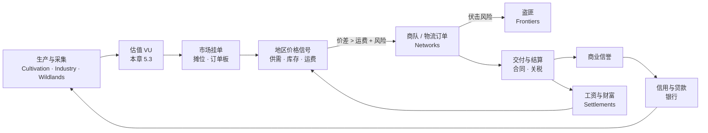

# 16 · 市集 Exchange（`tcexchange`）

> 本章是 `tcexchange` 的完整规格。市集模组把“交易”从原版的“村民无限收购”改造成有地区差异的经济：每个聚落与市场都有自己的供需、库存、资金与价格；订单与合同要求货物真的被运到；商队在地图上行走，可能被劫；守约积累商业信誉。货币、银行、合同与价格模型归本模组所有，跨文明价值记账单位 `VU` 由本章定义（DA-11）。
>
> 冲突裁决顺序：`design-brief.md` 契约 → 00 章 DR/DA → 02 架构 → 31 界面规范 → 本章。本章不定义新的 NPC 实体，商人、行商、银行家都是核心实体 `tcivilization:person` 加上本模组的 `MerchantComponent`（02 §2.4、03 §4）。

| 项 | 内容 |
| --- | --- |
| 章节编号 | 16 |
| 模组 ID | `tcexchange`，根包 `com.nightcity.exchange`（现有入口类 `TExchange`、`TExchangeEvents`） |
| 必需依赖 | `tcivilization`（02 §1.3）；`tctechnology`、`tcskills` 为可选 |
| 拥有的领域 | 记账单位 `VU` 与估值表、各文明货币与汇率、地区价格模型（供需、库存、弹性、运费、季节、特产、信誉）、市场点与市场区域、订单与合同、商队的贸易任务层、商业信誉、银行与信用、行会、股份公司与交易所、保险、工资结算、NPC 交易与流动行商 |
| 不拥有的领域 | 运输工具、路线、站点与物流执行（Networks，14 章）；税率、关税、市场法规与专利的立法（Commons，19 章；本章只提供执行钩子）；外交条约与 AI 决策（Nations，23 章）；盗匪与劫掠结算（Frontiers，20 章）；聚落需求计算（Settlements，15 章）；地图价值计算（Atlas，22 章）；资源储量（Wildlands，10 章） |
| 科技配额 | 18（实际 19，在 ±3 内），含关键科技 `tctechnology:iron/coinage`、`tctechnology:medieval/guilds`、`tctechnology:renaissance/banking` |
| 性能预算 | 平均 0.3 ms/tick，峰值 1.5 ms/tick（02 §8） |
| 文明面板页签 | `tcexchange:market`（经济组，排序 550；页内子导航：行情、订单、合同、商队、银行、信誉、汇率），不注册第二个页签 |
| HUD 控件 | `tcexchange:market_ticker`（扩展，右中，位于市集或贸易站范围内） |

---

## 1. 定位与设计支柱

### 1.1 一句话定位

**“每座城市都有自己的价格。”** 市集让同一袋盐在海边只值 2 VU、在山城值 9 VU，让玩家的磨坊面粉要靠商队运到缺粮的港口才卖得上价，让邻国的廉价铁锭真的能冲垮你的铁匠铺。交易不再是“对着一个 NPC 无限卖出”，而是“找到需要它的地方，把它运过去，守约交付”。

### 1.2 设计支柱

| 编号 | 支柱 | 落地规则 |
| --- | --- | --- |
| EX-1 | **没有无限收购** | 每个市场对每类商品有需求曲线、库存、资金池与日吸收上限（5.8）；卖得越多价格越低，资金池耗尽后只能赊账、以货易货或被拒收。00 章反目标“无限收购的统一商店”在本模组中不存在任何例外 |
| EX-2 | **价格是地方的** | 价格由地区供需、库存、弹性、运输成本、季节、特产、信誉与政策共同决定（5.7）；两地价差被运费与风险约束，套利空间随路网改善而收窄 |
| EX-3 | **货物要真的运到** | 合同交付以货物实际抵达为准（5.10）：通过 Networks 物流订单、本模组商队或玩家亲自送达；没有“远程卖出”按钮（DR-20） |
| EX-4 | **货币随文明演化** | 赠礼 → 物物交换 → 商品货币 → 铸币 → 汇票与行会 → 银行与纸币 → 中央银行与股票交易所 → 电汇 → 国际货币体系 → 电子支付 → 多星球结算（DR-23，5.2） |
| EX-5 | **VU 是透明的尺子** | 所有跨文明、跨模组的价值以 `VU` 记账（DA-11）；界面同时显示本地货币与 VU 换算；VU 本身不是可持有、可铸造的货币 |
| EX-6 | **信誉是资本** | 准时交付、公平报价、偿还贷款积累信誉（5.12）；信誉决定价差、合同上限、贷款利率、行会准入与 AI 文明态度 |
| EX-7 | **混合管理** | 玩家可以亲自摆摊议价、亲自押送商队；也可以只设定挂单规则与商队航线，让商人 NPC 自动执行（DR-21）。玩家的显式指令永远优先于自动规则 |
| EX-8 | **缺模组不残缺** | 单独安装时用内置“外部市场”与简化商队维持完整循环（第 2 节）；联动时用聚落、路网、AI 文明的真实数据替换回退来源 |

### 1.3 与决策记录的对应

| 决策 | 本章体现 |
| --- | --- |
| DR-17 无原版村庄 | 村民交易随 Settlements 转换消失（VO-VL-05），由 `MerchantComponent` 与对话交易接替（5.19） |
| DR-19 不增加生存负担 | 玩家个人永远不需要货币才能存活；不施加“破产惩罚” |
| DR-20 可见过程 | 商队实体行走、摊位可见货物堆、价格可在地图图层上看到 |
| DR-21 混合管理 | 订单板与商队规划支持规则化自动执行；指令轮盘可逐个指挥商人 |
| DR-22 AI 文明贸易 | AI 文明有自己的市场、货币、商队与贸易意愿（5.21） |
| DR-23 货币演化 | 每个文明自有货币与汇率；形态按时代切换（5.2、5.5） |
| DR-28 HUD 极简 | 只注册一个情境控件 `market_ticker` |
| DA-04 核心人物实体 | 商人、行商、银行家都是 `tcivilization:person` + `MerchantComponent` |
| DA-11 VU | 本章定义 VU 锚定、估值算法与原版回退表（5.3） |

### 1.4 职责边界

| 领域 | 本模组负责 | 其他模组负责 |
| --- | --- | --- |
| 运输 | 商队贸易任务（买卖什么、价格上限、护卫预算）；运费计入价格 | 车辆、路线、站点、装卸、运输时间（Networks） |
| 税与关税 | 成交时扣税、汇入国库、执行禁运 | 税率、关税、违禁品与市场法规的立法（Commons）；条约减免（Nations） |
| 劫掠 | 被劫货物 VU 核算、保险赔付、悬赏金支付 | 盗匪、伏击判定、战斗、赃物去向（Frontiers） |
| 需求 | 把需求转成需求曲线、价格与订单 | 居民需求与满足度（Settlements）；AI 文明产出（Nations） |
| 估值 | VU 估值表、回退表、地区价格 | 地图信息价值（Atlas `mapValue`）、书籍知识（Discovery） |
| 工资 | 以货币结算工资 | 岗位、班次与产出（Settlements、Industry） |

---

## 2. 独立玩法（只安装 `tcivilization` + `tcexchange`）

只安装核心与本模组时，玩家仍然可以完成“交换 → 积累商品货币 → 铸币 → 市场挂单 → 组织商队远行贸易 → 积累信誉 → 开银行贷款扩张”的完整循环。缺少的真实来源（聚落需求、路网、AI 文明）由本节的回退来源替代。

### 2.1 起步（E0-E1，对应 01 §8 前 10 小时脚本）

1. **E0 赠礼账。** 把物品交给任意 `person` 会记入核心人情账（`MemoryApi.record`，类型 `tcexchange:gift`）；对方日后回赠价值相近的物品（赠礼 VU × 0.8-1.1）。这是第一个可见循环，不需要科技。
2. **第一次物物交换（01 §8 的 9:30 节点）。** 第 8:30 前后玩家看见另一个部族的炊烟（有 Nations 时为 AI 部族，否则为来自最近外部市场的 3 人行商队，2.2）。与对方首领或行商对话选择“交换”（动作 `tcexchange:open_trade`），用陶罐换对方的燧石与盐。
   - 未解锁 `neolithic/barter` 时，一次交换只能各出 1 种物品（“一换一”），对方按自身需求估值，接受区间为 ±25%。
   - 完成后：编年史记录“第一次物物交换”；`neolithic/barter` 获得知识（`KnowledgeSourceType.PRACTICE`，+12）；`trade` +10、`diplomacy` +5（附录 D）；对方信誉记录 +2。
3. **解锁 `neolithic/barter` 后**：可放置 `barter_mat`（交换席），行商每 6-10 MC 日来访；允许多种物品成篮交换；可设置“常设交换”（例如“3 燧石换 1 熏肉”）由族人与行商自动执行。

### 2.2 外部市场（只在 Nations 缺失时生成）

世界首次加载时生成 6 个抽象外部市场 `ExternalMarket`（可配置 0-12），不放置方块，只存在于 `SavedData`，虚拟坐标位于出生点 2,000-6,000 格半径圆周上。每个外部市场有一个地理画像：

| 画像 | 盈余类别（出口） | 缺口类别（进口） | 特产示例 |
| --- | --- | --- | --- |
| 海岸 `coastal` | 粮食（鱼）、奢侈品（盐、珍珠） | 木材、金属 | 盐、鱼干 |
| 山地 `highland` | 石料、金属 | 粮食、纺织 | 燧石、铜矿石、羊毛 |
| 草原 `steppe` | 纺织（羊毛、皮）、粮食（畜产） | 制成品、木材 | 皮革、马 |
| 森林 `forest` | 木材、燃料 | 石料、金属 | 蜂蜜、毛皮、木炭 |
| 河谷 `river_valley` | 粮食、纺织（亚麻） | 金属、燃料 | 小麦、亚麻布 |
| 荒漠 `arid` | 奢侈品（染料、香料） | 粮食、木材 | 染料、玻璃砂 |

- 外部市场的时代 = 玩家文明当前时代 −1（最低 E1），按 5.7 的同一价格模型运行，只是“需求”来自画像表而不是聚落。
- 外部市场每 6-10 MC 日派出一支行商队（2.1），到达玩家任一 `barter_mat`/`market_stall` 附近 64 格处实体化；玩家也可以组织商队前往外部市场（2.3）。
- 安装 Nations 后不再生成新的外部市场；已有外部市场在存档中转为“遥远异邦”只读记录，其商队在 3 季内逐步停发，玩家与它们未完成的合同照常结算。

### 2.3 中期（E2-E4，独立）

1. **商品货币（E2）。** `bronze/commodity_money` 解锁 `cowrie_shell`（贝）与 `market_stall`（市场摊位）：48 格内的摊位共享一个市场账本。`bronze/weights_and_measures` 解锁 `merchant_scale`（商秤）与按重量计价的 `hacksilver`（碎银）。
2. **铸币（E3，关键科技 `iron/coinage`）。** `mint`（铸币台）把金属锭铸成文明货币；首次铸币时命名并选择符号，之后界面按 31 §8.4 格式显示（`34 贝`、`¥ 1,240 (≈860 VU)`）。
3. **订单与商队（E3）。** `iron/marketplace` 解锁 `order_board`（订单板），行商与外部市场商队按价格响应挂单。`bronze/caravan_trade` 解锁商队：无 Networks 时由 1 名商人 + 1-3 名护卫 + 原版驮兽（骡、羊驼）组成，L0 内实体化行走，离开 L0 后按 5.11.4 抽象旅行。
4. **行会与汇票（E4）。** `medieval/guilds` 允许建立行会（5.14，摊位费减免与合同担保）；`medieval/bills_of_exchange` 解锁 `bill_of_exchange`（汇票），远行不必押运现金。

### 2.4 后期（E5+，独立）

- 银行（`renaissance/banking`）：`bank_counter` 吸收存款、发放贷款、发行 `banknote`（纸币）；贷款利率按 5.13 由信誉与国库储备决定。
- 股份公司（`renaissance/joint_stock_company`）：玩家可特许设立贸易公司，发行 `share_certificate`，由公司 NPC 自动跑远程航线；独立模式下远程航线终点是外部市场。
- 交易所（`industrial/stock_exchange`）：`exchange_board` 汇总所有市场点的行情，允许跨市场下单（货物仍需运输，5.15）。
- 电汇与电子支付：支付不再需要随身携带现金；`payment_terminal` 让任何商店方块直接刷卡结算。
- 没有 Nations、Orbit 时，E8-E10 的国际货币与多星球结算退化为“与外部市场的汇率”“与玩家其他天体殖民地的内部结算”，不提供额外内容。

### 2.5 回退数据源

| 数据 | 联动来源 | 独立回退 |
| --- | --- | --- |
| 市场点与聚落 | 核心 `SettlementRegistry` + Settlements 的人口、繁荣度 | 核心 `SettlementRegistry`（只有人口数）；无聚落时以 `barter_mat`/`market_stall` 位置为市场点 |
| 居民消费需求 | Settlements `SettlementNeedsUpdatedEvent` | 人口 × 时代消费篮（6.5） |
| 运输时间与运费 | Networks `estimateFreight` | 直线距离 × 地形系数 × 时代速度（5.7.4） |
| 资源丰度与比较优势 | Wildlands `GeoApi.depositSummary` | 生物群系标签表（`#c:is_mountain` → 金属、石料 +；`#c:is_ocean` 邻接 → 盐、鱼 +） |
| 特产 | Cultivation `origin_region` 与品质组件 | 生物群系标签表；无品质溢价 |
| 野生物产丰度 | Ecology `PopulationStatusChangedEvent` | 常数 1.0 |
| 工业品基准价 | Industry 的配方图与 `tcindustry:quality` | 原版配方图 + 回退估值表（5.3） |
| 其他文明 | Nations 的 AI 文明（货币、汇率、市场） | 外部市场（2.2） |
| 税、关税、市场规则 | Commons 的法律与政策 | 固定市场费 2%，无关税 |
| 盗匪 | Frontiers 的伏击与悬赏 | 抽象“路途损耗”：每 1,000 格 0.5% 的货物丢失概率（可配置为 0） |
| 地图交易 | Atlas `mapValue` | 原版已填充地图按回退表 5 VU |
| 技能加成 | Skills `ProficiencyBridge.multiplier` | 1.0 |
| 科技门槛 | Technology | 所有内容按时代默认可用（无科技模式，04 §5.8） |

---

## 3. 联动玩法

联动后的总体效果：**不同城市形成不同的经济结构**——矿城出口金属、进口粮食；河谷城出口粮布；港口靠转口与保险致富；内陆小镇运费高，只能消费本地产品。没有任何城市“无限收购”。

### 3.1 tcivilization（核心，必需）

- 注册人物组件 `MerchantComponent`、区域层 `tcexchange:market`（02 §5）、对话动作 `tcexchange:open_trade`、人物检视分节 `tcexchange:trade`“交易”（order 200，31 §5.9；货物、报价与对玩家的信誉）。
- 编年史条目（`MemoryApi.record`）：第一次物物交换、第一枚本文明铸币（播放 `Ceremonies.play`）、第一次合同违约、第一家银行、第一次股市崩盘、第一个海外贸易站。
- 通知分类 `tcexchange:market`（31 §7.6）与 `AlertProvider` 警报：商队遇袭、合同即将逾期、贷款违约、资金池枯竭。
- 修改型操作经 `CivPermissions.check(player, action, scope)`，返回 `tcivilization:action_result`；订单、合同、商队计划实现 `VersionedShared`（31 §16.3）。
- 向核心提供 `VuValuation` 实现；未安装本模组时核心使用回退估值表（5.3.4，Q-16-01）。

### 3.2 tctechnology

- 定义 19 项科技（附录 B），其中三项关键科技 `iron/coinage`、`medieval/guilds`、`renaissance/banking` 的 ID 与 04 §5.8 的替身完全一致；本模组存在时替身不加载。
- 注册 `ContactProvider`：两季（24 MC 日）内双方之间有任何一笔已结算的贸易（订单、合同、商队成交），即构成扩散接触（04 §5.9，每个接触 −10%，下限 0.60）。
- 学术赞助（04 `renaissance/research_patronage`，前置包含本模组的 `renaissance/banking`）：赞助金额以 `ExchangeApi.toVu` 换算，`rp = 0.5 × VU × 0.9^n`。
- 注册里程碑判定器 `tcexchange:overseas_trading_post`（5.17），与 Networks 的 `tcnetworks:overseas_route` 共同构成 E5→E6 时代里程碑。
- 实践触发器：`tcexchange:first_barter`（`neolithic/barter`）、`tcexchange:coin_struck`（`iron/coinage`）、`tcexchange:contract_fulfilled`（`medieval/bills_of_exchange`、`medieval/trade_fairs`）、`tcexchange:loan_repaid`（`renaissance/banking`、`renaissance/double_entry_bookkeeping`）。
- Frontiers 缺失时，原版弩配方的后备门槛为 `medieval/guilds`（04 §5.13，弩 ← 行会制作）；本模组在该科技的“解锁”说明中列出这一点。

### 3.3 tcskills

- `trade` 是主技能：效果 `tcskills:price/trade`（卖出价 ×m、买入价 ÷m，上限 ±15%，05 §5.6）与 `tcskills:capacity/caravan`（商队货位）。本模组在一次报价中只调用一次 `ProficiencyBridge.multiplier(player, "trade", "price/trade")`。
- `diplomacy`：与 AI 文明商人议价时的谈判速度与接受区间；`logistics`：玩家亲自押送的商队载货量（`capacity/cargo`）；`leadership`：商队护卫士气（`influence/morale`），影响 Frontiers 伏击中的 `guard` 有效值。
- 05 §5.12 的原版回退挂钩“村民/流浪商人交易 → `trade`、`diplomacy`”在本模组加载时停用，由附录 D 的挂钩代替。

### 3.4 tcwildlands

- **比较优势。** `GeoApi.depositSummary(regionKey, Optional.empty())`（全知查询，只用于内部定价，不泄露未勘探储量）决定金属、石料类的供给潜力 `S_geo`（5.7.2）。`DepositDiscoveredEvent` 使附近 2 个区域该矿产的远期价格在 3 MC 日内下调 5-15%。
- **灾害。** `DisasterWarnedEvent` → 粮食与燃料 +5-10% 投机溢价；`DisasterStartedEvent(hazard, footprint)` → 覆盖区域的市场库存按面积占比损毁，投保者按 5.18 理赔；`DisasterEndedEvent` → 结算赈灾支出（Commons 决定是否动用国库）。
- **季节与干旱。** `LocalSeasonProvider`、`SeasonChangedEvent` 与 `HazardApi.droughtIndex(pos)` 进入季节系数（5.7.5）。
- **宝石。** `raw_emerald`（E4）合成的 `minecraft:emerald` 是普通宝石，基准价 10 VU（5.19.3）。

### 3.5 tcecology

- 毛皮、象牙（E2-E6）、鲸脂（E5-E6）、木材的价格乘以丰度系数（`PopulationStatusChangedEvent`）：`ABUNDANT` ×0.85、`STABLE` ×1.0、`DECLINING` ×1.25、`ENDANGERED` ×1.8。稀缺 → 涨价 → 更强捕猎激励，这是 11 章设计的“公地悲剧”反馈，本模组不额外抑制。
- 保护政策把对应商品标记为禁售：市场拒绝挂单，`CargoInspectEvent` 查扣（有 Networks 时）；禁售品只能经走私者出手（5.16.4）。

### 3.6 tccultivation

- **特产。** 作物、畜产与加工食品携带 `origin_region` 与品质数据组件；离开原产区域 ≥ 2 个区域的市场对其支付特产溢价（5.7.6）；带 `quality` 性状的品种品质每高一档溢价 +8%。
- **粮食供给。** 聚落的粮食储量（经 Settlements 的 `FoodStorageProvider`）与 Cultivation 的收获量共同决定粮食类本地供给；歉收季粮价上涨，丰收季下跌。
- **价格信号反馈给农民。** 农田页签经 `ExchangeApi.price` 显示本地市价；Exchange 缺失时不显示价格，特产只作收藏与外交礼物（12 §3）。

### 3.7 tcindustry

- **基准价与价格信号。** 工业品基准价由配方图计算（5.3.2），可用 `tc_value` 数据包（`data/<ns>/tc_value/*.json`，5.3）覆写；生产页签经 `ExchangeApi.priceTrend` 显示“锡价上涨 18%，青铜成本 +12%”。
- **销售订单与工资。** 工厂产出可自动挂卖（5.9.3）；岗位工资以文明货币结算（5.16.5），Exchange 缺失时 Industry 不计工资、隐藏成本列（13 §3.9）。
- **品质。** `tcindustry:quality`：Q0 ×0.6、Q1 ×0.85、Q2 ×1.0、Q3 ×1.6、Q4 ×2.5；Q4 署名物品另加署名者信誉溢价（每 10 点 +2%，上限 +20%）。
- **其他。** `IndustryAccidentEvent` 触发理赔（5.18）；`tcindustry:plc_program` 按复杂度估值出售；瓷器（E5）是奢侈品类的高价出口品。

### 3.8 tcnetworks

- **实体化车队。** 有 Networks 时商队由其真实车辆与船舶执行（DR-20）：本模组生成 `LogisticsOrderRequest`（`linkedContract` = 合同 ID），Networks 负责装卸、寻路与运输；否则按 2.3 驱动简化商队。
- **运费约束价差。** `NetworksApi.estimateFreight(level, from, to, massT, slotUnits, modes)` 返回的 `FreightEstimate(ticks, fuelUnits, crewHours, risk, modesUsed, reachable)` 换算为 VU 运费（5.7.4）。车票与运费付给线路所有者；物流页签的“利润”列由本模组提供（14 §3.6）。
- **站点即仓储。** `freight_depot`（E2）、`warehouse_core`（E4）、`freight_station`（E6）、`asrs_rack`（E9）位于市场半径内时计入市场库存（5.6）。
- **事件。** `ShipmentDispatchedEvent` → 合同“在途”；`ShipmentDeliveredEvent` → 交付结算；`TollPointEvent`（可取消）→ 关税与过路费，禁运时取消；`CargoInspectEvent`（可取消）→ 查扣违禁品与禁售品。
- **信息延迟与里程碑。** 远方行情按信息延迟显示（5.7.9）；海外贸易站（5.17）由本模组判定贸易站部分、Networks 判定定期航线。

### 3.9 tcsettlements

- **职业与岗位。** 本模组的工作地通过 `WorkplaceProvider` 登记：E2 `merchant`（商人，岗位 `market_stall`）、E4 `guild_master`（行会师傅，岗位 `guild_hall`）、E5 `banker`（银行家，岗位 `bank_counter`）（15 §5.7）；E3 的税吏属于 Commons。
- **市集文化。** `CultureProvider`：市场区域内 ≥ 4 个营业摊位时提供 8 文化点；货物品类数计入“食物多样性”；规划分区“市场”是市场区域候选（5.6.2）。
- **需求。** `SettlementNeedsUpdatedEvent` 每 MC 日携带需求快照，本模组把它转成居民消费需求曲线（5.7.1）。
- **工资与财富。** 工资计入繁荣度财富项 `wealth = min(1, 人均日产出 VU / WEALTH_TARGET)`，人均日产出由本模组提供。
- **移民与疫情。** 移民期望收入来自本模组工资水平；疫情（`SettlementEpidemicStartedEvent`）使来访商队 −50%、需求 −20%；外来商队计入外来感染源。

### 3.10 tcdiscovery

- **不出售科技。** 只交易知识载体（书籍、期刊、标本、仪器、地图、专利许可），定价见 5.20；知识价值由 Discovery 计算。
- **贸易接触。** 每条 10 MC 日内有成交的贸易路线计 1 项对方前沿科技的接触传播（17 §5.9），数据来自 `ExchangeApi.tradePartners(civ, days)`。
- **期刊与专利。** `industrial/scientific_journals` 后每季可用长期合同订阅 1 份外国期刊；专利法由 Commons 定义，本模组执行版税流（5.10.6）。

### 3.11 tcechoes

- **古物。** 古物与遗物属奢侈品类，按年代、品相与出处定价（5.20）；需求来自博物馆与城级以上聚落的收藏，量小、弹性低、易饱和。
- **盗掘。** 受 Commons 保护的遗址出土物带 `tcexchange:unprovenanced` 标记，在合法市场 ×0.3 且可被查扣。

### 3.12 tccommons

- **税与关税。** Commons 实现 `TaxPolicyProvider`：交易税、关税（按对方文明与商品类别）、过路费、港口费；本模组在成交与过关时扣款，税款进入文明国库账户（5.16）。Commons 缺失时只收固定市场费 2%。
- **市场规则。** 价格上下限（5.7.8）、违禁品清单、行会特许、专利法、银行准备金率、反垄断。
- **国库。** 国库是本模组的账户，用途由 Commons 决定。

### 3.13 tcfrontiers

- **悬赏。** 悬赏金 `50 VU × 1.03^notoriety`（20 §5.6）以悬赏板所属文明货币支付；`FrontiersBountyClaimedEvent(bounty, claimer, rewardVu)` → 从该文明国库支付。Exchange 缺失时 Frontiers 用 `1 emerald ≈ 10 VU`。
- **劫掠。** 伏击判定（`p_ambush = 0.02 × (D/50)² × (1 − escort)`）与战斗由 Frontiers 负责；本模组提供货物 VU 价值，处理 `FrontiersRaidResolvedEvent` 的理赔与信誉（不可抗力不扣信誉）。
- **贫困与过路财富。** `ExchangeApi.poverty(regionKey)`（5.16.6）与 `transitValue(regionKey, days)`（每 1,000 VU 使盗匪招募池 +0.3，20 §5.6）；无配方数据时按 5.3.4 估值。
- **军火、赎金、贡赋。** 武器弹药属制成品类，按配方图估值；战时军需使其需求 ×1.5（5.7.1），交战方之间自动禁运（5.16.3）。赎金与贡赋（赃物 × 0.5）以 VU 记账、以货币支付；`highwaymen` 的过路费是 `TollPointEvent` 的一种来源。
- **走私者与失落商队。** E6+ 关税 ≥ 40% 或禁运时 Frontiers 生成 `smugglers`/`smuggler_baron`，黑市价 ×1.3-1.8、不计税（5.16.4）；`lost_caravan`（D ≥ 30）护送成功使对应商人与行会信誉 +8。

### 3.14 tcbeyond

- 异界物产（异质碎片、精炼晶体、灰烬之境的原版下界物产）带“异质”标签，价格 `×(1 + 0.4 × 异质强度)`，只有 E6+ 城级以上市场接受（21 §3）。
- `tcbeyond:inert`（惰性化）遗物按古物价格出售（3.11）。

### 3.15 tcatlas

- **地图是商品。** `AtlasApi.mapValue(ItemStack, KnowledgeHolder buyer)` 返回价值点 V（只计买方未知的区块；同一张图卖第二次为 0）；本模组按 `P = V × map_vu_per_point(era)` 报价（6.6）。Atlas 的 [地图交易] 子页签使用本模组的交易后端，AI 商人可以买卖地图。
- **图层与要素。** 本模组注册 `MapLayerProvider`：价格面（源区域层 `tcexchange:market`，`RdBu` 配色，可选商品）；注册 `MapFeatureProvider`：商路（玩家与 AI 商队近 2 季的路径）、商队当前位置、贸易站与银行。商路变化时调用 `invalidateFeatures`。

### 3.16 tcnations

- **AI 货币与汇率。** AI 文明首次接触时获得按文化词库命名的货币，汇率按 5.5 浮动（DR-23）。
- **贸易协定。** `trade_agreement`：双方关税 −50%，AI 市场接受玩家挂单；`NationsTreatySignedEvent` 更新关税表；Exchange 缺失时 Nations 改为互赠物资包。
- **战争与禁运。** `NationsWarDeclaredEvent` → 交战双方自动禁运；`merchant_princes` 议程的 AI 对玩家禁运或加征关税反应强烈。
- **贡金、赔款、赎金。** 1 份贡金 = 败方日产出的 10%，每 12 MC 日支付一次，持续 48 MC 日；以 VU 记账、以支付方货币支付，按当日汇率换算。
- **主权信用。** `NationsApi.relation(a, b).trust`（0-100，初始 50）是本模组给该文明贷款时的主权信用输入（5.13.3）。
- **AI 经济。** `NationState.stock`（8 类，VU/日）映射到商品类别（5.4），盈余或缺口 > 20% 产生进出口意愿；AI 商队按 5.21 实体化。
- **估值。** 礼物、贡金、驿使费用（`courier_cost_vu` 20）都用 `ExchangeApi.valueOf`；Nations 对关税条款的估值加成 +5-15%。

### 3.17 tcorbit

- **服务定价。** 发射服务、卫星租用（通信、导航、遥感）按成本加成定价，以合同长期结算。
- **太空资源。** 氦-3 与铂族金属（PGM）在地球市场为奢侈品/燃料类，首批到货时价格冲击按 5.7 传导。
- **多星球结算。** E10 `space/interplanetary_settlement`：各天体独立市场与价格，跨天体支付有光行时延迟，每 MC 日以结算批次清算（5.2）。

### 3.18 联动汇总

各模组缺失时的回退来源见 2.5；双向登记见附录 C。

---

## 4. 核心玩法循环



### 4.1 三个时间尺度

| 尺度 | 玩家活动 | 系统结算 |
| --- | --- | --- |
| 分钟（L0） | 在摊位上买卖、议价；把货物装上商队；亲自押送；在订单板挂单 | 即时成交：沿需求曲线积分定价（5.8.1），扣税，更新信誉 |
| MC 日（L2/L3） | 查看行情页签、调整挂单规则、规划商队路线 | 价格日结算（5.7）、订单撮合（5.9）、合同到期检查、商队抽象推进、利息计提 |
| 季与年 | 续签长期合同、选举行会会长、调整利率、扩张贸易站 | 信誉衰减、汇率重估、资金池补充、贸易接触刷新、里程碑判定 |

### 4.2 一个 E3 的典型日

1. 清晨，订单板显示盐本地价 7.4 铢（≈ 6.1 VU），1,400 格外的渔港只要 2.1 铢；行情页签提示“运费估计 1.3 铢/袋”。
2. 玩家在商队规划中建立“盐线”：商人莉娜 + 2 名护卫 + 3 头驮骡，每 4 MC 日往返，买入上限 3.0、卖出下限 6.0。
3. 商队出发；HUD `market_ticker` 离开市场范围后隐藏，追踪器显示商队位置（`TrackerApi.pin`）。
4. 午后，商队在山口遭遇伏击（Frontiers），护卫击退盗匪，损失 1 袋盐（未投保）。
5. 傍晚回城卸货：32 袋盐沿需求曲线逐袋定价，从 7.2 铢降到 5.9 铢；资金池 3 日内恢复（5.8）。玩家 `trade` +4。
6. 次日结算：本地盐价降到 6.3，港口升到 2.6——价差收窄，利润自然下降，玩家寻找下一个机会。

---

## 5. 系统规则与公式

### 5.1 时间尺度与模拟层级

| 层级 | 频率 | 内容 | 线程 |
| --- | --- | --- | --- |
| 即时（L0） | 事件驱动 | 摊位成交、议价、装卸、合同交付确认、税款扣除 | 主线程 |
| L1 | 每 20 tick | 简化商队（无 Networks 时）的路点推进；`market_ticker` 数据刷新（只对订阅者） | 主线程 |
| L2 | 每 1,000 tick | 已加载市场的显示价格向目标价格平滑一步（5.7.10）；仓储容器脏标记汇总 | 主线程（只读脏标记） |
| L3 | 每 24,000 tick（每 MC 日） | 全部市场的价格日结算、订单撮合、合同到期检查、利息计提、资金池补充、AI 与外部市场的抽象贸易 | TC-Sim 线程读快照，产出 `SimCommand` 回主线程应用 |
| 季 | 每 12 MC 日 | 信誉衰减、汇率重估、行会选举、扩散接触刷新、海外贸易站计时 | TC-Sim |

- 日结算分摊到 20 tick，每 tick 处理 1/20 的市场。未加载市场最多补算 3 MC 日（02 §7）；更长空缺直接把显示价移到目标价与旧价的中点，并标注“久未更新”。
- 世界读写只在主线程；TC-Sim 线程只读 `MarketSnapshot`。

### 5.2 时代演进与货币形态

| 时代 | 科技 | 货币形态 | 交易方式 | 新增内容 | 基础半价差 `s_era` |
| --- | --- | --- | --- | --- | --- |
| E0 | — | 赠礼（人情账） | 赠礼与回赠 | 赠礼记忆 | — |
| E1 | `neolithic/barter` | 物物交换 | 交换席、成篮交换、常设交换 | `barter_mat` | 25% |
| E2 | `bronze/commodity_money`、`bronze/weights_and_measures`、`bronze/caravan_trade` | 商品货币（贝、盐饼）与称量银 | 摊位、商秤、驮队 | `cowrie_shell`、`salt_cake`、`hacksilver`、`market_stall`、`merchant_scale` | 18% |
| E3 | `iron/coinage`（关键）、`iron/marketplace` | 铸币（铜、银、金） | 铸币台、订单板、商队 | `mint`、`coin_die`、`bronze_coin`、`silver_coin`、`gold_coin`、`coin_purse`、`order_board`、`contract_scroll` | 12% |
| E4 | `medieval/guilds`（关键）、`medieval/bills_of_exchange`、`medieval/trade_fairs` | 铸币 + 汇票 | 行会、集市、账房 | `guild_hall`、`guild_charter`、`counting_house`、`bill_of_exchange`、`fair_banner` | 9% |
| E5 | `renaissance/banking`（关键）、`renaissance/double_entry_bookkeeping`、`renaissance/joint_stock_company`、`renaissance/marine_insurance` | 纸币、存款、股份 | 银行、贸易站、保险 | `bank_counter`、`bank_vault`、`banknote`、`ledger`、`share_certificate`、`insurance_policy`、`trading_post` | 7% |
| E6 | `industrial/stock_exchange`、`industrial/central_banking` | 央行纸币、债券、股票 | 交易所、中央银行 | `exchange_board`、`bond`、`stock_ticker` | 5% |
| E7 | `electric/wire_transfer` | 电汇、支票 | 电报汇款 | `cheque_book`、`wire_counter` | 4% |
| E8 | `atomic/international_monetary_system` | 储备货币与汇率体系 | 外汇市场、信用卡 | `payment_card`、`forex_board` | 3% |
| E9 | `information/electronic_payment` | 电子支付 | 支付终端、即时清算 | `payment_terminal` | 2% |
| E10 | `space/interplanetary_settlement` | 多星球结算 | 跨天体结算批次 | `clearing_house` | 2% |

旧货币物品永远可用，按当日汇率兑换为新形态；新形态只是降低交易成本（价差、重量、远程支付）。

**E0 赠礼账规则。** 赠礼记入接收者记忆（`tcexchange:gift`，价值 G VU），接收者 2-6 MC 日内以 0.8-1.1 G 回赠，未回赠的人情 50% 转为信誉（5.12）；同一对象 12 MC 日内超过 `2 × WEALTH_TARGET(era) × 6` 的赠礼不产生回赠义务。

### 5.3 VU 与价值表

#### 5.3.1 锚定

```text
1 VU ≡ 基准条件下 1 FU 主粮在长期均衡时的价格
基准条件：时代无关；温带、正常季节、无灾害、本地自给率 100%、无税
```

- FU 是 15 章的食物单位（成年人日食 1 FU；独立模式 FU = 饱食度 / 4），所以成年人一天口粮恒约 1 VU，与 15 章 `WEALTH_TARGET`（E0 = 1 VU/人/日）直接对应。
- VU 不随时代通胀：粮食长期约 1 VU，工业品的 VU 价格随生产率提高而下降（5.3.3）。

#### 5.3.2 基准价：配方图计算

数据包加载完成后（`TagsUpdatedEvent`），在工作线程上构建一次全物品基准价表 `B(item)`：

```text
原料：B_raw(item) = H_gather(item) × LV(era_item) × K_scarcity(item)
加工：B(item) = min_r [ ( Σ_i n_i · B(in_i) + H_r · LV(era_r) + E_r ) / out_r ] × (1 + μ)

H_gather   = 采集 1 个所需标准工时（按工具档位与掉落率；Wildlands/Ecology/Cultivation 用数据文件给出）
LV(era)    = 标准劳动价值（VU/工时）= WEALTH_TARGET(era) / 4
             E0 0.25 | E1 0.5 | E2 1.0 | E3 1.75 | E4 2.5 | E5 3.75 | E6 6.25 | E7 10 | E8 15 | E9 22.5 | E10 32.5
H_r        = 配方工时（工作台时间、机器周期按 1 工人折算；自动化机器按维护工时）
E_r        = 能耗（燃料 VU；电力按 6.1 的电价）
μ          = 0.10（制造毛利）
K_scarcity = 1.0；宝石、贵金属、稀有物种取数据文件值（2-20）
食物：B_food(item) = FU(item) × 1.0 × (1 + 0.1 × 加工级数)，主粮加工级数 0
```

- 迭代求不动点，最多 32 轮；循环配方（例如方块 ↔ 锭）取已知最小值并记 `VALUE_CYCLE` 调试日志。
- 每个模组可以用 `data/<ns>/tc_value/*.json` 覆写或补充：`{"item": "...", "vu": 12.0}` 或 `{"tag": "...", "vu": 3.0}`，优先级：覆写 > 配方图 > 回退表。
- 带数据组件的物品在基准价之上乘以组件系数：`tcindustry:quality`（3.7）、Cultivation 品质（3.6）、耐久剩余比例 `max(0.2, d)`、附魔（每级 +8% 基准，原版附魔书按 5.3.4）。

#### 5.3.3 技术折旧

```text
制成品与机器：B_eff = B × max(0.40, 0.90^(era_civ − era_item))
原料、食物、奢侈品、古物：不折旧
```

`era_item` 取解锁该物品的科技时代（无科技门槛时取 6.4 的时代映射）。这让 E3 的铁剑在 E7 只值原价的 48%，而一袋盐始终是一袋盐。

#### 5.3.4 原版回退估值表

物品既无覆写、也无法由配方图求值（例如战利品专属物品），或本模组缺失而他模组需要估值时，使用**全家族共用**的回退表，由核心承载为 `data/tcivilization/tc_value/fallback_vanilla.json` 与 `VuFallback.estimate(ItemStack)`（03 §12.5 `api.value`）。本模组在 `FMLCommonSetupEvent` 中以 `VuValuation.install` 安装完整估值器（覆写 > 配方图 > 回退表）；他模组一律调用 `VuValuation.valueOf`。

| 类别 | 物品与 VU（省略 `minecraft:` 前缀） |
| --- | --- |
| 稀有度回退 | 未列出物品：`COMMON` 1、`UNCOMMON` 5、`RARE` 20、`EPIC` 50 |
| 粮食 | `wheat` 0.4；`bread` 1.25；`cooked_beef`、`cooked_porkchop` 2.0 |
| 材料 | `#minecraft:logs` 0.5；`#minecraft:planks` 0.15；`cobblestone` 0.05；`coal`、`charcoal` 1.0；`leather` 1.5；`#minecraft:wool` 0.8；`paper` 0.3 |
| 金属与宝石 | `copper_ingot` 1.5；`iron_ingot` 3；`gold_ingot` 8；`lapis_lazuli` 2；`emerald` 10；`diamond` 40；`netherite_ingot` 50 |
| 其他 | `book` 2；`filled_map` 5；`ender_pearl`、`blaze_rod` 15；`enchanted_book` 10 + 8 × 附魔总级数（上限 50） |

Frontiers 的“1 绿宝石 ≈ 10 VU”、Nations 的“原版物品按稀有度 1-50 VU”都是本表的子集，三章一致。

### 5.4 商品类别

商品类别与 23 章 `EconomyCategory` 的 8 类一一对应，使 AI 文明经济与玩家市场可以直接对接。物品通过标签 `#tcexchange:category/<k>` 归类，未归类物品按“制成品”处理。

| 类别 | 标签 | 子类示例 | 需求弹性 ε | 每日损耗 | 默认目标库存（日消费量的倍数） |
| --- | --- | --- | --- | --- | --- |
| 粮食 `FOOD` | `category/food` | 主粮（`class/staple`）、肉鱼、蔬果、加工食品、调味 | 主粮 0.3；其余 0.8 | 主粮 0.2%，生鲜 3-8% | 20 |
| 木材 `TIMBER` | `category/timber` | 原木、木板、竹、树皮 | 0.7 | 0 | 15 |
| 石料 `STONE` | `category/stone` | 石材、砖瓦、灰浆、玻璃砂、黏土 | 0.6 | 0 | 15 |
| 金属 `METAL` | `category/metal` | 矿石、锭、合金、废金属 | 0.9 | 0 | 25 |
| 纺织 `TEXTILE` | `category/textile` | 纤维、羊毛、布、皮革、毛皮 | 0.9 | 0.1% | 20 |
| 燃料/能源 `FUEL` | `category/fuel` | 木炭、煤、油、燃料棒 | 0.4 | 0 | 15 |
| 制成品 `MANUFACTURED` | `category/manufactured` | 工具、武器、机器、零件、知识载体 | 1.2 | 0 | 10 |
| 奢侈品 `LUXURY` | `category/luxury` | 盐、香料、染料、宝石、瓷器、古物、异质品 | 1.6 | 0 | 8 |

- 盐在 E0-E4 归奢侈品（`class/salt`，弹性特例 0.5），E5 起归调味（粮食类）。同一子类内物品共享 30% 的需求（替代品效应，例如面包涨价把部分需求转向土豆）。

### 5.5 货币发行与汇率

#### 5.5.1 文明货币

- 每个文明最多一种法定货币 `CurrencyDef`；E1-E2 没有法定货币，使用跨文明通用、由市场定价的商品货币（贝、盐饼、碎银）。
- 玩家文明首次铸币时命名货币、选择符号与面值锚定（1 枚铜币 ≈ 0.5、1 或 2 VU，默认 1）；AI 文明在首次接触或 E3 时按文化词库自动生成。
- 铸币面值 = 金属含量价值 × (1 + 铸币税 s)，默认 s = 0.08，Commons 可立法 0-0.30。成色每贬损 10%，货币信心 −0.10 并记入编年史。

#### 5.5.2 货币供给

```text
M_c = 铸币累计 − 回炉累计 + 纸币发行 − 纸币回收 + 银行存款创造
银行存款创造 = Σ 贷款余额（受准备金率 r_res 约束：贷款 ≤ 存款 × (1 − r_res)）
```

本模组追踪铸币台、银行柜台、支付终端的发行与回收差额，不扫描玩家背包或箱子中的货币物品。

#### 5.5.3 汇率

```text
R_c = VU / 1 单位货币（每 MC 日更新）

R_qty   = (Y_c × K_era) / M_c
R_metal = 每单位货币的金属含量 VU（纸币与电子货币为 0）
R*      = max(R_metal, R_qty) × (0.8 + 0.4 × C_c)
R_c(t+1) = R_c(t) + 0.10 × (R* − R_c(t))

Y_c   = 文明日产出（VU/日；Settlements 人均产出 × 人口，或 Nations 的 8 类产出之和，或本模组统计的成交额 × 3）
K_era = 货币持有天数：E2 15 | E3 12 | E4 10 | E5 9 | E6 8 | E7 7 | E8 6 | E9 4 | E10 3
        时代跃迁后 24 MC 日（2 季）内由旧值线性过渡到新值，避免 R_c 阶跃
C_c   = 货币信心 ∈ [0, 1]，初始 0.5：
        + 0.1 × 国库储备率（储备 / M_c，上限 0.3）
        − 0.1 × 每 10% 成色贬损
        − 0.2 × 战争中（每场）
        − 0.3 × 最近 2 年内有主权违约
        + 0.002 × 文明商业信誉（0-100）
```

- 兑换 `a → b` 的价格 = `R_a / R_b × (1 − f_fx)`，`f_fx` = E4 3%、E5 2%、E6+ 1%，有贸易协定时减半。行情页签显示本季物价指数与 R_c 走势，R_c 一季下降 > 20% 时发出警报；时代跃迁后 1 季内不发此警报（`K_era` 过渡期，35 §10.5）。
- E8 `atomic/international_monetary_system`：玩家文明可提议储备货币协定（Nations 存在时经 `NationsApi.propose`），成员间兑换费 0.2%，以储备货币作为国际合同的默认计价货币。

### 5.6 市场点与市场区域

#### 5.6.1 市场点

市场点是有账本的交易场所，由“市场锚点”方块建立；同一聚落中相距 ≤ 256 格的锚点合并。

| 锚点方块 | 时代 | 半径 | 市场等级 | 可交易类别 | 备注 |
| --- | --- | --- | --- | --- | --- |
| `barter_mat` | E1 | 16 | 集 `FAIR` | 粮食、纺织、石料、奢侈品 | 行商来访点 |
| `market_stall`（≥ 2 个） | E2 | 48 | 市 `MARKET` | 8 类全部 | 摊位即货架 |
| `order_board` | E3 | 64 | 市 `MARKET` | 8 类全部 | 订单挂牌 |
| `guild_hall` | E4 | 64 | 大市 `GRAND_MARKET` | 8 类 + 行会商品 | 行会担保合同 |
| `trading_post` | E5 | 64 | 商站 `TRADING_POST` | 8 类全部 | 可位于无聚落之地（海外） |
| `exchange_board` | E6 | 128 | 交易所 `EXCHANGE` | 8 类 + 证券 | 全文明行情汇总 |

- **市场账本** `MarketLedger`：每个价格条目的库存、目标库存、目标价、显示价与资金池。
- **市场仓储**：半径内的摊位展示格、`counting_house`、`bank_vault`，以及被标记为市场仓储的 Networks 站点；其他箱子（包括玩家私人箱子）不被市场“看见”。
- **营业**：6:00-18:00（MC 时间）；`merchant` 在岗时玩家不在场也能成交；夜间只有订单板与 E9 支付终端可用。

#### 5.6.2 市场区域与价格面

- 价格属于市场点；区域层 `tcexchange:market` 为每个区域保存最近市场点及其各类别价格指数。无市场点的区域在地图价格面上显示为“最近市场价 + 运到此地的运费”插值。
- Settlements 规划分区“市场”内放置的锚点半径 +16。

### 5.7 地区价格模型

每个市场点 m 的每个价格条目 i 有两层价格：**参考价** `P_ref`（反映基本面，每 MC 日结算并平滑）与**即时报价** `q(I)`（随实时库存变化，成交即动）。

```text
P_ref(m,i) = B_i × G(m,i) × Sea(m,i) × Sp(m,i) × Ev(m,i) / R_c(m)              （以市场货币计）
q(m,i)     = P_ref × M_stock^(1/ε_i)
M_stock    = ( T(m,i) / max(I(m,i), 0.05 × T(m,i)) )^0.5
约束：q ∈ [0.2 B, 5 B]；主粮 [0.4 B, 8 B]；奢侈品 [0.3 B, 10 B]（均以 VU 计后换算）

B   = 基准价（5.3），已含技术折旧与品质组件
G   = 比较优势系数（5.7.2）
Sea = 季节系数（5.7.5）
Sp  = 特产系数（5.7.6）
Ev  = 事件系数（灾害、战争、疫情、发现新矿；乘积，限制在 [0.5, 3.0]）
T   = 目标库存 = 日需求 D × 5.4 表中的“目标库存倍数”
I   = 当前库存（市场仓储实物 + 在本市场挂单的卖单货物 + NPC 商人的虚拟库存）
ε   = 需求弹性（5.4）
```

弹性越低，短缺时涨得越猛：库存只剩目标一半时，主粮（ε = 0.3）`1.414^3.33 ≈ 3.2` 倍，制成品（ε = 1.2）只涨 34%。

#### 5.7.1 需求

```text
D(m,i) = D_res + D_ind + D_ext + D_gov                              （件/MC 日）

D_res = Σ_k [ Pop × Basket(era, wealth, k) × share(i | k) ] / B_i × N_mult
  Pop     = 市场服务人口（市场半径内聚落人口；Settlements 缺失时 = 文明 person 数 × 市场所占比例）
  Basket  = 人均日消费（VU）在 8 类间的分配（6.5），总额 = min(人均收入, WEALTH_TARGET(era))
  share   = 子类内的历史成交份额（新物品 1/n，替代品共享 30% 需求）
  N_mult  = 需求紧迫度：Settlements 需求满足度 < 50% 的类别 ×1.5；饥荒中的粮食 ×2.0
D_ind = 本地作坊与工厂对原料的日需求（Industry 生产计划、订单板上的常设买单）
D_ext = 外部需求：AI 文明进口意愿（5.21）、外部市场画像（2.2）、其他市场的套利拉动（5.7.4）
D_gov = 国库采购（Commons 政策）；战时军需（武器、弹药、粮食 ×1.5）
```

**恩格尔系数决定城市的经济结构。** `Basket` 的类别比例随人均收入相对 `WEALTH_TARGET` 的比值 w 变化：

```text
食物份额  = 0.65 − 0.35 × clamp((w − 0.5) / 2.5, 0, 1)        （w = 0.5 时 65%，w ≥ 3 时 30%）
奢侈份额  = 0.02 + 0.18 × clamp((w − 1) / 3, 0, 1)
其余类别按 6.5 的时代比例分配剩余份额
```

同一时代的两座城市，一座以农夫为主（w ≈ 0.7）几乎只买粮食、燃料与布；另一座以工匠与商人为主（w ≈ 2.5）大量需求瓷器、香料、书籍——价格与商路随之分化，这就是“联动后城市产生不同经济结构”的实现方式。

#### 5.7.2 供给与比较优势

```text
S(m,i)   = S_npc + S_player + S_import                             （件/MC 日）
S_npc    = Σ 本地相关岗位 × 岗位产出率 × S_geo(region, k)
S_geo    ∈ [0.2, 2.0]：区域在该类别的供给潜力
           金属、石料：Wildlands 储量等级（无 0.2 | 微量 0.5 | 小 0.8 | 中 1.2 | 大 1.6 | 超大 2.0）
           木材、毛皮：生物群系木材密度 × Ecology 丰度（3.5）
           粮食、纤维：Cultivation 的气候适宜度（缺失时按生物群系温度与降水推断）
           奢侈品：特产表（盐：海岸与盐湖 2.0；香料与染料：热带与荒漠 1.6）
G(m,i)   = S_geo^(−0.5)      （原料与半成品；制成品 G = 1，但其原料成本已经过配方图传导）
```

资源丰富的区域 G < 1（矿区铁价低），匮乏区域 G > 1。玩家看不到未勘探的储量，只能从价格推断。

#### 5.7.3 库存的日结算

```text
I(t+1) = I(t) × (1 − 损耗_k) + S − 成交出库 − D_npc_satisfied
D_npc_satisfied = min(D_res + D_gov, I(t) × 0.5)      （NPC 居民从市场买走的量，以 ask 价支付，进入资金池）
```

NPC 居民的买卖全部是**虚拟库存操作**（不生成物品实体）；只有玩家与实体商队移动真实物品。界面分开显示两者（“实物 120 / 账面 340”），实物部分保存在市场仓储容器中。

#### 5.7.4 运费与套利带

```text
F_vu(a→b) = W_crew × crewHours + P_fuel × fuelUnits + 2 × h × slots + r × V_cargo
  W_crew = 起点市场日工资 / 8（VU/工时）
  P_fuel = 燃料类参考价（VU/燃料单位）
  h      = 装卸费 0.02 VU/物品槽（每端）
  r      = 风险：Networks 的 FreightEstimate.risk；缺失时 r = 0.002 × D_frontiers（Frontiers 危险度），再缺失时 0.005/1,000 格

Networks 缺失时的时间与工时：
  ticks     = d × terrain / v_era × 20
  v_era     （格/秒）：E1-E2 驮队 3.0 | E3-E4 驮队/牛车 4.0 | E5-E6 马车/帆船 6.0 | E7+ 12.0
  terrain   = 平原 1.0 | 森林 1.4 | 山地 1.8 | 沿 Settlements 道路 0.7 | 水路 0.5
  crewHours = (1 + 护卫数) × ticks / 1,000
  fuelUnits = 驮兽数 × 天数 × 0.5（饲料，按燃料类计价）

单位运费 f_i = F_vu / 件数
套利带：|P_a,i − P_b,i| ≤ f_i + (r + π + s_a + s_b) × P_i
  s_a, s_b = 两端市场对 NPC 商人报出的半价差（5.7.7，按 R_p = 50 计）
  π = 商人最低利润：E1-E4 5% | E5-E6 3% | E7+ 2%
```

价差超出套利带时，**抽象 NPC 商人**在两个有贸易接触（共享道路、Networks 线路或已签贸易协定）的市场之间搬运货物：

```text
Q_arb = 0.3 × (gap − band) / P_i × min(D_a, D_b)      （件/MC 日）
Q_arb ≤ 文明剩余商队运力（6.2）× 0.5
```

抽象搬运不产生实体，只修改两地虚拟库存并计入 `transitValue`。它防止价格无限分化，又只吃掉超出套利带部分的 30%，把大部分利润留给亲自组织运输的玩家。套利带含两端价差，NPC 商人只在付完买卖价差后仍有 π 利润时才搬运；信誉更高、`trade` 技能更强（价差更窄）的玩家因此在已有商路上保有利润空间（35 §10.8）。

#### 5.7.5 季节系数

| 类别 | 春 | 夏 | 秋 | 冬 | 说明 |
| --- | --- | --- | --- | --- | --- |
| 粮食（主粮） | 1.10 | 1.00 | 0.85 | 1.10 | 秋收后最便宜；干旱指数 > 0.6 时 ×(1 + 0.5 × (指数 − 0.6)) |
| 粮食（生鲜） | 1.05 | 0.90 | 0.95 | 1.25 | 冬季无鲜货 |
| 燃料 | 0.95 | 0.85 | 1.00 | 1.25 | 寒带冬季再 ×1.1 |
| 纺织 | 0.95 | 0.90 | 1.05 | 1.10 | 春季剪毛 |
| 木材 | 1.00 | 0.95 | 1.00 | 1.05 | — |
| 其他 | 1.00 | 1.00 | 1.00 | 1.00 | — |

季节来自 Wildlands `LocalSeasonProvider`（南北半球相反），缺失时用核心季节计数；热带区域系数向 1.0 收拢一半。

#### 5.7.6 特产

```text
Sp = 0.9                                      （在原产区域内出售）
Sp = 1.0                                      （离开原产区域 1 个区域）
Sp = 1 + min(1.0, 0.15 × n_away)              （n_away ≥ 2：离开原产区域的 512 区域数）
品质：Sp × (1 + 0.08 × (品质档 − 2))          （品质档 0-4；Cultivation `provenance` 的 Q1-Q5 取 tier − 1；Industry 品质见 3.7）
```

- 原产地来自 Cultivation 的 `origin_region` 组件；缺失时本模组在物品首次进入市场时按交出者所在区域写入 `tcexchange:origin`，特产名单由 `data/tcexchange/specialty/*.json` 按生物群系标签给出。
- 同一特产在一个市场累计成交超过 4T 后，溢价每季衰减 25%，直到 `Sp = 1 + 0.05 × n_away`。

#### 5.7.7 买卖价差

```text
ask = q × (1 + s)       （市场卖给你）
bid = q × (1 − s)       （市场从你这里收购）
s   = s_era × k_tier × k_rep × k_liq，限制在 [0.01, 0.40]
  s_era  = 5.2 表
  k_tier = 集 1.3 | 市 1.0 | 大市 0.85 | 商站 0.9 | 交易所 0.6
  k_rep  = 1 − 0.004 × (R_p − 50)        （R_p = 交易者个人信誉，0-100 → 1.2-0.8）
  k_liq  = 1 + 0.5 × max(0, 1 − 近 3 日成交量 / D)     （冷门商品价差更大）
最终成交价 = max( ask ÷ m_trade, q × 1.005 ) × (1 + τ_sale + τ_tariff)      （买入）
           = min( bid × m_trade, q × 0.995 )                            （卖出）
  m_trade = tcskills 的 price/trade 倍率（≤ 1.15）
```

`trade` 倍率作用在价差之后，并被“参考线 ±0.5%”截断：无论技能多高，同一时刻的卖出价总低于买入价至少 1%，再加上积分定价（卖出抬高库存、压低 q），同刻往返永远亏损（5.22）。

#### 5.7.8 价格管制

Commons 可立法设置某商品的上限 `P_max` 或下限 `P_min`：

| 管制 | 价格表现 | 副作用 |
| --- | --- | --- |
| 上限 `q > P_max` | 成交价锁定为 `P_max` | NPC 卖出量 × `(P_max / q)^1.5`（惜售），界面显示“限价缺货”；Settlements 该类需求满足度下降；Frontiers 存在时走私者按 `q × 1.3` 出售（5.16.4） |
| 下限 `q < P_min` | 市场收购价锁定为 `P_min` | 由国库出资收购剩余；国库余额不足时停止收购，界面显示“托市资金耗尽”，价格回到 q |

管制不改变 `P_ref` 的计算，只改变成交；解除管制后价格在 3 MC 日内按 5.7.10 回归。

#### 5.7.9 过时报价

远方市场的行情不是实时的：

```text
显示价格(远端 m, 观察点 o) = 远端 m 在 (now − latency) 时刻的快照
latency = NetworksApi.informationLatency(level, o, m)          （14 §5.12）
Networks 缺失：latency = d / v_era × 20 tick（与商队同速），E7 起 20 tick，E9 起 1 tick
```

- 每个价格条目保留最近 8 个日结算快照与当前值，远端查询返回不晚于 `now − latency` 的最新快照；远程挂单同样延迟到达（显示“在途”），按到达时价格成交。
- 快照年龄 > 1 MC 日显示为灰色并带“过时”文字标签（与 14 章一致）。

#### 5.7.10 平滑与涨跌限制

```text
L3 日结算：计算新的目标参考价 P_ref*
L2（每 1,000 tick）：P_ref ← clamp( P_ref + 0.2 × (P_ref* − P_ref),  P_day0 × 0.75,  P_day0 × 1.25 )
即时报价 q 随实时库存变化，不受 ±25% 限制，但受 5.7 的绝对上下限约束
```

`P_day0` 为当日开盘参考价。参考价单日最多变动 ±25%，但玩家把 3,000 个小麦倒进同一市场时，即时报价会立刻沿库存曲线下滑（5.8）。

### 5.8 禁止无限收购

“NPC 以固定价格无限收购”会让任何可自动化的产出变成无限财富。本模组用三道约束禁止它，三者同时生效、不可关闭（只可调参数）。

#### 5.8.1 积分定价

```text
卖出 n 件的总收入 = Σ_{x=1}^{n} bid(I + x)     （每件按“放入后”的库存计价）
买入 n 件的总支出 = Σ_{x=0}^{n−1} ask(I − x)   （每件按“取出前”的库存计价）
n > 64 时按 1/16 段分段求和
```

计价点的取法保证先卖后买（或先买后卖）同一件货时两次报价使用同一库存水平，往返必亏一个价差。

例：E3 市集的盐，目标库存 T = 40 袋、当前 I = 40、参考价 6 铢、盐弹性 0.5、s = 12%，于是 `bid(I) = 6 × (40 / I) × 0.88 = 211.2 / I`。

| 卖出数量 | 最后一袋 bid | 平均 bid | 总收入 |
| --- | --- | --- | --- |
| 1 | 5.15 | 5.15 | 5.2 |
| 20 | 3.52 | 4.24 | 85 |
| 40 | 2.64 | 3.63 | 145 |
| 80 | 1.76 | 2.88 | 230 |

卖 80 袋的收入不到卖 20 袋的 3 倍——边际收益递减，玩家自然去寻找别的市场。

#### 5.8.2 日吸收上限

```text
A(m,i) = max(1, D(m,i) + 0.25 × T(m,i))            每 MC 日可收购件数
```

当日收购达 A 时 bid 显示“今日饱和”，市场不再直接收购，玩家可改挂**卖单**（5.9）等待需求吃单。无需求的物品（D = 0）A = 1，只象征性收购 1 件。

#### 5.8.3 资金池

```text
F_m          = 市场资金池（市场货币）
初始与上限   = Pop × WEALTH_TARGET(era) × 5 / R_c ；上限 × 60
日补充       = 0.6 × 当日 NPC 从市场买入的支出 + 0.05 × 服务人口可支配收入 + 国库注资（Commons）
日支出上限   = 0.25 × F_m(日初)
```

资金池不足以支付一笔收购时，市场按以下顺序提出替代方案（玩家选择，均可拒绝）：

1. **以货易货**：从市场库存中给出等值（按 ask）的其他商品，优先玩家近期买过的类别。
2. **赊账**（E3+，市场信誉 ≥ 40）：开出 `credit_chit`（赊账凭据），12 MC 日内于该市场兑付；面值 = bid × (1 − 0.01 × (60 − 市场信誉)/2)。到期资金池仍不足时按 5.12 计市场违约（信誉 −5）。
3. **拒绝**：界面显示“本市场今日已无现金”。

资金池按市场所属文明分别计算；AI 文明的市场资金池上限另受其国库（`NationState` 的财富）约束。

#### 5.8.4 其他约束

- NPC 市场的收购价永远不超过 `q × 0.995`（5.7.7）；`trade` 技能倍率不作用于“饱和”或“无现金”状态。
- 未归类物品（无标签、无估值覆写）只在城级以上市场以制成品类收购，目标库存 T 固定为 4 件。
- 同一玩家 1 MC 日内在同一市场同一条目先卖后买（或反之）的次数超过 8 次时，价差 s 对该玩家翻倍 12,000 tick（5.22）。

### 5.9 订单

| 订单类型 | 说明 | 托管 | 时代 |
| --- | --- | --- | --- |
| 市价单 | 立即按积分价成交（5.8.1） | 无 | E2 |
| 限价买单 | 价格 ≤ 限价时成交 | 锁定资金（账户或市场资金池中的玩家余额） | E3 |
| 限价卖单 | 价格 ≥ 限价时成交 | 货物必须已在市场仓储中（实物托管） | E3 |
| 常设单 | 每 MC 日自动重复的买单或卖单，可设数量上限 | 同上 | E3 |
| 远程单 | 在交易所对远端市场下单，按信息延迟到达 | 资金托管于本地银行 | E6 |

#### 5.9.1 撮合

- **即时撮合**：新订单按“价格优先、时间优先”与对手方撮合；玩家对玩家、玩家对 NPC 均可。
- **日撮合**（L3）：NPC 需求按 bid 吃卖单（受 5.8.2、5.8.3 约束）；NPC 供给按 ask 成交买单。
- 成交货物转入买方在该市场的“取货格”，须亲自取货或安排运输——**订单只在同一市场内交割**，跨市场必须走合同（5.10）。

#### 5.9.2 费用与上限

- 挂单费：成交额 0.5%（成交时收取；未成交撤单收取 0.1%）；行会会员减半。
- 订单有效期 1-48 MC 日；到期自动撤单并归还托管物。
- 每文明同时挂单 ≤ 128 条，每玩家 ≤ 32 条，每市场 ≤ 512 条。

#### 5.9.3 工厂销售订单

Industry 存在时，工厂的生产页签可添加 `SalesOrderSpec`：

```text
SalesOrderSpec(factoryId, item, minPrice, maxPerDay, marketId)
产出 → 若工厂在市场半径内：日结时以虚拟方式移入市场仓储
     → 若不在：生成 Networks 常设物流订单（STANDING）运往该市场的仓储站点
到达后自动挂为限价卖单，价格 = max(minPrice, 当前 q × (1 − s))
```

销售收入进入工厂所有者账户；未售货物在仓储中累积，满仓时提示“销路饱和”（不会凭空消失）。

### 5.10 合同与实物交付

合同是跨市场、跨时间、跨文明的交易承诺。**合同不搬运物品**：货物必须由 Networks 物流订单、商队或玩家亲手运到交付地点。

#### 5.10.1 条款

| 条款 | 取值 |
| --- | --- |
| 当事方 | 文明、玩家、NPC 商号（AI 文明的商人、行会、股份公司）；2 方，另可加 1 个担保人 |
| 标的 | 物品或标签 × 数量；最低品质；可选原产地要求 |
| 交付地点 | `counting_house`、`trading_post`、市场仓储、指定 Networks 站点（以 `GlobalPos` 记录） |
| 期限 | 交付截止 tick；重复合同为“每 N MC 日 × K 次” |
| 价格与币种 | 总价或单价；任一已知货币或 VU（以签约日汇率锁定或按交付日汇率浮动） |
| 定金 | 0-50%，签约时由买方托管 |
| 违约金 | 0-100%（违约方支付给守约方） |
| 担保 | 行会或银行；担保人在违约时代偿，收取 1-3% 担保费 |
| 不可抗力 | 默认包含：劫掠（有 `FrontiersRaidResolvedEvent` 记录）、灾害、战争禁运；可删除以换取更低价格 |
| 版税 | 仅许可合同：单位版税或比例版税（5.10.6） |

#### 5.10.2 签订

- 玩家之间：在合同编辑器中起草 → 双方逐条确认 → 签字（`contract_sign`）。合同实现 `VersionedShared`：任一方修改条款都使对方确认失效并递增版本（31 §16.3）。
- 与 NPC：`接受 ⇔ 合同对其价值 ≥ 其估值 × (1 + margin)`，`margin = 0.15 − 0.10 × commerce`（AI 人格，独立模式 0.5）；`diplomacy` 每级使 margin −0.1%（上限 −5%）。
- 签约生成实物副本 `contract_scroll`；E4 后收款权可背书转让（卷轴交给第三方并在账房登记），即汇票的前身。

#### 5.10.3 交付与验收

1. 运输方式三选一：Networks（创建 `LogisticsOrderRequest`，`linkedContract` = 合同 ID；`ShipmentDispatchedEvent` → “在途”，`ShipmentDeliveredEvent` → 验收）；本模组商队到达并卸货（5.11）；或玩家/其 NPC 把货物放入交付方块的“验收槽”。
2. 验收在主线程逐槽比对物品、数量、品质、原产地；不合格货物退回并通知双方。部分交付按比例结算（合同可选“不接受部分交付”）。
3. 通过后托管资金转入卖方账户，货物转入买方仓储；按 5.12 更新信誉；触发 `ContractFulfilledEvent`。

#### 5.10.4 逾期与违约

```text
截止 → 宽限 2 MC 日（警报 tcexchange:contract_overdue）
宽限结束未交付：
  有不可抗力记录 → 可申请延期一次（期限 +50%），不扣信誉
  否则违约：定金归守约方 + 违约金；违约方信誉 −(5 + 10 × 未交付价值占比)；担保人代偿后向违约方追索（计为该方对担保人的债务）
```

#### 5.10.5 合同上限

每文明进行中的合同 ≤ 64 份；每玩家 ≤ 16 份；单份合同标的 ≤ 54 种物品条目。

#### 5.10.6 版税流

专利许可是一种特殊合同：

```text
版税 = 单位版税 × 产量   或   比例 ρ × 销售额（ρ ≤ Commons 专利法上限，默认 10%）
产量来源：`IndustryProcessCompletedEvent`（工厂产出，按事件的 `outputs` 计，13 §12）、Discovery 印刷事件（书籍印数）
结算：每季（12 MC 日）从被许可方账户扣付；余额不足计为欠款，2 季欠款视为违约
```

Commons 缺失时版税合同仍可签订，违约只扣信誉、不被查扣。

### 5.11 商队

#### 5.11.1 组成

商队计划 `CaravanPlan` 由玩家在商队规划界面（10.5）或 NPC 商号生成：

- **人员**：1 名领队（`merchant` 职业的 `person` 或玩家本人）+ 0-4 名护卫（Frontiers 存在时为 `guard` 职业）。
- **运力**：无 Networks 时为原版驮兽（骡、驴、羊驼，带箱子，每头 15 格）；有 Networks 时为其车辆或船舶。
- **路线**：≤ 8 个经停市场，每站一组指令：“买入 X ≤ N 件，价格 ≤ p”“卖出 Y，价格 ≥ p”“交付合同 #k”。
- **预算**：现金或汇票（E4+）、护卫工资、保险（5.18）。

#### 5.11.2 执行

- **有 Networks**：计划转为 Networks 物流订单（ONCE，经停点 = 市场仓储站点），领队随车；路线、时间、事故由 Networks 处理，本模组只在经停时执行交易指令。
- **无 Networks**：领队与护卫沿路点行走（优先 Settlements 道路与原版小径），驮兽拴绳跟随，进入市场半径即执行指令。

#### 5.11.3 实体与遭遇

- 商队在模拟距离内是真实实体，Atlas 地图显示商队图标；玩家可与领队对话交易（5.19）。
- Frontiers 存在时，商队每穿过一个区域由 Frontiers 判定伏击（3.13）：加载区内生成真实盗匪与战斗，未加载时抽象结算；被劫货物价值由本模组按 5.3 估算。
- 玩家攻击他人商队视为劫掠：在受害文明信誉 −30，关系按 Nations 规则恶化，在受害方领地内由 Frontiers 记为通缉。

#### 5.11.4 抽象旅行

```text
离开所有玩家的模拟距离 → 实体移除，商队转为抽象记录 AbstractCaravan(planId, routePos, speed, manifest)
抽象移动：每 L1（20 tick）routePos += v_era × 20 / terrain(当前段)
接近任一玩家的模拟距离（≤ 模拟距离 + 16 格）→ 在路线上最近的可站立位置重新实体化
抽象损耗（Frontiers 缺失）：每 1,000 格货物损失 0.5%（2.5），护卫每人使损耗 −20%
```

抽象与实体状态的位置、货物、护卫完全一致；重新实体化时货物按清单重建到驮兽箱子中。

#### 5.11.5 规模上限

| 时代 | 同时进行的商队（每文明） | 每队驮兽/车辆 | 每队护卫 |
| --- | --- | --- | --- |
| E2 | 2 | 3 | 2 |
| E3-E4 | 4 | 4 | 3 |
| E5-E6 | 8 | 6 | 4 |
| E7+ | 12 | 由 Networks 决定 | 4 |

超过上限的商队计划排队等待。AI 文明的商队计入同一服务器总上限（5.21）。

### 5.12 商业信誉

信誉分三层，全部为 0-100 的整数（内部以 0.1 精度存储）：

| 层级 | 对象 | 初始值 | 衰减（每季向初始值回归） |
| --- | --- | --- | --- |
| 文明信誉 `R_civ` | 每个文明（玩家文明与 AI 文明） | 50 | 差值的 5% |
| 个人信誉 `R_p` | 玩家、NPC 商人、行会、股份公司 | 玩家 30；NPC 商人 40-70 | 差值的 3% |
| 双边关系 `R_pair(a, b)` | 任意两个交易主体 | 0（−100 至 +100） | 差值的 10%（写入核心记忆 `tcexchange:trade`） |

#### 5.12.1 信誉变化

| 事件 | 个人 `R_p` | 文明 `R_civ` | 双边 `R_pair` |
| --- | --- | --- | --- |
| 合同按时履行 | +1 + min(4, 价值 / (100 × LV)) | +0.2 | +5 |
| 合同提前 ≥ 25% 履行 | 额外 +1 | — | +2 |
| 交付逾期（宽限期内） | −2 | — | −5 |
| 合同违约 | −(5 + 10 × 未交付占比) | −1 | −25 |
| 以次充好（验收不合格且申报品质高于实际） | −15 | −2 | −40 |
| 贷款按期还清 | +3 | +0.5（国家贷款） | +10 |
| 贷款违约 | −20 | −10（主权违约） | −60 |
| 护送失落商队成功（Frontiers 事件） | +8 | — | 对该商人 +20 |
| 劫掠他人商队 | −30 | −5 | 对受害方 −80 |
| 赊账凭据到期未兑付（市场违约） | — | −5 | — |
| 首次与新文明成交 | +1 | +0.5 | +5 |

- 文明信誉 = 0.6 × 自身行为累计 + 0.4 × 成员个人信誉的交易额加权平均。同一对主体 1 MC 日内信誉增加合计 ≤ +5，减少不设上限。

#### 5.12.2 信誉档位

| 档位 | 范围 | 效果 |
| --- | --- | --- |
| 不可信 | 0-19 | 只能现货交易；合同需 100% 定金；无贷款；AI 商人拒绝签长期合同 |
| 可疑 | 20-39 | 合同定金 ≥ 50%；贷款上限 ×0.5；行会拒绝入会 |
| 普通 | 40-59 | 标准条件 |
| 可靠 | 60-79 | 可申请入会；可赊账；贷款利率 −1%；AI 商人接受区间 +5% |
| 声名卓著 | 80-100 | 可特许股份公司；合同可免定金；贷款利率 −2%；AI 文明主动邀约贸易协定（Nations 存在时） |

信誉影响价差（`k_rep`）、贷款（5.13）、合同条件与 AI 接受区间；人物界面“交易”分节与市集页签显示个人与文明信誉及最近 10 条原因。

### 5.13 银行与信用

#### 5.13.1 账户与存取

- 文明、玩家、NPC 商号、行会、股份公司均可开设 `Account`。E5 前账户只存在于 `counting_house` 记账簿中，只记赊欠与汇票。
- `bank_counter` 存取货币物品；`banknote`（面值 1、5、10、50、100）是银行对持票人的债务，同一货币的任何银行柜台见票即付。
- 文明国库是特殊账户：税款、关税、铸币税、罚没收入进入国库，支出由 Commons 决定。

#### 5.13.2 利率与贷款

```text
年 = 4 季 = 48 MC 日；利息每 MC 日计提一次（日利率 = 年利率 / 48）

i_loan    = i_base(era) + 0.25% × max(0, 70 − R_p) + 0.5% × (期限年数 − 1) − 档位优惠（5.12.2）
i_deposit = max(0, i_loan_平均 − 2%)
i_base    = E5 8% | E6 6% | E7 5% | E8 4% | E9 3% | E10 3%   （E6 起央行可在 ±2% 内调整）

贷款上限 L_max = 借款人近 4 季平均年收入 × (R_p / 50) × 2 + 抵押物估值 × 0.6
银行可贷总额 ≤ 存款 × (1 − r_res)，r_res 默认 0.20（Commons 可立法 0.05-1.00）
```

- 还款：到期一次还本付息或每季等额；错过 2 次即违约，抵押物（方块、仓储货物、股份）被银行接管，信誉 −20。
- **挤兑**：单日取款 > 准备金时暂停兑付 3 MC 日，`C_c` −0.2 并记入编年史；E6 中央银行作为最后贷款人注资时只暂停 1 MC 日。
- E5 后银行可由玩家或 `banker` NPC 经营；NPC 按上式自动审批，玩家手动审批（界面给出建议利率与违约概率）。

#### 5.13.3 主权信用

文明之间的贷款（玩家文明 ↔ AI 文明，或两个玩家文明）使用主权信用：

```text
i_sovereign = i_base + 0.1% × (100 − trust) + 3%（借方处于战争中）+ 5%（2 年内有主权违约）
trust：NationsApi.relation(lender, borrower).trust（0-100）；Nations 缺失时 = 借方文明信誉 R_civ
主权贷款上限 = 借方文明近 4 季平均日产出 Y_c × 48 × 0.5
```

主权违约：借方文明信誉 −10、货币信心 −0.3、与贷方的双边关系 −60；Nations 存在时发出 `ExchangeSovereignDefaultEvent`，Nations 可据此改变关系与 AI 议程。

### 5.14 行会

- **建立**（`medieval/guilds`）：放置 `guild_hall`，用 `guild_charter` 写明行业（一个商品类别或标签，例如“铁匠：`#c:tools` + `#c:weapons`”）；至少 3 名个人信誉 ≥ 40 的成员（玩家或该行业岗位 NPC）。
- **权利与义务**：摊位费、挂单费减半；行会担保合同（违约时以担保基金代偿）；成员在同一市场点内共享挂单信息、不受信息延迟。每笔销售缴 2% 进担保基金；行会可设本行业挂单最低品质（例如 Industry Q1），违者首次警告、再犯开除并信誉 −5。
- **行会师傅**：`guild_master`（E4 职业）每季由成员按个人信誉加权投票产生，可调整最低挂单价（≥ 参考价 70%）与品质标准。
- **专营权**：Commons 可授予行会在某市场的专营权（非会员 +10% 附加费），反垄断法可撤销；Commons 缺失时无专营权。
- **弩的后备门槛**：Frontiers 缺失时弩需 `medieval/guilds`，且只能在 `guild_hall` 8 格内的工作台制作（3.2）。

### 5.15 股份公司与交易所

#### 5.15.1 股份公司（`renaissance/joint_stock_company`）

- 文明信誉 ≥ 60、发起人个人信誉 ≥ 80 时，可在 `trading_post` 或 `bank_counter` 特许设立股份公司（名称、股数 N = 100-10,000、首发价、业务）。公司是 NPC 商号，拥有账户、仓储、商队与贸易站；其雇员 `merchant` 按 5.7.4 的套利逻辑自动跑远程贸易，运力来自公司实体资产。
- 每季结算利润，按派息率（默认 50%）转账给 `share_certificate`（记录公司 ID 与股数）持有者，无银行账户者存入公司账房待领；证书可在交易所买卖或直接转交，于下次分红前登记生效。

#### 5.15.2 交易所（`industrial/stock_exchange`）与简化价格模型

不做连续撮合订单簿，采用**每日集合竞价 + 基本面锚定**：

```text
NAV  = 公司资产（货物 VU + 现金 + 船舶车辆与建筑估值）− 负债
E    = 近 4 季平均利润（年化）
V    = 0.5 × NAV + 0.5 × E × PE(era)，PE：E6 10 | E7 11 | E8+ 12
p*   = V / N
日集合竞价：在 [p(t) × 0.9, p(t) × 1.1] 内取使成交量最大的单一价格 p_c
无成交时：p(t+1) = p(t) + 0.25 × (p* − p(t)) + p(t) × 0.03 × z，z ~ N(0,1) 截断于 ±2
有成交时：p(t+1) = p_c
```

- `exchange_board` 显示上市公司、债券与商品价格指数；不做期货。**债券**（E6）：国库发行 `bond`（期限 1-5 年，票面利率 = i_base + 主权风险溢价，按季付息），由 Commons 决定。每个交易所 ≤ 32 只证券，每服务器上市公司 ≤ 64 家。

### 5.16 税费、关税、禁运、走私、工资与贫困

#### 5.16.1 税费

本模组在交易发生时查询 `TaxPolicyProvider.rate(TaxContext)`（Commons 实现）并执行扣款：

| 税种 | 时点 | 缴纳方 | Commons 缺失时 |
| --- | --- | --- | --- |
| 交易税 `SALES` | 每笔市场成交 | 买方 | 固定市场费 2%，归市场所属文明国库 |
| 关税 `TARIFF` | 外国货物进入本国市场或交付地点 | 进口方 | 0 |
| 过路费 `TOLL` | `TollPointEvent`（Networks）或 Frontiers 拦路者 | 承运方 | 0（拦路者仍可收取） |
| 港口费 `PORT` | 船舶在港装卸 | 承运方 | 0 |
| 铸币税 `MINT` | 铸币时 | 铸币方 | 8% |
| 工资税 `PAYROLL` | 工资结算 | 雇主 | 0 |

`TaxContext(payerCiv, payeeCiv, kind, item, valueVu, marketId, originCiv)`；Commons 返回税率与收款账户。`originCiv` 由 `tcexchange:origin` 组件或 Networks 运单起点确定。

#### 5.16.2 关税与贸易协定

- 关税按（对方文明 × 商品类别）设置；Nations 的 `trade_agreement` 使双方关税 −50%（3.16）；储备货币协定成员间兑换费 0.2%。
- 关税影响套利带：`band += τ_tariff × P`，高关税自然切断低价差的商路。

#### 5.16.3 禁运

- 来源：交战（`NationsWarDeclaredEvent` 自动对交战方禁运，`NationsPeaceSignedEvent` 解除）、Commons 立法、Ecology 保护禁售（3.5）。
- 执行：本市场拒绝禁运对象的挂单与合同；`TollPointEvent` 取消通行；`CargoInspectEvent` 查扣禁运货物；已签合同的履行进入不可抗力（5.10.4）。

#### 5.16.4 走私与黑市

```text
触发：τ_tariff ≥ 40%、禁运、禁售或价格上限（5.7.8）
黑市价格：q_black = q_origin_market × (1.3 + 0.5 × 查扣风险)，限制在 ×1.3-1.8
查扣风险：每经过一个检查点 15% + 每个海关岗位（Commons）5%；被查扣时货物没收、走私方个人信誉 −10
```

- Frontiers 存在（E6+）时由 `smugglers`/`smuggler_baron` 实体化走私网络，本模组只提供黑市价格与查扣结算；缺失时 `trading_post` 交易界面提供抽象“黑市”选项（查扣风险固定 20%）。黑市成交不计税、不进入账本与价格指数，但计入 `transitValue`。

#### 5.16.5 工资

```text
w_day(m) = 8 × LV(era) × (0.6 + 0.4 × 劳动力紧张度) × 岗位技能系数
  劳动力紧张度 = clamp(岗位空缺数 / 劳动力, 0, 1)
  岗位技能系数 = 0.8（无技能要求）| 1.0（普通）| 1.5（专家岗位）| 2.0（管理岗位）
支付：每 MC 日从雇主账户扣除，以雇主所属文明货币计；E1-E2 无货币时以食物配给支付（1 FU + 0.5 VU 其他商品）
欠薪：雇主余额不足 → 欠薪；连续欠薪 3 日，Settlements 满意度 −10，工人离岗概率 +5%/日
```

8 × LV = 2 × WEALTH_TARGET：一名就业者养活自己和一名受抚养人，使人均收入接近 15 章 `WEALTH_TARGET`。

#### 5.16.6 贫困

```text
poverty(region) = 区域内人均收入 < 生存篮子（1 FU + 0.25 × WEALTH_TARGET 的燃料与纺织）的人口比例
无数据时回退 0.3
```

贫困提高 Frontiers 的盗匪招募（3.13），降低该区域市场的奢侈品需求，并在市集页签的“社会”分区显示。

### 5.17 里程碑：海外贸易站（E5 → E6）

`tcexchange:overseas_trading_post` 是 E5→E6 时代里程碑（04 §5.8“远洋贸易站”）的 Exchange 部分，须与 Networks 的 `tcnetworks:overseas_route` 同时满足（14 §5.17）。判定器 `OverseasTradingPostChecker implements MilestoneChecker`（04 §12.1）在 `RegisterMilestoneCheckersEvent` 中注册，返回 `MilestoneStatus`（进度 0/2 季）。

| 条件 | 判定 |
| --- | --- |
| 1. 另一大陆 | 文明的一座 `trading_post` 与首都位于不同大陆：Wildlands 存在时比较大陆 ID；否则相距 ≥ 2,000 格且连线每 64 格采样的海洋生物群系比例 ≥ 40%（与 04 后备判定一致） |
| 2. 持续营业 | 连续 2 季，每季：在岗 `merchant`（或所属股份公司雇员）≥ 18 MC 日；结算交易 ≥ 8 笔且总额 ≥ 500 × LV(E5) VU；仓储实物 ≥ 16 组 |
| 3. 航线 | Networks 判定：每 6 MC 日至少一个航次到达该贸易站所在港口 |

- 某季不满足或贸易站被毁时进度归零（后者发警报）；进度显示在市集页签“里程碑”卡片与科技树时代条件中。
- 本模组缺失时由 04 的后备判定器（`milestone_marker` 贸易站模式 + 相邻 `milestone_cache` ≥ 64 组维持 2 季）代替；Networks 缺失时只判定 Exchange 部分。
- 完成时：编年史“第一座海外贸易站”、重要级通知、Atlas 永久地标。

### 5.18 保险（`renaissance/marine_insurance`）

```text
保费 = V_cargo × p_loss × (1 + 0.25) × 期限系数
p_loss = Networks 的 risk 或 Frontiers 的 p_ambush × 平均损失比例（0.25）+ 灾害基础率 0.5%/季（Wildlands 灾害频率）
期限系数 = 航程天数 / 12（单程货运险），建筑与工厂险按季
赔付 = 实际损失 VU × 90%（10% 免赔）
```

- 保险人：银行、业务为保险的股份公司或玩家，须有覆盖最大单笔赔付 50% 的准备金。承保：商队货物、Networks 运单货物、建筑与工厂。
- 理赔触发：`FrontiersRaidResolvedEvent`、Networks 运输事故、`IndustryAccidentEvent`、`DisasterStartedEvent`；自动核定，1 MC 日后赔付。
- 欺诈防护：自己造成的损失（劫掠自己的商队、故意引发事故）不赔且信誉 −20；1 季内理赔 ≥ 3 次的投保人保费 ×2。

### 5.19 NPC 交易与流动行商

#### 5.19.1 替代原版村民交易

Settlements 把村民转换为 `tcivilization:person` 后，原版村民交易随之消失（VO-VL-05）。本模组以三种方式提供 NPC 交易：

1. **交易对话动作**：任何带 `MerchantComponent` 的 `person`（商人、行会师傅、银行家、行商、AI 商人）在对话中提供“交易”节点（`tcexchange:open_trade`），按其所属市场报价（5.7）；无所属市场的行商用来源市场价格加运费。
2. **市场摊位**：右键有 `merchant` 在岗的摊位即可交易。
3. **E0-E1 交换**：没有市场时，任何 `person` 都可以一换一交换（2.1）。

`MerchantComponent` 记录所属市场或商号、虚拟库存子集、现金、个人信誉与议价倾向。**议价**（E2+）：接受区间 = 报价 ± `(0.03 + 0.002 × trade 等级 + 0.001 × R_pair)`，每次被拒缩小 1%，3 次失败后当日拒绝议价。

#### 5.19.2 流动行商与流浪商人

- 原版流浪商人（`minecraft:wandering_trader`）由游戏规则 `minecraft:spawn_wandering_traders` 控制。本模组默认在世界首次加载时将其设为 `false`（第 16 节），以**流动行商**取代：1 名带 `MerchantComponent` 的 `person`（身份标签 `tcexchange:peddler`，不占岗位）+ 1-2 头驮兽，来自最近的 AI 市场、外部市场（2.2）或本文明其他市场；每 6-10 MC 日（E1-E2）/ 4-8 MC 日（E3+）到访一个市场点或交换席，停留 1-2 MC 日，按来源地 ask + 运费出售特产、按本地需求收购；同样会遭遇 Frontiers 伏击。
- 开关 `vanilla.replace_wandering_trader = true`（`tcexchange-server.toml`）。设为 `false` 时本模组不改游戏规则、不生成行商，原版流浪商人照常出现且交易不受干预。本模组缺失时游戏规则保持世界当前值（默认 `true`），原版行为完全恢复。
- 已存在的流浪商人不移除，按原版计时消失。规则只在首次加载写入一次（记录于 `VanillaPolicyService`）；管理员改回 `true` 后不再改写，两者并存。

#### 5.19.3 绿宝石

- 绿宝石不是货币，而是 Wildlands 宝石系统中的普通宝石（`raw_emerald` 合成），属奢侈品类，基准价 10 VU；Frontiers 的“1 绿宝石 ≈ 10 VU”回退估值与此一致。
- 不移除任何原版用途（绿宝石块、信标基座、命令）；E4 前可作高价值商品货币使用（任何市场按参考价收购，但受 5.8 约束）。

### 5.20 知识、地图、古物与异质品交易

| 商品 | 估值 | 特殊规则 |
| --- | --- | --- |
| 书籍 | 手抄：工时 × LV + 纸张 + 封面；印刷：`P_manuscript × max(0.08, 1 / (1 + 0.15 × 印数^0.7))` | 印数来自 Discovery 印刷记录；知识价值由 Discovery 决定 |
| 期刊 | 订阅合同，每季 1 份，订阅费 = 3 × 同类印刷书价 | 需 `industrial/scientific_journals` |
| 地图 | `P = V × map_vu_per_point(era)`（6.6） | V 来自 `AtlasApi.mapValue(stack, buyer)`，只计买方未知部分 |
| 古物 | `B_artifact × (1 + log10(1 + 年代/100)) × 品相 × 出处`；输入由 18 §5.5.8 提供 | 出处由 18 判定：鉴定 ≥ 2 级、`siteId` 已入档且非盗掘 → ×1.5；否则 ×1。鉴定 0-1 级的文物只能按“未知古物”收购，`B_artifact × 0.5`。`tcexchange:unprovenanced`（盗掘）×0.3 且可查扣 |
| 标本 | 采集工时 + 稀有度 | 濒危物种受 Ecology 禁售约束 |
| 专利许可 | 版税合同（5.10.6） | 不出售科技本身 |
| 异质品 | `B × (1 + 0.4 × 异质强度)` | 只在 E6+ 城级以上市场挂牌 |

**不交易**：科技、研究点、技能点、知识进度。

### 5.21 AI 文明经济（Nations 存在时）

- 每个 AI 文明拥有货币（5.5）、首都市场点、国库账户、NPC 商人与商队；AI 市场使用同一价格模型，人口与需求来自 `NationState`（人口、时代、8 类产出 `stock`）。
- **进出口意愿**：盈余率 `u_k = (stock_k − 需求_k) / 需求_k`；`u_k > 0.2` 出口、`u_k < −0.2` 进口，强度 × 人格 `commerce` ∈ [0, 1]。
- **AI 商队与合同**：每 12 MC 日每个 AI 文明按意愿派 0-3 支商队前往有接触（`NationsApi.hasContact`）且未禁运的市场，按 5.11 实体化（服务器 ≤ 24 支）；每季向玩家提出 ≤ 2 份长期合同，`merchant_princes` 议程频率 ×2。
- **AI 之间**：每季抽象结算（只改双方 `stock` 与国库），计入贸易接触。
- **贸易外交**：Nations 估值关税条款时调用 `ExchangeApi.valueOf` 与 `tradeVolume(civA, civB, days)`；本模组提供贸易依赖度（双边贸易额 / 文明日产出），依赖度越高越不愿开战。

### 5.22 反套利与审计

| 漏洞 | 对策 |
| --- | --- |
| 同刻往返套利 | 5.7.7 的 ±0.5% 截断 + 5.8.1 计价点；属性测试：任意买卖往返收益 < 0 |
| 自动化无限卖出 | 5.8 积分定价、日吸收上限、资金池 |
| 刷信誉 | 每对主体日增量 ≤ +5；1 季内合同总额 < 10 × LV 不计信誉 |
| 自我交易 | 同一所有者的订单不撮合；同文明市场间转运不算贸易接触 |
| 复制货币物品 | 纸币、汇票、股票、凭证带批次与序号，重复序号兑付失败并记审计日志 |
| 刷保险 / 利用信息延迟 / 卸载区块 | 5.18 欺诈防护；远程单按到达时价格成交；合同与贷款按世界时间计期 |

**审计日志**：≥ 100 × LV 的成交、全部铸币与纸币发行、全部违约写入 `exchange_audit.log`，管理员命令 `/tcexchange audit <civ|player> [days]` 查询。

---

## 6. 数值表

### 6.1 货币物品与基础参数

| 物品 | 时代 | 面值 | 默认每锭枚数 | 堆叠 | 备注 |
| --- | --- | --- | --- | --- | --- |
| `cowrie_shell` 贝 | E2 | — | — | 64 | 海岸采集或外部市场；跨文明通用，市场定价 |
| `salt_cake` 盐饼 | E2 | — | — | 16 | 盐 ×4 压制；可拆回 |
| `hacksilver` 碎银 | E2 | 按重 | 9 / 银锭 | 64 | 商秤称量后交易 |
| `bronze_coin` 铜币 | E3 | 1 单位 | 首铸时定 | 64 | 1 单位锚定 0.5/1/2 VU（5.5.1） |
| `silver_coin` 银币 | E3 | 10 单位 | 首铸时定 | 64 | 银锭由 Wildlands/Industry 提供；都缺失时改用金粒 |
| `gold_coin` 金币 | E3 | 100 单位 | 首铸时定 | 64 | — |
| `banknote` 纸币 | E5 | 1/5/10/50/100 | — | 64（同面值） | 带发行序号 |
| `bill_of_exchange` 汇票 | E4 | 任意 | — | 1 | 指定兑付地点与期限 |

- 每锭枚数 n 在首次铸币时按当时锭价计算：`n = round(V_ingot × (1 + s) / 面值VU)`，写入印模；此后提高 n 即为成色贬损（5.5.1）。
- 电价 = Industry 发电配方的燃料成本 / 发电量 × 1.2；Industry 缺失时 0.02 VU / 1,000 FE。
- 驮兽饲料 0.5 VU/头/日；装卸 0.02 VU/槽/端；市场摊位账本容量 512 个价格条目。

### 6.2 商队与运力

| 商队类型 | 时代 | 运力（格） | 速度（格/秒） | 护卫上限 |
| --- | --- | --- | --- | --- |
| 背负行商 | E1 | 27（领队背包） | 3.0 | 0 |
| 驮队 | E2 | 15 × 驮兽（≤ 3） | 3.0 | 2 |
| 驮队/牛车 | E3-E4 | 15 × 驮兽（≤ 4） | 4.0 | 3 |
| 马车/帆船（无 Networks） | E5-E6 | 15 × 6 | 6.0 | 4 |
| 机动车队（无 Networks） | E7+ | 15 × 6 | 12.0 | 4 |
| Networks 车队/船队 | E2+ | 由 Networks | 由 Networks | 4 |

文明剩余商队运力（5.7.4 抽象套利上限的基数）= Σ 空闲商队运力 + 未达 5.11.5 上限的空位 × 该时代标准运力。

### 6.3 价差、利润与利率

| 时代 | 半价差 `s_era` | 兑换费 `f_fx` | 商人最低利润 π | 基础年利率 `i_base` |
| --- | --- | --- | --- | --- |
| E1 | 25% | — | 5% | — |
| E2 | 18% | — | 5% | — |
| E3 | 12% | — | 5% | —（赊账凭据不计息） |
| E4 | 9% | 3% | 5% | —（汇票按 5.13 贴现） |
| E5 | 7% | 2% | 3% | 8% |
| E6 | 5% | 1% | 3% | 6% |
| E7 | 4% | 1% | 2% | 5% |
| E8 | 3% | 1% | 2% | 4% |
| E9-E10 | 2% | 1% | 2% | 3% |

铸币税默认 8%（Commons 可立法 0-30%）；商秤、行会、集市旗等对半价差的修正见 7.1。

### 6.4 无科技门槛物品的时代映射（技术折旧用）

| 物品组 | 时代 | 物品组 | 时代 |
| --- | --- | --- | --- |
| 木、石工具，燧石 | E0 | 铁工具与武器、铁锭 | E3 |
| 陶器、皮革、羊毛制品 | E1 | 钻石工具、附魔书 | E5 |
| 铜器、青铜、弓 | E2 | 下界合金、红石元件 | E6 |
| 原料、食物、宝石 | 不折旧 | 鞘翅、信标 | E8 |

### 6.5 时代消费篮（w = 1 时的类别份额）

| 时代 | 粮食 | 木材 | 石料 | 金属 | 纺织 | 燃料 | 制成品 | 奢侈品 |
| --- | --- | --- | --- | --- | --- | --- | --- | --- |
| E1 | 65% | 8% | 3% | 1% | 10% | 10% | 1% | 2% |
| E2 | 58% | 8% | 5% | 3% | 10% | 9% | 4% | 3% |
| E3 | 50% | 7% | 6% | 5% | 10% | 9% | 9% | 4% |
| E4 | 45% | 7% | 7% | 6% | 10% | 9% | 11% | 5% |
| E5 | 40% | 6% | 7% | 7% | 10% | 9% | 14% | 7% |
| E6 | 34% | 5% | 7% | 8% | 9% | 11% | 18% | 8% |
| E7 | 28% | 4% | 7% | 8% | 8% | 13% | 23% | 9% |
| E8+ | 22% | 3% | 7% | 8% | 7% | 14% | 28% | 11% |

人均总额 = `min(人均收入, WEALTH_TARGET(era))`（5.7.1）；w ≠ 1 时按恩格尔系数调整粮食与奢侈品份额，其余类别按比例缩放。

### 6.6 地图信息价值 `map_vu_per_point(era)`

| 时代 | E1-E2 | E3 | E4 | E5 | E6 | E7 | E8+ |
| --- | --- | --- | --- | --- | --- | --- | --- |
| VU / 价值点 | 0.5 | 0.8 | 1.0 | 1.2 | 0.8 | 0.4 | 0.1 |

大航海时代（E5）地图最值钱；航空测绘（E7）与卫星（E8+）普及后信息溢价下降。

### 6.7 平衡基准

| 指标 | 目标 | 场景 |
| --- | --- | --- |
| 相距 1,000 格的两个 E3 市场的同一商品价差 | ≤ 运费 + 风险 + 两端价差 + π（5.7.4 套利带） | 200 MC 日模拟后 |
| E3 驮队一趟（1,500 格、往返 2 MC 日）的净利 | 2-5 × 当地日工资 | 价差最大的商品；信誉 50、未学 `trade` 的玩家（35 §10.8） |
| 主粮价格季节波动 | ±20% 以内（无灾害） | 4 季 |
| 自动化农场持续卖入同一市场 | 7 日后边际收入 < 首日 25% | 5.8 |
| 超额货币增长 `g_ex`（货币供给增长扣除产出增长与 `K_era` 变化，35 §10.5） | 0-15%/年（无战争、无贬值） | EC-P3-2 |

---

## 7. 内容清单

### 7.1 方块

| ID | 中文名 | 时代 | 方块实体 | 功能 |
| --- | --- | --- | --- | --- |
| `barter_mat` | 交换席 | E1 | 否 | 集市锚点；常设交换；行商到访点 |
| `market_stall` | 市场摊位 | E2 | 是（9 格展示） | 市场点；`merchant` 岗位 |
| `merchant_scale` | 商秤 | E2 | 否 | 称量碎银与散货；摊位 4 格内时半价差 −1 个百分点 |
| `mint` | 铸币台 | E3 | 是 | 锭 + 印模 → 货币；首铸命名货币 |
| `order_board` | 订单板 | E3 | 是 | 挂单、撮合、取货格 |
| `counting_house` | 账房 | E4 | 是（27 格托管仓） | 合同交付与验收；汇票与赊账登记 |
| `guild_hall` | 行会会所 | E4 | 是 | 行会；`guild_master` 岗位 |
| `fair_banner` | 集市旗 | E4 | 否 | 宣布集市：3 MC 日内行商来访 ×3、半价差 −20%；冷却 1 季 |
| `trading_post` | 贸易站 | E5 | 是（54 格） | 无聚落的市场锚点；海外贸易站里程碑 |
| `bank_counter` | 银行柜台 | E5 | 是 | 账户、贷款、纸币；`banker` 岗位 |
| `bank_vault` | 金库 | E5 | 是（54 格，防爆） | 准备金与抵押品 |
| `exchange_board` | 交易所行情板 | E6 | 是 | 证券集合竞价；全文明行情 |
| `stock_ticker` | 报价机 | E6 | 否 | 按所选商品价格相对参考价输出红石信号 0-15 |
| `wire_counter` | 电汇柜台 | E7 | 是 | 跨市场即时转账（需电报连通） |
| `forex_board` | 外汇牌价板 | E8 | 是 | 货币兑换；储备货币协定 |
| `payment_terminal` | 支付终端 | E9 | 是 | 把相邻容器变成自助商店；刷卡结算 |
| `clearing_house` | 清算所 | E10 | 是 | 跨天体结算批次 |

### 7.2 物品

货币物品见 6.1。其他：`coin_die`（印模，耐久 256）、`coin_purse`（钱袋）、`contract_scroll`（合同卷轴）、`credit_chit`（赊账凭据）、`guild_charter`（行会特许状）、`ledger`（账簿）、`share_certificate`（股票）、`insurance_policy`（保单）、`bond`（债券）、`cheque_book`（支票簿）、`payment_card`（支付卡）。

### 7.3 非方块内容

- 人物组件 `MerchantComponent`；身份标签 `tcexchange:peddler`（流动行商）。
- 区域层 `tcexchange:market`；页签 `tcexchange:market`；HUD 控件 `tcexchange:market_ticker`；通知类别 `tcexchange:market`。
- 数据包目录：`tc_value/`、`specialty/`、`market_profile/`（外部市场画像）、`currency_names/`（文化词库）。
- 声音：`tcexchange:event.coin_clink`、`tcexchange:block.mint.strike`、`tcexchange:block.market_stall.bell`。

---

## 8. 配方与生产链

```text
交换席：   干草块 ×2 + 地毯 ×1                         → barter_mat         [neolithic/barter]
市场摊位： 木板 ×6 + 羊毛 ×2 + 木棍 ×2                  → market_stall       [bronze/commodity_money]
商秤：     铜锭 ×3 + 木棍 ×1 + 线 ×2                    → merchant_scale     [bronze/weights_and_measures]
碎银：     银锭 ×1（商秤上切割）                         → hacksilver ×9
印模：     青铜锭/铁锭 ×2（铁砧刻字）                    → coin_die           [iron/coinage]
铸币：     锭 ×1 + 印模耐久 1（铸币台 40 tick）          → 对应货币 ×n（6.1），铸币税转入国库
订单板：   木板 ×4 + 纸 ×3 + 铁锭 ×1                    → order_board        [iron/marketplace]
账房：     木板 ×6 + 书 ×1 + 箱子 ×1 + 商秤 ×1           → counting_house     [medieval/bills_of_exchange]
银行柜台： 抛光石 ×4 + 金锭 ×2 + 账房 ×1                 → bank_counter       [renaissance/banking]
金库：     铁块 ×4 + 黑曜石 ×4 + 铁门 ×1                 → bank_vault         [renaissance/banking]
纸币：     纸 ×1 + 染料 ×1，于银行柜台发行（占用准备金）  → banknote
支付终端： Industry 电路板 ×1 + 玻璃板 ×1 + 铁锭 ×2      → payment_terminal   [information/electronic_payment]
```

**货币生产链（E3）**：Wildlands 采矿 → 冶炼（青铜、银、金锭）→ 铸币台（铸币税入国库）→ 市场流通 → 银行回收（E5）→ 回炉（铸币台反向，损耗 5%）。合同卷轴、汇票、股票、保单在签订时由对应方块生成，不可合成。

---

## 9. 交互规范

| 对象 | 操作 | 结果 | 权限动作 |
| --- | --- | --- | --- |
| 有 `MerchantComponent` 的 `person` | 对话 →“交易” | 市场界面（10.3） | 无（禁运对象被拒） |
| `barter_mat` | 右键 / Shift+右键 | 以物易物 / 设置常设交换 | `tcexchange:trade` / `tcexchange:manage_market` |
| `market_stall` | 右键 | 有人在岗：交易；所有者：摊位管理 | `tcexchange:trade` / `tcexchange:manage_market` |
| `mint` | 右键 | 铸币界面 | `tcexchange:mint` |
| `order_board`、`exchange_board` | 右键 | 订单板（10.4）/ 证券下单；取货 | `tcexchange:place_order` |
| `counting_house`、`trading_post` | 右键 | 合同列表、验收槽、托管仓 | `tcexchange:contract` |
| `bank_counter` | 右键 | 账户、存取、贷款、纸币 | `tcexchange:bank`（经营另需 `tcexchange:manage_bank`） |
| `payment_terminal` | 右键 | 设置相邻容器的自助价格 | `tcexchange:manage_market` |
| 驮兽 | 拴绳牵至商队领队 | 编入商队 | `tcexchange:caravan` |

- 修改型操作在服务端经 `CivPermissions.check(player, action, scope)`，返回 `tcivilization:action_result`；失败原因（无权限、距离、版本冲突、禁运、资金不足）按 31 §16.1 灰显并说明。
- C→S 重新校验：方块距离 ≤ 8 格、权限、对象版本号；对话交易时距离 > 8 格自动关闭。
- 本模组不设默认按键；注册一个未绑定的 `tcexchange:open_market`（打开市集页签）。

---

## 10. UI 线框描述

### 10.1 文明面板页签 `tcexchange:market`（J，经济分组，排序 550）

```text
┌ 市集 ─────────────────────────────────────────────────────────────────┐
│ [行情] [订单] [合同] [商队] [银行] [信誉] [汇率]   货币：铢 1 = 0.82 VU │
├───────────────────────────────────────────────────────────────────────┤
│ 市场：[主城集市 ▼]  类别：[全部 ▼]  搜索：[______]   数据截至 0.4 日前 │
│ 商品        参考价   买入    卖出    库存/目标     7 日     需求  饱和 │
│ 小麦        1.2      1.3     1.1     320/900      ▁▂▂▃▅   高    —    │
│ 盐          7.4      8.3     6.5      12/40       ▃▅▆▇█   紧缺  —    │
│ 铁锭        4.1      4.6     3.6      80/150      ▅▄▄▃▃   中    今日 │
│ ……                                                     第 1/6 页 ▶   │
├───────────────────────────────────────────────────────────────────────┤
│ 比价：盐  主城 7.4 │ 渔港 2.1（过时 1.2 日）│ 运费 1.3 │ 价差 4.0 ▲     │
│ [在地图上显示价格面]  [新建商队]  [挂单]                             │
└───────────────────────────────────────────────────────────────────────┘
```

分页快照每页 50 行，`panel_request` ≤ 4 次/秒，快照 ≤ 64 KiB；涨跌除颜色外用 ▲▼ 区分。总览卡（200×100）：汇率、价格指数 7 日变化、进行中/逾期合同数、在途商队数。

### 10.2 HUD 控件 `tcexchange:market_ticker`

```text
┌ 主城集市 ───────────┐
│ 盐   7.4 ▲12%       │
│ 小麦 1.2 ▼ 3%       │
│ 铁锭 4.1  —   饱和  │
└─────────────────────┘
```

- 锚点 `MIDDLE_RIGHT`（右中），显示等级 `EXPANDED`（扩展）；仅当玩家位于市场点或贸易站半径内时显示；最多 3 行，玩家追踪的商品优先，其次为当日涨跌最大者。
- 进入范围时订阅，离开时退订；每 20 tick 更新，载荷 ≤ 256 B。

### 10.3 市场交易界面

```text
┌ 交易：商人 阿勒（主城集市）    信誉 62 可靠    议价剩余 3 次 ───────┐
│ 对方出售                         │ 你的背包                         │
│ [盐 ×12  8.3] [布 ×20  3.1]      │ [陶罐 ×6] [小麦 ×64] [铜币 ×40]  │
├──────────────────────────────────┴──────────────────────────────────┤
│ 买入：盐 ×8      合计 67.1（含税 2%）    积分价 8.3 → 8.9            │
│ 卖出：小麦 ×32   合计 34.6               积分价 1.1 → 0.97           │
│ 差额：你支付 32.5 铢              市场资金池：充足                   │
│ [出价…]  [确认交易]  [取消]                                         │
└─────────────────────────────────────────────────────────────────────┘
```

E0-E1 以物易物模式不显示价格，只显示对方满意度条（“吃亏 ◀──●── 划算”）。资金池不足时差额行显示“对方现金不足：以货易货 / 赊账凭据 / 取消”。

### 10.4 订单板与合同编辑器

```text
┌ 订单板：主城集市 ──────────────────────────────────────────────┐
│ 买单                               │ 卖单                       │
│ 铁锭  50 @ ≤ 4.0  阿勒   剩 3 日   │ 铁锭 120 @ ≥ 4.4  矿业公司 │
│ 盐    20 @ ≤ 7.0  你     常设      │ 盐    10 @ ≥ 8.0  行商     │
├────────────────────────────────────┴───────────────────────────┤
│ 新订单：[买 ▼] [铁锭 ▼] 数量 [50] 限价 [4.0] 有效 [7 日] [挂单] │
│ 取货格：铁锭 ×30（昨日成交）                       [全部取出]   │
└────────────────────────────────────────────────────────────────┘
┌ 合同 #C-0142（草稿 v3）  甲：你  乙：渔港商会   担保：铁匠行会 ┐
│ 标的：盐 ×200（品质 ≥ 普通）     交付：主城账房  期限：第 418 日│
│ 重复：每 12 日 × 4 次   价格：2.9/袋（锁定汇率）  定金 20%      │
│ 违约金 30%   不可抗力：[✓] 劫掠 [✓] 灾害 [✓] 战争              │
│ 甲确认 ✓  乙确认 —（你修改了“期限”，对方需重新确认）           │
│ [保存草稿] [发送给对方] [签字]                 正在编辑：你     │
└────────────────────────────────────────────────────────────────┘
```

订单与合同实现 `VersionedShared`：修改递增版本号并清除对方确认；并发编辑时后提交者收到冲突提示与差异视图（31 §16.3）。

### 10.5 商队规划

```text
┌ 商队规划：盐路 #2 ──────────────────────────────────────────────┐
│ 领队：[商人 莉娜 ▼]  护卫：[2 ▼]  驮兽：骡 ×3（45 格）  保险 [✓] │
│ 1 主城集市   卖：陶器 ×24 ≥ 3.0                 ●──┐            │
│ 2 渔港       买：盐 ×120 ≤ 2.6  交付 #C-0142        └──●  ⚠危险 3│
│ 3 主城集市   卖：盐 余量 ≥ 6.0                                    │
├─────────────────────────────────────────────────────────────────┤
│ 预计：往返 2.1 日  运费 41  伏击风险 4%  预期净利 +186            │
│ [在地图上编辑路线]  [发车]  [保存为常设]                         │
└─────────────────────────────────────────────────────────────────┘
```

商队计划实现 `VersionedShared`。有 Networks 时“驮兽”行改为“载具：由物流订单分配”，路线编辑跳转 Networks 的路线工具；风险取 `FreightEstimate.risk` 与 Frontiers 危险度。

### 10.6 通知

| 类型 | 级别 | 示例 |
| --- | --- | --- |
| 订单成交 | 信息（同市场 60 秒内合并） | “铁锭 ×50 已成交，请到取货格领取” |
| 价格异动 | 信息 | “盐价 3 日上涨 40%（主城集市）” |
| 商队抵达 / 遇袭 | 信息 / 警告 | “盐路 #2 在 (1204, −388) 遭遇伏击” |
| 合同将逾期 / 违约 | 警告 / 重要 | “合同 #C-0142 宽限期剩 1 日” |
| 贷款违约、挤兑、资金池枯竭 | 重要 | “主城集市今日已无现金” |
| 里程碑进度 | 重要 | “海外贸易站：第 1/2 季已满足” |

警报来源实现核心 `AlertProvider`，深链接打开对应子页签与对象。

---

## 11. 数据结构

### 11.1 存档布局

`<world>/data/tcexchange/` 下的 `SavedData`（每个文件带 `schema` 版本，升级经 DataFixer）：`currencies.dat`、`markets/<marketId>.dat`（市场账本，按市场分文件，只在该市场 L0/L1 或日结算时载入）、`orders.dat`、`contracts.dat`、`caravans.dat`、`banks.dat`、`reputation.dat`、`securities.dat`。金额一律以 `long` 的最小单位（1/100 货币单位）存储，VU 用 `double`。

### 11.2 记录

```java
public record CurrencyDef(UUID civId, String name, String symbol, float anchorVu,
        Map<Identifier, Integer> coinsPerIngot, float confidence, double supplyMinor, float rateVu) { }

public record MarketLedger(UUID id, UUID civId, ResourceKey<Level> dim, BlockPos anchor, MarketTier tier,
        Map<Identifier, PriceEntry> entries, long fundMinor, int lastSettledDay) { }
public enum MarketTier { BARTER, STALL, BOARD, GUILD, TRADING_POST, EXCHANGE }

public record PriceEntry(Identifier item, float refVu, float quoteVu, float stock, float virtualStock,
        float target, float demandPerDay, float absorbedToday, float[] history7) {
    // CODEC：RecordCodecBuilder，字段 item/ref/quote/stock/virtual/target/demand/absorbed/h7；其余记录同理
}

public record TradeOrder(UUID id, int version, UUID marketId, UUID owner, Side side, Identifier item,
        int count, int filled, long limitMinor, int expiresDay) implements VersionedShared { }

public record ContractTerms(UUID id, int version, UUID partyA, UUID partyB, Optional<UUID> guarantor,
        Identifier item, int count, Optional<Identifier> minQuality, UUID deliveryMarket, int dueDay,
        Optional<Repeat> repeat, long priceMinor, UUID currencyCiv, float depositRatio, float penaltyRatio,
        EnumSet<ForceMajeure> forceMajeure, ContractState state, Set<UUID> confirmedBy,
        Optional<Identifier> linkedShipment) implements VersionedShared { }
public enum ContractState { DRAFT, SIGNED, IN_TRANSIT, DELIVERED, OVERDUE, FULFILLED, DEFAULTED, VOID }

public record CaravanPlan(UUID id, int version, UUID ownerCiv, UUID leader, List<UUID> guards,
        List<UUID> packAnimals, List<CaravanStop> stops, boolean recurring, boolean insured,
        CaravanState state, Optional<Vec3> abstractPos, List<ItemStack> manifest) implements VersionedShared { }
public record CaravanStop(UUID marketId, List<StopInstruction> instructions, Optional<UUID> contractId) { }

public record Account(UUID id, UUID holder, UUID bankId, UUID currencyCiv, long balanceMinor, List<Loan> loans) { }
public record Loan(UUID id, long principalMinor, float rate, int startDay, int termDays, Optional<UUID> collateral) { }
public record ReputationRecord(UUID subject, ReputationScope scope, float value, List<ReputationReason> recent10) { }
public enum ReputationScope { PERSON, PLAYER, CIVILIZATION }
```

`MerchantComponent`（人物组件，挂在 `tcivilization:person` 上）：`marketId`、`stockSlots`（≤ 18）、`specialties`（类别列表）、`hagglesLeft`、`peddlerRoute`（行商才有）。

### 11.3 数据包格式

```json
// data/<ns>/tc_value/<item>.json —— 覆写估值（5.3）
{ "item": "minecraft:saddle", "vu": 18.0, "category": "manufactured", "era": "E2", "elasticity": 0.9 }

// data/tcexchange/specialty/coastal_salt.json —— 特产（5.7.6）
{ "item": "tcindustry:salt", "biomes": "#c:is_beach", "premium": 0.3, "label": "海盐" }

// data/tcexchange/market_profile/steppe_traders.json —— 外部市场画像（2.2，独立模式）
{ "sells": { "#c:leathers": 1.6, "#minecraft:wool": 1.4 }, "buys": { "#tcexchange:category/metal": 0.7 },
  "visit_interval_days": 12, "eras": "E1-E5" }
```

### 11.4 区域层 `tcexchange:market`

经核心 `RegionLayerRegistry` 注册，格子 64×64 方块，每 MC 日结算后更新：`nearestMarket`、`priceIndex`（short，100 = 基准）、`selectedPrice`（按客户端订阅即时计算，不入存档）、`transitValue`（float，近 12 日过路货物 VU）、`poverty`（byte，千分比）。读取方：Atlas、Frontiers、Commons。

---

## 12. 公共 API、事件与网络负载

### 12.1 API（包 `com.nightcity.exchange.api`，经核心 `TcApis.get(ExchangeApi.class)` 获取；未安装时返回 `Optional.empty()`）

```java
public interface ExchangeApi {
    /** 估值（5.3）：任何模组给物品、礼物、贡金、赎金估价都用它；无数据时回退 5.3.4。 */
    double valueOf(ItemStack stack);
    double toVu(UUID currencyCiv, long amountMinor);
    long fromVu(UUID currencyCiv, double vu);

    /** 区域报价（5.7）：Cultivation、Industry 页签显示用；不存在市场时返回 empty。 */
    Optional<Quote> price(ServerLevel level, BlockPos pos, Identifier item);
    float priceTrend(UUID marketId, Identifier item, int days);           // 相对变化，−1..+∞

    /** 贸易接触与外交（17 §5.9、Nations）。 */
    Set<UUID> tradePartners(UUID civId, int days);
    double tradeVolume(UUID civA, UUID civB, int days);                 // VU
    float tradeDependency(UUID civA, UUID civB);                        // 双边贸易额 / 文明日产出

    /** Frontiers（20 §5.6）。 */
    float poverty(RegionKey region);                                    // 0-1；无数据 0.3
    double transitValue(RegionKey region, int days);                    // VU

    /** 结算：悬赏、赎金、贡金、赔款、车票。付款方余额不足时返回失败结果，不透支。 */
    ActionResult settle(UUID payer, UUID payee, double vu, Identifier reason);

    /** 国库（5.13.1；支出权属于 Commons，19 §5.9）。金额以 VU 计，按国库货币汇率换算记账。 */
    double treasuryBalanceVu(UUID civId);
    void depositTreasury(UUID civId, double vu, Identifier reason);                  // 罚没、赈灾回收、实物国库折现
    /** 余额不足或授权无效时返回失败，不透支；成功后写入国库流水（authorizer、basis、reason）。 */
    ActionResult withdrawTreasury(UUID civId, UUID payee, double vu, Identifier reason, TreasuryAuth auth);

    float reputation(UUID subject);                                     // 0-100
    Optional<CurrencyDef> currencyOf(UUID civId);
    /** 外部模组登记需求（Industry 原料、Orbit 发射服务、Settlements 居民篮子）。 */
    void reportDemand(UUID marketId, Identifier item, float perDay, Identifier source);
}
public record Quote(UUID marketId, double bidVu, double askVu, double refVu, float staleDays, boolean saturated) { }
/** authorizer 非空：调用时该玩家须在线，本模组以 CivPermissions.check(authorizer, tccommons:treasury_withdraw, civ) 复核。
 *  authorizer 为空：basis 必须是已生效法令（tccommons:law/<id>，如悬赏、福利、托市），由 Commons 负责合法性，本模组只记账。 */
public record TreasuryAuth(@Nullable ServerPlayer authorizer, Identifier basis) { }
```

无 Commons 时，`CivPermissions` 的默认规则允许任一文明成员支出国库，`basis` 记为 `tcexchange:member`；悬赏（20 §5.6）与托市（5.7.8）仍按本模组规则自动支付。

本模组实现的核心/他模组接口：`VuValuation`（核心）、`WorkplaceProvider` 与 `CultureProvider`（Settlements）、`ContactProvider`（04）、`MilestoneChecker`（04）、`MapLayerProvider` 与 `MapFeatureProvider`（Atlas）、`AlertProvider`（核心）。

### 12.2 事件（NeoForge 游戏总线，服务器线程）

| 事件 | 可取消 | 触发时机 | 主要监听方 |
| --- | --- | --- | --- |
| `ExchangeTradeEvent` | 是（禁运、法律） | 每笔成交前（含 NPC 与订单撮合） | Commons（市场规则、税）、Skills |
| `ExchangeMarketSettledEvent` | 否 | 市场日结算后，携带价格指数与短缺清单 | Settlements（需求满足）、Atlas、Echoes |
| `ContractFulfilledEvent` | 否 | 合同验收通过 | Skills、Technology（实践触发器）、Nations（信任） |
| `ContractDefaultedEvent` | 否 | 合同违约 | Nations（关系）、Commons（司法） |
| `ExchangeReputationChangedEvent` | 否 | 信誉跨档位 | Nations、Settlements（商人迁入意愿） |
| `CurrencyIssuedEvent` | 否 | 首次铸币、纸币首发、成色贬损 | Echoes（编年史）、Commons |
| `ExchangeSovereignDefaultEvent` | 否 | 文明主权违约 | Nations（关系与议程）、Echoes |
| `CaravanDepartedEvent` / `CaravanArrivedEvent` | 否 | 商队发车/抵达经停点 | Frontiers（目标池）、Atlas（商路要素） |
| `CaravanRegionEnteredEvent` | 否 | 商队（实体或抽象）进入新的 64×64 区域格 | Frontiers（伏击判定） |

监听：`SettlementNeedsUpdatedEvent`、`ShipmentDispatchedEvent`/`ShipmentDeliveredEvent`、`FrontiersRaidResolvedEvent`、`FrontiersBountyClaimedEvent`、`NationsTreatySignedEvent`、`NationsWarDeclaredEvent`、`NationsPeaceSignedEvent`、`IndustryProcessCompletedEvent`、`DisasterStartedEvent`/`DisasterEndedEvent`、`SeasonChangedEvent`、`EraAdvancedEvent`、`TechnologyUnlockedEvent`、`PersonEmbodiedEvent`/`PersonAbstractedEvent`。

### 12.3 网络负载

面板数据走核心 `tcivilization:panel_request` / `panel_snapshot`（分页 50 行，快照 ≤ 64 KiB，≤ 4 次/秒）。自有负载：

| 负载 | 方向 | 内容 | 频率与限制 |
| --- | --- | --- | --- |
| `tcexchange:ticker_sync` | S→C | HUD 3 行行情 | 范围内每 20 tick，≤ 256 B |
| `tcexchange:trade_offer` | C→S | 交易界面的买卖清单、出价 | 校验距离 ≤ 8、权限；≤ 4 次/秒 |
| `tcexchange:trade_result` | S→C | 成交明细或拒绝原因（`action_result`） | 响应 |
| `tcexchange:order_place` | C→S | 订单字段 + 版本号 | ≤ 2 次/秒；每玩家挂单上限（5.9） |
| `tcexchange:order_cancel` | C→S | 订单 id + 版本号 | — |
| `tcexchange:contract_edit` | C→S | 合同 id、版本号、改动的条款 | 版本不符返回冲突与差异 |
| `tcexchange:contract_sign` | C→S | 合同 id、版本号 | 双方签字后锁定 |
| `tcexchange:caravan_plan` | C→S | 商队计划（≤ 8 经停点）+ 版本号 | ≤ 1 次/秒 |
| `tcexchange:mint_request` | C→S | 铸币台位置、锭数、印模槽 | 校验 `tcexchange:mint` |
| `tcexchange:bank_action` | C→S | 存、取、借、还、发行纸币 | 校验 `tcexchange:bank` |

---

## 13. 配置项

文件 `config/tcexchange-server.toml`（服务器，同步到客户端只读显示）与 `tcexchange-client.toml`。

| TOML 键 | 默认 | 范围 | 说明 |
| --- | --- | --- | --- |
| `vanilla.replace_wandering_trader` | true | bool | 首次加载写入 `minecraft:spawn_wandering_traders=false` 并生成流动行商（5.19.2，30 VO-TR-01） |
| `vanilla.emerald_vu` | 10.0 | 1-100 | 绿宝石估值（5.19.3） |
| `vanilla.disable_skill_trade_hook` | true | bool | 停用 05 §5.12 的原版交易技能挂钩 |
| `pricing.spread_multiplier` | 1.0 | 0.5-2.0 | 乘到 `s_era` |
| `pricing.smoothing_alpha` | 0.2 | 0.05-1.0 | 日价平滑（5.7.10） |
| `pricing.max_daily_change` | 0.25 | 0.05-1.0 | 日涨跌上限 |
| `market.absorb_ratio` | 0.25 | 0.05-1.0 | 吸收上限中的 0.25T 项（5.8） |
| `market.fund_refill` | 0.25 | 0.05-1.0 | 资金池日回补比例 |
| `market.radius` | 48 | 16-128 | 市场点合并半径 |
| `caravan.max_ai_caravans` | 24 | 0-64 | 全服 AI 商队上限 |
| `caravan.abstract_loss_per_1000` | 0.005 | 0-0.05 | 无 Frontiers 时的路途损耗；0 关闭 |
| `caravan.entity_radius_chunks` | 6 | 2-12 | 商队实体化半径（离玩家） |
| `contract.grace_days` | 2 | 0-7 | 逾期宽限 |
| `bank.reserve_ratio` | 0.20 | 0.05-1.0 | 准备金率默认值（E6 起央行可调） |
| `mint.default_seigniorage` | 0.08 | 0-0.30 | 默认铸币税 |
| `simulation.catchup_days` | 3 | 1-12 | 离线追赶上限 |
| `audit.threshold_lv` | 100 | 10-10000 | 审计阈值（× LV） |
| `standalone.external_markets` | true | bool | 独立模式下的外部市场与行商 |
| `client.ticker_rows`（client） | 3 | 0-3 | HUD 行数；0 隐藏 |
| `client.show_vu`（client） | false | bool | 价格旁显示 VU 换算 |

---

## 14. 性能预算

总预算：平均 0.3 ms/tick，峰值 1.5 ms/tick（02 §8）。日结算分摊到 20 tick；估值配方图在资源重载时于工作线程计算，结果原子替换。

| 子系统 | 平均 ms/tick | 峰值 | 手段 |
| --- | --- | --- | --- |
| 市场日结算（价格、需求、资金池） | 0.08 | 0.6 | 每 tick 处理 1/20 市场；只更新有成交或需求变化的条目 |
| 订单撮合与合同到期 | 0.04 | 0.3 | 事件驱动；到期队列按日索引 |
| 实体化商队（≤ 4 支，含驮兽跟随） | 0.06 | 0.3 | 复用核心寻路缓存；每 tick ≤ 2 次寻路请求 |
| L1/L2 抽象商队、套利与 AI 贸易 | 0.03 | 0.2 | 每 20 tick / 1,000 tick 批量 |
| 银行利息、汇率、货币供给 | 0.01 | 0.1 | 每日 1 次 |
| 网络同步与 HUD | 0.03 | 0.1 | 订阅 + 脏标记 |
| 余量 | 0.05 | — | — |

内存：每个价格条目约 72 B，市场 ≤ 512 条目约 37 KB；200 个市场约 7.4 MB。基准场景见 AC-01。

---

## 15. 技能挂钩

只使用简报 §2.1 的技能 ID，经核心 `ProficiencyBridge.add(player, skill, amount, source)`（03 §12.1，转发到 `SkillsApi.addProficiency`）发放；Skills 缺失时为空操作、不影响玩法。完整机器可读列表见附录 D。

| 技能 | 来源行为 | 设计意图 |
| --- | --- | --- |
| `trade` | 成交（按利润而非流水计）、合同履约、开辟新商路、贸易站里程碑 | 主技能；奖励“低买高卖 + 守信”，不奖励刷量 |
| `diplomacy` | 首次物物交换、与新文明的首笔交易、议价成功、签订跨文明合同 | 贸易作为外交的一部分 |
| `logistics` | 商队按时抵达、亲自押送、合同实体交付 | 把货真正运到 |
| `leadership` | 商队护卫击退伏击、主持行会、经营银行 | 管理商队与机构 |

防刷：`trade` 经验对同一对主体每日上限 50；同一所有者之间的成交不计；同一商路 3 MC 日内只计一次“开辟”。反向加成（只读）：`trade` 价格倍率（05 §5.6，受 ±0.5% 参考线截断）、`diplomacy` 降低 NPC 合同 margin、`logistics` 提高押送载货量、`leadership` 提高护卫士气。

回退挂钩：本模组不调用 `SkillsApi.claimFallback`。“与 NPC 或市场成交”只计本模组市场与 NPC 合同，不覆盖原版村民交易，`tcskills:hook/trade`、`tcskills:hook/first_trade` 保持开启，重叠由 05 15.2 第 4 条去重。本模组以行商代替流浪商人（30 VO-TR-01），Settlements 又移除村民（30 VO-VL-02）时，这两个挂钩没有目标，`/tcskills debug hooks` 显示 `INERT`。

---

## 16. 对原版的改动

| 改动 | 机制 | 配置开关（TOML 键与默认值） | 本模组缺席或开关关闭时 | 理由 |
| --- | --- | --- | --- | --- |
| 关闭原版流浪商人与行商羊驼（30 VO-TR-01） | 世界首次加载时经核心 `VanillaPolicyService` 写入一次 `minecraft:spawn_wandering_traders = false`，由流动行商 `tcexchange:peddler` 取代（5.19.2）；不覆盖玩家后续修改 | `vanilla.replace_wandering_trader = true` | 不写规则、不生成行商；规则保持当前值（原版默认 true），原版流浪商人照常出现 | 随机交易表与地区供需模型冲突 |
| 村民交易消失（30 VO-VL-05） | 本模组不改原版；由 Settlements 的村民转换导致，NPC 交易由 `MerchantComponent` 与 `tcexchange:open_trade` 接替（5.19.1） | 无（随 Settlements `vanilla.convert_villagers`） | Settlements 缺席时原版村民与交易照常 | DR-17；交易归 Exchange |
| 绿宝石不再是货币 | 不删除物品与原有用途；估值 10 VU（5.19.3），作为宝石参与奢侈品定价；来源见 30 VO-MG-01 | `vanilla.emerald_vu = 10.0` | 原版用途不变；Frontiers 在无 Exchange 时以绿宝石支付悬赏（20 章） | 各文明发行自己的货币 |
| 停用 05 §5.12 的原版交易技能挂钩 | Skills 的回退挂钩“村民/流浪商人交易 → `trade`、`diplomacy`”在本模组加载时停用，由附录 D 代替 | `vanilla.disable_skill_trade_hook = true` | Skills 使用自己的回退挂钩 | 避免重复发放 |

本模组不修改原版配方、原版生物 AI 或原版维度；地图、附魔书等原版物品照常可交易并按 5.3 估值。

---

## 17. 验收标准

| 编号 | 场景 | 通过条件 |
| --- | --- | --- |
| AC-01 | 40-roadmap EC-P3-2：3 座玩家聚落 + 2 个 AI 文明无头运行 200 MC 日 | 所有价格在 35 章区间内；审计脚本未发现正收益的往返序列；超额货币增长 `g_ex` 0-15%/年（35 §10.5）；平均 ≤ 0.3 ms/tick |
| AC-02 | 属性测试：随机生成的买卖序列在同一市场同一时刻往返 | 收益恒 < 0（5.7.7 与 5.8.1） |
| AC-03 | 自动化农场每日向同一市场卖出 10 倍目标库存的小麦，持续 7 日 | 第 7 日边际收入 < 首日 25%；超出吸收上限的部分被拒或转为以货易货/赊账 |
| AC-04 | 首次物物交换（01 §8 E0-E1 脚本） | 以陶罐换到燧石与盐；编年史记录；`neolithic/barter` 获得实践知识；附录 D 的技能经验发放 |
| AC-05 | 玩家与 AI 商人签订盐的交付合同，商队经 Networks 运输 | 运单 `linkedContract` 正确；送达后验收、托管资金转移、`ContractFulfilledEvent` 触发 |
| AC-06 | 同一合同的 2 名玩家并发编辑 | 后提交者收到版本冲突与差异视图，对方确认被清除 |
| AC-07 | 商队在未加载区域行进后玩家靠近 | 实体化后位置、货物、护卫状态与抽象状态一致（5.11.4） |
| AC-08 | Frontiers 伏击商队，商队投保 | 损失按 VU 结算；保险赔付；不可抗力不扣信誉 |
| AC-09 | 海外贸易站在另一大陆持续营业 2 季 | `tcexchange:overseas_trading_post` 判定通过；缺 Networks 时按 5.17 回退判定 |
| AC-10 | `vanilla.replace_wandering_trader` 为 true / false / 本模组移除 | 分别为：规则写 false 且出现流动行商；规则不变且原版商人出现；原版行为恢复 |
| AC-11 | 独立模式（只有核心与本模组） | 外部市场与行商可用；价格、订单、合同、信誉全部可用；无 NPE |
| AC-12 | 面板与 HUD | 快照 ≤ 64 KiB、分页 50 行、请求 ≤ 4 次/秒；HUD 只在市场范围内显示 |

---

## 18. 未决问题与风险

| 编号 | 问题 / 风险 | 当前倾向 | 需要谁确认 |
| --- | --- | --- | --- |
| Q-16-01 | VU 回退表的归属：本模组缺失时 Frontiers、Nations、Atlas 也需要估值 | **已解决**：核心契约 `api.value`（`VuValuation`、`VuFallback`，03 §12.5） | — |
| Q-16-02 | HUD 锚点名称：03 写 `CENTER_RIGHT`，31 写 `MIDDLE_RIGHT` | **已解决**：03 已改为 `MIDDLE_RIGHT` | — |
| Q-16-03 | 14 §5.12 正文写 `InformationApi.latency`，14 §12 为 `NetworksApi.informationLatency` | **已解决**：14 已统一为后者 | — |
| Q-16-04 | Nations 的 `neolithic/gift_exchange` 与本模组 `neolithic/barter` 并存 | **已解决**：赠礼外交归 Nations，物物交换归本模组，互不为前置（23 §4.2 已注明） | — |
| Q-16-05 | 新事件需要监听方确认：`ExchangeSovereignDefaultEvent`、`ContractFulfilledEvent`、`ExchangeReputationChangedEvent`、`CaravanRegionEnteredEvent` | 按 12.2 表 | 20 / 23 章 |
| Q-16-06 | 本模组依赖的工厂产量事件与 Nations 对 `tradeVolume` 的调用 | 产量事件**已确定**为 13 的 `IndustryProcessCompletedEvent`（按 `outputs` 计）；`tradeVolume` 按本章 12.1 接口实现；23 §5.7 宣战效用减去 `0.20 · tradeDependency`，§6.3 `merchant_princes` 以 `tradeDependency ≥ 0.15` 判定（**已核对**） | 23 章 |
| Q-16-07 | 银矿来源（银币、碎银） | Wildlands 提供银矿；都缺失时银币改用金粒 | 10 章 |
| R-16-01 | 经济系统对普通玩家过于复杂 | E0-E2 只暴露物物交换与摊位；订单、合同、银行逐时代解锁；HUD 默认扩展等级 | — |
| R-16-02 | 多人服务器上通过多账号对倒刷信誉或套利 | 同一所有者不撮合；信誉日增量上限；审计日志 | — |
| R-16-03 | AI 文明长期运行后通胀或通缩失控 | 铸币受金属供给约束；央行准备金率；AC-01 长时模拟 | 35 章 |

---

## 附录 A：注册 ID

| 类型 | ID | 中文名 | 英文名 | 时代 | 说明 |
| --- | --- | --- | --- | --- | --- |
| block | tcexchange:barter_mat | 交换席 | Barter Mat | E1 | 集市锚点、常设交换 |
| block | tcexchange:market_stall | 市场摊位 | Market Stall | E2 | 市场点；merchant 岗位 |
| block | tcexchange:merchant_scale | 商秤 | Merchant Scale | E2 | 称量碎银；价差 −1 个百分点 |
| block | tcexchange:mint | 铸币台 | Mint | E3 | 铸币与回炉 |
| block | tcexchange:order_board | 订单板 | Order Board | E3 | 挂单撮合、取货格 |
| block | tcexchange:counting_house | 账房 | Counting House | E4 | 合同交付、托管仓 |
| block | tcexchange:guild_hall | 行会会所 | Guild Hall | E4 | 行会；guild_master 岗位 |
| block | tcexchange:fair_banner | 集市旗 | Fair Banner | E4 | 宣布集市 |
| block | tcexchange:trading_post | 贸易站 | Trading Post | E5 | 无聚落市场锚点、里程碑 |
| block | tcexchange:bank_counter | 银行柜台 | Bank Counter | E5 | 账户、贷款、纸币；banker 岗位 |
| block | tcexchange:bank_vault | 金库 | Bank Vault | E5 | 准备金与抵押品，防爆 |
| block | tcexchange:exchange_board | 交易所行情板 | Exchange Board | E6 | 证券集合竞价 |
| block | tcexchange:stock_ticker | 报价机 | Stock Ticker | E6 | 价格 → 红石信号 |
| block | tcexchange:wire_counter | 电汇柜台 | Wire Counter | E7 | 跨市场即时转账 |
| block | tcexchange:forex_board | 外汇牌价板 | Forex Board | E8 | 货币兑换 |
| block | tcexchange:payment_terminal | 支付终端 | Payment Terminal | E9 | 自助商店、刷卡 |
| block | tcexchange:clearing_house | 清算所 | Clearing House | E10 | 跨天体结算 |
| item | tcexchange:cowrie_shell | 贝 | Cowrie Shell | E2 | 商品货币 |
| item | tcexchange:salt_cake | 盐饼 | Salt Cake | E2 | 商品货币 |
| item | tcexchange:hacksilver | 碎银 | Hacksilver | E2 | 称量银 |
| item | tcexchange:coin_die | 印模 | Coin Die | E3 | 铸币台消耗品 |
| item | tcexchange:bronze_coin | 铜币 | Bronze Coin | E3 | 面值 1 单位 |
| item | tcexchange:silver_coin | 银币 | Silver Coin | E3 | 面值 10 单位 |
| item | tcexchange:gold_coin | 金币 | Gold Coin | E3 | 面值 100 单位 |
| item | tcexchange:coin_purse | 钱袋 | Coin Purse | E3 | 收纳货币 |
| item | tcexchange:contract_scroll | 合同卷轴 | Contract Scroll | E3 | 合同的物品形态 |
| item | tcexchange:credit_chit | 赊账凭据 | Credit Chit | E3 | 市场欠条 |
| item | tcexchange:guild_charter | 行会特许状 | Guild Charter | E4 | 建立行会 |
| item | tcexchange:bill_of_exchange | 汇票 | Bill of Exchange | E4 | 异地兑付 |
| item | tcexchange:banknote | 纸币 | Banknote | E5 | 面值 1/5/10/50/100 |
| item | tcexchange:ledger | 账簿 | Ledger | E5 | 摊位与商号流水 |
| item | tcexchange:share_certificate | 股票 | Share Certificate | E5 | 公司股份 |
| item | tcexchange:insurance_policy | 保单 | Insurance Policy | E5 | 货物保险 |
| item | tcexchange:bond | 债券 | Bond | E6 | 国库债券 |
| item | tcexchange:cheque_book | 支票簿 | Cheque Book | E7 | 签发支票 |
| item | tcexchange:payment_card | 支付卡 | Payment Card | E8 | 绑定账户 |
| block_entity | tcexchange:market_stall | 市场摊位 | Market Stall | E2 | 展示格与账本 |
| block_entity | tcexchange:mint | 铸币台 | Mint | E3 | 铸币进度 |
| block_entity | tcexchange:order_board | 订单板 | Order Board | E3 | 取货格 |
| block_entity | tcexchange:counting_house | 账房 | Counting House | E4 | 托管仓 27 格 |
| block_entity | tcexchange:guild_hall | 行会会所 | Guild Hall | E4 | 行会 id |
| block_entity | tcexchange:trading_post | 贸易站 | Trading Post | E5 | 仓储 54 格 |
| block_entity | tcexchange:bank_counter | 银行柜台 | Bank Counter | E5 | 银行 id |
| block_entity | tcexchange:bank_vault | 金库 | Bank Vault | E5 | 54 格 |
| block_entity | tcexchange:exchange_board | 交易所行情板 | Exchange Board | E6 | 显示缓存 |
| block_entity | tcexchange:wire_counter | 电汇柜台 | Wire Counter | E7 | 电报节点 |
| block_entity | tcexchange:forex_board | 外汇牌价板 | Forex Board | E8 | 牌价缓存 |
| block_entity | tcexchange:payment_terminal | 支付终端 | Payment Terminal | E9 | 自助价格表 |
| block_entity | tcexchange:clearing_house | 清算所 | Clearing House | E10 | 结算批次 |
| menu | tcexchange:market | 市场交易 | Market Trade | E1 | 10.3 |
| menu | tcexchange:barter | 物物交换 | Barter | E1 | 满意度条 |
| menu | tcexchange:mint | 铸币 | Mint | E3 | — |
| menu | tcexchange:order_board | 订单板 | Order Board | E3 | 10.4 |
| menu | tcexchange:contract_editor | 合同编辑器 | Contract Editor | E3 | 10.4 |
| menu | tcexchange:caravan_planner | 商队规划 | Caravan Planner | E2 | 10.5 |
| menu | tcexchange:counting_house | 账房 | Counting House | E4 | 验收槽 |
| menu | tcexchange:bank | 银行 | Bank | E5 | — |
| menu | tcexchange:exchange_board | 交易所 | Exchange | E6 | 证券下单 |
| payload | tcexchange:ticker_sync | HUD 行情 | Ticker Sync | — | S→C |
| payload | tcexchange:trade_offer | 交易提交 | Trade Offer | — | C→S |
| payload | tcexchange:trade_result | 交易结果 | Trade Result | — | S→C |
| payload | tcexchange:order_place | 挂单 | Order Place | — | C→S |
| payload | tcexchange:order_cancel | 撤单 | Order Cancel | — | C→S |
| payload | tcexchange:contract_edit | 合同修改 | Contract Edit | — | C→S，带版本号 |
| payload | tcexchange:contract_sign | 合同签字 | Contract Sign | — | C→S |
| payload | tcexchange:caravan_plan | 商队计划 | Caravan Plan | — | C→S，带版本号 |
| payload | tcexchange:mint_request | 铸币请求 | Mint Request | — | C→S |
| payload | tcexchange:bank_action | 银行操作 | Bank Action | — | C→S |
| keybind | tcexchange:open_market | 打开市集 | Open Market | — | 未绑定 |
| hud_widget | tcexchange:market_ticker | 行情条 | Market Ticker | E2 | MIDDLE_RIGHT，EXPANDED |
| civ_tab | tcexchange:market | 市集 | Market | E0 | 经济分组，排序 550 |
| region_layer | tcexchange:market | 市场 | Market | — | 64×64 格；价格指数、过路财富、贫困 |
| sound | tcexchange:event.coin_clink | 钱币声 | Coin Clink | — | 成交 |
| sound | tcexchange:block.mint.strike | 铸币声 | Mint Strike | — | 铸币 |
| sound | tcexchange:block.market_stall.bell | 摊铃 | Stall Bell | — | 摊位开市 |

---

## 附录 B：科技

| 科技 ID | 中文名 | 时代 | RP | 知识阈值 | 前置 | 解锁 |
| --- | --- | --- | --- | --- | --- | --- |
| tctechnology:neolithic/barter | 物物交换 | E1 | 50 | 25 | tctechnology:neolithic/pottery | barter_mat、成篮交换、常设交换 |
| tctechnology:bronze/commodity_money | 商品货币 | E2 | 140 | 45 | tctechnology:neolithic/barter | cowrie_shell、salt_cake、market_stall、merchant 职业 |
| tctechnology:bronze/weights_and_measures | 度量衡 | E2 | 160 | 45 | tctechnology:bronze/commodity_money、tctechnology:bronze/smelting | merchant_scale、hacksilver |
| tctechnology:bronze/caravan_trade | 商队贸易 | E2 | 180 | 50 | tctechnology:neolithic/barter、tctechnology:neolithic/animal_husbandry | 驮队、商队规划 |
| tctechnology:iron/coinage | 铸币 | E3 | 320 | 70 | tctechnology:bronze/weights_and_measures、tctechnology:bronze/alloying | mint、coin_die、bronze_coin、silver_coin、gold_coin、coin_purse、文明货币（关键科技） |
| tctechnology:iron/marketplace | 市场 | E3 | 280 | 65 | tctechnology:bronze/commodity_money、tctechnology:bronze/writing | order_board、contract_scroll、credit_chit、订单与合同 |
| tctechnology:medieval/guilds | 行会 | E4 | 650 | 100 | tctechnology:iron/marketplace、tctechnology:iron/coinage | guild_hall、guild_charter、guild_master 职业；Frontiers 缺失时原版弩的后备门槛（会所 8 格内制作）（关键科技） |
| tctechnology:medieval/bills_of_exchange | 汇票 | E4 | 700 | 100 | tctechnology:iron/coinage、tctechnology:medieval/papermaking | counting_house、bill_of_exchange、跨货币兑换 |
| tctechnology:medieval/trade_fairs | 集市 | E4 | 600 | 95 | tctechnology:iron/marketplace、tctechnology:iron/road_building | fair_banner |
| tctechnology:renaissance/double_entry_bookkeeping | 复式记账 | E5 | 1000 | 130 | tctechnology:medieval/guilds、tctechnology:medieval/papermaking | ledger、NPC 代管账本 |
| tctechnology:renaissance/banking | 银行 | E5 | 1200 | 140 | tctechnology:medieval/bills_of_exchange、tctechnology:medieval/guilds | bank_counter、bank_vault、banknote、存贷款；04 学术赞助的前置（关键科技） |
| tctechnology:renaissance/joint_stock_company | 股份公司 | E5 | 1500 | 150 | tctechnology:renaissance/banking、tctechnology:renaissance/double_entry_bookkeeping | share_certificate、trading_post、公司 |
| tctechnology:renaissance/marine_insurance | 海上保险 | E5 | 1300 | 140 | tctechnology:renaissance/banking、tctechnology:renaissance/celestial_navigation | insurance_policy |
| tctechnology:industrial/stock_exchange | 证券交易所 | E6 | 2400 | 190 | tctechnology:renaissance/joint_stock_company、tctechnology:renaissance/printing_press | exchange_board、stock_ticker、bond |
| tctechnology:industrial/central_banking | 中央银行 | E6 | 2200 | 190 | tctechnology:renaissance/banking、tctechnology:renaissance/double_entry_bookkeeping | 准备金率、最后贷款人、利率调整 |
| tctechnology:electric/wire_transfer | 电汇 | E7 | 3600 | 250 | tctechnology:industrial/central_banking、tctechnology:electric/telegraphy | wire_counter、cheque_book |
| tctechnology:atomic/international_monetary_system | 国际货币体系 | E8 | 6000 | 320 | tctechnology:electric/wire_transfer、tctechnology:industrial/stock_exchange | forex_board、payment_card、储备货币协定 |
| tctechnology:information/electronic_payment | 电子支付 | E9 | 9000 | 400 | tctechnology:atomic/international_monetary_system、tctechnology:information/computer_networks | payment_terminal、即时清算 |
| tctechnology:space/interplanetary_settlement | 多星球结算 | E10 | 13000 | 500 | tctechnology:information/electronic_payment、tctechnology:space/interplanetary_transfer | clearing_house、跨天体结算批次 |

---

## 附录 C：联动登记

| 对方模组 | 方向 | 联动内容 |
| --- | --- | --- |
| tcivilization | 本模组→对方 | 提供 MerchantComponent、market 区域层、对话交易动作与人物“交易”分节、VuValuation；使用人物、编年史、通知、权限、面板、HUD |
| tctechnology | 本模组→对方 | 19 项科技（含关键科技 coinage/guilds/banking）；贸易往来作为扩散接触（ContactProvider）；学术赞助按 VU 计价；实践触发器 |
| tcskills | 双向 | trade、diplomacy、logistics、leadership 经验；读取 trade 价格倍率与商队容量 |
| tcwildlands | 对方→本模组 | 矿床与资源分布决定比较优势；金属来源与采矿灾害冲击价格 |
| tcecology | 对方→本模组 | 毛皮、象牙、鲸脂、木材价格随种群丰度变化；保护政策下禁售 |
| tccultivation | 双向 | 特产 origin_region 与品质溢价、季节供给；本模组向其提供本地市价 |
| tcindustry | 双向 | 工业品与原料价格、电价；本模组结算工资并提供价格趋势 |
| tcnetworks | 双向 | 商队实体化为车队船队；estimateFreight 约束价差；合同绑定物流订单；车票运费以货币结算；共同判定海外贸易站里程碑 |
| tcsettlements | 双向 | 居民需求与繁荣度、商人劳动力与市场分区；本模组提供工资（财富项）、市集文化与食物多样性 |
| tcdiscovery | 本模组→对方 | 贸易路线带来接触传播；书籍与期刊订阅可交易 |
| tcechoes | 双向 | 本模组定价古物并标记 unprovenanced；对方提供 B_artifact、年代、品相、出处与编年史 |
| tccommons | 双向 | 税率、关税、铸币税立法、价格管制与市场规则；本模组提供税基与国库账户 |
| tcbeyond | 对方→本模组 | 超常物品估值与禁售；Beyond 渗透地区的贸易中断 |
| tcfrontiers | 双向 | 伏击、劫掠与走私；悬赏、赎金、贡赋以货币与 VU 结算；贫困与过路财富驱动招募；军火价格 |
| tcatlas | 双向 | 地图作为商品（AtlasApi.mapValue）；市场价格图层与商路要素；贸易站地标 |
| tcnations | 双向 | AI 货币与汇率；贸易协定关税；贡金赔款以 VU 记账；禁运；信任作为主权信用输入；主权违约事件 |
| tcorbit | 双向 | 发射服务、卫星租用、氦-3 与铂族金属定价；多星球结算（E10） |

---

## 附录 D：技能挂钩

| 行为 | 技能 | 数值 | 冷却/上限 |
| --- | --- | --- | --- |
| 第一次物物交换 | trade | 10 | 每玩家一次 |
| 第一次物物交换 | diplomacy | 5 | 每玩家一次 |
| 与 NPC 或市场成交（按利润 VU / LV） | trade | 1 | 每笔 ≤ 5；同一对主体每日 50 |
| 议价成功 | trade | 2 | 每 NPC 每日 3 次 |
| 订单撮合成交 | trade | 1 | 每日 30 次 |
| 合同按期履约（卖方） | trade | 8 | 每合同一次；1 季内同一对主体合同总额 < 10 × LV 时不计 |
| 合同实体交付（亲自或商队送达） | logistics | 5 | 每合同一次 |
| 开辟新商路（首次在两个市场之间完成往返） | trade | 15 | 每对市场一次 |
| 与新文明完成首笔交易 | diplomacy | 20 | 每文明一次 |
| 签订跨文明合同 | diplomacy | 6 | 每对文明每日 1 次 |
| 商队按时抵达经停点 | logistics | 3 | 每商队每日 4 次 |
| 亲自押送商队完成全程 | logistics | 10 | 每日 2 次 |
| 商队护卫击退伏击 | leadership | 12 | 每次伏击一次 |
| 首次铸造本文明货币 | trade | 25 | 每文明一次 |
| 主持行会（每季任期结束） | leadership | 20 | 每季一次 |
| 经营银行：贷款按期收回 | trade | 4 | 每日 10 次 |
| 建立股份公司 | leadership | 30 | 每公司一次 |
| 海外贸易站里程碑达成 | trade | 50 | 每文明一次 |
| 海外贸易站里程碑达成 | logistics | 30 | 每文明一次 |