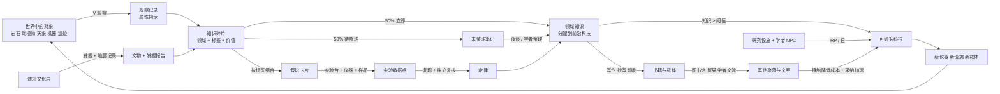

# 17 · 求知 Discovery（`tcdiscovery`）

> **独立玩法**：观察、实验、考古、研究与知识传播。
> **联动玩法**：技术进步依赖“发现与交流”，而不是堆材料。Discovery 是 RP 与知识的主要来源；科技树本身、RP 结算与知识阈值规则属于 04 章 `tctechnology`。

| 项 | 内容 |
| --- | --- |
| 模组 ID | `tcdiscovery` |
| Java 包 | `com.nightcity.discovery`（主类 `TDiscovery`，游戏总线监听 `TDiscoveryEvents`，调试指令 `/tcdiscovery status`） |
| 必需依赖 | `tcivilization`（核心：人物实体、区域层、HUD 与文明面板框架）、`tctechnology`（科技树与 `TechApi`） |
| 可选联动 | 全部其他主题模组；桥接类位于 `com.nightcity.discovery.compat.<other>`，用 `ModList.isLoaded` 守卫 |
| 拥有内容 | 观察模式（V）、日志页签（Y）、知识碎片与假说、实验与仪器、研究设施、书籍与知识载体（泥板 → 数据磁带）、造纸与印刷、标本与收藏、考古发掘玩法、学者劳动、知识传播与采纳 |
| 不拥有 | 科技 ID 体系、RP 结算、知识阈值规则（04）；教育、识字率、住房（15 Settlements）；遗迹、古文物、传说、世界历史（18 Echoes）；地图与测绘仪器（22 Atlas）；玻璃、金属、机器与能量网络（13 Industry） |
| 相关决议 | DR-06 写实、DR-07 程序历史、DR-19 无个人生存、DR-20 可见实体过程、DR-24 文明共享科技、DR-25 技能中等影响、DR-28 HUD 极简 |
| 科技配额 | 26 项（附录 B），含关键科技 `bronze/writing`、`medieval/papermaking`、`renaissance/printing_press`、`renaissance/scientific_method` |
| 存档 | `data/tcdiscovery.dat`（文明知识状态、日志、实验、设施索引）；区域层 `tcdiscovery:field_record` |

---

## 1. 定位与设计支柱

求知 Discovery 回答一个问题：**文明是怎样“知道”一件事的？** 在本模组家族里，科技不能靠刷材料解锁。玩家要观察世界，把零散的见闻变成知识；要动手做实验，验证猜想；要把知识写下来、抄下来、印出来、带出去。知识会在人与人、聚落与聚落、文明与文明之间流动，也会失传。

### 1.1 设计支柱

| 编号 | 支柱 | 含义 | 落地规则 |
| --- | --- | --- | --- |
| DP-1 | **看见即知识** | 真实世界是最主要的知识来源 | 观察模式（V）对岩石、动植物、天象、天气、遗迹、机器都有效；首次观察给“发现”奖励（§5.2） |
| DP-2 | **知识有载体** | 知识存在于人、泥板、书本与磁带中，可以复制、运输、交易，也会丢失 | 口述阶段的笔记会衰减；书本带有内容、作者、抄本代数与保真度（§5.8） |
| DP-3 | **实验可复现** | 实验测量的是世界里的“真值”，带噪声；仪器越精确、重复越多，结果越可信 | 测量 = 真值 + 噪声；达到复现次数且标准误小于容差才算“确认”（§5.5） |
| DP-4 | **交流胜于堆料** | 与他人接触比闭门研究更快 | 书籍、学者交流、观察外国建筑都会降低科技成本；内部“采纳”只影响 NPC 熟练度（§5.9） |
| DP-5 | **过程可见** | 研究不是一个进度条，而是一群在书桌前工作的学者 | 设施由实体方块与家具组成；学者 NPC 在场工作；印刷机、蒸馏器、望远镜都有可见动画（DR-20） |
| DP-6 | **独立有趣，联合更深** | 只装核心 + 科技 + 本模组也能完整游玩 | 原版岩石、动植物、天体、可疑沙砾、化石都是观察与发掘对象；其他模组接入后对象和结果更丰富 |

### 1.2 与 tctechnology 的分工

| 事项 | tctechnology（04） | tcdiscovery（本章） |
| --- | --- | --- |
| 科技树、科技 JSON、前置、时代 | 定义与校验 | 只提供本模组拥有的 26 项科技数据文件 |
| RP 结算公式、难度、追赶与传播乘数 | 权威 | 不重复定义；只调用 `TechApi` |
| 知识阈值 | 权威（“知识 ≥ 阈值才可研究”） | 产出知识：观察、综合、实验、书籍、交流 |
| 当前研究队列 | 权威（每个研究地点 1 项 + 队列 5 项；研究池） | 设施核心方块实体实现 04 的 `ResearchSite`，`rpPerDay` 返回 §5.4 的 RP_day，由 04 结算到该地点的研究项目；非地点来源（奖项、传说）进入研究池 |
| 科技可见性（“？？？”） | 权威（04 §5.2：知识 > 0 即由“未知”变“已知”） | 观察结果可提供“线索”：给目标科技 1 点知识，使其在树上显示为“已知” + 提示 |
| 缺少本模组时 | 使用 04 的后备“研究台”（01 §4.1）；本模组安装时研究台按 04 `research_table_mode = auto` 停用 | — |

本章只调用 04 §12 的公共 API（签名以 04 为准，本章不重新定义科技树）：

```java
// 04 章 tctechnology 的公共 API（本章只调用）
TechApi.addKnowledge(UUID civ, Identifier tech, KnowledgeSourceType type, int amount, @Nullable Entity actor);
        // type：OBSERVATION（观察、夜谈）、EXPERIMENT（实验，04 再乘 1.5）、BOOK（书籍、交流）、ARTIFACT（标本、化石）
TechApi.fireTrigger(ServerPlayer player, Identifier trigger, CompoundTag context);  // 触发 tcdiscovery:observe 等触发器
TechApi.addResearchPoints(UUID civ, int rp, Identifier reason);                     // 进入研究池
TechApi.state(civ, tech) / definition(tech) / all() / era(civ) / isUnlocked(civ, tech) / knowledge(civ, tech)
// 本模组实现：ResearchSite（各时代设施）、ContactProvider（学术接触，§5.9）
// 本模组在 RegisterKnowledgeTriggersEvent 注册触发器：tcdiscovery:observe、tcdiscovery:experiment、tcdiscovery:read_book
```

**前沿科技**由本模组从 04 的状态计算并缓存（`TechnologyUnlockedEvent` 时刷新）：

```text
frontier(civ) = { t : state(civ, t) ∈ {UNDISCOVERED, KNOWN, RESEARCHABLE, RESEARCHING}
                      且 era(t) ≤ era(civ) + 1 且 未完成的前置 ≤ 1 }
```

`addKnowledge` 只接受整数：本模组按（文明, 科技）累积小数部分，满 1 再提交；04 的 `daily_cap` 与 `knowledge_max` 截掉的部分退回该领域储备（§5.1）。

---

## 2. 独立玩法（只安装 `tcivilization` + `tctechnology` + 本模组）

独立安装时，世界是原版或其他地形模组生成的，没有 Echoes 遗迹、没有 Wildlands 岩石。Discovery 以原版内容为对象，玩法依然完整。

### 2.1 第一小时：从篝火到计数刻符

1. **按 V 进入观察模式**。准星对准原版方块或生物 0.5 秒后出现信息卡；继续对准 2 秒（40 tick）完成观察。第一次观察橡树会得到“发现：橡树（植物学）”，日志新增一页，并获得少量知识与学术熟练度。
2. 观察燧石（`minecraft:flint` 掉落物或砾石）、篝火、狼、鹿（原版无鹿时用羊/牛）、雨、月相、太阳高度……每类目标都会揭示若干“属性”。没揭示的属性显示为“？”，并附提示，例如“？——用手掂一掂它的重量（需要 `bronze/numeracy`）”。
3. 观察得到的知识一半立刻生效，另一半成为“未整理笔记”。E0-E1 没有文字，笔记每天衰减 2%。研究 `stone/oral_tradition`（20 RP）后可以在黄昏时举行**夜谈 Hearth Talk**：至少 2 名族人（玩家或 NPC）围坐在点燃的篝火旁 30 秒，笔记被整理成知识，并重置衰减。
4. 研究 `neolithic/tally_marks` 后可以建造**长老之座** `tcdiscovery:elder_seat`，这是第一个研究设施：指派一名长者，每天自动整理笔记并产出 RP。

### 2.2 中期：文字、实验与图书馆

- `bronze/writing` 之后，笔记不再衰减；可以在书吏桌 `scribe_desk` 上用湿泥板记录知识。泥板可以放在泥板架上（图书馆加成），也可以送给其他玩家。
- `iron/natural_philosophy` 之后，日志中出现**假说板**：把带有相同标签的碎片拖到一起，生成假说卡片，例如“重物下落比轻物快？”。在实验台 `experiment_bench` 上做实验检验它。
- 实验测的是世界里的真值。例如“单摆计时”实验：在实验台上挂摆锤，用水钟计 50 次摆动，测出重力加速度（真值 9.81 m/s²，仪器越好误差越小）。确认后，“力学”领域与 `iron/geometry`、`renaissance/scientific_method` 获得知识。测量越准，奖励越高。
- 某些实验依赖其他模组的世界规则：例如“圭表测地”（两个纬度同日正午的影长差 → 星球周长）只在 Wildlands 提供随纬度变化的太阳高度时出现；独立安装时该实验不在列表中，而不是显示为不可用（UP-5）。
- 发现原版化石结构（骨块簇）或在沉积岩中用小铲挖掘，可以得到化石 `tcdiscovery:fossil`。原版可疑沙/可疑砾石用原版刷子刷出的物品会被识别为“未知古物”，可在日志中记录发现地点（无 Echoes 时没有完整来历）。

### 2.3 后期：学府、印刷与科学方法

- 收集 20 种不同书名的书并建成学府（`academy_lectern` 核心），达成 E4 → E5 里程碑“学府 Academy”（01 §4）。
- 印刷机让抄本保真度保持 1.0、产量提高约 12 倍；书籍成为可交易的商品。
- `renaissance/scientific_method` 之后，实验需要复现和独立复核才能成为“定律”，定律以确认者的名字命名（“某某定律”），并给出大量知识。
- E6 以后有期刊、学术会议、同行评议；E9 主机可以做“模拟实验”；E10 空间科学控制台可以分析太空望远镜数据（无 Orbit 时只能使用地面射电望远镜）。

### 2.4 独立安装时的对象来源

| 领域 | 原版对象（举例） | 揭示的属性举例 |
| --- | --- | --- |
| 植物 | 原木、树叶、花、作物、仙人掌、海带 | 生长条件、季节、可食用性、纤维 |
| 动物 | 牛羊猪鸡、狼、狐狸、海龟、鱼、蜜蜂 | 食性、繁殖、迁徙、群居 |
| 地质 | 石头、深板岩、砂岩、凝灰岩、方解石、紫水晶、原版矿石 | 硬度、条痕、层理、成因 |
| 天文 | 太阳、月相、星空（夜晚抬头）、日食（由月相周期推算的“缺月夜”） | 周期、高度角、方位 |
| 气象 | 雨、雪、雷暴、风（粒子方向） | 季节性、前兆 |
| 材料 | 熔炉、玻璃、粘土、铁锭 | 熔点、导热、延展性 |
| 古物 | 原版可疑沙/砾、陶片、化石结构、废弃矿井 | 年代（粗略）、材质 |

---

## 3. 联动玩法

以下每一条都由 `compat.<other>` 桥接类实现，对方未安装时自动关闭，不留空入口（UP-5）。

### 3.1 tctechnology（必需）

- 观察、综合、实验、书籍都通过 `TechApi.addKnowledge`（来源类型 OBSERVATION / EXPERIMENT / BOOK / ARTIFACT）把知识加到具体科技上；观察同时调用 `TechApi.fireTrigger(player, tcdiscovery:observe, …)`，让科技 JSON 中以 `tcdiscovery:observe` 为触发器的知识来源（04 §11）生效。设施以 `ResearchSite` 身份由 04 结算 RP。
- “接触”降低成本：本模组注册 `ContactProvider`（学术接触）。读过某文明的书、与其互派学者、同赴学术会议、在其领地观察其建筑后，该文明在 `scholarly_contact_days`（默认 60 日）内计为接触；04 的扩散因子据此生效（每个拥有该科技的接触文明 −10%，最多 −40%，01 §5.1）。
- 观察可以给未知科技“线索”：例如第一次观察孔雀石，给 `bronze/smelting` 1 点知识，使其在科技树上由“？？？”变为“已知”，并显示提示“绿色的石头在火中会流出红色的金属”。

### 3.2 tcechoes（遗响，18 章）

- **考古发掘**：Echoes 的 `cultural_layer`（文化层）方块是 Discovery 发掘玩法的对象。Echoes 实现 `DigSiteProvider`，告诉 Discovery 每一层的时代与文化；Discovery 负责发掘工具、地层记录、发掘报告。出土时触发 `ArtefactExcavatedEvent`，物品与来历由 Echoes 生成。
- **文物鉴定与破译**：观察（V + 放大镜）可把文物鉴定到 1 级（材质与大致年代）；在研究设施由学者比对可到 2 级；破译古文字（Echoes 的语料规则）可到 3 级。破译后的铭文与古书作为知识载体被 Discovery 读取，给出 Echo Clue（知识或 -15% ~ -50% 成本）。
- **传说线索**：“龙骨”传说的真相常常是化石床。Discovery 的化石鉴定与地质观察可以把传说标记为“已解释”，获得额外知识。
- 日志页签中，Echoes 通过 `JournalSectionRegistry` 追加“遗迹与传说”分区（31 §5.5）。

### 3.3 tcsettlements（聚落，15 章）

- 学者是 Settlements 的职业 `scholar`，来源于教育系统；学者的受教育程度决定设施效率（§5.4）。
- 研究设施、图书馆、学府算作聚落的“文化建筑”，提升教育与繁荣度；聚落识字率影响书籍的读者数，从而影响“采纳”速度（§5.9）。
- Settlements 的公共卫生系统读取 Discovery 的医学知识（显微术观察到微生物后，“病菌学说”假说可被确认，降低聚落疫病传播率；具体数值在 15 章）。
- 无 Settlements 时，学者由核心 `tcivilization:person` 加 `ScholarComponent` 直接指派，受教育程度固定 0.6。

### 3.4 tcwildlands（山河，10 章）

- 25 种岩石、32 种矿物、地层、火山、季风、洋流都是观察对象；矿物属性（硬度、条痕、磁性、比重）由观察和实验逐步揭示。
- 分析化学之后可以做“矿石品位化验”实验，结果写入 Wildlands 勘探记录，提高地图上的矿藏可信度。
- 圭表测地实验（只在 Wildlands 安装时出现）得到的星球周长与真值 163,840 格（DA-03）比较，误差 ≤ 2% 时解锁 Atlas 的“经纬网”图层（若 Atlas 已安装）。

### 3.5 tcecology（生态，11 章）

- 每个物种第一次观察即“发现”，给生态图鉴添加条目；连续观察揭示食性、繁殖季、迁徙路线。
- 标本采集（标本罐、植物标本、剥制标本）为 Ecology 图鉴提供“已鉴定”标记。生态学领域知识达到阈值后，Ecology 的 `tcecology:ecosystem_health` HUD 控件解锁（11 章）。
- 种群普查实验（标记重捕法，E6）给出物种数量估计，Ecology 用来显示种群趋势的置信区间。

### 3.6 tccultivation（农耕，12 章）

- 野生近缘种、作物品种、土壤是观察对象；“杂交试验”实验测量性状遗传比例（真值来自 Cultivation 的遗传模型），确认后提高育种成功率。
- 土壤化验（E6 分析化学）给出氮磷钾与 pH，Cultivation 用于施肥建议。

### 3.7 tcindustry（工业，13 章）

- 实验仪器的玻璃器皿、透镜、精密零件由 Industry 的玻璃与金属加工提供（配方见 §8）。
- 实验结果反哺工业：“青铜配比”实验确认锡含量最优值（真值 10% ± 世界种子扰动 1%）后，Industry 的青铜质量 +1 级；“蒸汽压力”实验降低锅炉事故率。
- 碎浆机 `pulp_stamper` 在有 Industry 时由机械动力 `SU` 驱动（32 SU），否则由水车或人力。
- E9 主机机柜使用 Industry 的集成电路；E8 以后实验设备消耗电能 `J`。

### 3.8 tcnetworks（交通，14 章）

- 书籍与期刊通过邮路、商队、铁路运输到其他聚落，计入传播；道路连接、邮政、电报、计算机网络缩短“采纳”时间（§5.9）。

### 3.9 tcexchange（交易，16 章）

- 书籍、标本、仪器是可交易商品；印刷书价格随印量下降。外文明书籍是“知识进口”的主要途径。专利与版税政策（与 Commons 合作）影响书价。

### 3.10 tcnations（列国，23 章）

- AI 文明有自己的知识库（抽象）。“学者交流”是一种外交协定：双方各派 1-3 名学者，按天互相传播知识。
- 从 AI 文明获得的书籍、在其城市中观察到的建筑与机器，计入 01 §5.1 的接触传播。
- 翻译：读外文书需要会该语言的学者，或已翻译的抄本（§5.8）。

### 3.11 tcatlas（舆图，22 章）

- 天文观测（太阳高度、北极星高度）是天文导航的知识来源；`renaissance/telescope` 解锁原版望远镜 `minecraft:spyglass` 的配方，Atlas 把它用作远眺与测绘工具。
- 遗址发掘点、化石点、观察记录可以作为地图图层“科研”显示（Atlas 提供图层框架）。

### 3.12 tcorbit（寰宇，24 章）

- `space/space_science` 提供太空望远镜载荷 `tcdiscovery:space_telescope`；Orbit 负责发射与轨道。载荷在轨时，空间科学控制台每天得到深空观测数据。
- 月面、火星样品是 E10 的观察与实验对象。

### 3.13 tccommons（共治，19 章）

- 公共图书馆、公立大学是公共工程；“版权”“学术自由”等政策改变书价与研究效率（Commons 定义政策，Discovery 读取政策标志）。

### 3.14 tcfrontiers（边疆，20 章）

- 远征可以带回异域标本与观察记录（远方生物群系的“发现”）；远征营地可以放置便携观测装置。

### 3.15 tcbeyond（异界，21 章，可选）

- 异界影响区中的现象在观察模式下显示为“无法解释”，产生 `anomaly` 标签碎片，交给 Beyond 的异术研究。本模组的熟练度挂钩不使用 `arcana`。

### 3.16 tcskills（技能，05 章）

- 观察、实验、写作、发掘、标本采集都给熟练度（§15）。学术熟练度提高测量精度与抄写保真度，影响中等（DR-25）。

---

## 4. 核心玩法循环



三个尺度的循环：

| 尺度 | 循环 | 玩家在做什么 | 反馈 |
| --- | --- | --- | --- |
| 分钟 | 观察 → 属性揭示 → 碎片 | 外出时随手按 V 看看新东西 | 信息卡上的“？”变成答案；“发现”提示音与日志条目 |
| 游戏日 | 夜谈/设施整理 → 知识 → 解锁研究 | 黄昏回营地；安排学者；摆好实验 | 科技树上前沿节点的知识条增长；设施日报 |
| 时代 | 设施升级 → 新载体 → 传播 | 建学堂、图书馆、学府、实验室；印书、派学者交流 | 研究速度上台阶；与 AI 文明接触后成本下降 |

---

## 5. 系统规则与公式

### 5.1 知识模型

知识分两层：**领域知识**（Discovery 内部的中间量）与**科技知识**（04 章的“知识阈值”所用的量）。玩家获得的大部分知识先进入某个领域，再按权重分配到“前沿科技”。

| 领域 ID | 中文 | 典型对象 | 主要受益科技（举例） |
| --- | --- | --- | --- |
| `geology` | 地质 | 岩石、矿物、地层、火山 | 冶炼、采矿、建筑材料 |
| `weather` | 气象水文 | 雨雪、风、季节、河流、潮汐 | 历法、灌溉、航海 |
| `astronomy` | 天文 | 日月星、日食、行星 | 历法、天文导航、望远镜、空间科学 |
| `botany` | 植物 | 野生植物、作物、林木 | 栽培、草药、造纸 |
| `zoology` | 动物 | 野生动物、家畜、鱼类、昆虫 | 驯化、狩猎、博物学 |
| `materials` | 材料 | 粘土、木、金属、玻璃、纤维 | 陶器、冶金、纺织 |
| `mechanics` | 力学 | 杠杆、轮子、水流、摆、下落 | 车轮、水力、机械 |
| `chemistry` | 化学 | 燃烧、发酵、染料、盐、矿石化验 | 炼金术、分析化学、工业化学 |
| `optics` | 光学 | 光、透镜、颜色、光谱 | 光学、望远镜、摄影、光谱学 |
| `electricity` | 电磁 | 雷电、磁石、电池、电路 | 电报、电网、电子 |
| `anatomy` | 人体与医学 | 动物解剖、草药效果、微生物 | 医学、公共卫生（Settlements） |
| `mathematics` | 数学 | 计数、测量、几何、统计 | 算术、几何、计算科学 |
| `society` | 语言与社会 | 遗迹、文物、铭文、外国聚落 | 文字、法律、外交、史学 |

**领域 → 科技权重**：`data/tcdiscovery/domain_map/<namespace>/<era>/<tech>.json`。任何模组都可以在自己的数据包中为自己的科技提供权重文件；缺失时按 04 章科技类别的默认映射表推断（`data/tcdiscovery/domain_map/_category_defaults.json`）。

```json
// data/tcdiscovery/domain_map/tctechnology/bronze/smelting.json
{ "weights": { "geology": 0.5, "materials": 0.35, "chemistry": 0.15 } }
```

**分配规则**：

```text
// 碎片 F：领域 d，价值 v，直接提示科技集合 H（可为空）
immediate = v × immediate_share                 // 默认 0.5
pending   = v − immediate                        // 进入未整理笔记

distribute(civ, d, k, H):
    T  = { t ∈ frontier(civ) : w(t,d) > 0 } ∪ (H ∩ frontier(civ))      // frontier 见 §1.2
    W(t) = max(w(t,d), 0.05) × (t ∈ H ? 2 : 1)
    if T 为空:
        reserve[civ][d] += k                     // 领域储备
    else:
        for t in T: TechApi.addKnowledge(civ, t, type, k × W(t) / ΣW, actor)   // type：碎片的来源类型（OBSERVATION/EXPERIMENT/BOOK/ARTIFACT）；小数累积后取整提交

每日结算（L3）：reserve[civ][d] 中最多 20% 按同样规则释放到新出现的前沿科技
```

前沿科技由本模组按 §1.2 的规则计算（未完成前置 ≤ 1、时代 ≤ 当前时代 + 1）。因此观察“超前”的对象（例如 E1 时观察磁铁矿）不会浪费：知识先存入领域储备，等到相关科技进入前沿时再释放。

### 5.2 观察模式

**目标定义**（数据驱动）：`data/tcdiscovery/observation_target/<namespace>/<path>.json`。

```json
{
  "match": { "type": "block_tag", "tag": "c:ores/copper" },
  "domain": "geology",
  "tags": ["mineral", "green", "copper", "oxidation"],
  "base_value": 12,
  "complexity": 1.0,
  "min_instrument": 0,
  "monitoring": false,
  "properties": [
    { "id": "color",    "reveal": { "observations": 1 } },
    { "id": "streak",   "reveal": { "observations": 2, "instrument_tag": "tcdiscovery:streak_plate" } },
    { "id": "smelts_to","reveal": { "tech": "tctechnology:bronze/smelting" } }
  ],
  "tech_hints": ["tctechnology:bronze/smelting"],
  "hint_text": "tcdiscovery.hint.malachite"
}
```

匹配类型：`block`、`block_tag`、`entity`、`entity_tag`、`fluid`、`biome`、`weather`、`celestial`（太阳、月相、恒星、行星、日月食）、`season`、`structure`（含 Echoes 遗迹）、`foreign_block`（他文明领地内属于本文明未掌握科技的方块，见下）、`item`（手持或掉落物）。

**观察流程**：

1. V 切换观察模式（客户端可设为按住模式）。进入后 L1 描边可观察对象，HUD 淡出到 30%（31 §5.4）。
2. 准星对准有效目标 10 tick 后显示信息卡；继续对准时进度环增长。
3. 完成所需时间：

```text
t_obs = observe_ticks × complexity × s_inst          // observe_ticks 默认 40
s_inst = 1.0（裸眼）；0.8（持有满足要求的仪器）；天象目标在望远镜内为 0.6
移动目标离开准星 > 10 tick：进度每 tick 衰减 5%
距离上限：方块/实体 24 格；天象需露天；天气需正在发生；季节目标每季可观察一次
```

4. 客户端完成后发送 `tcdiscovery:observe_request`，服务端校验（视线、距离、冷却、目标仍存在），计算价值，返回 `tcdiscovery:observation_result`。

**价值公式**：

```text
情境桶 = (目标 ID, 区域键 regionKey, 季节)
n_r = 本文明在当前情境桶中已有的观察次数
n_o = 本文明在其他情境桶中对同一目标的观察次数
v   = base_value × diminishing_factor^(n_r + 0.25 × n_o) × M_inst × M_skill × M_first

M_inst  = clamp(1 + 0.25 × (仪器等级 − min_instrument), 1.0, 1.75)
M_skill = ProficiencyBridge.multiplier(观察者, "scholarship", "speed/research")   // 05 §6.3：50 级 ×1.30，含天赋 ≤ ×1.50；Skills 缺席 1.0
M_first = 1 + first_discovery_bonus                  // 文明首次观察该目标；默认 +0.5

累计上限：同一文明对同一目标获得的价值总和 ≤ base_value × target_yield_cap（默认 4）
监测型目标（monitoring = true：天气、天象、种群）：上限每游戏年（48 日）重置
v < 0.05 × base_value 时信息卡显示“已充分了解”，不再给知识，只给琐碎熟练度
```

**属性揭示**：每个属性的揭示条件可组合：观察次数、持有仪器标签、已掌握科技。已揭示属性是**文明共享**的（DR-24），同步给该文明所有在线玩家（`tcdiscovery:known_properties_sync`），并显示在核心 `tcivilization:target_info` 的附加行中（本模组注册的 `TargetInfoProvider`）。

**首次发现**：文明首次完成某目标观察时：价值 +50%；日志写入“发现”页（含发现者、地点、日期）；发送 `success` 级通知 “发现：孔雀石”；若目标带 `tech_hints`，对其中仍为“未知”（UNDISCOVERED）的科技给 1 点 OBSERVATION 知识，使其变为“已知”并显示 `hint_text`。

**观察外国建筑**（`foreign_block`）：Discovery 反查 04 章科技 JSON 的“解锁”列表，建立“方块 → 科技”索引。当玩家在另一文明（Nations AI 文明；按 DR-02 所有玩家同属一个玩家文明，Echoes 遗迹中的古代建筑另由 18 章处理）领地内观察到属于本文明未掌握科技的方块时：

```text
每个 (科技, 来源文明) 只生效一次：
    来源文明在 scholarly_contact_days（默认 60 日）内计为学术接触（ContactProvider → 04 扩散因子）
    TechApi.addKnowledge(civ, tech, OBSERVATION, ceil(0.1 × KT(tech)), player)      // KT：04 知识阈值
```

**区域层 `tcdiscovery:field_record`**：每个区域（512 × 512 格）保存一个按目标注册序号索引的位集（本文明在该区域观察过哪些目标）与一个季节掩码；用于计算 `n_r`、扩展等级 HUD 控件 `tcdiscovery:field_notes` 的“本地区尚未观察”计数，以及 Atlas 的“科研”图层。同步优先级 0（只在打开地图或日志时按需请求）。

### 5.3 整理：夜谈与学者

未整理笔记保存在**玩家日志**中（每名玩家一份），整理后的知识属于文明。

**夜谈 Hearth Talk**（需要 `stone/oral_tradition`）：

```text
条件：一天中的 12000-13800 tick（黄昏，落在 04 “火塘议事”的 12000-18000 时段内）；点燃的篝火（原版 campfire 或 04 章火塘）6 格内 ≥ 1 名文明成员；持续 600 tick
每堆篝火每晚一次；参与者为玩家与核心人物实体（族人）
参与人数 p（上限 8）：
    整理量 C = 40 + 15 × p              // 知识点
    效率   η = (p == 1) ? 0.6 : 0.8     // 独自沉思效率较低
    RP：夜谈不另产 RP——同一火塘的 RP 由 04 的火塘议事（研究地点 tctechnology:hearth）结算，避免重复
整理顺序：参与玩家的笔记按时间先后；整理的笔记衰减计时重置
安装 Echoes 时：p ≥ 3 且有长者在场，有 25% 概率触发“讲述传说”（18 章）
```

**口述衰减**（掌握 `bronze/writing` 之前）：

```text
pending_i(次日) = pending_i × (1 − oral_decay_per_day)      // 默认 0.02
玩家可在长老之座把笔记“托付”给长者：长者每日以 η = 0.9 整理 20 点
长者在托付笔记整理完之前去世：其保管的笔记损失 50%（玩家死亡不损失任何知识，DR-19）
```

**设施整理**：研究设施的每名学者每天可整理 `S_T` 点存入“设施档案”的笔记（玩家在设施核心界面中点击“存入笔记”），效率 η_T：E1-E3 为 0.9，E4 起为 1.0。交叉整理加成：同一批次中笔记覆盖 ≥ 2 个领域且共享 ≥ 1 个标签时，每多一个领域 +10%，最多 +30%。

**玩家亲自整理**：在任意已建成设施的核心处长按“整理”，每秒整理 2 点（效率同设施），期间获得学术熟练度。

### 5.4 研究设施与学者劳动

设施 = **核心方块** + 半径 8 格（17 × 9 × 17 的立方体）内的**家具**。除天文台外，核心必须处于室内（核心处天空光 ≤ 7）。核心方块共用方块实体 `tcdiscovery:research_facility`，每 100 tick 扫描一次家具（缓存，方块变化时增量更新）。

| 时代 | 设施 | 核心方块 | 家具要求得分 | 标准学者 s_std | 上限 s_max | RP / 学者日 r_T | 整理 / 学者日 S_T |
| --- | --- | --- | --- | --- | --- | --- | --- |
| E0 | 夜谈 | （篝火，非设施） | — | — | — | 见 §5.3 | 见 §5.3 |
| E1 | 长老之座 | `elder_seat` | 2 | 2 | 3 | 7.5 | 20 |
| E2 | 书吏之屋 | `scribe_desk` | 4 | 3 | 4 | 9 | 40 |
| E3 | 学堂 | `scholars_table` | 6 | 3 | 6 | 15 | 60 |
| E4 | 缮写室 | `scriptorium_desk` | 8 | 4 | 8 | 19 | 80 |
| E5 | 学府 / 天文台 | `academy_lectern` / `refracting_telescope` | 12 | 5 | 10 | 24 | 100 |
| E6 | 工程学院 | `engineering_college_desk` | 16 | 5 | 10 | 38 | 120 |
| E7 | 研究所 | `research_director_desk` | 20 | 6 | 12 | 48 | 140 |
| E8 | 国家实验室 | `national_lab_control` | 24 | 6 | 12 | 71 | 160 |
| E9 | 计算中心 | `mainframe_terminal`（+ ≥ 4 台 `mainframe_rack`） | 24 | 6 | 12 | 104 | 180 |
| E10 | 航天中心 | `space_research_console` | 24 | 6 | 12 | 146 | 200 |

标准产出（s_std 名学者、Q = 1）约为 01 §5 “典型日 RP”的 25%：例如 E5 学府 5 × 24 = 120 RP/日，对应典型 480 RP/日。表中“时代”是设施级别；学府核心 `academy_lectern` 在 E4 由 `medieval/universities` 解锁，建成学府并收藏 20 种书即 01 章 E4 → E5 里程碑。

**家具得分**：方块标签 `tcdiscovery:furnishing/<类别>`，每类最多计 4 件：

| 类别 | 得分 | 例子 |
| --- | --- | --- |
| `desk` 书桌 | 1 | `scribe_desk`、`scholars_table`、`lab_bench`，原版 `lectern` |
| `storage` 藏书 | 1 | `tablet_rack`、`scroll_shelf`，原版 `chiseled_bookshelf`、`bookshelf` |
| `instrument` 仪器 | 2 | `gnomon`、`water_clock`、`armillary_sphere`、`compound_microscope`、`spectroscope` 等 |
| `light` 照明 | 0.5 | 原版 `lantern`、`candle`；E7 起电灯（Industry） |
| `seat` 座位 | 0.5 | 原版楼梯/台阶（当作长凳），Settlements 椅子 |
| `hearth` 火塘 | 1 | 篝火、壁炉（仅 E1-E3 计分） |

**产出公式**：

```text
e_i   = 0.4 + 0.6 × edu_i × attendance_i      // edu：Settlements 受教育程度 0-1（无 Settlements 时 0.6）；attendance：当日到岗比例
s_eff = Σ e_i
f     = min(s_eff, s_std) + 0.5 × clamp(s_eff − s_std, 0, s_max − s_std)
Q     = 0.6 + 0.4 × min(1, 家具得分 / 要求得分) + min(0.2, 0.02 × 设施内不同书名数)     // 0.6-1.2
spec  = 当前研究的首要领域 == 设施专攻领域 ? +0.15 : (设施有专攻 ? −0.05 : 0)
dup   = 0.7^(k−1)                            // 同一聚落中第 k 座同级设施
RP_day = r_T × f × Q × (1 + spec) × dup × rp_multiplier
```

每名学者每天在“研究”和“整理”之间分配工时：设施界面的滑块（默认“自动”：先用至多 50% 工时整理档案中的笔记，其余产出 RP）。设施核心方块实体实现 04 的 `ResearchSite`（`siteType = tcdiscovery:<设施>`，`hearthSlotCost = 0`），`rpPerDay` 返回 RP_day × 研究工时比例；04 每 100 tick 把它结算到该地点正在研究的科技（研究项目与队列在 04 的科技树界面设置）。

**学者 NPC**：学者是核心人物实体 `tcivilization:person` 加 `ScholarComponent`（本模组注册的组件）。白天在设施内的书桌、仪器之间移动并播放书写、观测动画（DR-20）；夜间回家。设施在区块未加载时按 L2/L3 抽象结算（出勤率取过去 3 日平均）。玩家也可以作为“学者”：站在设施内工作（长按核心“研究”）每秒产出 `r_T / 600` RP。

### 5.5 实验

实验在**实验站**上进行：`experiment_bench`（E3，“试验”）、`lab_bench`（E6，带通风橱时可做有毒/燃烧类实验）、`refracting_telescope` 与 `radio_telescope_dish`（观测类实验）、`compound_microscope` / `electron_microscope`（显微类）、`mainframe_terminal`（E9 模拟实验）、`space_research_console`（E10）。每个实验由数据文件定义：`data/tcdiscovery/experiment/<path>.json`。

```json
{
  "station": "experiment_bench",
  "requires_tech": "tctechnology:bronze/alloying",
  "min_method_stage": "natural_philosophy",
  "domain": "materials",
  "tags": ["alloy", "copper", "tin", "hardness"],
  "instruments": [ { "tag": "tcdiscovery:instrument/balance", "min_grade": 1 } ],
  "samples": [ { "item": "c:ingots/copper", "count": 9 }, { "item": "c:ingots/tin", "count": 1 } ],
  "duration_ticks": 1200,
  "complexity": 2,
  "measure": {
    "quantity": "bronze_optimal_tin_pct", "unit": "%",
    "true_value": { "type": "seeded_normal", "mean": 10.0, "sd": 1.0 },
    "base_sigma": 2.5, "tolerance": 0.4, "tolerance_mode": "absolute"
  },
  "tests_hypotheses": ["tcdiscovery:alloy_harder_than_parts"],
  "reward": { "knowledge": 120, "tech_hints": [] },
  "effects": [ { "type": "tcindustry:alloy_quality", "alloy": "bronze" } ]
}
```

**真值类型**：

| 类型 | 含义 | 例子 |
| --- | --- | --- |
| `constant` | 写实物理常数 | 重力加速度 9.81 m/s²；水的沸点 100 °C（海平面） |
| `seeded_normal` | 按世界种子扰动的工艺参数（每个世界略有不同，必须实测） | 青铜最优含锡量 10% ± 1%；本地陶土最佳烧成温度 |
| `provider` | 由其他模组的 `TrueValueProvider` 给出 | Wildlands 星球周长 163,840；Cultivation 性状分离比 3:1；Ecology 某种群数量 |

**测量**：

```text
grade → 精度 P：1 → 1.0，2 → 1.6，3 → 2.5，4 → 4.0，5 → 6.3
P_inst = (Π 所用仪器的 P)^(1/件数)          // 几何平均
σ_eff  = base_sigma / (P_inst × (1 + 0.002 × L_scholarship) × (1 + 0.1 × (station_tier − 1)))
x_i    = μ + σ_eff × N_i
N_i    ~ N(0, 1)，由 hash(worldSeed, experimentId, civId, runIndex) 决定
         —— 同一次运行读档重来结果不变，不能靠重载“刷”结果
```

**单次运行成功率与失败结果**：

```text
p_success = clamp(0.55 + 0.04 × Σ grade_inst + 0.002 × L_scholarship
                  + 0.05 × (station_tier − 1) − 0.08 × complexity + m_method, 0.05, 0.95)
m_method：思辨 0；实验 +0.10；学科 +0.15；计算 +0.20（§5.7）

失败时再掷：
    60% 无结论：不产生数据点；样品消耗 50%
    30% 样品损毁：样品全部消耗；所用仪器耐久 −10%
    10% 事故：一件仪器耐久 −50%（玻璃器皿直接破碎为碎玻璃）；
        燃烧/化学类实验在 accident_fire = true 时于实验台顶面生成 100 tick 的不蔓延火焰，
        并冒烟；事故不施加任何玩家状态效果（DR-19）
有通风橱 `fume_hood` 的实验室：事故概率减半
```

**确认、复现与准确度**：

```text
n  = 成功数据点数；x̄ = 均值；s = 样本标准差（n = 1 时取 σ_eff）
SE = s / √n
τ  = tolerance（absolute）或 tolerance × |x̄|（relative）

“实验”阶段起的确认条件：n ≥ reproducibility_required（默认 3）且 SE ≤ τ
“实验”阶段以前（试验）：n ≥ 1 即出结果，标记“试验性”，奖励 ×0.6，不能把假说确认为定律

独立复核：数据点来自 ≥ 2 个不同实验站（相距 ≥ 64 格）或 ≥ 2 名不同主持者（玩家或学者）
          → 奖励 ×1.25，标签“已独立复核”
准确度 A = clamp(1 − |x̄ − μ| / (3τ), 0, 1)     // 隐藏量，玩家只看到 x̄ ± 2·SE
奖励知识 = reward.knowledge × (0.5 + 0.5 × A) × (独立复核 ? 1.25 : 1) × (试验性 ? 0.6 : 1)
```

确认后可以继续追加数据点：若新的 A 比上次发奖时高 ≥ 0.2，补发差额知识；`effects` 总是按最新的 A 更新（例如 Industry 青铜品质：A ≥ 0.5 品质 +1，A ≥ 0.85 品质 +2，具体由 13 章解释）。

**可见过程**：运行中实验站有对应动画——摆锤摆动、蒸馏器冒泡、天平左右晃动、望远镜缓慢转动；`tcdiscovery:experiment_status` HUD 控件显示剩余时间。区块卸载时实验暂停（实验需要有人在场主持；E7 起学者可在设施内自动主持，按 L2 抽象结算）。

### 5.6 假说

日志的**假说板**（`iron/natural_philosophy` 解锁）把碎片组合成可检验的猜想。

```json
// data/tcdiscovery/hypothesis/heavier_falls_faster.json
{
  "requires_tags": [["falling"], ["weight", "mass"]],   // 每组至少命中一个
  "min_fragments": 2,
  "min_method_stage": "natural_philosophy",
  "truth": false,
  "rival": "tcdiscovery:falling_independent_of_mass",
  "tested_by": "tcdiscovery:inclined_plane",
  "prediction": { "quantity": "mass_dependence", "op": ">", "value": 0.2 },
  "domain": "mechanics",
  "reward": { "knowledge": 200, "tech_hints": ["tctechnology:renaissance/scientific_method"] }
}
```

规则：

1. 玩家把 2-3 条日志碎片拖入假说板的槽位。若槽内碎片的标签满足某假说的 `requires_tags`，生成假说卡；若同时满足互为对手（`rival`）的两个假说，两张卡都出现（例如“热是一种流体”与“热是微粒的运动”）。每条碎片最多参与 3 张假说卡。
2. 假说卡显示：陈述、可检验的预测、所需实验与仪器（未掌握的仪器显示“？”）。
3. 检验：在对应实验确认（§5.5）后，用测得的 x̄ 与预测比较：
   - 与真命题的预测一致 → **证实**；“实验”阶段起成为**定律**（以主持者姓名命名，可在 `TcConfirmDialog` 中改名），奖励全额知识 + `tech_hints` 线索；文明首次确认某定律发送 `success` 通知。
   - 与假命题的预测矛盾 → **证伪**，奖励 ×0.5，卡片标记“已证伪”，其对手假说的检验成本（所需数据点）−1。
   - “实验”阶段以前只能得到“支持 / 不支持”，奖励 ×0.3；掌握 `renaissance/scientific_method` 后可重新检验已“支持”的假说使其成为定律。
4. 随模组提供约 40 个假说，其中约 30% 为历史上真实出现过的错误假说（燃素、热质、自然发生说、地心说、瘴气说），证伪它们同样推进知识。

### 5.7 科学方法的阶段

文明所处的“方法阶段”由已掌握的科技决定，全文明共享。

| 阶段 | 触发科技 | 时代 | 新能力 | 数值修正 |
| --- | --- | --- | --- | --- |
| 口传 Lore | （起始）/ `stone/oral_tradition` | E0-E1 | 观察、夜谈、长老托付 | 笔记日衰减 2%；夜谈 η 0.6-0.8 |
| 记录 Records | `bronze/writing` | E2 | 泥板、书吏、档案 | 衰减停止；设施整理 η 0.9 |
| 思辨 Natural philosophy | `iron/natural_philosophy` | E3 | 假说板、实验台“试验” | 试验奖励 ×0.6；假说只得“支持” |
| 经院 Scholastic | `medieval/universities` | E4 | 学府、书目、学位 | 设施书目加成上限 0.2 → 0.3；学者在学府满 1 年受教育程度 +0.1（无 Settlements 时） |
| 实验 Experimental | `renaissance/scientific_method` | E5 | 复现、定律、独立复核 | m_method +0.10；试验性结果可升级 |
| 学科 Disciplinary | `industrial/scientific_journals` | E6 | 期刊、学术会议、同行评议 | m_method +0.15；定律必须独立复核；期刊传播（§5.9） |
| 体制 Institutional | `electric/research_institutes` | E7 | 研究所、技术报告、学者自动主持实验 | 自动主持的实验按 L2 抽象结算 |
| 大科学 Big science | `atomic/national_laboratories` | E8 | 国家实验室、大型装置（云室、射电望远镜） | 大型实验 complexity 4-5，奖励 ×1.5 |
| 计算 Computational | `information/computational_science` | E9 | 模拟实验（无样品、消耗算力） | m_method +0.20；模拟实验 σ 由算力决定 |
| 空间 Space | `space/space_science` | E10 | 太空望远镜数据分析 | 天象观测无大气抖动：base_sigma ×0.25 |

### 5.8 知识载体：写作、抄写、印刷

知识可以写进实体物品。所有载体共用数据组件 `tcdiscovery:written_knowledge`（§11），内容包括：条目列表、书名、作者、来源文明、文字（语言）、抄本代数、保真度、成书日期。原版 `minecraft:book` 作为“空白册”使用；原版 `written_book` 不受影响（玩家写的普通书仍可用）。

| 载体 | ID | 解锁 | 条目容量 | 未妥善保存的寿命（年） | 制作 / 每份抄写 | 复制方式 |
| --- | --- | --- | --- | --- | --- | --- |
| 刻符棒 | `tally_stick` | `neolithic/tally_marks` | 1（仅计数/历法类条目） | 5 | 100 tick | 手刻 |
| 泥板 | `clay_tablet` | `bronze/writing` | 2 | 不衰减（烧制后） | 600 tick + 晾干 1 日 | 手写（刻写笔） |
| 竹简 | `bamboo_slips` | `iron/libraries` | 4 | 50 | 900 tick | 手写 |
| 卷轴 | `scroll`（羊皮纸 `parchment` 制成） | `iron/libraries` | 4 | 100 | 900 tick | 手写 |
| 手抄本 | `manuscript` | `medieval/papermaking` | 8 | 200 | 2,400 tick | 手写（羽毛笔） |
| 印本 | `printed_book` | `renaissance/printing_press` | 8 | 200 | 排版 600 tick；之后每本 200 tick | 印刷 |
| 期刊 | `journal_issue` | `industrial/scientific_journals` | 12 | 100 | 每季自动编成母版；印刷同上 | 印刷 |
| 技术报告 | `technical_report` | `electric/research_institutes` | 4（单项知识 ×1.5） | 100 | 1,200 tick | 打字/印刷 |
| 缩微胶卷 | `microfilm_reel` | `atomic/national_laboratories` | 64 | 300 | 400 tick | 摄影复制 |
| 数据磁带 | `data_tape` | `information/computational_science` | 512 | 30 | 100 tick | 主机复制 |

“寿命”指放在背包、箱子或露天时：超过寿命后每年保真度 −5%。放在藏书家具（泥板架、卷轴架、原版雕纹书架）且所在空间有屋顶时，老化速度 ×0.1。

**条目类型**：`tech`（本文明已掌握的科技）、`domain`（领域知识）、`law`（定律）、`experiment`（已确认实验）、`site_report`（发掘报告）、`chronicle`（编年记录，Echoes）、`specimen_catalog`（收藏目录）。

**写作原书**：在书吏桌、学者桌或缮写桌上选择条目（只能写本文明已掌握或已确认的内容），消耗载体材料与墨水。原书保真度 `f = 0.85 + 0.15 × q_author`，`q_author` 为作者质量（玩家：`min(1, L_scholarship / 50)`，等级上限 50；NPC 学者：受教育程度）。

**抄写与印刷**：

```text
手抄：f_new = f_src × (0.92 + 0.07 × q_scribe)
印刷：排版时以一本原书为母版；之后每本 f_new = f_master，不再衰减
摄影 / 电子复制：f_new = f_src × 0.999
f < 0.5 的副本标记“讹误”：每个条目有 20% 概率失效（阅读时不给知识，日志提示“这段记载似乎有误”）
```

**阅读**：

```text
阅读时间：每条目 200 tick（在书桌旁坐读）；放入设施藏书家具的书由学者自动阅读，每名学者每日 1 条目
对本文明读者：
    自己文明写的书 —— 不再给科技知识；计入设施书目加成与“学府”里程碑（20 种不同书名）
    条目 law / experiment / site_report —— 若本文明尚未拥有该条目（例如另一位玩家在别处完成的发掘报告），按原奖励 × f 给予
对外文明来源的条目 tech t（本文明未掌握）：
    k = 0.5 × KT(t) × f × translation × (同一书名再次阅读 ? 0 : 1)        // KT：04 章知识阈值
    TechApi.addKnowledge(civ, t, BOOK, k, reader)                      // 04 对 BOOK 来源计每日上限
    首次读到来源文明 c 的书：c 在 scholarly_contact_days 内计为学术接触（ContactProvider → 04 扩散因子 −10%/文明）
translation：同文字 1.0；本文明有通晓该语言的学者（Nations 语言接触 ≥ 0.5）0.9；否则 0.3（“未译”）
```

**翻译**：在缮写桌上，由通晓两种语言的学者（或外交熟练度 ≥ 30 的玩家）把外文书抄成本文明文字的译本，`f_new = f_src × 0.95`，之后按本文明文字阅读。古文字（Echoes 遗物）不走翻译，走 18 章的破译规则。

### 5.9 知识传播与采纳

**文明之间**（全部计入 01 §5.1 的接触传播，上限由 04 章执行）：

| 渠道 | 前提 | 规则 |
| --- | --- | --- |
| 书籍 | 获得外文明书籍（贸易、赠与、战利品、遗迹） | §5.8 阅读规则 |
| 观察外国建筑 | 在他文明领地内观察 | §5.2 `foreign_block` |
| 学者交流 | `iron/libraries` + Nations 外交协定“学者交流” | 每名派驻学者每日：从对方已掌握、我方前沿中随机 1 项，`+0.04 × KT(t)` 知识；协定生效首日每项对方科技计为接触 |
| 贸易接触 | Exchange 或 Nations 的活跃贸易路线 | 每条路线每 10 日：对方文明 1 项我方前沿科技计为接触 |
| 学术会议 | `industrial/scientific_journals` | §5.12；每个出席文明的已掌握前沿科技全部计为接触 |
| 期刊订阅 | `industrial/scientific_journals` + Exchange | 每季收到 1 本外文期刊（12 条目） |

传播是双向的：玩家文明的书被 AI 文明获得、学者交流、会议，同样让 AI 文明受益。Discovery 发出 `KnowledgeDiffusedEvent(direction = OUT)`，由 Nations 更新 AI 文明的抽象知识库。

**文明内部的采纳（Adoption）**：科技解锁对整个文明立即生效（DR-24）。但新技术在各聚落的 NPC 劳动中需要时间“普及”：

```text
科技 t 解锁时，每个聚落 s：a(s, t) = adoption_floor            // 默认 0.7
每日：a(s, t) = min(1, a + (1 − adoption_floor) / D(s))
D(s) = adoption_base_days × dist × lit / conn                     // adoption_base_days 默认 6
dist = clamp(1 + d_capital / 2000, 1, 3)                          // d_capital：到首都（首个聚落）的格数
lit  = 1.5 − literacy(s)                                          // Settlements 识字率 0-1；无 Settlements 取 0.5 → lit = 1.0
conn = 1 + 0.5·[有学堂级以上设施或图书馆] + 0.5·[道路/邮路连通] + 1.0·[电报] + 2.0·[计算机网络]
首都：D 减半
该聚落图书馆中有包含 t 的书被阅读：a 立即 +0.1
```

`a(s, t)` 只乘在该聚落 NPC 使用该科技相关岗位与配方时的工作效率上（Settlements、Industry、Cultivation 调用 `DiscoveryApi.adoptionFactor`）；**不影响解锁、不影响玩家亲手制作**。配置 `adoption_enabled = false` 时恒为 1。

**知识的丢失**：

| 情况 | 后果 | 预防 |
| --- | --- | --- |
| 写作前的口述衰减 | 未整理笔记每日 −2% | 夜谈、托付长者、尽快研究文字 |
| 长者去世 | 其保管的笔记 −50% | 多次托付分散 |
| 藏书家具被烧毁 | 每件载体 70% 概率毁坏 | 石砌图书馆；`AlertProvider` 警报“图书馆有火灾风险”（藏书家具 4 格内有可燃方块与火源） |
| 载体老化 | 超过寿命后保真度每年 −5% | 放入有屋顶的藏书家具；抄写/印刷新本 |
| 科技 | **永不丢失**（DR-24） | — |

### 5.10 考古发掘

Discovery 拥有发掘**玩法**（工具、网格、地层记录、筛选、报告）；发掘**对象**（文化层、文物、来历）属于 Echoes。两者通过 `DigSiteProvider` 接口连接（§12）。

**工具与解锁**：

| 工具 | ID | 解锁 | 作用 |
| --- | --- | --- | --- |
| 小铲 | `trowel` | 无（E0 基础配方：木棍 + 燧石） | 慢速、精细地挖掘文化层与沉积岩；不降低出土物状态 |
| 刷子 | 原版 `minecraft:brush` | 原版配方（由 04 章决定是否改门槛） | 刷可疑沙砾与 Echoes 的 `artefact_deposit`；状态 ×1.1 |
| 筛子 | `sieve`（方块） | 无 | 把发掘出的土（Echoes `midden_soil` 等）筛出小件 |
| 发掘桩 | `dig_site_stake`（方块） | `bronze/archives` | 划定发掘网格并记录地层；没有发掘桩也能挖，但无法地层记录 |

**发掘网格**：放置发掘桩后打开 `tcdiscovery:dig_site` 界面，选择网格（`bronze/archives` 3 × 3；`iron/natural_philosophy` 5 × 5；Echoes 已安装且文明掌握 `tctechnology:industrial/archaeology` 时 9 × 9），桩向 `DigSiteProvider` 查询该范围的地层：

```text
Layer(yTop, yBottom, periodYear, cultureId, density)    // periodYear：相对开局的年份（负数），见 18 章
```

**规则**：

```text
挖开一个文化层方块（Echoes cultural_layer）：
    P_find = density × tool_factor               // 小铲 1.0；刷子 1.0；镐/锹 0.6
    出土物由 provider 生成（物品 + Echoes 来历组件）
    状态 condition = provider 给出的原始状态 × tool_cond     // 小铲 1.0；刷子 1.1（上限 1）；镐/锹 0.4
    掉落的土方：Echoes `midden_soil` 物品，可放入筛子
筛子：每份土 160 tick，8% 概率得到小件（珠子、种子、钱币、骨片），由 provider 决定
地层记录：一个层被挖穿之前，用观察模式（V）观察该层暴露的剖面 → 日志“地层记录”条目
    给 society 领域 8 × (1 + 0.1 × 该层出土物数) 知识
    该层出土物获得“有地层背景”标记；没有标记的出土物最高只能鉴定到 1 级（18 章）
    镐/锹挖掘过的格子：该格的地层背景永久丢失
发掘完成：网格体积 ≥ 80% 已挖开且所有层已记录
    → 在任意书桌写“发掘报告”（site_report 条目，载体为手抄本或技术报告）
    → 知识 60 × 层数（society）+ 每件已出土文物 5；Echoes 收到 DigSiteCompletedEvent，可揭示相关传说线索
```

**独立安装（无 Echoes）时的对象**：

| 对象 | 来源 | 结果 |
| --- | --- | --- |
| 原版可疑沙 / 可疑砾石 | 原版沙漠神殿、沙漠水井、海底废墟、古迹废墟（若世界生成存在） | 原版战利品；Discovery 给物品加“未知古物”标签，记录发现地点；观察 = `society` 领域碎片 |
| 化石（沉积岩） | 方块标签 `tcdiscovery:fossil_bearing`（默认含原版砂岩、红砂岩及 Wildlands 页岩、石灰岩、泥岩、白垩、白云岩） | 用小铲/刷子挖掘时 `fossil_chance`（默认 0.4%）得到化石；刷子 ×3；镐 ×0.25 且为“残片” |
| 化石（骨块） | 地下 Y < 60、相邻 ≥ 6 个骨块的原版化石地物 | 用刷子刷骨块 → 完整化石（completeness ≥ 0.8） |

化石带数据组件：类群（菊石、三叶虫、鱼、蕨类、爬行类、哺乳类）、地质时代（Wildlands 地质层给出岩层年龄；独立安装时按 Y 高度推算）、完整度。化石是 `geology` 与 `zoology` 领域的高价值观察对象（base 20），也是收藏套组的组成部分。

### 5.11 标本与收藏

| 标本 | ID | 来源 | 解锁 | 数据 |
| --- | --- | --- | --- | --- |
| 矿物样本 | `mineral_sample` | 用小铲或镐潜行右键岩石/矿物方块，不破坏方块 | `iron/natural_philosophy` | 方块 ID、区域、采集日 |
| 植物标本 | `herbarium_sheet` | 植物物品 + 纸/羊皮纸，在学者桌压制 1 日 | `iron/natural_philosophy` | 物种、区域、季节 |
| 标本罐 | `specimen_jar` | 玻璃瓶（原版 `glass_bottle`）+ 小动物、鱼、昆虫掉落物（Ecology 存在时为物种实体捕获） | `iron/natural_philosophy` | 物种、区域 |
| 剥制标本 | `mounted_specimen`（方块） | 狩猎所得兽皮 + 骨头，在学者桌制作 | `renaissance/curiosity_cabinets` | 物种、个体大小 |
| 化石 | `fossil` | §5.10 | 无 | 类群、地质时代、完整度 |

所有标本共用数据组件 `tcdiscovery:specimen`：物种/方块 ID、区域键、采集者、采集日、质量 0-1、是否已鉴定。

**存放**：`specimen_cabinet`（27 格，算作 `instrument` 类家具）与 `display_case`（1 格，在玻璃罩内渲染物品）。有屋顶的建筑中，一个标本柜 8 格内若有 ≥ 3 个展示柜，该建筑被视为“博物馆”（Settlements 安装时计入文化建筑）。

**在柜中观察**：观察存放的标本 = 观察该物种，价值 ×0.5，情境桶使用标本的原采集区域。这样可以在家研究远方物种。

**收藏套组**：`data/tcdiscovery/collection/<id>.json`，例子：

| 套组 | 要求 | 一次性奖励 | 持续加成 |
| --- | --- | --- | --- |
| 本地植物志 | 同一区域 10 种植物标本 | botany 150 | 所在设施 RP +5% |
| 硬度标尺 | 10 种参考矿物样本（Wildlands：石膏 → 金刚石；独立安装时用原版方块的替代表） | geology 200 | +5% |
| 化石序列 | 5 个不同地质时代的化石 | geology 120、zoology 120 | +5% |
| 鸟类图谱 | 8 种鸟类标本（需 Ecology） | zoology 160 | +5% |
| 古陶谱系 | 4 种不同文化的陶片（需 Echoes，鉴定 ≥ 2 级） | society 180 | +5% |

持续加成作用于标本柜所在设施，上限 +25%；套组需全部放在同一建筑内才生效。

### 5.12 后期制度：期刊、会议、奖项、计算与空间

**学术期刊**（`industrial/scientific_journals`）：每季（12 日）第 1 日，文明自动编成一期期刊母版，收录上季度新确认的定律、实验与发掘报告（最多 12 条目）。母版出现在文明“学会”所在设施的藏书家具中，可印刷分发：

```text
一期期刊被送达 ≥ 3 个聚落的图书馆（物品放入藏书家具）时：
    下一季所有设施 RP +5%
    期刊所含条目涉及的科技，在收到期刊的聚落采纳度 a +0.1
```

**学术会议**：在 E6 以上设施举办，每季每文明 1 次；要求设施内 ≥ 6 个座位与 ≥ 3 名学者。邀请关系不低于“中立”的 AI 文明（Nations）。会议持续 1 日：

```text
每个出席文明 c：
    c 在 scholarly_contact_days 内计为学术接触：c 已掌握的科技按 04 扩散因子降价（每文明 −10%，04 章上限 −40%）
    我方对 c 同样产生外流传播（KnowledgeDiffusedEvent OUT）
    双方关系 +3（Nations 解释）
待复核的定律：每个出席文明 50% 概率在下一季内完成“外部复核”，视为独立复核
```

**奖项**：每年第 1 日，文明可把“年度学术奖”授予一位上一年确认过定律的玩家或学者 NPC：获奖者得到学术熟练度，学者 NPC 受教育程度 +0.05；文明在所有已接触 AI 文明中声望 +1（Nations）。

**模拟实验**（E9，`mainframe_terminal`）：不消耗样品，消耗算力 CU（每台 `mainframe_rack` 1 CU/tick，E9 后接入 Industry 电网，每台 2 kW）。

```text
σ_sim = base_sigma / sqrt(CU_total / 10,000)
可模拟的实验在 JSON 中标注 "simulable": true（例如气候模型、结构力学、核反应截面）
```

**空间科学**（E10）：太空望远镜载荷 `space_telescope` 由 Orbit 发射入轨后，每日向 `space_research_console` 提供 3 次深空观测（星系、系外行星、宇宙背景），等价于 `celestial` 目标观察且 base_sigma ×0.25。未安装 Orbit 时，`radio_telescope_dish` 提供相同目标的地面观测，每日 1 次。

## 6. 数值表

### 6.1 内置实验（`data/tcdiscovery/experiment/`，节选 21 项）

| 实验 ID | 实验站 | 所需科技 | 领域 | 测量量 | 真值 | base_sigma | τ | 知识 |
| --- | --- | --- | --- | --- | --- | --- | --- | --- |
| `pendulum_period` | experiment_bench | `iron/natural_philosophy` | mechanics | 重力加速度 g | constant 9.81 m/s² | 0.8 | 0.15 | 100 |
| `inclined_plane` | experiment_bench | `iron/natural_philosophy` | mechanics | 下落与质量相关度 | constant 0 | 0.5 | 0.1 | 150 |
| `lever_ratio` | experiment_bench | `iron/geometry` | mechanics | 力矩比 | constant 1.0 | 0.2 | 0.05 | 80 |
| `clay_firing_temperature` | experiment_bench | `neolithic/pottery` | materials | 本地陶土最佳烧成温度 | seeded_normal 900 ± 40 °C | 80 | 15 | 80 |
| `bronze_tin_ratio` | experiment_bench | `bronze/alloying` | materials | 青铜最优含锡量 | seeded_normal 10 ± 1 % | 2.5 | 0.4 | 120 |
| `soil_fertility` | experiment_bench | `iron/natural_philosophy` | botany | 施肥增产比 | provider（Cultivation）/ constant 1.3 | 0.3 | 0.05 | 100 |
| `planetary_circumference` | gnomon ×2（相距 ≥ 2,000 格） | `iron/geometry` | astronomy | 星球周长 | provider（Wildlands）163,840 | 15,000 | 5 %（相对） | 300 |
| `refraction_water` | experiment_bench + hand_lens | `medieval/optics` | optics | 水的折射率 | constant 1.33 | 0.1 | 0.02 | 120 |
| `distillation_yield` | experiment_bench + alembic | `medieval/alchemy` | chemistry | 酒精沸点 | constant 78 °C | 8 | 1.5 | 100 |
| `water_boiling_point` | experiment_bench + thermometer | `renaissance/scientific_method` | chemistry | 水的沸点 | provider（海拔修正）/ constant 100 °C | 3 | 0.5 | 120 |
| `air_pressure_altitude` | barometer（两处高差 ≥ 64 格） | `renaissance/scientific_method` | weather | 气压随高度递减率 | constant 12 Pa/m | 3 | 0.8 | 160 |
| `vacuum_fall` | air_pump | `renaissance/scientific_method` | mechanics | 真空中羽毛/铁球时间差 | constant 0 | 0.4 | 0.05 | 200 |
| `jupiter_moons` | refracting_telescope | `renaissance/telescope` | astronomy | 木卫一周期 | constant 1.77 日 | 0.3 | 0.05 | 200 |
| `cell_size` | compound_microscope | `renaissance/microscopy` | botany | 植物细胞直径 | constant 30 μm | 10 | 3 | 150 |
| `microbe_contagion` | compound_microscope | `renaissance/microscopy` | anatomy | 病原与发病相关度 | provider（Settlements 疾病）/ constant 0.8 | 0.3 | 0.08 | 250 |
| `heredity_ratio` | experiment_bench | `renaissance/scientific_method` | botany | 性状分离比 | provider（Cultivation）/ constant 3.0 | 0.8 | 5 %（相对） | 220 |
| `combustion_mass` | lab_bench + analytical_balance | `industrial/analytical_chemistry` | chemistry | 镁燃烧后质量比 | constant 1.66 | 0.2 | 0.03 | 260 |
| `electrolysis_water` | lab_bench | `industrial/analytical_chemistry` | chemistry | 氢氧体积比 | constant 2.0 | 0.3 | 0.05 | 240 |
| `spectral_lines` | spectroscope | `electric/spectroscopy` | optics | 钠 D 线波长 | constant 589 nm | 6 | 1 | 400 |
| `radio_sky_survey` | radio_telescope_dish | `atomic/national_laboratories` | astronomy | 氢 21 cm 谱线频率 | constant 1,420 MHz | 30 | 2 | 700 |
| `climate_sensitivity` | mainframe_terminal（simulable） | `information/computational_science` | weather | 气候敏感度 | provider（Wildlands）/ constant 3.0 °C | 1.5 | 0.3 | 1,200 |

所需科技列只写路径部分，均位于 `tctechnology:` 命名空间；`neolithic/pottery`、`bronze/alloying` 为 04 章关键科技。provider 未安装时使用 constant 后备值。

### 6.2 仪器

| 仪器 | ID | 时代 | 精度等级 | 标签 `tcdiscovery:instrument/*` | 耐久（次） |
| --- | --- | --- | --- | --- | --- |
| 圭表 | `gnomon`（方块） | E1 | 1 | celestial | ∞ |
| 天平 | `balance_scale` | E2 | 1 | balance | 200 |
| 条痕板 | `streak_plate`（素烧瓷片；同名物品标签收录它与原版 `white_terracotta`） | E3 | 1 | streak | 100 |
| 漏刻 | `water_clock`（方块） | E3 | 1 | timer | ∞ |
| 浑仪 | `armillary_sphere`（方块） | E3 | 2 | celestial | ∞ |
| 原版时钟 | `minecraft:clock` | E4 | 2 | timer | ∞ |
| 原版望远镜 | `minecraft:spyglass` | E5 | 2 | celestial | ∞ |
| 放大镜 | `hand_lens` | E4 | 2 | lens | 300 |
| 蒸馏器 | `alembic` | E4 | 2 | glassware | 150 |
| 温度计 | `thermometer` | E5 | 3 | thermo | 300 |
| 气压计 | `barometer` | E5 | 3 | pressure | 300 |
| 折射望远镜 | `refracting_telescope`（方块） | E5 | 3 | celestial | ∞ |
| 复式显微镜 | `compound_microscope`（方块） | E5 | 3 | lens | ∞ |
| 抽气机 | `air_pump`（方块） | E5 | 3 | vacuum | ∞ |
| 分析天平 | `analytical_balance` | E6 | 4 | balance | 500 |
| 照相底片 | `photographic_plate` | E6 | 4 | 消耗品（附加在望远镜/显微镜上 +1 级） | 1 |
| 分光镜 | `spectroscope`（方块） | E7 | 4 | spectral | ∞ |
| 示波器 | `oscilloscope`（方块） | E7 | 5 | electric | ∞ |
| 电子显微镜 | `electron_microscope`（方块） | E8 | 5 | lens | ∞ |
| 云室 | `cloud_chamber`（方块） | E8 | 5 | particle | ∞ |
| 射电望远镜 | `radio_telescope_dish`（多方块 5 × 5） | E8 | 5 | celestial | ∞ |

E7 以后的方块仪器在接入 Industry 电网时才工作（示波器 0.2 kW、电子显微镜 5 kW、云室 1 kW、射电望远镜 10 kW）；未安装 Industry 时视为自带电源。

## 7. 内容清单

完整注册清单见附录 A。按时代汇总：

| 时代 | 方块 | 物品 |
| --- | --- | --- |
| E0 | `sieve` | `trowel`、`fossil` |
| E1 | `elder_seat`、`calendar_stone`、`gnomon` | `tally_stick` |
| E2 | `scribe_desk`、`tablet_rack`、`dig_site_stake` | `stylus`、`wet_clay_tablet`、`clay_tablet`、`balance_scale` |
| E3 | `scholars_table`、`scroll_shelf`、`water_clock`、`armillary_sphere`、`experiment_bench` | `bamboo_slips`、`parchment`、`scroll`、`ink`、`specimen_jar`、`herbarium_sheet`、`mineral_sample` |
| E4 | `scriptorium_desk`、`paper_vat`、`pulp_stamper`、`academy_lectern` | `quill`、`manuscript`、`paper_mould`、`hand_lens`、`lens`、`alembic` |
| E5 | `printing_press`、`type_case`、`refracting_telescope`、`compound_microscope`、`air_pump`、`specimen_cabinet`、`display_case`、`mounted_specimen` | `printed_book`、`movable_type`、`thermometer`、`barometer` |
| E6 | `engineering_college_desk`、`lab_bench`、`fume_hood`、`camera` | `journal_issue`、`analytical_balance`、`photographic_plate` |
| E7 | `research_director_desk`、`spectroscope`、`oscilloscope` | `technical_report` |
| E8 | `national_lab_control`、`electron_microscope`、`cloud_chamber`、`radio_telescope_dish` | `microfilm_reel` |
| E9 | `mainframe_terminal`、`mainframe_rack` | `data_tape` |
| E10 | `space_research_console` | `space_telescope`（Orbit 载荷） |

本模组不注册实体、流体、维度、生物群系或结构（设施由玩家建造；遗迹结构属于 Echoes）。

## 8. 配方与生产链

| 产物 | 输入 | 工作站 / 时间 | 说明 |
| --- | --- | --- | --- |
| `tally_stick` ×1 | 木棍 ×1 + 燧石（工具，不消耗） | 手工 | 刻下一条计数/历法条目 |
| `wet_clay_tablet` ×2 | 黏土球 ×2 | 手工 | 用 `stylus` 在书吏桌上书写，之后放入原版熔炉/营火烧成 `clay_tablet` |
| `ink` ×4 | 木炭或墨囊 ×1 + 水瓶 ×1 + 胶（史莱姆球或皮革碎屑） ×1 | 学者桌 | 每份抄写消耗 1 |
| `parchment` ×2 | 皮革 ×1 + 石灰（Industry `quicklime`，无 Industry 时为骨粉 ×2） | 学者桌 200 tick | 卷轴、植物标本的材料 |
| `bamboo_slips` ×1 | 竹子 ×6 + 线 ×1 | 学者桌 | — |
| 纸浆（纸槽内部流体量，不注册流体） | 甘蔗/竹子/亚麻（Cultivation）×4 + 水 | `pulp_stamper` 400 tick | 动力：Industry 32 SU；无 Industry 时可接水车，或手动右键 20 次 |
| 原版 `minecraft:paper` ×3 | 纸浆 1 份 | `paper_vat` + `paper_mould` 200 tick，晾干 1 日 | 原版无序纸配方移除，改为本链（§16） |
| `manuscript` | 原版书 ×1 + 墨水 ×2 | 缮写桌 2,400 tick | 写作原书或手抄 |
| `movable_type` ×16 | 青铜锭或铅锭（Industry `c:ingots/lead`）×1 | 铁砧 / Industry 铸造 | 一个 `type_case` 需 64 个活字才能排版 |
| `printed_book` | 原版书 ×1 + 墨水 ×1 | `printing_press` 200 tick（排版后） | 母版放入印刷机书槽 |
| `lens` | 玻璃板 ×2 | 学者桌（磨制 600 tick） | 质量受学术熟练度影响：每 25 级精度 +0.1 级 |
| `refracting_telescope` | 透镜 ×2 + 铜锭 ×4 + 木头 ×2 | 工作台 | 原版望远镜配方需 `renaissance/telescope`（§16） |
| `compound_microscope` | 透镜 ×3 + 黄铜/铜锭 ×4 | 工作台 | — |
| `specimen_jar` | 玻璃瓶 + 标本来源 | 手工右键 | 见 §5.11 |
| `trowel` | 木棍 ×1 + 燧石或铁粒 ×1 | 手工 | — |

“学者桌”指 `scholars_table`（E3）及更高时代的书桌，它们都向下兼容低时代配方。

## 9. 交互规格

| 操作 | 输入 | 结果 |
| --- | --- | --- |
| 进入/退出观察模式 | V（`key.tcdiscovery.observe`，切换；客户端配置可改为按住） | 见 §5.2；不暂停游戏 |
| 观察目标 | 观察模式中准星对准目标 ≥ `t_obs` | 进度环满 → 结果卡（L4）、碎片入日志 |
| 打开日志 | Y（`key.tcdiscovery.journal`） | 打开 J 面板“知识 › 日志”标签页；单人游戏暂停 |
| 夜谈 | 黄昏时对 `elder_seat` 或篝火（营火）右键 | 弹出参与者确认；整理未整理笔记 |
| 托付长老 | 手持日志条目（日志界面拖出）对长老 NPC | 笔记由长老保管 |
| 开始实验 | 实验站右键 → `tcdiscovery:experiment` 菜单 | 放入样品与仪器，选择实验，点“开始” |
| 写书 / 抄写 | 书桌右键 → `tcdiscovery:copying` 菜单 | 选择条目、放入载体与墨水 |
| 印刷 | 印刷机右键 → 放入母版、活字盒相邻、空白书 | 排版 600 tick，之后连续印刷 |
| 阅读 | 对书桌潜行右键并手持载体；或放入藏书家具 | 玩家阅读或学者自动阅读 |
| 设立发掘 | 放置 `dig_site_stake` → 右键选网格 | 网格以粒子线显示（`reduced_motion` 时为静态线框） |
| 采集矿物样本 | 潜行 + 右键岩石（手持小铲或镐） | 得到样本，方块不变；每块 1 次 |
| 存放 / 展示标本 | 标本柜或展示柜右键 | 标准容器界面；展示柜渲染物品 |
| 配置研究设施 | 设施核心方块右键 → `tcdiscovery:research_facility` 菜单 | 专精领域、学者分配、研究目标 |

## 10. UI / HUD

遵循 31 章契约：本模组**不新建独立管理界面或入口热键**；日志是 J 面板（`tcivilization:civ_panel`）的一个标签页；观察模式是 L4 覆盖层而非界面；所有表格、图表、人物、物品使用核心共享控件（TcTable、TcChart、TcPersonChip、TcItemChip、TcProgressBar、TcEraBadge、TcSearchField、TcConfirmDialog、TcScrollPane、TcTooltip）；状态一律“图标 + 文字”，不只用颜色。

### 10.1 观察结果卡（L4 覆盖层）

准星对准目标 0.5 s 后在准星右侧出现；观察完成后变为结果卡，3 s 后淡出（`reduced_motion` 时直接切换）。观察模式下 HUD 其余控件透明度降为 30%，目标描边（L1）。

```text
┌──────────────────────────────────────┐
│ ◎ 铁矿石                    [E3 铁器] │
│ 已知：可熔炼 · 含铁 · 硬度 ≈ 4        │
│ ── 观察中 ███████░░░ 70% ──          │
│ 新发现！ materials +18（首次 +50%）   │
│ ▸ 碎片：“红色矿脉常伴随湿地”          │
│ 本区域同类观察 2/4（递减 ×0.6）       │
└──────────────────────────────────────┘
```

### 10.2 日志标签页 `tcdiscovery:journal`（J › 知识，顺序 850，Y 直达）

```text
┌ J 文明面板 ─────────────────────────────────────────────────────┐
│ 个人 │ 文明 │ 经济 │ 世界 │ [知识]                               │
│ ┌ 日志 ┐ 遗迹与传说 │ 编年史                                     │
├──────────────┬──────────────────────────────────────────────────┤
│ ▸ 观察  (12) │ [搜索 TcSearchField________]  领域 ▾  时代 ▾        │
│   实验   (3) │ ┌ TcTable ────────────────────────────────────┐ │
│   假说板     │ │ 日期 │ 条目            │ 领域  │ 状态        │ │
│   线索   (2) │ │ 214  │ 钟摆周期测量 #3 │ 力学  │ ✔ 已确认    │ │
│   已知知识   │ │ 213  │ 青铜含锡量 #2   │ 材料  │ ◐ 2/3 数据  │ │
│   研究机构   │ │ 210  │ 燧石与黄铁矿    │ 地质  │ ✎ 未整理    │ │
│   藏书与收藏 │ └─────────────────────────────────────────────┘ │
│              │ 未整理笔记 46 · 每日衰减 2%  [托付长老] [夜谈说明] │
└──────────────┴──────────────────────────────────────────────────┘
```

- 皮肤随方法阶段变化：口传（树皮与绳结）、记录（泥板）、经院（羊皮纸）、学科（印刷期刊）、计算（终端绿屏，仍满足对比度要求）。只改装饰，布局不变。
- 线索条目可通过核心 `TrackerApi` 置顶（最多 3 项，与其他模组共享名额），条目带深度链接。
- “已知知识”页按 13 个领域显示 `TcChart` 条形图与每个前沿科技的知识进度（数据来自 TechApi，只读）。
- Echoes 存在时通过 `JournalSectionRegistry` 加入“遗迹与传说”分区；本页不显示任何缺席模组的占位。

### 10.3 假说板与实验菜单

```text
假说板                                   实验菜单 tcdiscovery:experiment
┌───────────────────────────────────┐   ┌───────────────────────────────────┐
│ 碎片槽: [下落] [重量] [  ]         │   │ 实验: 钟摆周期 ▾      方法: 实验   │
│ → 假说卡                           │   │ 样品 [■][■]   仪器 [漏刻 2][  ]    │
│ ┌ 重物下落更快 ─────────────────┐ │   │ 成功率 ≈ 72%   时长 1200 tick      │
│ │ 预测: 质量相关度 > 0.2          │ │   │ 数据点 ●●○  x̄ = 9.6 ± 0.4        │
│ │ 检验: 斜面实验 · 需 漏刻       │ │   │ 确认条件: n ≥ 3 且 SE ≤ 0.15       │
│ │ 状态: ? 待检验  [置顶] [检验]  │ │   │ [开始]  [查看历史]                 │
│ └───────────────────────────────┘ │   └───────────────────────────────────┘
└───────────────────────────────────┘
```

研究设施菜单 `tcdiscovery:research_facility`：上方 `TcEraBadge` + 设施级别与得分（`TcProgressBar`，带数值）；中部学者列表（`TcPersonChip`，显示受教育程度与当前任务）；下部“专精领域”下拉、“研究目标”（选择前沿科技，转发给 TechApi 的定向 RP）以及每日 RP 公式明细（e_i、f、Q、spec、dup 逐项列出）。

### 10.4 HUD 控件

| 控件 ID | 最低 HUD 级别 | 锚点 | 何时显示 | 内容 |
| --- | --- | --- | --- | --- |
| `tcdiscovery:experiment_status` | STANDARD | 右侧中部 | 玩家 32 格内有自己主持的实验正在运行 | 实验名、剩余时间（`TcProgressBar` + 秒数）、数据点 n/所需 |
| `tcdiscovery:field_notes` | EXPANDED | 左下 | 所在区域仍有 ≥ 1 个未观察过的目标类型 | “本区域未观察目标：3”及最近一个的方位箭头（箭头 + 距离文字） |

均通过核心 `RegisterHudWidgetsEvent` 注册，语言键 `hud.tcdiscovery.experiment_status`、`hud.tcdiscovery.field_notes`。

### 10.5 概览卡、目标信息、警报、通知、深度链接

- **概览卡**（200 × 100，放在核心概览页）：方法阶段徽章、今日 RP、待确认实验数、未整理笔记数及衰减提示。
- **TargetInfoProvider**：为原版和任何模组的方块/实体追加一行“已知性质”（只显示本文明已观察到的性质；未观察显示“未研究 · 按 V 观察”）；对本模组设施显示级别、学者数、今日 RP。
- **AlertProvider**：“未整理笔记正在衰减（46，−2%/日）”；“图书馆有火灾风险”；“实验仪器耐久 < 10%”；“设施缺少学者”。
- **TcNotifications**（类别 `tcdiscovery:discovery`，31 §7.6）：首次发现 `success`；定律确认 `success`；事故 `warning`；文明进入新方法阶段 `ceremony`（可打断）；藏书被烧毁 `critical`（可打断）。
- **深度链接**（`DeepLinkRegistry.register`）：`tc:tcdiscovery/entry/<id>`、`tc:tcdiscovery/hypothesis/<id>`、`tc:tcdiscovery/experiment/<id>`、`tc:tcdiscovery/facility?pos=<x,y,z>`、`tc:tcdiscovery/domain/<domain>`。链接目标不可解析时（`DeepLink.isResolvable` 为假）显示为普通文字。

## 11. 数据结构

```java
package com.nightcity.discovery.data;

import net.minecraft.resources.Identifier;

public record ObservationTarget(Identifier id, Matcher matcher, String domain, float baseValue,
                                int observeTicks, List<String> tags, Optional<Identifier> requiresTech) {
    public static final Codec<ObservationTarget> CODEC = RecordCodecBuilder.create(i -> i.group(
        Identifier.CODEC.fieldOf("id").forGetter(ObservationTarget::id),
        Matcher.CODEC.fieldOf("matcher").forGetter(ObservationTarget::matcher),
        Codec.STRING.fieldOf("domain").forGetter(ObservationTarget::domain),
        Codec.FLOAT.fieldOf("base").forGetter(ObservationTarget::baseValue),
        Codec.INT.optionalFieldOf("observe_ticks", 40).forGetter(ObservationTarget::observeTicks),
        Codec.STRING.listOf().fieldOf("tags").forGetter(ObservationTarget::tags),
        Identifier.CODEC.optionalFieldOf("requires_tech").forGetter(ObservationTarget::requiresTech)
    ).apply(i, ObservationTarget::new));
}

public record KnowledgeFragment(UUID id, Identifier target, String domain, float amount,
                                List<String> tags, long day, long regionKey, boolean organized) {}

public record JournalEntry(UUID id, EntryKind kind, Identifier ref, long day, UUID author,
                           EntryState state, Optional<String> customName) {}   // kind: OBSERVATION, EXPERIMENT, HYPOTHESIS, CLUE, LAW, SITE_REPORT

public record Hypothesis(Identifier id, List<List<String>> requiresTags, int minFragments,
                         MethodStage minStage, boolean truth, Optional<Identifier> rival,
                         Identifier testedBy, Prediction prediction, String domain, Reward reward) {}

public record ExperimentDef(Identifier id, Identifier station, Identifier requiresTech, MethodStage minStage,
                            String domain, List<InstrumentReq> instruments, List<SampleReq> samples,
                            int durationTicks, int complexity, Measure measure, boolean simulable,
                            List<Identifier> testsHypotheses, Reward reward, List<EffectSpec> effects) {}

public record ExperimentRun(Identifier experiment, UUID civId, List<DataPoint> points,
                            Set<BlockPos> stations, Set<UUID> hosts, float awardedAccuracy) {}
public record DataPoint(double value, long day, UUID host, BlockPos station, int runIndex) {}

public record WrittenKnowledge(List<CarrierEntry> entries, String title, UUID author, UUID originCiv,
                               Identifier script, int generation, float fidelity, long day) {
    public static final Codec<WrittenKnowledge> CODEC = /* RecordCodecBuilder，同上 */ null;
    public static final StreamCodec<RegistryFriendlyByteBuf, WrittenKnowledge> STREAM_CODEC = /* … */ null;
}
public record CarrierEntry(String type, Identifier ref, float amount) {}   // type: tech/domain/law/experiment/site_report/chronicle/specimen_catalog

public record CivKnowledgeState(UUID civId, Object2FloatMap<String> domainReserve, float unorganizedNotes,
                                Set<Identifier> knownProperties, Map<Identifier, ExperimentRun> runs,
                                Set<Identifier> laws, MethodStage stage, Map<Long, Object2FloatMap<Identifier>> adoption) {}

public record FacilityState(BlockPos core, int tier, float furnishingScore, String specialization,
                            List<UUID> scholars, Optional<Identifier> researchTarget, int bookTitles) {}

public record FieldRecordCell(short observedTargetsBitsetIndex, byte observationCount, byte lastDay) {} // 区域层 tcdiscovery:field_record 的单元
```

数据组件：`tcdiscovery:written_knowledge`（WrittenKnowledge）、`tcdiscovery:specimen`（物种/方块、区域键、采集者、日期、质量、已鉴定）、`tcdiscovery:fossil`（类群、地质时代、完整度）、`tcdiscovery:instrument`（等级、剩余耐久）。全部有 Codec 与 StreamCodec。

存档：`data/tcdiscovery.dat`（每个文明一份 CivKnowledgeState、设施索引、每名玩家的日志条目）；`field_record` 为区域层，存于核心区域存储；不新建其他文件。

## 12. API、事件与网络

### 12.1 公共 API（`com.nightcity.discovery.api`）

```java
public interface DiscoveryApi {
    static DiscoveryApi get() { return TDiscovery.api(); }

    boolean isPropertyKnown(UUID civId, Identifier property);
    void recordObservation(ServerPlayer player, Identifier target, float valueMultiplier, Identifier source);
    void grantFragment(UUID civId, String domain, float amount, List<String> tags, Identifier source);
    float adoptionFactor(UUID civId, long settlementId, Identifier techId);   // 0.7-1.0；未启用时 1
    ReadResult readCarrier(UUID readerCiv, ItemStack carrier);               // 走 §5.8 规则
    ItemStack createCarrier(Identifier carrierItem, WrittenKnowledge content);
    MethodStage methodStage(UUID civId);
    Optional<DataSummary> experimentSummary(UUID civId, Identifier experiment); // x̄、SE、n、已确认

    void registerDigSiteProvider(DigSiteProvider provider);                  // Echoes 实现
    void registerTrueValueProvider(Identifier quantity, TrueValueProvider provider);
    double measuredValue(UUID civId, Identifier quantity);                    // 返回 x̄，未测量时 NaN
}

public interface DigSiteProvider {
    List<Layer> layers(ServerLevel level, BoundingBox grid);
    Optional<ItemStack> excavate(ServerLevel level, BlockPos pos, float condition, boolean stratified);
    Optional<ItemStack> sift(ServerLevel level, BlockPos origin, RandomSource random);
    void onDigCompleted(ServerLevel level, BoundingBox grid, UUID civId, List<Layer> recorded);
}

public interface TrueValueProvider { double trueValue(ServerLevel level, BlockPos where, UUID civId); }

public final class JournalSectionRegistry {          // 其他模组向日志标签页加分区
    public static void register(JournalSection section);   // id、排序、标题键、渲染器工厂、可见性谓词
}
```

TechApi 调用（04 章定义，本章只使用）：`addKnowledge`、`addResearchPoints`、`fireTrigger`、`state`、`knowledge`、`isUnlocked`、`era`（§1.2）。本模组实现 04 的 `ResearchSite`（设施核心，在 `RegisterResearchSitesEvent` 注册）与 `ContactProvider`（学术接触），并在 `RegisterKnowledgeTriggersEvent` 注册触发器 `tcdiscovery:observe`、`tcdiscovery:experiment`、`tcdiscovery:read_book`。

### 12.2 事件（NeoForge 事件总线，服务端）

| 事件 | 时机 | 主要字段 | 可取消 |
| --- | --- | --- | --- |
| `ObservationCompletedEvent` | 一次观察完成 | player、target、value、firstDiscovery | 否（可修改 value） |
| `DiscoveryMadeEvent` | 文明首次观察某目标 / 首次确认某定律 | civId、ref、kind | 否 |
| `ExperimentConcludedEvent` | 实验确认或更新准确度 | civId、experiment、x̄、SE、n、accuracy | 否 |
| `HypothesisConfirmedEvent` | 假说证实或证伪 | civId、hypothesis、confirmed、lawName | 否 |
| `KnowledgeCarrierCreatedEvent` | 写作、抄写、印刷 | carrier、content、creator | 是 |
| `KnowledgeDiffusedEvent` | 任一跨文明传播 | from、to、techId、channel、direction | 否 |
| `ArtefactExcavatedEvent` | 发掘出土一件物品 | player、pos、stack、condition、stratified | 否 |
| `FacilityTierChangedEvent` | 设施级别变化 | pos、civId、oldTier、newTier | 否 |

本模组监听：核心 `MemoryRecordedEvent`（把聚落记忆中的“陌生事物”转为观察线索）、04 的 `TechnologyUnlockedEvent`（启动采纳计时、刷新方法阶段）、Echoes 的 `LegendToldEvent`（夜谈时写入线索）。

### 12.3 网络载荷（`tcdiscovery:` 命名空间）

| 载荷 | 方向 | 内容 | 频率限制 |
| --- | --- | --- | --- |
| `tcdiscovery:observe_request` | C2S | 目标类型（方块位置/实体 ID）、观察 tick 数 | 每秒 ≤ 4 |
| `tcdiscovery:observation_result` | S2C | 目标、价值、碎片、首次标记、本区域计数 | 事件驱动 |
| `tcdiscovery:known_properties_sync` | S2C | 本文明已知性质集合增量（用于 TargetInfo） | 登录全量 + 增量 |
| `tcdiscovery:hypothesis_action` | C2S | 放入/移出碎片、检验、改名 | 每秒 ≤ 10 |
| `tcdiscovery:experiment_action` | C2S | 开始/取消实验、选择实验 | 每秒 ≤ 4 |
| `tcdiscovery:experiment_update` | S2C | 运行进度、新数据点 | 每 20 tick 一次 |
| `tcdiscovery:book_compose` | C2S | 选择条目、书名 | 每秒 ≤ 2 |
| `tcdiscovery:dig_record` | C2S | 发掘桩网格与层记录请求 | 每秒 ≤ 4 |
| `tcdiscovery:facility_config` | C2S | 专精、学者分配、研究目标 | 每秒 ≤ 4 |

日志与设施的列表数据通过核心 `tcivilization:panel_request` / `panel_snapshot` 获取，不另设同步载荷。所有 C2S 载荷在服务端校验距离（≤ 8 格）、权限（Commons 设施权限）与文明归属。

## 13. 配置

`config/tcdiscovery-server.toml`：

| 键 | 默认 | 范围 | 说明 |
| --- | --- | --- | --- |
| `observe.observe_ticks` | 40 | 10-200 | 基础观察时间 |
| `observe.max_distance` | 24 | 4-64 | 最大观察距离（格） |
| `observe.diminishing_factor` | 0.6 | 0.3-0.9 | 同区域重复观察递减 |
| `observe.target_yield_cap` | 4 | 1-16 | 每区域每目标有收益的次数 |
| `observe.first_discovery_bonus` | 0.5 | 0-2 | 文明首次发现加成 |
| `knowledge.immediate_share` | 0.5 | 0-1 | 观察知识中立即计入的比例 |
| `knowledge.oral_decay_enabled` | true | — | 未整理笔记是否衰减 |
| `knowledge.oral_decay_per_day` | 0.02 | 0-0.2 | 每日衰减率 |
| `knowledge.hearth_min_participants` | 1 | 0-8 | 夜谈最少参与 NPC 数 |
| `research.rp_multiplier` | 1.0 | 0.1-10 | 设施 RP 总倍率 |
| `experiment.reproducibility_required` | 3 | 1-10 | 确认所需数据点 |
| `experiment.accident_fire` | false | — | 燃烧类事故是否生成火焰 |
| `diffusion.adoption_enabled` | true | — | 文明内部采纳 |
| `diffusion.adoption_base_days` | 6 | 1-60 | 采纳基础天数 |
| `diffusion.adoption_floor` | 0.7 | 0.3-1.0 | 新科技初始效率 |
| `diffusion.scholarly_contact_days` | 60 | 0-360 | 读外文书、学者互派、学术会议、观察外国建筑后，对方计为学术接触的天数（0 = 关闭本模组的 `ContactProvider`） |
| `archaeology.fossil_chance` | 0.004 | 0-0.05 | 沉积岩化石概率 |
| `archaeology.careless_condition_factor` | 0.4 | 0.1-1 | 镐/锹挖掘的状态倍率 |
| `vanilla.gate_paper` | true | — | 原版纸配方受造纸术限制 |
| `vanilla.gate_spyglass` | true | — | 原版望远镜配方受 `renaissance/telescope` 限制 |

`config/tcdiscovery-client.toml`：`observe.mode = "toggle"`（`toggle`/`hold`）、`observe.zoom = true`（×1.5）、`observe.outline = true`、`journal.skin_by_stage = true`。

## 14. 性能预算

| 部分 | 层级 | 预算 | 方法 |
| --- | --- | --- | --- |
| 观察 | 事件驱动 | 每次请求 ≤ 0.05 ms | 目标匹配用预构建的方块/实体 → 目标索引；区域计数查 `field_record` |
| 实验运行 | L0（运行中实验站） | 全服 ≤ 0.03 ms/tick | 只在完成时计算数据点；动画在客户端 |
| 设施 RP | L2（每 1,000 tick） | 每设施 ≤ 0.02 ms | 家具得分缓存，方块变化时标脏重算 |
| 日结算 | L3（每日） | 全部文明 ≤ 5 ms | 衰减、采纳、期刊、载体老化；载体老化只处理藏书家具中的物品，背包物品在读取时惰性结算 |
| 学者自动实验（E7+） | L2 | 每设施 ≤ 0.05 ms | 抽象结算，不模拟实体动作 |

整体保持模组预算：平均 ≤ 0.1 ms/tick，峰值 ≤ 0.5 ms。`known_properties_sync` 增量 ≤ 512 B。存档每文明 ≤ 64 KB。

## 15. 技能挂钩

全部数值见附录 D。原则：观察与实验给 `scholarship`，野外测绘与天文给 `surveying`，发掘给 `exploration`，抄写与印刷给 `crafting`，仪器制作给 `engineering`；标本按来源给 `foraging` / `hunting` / `farming`；学者交流给 `diplomacy`；组织夜谈与会议给 `leadership`；病原观察给 `medicine`。熟练度只改善精度与速度（`σ_eff` 中的 `1 + 0.002 × L_scholarship`、抄写质量 `q_scribe`），从不作为解锁门槛（DR-25）。

回退挂钩：本模组不调用 `SkillsApi.claimFallback`。本模组不改附魔台（16 节），“写作原书”也不覆盖原版书与笔署名，`tcskills:hook/enchant`、`tcskills:hook/sign_book` 保持开启，重叠由 05 15.2 第 4 条去重。

## 16. 原版改动

| 原版内容 | 改动 | 可配置 |
| --- | --- | --- |
| `minecraft:paper` 配方 | 无序甘蔗配方移除，改为纸槽链；未掌握 `medieval/papermaking` 时无法制作 | `vanilla.gate_paper` |
| `minecraft:book` | 作为空白册；配方不变（需要纸，因此间接受造纸术限制） | — |
| `minecraft:spyglass` | 配方需 `renaissance/telescope`；可作为 2 级天文仪器 | `vanilla.gate_spyglass` |
| `minecraft:brush` | 可刷 Echoes `artefact_deposit`；刷沉积岩可得化石 | — |
| `minecraft:lectern` | 放在设施内计为 `reading` 家具；讲台上的载体可被学者阅读 | — |
| `minecraft:bookshelf` / `chiseled_bookshelf` | 计为藏书家具；雕纹书架中的载体计入书目 | — |
| 可疑沙 / 可疑砾石 | 战利品附加“未知古物”标签与发现地点 | — |
| `minecraft:clock` | 可作为 2 级计时仪器 | — |
| 附魔台 | 不改动（Beyond 负责超自然内容） | — |

## 17. 验收标准

1. 只安装 `tcivilization` + `tctechnology` + 本模组：新世界中按 V 观察燧石、橡木、夜空，日志出现条目；夜谈后笔记整理为知识；可推进到 `bronze/writing` 并写出泥板。
2. 同一区域重复观察同一目标，第 5 次起收益为 0；换区域恢复。
3. 钟摆实验在相同种子、相同运行序号下读档重来结果完全相同；3 个数据点且 SE ≤ 0.15 时确认，测得值落在 9.81 ± 0.45 内的概率 ≥ 90%（统计测试 1,000 次）。
4. 证伪“重物下落更快”得到 50% 奖励并降低对手假说检验成本。
5. 手抄 10 代后的抄本保真度 < 0.5 且标记“讹误”；印本保真度保持 1.0。
6. 外文明书籍阅读：未译系数 0.3；首次阅读后来源文明计为学术接触 60 日，其已掌握科技在 04 的扩散因子中按每文明 −10% 降价（04 章上限 −40%）。
7. 新科技解锁当日，聚落 NPC 效率为 0.7，按 §5.9 公式在预期天数内达到 1.0；玩家亲手制作不受影响。
8. 镐挖文化层：出土物状态 ×0.4 且最高只能鉴定到 1 级。
9. Echoes 未安装时日志无“遗迹与传说”分区、无占位；Discovery 未安装时 Echoes 的 Y 键回退生效（18 章）。
10. HUD 控件只在条件满足时出现；所有状态有文字或图标，不只靠颜色；观察模式不暂停游戏，Y 打开的日志在单人游戏中暂停。
11. 100 名学者、40 个设施的测试世界中，模组平均 ≤ 0.1 ms/tick。

## 18. 开放问题与风险

| 编号 | 问题 / 风险 | 当前倾向 |
| --- | --- | --- |
| OQ-17-1 | 原版望远镜的限制与 Atlas 测量仪器是否重复？ | Atlas 拥有测量仪器；本章只把原版望远镜作为天文仪器并限制配方，可配置关闭 |
| OQ-17-2 | 观察模式是否会被当作“刷 RP”的主要方式？ | 区域收益上限 + 递减 + 首次加成；设施 RP 仍为后期主体 |
| OQ-17-3 | 假说中的错误理论是否会让玩家觉得被误导？ | 证伪同样给奖励，并在日志中明示“历史上的假说” |
| OQ-17-4 | 文明内部采纳是否与 DR-24（共享科技）冲突？ | 只影响 NPC 效率，不影响解锁与玩家制作；可关闭 |
| OQ-17-5 | 多人服务器中多名玩家共享日志还是各自日志？ | 碎片与笔记个人所有，知识与定律归文明；日志显示两者 |
| OQ-17-6 | 学术会议邀请 AI 文明的外交成本由谁定？ | 由 Nations（23 章）定；本章只规定效果 |
| R-17-1 | 21 项内置实验的真值需与 Wildlands、Cultivation、Settlements 的数据一致 | 统一走 `TrueValueProvider`，provider 缺失时用 constant 后备 |
| R-17-2 | 纸张门槛可能影响其他模组使用原版纸的配方 | 门槛只作用于原版配方，其他模组配方不受影响；提供开关 |

## 附录 A：注册 ID

| 类型 | ID | 中文名 | 英文名 | 时代 | 说明 |
| --- | --- | --- | --- | --- | --- |
| block | tcdiscovery:sieve | 筛子 | Sieve | E0 | 筛发掘土方 |
| block | tcdiscovery:elder_seat | 长老之座 | Elder Seat | E1 | E1 设施核心 |
| block | tcdiscovery:calendar_stone | 历石 | Calendar Stone | E1 | 记录季节与天象 |
| block | tcdiscovery:gnomon | 圭表 | Gnomon | E1 | 1 级天文仪器 |
| block | tcdiscovery:scribe_desk | 书吏桌 | Scribe Desk | E2 | E2 设施核心 |
| block | tcdiscovery:tablet_rack | 泥板架 | Tablet Rack | E2 | 藏书家具 |
| block | tcdiscovery:dig_site_stake | 发掘桩 | Dig Site Stake | E2 | 发掘网格 |
| block | tcdiscovery:scholars_table | 学者桌 | Scholar's Table | E3 | E3 设施核心 |
| block | tcdiscovery:scroll_shelf | 卷轴架 | Scroll Shelf | E3 | 藏书家具 |
| block | tcdiscovery:water_clock | 漏刻 | Water Clock | E3 | 计时仪器 |
| block | tcdiscovery:armillary_sphere | 浑仪 | Armillary Sphere | E3 | 2 级天文仪器 |
| block | tcdiscovery:experiment_bench | 实验台 | Experiment Bench | E3 | 实验站 |
| block | tcdiscovery:scriptorium_desk | 缮写桌 | Scriptorium Desk | E4 | E4 设施核心 |
| block | tcdiscovery:paper_vat | 纸槽 | Paper Vat | E4 | 抄纸 |
| block | tcdiscovery:pulp_stamper | 纸浆捣碓 | Pulp Stamper | E4 | 制浆 |
| block | tcdiscovery:academy_lectern | 学府讲台 | Academy Lectern | E4 | 学府核心 |
| block | tcdiscovery:refracting_telescope | 折射望远镜 | Refracting Telescope | E5 | 天文台核心 |
| block | tcdiscovery:compound_microscope | 复式显微镜 | Compound Microscope | E5 | 显微实验站 |
| block | tcdiscovery:air_pump | 抽气机 | Air Pump | E5 | 真空实验 |
| block | tcdiscovery:printing_press | 印刷机 | Printing Press | E5 | 印刷 |
| block | tcdiscovery:type_case | 活字盒 | Type Case | E5 | 排版 |
| block | tcdiscovery:specimen_cabinet | 标本柜 | Specimen Cabinet | E5 | 27 格 |
| block | tcdiscovery:display_case | 展示柜 | Display Case | E5 | 展示 1 件 |
| block | tcdiscovery:mounted_specimen | 剥制标本 | Mounted Specimen | E5 | 动物标本 |
| block | tcdiscovery:engineering_college_desk | 工程学院讲桌 | Engineering College Desk | E6 | E6 设施核心 |
| block | tcdiscovery:lab_bench | 实验桌 | Lab Bench | E6 | 化学实验站 |
| block | tcdiscovery:fume_hood | 通风橱 | Fume Hood | E6 | 事故减半 |
| block | tcdiscovery:camera | 照相机 | Camera | E6 | 摄影记录 |
| block | tcdiscovery:research_director_desk | 所长办公桌 | Research Director Desk | E7 | E7 设施核心 |
| block | tcdiscovery:spectroscope | 分光镜 | Spectroscope | E7 | 光谱仪器 |
| block | tcdiscovery:oscilloscope | 示波器 | Oscilloscope | E7 | 电学仪器 |
| block | tcdiscovery:national_lab_control | 国家实验室控制台 | National Lab Control | E8 | E8 设施核心 |
| block | tcdiscovery:electron_microscope | 电子显微镜 | Electron Microscope | E8 | 5 级显微 |
| block | tcdiscovery:cloud_chamber | 云室 | Cloud Chamber | E8 | 粒子探测 |
| block | tcdiscovery:radio_telescope_dish | 射电望远镜 | Radio Telescope Dish | E8 | 5 × 5 多方块 |
| block | tcdiscovery:mainframe_terminal | 主机终端 | Mainframe Terminal | E9 | E9 设施核心 |
| block | tcdiscovery:mainframe_rack | 主机机柜 | Mainframe Rack | E9 | 提供算力 |
| block | tcdiscovery:space_research_console | 空间研究控制台 | Space Research Console | E10 | E10 设施核心 |
| item | tcdiscovery:trowel | 小铲 | Trowel | E0 | 精细发掘 |
| item | tcdiscovery:fossil | 化石 | Fossil | E0 | 带化石组件 |
| item | tcdiscovery:tally_stick | 刻符棒 | Tally Stick | E1 | 计数载体 |
| item | tcdiscovery:stylus | 刻写笔 | Stylus | E2 | 书写泥板 |
| item | tcdiscovery:wet_clay_tablet | 湿泥板 | Wet Clay Tablet | E2 | 待烧制 |
| item | tcdiscovery:clay_tablet | 泥板 | Clay Tablet | E2 | 知识载体 |
| item | tcdiscovery:balance_scale | 天平 | Balance Scale | E2 | 1 级称量 |
| item | tcdiscovery:bamboo_slips | 竹简 | Bamboo Slips | E3 | 知识载体 |
| item | tcdiscovery:parchment | 羊皮纸 | Parchment | E3 | 书写材料 |
| item | tcdiscovery:scroll | 卷轴 | Scroll | E3 | 知识载体 |
| item | tcdiscovery:ink | 墨水 | Ink | E3 | 书写消耗 |
| item | tcdiscovery:specimen_jar | 标本罐 | Specimen Jar | E3 | 动物标本 |
| item | tcdiscovery:herbarium_sheet | 植物标本 | Herbarium Sheet | E3 | 植物标本 |
| item | tcdiscovery:mineral_sample | 矿物样本 | Mineral Sample | E3 | 岩矿标本 |
| item | tcdiscovery:streak_plate | 条痕板 | Streak Plate | E3 | 矿物条痕 |
| item | tcdiscovery:quill | 羽毛笔 | Quill | E4 | 手抄工具 |
| item | tcdiscovery:manuscript | 手抄本 | Manuscript | E4 | 知识载体 |
| item | tcdiscovery:paper_mould | 抄纸帘 | Paper Mould | E4 | 抄纸工具 |
| item | tcdiscovery:hand_lens | 放大镜 | Hand Lens | E4 | 2 级透镜 |
| item | tcdiscovery:lens | 透镜 | Lens | E4 | 光学部件 |
| item | tcdiscovery:alembic | 蒸馏器 | Alembic | E4 | 玻璃器皿 |
| item | tcdiscovery:printed_book | 印本 | Printed Book | E5 | 知识载体 |
| item | tcdiscovery:movable_type | 活字 | Movable Type | E5 | 排版部件 |
| item | tcdiscovery:thermometer | 温度计 | Thermometer | E5 | 3 级测温 |
| item | tcdiscovery:barometer | 气压计 | Barometer | E5 | 3 级测压 |
| item | tcdiscovery:journal_issue | 期刊 | Journal Issue | E6 | 知识载体 |
| item | tcdiscovery:analytical_balance | 分析天平 | Analytical Balance | E6 | 4 级称量 |
| item | tcdiscovery:photographic_plate | 照相底片 | Photographic Plate | E6 | 仪器 +1 级 |
| item | tcdiscovery:technical_report | 技术报告 | Technical Report | E7 | 知识载体 |
| item | tcdiscovery:microfilm_reel | 缩微胶卷 | Microfilm Reel | E8 | 知识载体 |
| item | tcdiscovery:data_tape | 数据磁带 | Data Tape | E9 | 知识载体 |
| item | tcdiscovery:space_telescope | 太空望远镜 | Space Telescope | E10 | Orbit 载荷 |
| block_entity | tcdiscovery:research_facility | 研究设施 | Research Facility | E1 | 所有设施核心共用 |
| block_entity | tcdiscovery:experiment_bench | 实验台 | Experiment Bench | E3 | 实验运行 |
| block_entity | tcdiscovery:lab_bench | 实验桌 | Lab Bench | E6 | 实验运行 |
| block_entity | tcdiscovery:copying_desk | 书桌 | Copying Desk | E2 | 写作与抄写，书桌共用 |
| block_entity | tcdiscovery:printing_press | 印刷机 | Printing Press | E5 | 排版与印刷 |
| block_entity | tcdiscovery:specimen_cabinet | 标本柜 | Specimen Cabinet | E5 | 存放标本 |
| block_entity | tcdiscovery:display_case | 展示柜 | Display Case | E5 | 渲染展品 |
| block_entity | tcdiscovery:knowledge_shelf | 藏书架 | Knowledge Shelf | E2 | 泥板架、卷轴架共用 |
| block_entity | tcdiscovery:telescope | 望远镜 | Telescope | E5 | 天文观测 |
| block_entity | tcdiscovery:microscope | 显微镜 | Microscope | E5 | 显微观测 |
| block_entity | tcdiscovery:dig_site | 发掘点 | Dig Site | E2 | 网格与地层 |
| block_entity | tcdiscovery:paper_vat | 纸槽 | Paper Vat | E4 | 纸浆存量 |
| block_entity | tcdiscovery:pulp_stamper | 纸浆捣碓 | Pulp Stamper | E4 | 动力输入 |
| block_entity | tcdiscovery:mainframe | 主机 | Mainframe | E9 | 算力 |
| block_entity | tcdiscovery:sieve | 筛子 | Sieve | E0 | 筛选进度 |
| menu | tcdiscovery:research_facility | 研究设施 | Research Facility | E1 | 设施配置 |
| menu | tcdiscovery:experiment | 实验 | Experiment | E3 | 实验菜单 |
| menu | tcdiscovery:copying | 写作与抄写 | Copying | E2 | 书桌菜单 |
| menu | tcdiscovery:printing_press | 印刷机 | Printing Press | E5 | 印刷菜单 |
| menu | tcdiscovery:dig_site | 发掘 | Dig Site | E2 | 网格与地层 |
| menu | tcdiscovery:paper_vat | 纸槽 | Paper Vat | E4 | 抄纸 |
| payload | tcdiscovery:observe_request | 观察请求 | Observe Request | — | C2S |
| payload | tcdiscovery:observation_result | 观察结果 | Observation Result | — | S2C |
| payload | tcdiscovery:known_properties_sync | 已知性质同步 | Known Properties Sync | — | S2C |
| payload | tcdiscovery:hypothesis_action | 假说操作 | Hypothesis Action | — | C2S |
| payload | tcdiscovery:experiment_action | 实验操作 | Experiment Action | — | C2S |
| payload | tcdiscovery:experiment_update | 实验更新 | Experiment Update | — | S2C |
| payload | tcdiscovery:book_compose | 编写书籍 | Book Compose | — | C2S |
| payload | tcdiscovery:dig_record | 发掘记录 | Dig Record | — | C2S |
| payload | tcdiscovery:facility_config | 设施配置 | Facility Config | — | C2S |
| keybind | tcdiscovery:observe | 观察模式 | Observe | — | V，`key.tcdiscovery.observe`，切换 |
| keybind | tcdiscovery:journal | 日志 | Journal | — | Y，`key.tcdiscovery.journal`，打开 J 面板日志页 |
| civ_tab | tcdiscovery:journal | 日志 | Journal | — | 知识组，顺序 850，`civtab.tcdiscovery.journal` |
| hud_widget | tcdiscovery:experiment_status | 实验状态 | Experiment Status | — | STANDARD，`hud.tcdiscovery.experiment_status` |
| hud_widget | tcdiscovery:field_notes | 野外笔记 | Field Notes | — | EXPANDED，`hud.tcdiscovery.field_notes` |
| region_layer | tcdiscovery:field_record | 观察记录 | Field Record | — | 每区域观察计数 |
| sound | tcdiscovery:event.observe_complete | 观察完成 | Observe Complete | — | — |
| sound | tcdiscovery:event.discovery_made | 新发现 | Discovery Made | — | — |
| sound | tcdiscovery:item.quill.scratch | 笔尖沙沙 | Quill Scratch | — | — |
| sound | tcdiscovery:block.printing_press.stamp | 印刷机压印 | Printing Press Stamp | — | — |
| sound | tcdiscovery:event.experiment_fail | 实验失败 | Experiment Fail | — | — |
| sound | tcdiscovery:ui.page_turn | 翻页 | Page Turn | — | — |

## 附录 B：科技

| 科技 ID | 中文名 | 时代 | RP | 知识阈值 | 前置 | 解锁 |
| --- | --- | --- | --- | --- | --- | --- |
| tctechnology:stone/oral_tradition | 口述传统 | E0 | 20 | 10 | tctechnology:stone/fire_making | 夜谈、长老托付 |
| tctechnology:neolithic/tally_marks | 计数刻符 | E1 | 60 | 20 | tctechnology:stone/oral_tradition | tally_stick、elder_seat |
| tctechnology:neolithic/sky_calendar | 天象历法 | E1 | 70 | 25 | tctechnology:neolithic/tally_marks | calendar_stone、gnomon |
| tctechnology:bronze/writing | 文字 | E2 | 195 | 50 | tctechnology:neolithic/tally_marks | stylus、wet_clay_tablet、clay_tablet、scribe_desk；方法阶段“记录” |
| tctechnology:bronze/numeracy | 算术 | E2 | 140 | 35 | tctechnology:neolithic/tally_marks | balance_scale |
| tctechnology:bronze/archives | 档案 | E2 | 150 | 40 | tctechnology:bronze/writing | tablet_rack、dig_site_stake（3 × 3） |
| tctechnology:iron/natural_philosophy | 自然哲学 | E3 | 320 | 70 | tctechnology:bronze/writing、tctechnology:neolithic/sky_calendar | 假说板、experiment_bench、water_clock、scholars_table、streak_plate、标本 |
| tctechnology:iron/geometry | 几何学 | E3 | 300 | 65 | tctechnology:bronze/numeracy | armillary_sphere、圭表测地 |
| tctechnology:iron/libraries | 图书馆 | E3 | 320 | 70 | tctechnology:bronze/archives | bamboo_slips、parchment、scroll、ink、scroll_shelf；学者交流 |
| tctechnology:medieval/papermaking | 造纸术 | E4 | 845 | 140 | tctechnology:iron/libraries | paper_vat、pulp_stamper、paper_mould、scriptorium_desk、manuscript、quill；原版纸 |
| tctechnology:medieval/universities | 大学 | E4 | 700 | 120 | tctechnology:iron/natural_philosophy、tctechnology:iron/libraries | academy_lectern；方法阶段“经院” |
| tctechnology:medieval/optics | 光学 | E4 | 650 | 110 | tctechnology:iron/geometry | lens、hand_lens |
| tctechnology:medieval/alchemy | 炼金术 | E4 | 600 | 100 | tctechnology:iron/natural_philosophy | alembic |
| tctechnology:renaissance/printing_press | 印刷术 | E5 | 1560 | 210 | tctechnology:medieval/papermaking | printing_press、type_case、movable_type、printed_book |
| tctechnology:renaissance/scientific_method | 科学方法 | E5 | 1560 | 210 | tctechnology:medieval/universities、tctechnology:medieval/alchemy | thermometer、barometer、air_pump；方法阶段“实验” |
| tctechnology:renaissance/telescope | 望远镜 | E5 | 1200 | 160 | tctechnology:medieval/optics | refracting_telescope；原版望远镜配方 |
| tctechnology:renaissance/microscopy | 显微术 | E5 | 1100 | 150 | tctechnology:medieval/optics | compound_microscope |
| tctechnology:renaissance/curiosity_cabinets | 珍奇柜 | E5 | 1000 | 140 | tctechnology:medieval/universities | specimen_cabinet、display_case、mounted_specimen、收藏套组 |
| tctechnology:industrial/scientific_journals | 学术期刊 | E6 | 2200 | 230 | tctechnology:renaissance/printing_press、tctechnology:renaissance/scientific_method | journal_issue、engineering_college_desk、学术会议；方法阶段“学科” |
| tctechnology:industrial/analytical_chemistry | 分析化学 | E6 | 2100 | 220 | tctechnology:renaissance/scientific_method、tctechnology:medieval/alchemy | lab_bench、fume_hood、analytical_balance |
| tctechnology:industrial/photography | 摄影术 | E6 | 2000 | 210 | tctechnology:medieval/optics、tctechnology:industrial/analytical_chemistry | camera、photographic_plate |
| tctechnology:electric/research_institutes | 研究所 | E7 | 3800 | 320 | tctechnology:industrial/scientific_journals | research_director_desk、technical_report、oscilloscope；方法阶段“体制” |
| tctechnology:electric/spectroscopy | 光谱学 | E7 | 3600 | 300 | tctechnology:industrial/photography、tctechnology:industrial/analytical_chemistry | spectroscope |
| tctechnology:atomic/national_laboratories | 国家实验室 | E8 | 6000 | 430 | tctechnology:electric/research_institutes、tctechnology:electric/spectroscopy | national_lab_control、electron_microscope、cloud_chamber、radio_telescope_dish、microfilm_reel；方法阶段“大科学” |
| tctechnology:information/computational_science | 计算科学 | E9 | 9000 | 560 | tctechnology:atomic/national_laboratories、tctechnology:atomic/transistor | mainframe_terminal、mainframe_rack、data_tape；方法阶段“计算” |
| tctechnology:space/space_science | 空间科学 | E10 | 13000 | 700 | tctechnology:information/computational_science、tctechnology:information/rocketry | space_research_console、space_telescope；方法阶段“空间” |

## 附录 C：联动矩阵

| 对方模组 | 方向 | 联动内容 |
| --- | --- | --- |
| tcivilization | 双向 | 核心提供 J 面板、人物 `tcivilization:person`（学者组件挂载处）、HUD/目标信息/警报/通知/深度链接注册表与 MemoryRecordedEvent；本模组注册日志标签页、HUD 控件与 TargetInfoProvider |
| tctechnology | 本模组→对方 | 观察、夜谈、实验、书籍通过 TechApi.addKnowledge 与触发器提供知识；设施实现 ResearchSite 产出 RP；学术接触实现 ContactProvider；拥有 4 项关键科技 |
| tcechoes | 双向 | Echoes 实现 DigSiteProvider 与日志“遗迹与传说”分区；本模组提供发掘玩法、ArtefactExcavatedEvent、夜谈讲述传说 |
| tcsettlements | 双向 | 聚落提供学者受教育程度、识字率、疾病真值；本模组提供设施、图书馆、采纳度与博物馆文化建筑 |
| tcwildlands | 对方→本模组 | 地质层、气候、海拔与星球周长作为观察目标与 TrueValueProvider；沉积岩化石 |
| tcecology | 对方→本模组 | 物种作为观察与标本对象；种群数量真值；鸟类图谱套组 |
| tccultivation | 双向 | 作物与施肥、遗传实验真值；造纸原料；实验结果提高农业 NPC 采纳度 |
| tcindustry | 双向 | 提供动力、电力、石灰与金属；实验 effects 改善合金品质；后期仪器接入电网 |
| tcnetworks | 对方→本模组 | 道路、邮路、电报与计算机网络加快科技采纳 |
| tcexchange | 对方→本模组 | 贸易路线带来接触传播；书籍与期刊订阅可交易 |
| tcnations | 双向 | 学者交流协定、学术会议、奖项声望；AI 文明的书籍与知识传播 |
| tcatlas | 双向 | 测绘与天文观察共享地理数据；本模组不注册测量仪器 |
| tcorbit | 对方→本模组 | 发射太空望远镜载荷，提供深空观测 |
| tccommons | 对方→本模组 | 设施与藏书的使用权限 |
| tcfrontiers | 对方→本模组 | 远征带回的远方标本与新区域首次观察 |
| tcbeyond | 对方→本模组 | 异常区作为特殊观察目标；超自然内容不计入科学方法 |
| tcskills | 本模组→对方 | 观察、实验、写作、发掘、标本等行为发放熟练度（附录 D） |

## 附录 D：技能挂钩

| 行为 | 技能 | 数值 | 冷却/上限 |
| --- | --- | --- | --- |
| 完成一次有收益的观察 | tcskills:scholarship | 3 | 受观察区域收益上限约束 |
| 文明首次发现某目标 | tcskills:scholarship | 15 | 每目标 1 次 |
| 夜间天文观察 | tcskills:surveying | 4 | 每夜 5 次 |
| 在新区域完成第一次观察 | tcskills:exploration | 10 | 每区域 1 次 |
| 主持夜谈 | tcskills:leadership | 5 | 每日 1 次 |
| 手抄一份载体 | tcskills:crafting | 3 | 每日 30 次 |
| 写作原书 | tcskills:scholarship | 12 | 每书名 1 次 |
| 印刷一批书 | tcskills:crafting | 2 | 每批 1 次 |
| 抄纸 | tcskills:crafting | 1 | 每日 60 |
| 取得一个实验数据点 | tcskills:scholarship | 4 | 每实验每日 6 次 |
| 实验确认 | tcskills:scholarship | 25 | 每实验 1 次 |
| 假说证实为定律 | tcskills:scholarship | 80 | 每定律 1 次 |
| 独立复核他人实验 | tcskills:scholarship | 20 | 每实验 1 次 |
| 用小铲或刷子发掘出土一件文物 | tcskills:exploration | 8 | 每日 20 次 |
| 记录一个地层 | tcskills:surveying | 6 | 每发掘点每层 1 次 |
| 写出发掘报告 | tcskills:scholarship | 50 | 每发掘点 1 次 |
| 采集植物标本 | tcskills:foraging | 4 | 每物种每区域 1 次 |
| 制作动物标本 | tcskills:hunting | 4 | 每物种每区域 1 次 |
| 记录作物性状标本 | tcskills:farming | 4 | 每品种 1 次 |
| 完成收藏套组 | tcskills:scholarship | 30 | 每套组 1 次 |
| 派驻学者交流 | tcskills:diplomacy | 20 | 每协定 1 次 |
| 主办学术会议 | tcskills:leadership | 40 | 每季 1 次 |
| 制作 3 级以上精密仪器 | tcskills:engineering | 10 | 每日 5 次 |
| 显微镜下观察病原 | tcskills:medicine | 6 | 每病原 1 次 |
| 文明建成第一所学府 | tcskills:scholarship | 300 | 每文明 1 次 |
| 文明确立科学方法 | tcskills:scholarship | 250 | 每文明 1 次 |


