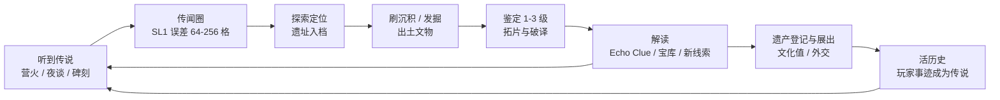
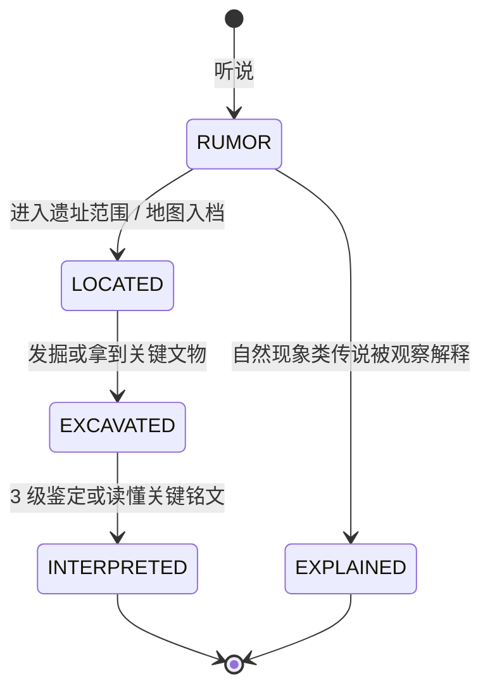

# 18 · 遗响 Echoes（`tcechoes`）

> **独立玩法**：遗迹、文明线索、地方传说与探索事件。
> **联动玩法**：世界历史能解释现有生态、技术和势力分布。世界历史模拟、遗迹、传说与古文物归 Echoes 所有。考古发掘的工具与地层记录属于 17 章 `tcdiscovery`，AI 文明的运行属于 23 章 `tcnations`，地图属于 22 章 `tcatlas`。

| 项 | 内容 |
| --- | --- |
| 模组 ID | `tcechoes` |
| Java 包 | `com.nightcity.echoes`（主类 `TEchoes`，游戏总线监听 `TEchoesEvents`，调试指令 `/tcechoes status`） |
| 必需依赖 | `tcivilization`（核心：文明记录、文明记忆、人物实体、地区附加层、HUD 与文明面板框架、`tc/history.bin` 存档路径） |
| 可选联动 | 其他所有主题模组。安装 `tctechnology` 后启用本模组科技与遗迹线索 Echo Clue。桥接类位于 `com.nightcity.echoes.compat.<other>`，用 `ModList.isLoaded` 守卫 |
| 拥有内容 | 世界历史预模拟与 `history.bin`；已消亡文明（`Civilization.kind = HISTORIC`）；遗迹结构集与风化；文化层与考古沉积方块；带来历的古文物；古文字与破译；传说、线索链与探索事件；古道、古矿坑、古港的历史数据；“活历史”（开局后的历史追加与遗迹化）；编年史书；遗产登记 |
| 不拥有 | 发掘工具、发掘网格、地层记录与发掘报告（17）；地图物品、地图库、`tcatlas:ancient_map` 的注册（22，内容由本模组提供）；AI 文明的运行与外交（23）；物种与种群（11）；地质、气候、矿床与自然地貌结构（10）；盗匪与特殊首领（20）；异界维度与怪物生成规则（21）；博物馆建筑识别（17 收藏、15 文化建筑）；法律与政策框架（19 Commons） |
| 相关决议 | DR-06 写实、DR-07 程序历史、DR-11 自然结构不含人造物、DR-17 无原版村庄、DR-18 原版怪物只在遗迹与影响区、DR-19 无个人生存、DR-24 文明共享科技、DR-25 技能中等影响、DR-28 HUD 极简 |
| 科技配额 | 7 项（附录 B），不含关键科技 |
| 存档 | `<world>/tc/history.bin`（世界历史，只读 + 追加，核心路径，03 §5.9）；`data/tcechoes.dat`（传说、线索、鉴定、遗产登记、活历史队列）；地区附加层 `tcechoes:history` |

---

## 1. 定位与设计支柱

遗响 Echoes 回答一个问题：**这个世界在玩家到来之前发生过什么？** 每个种子在开局前都会模拟约 5,000 年的历史。古代文化兴起、迁徙、互相征战，又在灾害与崩溃中衰亡。模拟的结果真实地落在地形上：

- 遗迹出现在古代文明真正定居过的河谷；
- 古道沿古代商路延伸；
- 古矿坑开在真实的矿床上；
- 猛犸象在被古人猎尽的大陆上已经消失；
- 存续下来的政体就是玩家日后遇到的 AI 文明，它们记得祖先的宿怨。

玩家不会读到一本完整的“世界史”，而是通过营火旁的传说、刻在石碑上的半懂不懂的文字、埋在土丘里的陶片，一点点拼出这段历史。

### 1.1 设计支柱

| 编号 | 支柱 | 含义 | 落地规则 |
| --- | --- | --- | --- |
| EP-1 | **历史是真的** | 每一处遗迹、每一则传说都对应模拟中的一个事件或地点，不存在凭空散布的废墟 | 遗迹只能由 `history.bin` 中的遗址记录或活历史生成（§5.4）；传说必须引用事件图中的节点（§5.6） |
| EP-2 | **现在由过去解释** | 现有的生态、技术与势力分布都能在历史中找到原因 | 物种灭绝记录、失传技术、AI 文明起源与宿怨、古道、古矿坑都由模拟输出（§5.3） |
| EP-3 | **线索而非答案** | 玩家得到的是有误差的传闻、残缺的铭文和需要比对的器物 | 传说精度链：传闻 → 定位 → 发掘 → 解读（§5.6）；鉴定分 3 级（§5.5） |
| EP-4 | **遗迹会老化** | 年代越久、气候越湿、材料越软，遗迹越残破 | 风化度 W 决定方块保留率、埋深与箱子是否存在（§5.4.3） |
| EP-5 | **历史在延续** | 开局之后发生的事同样会成为历史 | 被遗弃的聚落、覆灭的 AI 文明、沉没的船只会变成新遗迹；玩家的事迹会成为传说（§5.8） |
| EP-6 | **独立有趣，联合更深** | 只装核心 + 本模组也能完整游玩 | 无 Wildlands 时用原版群系近似地理；无 Discovery 时本模组自带鉴定台与 Y 键页签；无 Technology 时线索奖励改为文物、战利品与编年史条目（§2.4） |

### 1.2 归属与分工

| 事项 | 本模组 | 其他模组 |
| --- | --- | --- |
| 世界历史的生成 | 生成、写入 `history.bin`、提供只读视图 `WorldHistoryView` | 核心负责存档路径与编年史的“世界历史”切换（03 §5.9、§10.2） |
| 古代文明 | 创建 `HISTORIC` 文明记录（只读） | Nations 把存续政体转为 AI 文明并负责其运行（23 §5.1.1） |
| 遗迹 | 结构集、风格处理器、风化、战利品表、刷怪笼 | Wildlands 提供地质与岩石（10）；Frontiers 可让盗匪占据遗迹（20） |
| 考古 | 文化层方块、沉积方块、出土物与来历（`DigSiteProvider`） | Discovery 拥有工具、网格、地层记录与报告（17 §5.10） |
| 古文物鉴定 | 鉴定规则、古文字与语料、Echo Clue | Discovery 提供 1-2 级鉴定的观察与学者比对（17 §3.2）；Technology 结算知识与成本（04 §5.5） |
| 传说 | 文本模板、线索链、精度、揭晓 | Atlas 显示传闻圈与遗迹标记（22 §3.12） |
| 古地图 | `tcatlas:ancient_map` 与 `tcatlas:clay_tablet_map` 的**内容** | Atlas 注册物品并负责入库规则（22 §5） |
| 遗产保护 | 遗产登记、保护等级、对聚落与外交的效果 | Commons 提供政策框架（19）；Settlements 计算文化值（15） |

### 1.3 在开局流程中的位置

01 §8 的 0:00 场景是“星球生成与历史模拟进度屏（约 1-2 分钟），显示大陆轮廓与古代文明兴衰摘要”，由 Wildlands 与 Echoes 预计算。02 §6.1 的世界预计算流水线为：

```text
地质与气候（Wildlands，P0-P9） → 历史模拟（Echoes，≤ 30 s） → AI 文明播种（Nations） → 区块按需生成
```

历史模拟必须在玩家加入前完成，因为：遗迹的结构放置依赖遗址表；Nations 的播种依赖终态政体；出生点的“起源传说”（§2.1）依赖附近的遗址。

---

## 2. 独立玩法（只安装 `tcivilization` + 本模组）

### 2.1 第一小时：营火旁的故事

1. 新世界创建时，进度屏显示历史模拟：一张原版群系预览图，上面依次亮起古代文化的发源地，滚动字幕播报“−3,412 年，河湾人在红土河谷建立第一座城”“−611 年，大寒潮，北方诸城相继废弃”（§10.1）。
2. 玩家醒来后的第一个黄昏，营火旁出现一条**起源传说**（Origin Legend）。传说讲的是出生点 1,500 格内最近的一处 E0-E1 遗址，例如“长者说，祖先曾在西边的岩厦里画下野牛”。传说以 SL1 传闻圈的形式写入 Y 键日志（§10.2），误差 64-256 格。
3. 玩家循着方向找到 `tcechoes:rock_shelter`（岩画岩厦）：岩壁上有 `rock_art` 方块，地面有 `cultural_layer` 与 `artefact_deposit`。用原版刷子刷沉积，得到第一件古文物，例如“燧石刮削器 · 1 级 · 约 3,000 年前”。
4. 右键岩画方块“临摹”，获得 1 张 `rubbing`（拓片）。日志的“文字”栏出现第一种古代符号体系的条目，破译进度 0%。

### 2.2 中期：追索线索链

- **石碑与语料**：城址、神庙与墓地中的 `ancient_tablet`（古代碑刻）带有铭文。拓片越多，对该文字体系的掌握越高（§5.5.3）。读懂一块碑，会揭示一条新传说或一处新遗址。
- **线索链**：一条传说通常指向下一条，例如“王的陵墓在望得见三座山的地方”→ 图书馆遗迹中的碑刻 →“陵墓在盐湖以北两日路程”→ 遗址定位。链完成后王陵墓室开放：试炼刷怪笼守卫的 `minecraft:vault` 宝库，内有该文化的王权器物。
- **探索事件**：遗迹附近的短事件（§5.7），例如地面塌陷露出墓道、暴雨冲出陶罐、冬至日影指向石堆。只改变方块与掉落，不给玩家个人状态（DR-19）。
- **古文物鉴定**：在 `epigraphy_table`（碑铭台）上把文物鉴定到 2 级（文化与年代）。破译该文化的文字后，带铭文的文物可鉴定到 3 级（铭文内容）。

### 2.3 后期：遗产与编年

- **遗产登记**：玩家可把已发掘的遗址登记为“遗产”（J 面板 › 传说 › 遗址档案 › 登记），设定保护等级。受保护遗址内的方块破坏需要权限（`CivPermissions`），遗址的残存度不再因玩家活动下降。
- **纪念碑**：玩家用 `stele`（纪念碑）为自己的文明刻下纪念文字，写入文明记忆，并成为未来世界的“碑刻”（§5.8.3）。
- **编年史**：活历史把玩家文明的重大事件追加到 `history.bin`。在 J 面板的编年史页签中可以切换到“世界历史”时间轴（03 §10.2），看到自己的文明与古代文明处在同一条时间线上。

### 2.4 独立安装时的数据来源与降级

| 依赖缺失 | 本模组的替代 |
| --- | --- |
| 无 `tcwildlands` | 历史只覆盖出生点周围半径 `history.standalone_radius_regions`（默认 24 个地区，约 49 × 49 个地区）的“历史窗口”。宜居度由原版群系近似（§5.1.2）；无地质矿床时，古矿坑放在原版山地群系，矿种取原版矿石；无灾害模型时，灾害按群系概率抽取 |
| 无 `tcdiscovery` | 原版刷子可直接刷 `artefact_deposit`；镐挖文化层视为“扰动”。1-2 级鉴定在本模组的 `epigraphy_table` 完成。`Y` 由本模组注册，打开 `tcechoes:legends` 页签（31 §6.1） |
| 无 `tctechnology` | 不加载本模组科技；Echo Clue 不产生知识与折扣，改为在文物鉴定到 3 级时给一次“解读奖励”：遗址宝库开放、文化器物套组进度、编年史条目 |
| 无 `tcnations` | 存续政体只作为历史记录与传说存在，不实体化为 AI 文明；它们的城址在开局时视为“刚被遗弃”（风化度取下限） |
| 无 `tcatlas` | 传闻圈与遗址标记显示在日志页签的 `TcMapSnippet` 地图片段中；古地图战利品改为本模组的 `tcechoes:ancient_chart`，右键在地图片段上显示内容 |
| 无 `tcsettlements` | 活历史的遗迹化只来自 Nations 覆灭与载具事故；无文化值联动 |

只有核心 + 本模组时以上全部同时生效。独立安装时本模组只改动自己玩法确实需要的原版内容（30 VP-4）：§16 中所有“抑制原版结构”的开关在非星球模式下默认关闭。

---

## 3. 联动玩法

各小节说明“对方提供什么、本模组提供什么、缺失时怎样”。全部双向登记见附录 C。

### 3.1 tcivilization（文明核心，03 章，必需）

- **文明记录**：每个已消亡的古代政体在开局时创建一条 `Civilization`，`kind = HISTORIC`、只读。它们的名称、文化、旗帜图案用于遗迹中的旗帜、编年史与传说。03 §12.1 的 `createAiCivilization` 只创建 AI 文明，本章需要一个 `HISTORIC` 变体（§12.1，OQ-ECH-6）。
- **文明记忆**：订阅 `MemoryRecordedEvent`，按记忆类型与重要度生成传说（§5.6.4）。注册记忆类型 `tcechoes:ruin_found`、`legend_revealed`、`artefact_deciphered`、`heritage_designated`、`stele_raised`（§12.1）。
- **人物**：传奇人物使用 `PersonName.epithet`（传奇称号，例如“渡河者”）与 `ImportanceFlag.LEGEND`；带 `LEGEND` 标志的已故人物在活历史中保留 2 年作为传说主角（§5.8）。
- **地区附加层** `tcechoes:history`（§11.3），同步策略 `NEAR`。
- **编年史与 UI**：核心编年史页签出现“文明记忆 | 世界历史”切换（03 §10.2），本模组实现 `WorldHistoryView`。通知类别 `tcechoes:legend`、典礼“传说揭晓”、追踪类型与深链接见 §10.5。

### 3.2 tctechnology（科技核心，04 章）

- **Echo Clue**：鉴定到 3 级的文物和完整解读的传说，按来源政体在其鼎盛期掌握的科技给出 `ECHO` 类型知识，或者降低该科技 15%-50% 的 RP（01 §5.1、04 §5.5 的 `echo` 因子）。规则见 §5.5.6。
- **器物考察**：鉴定到 2 级的文物可在研究地点“检视”，按 04 的 `ARTIFACT` 来源给知识（0.25 × 阈值，掌握 `bronze/artifact_study` 后为 1.0 倍率，每物品每科技 1 次）。
- **科技**：本模组 7 项科技（附录 B）。前置只引用关键科技与本模组科技。
- **时代跃迁**：`EraAdvancedEvent` 写入活历史，作为世界历史时间轴上的节点。
- 缺失时：见 §2.4。

### 3.3 tcdiscovery（求知，17 章）

- **考古发掘**：本模组实现 17 的 `DigSiteProvider`（§12.1），告诉 Discovery 每一层的年代与文化；Discovery 负责发掘工具、网格、地层记录与发掘报告（17 §5.10）。出土物与来历组件由本模组生成。本模组的 `tctechnology:industrial/archaeology` 解锁 17 的 9 × 9 发掘网格。
- **鉴定**：观察（V）可到 1 级；Discovery 研究设施的学者比对可到 2 级；破译古文字可到 3 级（17 §3.2）。本模组的 `epigraphy_table` 仍可做单件比对，速度为设施的 0.5 倍。未经地层记录的出土物最高 1 级（17 §5.10）；原版考古的 `tcdiscovery:unknown_artifact`（30 VO-LT-03）在 1 级鉴定时转为带来历的文物（§5.5.7），仍受该上限约束。
- **夜谈与传说**：17 §5.3 的夜谈在参与人数 p ≥ 3 且有长者在场时，有 25% 概率触发“讲述传说”。本模组发布 `LegendToldEvent`（§12.2），Discovery 把它作为线索写入日志。
- **“龙骨”传说**：部分传说的真相是化石床（10 的 `tcwildlands:fossil_bed`）。Discovery 的化石鉴定与地质观察可把传说标记为“已解释”，额外给 `society` 与 `geology` 领域知识（§5.6.6）。
- **日志分区**：通过 `JournalSectionRegistry` 在 `tcdiscovery:journal` 中追加“遗迹与传说”分区（31 §5.5）。Discovery 在场时 Y 打开 Discovery 日志，本模组的 `tcechoes:legends` 页签仍可从 J 面板打开。
- **套组与回调**：17 的“古陶谱系”需 4 种文化的陶片（≥ 2 级），本模组另登记 3 个套组（§5.9.3）；`onDigCompleted` 回调揭示下一条线索。

### 3.4 tcwildlands（山河，10 章）

- **输入**：历史模拟在 `PlanetGeneratedEvent` 之后运行（10 §3.11），读取 `SuitabilityApi.citySiteScore` / `terrainCost`（选址、古道）、`GeoApi.depositSummary`（古矿坑）、`HazardApi.profile`（历史灾害）、`ClimateApi.normals`（宜居度与风化）、`HydroApi.basinId`（文化区）。
- **历史灾害痕迹**：本模组调用 `GeoApi.recordHistoricalTrace` 请求 Wildlands 生成“古地震断崖、古火山灰层、古洪水台地”（10 §3.11），作为传说的物理证据（§5.3.6）。
- **古矿坑与矿床**：古矿坑开在真实矿床上；玩家发现古矿坑时，本模组调用 `GeoApi.markDiscovered(depositId, civ, player, SENSES)`，相当于一次免费的地表勘探（§5.3.5）。
- **流域命名**：面积 ≥ 50,000 km² 的流域，若模拟中有文化长期定居，其名称改用该文化语言生成的名字（10 §5.5 的“可被 Echoes 覆盖”）。
- **岩石**：遗迹风格处理器用 `GeoApi.rockAt` 取当地岩石替换石材（§5.4.2），所以花岗岩山区的城址是花岗岩砌的。
- **进度屏**：本模组的历史模拟作为外部阶段登记到 Wildlands 的 10 §10.4 进度屏（核心 `PlanetProgressStages`，03 §12.5），排在星球生成阶段之后，沿用同一布局与大陆预览（§10.1）。
- 缺失时：历史窗口与原版群系近似（§5.1.2）。

### 3.5 tcecology（生息，11 章）

- **灭绝记录**：模拟记录古代猎杀（§5.1.6）。孑遗物种（11 的 `woolly_mammoth`、`aurochs`、`great_auk`、`island_dodo`、`passenger_pigeon`、`marsupial_wolf`）在某大陆的模拟种群降到 0 时，经 `EcologyApi` 把该大陆的初始分布设为 0，并写入“已灭绝物种”记录（11 §3）。
- **冻土遗骸**：`frozen_camp`（冻土营地）中有猛犸象等冻土遗骸方块（`tcechoes:frozen_remains`）。Ecology 的组织样本工具可对其右键获取 `tcecology:tissue_sample`，用于基因救援（11 §5.10）。
- **玩家导致的灭绝**：订阅 `SpeciesExtirpatedEvent`（局部灭绝）与 `SpeciesExtinctEvent`（全球灭绝），生成哀歌类传说（§5.6.4）。
- **圣林**：EHI 80-100 的地区可生成“圣林”传说；文明生态信誉决定传说基调（11 §5.7）。

### 3.6 tcnations（列国，23 章）

- **播种**：Nations 读取 `history.bin` 的终态，把存续政体按终态人口降序排列，取前 `ai_civ_count`（默认 8）个转为 AI 文明。名称、文化、首都地区、圣地、终态时代、宿怨与旧盟都来自模拟（23 §5.1.1）。本模组在 `WorldHistoryReadyEvent` 时提供这些数据（§12.2，OQ-ECH-3）。
- **宿怨与旧盟**：模拟中两个政体的战争与同盟写入关系表。Nations 把它们转为外交修正：世仇 −25（永久），旧盟 +15（192 日）（23 §6.4）。
- **祖地宣称**：已灭亡政体的遗址若位于 AI 文明领土内，且该 AI 文明与已灭亡政体同文化，该 AI 文明对遗址所在地区有 `ancestral_claim`（23 §5.4，E3）。
- **圣地**：AI 文明的性格 `devout` 会因玩家保护或开发其圣地而改变态度（23 §6.2）。本模组提供圣地列表，并把“进入圣地”“在圣地挖掘”通知 Nations。
- **写回**：订阅 `NationsCivFoundedEvent`、`NationsCivCollapsedEvent`、`NationsWarDeclaredEvent`、`NationsPeaceSignedEvent`。AI 文明覆灭时，其聚落若在所有玩家 512 格以外，由本模组转为遗迹（23 §5.7，本章 §5.8.2）。
- **遗民**：`remnant_warden` 谈判成功后（§3.12），Nations 在场时作为小型 AI 势力创建，缺失时只作为传说角色。

### 3.7 tcnetworks（通途，14 章）

- **古道**：模拟输出的古代商路与驿道（§5.3.4）。玩家可修复古道遗迹，修复段立即获得石板路品质并纳入路网（14 §3.7）。
- **古港与沉船**：`ancient_harbor` 与 `ancient_wreck` 可修复为码头与航线起点。原版沉船保留，其箱子在本模组安装时附加古代货包 `ancient_cargo_bundle` 与航海日志 `captains_log`（14 §16，30 VO-LT-04）。
- **新沉船**：订阅 `VehicleAccidentEvent`（沉没、坠毁），活历史把事故残骸登记为遗迹（§5.8.2）。

### 3.8 tcatlas（舆图，22 章）

- **要素与图层**：本模组实现 `MapFeatureProvider` 与 `MapLayerProvider`。已知遗址显示为 22 的 `ruin` 图标（拱门，红紫 #CC79A7）；传闻以 SL1 传闻圈显示，位置误差 64-256 格（22 §3.12）。
- **古地图**：`tcatlas:ancient_map` 由 Atlas 注册、无配方，本模组在遗迹箱子中生成它并填写内容：古代道路、城址、海岸线，带“资料年代”。入库后为 SL1-SL3 知识，可能已过时，例如古河道已改道（22 §5）。`tcatlas:clay_tablet_map`（陶板地图）也会作为古地图来源出现在遗迹中（22 §5.9）。
- **原版制图台**：原版制图台只能在未被 Settlements 抑制的原版村庄与本模组遗迹中找到（30 VO-RC-09）。本模组的城址与图书馆遗迹风格池中含制图台。

### 3.9 tcsettlements（聚落，15 章）

- **遗迹候选**：聚落人口为 0 持续 12 MC 日后标记为 `ABANDONED`（15 §5.2）。若持续遗弃满 `ruinify.abandoned_years`（默认 2 年）且无玩家在 512 格内，本模组把它遗迹化（§5.8.2）。
- **事件写入**：聚落成立、升级、大疫、首批毕业生写入文明记忆（15 §12），本模组据此生成地方传说。
- **文化值**：本模组实现 15 的 `CultureProvider`。纪念碑 `stele`、展出中的祖物龛 `relic_shrine` 与已登记的遗产为聚落贡献文化值（§5.9）。
- **满意度**：遗产被破坏时，通过 `SettlementApi.putModifier` 给相关聚落临时满意度 −5，持续 24 日（§5.9.2）。
- **博物馆**：Discovery 的博物馆（展示柜 + 标本柜）陈列本模组的文物时，文物的“展出”加成生效（§5.9.3）。

### 3.10 tcexchange（市集，16 章）

- **古物定价**：文物进入 16 的奢侈品类 `LUXURY`，价格 `P = B_artifact × 年代系数 × 品相 × 出处`，年代系数 = `1 + log10(1 + 年代/100)`，有明确出处 ×1.5（16 §3.11）。本模组提供 `B_artifact`（§6.3）、年代、品相与“明确出处”判定（鉴定 ≥ 2 级且遗址已入档，§5.5.8）。
- **盗掘**：`illicit` 文物在 Exchange 中带 `tcexchange:unprovenanced` 标记，合法市场 ×0.3 且可被查扣（16 §3.11）。
- **跨文明的 Echo Clue**：同一文物交给另一个文明可再产生一次 Echo Clue（§5.5.6），这是古物贸易的知识价值。

### 3.11 tccommons（契约，19 章）

- **文化遗产区与政策**：Commons 提供法律区域 `heritage`（文化遗产区）与政策 `heritage_protection`（19 §3）。政策生效后，本模组的 `PROTECTED` 遗址自动成为 `heritage` 区域，未经许可的挖掘记为违法，出土物标记 `illicit`。
- **发掘许可**：`heritage` 区域内的 `tcechoes:excavate` 需要法官或领袖签发的发掘许可（19 §5.2 权限表）。Commons 缺失时，`PROTECTED` 遗址只允许登记文明中有 `tcechoes:excavate` 权限的成员发掘（§9.2）。
- **权限解析**：遗址内的所有动作经 `CivPermissions.check(player, action, scope)`，由 Commons 的领地解析器裁决；动作 ID 见 §9.2。

### 3.12 tcfrontiers（远征，20 章）

- **历史危险分量**：Frontiers 的地区危险度中 H（历史）分量读取 `tcechoes:history` 层的危险标志：古战场 30、陷落王国 50、匪患传说 40、屠城遗址 70（20 §5.2）。
- **盗匪据点**：盗匪团选址优先使用本模组遗迹（20 §5.5）。被占据的遗迹在地图上显示为盗匪据点，清剿后恢复为遗迹。
- **遗民守军**：`remnant_warden` 只出现在“陷落王国”遗址（20 §5.6），可谈判（`diplomacy` ≥ 30，或带回该王国的王权器物）。
- **海寇传说**：`sea_raider_jarl` 需要所在海岸有“海寇传说”（20 §5.6）。本模组在模拟中为有海上劫掠事件的海岸生成该传说。
- **首领与战役写入历史**：已命名首领被击败、重大战役结束后写入活历史与编年史；同名首领再次出现需 ≥ 1 年（“后继者”，20 §5.6）。本模组提供后继者的称号。
- **远征目标与兵器**：线索链中遥远的遗址可作为远征目标（20 §5.9）；古代兵器作为文物展示或研究（20 §6.3）。

### 3.13 tcbeyond（异界，21 章，可选）

- **异教遗迹**：本模组的 `cult_sanctum`（异教圣所）带结构标签 `#tcechoes:cult_site`，成为 Beyond 的“碎塔”影响区焦点（21 §5.2.2）。Beyond 缺失时，它只是普通遗迹。
- **刷怪笼**：遗迹中的刷怪笼与试炼刷怪笼在 Beyond 的所有模式下都保留（21 §5.3）。原版怪物在遗迹附近的自然生成由 30 §3.4 的 `#tcivilization:monster_ruins` 标签控制，本模组提供 `#tcechoes:hostile_ruins`。
- **异界遗迹**：Beyond 的异界维度可登记本模组的“异界遗迹”风格池（§7.1 末），由 Beyond 决定放置，本模组只提供结构与传说模板。
- **写入历史**：界心大封印、屠龙、首次涌潮写入历史与传说（21 §3）。
- **写实约束**：Beyond 缺失或处于 `mundane` 模式时，传说中的超自然内容一律以“传说”口吻出现，真相在解读后为自然解释，例如“龙骨”是化石，“鬼火”是沼气（DR-06）。

### 3.14 tccultivation（田园，12 章）

- **古种子罐**：城址与村落遗迹的储藏室中有 `ancient_seed_jar`（古种子罐），内含已灭绝的地方品种基因（12 §3）。打开后得到 Cultivation 的种子物品，带古代品种性状。
- **农业事件写入传说**：“首个命名品种”“大饥荒”写入传说（12 §3）。
- **古代农业痕迹**：梯田遗迹 `terrace_temple` 周围的旧梯田与灌渠可直接复垦。

### 3.15 tcindustry（工坊，13 章）

- **古代工业遗址**：`furnace_site`（冶炼遗址）有废弃炉址、矿渣堆 `ancient_slag` 与古水车基座。掌握 `tctechnology:industrial/archaeology` 后，玩家可把它们修复为 Industry 多方块的“半成品”：结构已就位 60%，补齐缺失方块即可成形（13 §3.11）。
- **失传工艺**：某些文物带“失传工艺”标签，例如大马士革钢纹。鉴定到 3 级并破译后，解锁 Industry 的 Q4 品级稀有配方（13 §3.11）。
- **杰作文物候选**：Q4 `MASTERWORK` 署名物品记为文物候选（13 §6.4）；持有者死亡或聚落遗迹化时可成为未来的文物。
- **事故与矿渣**：`IndustryAccidentEvent` 写入活历史；`ancient_slag` 带 `c:slag` 标签，可在 Industry 再处理中回收少量金属。

### 3.16 tcorbit（寰宇，24 章）

- **文明纪元**：终局里程碑达成时触发“文明纪元”结算，本模组生成本文明的编年史书 `chronicle_book`（01 §3、24 §3）。Echoes 缺失时终局只写入核心编年史。
- **轨道考古**：掌握 Orbit 的遥感卫星后，Atlas 的卫星图层可显示被埋藏遗址的“作物痕迹”（W ≥ 0.9 的遗址，§5.4.3）。

### 3.17 tcskills（技能成长，05 章）

- 05 §3：遗迹解读、传说线索 → `exploration`（`range/reveal` 传闻圈误差、`yield/loot` 出土品相）与 `scholarship`（`speed/research` 破译、`precision/experiment` 鉴定）。只改善精度与速度，不作门槛（DR-25）。见 §15、附录 D。

---

## 4. 核心玩法循环



| 尺度 | 循环 | 典型时长 | 产出 |
| --- | --- | --- | --- |
| 微观 | 刷一格沉积 → 出土 → 观察鉴定 1 级 | 1-2 分钟 | 文物、拓片、少量 `exploration` 熟练度 |
| 中观 | 一条传说：传闻 → 定位 → 发掘 → 解读 | 1-3 个 MC 日 | 一处遗址档案、一组文物、一条后续线索、一次 Echo Clue |
| 宏观 | 一个古文化：收集语料 → 破译文字 → 读懂王表 → 打开王陵 | 一个时代以上 | 失传技术折扣、王权器物、遗民或祖地外交、文化套组 |
| 世界 | 古文明史 → 现代格局 → 玩家事迹 → 编年史书 | 整局 | 编年史“世界历史”时间轴、终局编年史书 |

---

## 5. 系统规则与公式

### 5.1 世界历史预模拟

#### 5.1.1 网格与输入

模拟单位是**历史格**，一个历史格等于核心的一个地区（512 × 512 格）。

| 模式 | 范围 | 历史格数 | 宜居度 H 的来源 |
| --- | --- | --- | --- |
| 星球模式（`tcwildlands` 在场） | 整颗星球：320 × 160 地区，X 方向在 163,840 格处环绕 | 51,200（陆地通常 12,000-18,000） | `SuitabilityApi.citySiteScore` 在地区内 4 个采样点的最大值；气候来自 `ClimateApi.normals` |
| 独立模式 | 出生点周围半径 `history.standalone_radius_regions`（默认 24，即 49 × 49） | 2,401 | 群系 8 × 8 采样，权重见 §5.1.2 |

```text
星球模式：H(r) = clamp( max(S_i) / 100 , 0, 1 )        S_i = citySiteScore(采样点 i)，i = 1..4
独立模式：H(r) = Σ w(biome_j) / 64                      j = 1..64（8 × 8 采样）
海洋格：H = 0，只作为航路与沉船位置
```

模拟只在地区中心采样，不生成区块。所有输入 API 都是只读的，可在后台线程调用（10 §12）。

#### 5.1.2 无 Wildlands 时的群系近似

| 群系类别（原版标签） | 宜居权重 w | 默认建筑风格 | 矿床近似 |
| --- | --- | --- | --- |
| 平原、森林、草甸、河流（`c:is_plains`、`c:is_forest`、`c:is_meadow`、`c:is_river`） | 1.0 | timber / rammed_earth | 无 |
| 针叶林、热带草原（`c:is_taiga`、`c:is_savanna`） | 0.7 | timber / drystone | 无 |
| 丛林、沼泽（`c:is_jungle`、`c:is_swamp`） | 0.5 | terraced / timber | 无 |
| 沙漠、恶地（`c:is_desert`、`c:is_badlands`） | 0.2 | mudbrick | 恶地：金 |
| 冻原、山地（`c:is_snowy`、`c:is_mountain`） | 0.2 | drystone / cave_cut | 山地：铁、铜、煤 |
| 海洋（`c:is_ocean`） | 0 | — | — |

权重与 23 §5.1.2 的选址权重一致，避免 Nations 与本模组对“好地方”的判断不同。灾害在独立模式下按群系抽取：河流与沼泽有洪水，山地有地震与滑坡，沙漠有旱灾，冻原有寒潮。

#### 5.1.3 时间与阶段

模拟从 −5,000 年到 −1 年，每步 10 年，共 500 步。0 年是玩家到来的那一年。

| 阶段 | 年份 | 特征 | 典型遗迹 |
| --- | --- | --- | --- |
| 黎明 | −5,000 至 −3,500 | 采集与早期农业；文化发源地出现 | `camp_remains`、`rock_shelter`、`frozen_camp`、`megalith` |
| 古典 | −3,500 至 −1,500 | 城邦与文字；第一批长途商路 | `tell`、`barrow`、`village_ruin`、`city_ruin`、`temple_ruin` |
| 鼎盛 | −1,500 至 −300 | 帝国、水道、大型墓葬与图书馆 | `fortress_ruin`、`aqueduct_ruin`、`necropolis`、`library_ruin`、`observatory_ruin` |
| 黄昏 | −300 至 −1 | 大崩溃：气候异常、瘟疫、连锁崩溃；存续者退回 E0-E2 | `battlefield`、`sunken_city`、遗弃的城址 |

**大崩溃**：在 −300 至 −150 年之间（由种子决定）开始，持续 3-6 步。期间陆地承载力 ×0.7，每个政体每步有 0.15 的概率暴发瘟疫，稳定度每步额外 −0.08。

这解释了“失传技术”：鼎盛期政体曾达到 E3-E5，而存续者大多只剩 E0-E2，许多技术只留在遗迹与文物里（§5.3.2）。

#### 5.1.4 古代文化

黎明阶段开始时生成 `history.culture_count` 个文化（默认 12，范围 8-16）。

- **发源地**：在 H ≥ 0.6 的历史格中按 H 加权抽取，两两间隔至少 20 个地区（独立模式 6 个）。每个文化有以下属性：

| 属性 | 取值 | 用途 |
| --- | --- | --- |
| 语言 | 音素表 + 音节结构（由种子派生的 8 种模板之一） | 人名、地名、政体名、流域名；破译后的铭文译文 |
| 文字 | `NONE` / `PICTOGRAPHIC` / `LOGOGRAPHIC` / `SYLLABIC` / `ALPHABETIC` | 文化首次达到 E2 时获得，类型按语言模板抽取；决定破译规则（§5.5.3） |
| 建筑风格 | 主风格 + 次风格（§5.4.2） | 遗迹方块风格 |
| 葬俗 | 土丘墓 `barrow`、墓城 `necropolis`、火葬（无墓）、岩墓 `cave_cut` | 墓葬遗迹类型与陪葬品 |
| 纹样 | 8 种陶器纹样之一：几何、绳纹、彩绘、动物、植物、螺旋、人面、波浪 | 陶片与陶器外观；“古陶谱系”套组 |
| 神祇领域 | 太阳、河流、山岳、海洋、祖先、猛兽 | 神庙朝向与传说母题；AI 文明的圣地 |

文化之间的“文化距离” d(a, b) ∈ [0, 1] 由语言模板、文字类型与风格差异计算，用于战争张力与破译时的“同源”加成。

#### 5.1.5 政体动态

每个政体占有若干历史格，有首都、文化、时代、人口、稳定度与侵略性。政体总数上限 2,048，超过时最小的政体被并入邻居。每步按以下顺序执行：

```text
1. 承载力   K(r,t) = K0 · H(r) · techMult(era) · climate(t) · hazardScar(r,t)
            K0 = 4,000 人 / 历史格
            techMult: E0 0.3 · E1 1.0 · E2 1.6 · E3 2.2 · E4 3.0 · E5 4.0
            climate(t) = 1.0，大崩溃期间为 0.7
            hazardScar = 1 − 0.5 · 本地 50 年内重大灾害的严重度
2. 增长     P' = P + ρ · P · (1 − P / K)          ρ = 0.15 / 步（E0 为 0.075）
3. 迁徙     P > 0.9 K 时迁出比例 m = 0.2 · min(1, (P/K − 0.9) / 0.1)
            目标格 = argmax[ H(n) − 0.1 · terrainCost(r→n) − 0.3 · 有主(n) ]
            迁入无主格 → 扩张领土；跨越文化发源地 > 30 地区 → 以 0.3 的概率分化为新政体
4. 复杂度   C' = C + log10(ΣP) · (1 + 0.2 · 贸易伙伴数) · (1 − 0.5 · 战争中)
            时代阈值：E1 40 · E2 160 · E3 480 · E4 1,200 · E5 3,000（模拟上限 E5）
5. 战争     对每对接壤政体 (a, b)：
            tension = clamp(0.5 · 资源压力 + 0.3 · d(a,b) + 0.2 · 宿怨, 0, 1)
            p_war  = aggression_a · tension · 0.05
            战力 F = ΣP · eraMult · (1 + 0.1 · 盟友数)，eraMult = 1 + 0.4 · era
            胜方概率 = F_a / (F_a + F_b)；败方失去 1-3 个边境格
            攻陷首都时 0.1 的概率为“屠城”（记为 SACK 事件，生成屠城遗址）
6. 灾害     每格 p = 10 · 年发生率（HazardApi.profile；独立模式按群系）
            严重度 s ∈ [0, 1]，人口损失 0.2 · s – 0.6 · s
7. 稳定度   S' = S + 0.02 − 0.10 · 战争数 − 0.15 · Σs − 0.05 · max(0, 格数 / 治理上限 − 1) − 瘟疫 0.2
            治理上限 = 4 · (era + 1)²；S 初值 0.6，上限 1.0
8. 崩溃     S < 0 → 政体解体：每块连通领土以 0.5 的概率成为后继政体（继承文化与时代 −1），
            否则人口 × 0.3 并成为无主格；首都与大城生成遗址
```

侵略性 aggression ∈ [0.2, 1.0] 在政体建立时抽取，受神祇领域影响：猛兽 +0.2，祖先 −0.1。

#### 5.1.6 狩猎与灭绝

模拟为每个大陆跟踪 6 个孑遗物种的“历史种群”。种群在黎明阶段为满值；古代人口带来的狩猎压力按下式消耗种群：

```text
N' = N + 0.05 · N · (1 − N / Nmax) − h · Σ(该物种栖息格上的人口) / 10,000
h：woolly_mammoth 0.08 · aurochs 0.05 · great_auk 0.06 · island_dodo 0.12 · passenger_pigeon 0.02 · marsupial_wolf 0.04
```

种群降到 0 的大陆写入 `HUNT_EXTINCTION` 事件。Ecology 在场时，该物种在该大陆的初始分布为 0（§5.3.1）。若所有大陆都灭绝，至少保留 1 个冻土遗骸点。

#### 5.1.7 人物与事件

- **事件图**：每次建立、迁徙、战争、战役、屠城、同盟、崩溃、灾害、发明（时代晋升）、营造纪念物、狩猎灭绝、瘟疫、饥荒、海上劫掠、异教兴起、远征失踪都写入一个 `HistoryEvent`。事件之间用边连接，边的类型有：起因、参与、继承、结盟、世仇。上限：事件 60,000，边 120,000。超出时按重要度保留，被删除事件的边并入其起因事件。
- **人物**：每个政体在建立、时代晋升、重大战争、崩溃时生成具名人物（开国者、王、将军、先知、探险者、工匠）。上限 4,096 人。人物有名、称号、生卒年、所属政体与事迹（事件 ID 列表）。
- **重要度**：

```text
importance = 10 · log10(受影响人口 + 1) + 20 · [首都相关] + 15 · [造成崩溃或灭绝] + 5 · 参与人物数
```

  重要度 ≥ 40 的事件可成为传说母本（§5.6）；≥ 60 的事件出现在进度屏字幕（§10.1）。

#### 5.1.8 存续政体与交接

模拟结束时存活的政体按终态人口降序排列。前 `ai_civ_count` 个（由 Nations 的配置决定，默认 8）标记为 `SURVIVOR`，交给 Nations（§3.6）。其余存活政体标记为 `REMNANT`（遗民），只作为传说与遗址存在，可由 Frontiers 的遗民守军与 Nations 的小型势力使用。所有已灭亡政体创建 `HISTORIC` 文明记录。

### 5.2 确定性、存档与开局时机

#### 5.2.1 确定性

```text
historySeed = worldSeed ^ 0x4543484F4553L                         // "ECHOES"
rand(step, region, channel) = SplitMix64(historySeed ⊕ hash(region) ⊕ step·0x9E3779B97F4A7C15 ⊕ channel)
```

- **并行阶段**（增长、灾害、狩猎）：每个历史格独立计算，使用双缓冲，读上一步、写下一步，按历史格并行。
- **串行阶段**（迁徙、战争、崩溃、事件编号）：按政体 ID 升序依次处理。不迭代 `HashMap`，只用有序数组与 `Int2ObjectAVLTreeMap`。
- 所有浮点运算只用 `double` 与 `StrictMath`。同一种子、同一 `generatorVersion`、同一输入必须生成**逐字节相同**的 `history.bin`（验收 AC-ECH-1）。
- 星球模式的输入来自 Wildlands 的确定性结果；独立模式的输入来自原版群系源（同种子确定）。

#### 5.2.2 开局时机

| 情形 | 触发 | 行为 |
| --- | --- | --- |
| 新世界 + 星球模式 | `PlanetGeneratedEvent(freshlyGenerated = true)` | 在玩家加入前同步完成（后台线程 + 进度屏），然后发布 `WorldHistoryReadyEvent(freshlyGenerated = true)` |
| 新世界 + 独立模式 | `ServerStartingEvent`，世界没有 `history.bin` 且出生点区块尚未生成 | 同上，窗口以世界出生点为中心 |
| 已有世界中途加入本模组 | `ServerStartingEvent`，世界没有 `history.bin` 但已有区块 | 照常模拟，`freshlyGenerated = false`。遗址只放在尚未生成的区块；传说只指向未生成区块中的遗址；Nations 不重新播种（23 自行判断）；物种灭绝记录只写入编年史，不改变已存在的种群 |
| 已有 `history.bin` | `ServerStartingEvent` | 读取并校验头部；`generatorVersion` 不同时只读，不重算（OQ-ECH-9） |
| 本模组移除 | — | `history.bin` 与 `tcechoes.dat` 保留；遗迹主体由原版方块砌成，保留；本模组方块按缺失注册处理（§16.4）；核心编年史的“世界历史”切换消失（31 §17） |

#### 5.2.3 `history.bin`

| 区段 | 内容 | 上限 |
| --- | --- | --- |
| 头部 | 魔数 `TCH1`、格式版本、`historySeed`、`generatorVersion`、模式 `PLANET`/`STANDALONE`、历史窗口、起止年份 | 64 字节 |
| cultures | 文化 | 32 |
| polities | 政体（含终态与 `SURVIVOR`/`REMNANT`/`EXTINCT`） | 2,048 |
| persons | 人物 | 4,096 |
| events | 事件 | 60,000 |
| edges | 事件边 | 120,000 |
| sites | 遗址 | 12,000 |
| routes | 古道与航路（折线，每条 ≤ 64 点） | 3,000 |
| mines | 古矿坑与采石场 | 2,000 |
| legend_seeds | 传说母本 | 20,000 |
| region_index | 历史格 → 遗址、事件、传说母本的索引 | 每格 ≤ 16 遗址 |
| live_log | 活历史追加记录（§5.8） | 每年压缩一次 |

每个区段单独用 Deflate 压缩。目标：未压缩 ≤ 12 MB，压缩后 ≤ 4 MB。文件位于核心约定的 `<world>/tc/history.bin`（03 §5.9）。本模组缺席时文件不存在，核心的历史读取返回空视图。写入使用“写临时文件 → 原子替换”，追加记录只在自动保存时落盘。

### 5.3 历史如何解释现状

| 现状 | 历史原因 | 本模组的输出 | 消费方 | 对方缺席时 |
| --- | --- | --- | --- | --- |
| 某大陆没有猛犸象或原牛 | 古代人口猎尽（§5.1.6） | 灭绝记录、冻土遗骸点、哀歌传说 | Ecology 初始分布 | 只有传说与遗骸方块 |
| 某些科技研究更便宜 | 鼎盛期政体曾掌握，大崩溃后失传 | 文物的 `sourceTechs`、Echo Clue | Technology 的 `echo` 因子 | 只有解读奖励 |
| AI 文明的位置、文化、宿怨 | 存续政体与战争史 | `SURVIVOR` 政体、关系表、圣地、祖地 | Nations 播种与外交 | 只作为传说 |
| 荒野中有古道和古港 | 古代商路与航路 | `routes`、`ancient_road`、`ancient_harbor` | Networks 修复入网 | 遗迹可见，不入网 |
| 某座山有古老坑道 | 古代对真实矿床的开采 | `mines`、`ancient_mine`、矿床已采比例 | Wildlands 矿床、Industry 矿渣 | 原版山地近似 |
| 某地危险 | 古战场、陷落王国、屠城、匪患 | `tcechoes:history` 层的危险标志 | Frontiers 的 H 分量 | 只有传说 |
| 地表断崖、火山灰层 | 历史地震与火山 | `HistoricalTrace` 请求 | Wildlands 地貌 | 无 |

#### 5.3.1 物种分布

灭绝记录以 `(continentId, speciesId, year, causeEventId)` 写入。Ecology 初始化种群时调用 `WorldHistoryView.extinctions(continentId)`。另有两类正向记录：

- **圣林**：古代神祇领域为“猛兽”或“山岳”的圣地，若当前 EHI ≥ 80，生成“圣林”传说，该地的旗舰物种在 Ecology 的初始分布中 ×1.5；
- **驯化起源**：文化发源地附近的原版家畜群系加权 ×1.2，并以传说讲述“第一头被驯服的牛”。

#### 5.3.2 失传技术

每个政体在鼎盛期的时代为 `peakEra`。对于其文物，`sourceTechs` 取该政体 `peakEra` 内由本模组标签 `#tcechoes:lost_knowledge` 圈定的科技中的 1-3 项（按文物类型筛选，例如青铜器指向冶金，碑刻指向文字与历法，水道遗迹指向工程）。

```text
失传 = peakEra(源政体) > max(era(所有存续政体))，且该科技属于 peakEra 或更早
```

只有“失传”的科技可以获得 Echo Clue 的 RP 折扣；未失传的科技只获得 `ARTIFACT` 知识（§5.5.6）。标签 `#tcechoes:lost_knowledge` 的默认内容见 §7.6。

#### 5.3.3 势力分布

- 存续政体的首都历史格成为 AI 文明首都所在地区；其领土成为初始势力范围。
- 两个存续政体若在模拟中交战 ≥ 2 次，或发生过屠城，记为世仇；同盟 ≥ 50 年记为旧盟。
- 圣地：神庙遗迹、大型墓葬，以及与开国者事迹相关的遗址。

#### 5.3.4 古道与航路

- 每对有贸易关系、且连续 ≥ 100 年的政体首都之间，用 `SuitabilityApi.terrainCost`（独立模式用群系坡度近似）求最低代价路径，简化为 ≤ 64 点的折线。
- 沿线每 1,500-3,000 格放置 `waystation_ruin`（驿站遗址）。
- 海上贸易生成航路；航路沿线按海难事件放置 `ancient_wreck`。
- 古道的遗迹形态为碎石路面段（`ancient_road`），每段 16-48 格，段间残缺。风化见 §5.4.3。

#### 5.3.5 古矿坑

```text
候选矿床：Deposit.surfaceSigns = true 且距古代定居格 ≤ 4 地区
开采年数 Y = Σ 该矿床被定居格覆盖的年数
已采比例 minedFraction = min(0.6, Y / 3,000 · 规模系数)，规模系数：小 1.5 · 中 1.0 · 大 0.6
```

`ancient_mine` 的坑道沿矿体走向延伸，坑道长度与 minedFraction 成正比。本模组通过 `GeoApi.recordHistoricalTrace(ANCIENT_WORKINGS, …, minedFraction)` 通知 Wildlands，由 Wildlands 决定是否扣减矿床吨位（OQ-ECH-5）。玩家进入古矿坑的主坑道时，该矿床以 `ProspectMethod.SENSES` 标记为已发现。

#### 5.3.6 历史灾害痕迹

重大灾害事件（严重度 ≥ 0.7）请求 Wildlands 生成物理痕迹：

| 灾害 | 痕迹类型 | 外观（由 Wildlands 决定） | 传说 |
| --- | --- | --- | --- |
| 地震 | `FAULT_SCARP` | 断崖、错位地层 | “大地裂开吞没了王城” |
| 火山 | `ASH_LAYER` | 地层中的凝灰岩夹层 | “天降灰雨三年” |
| 洪水 | `FLOOD_TERRACE` | 河岸阶地与淤泥层 | “洪水淹没了平原上的七城” |
| 古矿 | `ANCIENT_WORKINGS` | 坑道与废石堆 | “山里的人挖出了太阳的颜色” |

被灾害毁灭的城址，若有 `ASH_LAYER` 痕迹，其文化层中夹一层火山灰（`artefact_deposit[matrix=ash]`），出土品相 +1 级（灰烬封存）。

### 5.4 遗迹的放置、风格与风化

#### 5.4.1 遗址的产生

每个政体在模拟中的每个“定居格”都会留下遗址候选。候选按下表转换为遗址类型，再按每格 ≤ 16 处与全局 12,000 处的上限按重要度保留。

| 来源 | 条件 | 遗址类型 |
| --- | --- | --- |
| 黎明期营地 | 人口 < 500 且时代 E0 | `camp_remains`；岩石山地为 `rock_shelter`；冻原为 `frozen_camp` |
| 纪念物 | 时代 E1-E2，神祇领域为太阳或祖先 | `megalith` |
| 墓葬 | 葬俗为土丘墓或墓城；按王与名人的死亡事件 | `barrow`（E1-E3），`necropolis`（E2-E4） |
| 长期定居 | 同一格连续定居 ≥ 800 年 | `tell`（土丘遗址，多文化层叠压） |
| 村落 | 人口 500-3,000 | `village_ruin` |
| 城市 | 人口 ≥ 3,000 或首都 | `city_ruin` |
| 神庙 | 首都或圣地；丛林与梯田地形 | `temple_ruin`；梯田地形为 `terrace_temple` |
| 异教 | `HERESY` 事件 | `cult_sanctum`（带 `#tcechoes:cult_site`） |
| 要塞 | 边境格且发生过 ≥ 2 次战争 | `fortress_ruin` |
| 战役 | `BATTLE` 事件重要度 ≥ 40 | `battlefield` |
| 矿业 | §5.3.5 | `ancient_mine`、`ancient_quarry`、`furnace_site` |
| 交通 | §5.3.4 | `ancient_road`、`waystation_ruin`、`ancient_harbor`、`ancient_wreck` |
| 工程 | 时代 ≥ E3 的首都，地势落差 ≥ 20 格 | `aqueduct_ruin` |
| 学术 | 时代 ≥ E2 且有文字 | `observatory_ruin`、`library_ruin` |
| 沉没 | 沿海城市 + 地震或洪水灾害 | `sunken_city` |

遗址的精确位置在历史格内用 `rand(region, SITE)` 抽取，并避开海洋、陡坡（坡度 > 0.6）与河道中心。星球模式下优先选 `citySiteScore` 最高的采样点。

#### 5.4.2 放置与风格

- 本模组注册结构放置类型 `tcechoes:history_sites`。它不使用间距与随机偏移，而是查询遗址表：区块 `(cx, cz)` 是否为某遗址的起始区块。查询经 `region_index` 是 O(1) 的，因此 `/locate structure tcechoes:city_ruin` 可用。
- 每种遗址对应一个结构集 `tcechoes:<site_type>`，结构使用拼图模板池（jigsaw）。模板用“参考调色板”搭建，由处理器 `tcechoes:style/<style>` 替换为风格方块，并用 `GeoApi.rockAt` 取当地岩石（独立模式取群系的原版石材）。

| 风格 | 墙 | 地面 | 屋顶 / 梁 | 装饰 | 典型地区 |
| --- | --- | --- | --- | --- | --- |
| `mudbrick`（泥砖） | 泥砖、泥土 | 夯土（粗泥土） | 无（塌落） | 赤陶、陶罐 | 干旱河谷 |
| `rammed_earth`（夯土） | 粗泥土、泥砖 | 泥土 | 原木残梁 | 赤陶 | 黄土与草原 |
| `timber`（木构） | 原木、木板 | 泥土 | 腐朽木板 | 篝火灰烬 | 森林 |
| `drystone`（干砌石） | 当地圆石、苔石 | 砂砾 | 无 | 石砖 | 山地与冻原 |
| `ashlar`（方石） | 当地岩石砖、錾制岩石 | 石板 | 石台阶 | 柱、雕纹石砖 | 鼎盛期首都 |
| `megalithic`（巨石） | 当地岩石整块 | 草地 | 无 | 苔石 | 黎明至古典期 |
| `terraced`（梯田） | 当地岩石、苔石 | 泥土、耕地 | 无 | 藤蔓 | 丛林与山坡 |
| `cave_cut`（岩凿） | 原岩 | 原岩 | 原岩 | 雕纹石砖 | 悬崖与峡谷 |

#### 5.4.3 风化与埋藏

遗址年龄 A（年）= 0 − 遗弃年份；活历史产生的遗迹为“游戏内已过年数”。

```text
W = 1 − exp( − A · k_clim / τ )
τ（材料寿命，年）：mudbrick 400 · rammed_earth 600 · timber 250 · drystone 1,500 · ashlar 2,500 · megalithic 6,000 · terraced 2,000 · cave_cut 8,000
k_clim = 1 + 0.6 · humidity + 0.4 · freezeThaw          humidity、freezeThaw ∈ [0, 1]，来自 ClimateApi 或群系
方块保留概率  P_keep(h) = clamp( 1 − W · (0.5 + h / H), 0, 1 )      h = 方块离地高度，H = 结构高度
破损替换概率  P_crack = W · 0.6                                     石砖 → 裂纹石砖 / 苔石砖，原木 → 剥皮原木
埋深          D = min(6, round( A / 800 · sedimentRate ))           sedimentRate：冲积平原 2、沙漠 1.5、其他 1
```

| W | 状态 | 外观 | 内容物 |
| --- | --- | --- | --- |
| < 0.2 | 完好 | 墙体基本完整，有屋顶 | 箱子、陶罐 |
| 0.2-0.45 | 残破 | 墙高减半，屋顶塌落 | 箱子减半，其余变为陶罐 |
| 0.45-0.7 | 废墟 | 只剩墙基与柱础 | 无箱子；`artefact_deposit` 代替 |
| 0.7-0.9 | 遗址 | 地表只见石堆与土丘 | 全部为文化层与沉积 |
| ≥ 0.9 | 埋藏 | 地表无痕迹，只有作物痕迹（§3.16） | 埋深 D 下的文化层 |

结构的地下部分（墓室、地窖、坑道）不受 h 项影响，只按 `P_keep = 1 − 0.3 · W` 保留，因此地表已埋藏的遗址仍可能有完整的墓室。

### 5.5 古文物、鉴定与破译

#### 5.5.1 来历组件

每件古文物带数据组件 `tcechoes:provenance`（§11.2）：

| 字段 | 含义 | 何时可见 |
| --- | --- | --- |
| `siteId` | 出土遗址 | 拾取即可见（未定位遗址显示“不明地点”） |
| `cultureId` / `polityId` | 文化 / 政体 | 2 级 |
| `periodYear` | 年代（鉴定后显示区间，3 级为精确到 10 年） | 1 级显示“约 N 千年前”，2 级显示 ±100 年 |
| `context` | `IN_SITU`（原位，刷子或网格发掘）/ `STRATIFIED`（有地层记录）/ `DISTURBED`（镐挖或扰动）/ `UNKNOWN`（战利品、交易） | 拾取即可见 |
| `condition` | 品相 0-100 | 1 级 |
| `appraisal` | 鉴定级别 0-3 | 始终 |
| `inscriptionId` | 铭文（可空） | 3 级显示译文 |
| `sourceTechs` | 关联科技（§5.3.2） | 3 级 |
| `finder` | 发现者所属文明 | 始终 |
| `illicit` | 来历不明（受保护遗址未经许可出土） | 始终 |

原版的纹饰陶片、纹饰陶罐与盔甲纹饰模板若出自本模组遗迹或被本模组收养的原版考古结构，也带该组件，因此原版物品同样可以鉴定与收藏。

#### 5.5.2 出土品相

```text
condition = round( 100 · (1 − 0.6 · W) · matrix · tool · ctx + noise )      clamp 5..100
matrix：ash 1.2 · clay 1.1 · sand 1.0 · soil 0.9 · gravel 0.8
tool：刷子 1.0 · Discovery 发掘工具按 17 §5.10 · 镐 0.4
ctx：地下墓室 / 地窖 1.1 · 其他 1.0
noise：均匀分布 ±8，exploration 的 yield/loot 加成把下限抬高（附录 D）
```

#### 5.5.3 鉴定级别

| 级别 | 方法 | 揭示内容 | 产出 |
| --- | --- | --- | --- |
| 0 未鉴定 | — | 物品类别、出土地点、出土情境 | — |
| 1 观察 | 手持文物按 V（Discovery 的观察）或在 `epigraphy_table` 上“粗看”（1 秒） | 材料、品相、约略年代 | `exploration` 2；传说进度（若文物来自传说遗址） |
| 2 比对 | Discovery 的研究设施由学者比对（17 §3.2）；或 `epigraphy_table` 单件比对（需 `bronze/epigraphy`，无 Technology 时不需要） | 文化、政体、年代 ±100 年；文物可交易、可计入收藏套组 | 04 的 `ARTIFACT` 知识；`scholarship` 5 |
| 3 解读 | 该文化文字的掌握度 M ≥ 60（无铭文的文物：同政体已有 ≥ 3 件 2 级文物） | 铭文译文、精确年代、关联科技 | Echo Clue（§5.5.6）；新传说或线索；`scholarship` 15 |

- Discovery 在场时，`DISTURBED` 或 `UNKNOWN` 的文物最高只能鉴定到 1 级（17 §5.10 的地层背景规则）。
- 独立安装时，刷子出土视为 `IN_SITU`，镐挖为 `DISTURBED`，上限同上。
- 2 级比对时间：设施由 17 决定；`epigraphy_table` 单件为 `200 / (1 + scholarship 速度加成)` tick。Discovery 在场时 `epigraphy_table` 的速度 ×0.5（§3.3）。

#### 5.5.4 古文字与破译

每个文明对每种古文字有掌握度 M ∈ [0, 100]，由文明共享（DR-24）。

```text
每份新的铭文拓片或读过的碑刻：ΔM = base(type) · (1 + 0.5 · cognate) · techMult · (1 + speedBonus(scholarship))
base：PICTOGRAPHIC 6 · LOGOGRAPHIC 2 · SYLLABIC 4 · ALPHABETIC 5
cognate = 1：存在已破译（M ≥ 80）且文化距离 d < 0.3 的同源文字
techMult：PICTOGRAPHIC 需 oral_epics（无时 0.5）；LOGOGRAPHIC 需 epigraphy（无时 0）；
          SYLLABIC / ALPHABETIC 需 philology 才能超过 M = 40（之前 ×0.5，之后 ×1）
双语碑：若碑上另一种文字 M ≥ 60，则本文字 M 立即 +25（每块双语碑每文明 1 次）
无 Technology 时 techMult 恒为 1
```

| M | 阅读能力 |
| --- | --- |
| 0-29 | 只能认出“这是文字”，可以收集拓片 |
| 30-59 | 读懂大意：铭文的人名、地名可用于传说定位（误差 × 0.7） |
| 60-89 | 可做 3 级鉴定；碑刻揭示完整线索 |
| ≥ 90 | 全文：额外揭示同一文化的全部 `REMNANT` 政体名称与王表 |

同一铭文只计一次。拓片 `tcechoes:rubbing` 可堆叠、带铭文 ID，可交易；交给其他文明的拓片也能让对方提升 M。

#### 5.5.5 铭文的种类

铭文由事件图生成，译文用语言模板与该文化的人名、地名填充。

| 种类 | 出现位置 | 生成来源 | 揭示内容 |
| --- | --- | --- | --- |
| 王表 | 城址宫殿、神庙 | 政体的王与在位年份 | 王陵线索链的第一环 |
| 界碑 | 古道、要塞 | 政体边界 | 古国疆域（Atlas 古地图图层） |
| 献辞 | 神庙、圣所 | 营造纪念物事件 | 圣地；Nations 圣地标记 |
| 法典 | 城址、图书馆 | 时代晋升事件 | `sourceTechs` 指向制度类科技 |
| 诅咒 | 墓葬入口 | 王与名人的死亡事件 | 墓室位置；“盗墓者的下场”传说 |
| 星表 | 天文台 | 发明事件 | `sourceTechs` 指向历法与天文 |
| 战记 | 战场、要塞 | 战役事件 | 战场位置；宿怨原因 |
| 商契 | 古港、驿站 | 贸易关系 | 古道走向与沉船线索 |

#### 5.5.6 Echo Clue

3 级文物或已解读的传说，对其 `sourceTechs` 中的每项科技产生一次线索：

```text
discount(t) = clamp( 0.15 + 0.05 · (同一政体已解读文物数 − 1) + 0.10 · [文物属王权或学术类], 0.15, 0.50 )
echo(t)     = 1 − max_{全部线索} discount(t)                        // 04 §5.5 成本公式中的 echo 因子
地板        cost(t) ≥ ceil(0.40 · rp_base · techCost)               // 04 的总折扣下限，由 04 执行
```

- 只有“失传”科技（§5.3.2）获得折扣；其余科技改为 `TechApi.addKnowledge(civ, t, ECHO, ceil(discount · threshold(t)))`。
- 每件文物对每个文明的每项科技只生效一次；同一文物交给其他文明可再生效一次（古物交易的价值来源之一）。
- 折扣经 04 §12.1 的 `CostFactorProvider`（`tcechoes:clue_discount`）进入成本公式；新线索产生时调用 `TechApi.invalidateCost(civ, t)`。

#### 5.5.7 与原版考古、Discovery 未知古物的关系

- 原版可疑沙/砾石归 17（30 VO-LT-03）：Discovery 在场时其战利品替换为 `tcdiscovery:unknown_artifact`；本模组缺席时完全由 17 决定。
- 本模组在场时，`unknown_artifact` 在 1 级鉴定时转为本模组文物：文化取所在历史格的主导文化，年代取原版结构的收养年份（§16.2），类型按结构种类抽取。转出的文物 `context = DISTURBED`，仍受 1 级上限约束，除非用 Discovery 的网格重新发掘。

#### 5.5.8 古物价值的输入

价格公式归 16（§5.20）。本模组只提供输入：

```text
B_artifact = base(type) · rarity                       base 与 rarity 见 §6.3；rarity：普通 1 · 少见 2 · 稀有 4 · 王权 10
年代       = A（年），未鉴定时取 1 级显示的“约 N 千年前”下限
品相       = condition / 100
出处       = 明确（鉴定 ≥ 2 级 且 siteId 已入档 且 非 illicit）→ 16 的 ×1.5；否则 ×1
鉴定 0-1 级的文物：16 只能按“未知古物”收购，B_artifact × 0.5
```

Exchange 缺席时，`B_artifact` 只用于收藏排序与 NPC 赠礼的分量。

### 5.6 传说

#### 5.6.1 传说的状态

传说母本（`LegendSeed`）在模拟中生成，最多 20,000 条。文明第一次听说某个母本时，生成该文明的传说实例（`LegendInstance`）。



| 状态 | 条件 | 奖励 |
| --- | --- | --- |
| `RUMOR` 传闻 | 从任意来源听说 | 日志条目、Atlas 传闻圈 |
| `LOCATED` 定位 | 文明成员进入遗址边界框 | 遗址档案；Atlas `ruin` 标记（`exploration` 25 由 Atlas 发放） |
| `EXCAVATED` 发掘 | 从该遗址取得 ≥ 1 件关键文物，或 Discovery 发掘完成 | `exploration` 10；下一环线索（若有） |
| `INTERPRETED` 解读 | 关键文物 3 级或关键铭文 M ≥ 60 | Echo Clue 或解读奖励；典礼“传说揭晓”；`scholarship` 25 |
| `EXPLAINED` 已解释 | 自然现象类传说被观察到真相（§5.6.6） | `scholarship` 15；Discovery 领域知识 |

#### 5.6.2 传闻圈

```text
err = clamp( 256 · source · (1 − 0.5 · [historiography]) · (1 − revealBonus(exploration)), 64, 256 )
source：营火 1.0 · 夜谈 0.8 · AI 文明使节 0.6 · 碑刻 0.5 · 古地图 0.4 · 读懂王表 0.3
圈心 = 真实位置 + 均匀随机偏移（半径 ≤ 0.8 · err）
```

同一传说从第二个来源再次听说时，取两圈交集的外接圆，误差下限仍为 64 格。

#### 5.6.3 文本模板

传说文本由模板 + 槽位生成，模板键为 `legend.tcechoes.<kind>.<n>`（每类 ≥ 6 条）。槽位：`{person}`、`{epithet}`、`{polity}`、`{culture}`、`{dir}`（模糊方位：“日落的方向”“河的上游”）、`{distance}`（“三日路程”）、`{landmark}`（山、湖、河、海岸、森林，取自地形）、`{era_vague}`（“祖父的祖父的时代”“很久很久以前”）。

| 种类 | 母本来源 | 示例 |
| --- | --- | --- |
| `origin` 起源 | 离出生点最近的 E0-E1 遗址 | “祖先曾在{dir}的岩厦里画下野牛。” |
| `founding` 建城 | 政体建立 | “{epithet}{person}渡过{landmark}，在那里筑起了第一道墙。” |
| `war` 战争 | 战役、屠城 | “{polity}的军队在{landmark}旁倒下，直到今天那里的土还是红的。” |
| `fall` 陷落 | 崩溃 | “{polity}的诸城在一个冬天里空了。” |
| `king_tomb` 王陵 | 王的死亡 + 墓葬遗址 | “{person}和他的金面具一起睡在望得见三座山的地方。” |
| `lost_city` 失落之城 | 沉没城市、埋藏城址 | “{landmark}底下还有一座城，退潮时能听见钟声。” |
| `hoard` 窖藏 | 战争前夕的城市 | “敌人来之前，{polity}的商人把钱埋在了{dir}。” |
| `monster` 怪物 | 自然现象（§5.6.6） | “{dir}的山谷里埋着龙的骨头。” |
| `sacred_grove` 圣林 | 圣地 + EHI ≥ 80 | “{landmark}的林子是神的，猎人不进去。” |
| `lament` 哀歌 | 狩猎灭绝、玩家导致的灭绝 | “以前{landmark}上全是长毛的巨兽。” |
| `sea_raider` 海寇 | 海上劫掠事件 | “北方的船在{landmark}上岸时，钟楼会先烧起来。” |
| `prophecy` 预言 | 异教兴起 | “{person}说，天上的火会回来。” |
| `disaster` 灾异 | 重大灾害 | “天降灰雨三年，{polity}的人往{dir}走了。” |
| `hero` 英雄 | 活历史中的玩家事迹（§5.8） | “{epithet}{person}{deed}。” |

Beyond 缺失或处于 `mundane` 模式时，`monster` 与 `prophecy` 类传说在解读后一律给出自然解释（DR-06）。

#### 5.6.4 传说的来源

| 来源 | 条件 | 冷却 | 生成的传说 |
| --- | --- | --- | --- |
| 营火讲述 | 夜间潜行右键点燃的原版营火或 `tctechnology:fire_pit`（篝火坑；04 移除原版营火配方后的替代），文明领地内或 16 格内有本文明的人物 NPC | 每文明每 3 MC 日 1 次；掌握 `oral_epics` 后 2 日 | 距离最近、尚未听说的母本；首次必为 `origin` |
| 夜谈（17 §5.3） | 参与人数 ≥ 3 且有长者，25% | 由 17 决定 | 同上；发布 `LegendToldEvent` |
| 碑刻与岩画 | 读懂铭文（M ≥ 30），或临摹岩画 | 每块 1 次 | 铭文指向的母本 |
| 古地图 | 地图解读（22 §12.1 `interpret`） | 每张 1 次 | 地图覆盖范围内的 1-3 条 |
| 发掘完成 | `DigSiteProvider.onDigCompleted` 或遗址关键文物出土 | 每遗址 1 次 | 线索链的下一环 |
| AI 文明使节 | Nations：信任 ≥ 20 时使节讲述本族传说 | 每 AI 文明每年 2 条 | 该文明祖先的建城、王陵与圣地 |
| 文明记忆 | 核心 `MemoryRecordedEvent`，重要度 ≥ 40 | 每文明每 MC 日 ≤ 3 条 | `hero` 类，写入活历史 |
| Ecology | `SpeciesExtirpatedEvent`、`SpeciesExtinctEvent` | — | `lament` |
| Settlements | 聚落成立、升级、大疫（15 §12） | 每聚落每年 ≤ 2 条 | 地方传说 |
| Cultivation | 首个命名品种、大饥荒（12 §3） | — | `founding` 或 `disaster` 的地方变体 |
| Industry | `IndustryAccidentEvent`（重伤或死亡）、Q4 杰作 | — | `disaster`、工匠 `hero` |
| Frontiers | 盗匪团成立、劫掠结局、特殊敌人生成 | — | `war`、`sea_raider` |
| Beyond | 界心大封印、屠龙、首次涌潮 | — | `prophecy`、`hero` |
| Nations | 宣战、和约、覆灭 | — | `war`、`fall` |

#### 5.6.5 线索链

线索链是事件图上的一条路径，长度 2-5，每一环是一个传说实例。最后一环通常是一处有宝库的遗址。

| 链 | 环 | 终点 |
| --- | --- | --- |
| 王陵链 | 王表（城址）→ 诅咒铭文（墓地入口）→ 王陵定位 | 墓室宝库：试炼刷怪笼 + `minecraft:vault`，王权器物 |
| 失落之城链 | 商契（古港）→ 航海日志（沉船）→ 沉没城市 | `sunken_city` 的神庙宝库 |
| 窖藏链 | 战记（战场）→ 商人名字（城址）→ 窖藏 | `coin_hoard` × 3-8 |
| 圣地链 | 献辞（神庙）→ 朝圣路（古道驿站）→ 圣所 | 圣地；Nations 在场时为 AI 文明圣地 |
| 学者链 | 星表（天文台）→ 书卷（图书馆）→ 学者之墓 | `scroll_case`，多项 `sourceTechs` |

每个文明在任何时刻最多有 `legends.max_active_chains`（默认 6）条进行中的线索链；超出时新的链以“传闻”保存，不生成后续环。

#### 5.6.6 自然现象传说

部分传说的真相是自然现象。观察对应的自然地物后，传说状态变为 `EXPLAINED`。

| 传说 | 真相 | 解释条件（Discovery 在场） | 解释条件（独立） |
| --- | --- | --- | --- |
| 龙骨 | 化石床 `tcwildlands:fossil_bed` 或原版化石 | 对化石方块完成观察（17） | 走到化石方块 4 格内 |
| 巨人之路 | 柱状玄武岩 | 对玄武岩柱地貌完成观察 | 走到地貌中心 16 格内 |
| 鬼火 | 沼泽沼气 | 夜间在沼泽完成观察 | 夜间进入目标沼泽 |
| 会唱歌的沙 | 沙丘 | 在沙丘完成观察 | 进入目标沙丘 |
| 天降之铁 | 陨铁（Wildlands 陨石坑；缺失时为铁矿露头） | 对陨石坑或露头完成观察 | 走到 8 格内 |
| 哭泣的石头 | 岩溶泉 | 对泉眼完成观察 | 走到 8 格内 |

### 5.7 探索事件

探索事件是遗迹附近的短事件。只改变方块、掉落与传说，不给玩家任何个人状态（DR-19）。每处遗址在有玩家位于 64 格内时，每 MC 日评估一次。

| 事件 | 条件 | 概率 / 次 | 效果 | 冷却 |
| --- | --- | --- | --- | --- |
| 塌陷 | W ≥ 0.45，有地下部分 | 5% | 地表 3 × 3 塌落，露出墓道或地窖入口 | 每遗址 1 次 |
| 暴雨冲刷 | 下雨结束后，遗址在冲积平原或坡地 | 30% | 地表新增 1-3 个 `artefact_deposit` | 每遗址 2 日 |
| 风蚀 | 沙漠或恶地，晴天 | 10% | 埋深 −1，露出墙基 | 每遗址 4 日 |
| 冻土融化 | `frozen_camp`，夏季 | 20% | 露出冻土遗骸或营地工具 | 每遗址每年 1 次 |
| 冬至日影 | `megalith` 或 `observatory_ruin`，冬季第 6 日正午 | 100% | 粒子光束指向石堆，内有供奉品 | 每遗址每年 1 次 |
| 野火之后 | Wildlands 野火或玩家火灾烧过遗址 | 100% | 植被清除，地表文化层显露 | — |
| 地震之后 | Wildlands 地震影响遗址 | 50% | 新增裂隙，露出 1 处隐藏墓室 | 每遗址 1 次 |
| 河道改道 | Wildlands 洪水后 | 30% | 河岸露出 `ancient_wreck` 残骸 | 每遗址 1 次 |
| 盗掘痕迹 | 无人登记的遗址，年龄 < 100 年的活历史遗迹除外 | 生成时 15% | 坑洞、空箱；剩余战利品 ×0.5；留下盗掘者的物品 | — |
| 盗掘者 | Frontiers 在场，遗址未受保护 | 每遗址每年 5% | 请求 Frontiers 生成小股盗匪（20 §5.5） | 每遗址每年 1 次 |
| 牧人指路 | 本文明人物 NPC 在遗址 128 格内 | 10% | 讲述该遗址的传说（传闻圈误差 × 0.5） | 每遗址 1 次 |
| 双语碑 | 两种文化交界处的城址或古港 | 生成时 | 放置双语碑（§5.5.4） | — |

### 5.8 活历史

#### 5.8.1 追加记录

开局之后发生的事件以 `LiveHistoryEntry` 追加到 `history.bin` 的 `live_log` 区段：事件类型、年份（游戏内）、位置、参与者、来源模组、重要度。每 MC 日最多写入 `living_history.max_entries_per_day`（默认 32）条，按重要度保留。每游戏年压缩一次：重要度 < 20 的条目合并为年度摘要。

#### 5.8.2 遗迹化

| 来源 | 条件 | 处理 |
| --- | --- | --- |
| 遗弃的聚落（15） | `ABANDONED` 满 `ruinify.abandoned_years`（默认 2 年），且 512 格内无玩家 | AI 聚落：物理遗迹化。玩家聚落：默认只登记遗址、不改方块（`ruinify.player_settlements = false`） |
| 覆灭的 AI 文明（23） | `NationsCivCollapsedEvent`，聚落距所有玩家 > 512 格 | 物理遗迹化；政体转为 `HISTORIC` |
| 载具事故（14） | `VehicleAccidentEvent`，沉没或坠毁 | 残骸保留为 `ancient_wreck` 遗址（年龄从 0 起算） |
| 战场（20、23） | 重大战役结束 | 登记 `battlefield` 遗址，地表不改 |

物理遗迹化是一个分步任务：

1. 只在区块已加载、512 格内无玩家时进行；每 20 tick 最多处理 1 个区块。
2. 按 A = `ruinify.initial_age`（默认 50 年）施加 §5.4.3 的风化。
3. 门、玻璃、床、照明方块移除；工作站方块按 W 保留。
4. 箱子内容：最多 3 件“杰作”或署名物品转为文物候选，其余按 50% 保留。
5. 登记遗址，`origin = LIVE`。

遗迹化的区块此后每过 1 年，下次加载时补一次风化（W 用新的 A 计算，只做增量）。

#### 5.8.3 纪念碑与玩家的传说

- **纪念碑**：玩家可在 `stele` 上刻字，最多 4 行 × 32 字，写入文明记忆（`tcechoes:stele_raised`）与活历史。碑文使用玩家文明的“文字”：同文明成员可直接阅读，其他文明需要对该文字的掌握度，因此多人服务器上玩家文明之间也存在“破译”。
- **英雄传说**：重要度 ≥ 40 的活历史条目生成 `hero` 类母本；AI 文明使节（Nations 在场时）与营火讲述都可能讲到它。

#### 5.8.4 编年史书

`tcechoes:chronicle_book` 是一本只读的成书，由活历史与世界历史编纂而成：

1. 序章：本文明所在地区的古代文明简史（只包含已解读的传说与已破译的王表）。
2. 本文明每个时代 1 章：重大事件、人物、奇观、遗产登记。
3. 尾章：终局里程碑。

- **手动编纂**：掌握 `iron/historiography` 后（无 Technology 时不需要），在传说页签“编年史”栏点击“装订”，消耗 1 书 + 4 纸，得到当前快照。
- **终局**：Orbit 的“文明纪元”结算时，为文明每名成员生成一本终版编年史书（24 §3），并写入核心编年史。
- **页数**：每本 ≤ 100 页，超出时按重要度裁剪。

### 5.9 遗产保护与展出

#### 5.9.1 遗产登记

已定位（`LOCATED` 以上）的遗址可由发现它的文明登记，前提是遗址位于该文明领地内或无主地。

| 等级 | 条件 | 效果 |
| --- | --- | --- |
| `LISTED` 登记 | 遗址已定位 | 地图标注“遗产”；所在聚落文化值 +8 |
| `PROTECTED` 保护 | 遗址在本文明领地内；掌握 `medieval/antiquarianism`（无 Technology 时不需要） | 遗址内方块破坏、发掘与拿取需权限；残存度冻结；文化值 +15；Commons 的 `heritage_protection` 政策生效后获得法律效力（§3.11） |
| `SACRED` 圣地 | 遗址是某 AI 文明的圣地，且与该文明签订“圣地共护”协议（Nations） | 双方均不得在遗址内挖掘；该 AI 文明信任 +10 |

#### 5.9.2 破坏与盗掘

- 在 `PROTECTED` 或 `SACRED` 遗址内未经许可的动作被 `CivPermissions` 拒绝（§9.2）。
- 无主地的 `LISTED` 遗址可以挖掘，但出土文物带 `illicit` 标记，除非挖掘者的文明就是登记者。
- 遗址被炸毁或残存方块减少 20% 以上时：登记文明的相关聚落获得满意度修正 `tcechoes:heritage_lost` −5，持续 24 MC 日（`SettlementApi.putModifier`）；若是 AI 文明的圣地，该文明信任 −15（`devout` 性格 −30）。

#### 5.9.3 展出与收藏

| 展出方式 | 文化值（15 的 `CultureProvider`） | 上限 |
| --- | --- | --- |
| `relic_shrine`（祖物龛）中放 1 件 ≥ 2 级文物 | 2 + 鉴定级别 + 稀有度加成（普通 0、少见 1、稀有 2、王权 4） | 每聚落 ≤ 40 |
| Discovery 博物馆陈列本模组文物 | 由 17 计算，本模组加“展出”系数 ×1.2 | 由 17 决定 |
| `stele`（纪念碑） | 每块 6 | 每聚落 ≤ 5 块计入 |
| 遗产登记 | `LISTED` 8 · `PROTECTED` 15 | 每聚落 ≤ 3 处计入 |

本模组登记的收藏套组（与 17 的“古陶谱系”并列）：

| 套组 | 内容 | 奖励 |
| --- | --- | --- |
| 王表 | 3 个不同政体的王权器物，≥ 2 级 | 典礼“传说揭晓”；`scholarship` 50；文化值永久 +10 |
| 失落的文字 | 4 种文字类型的铭文文物各 1 件，≥ 3 级 | 全部古文字 M +10；`scholarship` 80 |
| 大崩溃 | 5 个在黄昏阶段崩溃的政体的文物各 1 件，≥ 2 级 | 解锁编年史序章“大崩溃”；Frontiers 的历史危险标志在地图上显示 |

---

## 6. 数值表

### 6.1 遗址参数

“星球数量”是标准星球（约 15,000 个陆地历史格）的典型值；独立模式约为其 1/6。

| 遗址 | 尺寸（区块） | 典型数量（星球） | 默认风格 | 刷怪笼 | 宝库 |
| --- | --- | --- | --- | --- | --- |
| `camp_remains` | 1 | 1,500 | timber | 无 | 无 |
| `rock_shelter` | 1 | 400 | cave_cut | 无 | 无 |
| `frozen_camp` | 1 | 120 | timber | stray × 1（W < 0.45 时） | 无 |
| `megalith` | 1-2 | 300 | megalithic | 无 | 冬至供奉（§5.7） |
| `barrow` | 1 | 900 | drystone | zombie × 1 | 王陵链终点时有 |
| `tell` | 2-3 | 500 | mudbrick / rammed_earth | 无 | 无 |
| `village_ruin` | 2-3 | 1,800 | 按文化 | 无 | 无 |
| `city_ruin` | 4-9 | 450 | 按文化 | 墓区 skeleton/zombie × 2 | 王陵链终点时有 |
| `temple_ruin` | 2-4 | 300 | ashlar | 无 | 圣地链终点 |
| `terrace_temple` | 3-5 | 60 | terraced | skeleton × 1 | 有 |
| `cult_sanctum` | 2 | 80 | cave_cut / megalithic | 试炼刷怪笼 × 1 | 有 |
| `fortress_ruin` | 2-4 | 350 | drystone / ashlar | skeleton × 2 | 无 |
| `battlefield` | 2-4 | 400 | — | 无（Frontiers H 分量 30） | 无 |
| `ancient_mine` | 1-3（地下延伸） | 600 | drystone | 无 | 矿石储藏室 |
| `ancient_quarry` | 2 | 300 | 原岩 | 无 | 无 |
| `furnace_site` | 1-2 | 250 | drystone / mudbrick | 无 | 无 |
| `ancient_road` | 每段 1 | 3,000 段 | 碎石 | 无 | 无 |
| `waystation_ruin` | 1 | 900 | 按文化 | 无 | 无 |
| `ancient_harbor` | 2-4 | 200 | ashlar / timber | drowned × 1（水下部分） | 无 |
| `ancient_wreck` | 1 | 500 | timber | drowned × 1 | 货舱 |
| `aqueduct_ruin` | 2-6（线状） | 80 | ashlar | 无 | 无 |
| `observatory_ruin` | 1-2 | 90 | ashlar / megalithic | 无 | 学者链 |
| `library_ruin` | 2 | 70 | ashlar | 无 | 学者链 |
| `necropolis` | 3-6 | 150 | cave_cut / ashlar | 试炼刷怪笼 × 2 + skeleton/husk × 2 | 有（`minecraft:vault`） |
| `sunken_city` | 4-9 | 25 | ashlar | drowned × 3 | 有 |

- 刷怪笼中的生物按群系变种：沙漠为 husk，冻原为 stray，水下为 drowned（21 §5.3 允许这些生物只在本模组遗迹附近出现）。
- 宝库的 `minecraft:vault` 使用本模组的钥匙物品 `tcechoes:tomb_key`，由同一遗址的试炼刷怪笼掉落，每名玩家每个宝库只能开启 1 次（原版宝库机制）。

### 6.2 沉积出土概率

每个 `artefact_deposit` 被刷开时的掉落（战利品表 `tcechoes:deposit/<site>`）：

| 结果 | 黎明遗址 | 古典遗址 | 鼎盛遗址 | 黄昏遗址 |
| --- | --- | --- | --- | --- |
| 原版陶片（带来历） | 10% | 25% | 20% | 20% |
| 本模组文物（普通） | 35% | 30% | 30% | 25% |
| 本模组文物（少见） | 5% | 10% | 12% | 12% |
| 本模组文物（稀有） | 1% | 2% | 4% | 3% |
| 铭文残片 | 0 | 5%（有文字时） | 8% | 6% |
| 骨头、木炭、燧石 | 49% | 28% | 26% | 34% |

`exploration` 的 `yield/loot` 加成把“骨头、木炭、燧石”这一项的概率按比例转移给其余结果（附录 D）。

### 6.3 古物基准值

单位为 16 的记账单位 VU；表中为 `base(type)`，`B_artifact = base · rarity`（§5.5.8）。

| 文物 | base（VU） | 稀有度 |
| --- | --- | --- |
| `flint_scraper`、`bone_harpoon`、`ancient_tool` | 4 | 普通 |
| 原版陶片、`painted_pottery`、`votive_offering` | 6 | 普通 |
| `carved_figurine`、`glass_beads`、`seal_stone` | 15 | 少见 |
| `ancient_blade`、`inscribed_fragment` | 20 | 少见 |
| `bronze_ritual_vessel`、`funerary_mask`、`coin_hoard` | 45 | 稀有 |
| `scroll_case`、`astrolabe_fragment` | 60 | 稀有 |
| `royal_regalia` | 150 | 王权 |

### 6.4 传说配额

| 项 | 值 |
| --- | --- |
| 每个文明同时进行的线索链 | 6（`legends.max_active_chains`） |
| 营火讲述冷却 | 3 MC 日；`oral_epics` 后 2 日 |
| 每个文明每 MC 日新传说上限（全部来源合计） | 5 |
| 传闻圈误差范围 | 64-256 格 |
| 起源传说的搜索半径 | 1,500 格 |
| 活历史英雄传说的重要度门槛 | 40 |

---

## 7. 内容清单

### 7.1 结构

25 个结构，每个对应一个结构集 `tcechoes:<id>`，放置类型均为 `tcechoes:history_sites`。属性见 §6.1，中英文名见附录 A。

| 分组 | 结构 |
| --- | --- |
| 黎明 | `camp_remains`、`rock_shelter`、`frozen_camp`、`megalith` |
| 定居 | `tell`、`village_ruin`、`city_ruin`、`waystation_ruin` |
| 宗教与墓葬 | `barrow`、`necropolis`、`temple_ruin`、`terrace_temple`、`cult_sanctum` |
| 军事 | `fortress_ruin`、`battlefield` |
| 生产 | `ancient_mine`、`ancient_quarry`、`furnace_site` |
| 交通与工程 | `ancient_road`、`ancient_harbor`、`ancient_wreck`、`aqueduct_ruin` |
| 学术 | `observatory_ruin`、`library_ruin` |
| 灾难 | `sunken_city` |

异界遗迹：本模组提供模板池 `tcechoes:otherworld/<style>` 与传说模板，由 Beyond 决定是否在其维度中放置（21 的维度结构由 21 注册）。

### 7.2 方块

| ID | 中文名 | 说明 |
| --- | --- | --- |
| `cultural_layer` | 文化层 | 深色夹炭土；镐挖掉落 `midden_soil`；Discovery 的发掘工具读取其年代 |
| `artefact_deposit` | 考古沉积 | 可刷方块；方块状态 `matrix=sand\|gravel\|soil\|clay\|ash`；被刷完后变为对应的基质方块 |
| `midden_soil` | 灰坑土 | 堆肥桶 100% 增加 2 层；可作耕地底土 |
| `ancient_slag` | 古矿渣 | 高炉冶炼得 1-3 粒铁粒；Industry 再处理回收 |
| `rock_art` | 岩画 | 不可采集（精准采集得到本方块，可作装饰）；右键临摹 |
| `ancient_tablet` | 古代碑刻 | 带铭文的方块实体；状态 `bilingual=true\|false` |
| `frozen_remains` | 冻土遗骸 | 冰中的猛犸象等遗骸；Ecology 组织样本来源 |
| `epigraphy_table` | 碑铭台 | 鉴定、拓片整理、编年史装订 |
| `relic_shrine` | 祖物龛 | 展出 1 件文物，提供文化值 |
| `stele` | 纪念碑 | 2 格高，可刻 4 行文字 |
| `conservation_bench` | 修复台 | 修复文物品相 |

### 7.3 物品

**文物**（16 种，均带 `tcechoes:provenance`；外观随文化纹样变化，由物品模型的 `select` 按组件切换）：
`flint_scraper` 燧石刮削器、`bone_harpoon` 骨鱼叉、`carved_figurine` 石雕小像、`painted_pottery` 彩陶、`ancient_tool` 古工具、`votive_offering` 供奉品、`seal_stone` 印章石、`glass_beads` 玻璃珠串、`ancient_blade` 古剑、`inscribed_fragment` 铭文残片、`bronze_ritual_vessel` 青铜礼器、`funerary_mask` 葬礼面具、`coin_hoard` 钱币窖藏、`scroll_case` 书卷筒、`astrolabe_fragment` 星盘残件、`royal_regalia` 王权器物。

**其他物品**：

| ID | 中文名 | 说明 |
| --- | --- | --- |
| `rubbing` | 拓片 | 铭文或岩画的拓印，带铭文 ID |
| `ancient_cargo_bundle` | 古代货包 | 右键打开，按年代抽取 `tcechoes:cargo/<phase>` |
| `captains_log` | 航海日志 | 右键阅读，生成失落之城链的一环 |
| `ancient_seed_jar` | 古种子罐 | 右键打开得到古代品种种子（12）；无 Cultivation 时得到原版种子 |
| `tomb_key` | 墓室钥匙 | 开启本模组宝库的 `minecraft:vault` |
| `chronicle_book` | 编年史书 | 只读成书 |
| `ancient_chart` | 古海图 | Atlas 缺席时代替 `tcatlas:ancient_map` |

### 7.4 战利品表

| 表 | 内容要点 |
| --- | --- |
| `tcechoes:chests/<site>` | 25 张，按遗址类型；W ≥ 0.45 时不生成箱子 |
| `tcechoes:deposit/<site>` | 沉积出土（§6.2） |
| `tcechoes:vault/<site>` | 宝库：王权器物、稀有文物、`tcatlas:ancient_map`、附魔书 |
| `tcechoes:chests/ancient_mine` | 矿石储藏室：原版原矿（粗铁、粗铜、粗金）与**原版矿石方块标本**（铁矿石、铜矿石、金矿石、青金石矿石、红石矿石）。按 02 §3.1，星球模式下原版矿石方块只出现在本模组遗迹战利品与 Beyond 影响区 |
| `tcechoes:cargo/<phase>` | 货包：陶器、玻璃珠、钱币窖藏、香料（Cultivation 在场时为其作物） |
| `tcechoes:gameplay/campfire_tale` | 营火讲述的附带掉落（空表，供数据包扩展） |
| GLM `tcechoes:shipwreck_cargo` | 向原版沉船补给箱追加 `ancient_cargo_bundle`，向地图箱追加 `captains_log`（§16） |
| GLM `tcechoes:adopted_archaeology` | 向被收养的原版考古战利品追加来历组件（§16.2） |

城址与图书馆的模板池中含原版制图台（30 VO-RC-09）；城址、图书馆、古港的箱子以 15% 的概率含 `tcatlas:ancient_map`（战利品函数 `tcatlas:fill_ancient_map`，provider 为 `tcechoes:ruins`），城址与 tell 的沉积以 5% 的概率含 `tcatlas:clay_tablet_map`（Atlas 缺席时这两项改为 `ancient_chart` 或不掉落）。

### 7.5 标签

| 标签 | 类型 | 内容 |
| --- | --- | --- |
| `#tcechoes:hostile_ruins` | structure | `barrow`、`city_ruin`、`frozen_camp`、`fortress_ruin`、`necropolis`、`sunken_city`、`terrace_temple`、`cult_sanctum`、`ancient_harbor`、`ancient_wreck`。并入 `#tcivilization:monster_ruins`（30 §3.4） |
| `#tcechoes:cult_site` | structure | `cult_sanctum`（Beyond 碎塔焦点，21 §5.2.2） |
| `#tcechoes:adoptable` | structure | `minecraft:desert_pyramid`、`minecraft:trail_ruins`、`minecraft:ocean_ruin_cold`、`minecraft:ocean_ruin_warm`、`minecraft:trial_chambers`、`minecraft:jungle_pyramid`、`minecraft:igloo`、`minecraft:mineshaft`、`minecraft:mineshaft_mesa`、`minecraft:shipwreck`、`minecraft:shipwreck_beached` |
| `#tcechoes:artefacts` | item | 16 种文物 + 原版陶片 `#minecraft:decorated_pot_sherds` |
| `#tcechoes:regalia` | item | `royal_regalia`、`funerary_mask`、`bronze_ritual_vessel` |
| `#tcechoes:scholarly` | item | `scroll_case`、`astrolabe_fragment`、`inscribed_fragment` |
| `#tcechoes:lost_knowledge` | 科技（04 的科技标签） | 见 §7.6 |

### 7.6 失传知识标签的默认内容

| 时代 | 科技（`tctechnology:` 前缀省略；括号内为定义章节） | 对应文物 |
| --- | --- | --- |
| E2 | `bronze/alloying`（01）、`bronze/the_wheel`（01）、`bronze/bronze_weaponry`（20）、`bronze/sailing`（14） | 青铜礼器、古工具、古剑、航海日志 |
| E3 | `iron/bloomery`（20）、`iron/coinage`（16）、`iron/masonry`（14）、`iron/aqueducts`（15）、`iron/geometry`（17） | 古剑、钱币窖藏、铭文残片、水道遗迹 |
| E4 | `medieval/water_power`（20）、`medieval/canals`（14）、`medieval/optics`（17）、`medieval/magnetic_compass`（14） | 冶炼遗址、星盘残件、玻璃珠串 |
| E5 | `renaissance/printing_press`（15）、`renaissance/celestial_navigation`（14）、`renaissance/telescope`（17） | 书卷筒、星盘残件 |

标签由数据包维护；条目若不存在于当前科技树，加载时跳过并记录警告。

### 7.7 声音

`tcechoes:event.legend_revealed`（传说揭晓，木管 + 低鼓）、`tcechoes:item.rubbing.take`（纸面擦拓）、`tcechoes:block.relic_shrine.place`（器物落座）。刷沉积沿用原版刷子声音。

---

## 8. 配方与生产链

| 产物 | 配方 | 解锁 |
| --- | --- | --- |
| `epigraphy_table` | 有序合成：上排 2 纸 + 1 墨囊，中排 3 平滑石台阶，下排 2 木板（任意）+ 1 燧石 | `bronze/epigraphy` |
| `relic_shrine` | 有序合成：3 石砖台阶 / 1 蜡烛 + 1 物品展示框 / 3 石砖 | `neolithic/oral_epics` |
| `stele` | 有序合成：竖排 3 块磨制石材（`#tcechoes:stele_stones`：磨制安山岩、花岗岩、闪长岩、深板岩、玄武岩；Wildlands 在场时含其磨制岩石）+ 侧边 1 铁粒 | `iron/historiography` |
| `conservation_bench` | 有序合成：2 玻璃瓶 + 1 酿造台 / 2 铁锭 + 1 工作台 / 3 平滑石 | `electric/heritage_conservation` |
| `rubbing` | 交互：手持纸 + 副手木炭或墨囊，右键铭文方块或岩画；消耗各 1 | 无 |
| `chronicle_book` | 传说页签“装订”：1 书 + 4 纸 | `iron/historiography` |
| 品相修复 | `conservation_bench`：每 +10 品相消耗 1 蜜脾 + 1 纸，200 tick；上限为出土品相 + 40，且 ≤ 95 | `electric/heritage_conservation` |
| `midden_soil` → 骨粉 | 无序合成：1 灰坑土 → 2 骨粉 | 无 |
| `ancient_slag` → 铁粒 | 高炉：1 古矿渣 → 1-3 铁粒 | 无 |

无 Technology 时上述配方全部直接可用。

**生产链**：

```text
遗址 ──刷子/发掘──> 文物(0级) ──观察──> 1级 ──碑铭台/Discovery 设施──> 2级 ──文字掌握 M≥60──> 3级
  │                                    │                         │                    │
  └─铭文方块──纸+木炭──> 拓片 ──碑铭台整理──> 文字掌握 M           ├─> 祖物龛/博物馆展出 └─> Echo Clue / 解读奖励
                                                                  └─> 古物市场（Exchange）
古代冶炼遗址 ──industrial/archaeology──> Industry 半成品多方块（补齐 40% 方块即成形）
古道遗迹 ──修复──> Networks 石板路段      古港 ──修复──> Networks 码头
```

---

## 9. 交互规格

### 9.1 交互表

| 对象 | 操作 | 条件 | 结果 |
| --- | --- | --- | --- |
| `artefact_deposit` | 原版刷子刷 | 权限 `tcechoes:excavate` | 按 §6.2 出土；`context = IN_SITU` |
| `artefact_deposit` / `cultural_layer` | 镐挖 | 同上 | 出土概率 ×0.5，`context = DISTURBED`，品相 ×0.4 |
| `rock_art` / `ancient_tablet` | 手持纸 + 副手木炭/墨囊右键 | 无（受保护遗址需 `tcechoes:excavate`） | 得到拓片 |
| `ancient_tablet` | 空手右键 | — | 打开铭文界面：按 M 显示原文、部分译文或全文 |
| `rock_art` | 空手右键 | — | 显示画面描述；若画的是已知物种，显示 Ecology 物种名 |
| 文物 | 手持按 V | Discovery 在场 | 1 级鉴定（17 的观察） |
| `epigraphy_table` | 右键 | — | 打开碑铭台菜单（§10.4）：粗看、单件比对、拓片整理、装订 |
| `relic_shrine` | 手持文物右键 / 空手右键 | 权限 `tcivilization:build` | 放入 / 取出；展出时浮现文物名与年代 |
| `stele` | 手持书与笔右键 | 权限 `tcechoes:raise_stele` | 打开刻字界面，确认后不可修改 |
| `conservation_bench` | 右键 | — | 修复菜单 |
| 点燃的营火或篝火坑 | 夜间潜行右键 | 冷却就绪 | 营火讲述（§5.6.4） |
| `frozen_remains` | Ecology 组织样本工具右键 | Ecology 在场 | `tcecology:tissue_sample` |
| `ancient_cargo_bundle` / `ancient_seed_jar` | 右键 | — | 打开 |
| `captains_log` | 右键 | — | 阅读并生成传说 |
| 遗址档案 | 传说页签 › 登记 | 权限 `tcechoes:designate_heritage` | 遗产登记（§5.9.1） |

### 9.2 权限动作

所有修改动作先调用 `CivPermissions.check(player, action, scope)`，结果以 `tcivilization:action_result` 返回客户端（拒绝时显示原因）。

| 动作 ID | 作用域 | 说明 |
| --- | --- | --- |
| `tcechoes:excavate` | 位置 | 在已登记遗址内刷沉积、挖文化层、取拓片 |
| `tcechoes:alter_site` | 位置 | 在 `PROTECTED` / `SACRED` 遗址内破坏或放置方块 |
| `tcechoes:loot_site` | 位置 | 打开受保护遗址内的箱子与陶罐 |
| `tcechoes:designate_heritage` | 文明 | 登记、变更、撤销遗产等级 |
| `tcechoes:raise_stele` | 位置 | 刻碑 |
| `tcechoes:compile_chronicle` | 文明 | 装订编年史书 |

未登记的遗址不需要 `tcechoes:excavate`（只受领地的一般建造权限约束）。

---

## 10. UI / HUD

### 10.1 历史模拟进度屏

Wildlands 在场时（`PlanetProgressStages.isProvidedBy("tcwildlands")`），本模组在 `FMLCommonSetupEvent` 调用 `PlanetProgressStages.register(tcechoes:history_simulation, 标题, 1000)`，模拟期间用 `report` 汇报进度，`detail` 显示兴衰字幕（重要度 ≥ 60 的事件），结束时 `complete`；进度经 10 的 `planet_progress` 合并下发，沿用其大陆预览，本模组不再单独发送进度负载（10 §12.1、03 §12.5）。缺席时本模组显示自己的进度屏，用 256 × 128 的群系预览图：服务器每 0.5 s 发送 `tcechoes:history_progress`，每个阶段结束发送 `tcechoes:history_preview`（文化发源地与政体疆域的低分辨率图）。

```text
┌──────────────────────────── 世界历史 ────────────────────────────┐
│  [大陆预览：发源地 ●，疆域色块随年份扩张、消退]                    │
│                                                                  │
│  阶段：鼎盛  −1,240 年        ████████████████░░░░░░  71%         │
│  文化 12 · 政体 214 · 遗址 6,804 · 传说 9,112                     │
│ ──────────────────────────────────────────────────────────────── │
│  −1,262  赤岸联盟击败河湾王国，王城被焚                           │
│  −1,250  大地震，北方七城中三城坍塌                               │
│  −1,241  “渡河者”伊达尔建立白石城                                 │
└──────────────────────────────────────────────────────────────────┘
```

字幕只显示重要度 ≥ 60 的事件，每秒最多 2 条。单人模式下可按 Esc 选择“跳过动画”（模拟照常运行，只隐藏字幕）。

### 10.2 传说页签

页签 `CivPanelTabSpec("tcechoes:legends", KNOWLEDGE, 870, icon = 卷轴, unlockTech = null, visible = 已听说 ≥ 1 条传说, overviewCard = 进行中的线索链数, factory)`（31 §6）。内含 4 栏：传说、遗址、文物、文字，外加“编年史”入口。

- **按键**：Discovery 缺席时，本模组注册 `key.tcechoes.journal`，默认 Y，打开本页签。Discovery 在场时不注册该按键，Y 打开 `tcdiscovery:journal`，本模组内容作为其中的“遗迹与传说”分区（17 §10、31 §5.5），本页签仍可从 J 面板打开。
- **编年史切换**：本模组在场时，核心编年史页签显示“文明记忆 | 世界历史*”切换（03 §10.2）。

```text
┌ 传说 ─ 遗址 ─ 文物 ─ 文字 ──────────────────────── [搜索____] ┐
│ 线索链 3/6                                                      │
│ ▸ 王陵链 · 河湾王国          ●●○  已定位 → 待发掘                │
│ ▾ 失落之城链 · 白石城        ●○○○ 传闻                          │
│    “退潮时能听见钟声。”——航海日志，−412 年                       │
│    [地图片段：传闻圈 ±180 格]   [追踪]  [在舆图中打开]            │
│ ──────────────────────────────────────────────────────────────  │
│ 其他传说（12）  ○ 龙骨（已解释）  ○ 圣林  ○ 大寒潮 …              │
└─────────────────────────────────────────────────────────────────┘
```

“追踪”调用 `TrackerApi`，追踪类型 `tcechoes:legend`；“在舆图中打开”使用深链接 `tc:tcatlas/...`（Atlas 缺席时隐藏）。

### 10.3 遗址档案

```text
┌ 遗址档案 · 白石城（city_ruin） ──────────────────────────────────┐
│ 文化：河湾人   政体：白石城邦   年代：−1,241 至 −287              │
│ 状态：废墟 W 0.58   埋深 2   风格：方石（花岗岩）                 │
│ 发现：第 14 日 · 艾拉   发掘：2/5 区   遗产：[未登记 ▾]           │
│ ─────────────────────────────────────────────────────────────── │
│ 出土文物 7   铭文 3（王表 ✓ 诅咒 ? 界碑 ?）                       │
│ 关联传说：王陵链 ●●○ · 大地震                                     │
│ 历史危险：古战场（Frontiers）                                     │
│ [追踪] [登记遗产] [在舆图中打开]                                  │
└─────────────────────────────────────────────────────────────────┘
```

“登记遗产”打开 `TcConfirmDialog`，显示保护等级的效果与权限变化。

### 10.4 古文物鉴定（碑铭台菜单）

```text
┌ 碑铭台 ──────────────────────────────────────────────────────────┐
│ [文物槽]  青铜礼器 · 2 级 · 品相 74                               │
│ 文化：河湾人  政体：白石城邦  年代：约 −900 ±100                  │
│ 铭文：河湾文字（表意） 掌握度 ███████░░░ 58 / 60                  │
│ 3 级鉴定：还需 1 份河湾文字拓片                                   │
│ 关联科技：? ? （3 级后揭示）                                      │
│ ─────────────────────────────────────────────────────────────── │
│ [粗看]  [单件比对 ▸ 进度 ███░░ ]  [整理拓片 ×4]  [装订编年史]     │
└─────────────────────────────────────────────────────────────────┘
```

3 级鉴定完成时显示关联科技与 Echo Clue 折扣，例如“`iron/aqueducts` 研究成本 −25%”。无 Technology 时该行改为解读奖励。

### 10.5 HUD、通知与典礼

- **HUD 控件** `tcechoes:clue_compass`（线索罗盘）：只在追踪一条传说且位于其传闻圈 512 格内时显示，指向圈心，显示“约 N 格”。离开 512 格或进入遗址后自动隐藏（DR-28）。
- **通知类别** `tcechoes:legend`（传说线索，31 §11）：新传说、遗址定位、传说揭晓、文字破译到 30 / 60 / 90。
- **典礼**“传说揭晓”（31 §12）：小型，4 s；线索链终点与王表套组完成时触发。
- **深链接**：`tc:tcechoes/legend/<id>`、`tc:tcechoes/site/<id>`、`tc:tcechoes/artefact/<id>`、`tc:tcechoes/script/<id>`。
- **Atlas 缺席**：传闻圈与遗址显示在 `TcMapSnippet` 中。**本模组缺席**：无页签、无切换、无地图标记、无追踪类型（31 §17）。

---

## 11. 数据结构

### 11.1 世界历史（`history.bin`，只读）

```java
public record Culture(int id, String nameKey, LanguageTemplate language, ScriptType script,
        ArchStyle primaryStyle, ArchStyle secondaryStyle, Burial burial, Motif motif,
        Deity deity, long hearthRegion) {}
public enum ScriptType { NONE, PICTOGRAPHIC, LOGOGRAPHIC, SYLLABIC, ALPHABETIC }

public record Polity(int id, int cultureId, String name, int foundedYear, int endYear,
        int peakEra, int finalEra, int finalPopulation, long capitalRegion,
        PolityFate fate, IntList predecessorIds, UUID civId) {}
public enum PolityFate { SURVIVOR, REMNANT, EXTINCT }

public record HistoryEvent(int id, EventType type, int year, long region,
        IntList polities, IntList persons, int importance, int severity) {}
public record EventEdge(int from, int to, EdgeType type) {}   // CAUSED, PARTICIPATED, SUCCEEDED, ALLIED, FEUD
public record Person(int id, int polityId, String name, String epithet,
        int born, int died, PersonRole role, IntList deeds) {}

public record Site(int id, SiteType type, BlockPos anchor, int cultureId, int polityId,
        int builtYear, int abandonedYear, ArchStyle style, SiteOrigin origin,
        float weathering, byte burialDepth, IntList legendSeeds, int flags) {}
public enum SiteOrigin { SIMULATED, VANILLA, LIVE }

public record Route(int id, RouteKind kind, int polityA, int polityB, int fromYear, int toYear, long[] points) {}
public record AncientMine(int id, String depositId, BlockPos entrance, float minedFraction, int fromYear, int toYear) {}
public record LegendSeed(int id, LegendKind kind, int eventId, int siteId, int chainId, int chainIndex, byte truth) {}
public record Extinction(int continentId, Identifier species, int year, int causeEventId) {}
```

### 11.2 运行时数据（`data/tcechoes.dat` 与组件）

```java
public record Provenance(int siteId, int cultureId, int polityId, int periodYear,
        FindContext context, int condition, int appraisal, int inscriptionId,
        List<Identifier> sourceTechs, UUID finder, boolean illicit) {
    public static final Codec<Provenance> CODEC = RecordCodecBuilder.create(i -> i.group(
        Codec.INT.fieldOf("site").forGetter(Provenance::siteId),
        Codec.INT.fieldOf("culture").forGetter(Provenance::cultureId),
        Codec.INT.fieldOf("polity").forGetter(Provenance::polityId),
        Codec.INT.fieldOf("year").forGetter(Provenance::periodYear),
        FindContext.CODEC.fieldOf("context").forGetter(Provenance::context),
        Codec.intRange(0, 100).fieldOf("condition").forGetter(Provenance::condition),
        Codec.intRange(0, 3).fieldOf("appraisal").forGetter(Provenance::appraisal),
        Codec.INT.optionalFieldOf("inscription", -1).forGetter(Provenance::inscriptionId),
        Identifier.CODEC.listOf().fieldOf("techs").forGetter(Provenance::sourceTechs),
        UUIDUtil.CODEC.fieldOf("finder").forGetter(Provenance::finder),
        Codec.BOOL.optionalFieldOf("illicit", false).forGetter(Provenance::illicit)
    ).apply(i, Provenance::new));
}   // 注册为 DataComponentType，同时提供 StreamCodec

public record LegendInstance(int seedId, UUID civId, LegendState state, BlockPos rumourCenter,
        int rumourRadius, LegendSource firstSource, long heardTick) {}
public record ScriptMastery(UUID civId, int cultureId, int mastery, IntSet countedInscriptions) {}
public record HeritageEntry(int siteId, UUID civId, HeritageLevel level, long since, int baselineBlocks)
        implements VersionedShared {}
public record LiveHistoryEntry(int year, EventType type, BlockPos pos, List<UUID> actors,
        Identifier sourceMod, int importance) {}
public record EchoClue(UUID civId, Identifier tech, float discount, int artefactSiteId) {}
```

`HeritageEntry` 由多名成员共同编辑，实现 `VersionedShared`：客户端提交时携带版本号，版本不一致返回 `action_result` 的 `STALE` 并刷新。

### 11.3 地区附加层 `tcechoes:history`

```java
public record HistoryCell(short[] siteIds, byte hazardFlags, short dominantCulture,
        short lastPolity, int[] legendSeedIds) {}
// hazardFlags 位：0 古战场(H 30) · 1 陷落王国(H 50) · 2 匪患传说(H 40) · 3 屠城遗址(H 70) · 4 圣地 · 5 灾异
```

每格 ≤ 16 KiB（03 §5.2.3 的上限），实际 ≤ 1 KiB。同步策略 `NEAR`：客户端只接收玩家所在及相邻地区，用于 HUD 与地图片段。

---

## 12. API、事件与网络

### 12.1 公共 API（`com.nightcity.echoes.api`）

```java
public interface EchoesApi {
    static EchoesApi get() { return TEchoes.api(); }

    WorldHistoryView view();                                        // 未加载时 isLoaded() = false
    List<SiteSummary> sitesNear(ServerLevel level, BlockPos pos, int radius);
    Optional<SiteSummary> site(int siteId);
    List<LegendView> legendsOf(UUID civId);
    float clueDiscount(UUID civId, Identifier techId);              // §5.5.6，0-0.5
    int scriptMastery(UUID civId, int cultureId);                    // M 0-100
    Optional<HeritageEntry> heritage(int siteId);
    HistoryCell historyCell(ServerLevel level, long regionKey);
    void registerLegendSource(Identifier id, LegendSource source);   // 其他模组贡献传说来源（§5.6.4）
    void appendLiveHistory(LiveHistoryEntry entry);                  // 主线程；每日上限见 §13
    boolean requestRuinify(long settlementId, Identifier reason);    // §5.8.2，需满足距离条件
}

public interface WorldHistoryView {                                  // 只读、线程安全
    boolean isLoaded();
    List<Culture> cultures();
    List<Polity> polities();
    List<Polity> survivors();                                        // 23 播种用（§5.1.8）
    List<HistoryEvent> events(long regionKey);
    List<Extinction> extinctions(int continentId);                   // 11 读取（§5.3.1）
    List<Route> routes();                                            // 14 读取
    List<AncientMine> mines();                                       // 10、13 读取
    Relation relation(int polityA, int polityB);                     // 世仇 / 旧盟 / 中立
    List<Long> holySites(int polityId);
}
```

- **核心对接**：03 §12.1 提供 `createHistoricCivilization(String name, Identifier culture, BannerPatternLayers banner, int endYear)`，创建只读、无成员、不参与 tick 的 `HISTORIC` 文明。`WorldHistoryView` 及其记录类型（`Culture`、`Polity`、`HistoryEvent`、`Extinction`、`Route`、`AncientMine`、`Relation`）是核心托管契约，位于 `com.nightcity.tcivilization.api.history`（03 §12.5）。本模组在 `FMLCommonSetupEvent` 中调用 `TcHistory.install(view)`，实现类在 `com.nightcity.echoes.api.impl`。历史生成或载入完成后，本模组发布核心事件 `WorldHistoryReadyEvent`，23 以它为播种触发（OQ-ECH-6、OQ-ECH-3 已由 03 采纳）。上方 `EchoesApi.view()` 返回的就是同一个对象。
- **记忆类型**（在核心记忆注册表登记）：`tcechoes:ruin_found`（30）、`tcechoes:legend_revealed`（50）、`tcechoes:artefact_deciphered`（40）、`tcechoes:heritage_designated`（45）、`tcechoes:stele_raised`（35），括号内为默认重要度。
- **Discovery**：实现 17 的 `DigSiteProvider`：`layers` 按遗址地层表（§5.4.1）返回 `Layer(yTop, yBottom, periodYear, cultureId, density)`；`excavate` 按 §6.2 出土并附来历；`sift` 抽 `midden_soil` 筛渣表；`onDigCompleted` 写档案并发放 `EXCAVATED`。
- **Technology**：在 `RegisterKnowledgeTriggersEvent` 注册触发器 `tcechoes:echo`；Echo Clue 经 `TechApi.addKnowledge(civ, tech, ECHO, n, finder)` 发放（OQ-ECH-1）。
- **Atlas**：在 `RegisterMapFeaturesEvent` / `RegisterMapLayersEvent` 注册要素提供者与图层 `tcechoes:history`。在 `RegisterAncientMapProvidersEvent` 注册古地图内容提供者 `tcechoes:ruins`（22 §12.1 `AncientMapContentProvider`）：`roll` 按遗迹类型掷图幅与资料年代，`interpret` 从历史模拟取古代道路、城址与海岸线，并在其中发放古地图带来的传说（§5.6.4）。入库与 `AtlasApi.reveal` 由 Atlas 执行。
- **Settlements**：实现 `CultureProvider.culturePoints`；遗产损毁时用 `SettlementApi.putModifier` 施加满意度修正（§3.9）。
- **Wildlands**：`GeoApi.recordHistoricalTrace(HistoricalTrace(kind, pos, radius, year, depositId, minedFraction))`；`markDiscovered(depositId, civ, player, SENSES)`（OQ-ECH-5）。

### 12.2 事件（NeoForge 事件总线，服务端）

| 事件 | 时机 | 主要字段 | 可取消 |
| --- | --- | --- | --- |
| `WorldHistoryReadyEvent` | 模拟完成或读档校验完成 | server、view、freshlyGenerated | 否 |
| `LegendToldEvent` | 任一来源讲出传说 | civId、legendId、source、teller、pos | 否 |
| `LegendStateChangedEvent` | 传说状态推进（§5.6.1） | civId、legendId、from、to | 否 |
| `RuinDiscoveredEvent` | 文明首次进入遗址范围 | civId、siteId、player | 否 |
| `ArtefactAppraisedEvent` | 鉴定级别提升 | civId、stack、level、siteId | 否 |
| `ScriptMasteryChangedEvent` | 文字掌握度跨 30/60/90 | civId、cultureId、mastery | 否 |
| `SiteRuinifiedEvent` | 聚落或残骸转为遗址 | siteId、source、pos | 是（转换前） |
| `HeritageDesignatedEvent` | 遗产登记或等级变化 | siteId、civId、level | 是 |

`ArtefactExcavatedEvent` 归 17；本模组在 `excavate` 中只生成物品，不重复发布。

**本模组监听**：`PlanetGeneratedEvent`（10）、`ServerStartingEvent`、`MemoryRecordedEvent`、`TechnologyUnlockedEvent`、`EraAdvancedEvent`、`SpeciesExtirpatedEvent` / `SpeciesExtinctEvent`（11）、`NationsCivFoundedEvent` / `NationsCivCollapsedEvent` / `NationsWarDeclaredEvent` / `NationsPeaceSignedEvent`（23）、`VehicleAccidentEvent`（14）、`IndustryAccidentEvent`（13）、`SettlementFoundedEvent` / `SettlementTierChangedEvent` / `SettlementEpidemicStartedEvent`（15）、`FrontiersBanditBandFormedEvent` / `FrontiersRaidResolvedEvent` / `FrontiersSpecialEnemySpawnedEvent`（20）、`DisasterEndedEvent`（10）。

### 12.3 网络载荷（`tcechoes:` 命名空间）

| 载荷 | 方向 | 内容 | 频率限制 |
| --- | --- | --- | --- |
| `tcechoes:history_progress` | S2C | 模拟阶段、百分比、当前年份 | 每 10 tick 一次 |
| `tcechoes:history_preview` | S2C | 大陆轮廓位图（256×256）与 ≤ 12 条兴衰摘要 | 每阶段一次 |
| `tcechoes:legend_sync` | S2C | 本文明传说增量（状态、传闻圈、线索链） | 登录全量 + 增量 |
| `tcechoes:site_dossier` | C2S/S2C | 请求 / 返回一个遗址档案 | 每秒 ≤ 4 |
| `tcechoes:appraise_request` | C2S | 碑铭台槽位、比对 / 解读 | 每秒 ≤ 2 |
| `tcechoes:appraisal_result` | S2C | 鉴定级别、显示文本、掌握度变化 | 事件驱动 |
| `tcechoes:script_sync` | S2C | 文字掌握度增量 | 变化时 |
| `tcechoes:heritage_edit` | C2S | 遗产登记修改，带版本号（`VersionedShared`） | 每秒 ≤ 2 |
| `tcechoes:chronicle_compile` | C2S | 编纂编年史书的条目选择 | 每秒 ≤ 1 |
| `tcechoes:stele_text` | C2S | 石碑铭文（≤ 4 行 × 32 字） | 每秒 ≤ 1 |

页签列表数据经核心 `tcivilization:panel_request` / `panel_snapshot` 获取。所有 C2S 载荷在服务端校验距离（≤ 8 格）、`CivPermissions.check` 与文明归属，结果以 `tcivilization:action_result` 返回。

## 13. 配置

`config/tcechoes-common.toml`（数据包条件需要在服务端配置之前读取，因此原版结构开关放在 common）：

| 键 | 默认 | 范围 | 说明 |
| --- | --- | --- | --- |
| `history.culture_count` | 12 | 8-16 | 初始文化数（§5.1.4） |
| `history.standalone_radius_regions` | 24 | 8-64 | 独立模式模拟窗口半径（地区） |
| `history.max_sites` | 12000 | 2000-40000 | 遗址上限 |
| `history.thread_count` | 0 | 0-8 | 0 = 可用核心数 − 1 |
| `vanilla.suppress_superseded` | false | — | 非星球模式下抑制被替代的原版结构（§16.1） |
| `vanilla.shipwreck_cargo` | true | — | 沉船追加古代货包与航海日志 |
| `vanilla.adopt_vanilla_archaeology` | true | — | 收养原版考古结构（§16.2） |

`config/tcechoes-server.toml`：

| 键 | 默认 | 范围 | 说明 |
| --- | --- | --- | --- |
| `legends.max_active_chains` | 6 | 1-20 | 每文明同时进行的线索链 |
| `legends.campfire_cooldown_days` | 3 | 0-30 | 营火故事冷却（MC 日） |
| `living_history.max_entries_per_day` | 32 | 4-256 | 活历史每日写入上限 |
| `ruinify.abandoned_years` | 2 | 1-20 | 无人聚落转遗迹的年限 |
| `ruinify.player_settlements` | false | — | 玩家聚落是否可遗迹化 |
| `ruinify.initial_age` | 50 | 0-500 | 新遗址的起始年龄（年） |
| `exploration_events.enabled` | true | — | 探索事件（§5.7） |
| `heritage.damage_threshold` | 0.2 | 0-1 | 遗址损毁比例达到此值时发出告警 |

`config/tcechoes-client.toml`：`hud.clue_compass_range = 512`（64-2048）、`hud.clue_compass = true`。AI 文明数量 `ai_civ_count` 是 23 的配置。

## 14. 性能预算

| 部分 | 层级 | 预算 | 方法 |
| --- | --- | --- | --- |
| 历史模拟（星球） | 开局一次，后台线程 | ≤ 30 s（02 的开局预算内），峰值内存 ≤ 256 MB | 地区中心采样、不生成区块、并行按大陆分块 |
| 历史模拟（独立） | 同上 | ≤ 8 s | 窗口半径 24 地区 |
| 读档 | `ServerStartingEvent` | ≤ 200 ms | 只解压头部与索引，区段惰性加载 |
| 结构放置 | 世界生成 | 每区块查询 O(1) | 区块 → 遗址的哈希索引 |
| 遗迹化 | L1（每 20 tick） | 每次 ≤ 1 区块 | 排队分批 |
| 探索事件 | L3（每日） | 每遗址 ≤ 0.02 ms | 只评估 64 格内有玩家的遗址 |
| 传说与活历史 | 事件驱动 | 每条 ≤ 0.05 ms | 模板预编译 |

整体：平均 ≤ 0.1 ms/tick，峰值 ≤ 0.5 ms。`history.bin` 压缩后 ≤ 4 MB；`tcechoes.dat` 每文明 ≤ 128 KB；地区附加层每格 ≤ 1 KiB。

---

## 15. 技能挂钩

全部数值见附录 D。主技能 `tcskills:exploration`（找到、进入、发掘遗址，探索事件）与 `tcskills:scholarship`（鉴定、破译、解读传说、编纂）。效果只改善精度与速度，从不作为解锁门槛（DR-25）：

| 技能 | 效果（05 效果名） | 作用 |
| --- | --- | --- |
| `exploration` | `range/reveal` | 传闻圈误差 × (1 − 0.003 L)，下限 ×0.7 |
| `exploration` | `yield/loot` | 出土状态下限 +0.1 L（最多 +10）；沉积填料转移概率 +0.002 L |
| `scholarship` | `speed/research` | 破译 ΔM × (1 + 0.005 L)；比对耗时 × (1 − 0.004 L) |
| `scholarship` | `precision/experiment` | 年代判定误差 × (1 − 0.005 L)，下限 ×0.5 |

本模组不重复发放 22 已定义的“发现传闻中的遗迹”（exploration 25）与 17 的发掘与报告经验。

## 16. 原版改动

总原则：本模组是星球上历史遗迹的主体（30 §3.2）。原版结构在星球模式下是否生成由 Wildlands 的结构标签决定；本模组只做三件事：①提供替代结构；②**收养**保留下来的原版考古结构，给它们年代与文化；③向少数原版战利品追加内容。非星球模式下默认不抑制任何原版结构（30 VP-4）。

### 16.1 结构

| 改动 | 机制 | 配置开关（TOML 键与默认值） | 本模组缺席或开关关闭时 | 理由 |
| --- | --- | --- | --- | --- |
| `minecraft:mineshafts`（VO-ST-07）：星球模式不生成，由 `ancient_mine` 代替；非星球模式可选抑制 | 星球：Wildlands 不加 `#minecraft:has_structure/mineshaft`；非星球：内置数据包 `tcechoes:suppress_superseded` 覆写结构集 `frequency = 0`，带 `neoforge:conditions` 条件 `{"type": "tcivilization:common_config", "modid": "tcechoes", "key": "vanilla.suppress_superseded"}`（30 §4.4 只允许核心条件读取配置） | `tcechoes-common.toml#vanilla.suppress_superseded = false` | 原版矿井照常生成；星球模式下建议 Wildlands 在 Echoes 缺席时恢复矿井标签（OQ-ECH-7） | 古矿坑应来自历史上真实开采过的矿体 |
| `minecraft:jungle_temples`、`minecraft:igloos`（VO-ST-09）：星球模式不生成，由 `terrace_temple`、`frozen_camp` 代替；非星球模式可选抑制 | 同上 | 同上 | 原版生成 | 年代与文化需与历史模拟一致 |
| `minecraft:desert_pyramids`（VO-ST-08） | 不改生成；收养（§16.2） | `vanilla.adopt_vanilla_archaeology = true` | 原版结构无年代与文化 | 保留可疑沙考古 |
| `minecraft:ocean_ruins`、`minecraft:trail_ruins`（VO-ST-11） | 不改生成；收养 | 同上 | 同上 | 原版考古结构 |
| `minecraft:trial_chambers`（VO-ST-12） | 不改生成；收养为“古代试炼场”，传说模板“试炼者”可指向它 | 同上 | 原版结构无背景 | 星球上少数合法的原版怪物来源 |
| `minecraft:shipwrecks`、`minecraft:buried_treasures`（VO-ST-10） | 不改生成；战利品追加（§16.3） | `vanilla.shipwreck_cargo = true` | 原版战利品 | 沉船与古港同属海上历史（14 §16） |
| `minecraft:ruined_portals`（VO-ST-13） | 不改 | — | — | 归 Wildlands / Beyond |

**不属于本模组的结构**：村庄（15，VO-ST-01）；掠夺者前哨站与林地府邸（21 `tcbeyond:pale_hollow`）；远古城市与监守者（21 `tcbeyond:silent_deep`）；要塞、海底神殿、末地城（21）；沼泽小屋（10）；地牢与化石（10，VO-ST-16）。本模组不覆写这些结构集，只在传说中按 21 的设定引用它们（§3.13）。

### 16.2 收养

收养不改动方块，只建立遗址档案。玩家首次进入结构包围盒时，本模组用 `structureManager().getStructureWithPieceAt` 识别结构，按下表登记为遗址（年代 ±20% 由结构起点坐标确定性抖动，文化取所在历史格的主导文化）：

| 原版结构 | 年代（年前） | 遗址类型映射 | 可产生的传说 |
| --- | --- | --- | --- |
| `desert_pyramid` | ≈ 2,500 | `temple_ruin` | 王陵链、诅咒 |
| `trail_ruins` | ≈ 1,800 | `village_ruin` | 迁徙、地名由来 |
| `ocean_ruin_cold` / `ocean_ruin_warm` | ≈ 1,200 | `sunken_city` | 沉没之城 |
| `trial_chambers` | ≈ 3,000 | `cult_sanctum` | 试炼者 |
| `shipwreck` | 50-400 | `ancient_wreck` | 失踪船队 |
| `jungle_pyramid`、`igloo`、`mineshaft`（仅在生成时，通常为非星球模式） | ≈ 2,000 / ≈ 300 / 150-600 | `terrace_temple` / `frozen_camp` / `ancient_mine` | 同对应遗址类型 |

可收养的结构由标签 `#tcechoes:adoptable` 列出（§7.5，不并入 `hostile_ruins`）；遗产登记、发掘与权限规则与本模组遗址相同。

### 16.3 战利品

| 改动 | 机制 | 配置开关 | 本模组缺席或开关关闭时 | 理由 |
| --- | --- | --- | --- | --- |
| 沉船补给箱 15% 追加 `ancient_cargo_bundle`，地图箱 30% 追加 `captains_log`；埋藏宝藏 10% 追加 `ancient_chart`（VO-LT-04） | GLM `tcechoes:shipwreck_cargo` | `vanilla.shipwreck_cargo = true` | 原版战利品 | 失落之城链的起点 |
| 被收养结构的箱子战利品追加来历组件；原版纹饰陶片等同样带组件 | GLM `tcechoes:adopted_archaeology` | `vanilla.adopt_vanilla_archaeology = true` | 无来历组件 | 原版文物可鉴定与收藏 |
| 可疑沙/砾石的考古战利品 | Discovery 在场：不改，`unknown_artifact` 在 1 级鉴定时转换（§5.5.7）；Discovery 缺席：同一 GLM 直接附加来历组件，`context = DISTURBED` | 同上 | 原版战利品 | 归属 17（VO-LT-03），本模组只提供年代与文化 |
| 原版制图台出现在 `city_ruin`、`library_ruin` 模板池（VO-RC-09） | 结构模板 | — | 不出现 | 22 移除了制图台配方 |

### 16.4 缺席与移除

- **本模组未安装**：上表全部恢复原版；核心不显示“世界历史”切换；`#tcivilization:monster_ruins` 中的 `#tcechoes:hostile_ruins` 为 `required: false`，自动忽略。
- **从已有存档中移除**：遗迹主体（≥ 90% 方块为原版石、砖、木）保留；本模组 11 种方块按 NeoForge 缺失注册表处理为空气，因此 `cultural_layer`、`artefact_deposit`、`midden_soil` 只放在地表下 1-3 格，移除后留下小坑而非结构缺口。本模组物品消失；`history.bin` 与 `tcechoes.dat` 保留，重新安装后恢复。内置数据包随模组移除，之后生成的新区块恢复原版结构。

## 17. 验收标准

| 编号 | 条件 |
| --- | --- |
| AC-ECH-1 | 同一种子、同一 `generatorVersion`、同一输入生成的 `history.bin` 逐字节相同（跨 Windows/Linux、跨线程数） |
| AC-ECH-2 | 星球模式标准尺寸的历史模拟 ≤ 30 s，进度屏显示大陆轮廓与 ≥ 6 条兴衰摘要；独立模式 ≤ 8 s |
| AC-ECH-3 | 只装核心 + 本模组：出生点 1,000 格内有 ≥ 3 处遗址；营火故事给出传闻圈；完成一条 3 环线索链 |
| AC-ECH-4 | Discovery 缺席时 Y 打开 `tcechoes:legends`；在场时 Y 打开 `tcdiscovery:journal` 且传说为其中一栏；本页签在 J 面板知识分组、排序 870 |
| AC-ECH-5 | Nations 在场：AI 文明的名称、首都、宿怨与模拟的存续政体一致；世仇外交修正 −25 |
| AC-ECH-6 | Ecology 在场：编年史中记录灭绝的物种在对应大陆不生成 |
| AC-ECH-7 | 鉴定一件带失传知识的 2 级文物后，对应科技的知识或成本按 §5.5.6 降低，同一文明同一文物不重复 |
| AC-ECH-8 | `heritage` 区域内无许可发掘返回 `action_result` 拒绝；Commons 在场时出土物带 `illicit` 且在 Exchange 中带 `unprovenanced` |
| AC-ECH-9 | 两名玩家同时编辑同一遗产登记，后提交者收到 `STALE` 并刷新 |
| AC-ECH-10 | 非星球模式默认不抑制任何原版结构；开启 `suppress_superseded` 后新区块不再生成矿井、丛林神庙、冰屋 |
| AC-ECH-11 | 从存档移除本模组后可正常加载，遗迹主体保留；重新安装后传说与遗产登记恢复 |
| AC-ECH-12 | 200 处已加载遗址、10 名玩家的测试世界中，本模组平均 ≤ 0.1 ms/tick |

## 18. 开放问题与风险

| 编号 | 问题 / 风险 | 当前倾向 |
| --- | --- | --- |
| OQ-ECH-1 | 04 没有“成本因子提供者”接口，失传科技无法直接降低 RP 成本 | **已解决**：04 §12.1 新增 `CostFactorProvider` 与 `TechApi.registerCostFactor` |
| OQ-ECH-2 | `tcatlas:ancient_map` 由 22 注册，内容由本模组填写 | **已解决**：22 §12.1 `AncientMapContentProvider`（`roll` / `interpret`）与战利品函数 `tcatlas:fill_ancient_map`；Atlas 缺席时用 `ancient_chart` |
| OQ-ECH-3 | 23 没有规定从世界历史播种的触发时机 | **已采纳**：`WorldHistoryReadyEvent` 移入核心托管包 `api.history`（03 §12.3、§12.5），本模组发布；23 监听，`freshlyGenerated = false` 时不播种 |
| OQ-ECH-4 | 10 的进度屏没有供其他模组追加阶段的接口 | **已解决**：10 §12.1 提供核心包 `PlanetProgressStages`（03 §12.5）；本模组以 order 1000 登记 `tcechoes:history_simulation`（§10.1） |
| OQ-ECH-5 | 10 未定义 `HistoricalTrace` 与古代开采对矿体储量的扣减 | 按 §12.1 的记录提交 10 |
| OQ-ECH-6 | 03 有 `HISTORIC` 种类但无创建 API，也无 `WorldHistory` 查询接口 | **已采纳**：03 §12.1 增加 `createHistoricCivilization`；`WorldHistoryView` 位于 `com.nightcity.tcivilization.api.history`，经 `TcHistory.install` 安装（03 §12.5） |
| OQ-ECH-7 | 30 中 VO-ST-07/10/12、VO-LT-04 与 `hostile_ruins` 待 18 确认 | **已解决**：30 已按本章 §16 定稿；“Echoes 缺席时 Wildlands 恢复矿井”转 10 章 |
| OQ-ECH-8 | 16 的古物定价中“明确出处 ×1.5”的判定与未鉴定古物的收购规则 | **已解决**：16 §5.20 采纳本章 §5.5.8 的出处判定与“未知古物 ×0.5” |
| OQ-ECH-9 | `generatorVersion` 升级后旧存档的历史不重算 | 只读，新内容只出现在新遗址 |
| OQ-ECH-10 | 01 的 E2→E3 里程碑“律法石碑”与本模组 `stele` 可能重名 | **已解决**：本模组 `tcechoes:stele` 中文名定为“纪念碑 / Memorial Stele”，只承载纪念铭文；“律法石碑”专指 19 的 `tccommons:law_stele`（里程碑 `tctechnology:stele_of_law`） |
| R-ECH-1 | 超大星球的模拟时间可能超出预算 | 按大陆并行；超时降采样到 2 倍地区 |
| R-ECH-2 | 传说文本重复感 | 每文化独立词库 + 地名 + 事件参数；同模板每文明 30 日内不重复 |
| R-ECH-3 | 遗迹化可能破坏玩家建筑 | 玩家聚落默认不遗迹化；只处理所有玩家 512 格外的 AI 聚落 |

---

## 附录 A：注册 ID

结构的时代列为“E0”（世界生成时即存在）；文物在任何时代都可出土。

| 类型 | ID | 中文名 | 英文名 | 时代 | 说明 |
| --- | --- | --- | --- | --- | --- |
| structure | tcechoes:camp_remains | 营地遗存 | Camp Remains | E0 | 旧石器营地 |
| structure | tcechoes:rock_shelter | 岩厦 | Rock Shelter | E0 | 岩画与灰坑 |
| structure | tcechoes:frozen_camp | 冰原营地 | Frozen Camp | E0 | 替代冰屋 |
| structure | tcechoes:megalith | 巨石阵 | Megalith | E0 | 天象与祭祀 |
| structure | tcechoes:tell | 土丘遗址 | Tell | E0 | 多层叠压聚落 |
| structure | tcechoes:village_ruin | 村落遗址 | Village Ruin | E0 | |
| structure | tcechoes:city_ruin | 城址 | City Ruin | E0 | 政体都城 |
| structure | tcechoes:waystation_ruin | 驿站遗址 | Waystation Ruin | E0 | 古道节点 |
| structure | tcechoes:barrow | 古冢 | Barrow | E0 | |
| structure | tcechoes:necropolis | 墓城 | Necropolis | E0 | 王陵宝库 |
| structure | tcechoes:temple_ruin | 神庙遗址 | Temple Ruin | E0 | |
| structure | tcechoes:terrace_temple | 台阶神庙 | Terrace Temple | E0 | 替代丛林神庙 |
| structure | tcechoes:cult_sanctum | 秘教圣所 | Cult Sanctum | E0 | Beyond 碎塔焦点 |
| structure | tcechoes:fortress_ruin | 要塞遗址 | Fortress Ruin | E0 | |
| structure | tcechoes:battlefield | 古战场 | Battlefield | E0 | 地表遗物散布 |
| structure | tcechoes:ancient_mine | 古矿坑 | Ancient Mine | E0 | 替代原版矿井 |
| structure | tcechoes:ancient_quarry | 古采石场 | Ancient Quarry | E0 | |
| structure | tcechoes:furnace_site | 冶炼遗址 | Furnace Site | E0 | 可修复为 Industry 多方块 |
| structure | tcechoes:ancient_road | 古道 | Ancient Road | E0 | 可修复为道路 |
| structure | tcechoes:ancient_harbor | 古港 | Ancient Harbor | E0 | |
| structure | tcechoes:ancient_wreck | 古沉船 | Ancient Wreck | E0 | |
| structure | tcechoes:aqueduct_ruin | 水道遗址 | Aqueduct Ruin | E0 | |
| structure | tcechoes:observatory_ruin | 观象台遗址 | Observatory Ruin | E0 | |
| structure | tcechoes:library_ruin | 藏书阁遗址 | Library Ruin | E0 | 含制图台 |
| structure | tcechoes:sunken_city | 沉没之城 | Sunken City | E0 | 灾难遗址 |
| block | tcechoes:cultural_layer | 文化层 | Cultural Layer | E0 | 地层年代 |
| block | tcechoes:artefact_deposit | 考古沉积 | Artefact Deposit | E0 | 可刷 |
| block | tcechoes:midden_soil | 灰坑土 | Midden Soil | E0 | |
| block | tcechoes:ancient_slag | 古矿渣 | Ancient Slag | E0 | 可回收铁 |
| block | tcechoes:rock_art | 岩画 | Rock Art | E0 | 可临摹 |
| block | tcechoes:ancient_tablet | 古代碑刻 | Ancient Tablet | E0 | 铭文 |
| block | tcechoes:frozen_remains | 冻土遗骸 | Frozen Remains | E0 | 组织样本 |
| block | tcechoes:relic_shrine | 祖物龛 | Relic Shrine | E1 | 展出 1 件文物 |
| block | tcechoes:epigraphy_table | 碑铭台 | Epigraphy Table | E2 | 鉴定 |
| block | tcechoes:stele | 纪念碑 | Memorial Stele | E3 | 纪念铭文 |
| block | tcechoes:conservation_bench | 修复台 | Conservation Bench | E7 | 修复品相 |
| block_entity | tcechoes:ancient_tablet | 古代碑刻 | Ancient Tablet | E0 | 铭文 ID |
| block_entity | tcechoes:relic_shrine | 祖物龛 | Relic Shrine | E1 | 展品 |
| block_entity | tcechoes:epigraphy_table | 碑铭台 | Epigraphy Table | E2 | 槽位与进度 |
| block_entity | tcechoes:stele | 纪念碑 | Memorial Stele | E3 | 文字与日期 |
| block_entity | tcechoes:conservation_bench | 修复台 | Conservation Bench | E7 | 修复进度 |
| menu | tcechoes:epigraphy_table | 碑铭台 | Epigraphy Table | E2 | §10.4 |
| menu | tcechoes:conservation_bench | 修复台 | Conservation Bench | E7 | |
| menu | tcechoes:stele_inscription | 刻碑 | Stele Inscription | E3 | |
| item | tcechoes:flint_scraper | 燧石刮削器 | Flint Scraper | E0 | 文物 |
| item | tcechoes:bone_harpoon | 骨鱼叉 | Bone Harpoon | E0 | 文物 |
| item | tcechoes:carved_figurine | 石雕小像 | Carved Figurine | E0 | 文物 |
| item | tcechoes:painted_pottery | 彩陶 | Painted Pottery | E0 | 文物 |
| item | tcechoes:ancient_tool | 古工具 | Ancient Tool | E0 | 文物 |
| item | tcechoes:votive_offering | 供奉品 | Votive Offering | E0 | 文物 |
| item | tcechoes:seal_stone | 印章石 | Seal Stone | E0 | 文物 |
| item | tcechoes:glass_beads | 玻璃珠串 | Glass Beads | E0 | 文物 |
| item | tcechoes:ancient_blade | 古剑 | Ancient Blade | E0 | 文物 |
| item | tcechoes:inscribed_fragment | 铭文残片 | Inscribed Fragment | E0 | 文物 |
| item | tcechoes:bronze_ritual_vessel | 青铜礼器 | Bronze Ritual Vessel | E0 | 文物 |
| item | tcechoes:funerary_mask | 葬礼面具 | Funerary Mask | E0 | 文物 |
| item | tcechoes:coin_hoard | 钱币窖藏 | Coin Hoard | E0 | 文物 |
| item | tcechoes:scroll_case | 书卷筒 | Scroll Case | E0 | 文物 |
| item | tcechoes:astrolabe_fragment | 星盘残件 | Astrolabe Fragment | E0 | 文物 |
| item | tcechoes:royal_regalia | 王权器物 | Royal Regalia | E0 | 文物 |
| item | tcechoes:rubbing | 拓片 | Rubbing | E0 | |
| item | tcechoes:ancient_cargo_bundle | 古代货包 | Ancient Cargo Bundle | E0 | |
| item | tcechoes:captains_log | 航海日志 | Captain's Log | E0 | |
| item | tcechoes:ancient_seed_jar | 古种子罐 | Ancient Seed Jar | E0 | |
| item | tcechoes:tomb_key | 墓室钥匙 | Tomb Key | E0 | 开启宝库 |
| item | tcechoes:chronicle_book | 编年史书 | Chronicle Book | E3 | |
| item | tcechoes:ancient_chart | 古海图 | Ancient Chart | E0 | Atlas 缺席时 |
| civ_tab | tcechoes:legends | 传说 | Legends | E0 | 知识分组，排序 870 |
| keybind | tcechoes:journal | 打开传说 | Open Legends | — | key.tcechoes.journal，默认 Y，仅 Discovery 缺席时注册 |
| hud_widget | tcechoes:clue_compass | 线索罗盘 | Clue Compass | E0 | |
| region_layer | tcechoes:history | 历史分量 | History Layer | E0 | §11.3 |
| payload | tcechoes:history_progress | 模拟进度 | History Progress | E0 | S2C |
| payload | tcechoes:history_preview | 模拟预览 | History Preview | E0 | S2C |
| payload | tcechoes:legend_sync | 传说同步 | Legend Sync | E0 | S2C |
| payload | tcechoes:site_dossier | 遗址档案 | Site Dossier | E0 | 双向 |
| payload | tcechoes:appraise_request | 鉴定请求 | Appraise Request | E0 | C2S |
| payload | tcechoes:appraisal_result | 鉴定结果 | Appraisal Result | E0 | S2C |
| payload | tcechoes:script_sync | 文字同步 | Script Sync | E0 | S2C |
| payload | tcechoes:heritage_edit | 遗产编辑 | Heritage Edit | E0 | C2S，版本号 |
| payload | tcechoes:chronicle_compile | 编纂 | Chronicle Compile | E3 | C2S |
| payload | tcechoes:stele_text | 碑文 | Stele Text | E3 | C2S |
| sound | tcechoes:event.legend_revealed | 传说揭晓 | Legend Revealed | E0 | |
| sound | tcechoes:item.rubbing.take | 擦拓 | Rubbing Take | E0 | |
| sound | tcechoes:block.relic_shrine.place | 器物落座 | Shrine Place | E1 | |

## 附录 B：科技

7 项，均非关键科技；前置只引用关键科技或本模组科技。

| 科技 ID | 中文名 | 时代 | RP | 知识阈值 | 前置 | 解锁 |
| --- | --- | --- | --- | --- | --- | --- |
| tctechnology:neolithic/oral_epics | 口传史诗 | E1 | 60 | 15 | tctechnology:stone/fire_making | relic_shrine；营火讲述冷却 2 日；象形文字破译 ×1 |
| tctechnology:bronze/epigraphy | 碑铭学 | E2 | 150 | 40 | tctechnology:bronze/writing | epigraphy_table；2 级比对；表意文字可破译 |
| tctechnology:iron/historiography | 史学 | E3 | 320 | 70 | tctechnology:bronze/epigraphy | 传闻误差 ×0.5；stele；编年史装订 |
| tctechnology:medieval/antiquarianism | 好古学 | E4 | 650 | 110 | tctechnology:iron/historiography、tctechnology:iron/masonry | `PROTECTED` 遗产；古物市场；地区遗迹普查 |
| tctechnology:renaissance/philology | 古文字学 | E5 | 1200 | 160 | tctechnology:medieval/antiquarianism、tctechnology:renaissance/printing_press | 音节与字母文字超过 M 40；双语碑刻 |
| tctechnology:industrial/archaeology | 考古学 | E6 | 2200 | 230 | tctechnology:renaissance/philology、tctechnology:renaissance/scientific_method | 17 的 9 × 9 发掘网格；古工业遗址修复；遗址普查 |
| tctechnology:electric/heritage_conservation | 遗产保护 | E7 | 3800 | 320 | tctechnology:industrial/archaeology、tctechnology:electric/industrial_chemistry | conservation_bench |

## 附录 C：联动矩阵

| 对方模组 | 方向 | 联动内容 |
| --- | --- | --- |
| tcivilization | 双向 | 核心存储 WorldHistory 与 `HISTORIC` 文明、提供 J 面板/编年史切换/记忆事件；本模组生成历史、注册页签与记忆类型 |
| tctechnology | 双向 | 04 提供科技树与 addKnowledge；本模组注册 7 项科技、ECHO 触发器与 `#tcechoes:lost_knowledge` |
| tcdiscovery | 双向 | 17 提供发掘工具、网格、`unknown_artifact` 与日志；本模组实现 DigSiteProvider、日志分区与 LegendToldEvent |
| tcwildlands | 双向 | 10 提供地质/气候/矿体输入；本模组提交 HistoricalTrace 并以 ancient_mine 代替原版矿井 |
| tcecology | 双向 | 11 提供物种与灭绝事件；本模组提供历史灭绝与遗存物种分布 |
| tcnations | 双向 | 23 用存续政体播种 AI 文明与宿怨；本模组接收覆灭事件并遗迹化 |
| tcnetworks | 本模组→对方 | 古道、古港、驿站供修复；沉船货包 |
| tcatlas | 本模组→对方 | 遗址要素、传闻圈、`tcechoes:history` 图层、古地图内容 |
| tcsettlements | 双向 | 15 提供聚落事件与博物馆；本模组提供 CultureProvider 文化值与遗产稳定度修正 |
| tcexchange | 双向 | 16 定价古物并标记 unprovenanced；本模组提供 B_artifact、年代、品相、出处 |
| tccommons | 双向 | 19 提供 `heritage` 区域、`heritage_protection` 与发掘许可；本模组提供遗产登记与权限动作 |
| tcfrontiers | 双向 | 20 读取历史分量并占据遗迹；本模组记录战役与匪患传说 |
| tcbeyond | 双向 | 21 读取 `#tcechoes:cult_site` 并在异界放置遗迹；本模组提供模板池与传说 |
| tccultivation | 双向 | 12 提供古代品种；本模组提供古种子罐与驯化起源传说 |
| tcindustry | 双向 | 13 提供事故与杰作；本模组提供冶炼遗址修复与古矿渣 |
| tcorbit | 对方→本模组 | 24 的终局编年史书读取世界历史 |
| tcskills | 本模组→对方 | exploration、scholarship 经验（附录 D） |

## 附录 D：技能挂钩

| 行为 | 技能 | 数值 | 冷却/上限 |
| --- | --- | --- | --- |
| 1 级鉴定（观察） | tcskills:exploration | 2 | 每件文物 1 次 |
| 2 级鉴定（比对） | tcskills:scholarship | 5 | 每件文物 1 次 |
| 3 级鉴定（解读） | tcskills:scholarship | 15 | 每件文物 1 次 |
| 传说推进到 EXCAVATED | tcskills:exploration | 10 | 每传说 1 次 |
| 传说推进到 INTERPRETED | tcskills:scholarship | 25 | 每传说 1 次 |
| 传说推进到 EXPLAINED | tcskills:scholarship | 15 | 每传说 1 次 |
| 文字掌握度达到 60 | tcskills:scholarship | 50 | 每文字 1 次 |
| 文字掌握度达到 90 | tcskills:scholarship | 100 | 每文字 1 次 |
| 拓印 | tcskills:scholarship | 1 | 每日 20 次 |
| 完成探索事件 | tcskills:exploration | 3 | 每遗址每日 1 次 |
| 完成“王表”套组 | tcskills:scholarship | 50 | 每文明 1 次 |
| 完成“失落的文字”套组 | tcskills:scholarship | 80 | 每文明 1 次 |
