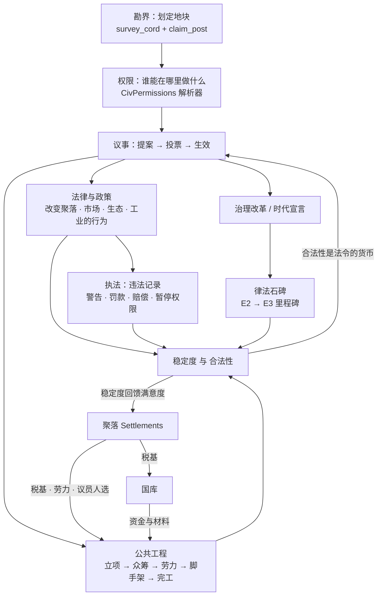

# 19 · 契约 Commons（`tccommons`）

> 本章是 `tccommons` 的完整规格。契约模组把“一群人住在一起”变成“一个有规则的共同体”：土地被划分并标明归属；谁能在哪里做什么由权限节点决定；法律与政策改变聚落、市场、生态与工业的行为；公共工程把玩家与 NPC 的劳力、材料组织成大型建设；玩家之间、聚落之间可以签订可执行的约定。多人服因此能发展出不同的治理方式；单人游戏中，NPC 议员、可见的公共工程与会改变 AI 态度的法律让同一套系统同样有意义。
>
> 冲突裁决顺序：`design-brief.md` 契约 → 00 章 DR/DA → 02 架构 → 31 界面规范 → 本章。本章不定义新的 NPC 实体：议员、法官、工头都是核心实体 `tcivilization:person` 加上本模组的 `OfficeComponent`（02 §2.4、03 §4）。本章实现核心 `CivPermissions` 的权限解析器（03 §12.1），是全家族“动作是否允许”的默认裁决者。

| 项 | 内容 |
| --- | --- |
| 章节编号 | 19 |
| 模组 ID | `tccommons`，根包 `com.nightcity.commons` |
| 必需依赖 | `tcivilization`（02 §1.3）；`tctechnology`、`tcskills` 为可选 |
| 拥有的领域 | 土地划分与领地权限；角色、职位与治理形式；提案与投票；法律与政策（含税率、关税、市场法规的立法）；执法、违约与仲裁；国库的支出权；公共工程的组织（立项、众筹、劳力调度、进度）；多人协作约定；律法石碑 `tccommons:law_stele` 的方块与里程碑判定；稳定度 Stability 与合法性 Legitimacy（README 术语表） |
| 不拥有的领域 | 聚落人口、岗位与施工执行系统（Settlements，15 章；本章复用其施工桩流程）；指令 Directive 的效果数值（Settlements）；货币、价格与成交扣税的执行（Exchange，16 章）；AI 文明的决策与外交（Nations，23 章）；城墙等防御功能方块与战斗（Frontiers，20 章）；道路、桥梁方块本身（Networks，14 章）；地图绘制（Atlas，22 章） |
| 科技配额 | 18（实际 18），无关键科技 |
| 性能预算 | 平均 0.1 ms/tick，峰值 0.5 ms/tick（02 §8） |
| 文明面板页签 | `tccommons:governance`（文明组，排序 250；页内子导航：概览、领地、权限、法律与政策、投票、公共工程、约定），不注册第二个页签 |
| HUD 控件 | `tccommons:claim_status`（最低等级极简，情境显示：进入他人或公共地块时、手持勘界绳时；位置见 31 §3.3.2-3.3.3） |

---

## 1. 定位与设计支柱

### 1.1 一句话定位

**“规则也是你建造的东西。”** 契约让玩家像搭房子一样搭建制度：先用勘界绳拉出一块地，再在火塘边召集族人议事，刻下第一部法典，立起律法石碑，组织全城的人修一座桥。每条规则都有可见的来源（谁提议、谁投票、何时生效）、可见的效果（哪个聚落、哪台机器、哪片森林被它改变）与可见的代价（合法性、稳定度、国库）。

### 1.2 设计支柱

| 编号 | 支柱 | 落地规则 |
| --- | --- | --- |
| SP-1 | **规则可见、可追溯** | 每条法令、每次投票、每个地块都有来源记录：提案人、投票明细、生效时刻、依据的科技。界面中任何“被拒绝”都给出原因与修复入口（31 §16.2，`tcivilization:action_result`） |
| SP-2 | **单人同样有意义** | 单人时，议会席位由 NPC 占据并按公开公式投票（5.5.4）；政策改变聚落行为（5.7）；法律通过 Nations 好感修正影响 AI 文明（5.7.5）；公共工程是组织 NPC 劳力的主要手段（5.11）。没有“只在多人服才有用”的功能 |
| SP-3 | **治理是选择，不是升级** | 12 种治理形式按时代解锁，但后解锁的不一定更好：王权法令便宜、合法性基线低；议会合法性高、法令昂贵；计划国家可选不选。改革需要投票并付出过渡期代价（5.4） |
| SP-4 | **保护优先于惩罚** | 领地保护是“阻止发生”，不是“事后惩罚”：未授权的破坏直接取消并提示原因。法律惩罚只涉及罚款、债务、暂停权限、赔偿与声誉，绝不涉及监禁、饥饿等个人生存机制（DR-19） |
| SP-5 | **可见的集体劳动** | 公共工程按阶段在现场搭建脚手架，参与者是可见的 NPC 与玩家，材料从捐献箱逐块搬运上墙（DR-20）；完成时举行仪式并写入编年史 |
| SP-6 | **与核心规则同构** | 所有可变动作都经 `CivPermissions.check(player, action, scope)`；共享对象实现 `VersionedShared`；被拒绝时返回 `tcivilization:action_result`。本模组缺席时核心默认规则仍可用（03 §12.1），本模组存在时只把规则细化，不改变调用方式 |
| SP-7 | **缺模组不残缺** | 只安装核心与本模组时，领地、角色、投票、法律、公共工程、约定全部可用；需要其他模组数据的政策（如排放标准、转基因政策）在对方缺席时不出现在法令列表中，而不是以无效状态出现 |

### 1.3 与决策记录的对应

- **DR-02 一个玩家文明**：多人服的“不同治理方式”体现在文明层治理形式、各聚落的特许状与地方法规（5.4.4）、玩家之间的约定（5.12）；对外关系只针对 AI 文明。
- **DR-11 时代宣布**：需要 `tccommons:declare_era`（默认授予领袖）；需要投票的形式取消 `EraAdvanceEvent.Pre` 并发起“时代宣言”提案（5.5.5）。
- **DR-19**：违法后果只有罚款、债务、暂停部分权限、赔偿与合法性变化，没有监禁或生存惩罚。
- **DR-20**：NPC 议员走到议事桌就座；工程逐块搭建脚手架；石碑分 4 个可见阶段刻字。
- **DR-21 混合管理**：玩家可亲自组织每项工程与投票，也可设“常设政策”让职位上的 NPC 执行；玩家显式操作优先。
- **DA-11 VU**：税额、罚款、国库在有 Exchange 时以文明货币附 VU 显示，否则以实物计（5.9）。

---

## 2. 独立玩法（只安装 `tcivilization` + `tccommons`）

只安装核心与本模组时，玩家仍然可以完成“勘界 → 议事 → 立法 → 组织工程 → 刻立石碑 → 改革政体”的完整循环。缺少的数据来源（聚落满意度、市场成交、AI 文明）由本节的回退规则替代，所有回退都在界面中以“简化模式”标注（31 §16.4 的不可用说明）。

### 2.1 起步（E0-E1）

1. **勘界。** 玩家合成 `survey_cord`（勘界绳，E0，无需科技），右击地面进入勘界模式，地面出现虚线边界（31 §5.10），右击相邻区块扩展选区，潜行右击确认，再在选区内放置界标 `claim_post`，地块生效（5.1.3）。文明的前 32 个区块默认是公共地块（CIVIC），任何族人都能建造。
2. **火塘议事。** 研究 `stone/tribal_council`（部落议事）后，文明从默认的“族长制”改为可选的“部落议事”：玩家可以在点燃的营火（或 Technology 的火坑、Settlements 的部落火塘）旁对族人发起提案，例如“把东面山坡划为公共林地”“禁止在泉水边宰杀猎物”。族人 NPC 按 5.5.4 的公式表态：他们会走到火塘边，头顶显示“赞成 / 反对 / 弃权”气泡，悬停可见理由（“我的家在东坡”“泉水是大家的”）。
3. **第一批规则。** 部落时期可用的法令都很朴素：`open_commons`（公共采集地）、`hunting_season`（猎季，独立模式下只限制玩家与 NPC 的狩猎时段）、`corvee`（共同劳役）。每条法令生效后，NPC 的行为会立即改变：例如猎季关闭期间，族人的狩猎任务暂停并在人物检视中显示“猎季未开”。
4. **共同劳役与第一座工程。** 研究 `neolithic/communal_labor` 后，可以立项纪念石堆（`cairn`）、林间小道（`footpath`）或防火带（`firebreak`）。玩家放下 `works_marker`，选择模板，蓝图以半透明方块显示；族人与玩家把石块、木材投进 `donation_box`（捐献箱）。没有 Settlements 时，核心人物经 `PersonApi.assignTask` 成为劳工，从捐献箱取材、逐块砌筑（5.11.4）。
5. **长老会。** 研究 `neolithic/council_of_elders` 后，可以改革为“长老会”：文明中年龄最长的 3-5 名成年人（玩家或 NPC）成为长老，坐在 `council_seat`（议席）上表决。单人时，这是玩家第一次“说服”NPC：投票前可以与长老逐一交谈（对话动作“游说”，`diplomacy` 检定，5.5.4），每次游说只能对同一长老、同一提案生效一次。

### 2.2 中期（E2-E5）

1. **法典与律法石碑。** 研究 `bronze/code_of_law` 后，可以在议事桌 `council_table` 上把已生效的法令汇编成一本 `law_code`（法典）。把法典放进 `law_stele`（律法石碑），由领袖在至少 5 名见证者面前举行刻立仪式，石碑分 4 个阶段刻满文字（5.10）。这是青铜时代进入铁器时代的里程碑 `tctechnology:stele_of_law`（01 §9）。独立模式下（无 Technology），刻立石碑仍然举行仪式并获得永久稳定度 +5、合法性 +15。
2. **土地制度。** 研究 `bronze/land_tenure` 后，族人可以拥有个人地块，玩家可以颁发 `land_deed`（地契）把公共地块转让或出租给某人。独立模式下的租金以实物结算：租户每 8 MC 日把约定物品放入 `covenant_chest`（约定箱），逾期则进入宽限期（5.12.4）。
3. **王权或共和。** E2 的 `bronze/kingship` 与 E3 的 `iron/republic` 代表两条路线：王权让领袖可以用较少的合法性直接颁布法令（法令倍率 ×0.6），但合法性基线较低、否决会削弱它；共和让议员按任期选举产生，法令昂贵但稳定度更高（5.4）。
4. **赋税与国库。** 研究 `iron/taxation` 后，放置 `treasury_chest`（国库箱）并颁布 `land_tax`。独立模式下没有货币：税以实物形式征收，玩家与租户按地块面积缴纳谷物、木材或石料，国库箱中的物品可直接用于公共工程（5.9）。
5. **市政工程与城镇特许状。** 研究 `iron/civic_engineering` 后可以立项桥、堤、防波堤与水渠；研究 `medieval/town_charter` 后，可以给各个定居点颁发 `town_charter`（特许状），让该地有自己的地方法规（例如“本镇禁止在镇内伐木”）。多人服中，不同玩家负责的城镇因此形成不同的风格（DR-02）。
6. **法庭。** 研究 `medieval/courts_of_justice` 后，放置 `courthouse_bench`（审判席），违法记录不再由领袖直接裁决，而是由法官审理，判决可被上诉一次（5.8.4）。

### 2.3 后期（E6-E10）

1. **宪政、劳动法与普选。** `industrial/constitution` 引入“权利”：被写入宪章的条目（例如“个人地块不可被征用”）只能以 2/3 多数修改。`industrial/labor_law` 让工作时长、安全标准成为法律；`electric/universal_suffrage` 解锁普选民主与联邦。
2. **福利国家与计划国家。** `atomic/welfare_state` 解锁福利政策，也解锁“计划国家”这一可选治理形式（法令便宜、稳定度来自完成计划而不是满意度）。
3. **数字治理。** `information/digital_governance` 解锁 `civic_terminal`（市民终端）：成员可远程投票，NPC 议员的立场分析图公开显示。
4. **星际宪章。** `space/interstellar_charter` 让文明可以对月面与殖民地主张领地，颁发 `colony_charter`，给离线的殖民据点设定自治规则。独立模式下（无 Orbit）此科技只解锁“殖民地自治”这一地方特许状模板，不出现月面领地。

---

## 3. 联动玩法

每个联动都写在独立的桥接类 `com.nightcity.commons.compat.<对方>` 中，由 `ModList.get().isLoaded(...)` 保护（02 §3）。对方缺席时，相关法令、模板与界面元素不注册或隐藏，不出现“不可用的残项”。

| 对方模组 | 联动内容（具体规则） |
| --- | --- |
| Civilization Core | 实现 `CivPermissions` 的两个解析器（领地 600、角色 500，5.2.3）；核心角色 `founder / member / guest` 映射为 `leader / citizen / visitor`；注册通知分类、追踪类型、页签、HUD、轮盘、深链（第 10 章）；重大事件写入编年史与文明记忆（`MemoryApi.record`） |
| Technology | 18 项本模组科技；`tccommons:declare_era` 与 `EraAdvanceEvent.Pre` 的投票取消（5.5.5）；`MilestoneChecker` 判定 `tctechnology:stele_of_law`（5.10），取代 04 §5.8 的后备方案；时代变化时检查治理形式门槛 |
| Skills | 立法、投票、游说、调解、工程完成等行为经 `SkillsApi` 计入 `leadership`、`diplomacy`、`construction`，集体工程用 `SkillsApi.addCollaborative`（附录 D）；`leadership` 等级降低法令合法性成本（5.6.3） |
| Settlements | 实现 `DirectiveGate`（5.13）与 `ClaimPermissionCheck`（建聚落时检查 `claim_manage`）；聚落辖区自动成为公共地块；`immigration`、`working_hours` 等法令覆盖聚落默认值；稳定度回馈满意度（`+0.05×(stability−50)/50`）；工程复用建筑工人与施工桩流程；议事厅读取房间类型 `hall` |
| Exchange | 实现 Exchange 的 `TaxPolicyProvider`（交易税、关税、过路费、港口费，16 §5.16）；立法：`market_rules`、`contraband_list`、`seigniorage`、`reserve_ratio`、`patent_law`、`guild_privilege`、`bond_issue`；国库账户由 Exchange 保管余额，本模组拥有支出权；E3 税吏职业属于本模组；工程可用国库资金采购材料 |
| Nations | 治理形式映射为与 AI 政体的亲和修正（5.4.3）；`war_vote` 法令要求宣战通过投票，失败时 Commons 取消 `NationsWarDeclaredEvent`；`diplomatic_conduct`、`open_border`、`refugee_policy` 等法令经 `NationsApi.addOpinionModifier` 改变 AI 态度；`border_treaty` 生效后把条约边界写入领地；“公开撇清”动作 `tccommons:disavow`；被占领聚落中的本模组法律暂停 |
| Ecology | 法律区域 `game_reserve`、`protected_forest`、`nature_reserve`（`reserve_marker` 可兼作区域标记）；`hunting_season`、`fishing_quota` 读取 Ecology 种群数据；违规捕猎记录为违法；保护区面积计入 EHI 模板（11 章） |
| Cultivation | `water_rights`（比例分配 / 河岸权 / 先占权）、`fallow_law`、`grazing_ban`、农业 `land_tax`；`tccommons:gmo_policy`（允许 / 标签 / 禁止）约束 `gm = true` 品种的种植与出口（12 §5） |
| Industry | `zoning_law`（工业区）、`emission_standard`（罚款与停产令，`isOperationBanned` 查询）、`organochlorine_ban`（E9）、`labor_safety` 与 `industrial_safety`；订阅 `IndustryAccidentEvent` 生成安全法提案；`fgd_scrubber` 等净化设备计入排放达标 |
| Networks | 路权 `tccommons:right_of_way` 与地役权约定；道路、桥梁、铁路公共工程模板；`toll_policy`（收费站规则，`TollPointEvent`）、`traffic_rules`、`no_fly` 禁飞区；`eminent_domain`（征用）为线路征地 |
| Atlas | 区域层 `tccommons:claim` 在地图上显示地块、法律区域与租约；`tcatlas:boundary_stone` 可兼作界标；`tcatlas:waypoint_edit_shared` 等 Atlas 节点由本模组的别名表授予默认角色（5.2.4）；地图标注的共享范围“团体”使用本模组的团体地块成员表 |
| Frontiers | 法令 `amnesty`、`conscription`、`bounty_law`、`weapon_permit`、`captive_law`、`contraband_list`；地块标志 `siege_damage`、`fire_spread`；读取地区动乱 0-1 计入稳定度；领地内不生成遭遇事件；`FrontiersOutpostEstablishedEvent` 的前哨所在区块自动成为公共地块；`FrontiersSiegeBlockBreachedEvent` 按 `siege_damage` 标志二次校验；动员时 `conscription` 决定 NPC 民兵比例 |
| Wildlands | 堤坝、防火带、防波堤、抗震加固公共工程模板经 `HydroApi.registerWaterWork` 登记；`disaster_relief` 政策；`HazardDamageEvent` 在有抗震加固时乘以减伤倍率；矿井支护工程完成后该聚落稳定度 +10（10 章） |
| Beyond | 异常强度 `tcbeyond:anomaly` ≥ 10 的区块不能被宣称；`ward_zone`（镇界区）法律区域以 `ward_stone`（半径 48 格）为标记；Beyond 通过数据驱动注册表 `tc_policy` 贡献政策 `tcbeyond:arcane_practice`（禁止 / 容许） |
| Orbit | `tcorbit:launch`、`assemble`、`mission_command`、`deorbit`、`colony_admin` 的默认角色（5.2.4）；`nuclear_thermal_ban`（禁止在大气层内使用核热发动机）；月面与殖民地领地（`space/interstellar_charter`） |
| Discovery | 公共图书馆、大学公共工程模板；`copyright`、`academic_freedom` 政策（影响印刷品传播与研究速度修正）；学术设施的使用权限走 `tccommons:use_facility` |
| Echoes | 法律区域 `heritage`（文化遗产区）与政策 `heritage_protection`：生效后遗产登记的保护等级获得法律效力，未经许可的挖掘记录为违法、盗掘文物标记“来历不明”；遗址内动作经本模组领地解析器 |

---

## 4. 核心玩法循环



| 时间尺度 | 玩家在做什么 | 系统在做什么 |
| --- | --- | --- |
| 秒到分钟 | 勘界、调整地块标志、投票、游说议员、往捐献箱投材料、亲手砌筑脚手架 | 权限判定（领地缓存命中）、投票计票、脚手架阶段推进、HUD 地块提示 |
| MC 日 | 发起提案、审阅违法记录、调度工程劳力、处理到期租约 | 日结算：稳定度、合法性漂移、违法记录时效、NPC 议员立场刷新、租约与约定的到期检查 |
| 结算期（默认 8 MC 日） | 调整税率、审阅国库报表、续签约定 | 征税、约定履行检查、罚款转债务、国库报表写入编年史 |
| 时代 | 治理改革、刻立石碑、颁发特许状、修订宪章 | 治理形式的时代门槛、时代宣言投票、里程碑判定 |

一次典型循环（E3 单人）：概览页提示“东河渡口：商队等待过河 3 次”。玩家发起“修建东河石桥”提案，5 名 NPC 议员 3 赞成（“商路经过我家门口”）、1 反对（“应先修城墙”）、1 弃权；通过后国库拨出 40% 石料，其余由捐献箱募集；6 名建筑工人到场，桥墩脚手架一层层升起。完工后举行落成仪式，稳定度 +4、合法性 +5，Networks 把桥接入路网。

---

## 5. 系统规则与公式

### 5.1 领地

#### 5.1.1 地块单位与类型

1. **单位。** 领地的最小单位是区块（16×16，全高度，单一维度）。地块 Parcel 是 1 个或多个四邻接相连的区块，同一地块内所有区块的所有者、标志与租约相同。
2. **所有者类型。**

| 类型 | 枚举 | 所有者 | 管理者 | 说明 |
| --- | --- | --- | --- | --- |
| 公共地块 | `CIVIC` | 文明 | 领袖；聚落辖区内为该聚落的管家 `steward` | 默认允许公民建造（标志 `public_build`） |
| 个人地块 | `PERSONAL` | 1 名玩家 | 业主 | 需要 `bronze/land_tenure`；业主可加受托人、出租 |
| 团体地块 | `GROUP` | 2-16 名玩家 | 团体约定指定的管理人 | E0 起可用（部落时代的“家族地”）；成员关系与分成由约定（5.12）规定 |

3. **租约。** 租约不是一种所有者类型，而是叠加在地块上的一层：租约期间租户获得 5.2.2 中“租户”一列的权限，业主保留转让与收租权（5.1.5）。
4. **聚落辖区。** 装有 Settlements 时，每个聚落边界（15 §5.1.2，以核心为圆心、半径随等级 48-512 格）内、区块中心落在边界圆内的区块，自动成为该聚落的公共地块（辖区），管家默认为聚落管理者。辖区不计入文明领地上限。两个聚落边界重叠时，按 15 §5.1.2 的中垂线规则以区块中心判定归属。辖区中已有的个人或团体地块保持原归属，嵌在辖区内。聚落升级扩大半径时，辖区自动扩张到无主区块；遇到 AI 文明区域时停止扩张（5.1.6）。聚落被遗弃（`ABANDONED`）后辖区保留 12 MC 日，然后转为普通公共地块并开始计入上限。

#### 5.1.2 领地上限

| 项 | 公式 | 说明 |
| --- | --- | --- |
| 文明领地上限（辖区以外） | `32 + 16 × 玩家成员数 + 8 × 聚落数` | 无 Settlements 时 `32 + 24 × 玩家成员数` |
| 个人地块上限（每名玩家） | 36 区块（[配置] `claims.personal_cap`） | 个人地块计入文明领地上限，但辖区内的个人地块不计入 |
| 团体地块上限 | 每名成员计入 `36 / 成员数`（向上取整） | 防止用团体地块绕开个人上限 |
| 单个地块最大区块数 | 256 | 超出须拆成多个地块，各需 1 个界标 |

领地上限只限制新宣称；超出上限（例如成员退出）时不会自动收回已有地块，只在概览页显示“超出上限 N 区块：不能新宣称”。

#### 5.1.3 宣称流程与界标

1. **选区。** 手持 `survey_cord` 右击地面开始，右击相邻区块扩展或取消，选区在地面以虚线显示（31 §5.10，最多 128 格内、≤ 256 个标记）。选区内的冲突区块以红色叉线显示，悬停给出原因。
2. **确认。** 潜行右击确认，打开确认面板：类型（公共/个人/团体）、区块数、上限余量、将生效的默认标志。确认需要 `tccommons:claim_manage`（公共）或 `tccommons:claim_personal`（个人、团体）。
3. **界标。** 确认后地块处于“待标界”状态，60 秒内（[配置] `claims.marker_timeout_ticks` 1,200）需在地块内放置一个可识别的界标，否则选区作废。可识别的界标：`tccommons:claim_post`、`tcatlas:boundary_stone`（Atlas，E2）、`tcnations:border_stone`（Nations，条约边界）、聚落核心（Settlements）、`tccommons:zone_sign`（仅用于法律区域，不能作为地块界标）。
4. **不能宣称的区块。** AI 文明拥有的区域内的区块（`NationsApi.regionOwner` 非玩家文明，5.1.6）；Beyond 异常强度 `tcbeyond:anomaly` ≥ 10 的区块；已属于他人的区块；被 `claims.blocked_dimensions` 列出的维度。
5. **界标缺失。** 地块内所有界标都被破坏时进入“界标缺失”状态：保护仍然有效，概览页出现提醒；12 MC 日内未补立则降为“未标界”：仍受保护，但不能出租、转让，不计入 Nations 区域判定。
6. **放弃。** 放弃地块使用普通确认对话框，列出后果（“3 个箱子将变为公共可开启”“1 份租约将终止”），执行后给出 10 秒撤销令牌（31 §16.4）。放弃写入编年史。

#### 5.1.4 离线保护、闲置与访客

- **离线保护。** 个人或团体地块的业主、受托人、租户全部离线时，以下标志强制关闭，无论设置如何：`explosions`、`fire_spread`、`siege_damage`、`mob_griefing`。公共地块在文明没有任何成员在线时同样适用（[配置] `claims.offline_protection = true`）。离线保护不阻止已排程的公共工程与 NPC 正常工作。
- **闲置地块。** 业主超过 60 天（真实时间，[配置] `claims.inactive_days`）未登录，地块标记为“闲置”。领袖可以发起“收回闲置地块”提案，通过后地块转为公共地块，容器内容不变，原业主上线时收到通知；原业主在回归后 30 天内可以发起“恢复”提案。单人存档不触发闲置。
- **访客。** 非成员玩家（核心角色 `guest`）默认是访客，只能观看与通行。地块标志 `guest_interact` 允许访客开门、按按钮、使用公共设施。业主可以把指定玩家加入地块的“访客名单”，单独授予 `container`、`crops` 等权限，有效期 1-30 MC 日，到期自动移除。

#### 5.1.5 租借

- 业主（公共地块为管家或领袖）可以把整个地块出租给 1 名玩家或 1 个团体，需要 `tccommons:lease_manage`。租约本身是一种约定（5.12，类型 `lease`），写明租期（1-96 MC 日或无期限）、租金（每结算期一次，物品或货币）、是否允许转租、到期后建筑归属（归业主 / 租户可拆除带走）。
- 租户获得 5.2.2 中“租户”一列的权限；业主在租期内不能进入租户的容器（`container`），但保留 `claim_transfer`。转让地块时租约随地块转移。
- 欠租：进入宽限期（1 个结算期），仍未支付则业主可以终止租约，欠款记为租户对业主的债务（5.8.3）。

#### 5.1.6 与 Atlas、Settlements、Nations、Beyond 的一致性

| 来源 | 规则 |
| --- | --- |
| Atlas | 区域层 `tccommons:claim` 是领地的唯一权威数据；Atlas 地图只读取它渲染（地块按所有者着色 + 线型区分：公共实线、个人虚线、团体点划线、租约斜纹），不另存一份 |
| Settlements | 聚落边界由 Settlements 计算，本模组只把边界内的区块登记为辖区；不改变聚落边界本身 |
| Nations | 玩家文明在某个 Nations 区域内拥有 ≥ 16 个已标界区块，或拥有该区域内的聚落核心时，`CommonsApi.regionClaimed` 返回 true，Nations 把该区域视为玩家文明所有（23 章）。玩家文明的区域只能通过割让条约改变；含聚落核心的区域不能割让。条约 `border_treaty` 生效时（`NationsTreatySignedEvent`），条约边界线上的 `border_stone` 自动成为相邻地块的界标 |
| Beyond | 异常强度 ≥ 10 的区块不能宣称；已宣称的区块后来异常强度升到 ≥ 10 时保留归属，但标志 `mob_griefing` 失效（Beyond 怪物不受领地保护），概览页提示“地块受异常侵蚀” |

### 5.2 权限节点

#### 5.2.1 动作清单

所有动作 ID 都在 `tccommons` 命名空间，调用方式统一为 `CivPermissions.check(player, action, scope)`。“作用域”一列说明 `ActionScope` 中哪个字段决定判定：`pos` 表示按地块判定（领地解析器），`civ` 表示按文明角色判定（角色解析器），`object` 表示针对某个共享对象（提案、工程、约定）。

| 动作 ID | 作用域 | 默认授予 | 说明 |
| --- | --- | --- | --- |
| `tccommons:claim_manage` | civ / pos | 领袖、议员；辖区内的管家 | 宣称、放弃、合并、拆分公共地块；Settlements 建立聚落时也检查此节点 |
| `tccommons:claim_personal` | civ | 公民 | 宣称个人或团体地块（个人地块需 `bronze/land_tenure`） |
| `tccommons:claim_transfer` | pos | 业主；公共地块为领袖 | 转让地块、颁发地契 |
| `tccommons:lease_manage` | pos | 业主；公共地块为管家、领袖 | 出租、续租、终止租约 |
| `tccommons:build` | pos | 见 5.2.2 | 放置方块（含流体桶倒出） |
| `tccommons:break` | pos | 见 5.2.2 | 破坏方块 |
| `tccommons:interact` | pos | 见 5.2.2 | 门、活板门、按钮、拉杆、压力板 |
| `tccommons:container` | pos | 见 5.2.2 | 打开带物品栏的方块 |
| `tccommons:use_facility` | pos | 见 5.2.2 | 使用工作台、熔炉、研究设施、机器等无私有物品栏的功能方块 |
| `tccommons:npc_command` | pos | 业主、管家 | 在该地块内对 NPC 下达指令、分配岗位（Settlements C→S 校验使用） |
| `tccommons:animals` | pos | 见 5.2.2 | 喂养、繁殖、宰杀、拴绳、骑乘地块内的动物 |
| `tccommons:crops` | pos | 见 5.2.2 | 收获、种植、施肥 |
| `tccommons:right_of_way` | pos | 业主、受托人；地役权持有人 | 在他人地块内铺设道路、轨道、管线或驾驶车辆穿行（Networks 校验） |
| `tccommons:propose` | civ | 公民 | 发起提案 |
| `tccommons:vote` | object | 有表决权者（随治理形式，5.4） | 投票；`object` 为提案 ID |
| `tccommons:enact` | object | 领袖 | 签署已通过的提案（只在需要签署的治理形式中出现） |
| `tccommons:decree` | civ | 领袖 | 不经投票颁布法令，消耗合法性（5.6.3） |
| `tccommons:veto` | object | 领袖（王权、宪政） | 否决已通过的提案 |
| `tccommons:office_assign` | civ | 领袖 | 任免职位 |
| `tccommons:role_assign` | civ | 领袖 | 调整成员角色、编辑角色授权表 |
| `tccommons:governance_reform` | civ | 领袖 | 发起治理形式改革提案 |
| `tccommons:declare_era` | civ | 领袖 | 宣布进入新时代（04 §5.11；投票挂钩见 5.5.5） |
| `tccommons:tax_set` | civ | 领袖、司库 | 调整税率（在法令允许的范围内） |
| `tccommons:treasury_withdraw` | civ | 领袖、司库 | 从国库支出 |
| `tccommons:works_create` | civ | 领袖、议员、工程总管 | 立项公共工程（需要投票的治理形式中会转为提案） |
| `tccommons:works_manage` | object | 工程总管、领袖 | 调度劳力、暂停、取消、修改优先级 |
| `tccommons:works_contribute` | object | 公民；访客（`guest_interact` 开启时） | 捐献材料、亲手砌筑 |
| `tccommons:covenant_create` | civ | 公民 | 起草约定 |
| `tccommons:judge` | object | 法官；无法庭时为领袖 | 裁决违法记录与约定纠纷 |
| `tccommons:enforce` | civ | 治安官、军务官、领袖 | 执行判决：扣押、发出停产令、暂停权限 |
| `tccommons:pardon` | object | 领袖 | 赦免已判决的违法记录 |
| `tccommons:law_zone` | civ | 领袖、议员 | 划定、修改法律区域 |
| `tccommons:disavow` | civ | 领袖、使节 | 对某次违约或暴行“公开撇清”（Nations） |
| `tccommons:charter_grant` | civ | 领袖 | 向聚落颁发或收回城镇特许状 |
| `tccommons:stele_inscribe` | civ | 领袖、法官 | 主持律法石碑刻立（5.10） |

核心的成员管理动作（邀请、移除成员，03 §5.1）由本模组的角色解析器按“领袖、议员”放行；文明改名、解散仍按核心规则只授予领袖（创始人映射）与权限等级 2。

#### 5.2.2 地块内的默认权限矩阵

| 动作 | 业主 / 管家 | 受托人 | 租户 | 公民 | 访客 |
| --- | --- | --- | --- | --- | --- |
| `build` / `break` | ✔ | ✔ | ✔（租约范围） | 公共地块：`public_build` 开启时 ✔；个人地块 ✘ | ✘ |
| `interact` | ✔ | ✔ | ✔ | ✔ | `guest_interact` 开启时 ✔ |
| `container` | ✔（租期内除外） | ✔ | ✔ | 公共地块 ✔；个人地块 ✘ | ✘ |
| `use_facility` | ✔ | ✔ | ✔ | ✔ | `guest_interact` 开启时 ✔ |
| `npc_command` | ✔ | ✘ | ✘ | ✘ | ✘ |
| `animals` / `crops` | ✔ | ✔ | ✔ | 公共地块 ✔；个人地块 ✘ | ✘ |
| `right_of_way` | ✔ | ✔ | ✔ | 有地役权时 ✔ | ✘ |

- 表中“✔”是缺省值，业主可以在地块设置中对每一列逐项勾选或取消；领袖可以用法令 `open_commons` 把“公民”列在全部公共地块上锁定为 ✔。
- 领袖不自动拥有他人个人地块的权限。宪政及之后的治理形式中，这条规则写入宪章，只能以 2/3 多数修改（5.7.3）。
- 野外（无主区块）不经过领地解析器，按核心默认规则全部允许。

#### 5.2.3 解析器

本模组向核心注册两个 `PermissionResolver`（03 §12.1，优先级大者先判定，第一个非 `Pass` 的结果生效）：

| 解析器 | 优先级 | 处理范围 | 返回 |
| --- | --- | --- | --- |
| `ClaimResolver` | 600 | `scope.pos` 不为空且位于地块内的动作；动作属于地块动作集合（上表 `pos` 类）或在权限默认表中声明 `land: true` 的他模组动作 | 按 5.2.2 矩阵与地块设置判定，`Decided(Allow)` 或 `Decided(Deny(tcivilization:owner, …))`；地块外返回 `Pass` |
| `RoleResolver` | 500 | 本模组的文明级动作，以及权限默认表中登记过的他模组动作 | 按“角色授权表 + 职位 + 治理形式约束”判定；未登记的动作返回 `Pass`，交由核心默认规则 |

判定顺序（`RoleResolver`）：

```
1. 操作者不是本文明成员 → 只检查访客授权；无 → Deny(permission)
2. 动作在治理形式的禁用表中（例：普选民主中没有 veto）→ Deny(permission, "当前政体不支持")
3. 操作者的权限被判决暂停（5.8.3）且动作在暂停范围内 → Deny(permission, "权限暂停至 …")
4. 角色授权表或职位授权包含该动作 → 继续；否则 Deny(permission, "需要角色：…")
5. 动作要求科技（例：tax_set 需要 iron/taxation）且未完成 → Deny(tech, fixLink=科技树)
6. 动作要求投票（治理形式规定）→ 不在此处拒绝：调用方收到 Allow，但本模组把操作转为提案（5.5.1）
7. 动作有冷却（例：governance_reform 12 MC 日）→ Deny(cooldown)
8. Allow
```

拒绝原因统一使用核心原因 ID：`tcivilization:permission`（角色不足）、`tcivilization:owner`（地块归属）、`tcivilization:vote`（需要投票）、`tcivilization:cooldown`、`tcivilization:tech`、`tcivilization:era`。`detail` 写出所需角色与当前角色，`fixLink` 指向 `tc:tccommons/permissions?action=<id>`。

#### 5.2.4 他模组动作与别名

其他模组通过数据包 `data/<命名空间>/tc_permission_defaults/*.json` 登记自己的动作及默认授予角色：

```json
{ "action": "tcnations:declare_war", "land": false,
  "roles": ["leader"], "offices": ["marshal"], "requires_vote": "war_vote" }
```

本模组内置以下默认表（对方模组存在时生效）。所有动作 ID 都是 `namespace:action` 形式的合法 `Identifier`。若数据包写了带点号的旧写法（如 `tcnations.propose`），加载时把第一个点号换成冒号、其余点号换成下划线，并在日志中提示一次：

| 动作 ID（来源章节） | 默认授予 | 备注 |
| --- | --- | --- |
| `tcnations:propose`（23） | 领袖、使节 | 向 AI 文明提出外交提议 |
| `tcnations:sign_treaty`（23） | 领袖 | 议会及之后的政体需投票 |
| `tcnations:declare_war`（23） | 领袖、军务官 | `war_vote` 生效时需投票（5.7.2） |
| `tcnations:make_peace`（23） | 领袖、使节 | — |
| `tcnations:army_command`（23） | 领袖、军务官 | — |
| `tcatlas:waypoint_edit_shared`（22） | 公民 | 编辑团体共享路标与标注 |
| `tcorbit:launch`、`tcorbit:assemble`、`tcorbit:mission_command`（24） | 公民 | 24 章：任一成员可发射，领袖可收紧 |
| `tcorbit:deorbit`、`tcorbit:colony_admin`（24） | 议员（24 章“官员”） | — |
| `tcechoes:excavate`（18） | 公民 | 在 `heritage` 区域内需要法官或领袖签发的发掘许可（5.7.4） |

### 5.3 角色与职位

#### 5.3.1 文明角色

| 角色 | ID | 核心映射 | 获得方式 | 说明 |
| --- | --- | --- | --- | --- |
| 领袖 | `tccommons:leader` | `tcivilization:founder` | 文明创始人；之后按治理形式继承、选举或任命（5.4） | 每个文明恰好 1 名；单人时就是玩家 |
| 议员 | `tccommons:councillor` | `member` | 按治理形式选举、任命或按年龄（长老会） | 席位数随治理形式；空缺可由 NPC 填补（5.5.4） |
| 公民 | `tccommons:citizen` | `member` | 加入文明 | 默认角色 |
| 访客 | `tccommons:visitor` | `guest` | 非成员 | 只读；可被授予地块访客名单 |

地块级角色（业主、管家、受托人、租户）不是文明角色，只在对应地块内生效。

#### 5.3.2 职位

职位可以由玩家或 NPC 担任。NPC 职位由核心人物加 `OfficeComponent` 表示，人物检视页显示 `tccommons:office`“职位”分节（`PersonSectionRegistry`，order 250，31 §5.9）。每名玩家最多同时担任 2 个职位（单人存档不限）。

| 职位 | ID | 授予的动作 | NPC 担任时的自动职责 | 解锁 |
| --- | --- | --- | --- | --- |
| 领袖 | `leader` | 见 5.2.1 | 不可由 NPC 担任（玩家文明的领袖永远是玩家） | — |
| 议员 | `councillor` | `vote`、`works_create`、`law_zone` | 按 5.5.4 投票；每 8 MC 日按自身立场提出 0-1 项提案 | `stone/tribal_council` |
| 司库 | `treasurer` | `tax_set`、`treasury_withdraw` | 按税法征收实物税（无 Exchange）；国库低于工程预留时发出提醒 | `iron/taxation` |
| 工程总管 | `works_overseer` | `works_create`、`works_manage` | 把空闲劳力分配到优先级最高的工程；材料不足时在通知中列出缺口 | `neolithic/communal_labor` |
| 使节 | `envoy` | `tcnations:propose`、`disavow` | 无（外交决定只由玩家做出） | 装有 Nations |
| 军务官 | `marshal` | `enforce`、`tcnations:army_command` | 执行 `conscription` 政策的民兵抽调 | 装有 Frontiers 或 Nations |
| 法官 | `judge` | `judge`、`stele_inscribe` | 按 5.8.4 的公式审理 NPC 涉案的违法记录 | `medieval/courts_of_justice` |
| 治安官 | `sheriff` | `enforce` | 对 NPC 违法者执行警告与罚款；对玩家只发出记录，不自动执行 | `bronze/code_of_law` |

### 5.4 治理形式

#### 5.4.1 形式清单

文明同一时刻只有 1 种治理形式。开局为“族长制”，不需要科技。“表决者”决定谁对提案投票；“法令倍率”乘在法令的合法性成本上（5.6.3），越低越便于领袖独断。

| 形式 | ID | 解锁 | 表决者 | 领袖产生 | 合法性基线 | 法令倍率 | 特点 |
| --- | --- | --- | --- | --- | --- | --- | --- |
| 族长制 | `chieftaincy` | 默认 | 无（领袖决定） | 创始人 | 50 | ×1.0 | 没有提案流程，所有法令都是法令；适合独自开局 |
| 部落议事 | `tribal_council` | `stone/tribal_council` | 全体成年成员（玩家 + NPC） | 创始人 | 55 | ×1.2 | 提案在火塘旁表决；NPC 全员参加 |
| 长老会 | `council_of_elders` | `neolithic/council_of_elders` | 3-5 名长老（最年长的成年人） | 长老会推举 | 60 | ×1.3 | 长老坐在 `council_seat` 上表决；稳定度 +3 |
| 王权 | `kingship` | `bronze/kingship` | 议员（领袖任命，3-7 席），仅咨询 | 世袭或指定继承人 | 60 | ×0.6 | 领袖可 `veto`（−5 合法性）；议员表决只作建议（未通过时法令成本 ×1.5） |
| 共和 | `city_republic` | `iron/republic` | 议员（选举，5-9 席） | 议员互选，任期 24 MC 日 | 60 | ×1.5 | 选举周期；稳定度 +5；不能 `veto` |
| 议会 | `parliament` | `renaissance/parliament` | 议员（选举，7-15 席，按聚落人口分配） | 议会多数推举 | 65 | ×1.6 | 条约与宣战需投票；各聚落有代表 |
| 宪政 | `constitutional` | `industrial/constitution` | 议员（选举）+ 宪章条款需 2/3 | 选举，任期 48 MC 日 | 65 | ×2.0 | 宪章权利不可被法令绕过；领袖可 `veto`，可被 2/3 推翻 |
| 普选民主 | `democracy` | `electric/universal_suffrage` | 全体公民（玩家）+ NPC 议员代表团 | 普选，任期 48 MC 日 | 70 | ×2.2 | 稳定度 +5；法令极贵；领袖不能 `veto` |
| 联邦 | `federation` | `electric/universal_suffrage` 且 ≥ 3 份有效特许状 | 各特许聚落各 1 票（加权人口平方根） | 联邦议会推举 | 70 | ×2.0 | 地方法规优先于文明法令（5.4.4）；关税、宣战仍属联邦 |
| 计划国家 | `planned_state` | `atomic/welfare_state`（可选） | 计划委员会（领袖任命 3 席） | 委员会推举 | 55 | ×0.8 | 稳定度不取满意度，改取“计划完成率”（5.6.1）；公共工程劳力 +20% |
| 数字民主 | `digital_democracy` | `information/digital_governance` | 全体公民远程投票 + NPC 代表 | 普选 | 75 | ×1.0 | 投票时长减半；所有提案的 NPC 立场分析公开 |
| 行会自治 | `guild_commune` | `medieval/town_charter` | 地方：持特许状聚落的居民行会 | — | — | — | 只能作为地方治理形式（5.4.4），不能作为文明形式 |

- **时代门槛。** 时代倒退不会发生（01 章），因此已采用的形式不会失效。
- **单人存档。** 所有形式都可用；需要议员的形式由 NPC 填补席位（5.5.4）。普选民主与数字民主在单人时由“NPC 代表团”投票：每个聚落 1 名代表，按 5.5.4 表决，票数按聚落人口平方根加权。

#### 5.4.2 治理改革

1. 发起：领袖使用 `governance_reform` 选择目标形式（需已解锁）。在族长制与王权中直接以法令执行（合法性成本 25 × 法令倍率）；其余形式进入“改革”提案，需 2/3 多数。
2. 过渡期：改革通过后进入 3 MC 日过渡期：稳定度 −10，所有进行中的投票冻结（不计时），职位保留。
3. 生效：过渡期结束时切换形式，重新分配议席（选举形式立即举行首次选举，5.5.6），合法性立即设为 `max(当前, 新基线 − 10)`。
4. 冷却：12 MC 日内不能再次改革；写入编年史与文明记忆（类型 `tccommons:reform`）。

#### 5.4.3 与 AI 政体的亲和

装有 Nations 时，玩家文明的治理形式对 AI 文明的态度产生持续修正（`NationsApi.addOpinionModifier(from = AI, to = 玩家文明, id = tccommons:polity_affinity, value, halfLifeDays = 0 表示持续)`，改革时替换）。

| 玩家治理形式 | 亲近（+10） | 疏远（−5） |
| --- | --- | --- |
| 族长制、部落议事 | `TRIBE`、`CHIEFDOM` | `EMPIRE`、`CONSTITUTIONAL` |
| 长老会 | `CHIEFDOM`、`CITY_STATE` | `EMPIRE` |
| 王权 | `MONARCHY`、`FEUDAL`、`EMPIRE` | `MERCHANT_REPUBLIC` |
| 共和 | `CITY_STATE`、`MERCHANT_REPUBLIC` | `MONARCHY`、`EMPIRE` |
| 议会、宪政 | `CONSTITUTIONAL`、`MERCHANT_REPUBLIC` | `FEUDAL`、`EMPIRE` |
| 普选民主、数字民主 | `CONSTITUTIONAL`、`FEDERATION` | `EMPIRE`、`FEUDAL` |
| 联邦 | `FEDERATION`、`CONSTITUTIONAL` | `EMPIRE` |
| 计划国家 | `EMPIRE` | `MERCHANT_REPUBLIC`、`CONSTITUTIONAL` |

修正只取最高的一项“亲近”或“疏远”，不叠加；态度范围 −100..100（23 章）。

#### 5.4.4 地方治理与城镇特许状

- 研究 `medieval/town_charter` 后，领袖可以用 `charter_grant` 向某个聚落颁发 `town_charter`（需该聚落等级 ≥ 镇；无 Settlements 时改为“≥ 12 个公共地块相连的定居点”，以 `claim_post` 为中心）。
- 持特许状的聚落可以：选择地方治理形式（当前文明形式或 `guild_commune`）；在辖区内颁布“地方法规”（只能比文明法令更严格，例如文明允许伐木，地方禁止；联邦形式中可以更宽松）；自行设定地方税附加（≤ 文明税率的 50%）。
- 多人服中，负责不同城镇的玩家因此形成不同的规则与风格：一个城镇是行会自治的商港，另一个是长老治理的农村（DR-02）。
- 收回特许状需要投票（简单多数）；被收回的聚落稳定度 −8，持续 24 MC 日。

### 5.5 投票

#### 5.5.1 提案类型

| 类型 | 枚举 | 通过门槛 | 典型来源 |
| --- | --- | --- | --- |
| 颁布 / 废止法令 | `STATUTE` | 简单多数 | 法律与政策页 |
| 调整税率 | `TAX` | 简单多数 | 司库、领袖 |
| 公共工程立项 | `WORKS` | 简单多数 | 工程页 |
| 治理改革 | `REFORM` | 2/3 | 领袖 |
| 时代宣言 | `ERA` | 简单多数 | 自动创建（5.5.5） |
| 选举 | `ELECTION` | 得票最多者当选 | 任期届满 |
| 收回闲置地块 / 征用 | `RECLAIM` | 2/3 | 领袖 |
| 指令开关 | `DIRECTIVE` | 简单多数 | Settlements（5.13） |
| 宣战 / 条约 | `WAR`、`TREATY` | 宣战 2/3；条约简单多数 | Nations（`war_vote` 生效时） |
| 宪章修订 | `CHARTER` | 2/3 | 宪政及之后 |
| 特许状收回 | `REVOKE` | 简单多数 | 领袖 |

#### 5.5.2 流程

```
起草 DRAFT ──提交──▶ 公示 OPEN ──时长到 / 提前结束──▶ 已结 CLOSED
                                   │
                         通过 PASSED ──签署（需要时）──▶ 生效 ENACTED
                         否决 FAILED / 被否决 VETOED / 过期 EXPIRED
```

1. **起草。** 需要 `propose`。提案包含：类型、标题、条款（结构化，例如“`land_tax` 税率 4% → 6%”）、可选说明（≤ 500 字）。同一成员同时最多 3 项公示中的提案。
2. **公示与投票。** 公示时播放 `tccommons:event.vote.open`，发送通知（类别 `tccommons:governance`），创建追踪项 `tccommons:vote`。投票时长默认 2 MC 日（[配置] `vote.duration_ticks` 48,000）；单人模式 2,400 tick；数字民主减半。可以改票，结束前以最后一次为准。
3. **提前结束。** 所有表决者都已投票，或剩余票数无法改变结果时，立即结束。
4. **签署。** 王权与宪政中，通过的提案进入 1 MC 日签署窗口：领袖签署或否决；窗口结束未处理视为签署。
5. **生效。** 生效时执行条款，播放 `tccommons:event.vote.passed`，写入编年史；失败播放 `tccommons:event.vote.failed`。

#### 5.5.3 计票

```
active      = 7 天（真实时间，[配置] vote.active_days）内登录过的玩家表决者 + 全部 NPC 表决者
quorum      = ceil(0.4 × active)                 // [配置] vote.quorum 0.4
cast        = 赞成 + 反对                         // 弃权不计入
有效         = 投票人数（含弃权）≥ quorum
简单多数     = 赞成 > 反对
2/3         = 赞成 ≥ 2/3 × cast
全体一致     = 反对 = 0 且 赞成 ≥ 1（约定类）
平票         = 未通过
```

未达法定人数的提案记为“未达法定人数”，提案人可在 1 MC 日后重新提交。

#### 5.5.4 NPC 表决（单人与空缺席位）

**单人模式**：文明只有 1 名玩家成员时自动启用（[配置] `vote.npc_councillors = "auto"`，可选 `always`、`never`）。需要议员的席位由 NPC 填补：长老会取最年长的成年人；选举形式由 NPC 候选人按“声望”（人物记忆中的正面事件数）当选；多人服中只填补无人报名的空缺席位。

每名 NPC 表决者有 3 条立场轴，取值 −1..1：传统—变革 `tr`、集体—个人 `co`、秩序—自由 `or`，由人物 UUID 确定性生成，并按记忆缓慢漂移（每条相关记忆 ±0.02）。每条法令在 `tc_policy` 数据中声明立场向量 `tags`。

```
score = 0.5 × (stance · tags) / 3
      + interest                      // 自身利益：家在工程 64 格内 +0.3；自家地块被征税或征用 −0.3
      + 0.3 × (mood − 0.5)            // mood：Settlements 的居民满意度 0..1；无 Settlements 时 0.5
      + 0.2 × (L − 50) / 50           // L：文明合法性
      + 0.15 × lobbied                // 本提案已被成功游说 1 次
      + 0.10 × [提案人为领袖]
      − 0.20 × [国库不足以支付提案的开支]
投票 = score ≥ 0.05 → 赞成；score ≤ −0.05 → 反对；否则弃权
```

- **可见过程。** 投票开始后，NPC 表决者在日程允许时（非睡眠）走到议事地点（火塘、`council_table` 或 `council_seat`）就座，头顶显示表态气泡；悬停或在投票页展开可见 3 项最大的得分因子，例如“+0.30 家在工程附近；−0.18 偏好传统；+0.10 领袖提议”。
- **游说。** 对 NPC 表决者使用对话动作“游说”（`tccommons:lobby`）：成功率 `min(0.95, 0.55 × SkillsApi.multiplier(player, diplomacy, influence/relation))`，无 Skills 时 0.55。失败时该 NPC 对本提案 `score −0.05`。每个提案对同一 NPC 只能游说 1 次。
- **确定性。** 除游说外，计票不含随机数；同一状态下同一提案的结果相同。

#### 5.5.5 时代宣言与 `EraAdvanceEvent.Pre`

1. Technology 在宣布时代前检查 `tccommons:declare_era`（04 §5.11），缺省授予领袖。
2. 本模组订阅 `EraAdvanceEvent.Pre`（游戏总线，可取消）。若当前治理形式需要投票（除族长制、王权、计划国家外的全部形式），且不存在一项针对 `from → to`、已在最近 3 MC 日内通过的 `ERA` 提案：
   - 取消事件；
   - 若尚无公示中的同类提案，自动创建 `ERA` 提案，提案人为 `declaredBy`；
   - 向宣布者返回 `action_result(Deny(tcivilization:vote, "时代宣言需要议事通过", fixLink = tc:tccommons/vote/<id>))`。
3. 提案通过后，本模组调用 `TechApi.advanceEra(civ, true)`。此时再次触发 `Pre`，本模组发现已通过的提案，放行。
4. 若 `advanceEra` 返回 false（条件在投票期间变化，例如人口跌破下限），提案标记“已通过，条件未满足”，保留 3 MC 日，期间条件恢复时领袖可一键再次宣布。
5. 族长制、王权、计划国家中领袖直接宣布，不取消事件；宣布时合法性 +5。

#### 5.5.6 选举

- 共和、议会、宪政、普选民主、数字民主按任期举行选举（`ELECTION` 提案自动创建）。候选人：自愿报名的玩家 + 声望最高的 NPC（补足到席位数的 1.5 倍）。
- 每名表决者可投票数 = 席位数；得票最多的候选人当选，平票时声望高者当选。
- 领袖选举（宪政及之后）：领袖本人连任不受限制；单人存档中玩家永远当选领袖（NPC 不参选领袖）。

### 5.6 稳定度、合法性与动乱

#### 5.6.1 稳定度 Stability（0-100）

```
stability = clamp(0, 100,
      50
    + 25 × (sat − 0.5) / 0.5          // sat：全部聚落满意度的人口加权均值；无 Settlements 时 0.5
    + 15 × (L − 50) / 50              // L：合法性
    + law_order                       // 0..+10，见下
    − 20 × unrest_ext                 // Frontiers 地区动乱 0..1 的人口加权均值；无 Frontiers 时 0
    − tax_burden                      // 0..15，见 5.9.2
    − war_weariness                   // Nations：交战中每 10 MC 日 +2，上限 20；和平后每日 −1
    + form_bonus                      // 治理形式表“特点”列，例：长老会 +3、共和 +5
    + Σ modifiers)                    // 石碑 +5、工程落成、改革过渡 −10 等，带期限
law_order = min(10, 2 × 生效中的 LAW 类法令数) − min(10, 0.5 × 未处理违法记录数) + [有法庭且有法官] × 3
```

计划国家以 `sat' = 0.5 × sat + 0.5 × 计划完成率` 代替 `sat`（计划完成率 = 最近 3 个结算期内按期完工的工程数 / 计划工程数）。

| 区间 | 名称 | 效果 |
| --- | --- | --- |
| ≥ 80 | 和谐 | 法令成本 ×0.8；工程劳力效率 +10%；NPC 议员赞成倾向 +0.05 |
| 60-79 | 稳定 | 无修正 |
| 40-59 | 不安 | 法令成本 ×1.2；概览页提示主要负面因子 |
| 20-39 | 动荡 | 法令成本 ×1.5；NPC 违法事件开始出现（5.8.5）；税收效率 −20% |
| < 20 | 危机 | NPC 议员每 4 MC 日提出 1 次“罢免领袖”或“改革”提案；工程停工 50% 劳力；`alert` 级通知 |

稳定度每 MC 日结算一次，区间变化触发 `StabilityBandChangedEvent`。Settlements 按 15 章公式读取稳定度回馈满意度（`+0.05 × (stability − 50) / 50`），这条回路的增益 < 0.1，不会自激。

#### 5.6.2 合法性 Legitimacy（0-100）

合法性是领袖“不经同意行事”的信用。每日向当前治理形式的基线漂移 2%：`L += 0.02 × (baseline − L)`。

| 事件 | 变化 |
| --- | --- |
| 提案通过并生效 | +2（每 MC 日最多 +6） |
| 公共工程落成 | 小型 +3，中型 +5，大型 +8 |
| 刻立律法石碑 | +10（无 Technology 时 +15） |
| 时代宣言通过 / 领袖直接宣布 | +5 |
| 领袖提出的提案未通过 | −2 |
| 否决已通过的提案 | −5 |
| 领袖本人违反生效法律 | −8（每条记录） |
| 律法石碑被破坏 | −10 |
| 颁布法令（不经投票） | −成本（5.6.3） |
| 失去聚落（被占领、遗弃） | −6 |

#### 5.6.3 法令成本

```
cost = weight × form_multiplier × band_multiplier / leader_mult
weight          : 法令在 tc_policy 中的权重（2-30，见 5.7）
form_multiplier : 5.4.1 的“法令倍率”
band_multiplier : 稳定度区间（和谐 0.8 / 稳定 1.0 / 不安 1.2 / 动荡 1.5 / 危机 2.0）
leader_mult     : SkillsApi.multiplier(leader, leadership, influence/morale)，无 Skills 时 1.0
```

合法性不足以支付时不能颁布法令，返回 `Deny(tcivilization:resource, "合法性不足（需要 18，当前 12）")`。

#### 5.6.4 动乱 Unrest

`unrest = clamp((50 − stability) / 50, 0, 1)`。动乱通过 `CommonsApi.unrest(civ)` 提供给 Frontiers（叛乱与盗匪招募）、Settlements（移民意愿）与 Nations（AI 对“内乱中的文明”的态度）。本模组只计算数值，不生成叛乱实体。Frontiers 的地区动乱可能包含本模组 `unrest` 的分量，本模组按前一日的值读取：即使 Frontiers 把 `unrest` 全额计入，回路增益也只有 `20 × 1 / 50 = 0.4 < 1`，不会自激。

### 5.7 法律与政策

#### 5.7.1 法令的结构

法令 Statute 分两类：**法律 LAW**（规定“不许做什么”，违反会产生违法记录，5.8）与**政策 POLICY**（选择一种设置，直接改变系统参数，不产生违法）。法令由数据驱动注册表 `tc_policy` 定义，其他模组可以用条件数据包贡献自己的法令：

```json
// data/tccommons/tc_policy/gmo_policy.json
{
  "kind": "POLICY",
  "options": ["allow", "label", "ban"], "default": "label",
  "weight": 10,
  "tags": { "tr": 0.4, "co": 0.2, "or": 0.3 },
  "requires_tech": "tctechnology:atomic/welfare_state",
  "requires_mods": ["tccultivation"],
  "category": "environment",
  "conditions": [{ "type": "neoforge:mod_loaded", "modid": "tccultivation" }]
}
```

- `requires_mods` 中任一模组缺席时，该法令不注册，不出现在法令列表中（SP-7）。
- 法令的效果由拥有对应系统的模组读取：`CommonsApi.policy(civ, id)` 返回当前选项（地方法规优先，5.4.4），`CommonsApi.isLawActive(civ, id, pos)` 判断某处的法律是否生效。本模组只负责立法、计票与违法记录。
- Beyond 贡献 `tcbeyond:arcane_practice`（`forbidden` / `tolerated`），其效果由 Beyond 读取（21 章）。

#### 5.7.2 法令清单

下表 ID 均在 `tccommons` 命名空间（例如 `gmo_policy` 即 `tccommons:gmo_policy`）。“需要模组”为空表示独立可用。

| 法令 ID | 类型 | 选项（默认） | 解锁科技 | 需要模组 | 权重 | 效果 |
| --- | --- | --- | --- | --- | --- | --- |
| `open_commons` | 政策 | 关 / 开（关） | — | — | 4 | 全部公共地块对公民锁定开放；NPC 采集者可在任意公共地块采收 |
| `hunting_season` | 法律 | 全年 / 季节 / 禁猎（全年） | `stone/tribal_council` | — | 4 | 禁猎期在领地内捕猎记违法；有 Ecology 时季节取物种繁殖期 |
| `corvee` | 政策 | 0 / 1 / 2 日每结算期（0） | `neolithic/communal_labor` | — | 6 | 成年 NPC 每结算期抽出 N 日参加公共工程；每抽 1 日满意度 −0.02 |
| `land_system` | 政策 | 公有 / 私有 / 封授（公有） | `bronze/land_tenure` | — | 10 | 公有：不能新宣称个人地块；私有：自由宣称与转让；封授：个人地块须领袖授予，业主租金的 10% 入国库 |
| `water_rights` | 政策 | 比例分配 / 河岸权 / 先占权（比例分配） | `bronze/code_of_law` | Cultivation | 6 | 设定 Cultivation 的用水分配规则（实现 12 章 `WaterRightsProvider`）；可按 `agri` 层计量收水费入国库 |
| `immigration` | 政策 | 开放 / 配额 / 关闭（开放） | `bronze/code_of_law` | Settlements | 6 | 覆盖 Settlements 的移民政策；配额 = 每聚落每结算期 N 人 |
| `working_hours` | 法律 | 6-12 小时（8） | `bronze/code_of_law` | Settlements | 4 | 写入 Settlements `jobs.shift_hours`；设施排班超时记违法 |
| `captive_law` | 政策 | 释放 / 赎回 / 劳役 / 招安 / 处决（赎回） | `bronze/code_of_law` | Frontiers | 8 | 20 §5.8.6；处决仅在本法令允许且 `combat.allow_execution = true` 时出现；每次处决全部 AI 态度 −15 |
| `amnesty` | 政策 | 关 / 开（关） | `bronze/code_of_law` | Frontiers | 8 | 盗匪可投降并作为移民加入聚落 |
| `conscription` | 政策 | 无 / 民兵 / 征召（无） | `bronze/code_of_law` | Frontiers 或 Nations | 10 | 动员时 NPC 成年人 5% / 15% 转为民兵；满意度 −0.03 / −0.08 |
| `diplomatic_conduct` | 政策 | 守信 / 务实 / 强硬（务实） | `bronze/code_of_law` | Nations | 8 | 见 5.7.5 |
| `refugee_policy` | 政策 | 拒绝 / 接纳 / 欢迎（接纳） | `bronze/code_of_law` | Nations | 6 | 接纳 AI 战争难民；见 5.7.5 |
| `heritage_protection` | 法律 | 关 / 开（关） | `bronze/code_of_law` | Echoes | 6 | 遗产登记的保护等级获得法律效力；未经许可发掘记违法 |
| `fishing_quota` | 法律 | 关 / 按物种配额（关） | `bronze/code_of_law` | Ecology | 4 | 超出 Ecology 建议可持续产量的捕捞记违法 |
| `fallow_law` | 法律 | 关 / 开（关） | `bronze/land_tenure` | Cultivation | 4 | 地块连续种植超过 Cultivation 建议轮次记违法 |
| `grazing_ban` | 法律 | 关 / 区域（关） | `bronze/land_tenure` | Cultivation 或 Ecology | 4 | 在指定区域放牧记违法 |
| `land_tax` | 政策 | 0-10%（0） | `iron/taxation` | — | 8 | 按地块面积与价值征收（5.9） |
| `trade_tax` | 政策 | 0-20%（0） | `iron/taxation` | Exchange | 6 | Exchange 成交时扣除 |
| `tariff` | 政策 | 0-50%（0） | `iron/taxation` | Exchange | 6 | 与 AI 文明交易时扣除；条约减免由 Nations 提供 |
| `market_rules` | 政策 | 自由 / 管制 / 行会（自由） | `iron/taxation` | Exchange | 8 | 管制：主粮价格上限 = 基准 ×1.5；行会：特定品类只能由行会成员挂单 |
| `seigniorage` | 政策 | 0-30%（8%） | `iron/taxation` | Exchange | 6 | 铸币税（16 章） |
| `reserve_ratio` | 政策 | 0.05-1.00（0.20） | `iron/taxation` | Exchange | 6 | 银行准备金率 |
| `patent_law` | 法律 | 关 / 开；版税上限 0-30%（开，10%） | `medieval/courts_of_justice` | Exchange | 6 | 版税合同获得强制力，违约可查扣 |
| `guild_privilege` | 政策 | 禁止 / 专营 / 反垄断（禁止） | `medieval/town_charter` | Exchange | 8 | 专营：非会员出售该行业商品 +10% 附加费；反垄断：撤销全部专营 |
| `bond_issue` | 政策 | 禁止 / 允许（禁止） | `industrial/constitution` | Exchange | 8 | 允许国库发行债券 |
| `contraband_list` | 法律 | 物品标签列表（空） | `iron/taxation` | Exchange 或 Frontiers | 6 | 交易或运输违禁品记违法，货物可被没收 |
| `toll_policy` | 政策 | 免费 / 收费 / 官营（免费） | `iron/taxation` | Networks | 6 | 收费站规则（`TollPointEvent`），收入入国库或业主 |
| `bounty_law` | 政策 | 关 / 开（关） | `iron/taxation` | Frontiers | 5 | 悬赏金由国库支付 |
| `disaster_relief` | 政策 | 关 / 常设（关） | `iron/taxation` | — | 5 | 灾害后国库自动拨付救济；聚落满意度恢复速度 ×2 |
| `zoning_law` | 法律 | 关 / 开（关） | `iron/civic_engineering` | — | 6 | 启用 `industrial`、`residential` 区域；在住宅区新建工业设施记违法 |
| `eminent_domain` | 政策 | 禁止 / 补偿 / 无偿（补偿） | `iron/civic_engineering` | — | 12 | 允许为公共工程或线路发起 `RECLAIM` 征用个人地块；补偿 = 地块价值 ×1.5 |
| `war_vote` | 法律 | 关 / 开（关；议会及之后默认开） | `iron/republic` | Nations | 6 | 宣战需要 `WAR` 提案 2/3 通过 |
| `open_border` | 政策 | 关闭 / 通商 / 开放（通商） | `iron/republic` | Nations | 6 | AI 商队与移民入境规则；见 5.7.5 |
| `weapon_permit` | 法律 | 关 / 开（关） | `medieval/courts_of_justice` | Frontiers | 6 | 无许可者在聚落辖区内持武器记违法；守卫与民兵豁免 |
| `copyright` | 法律 | 关 / 开（关） | `medieval/courts_of_justice` | Discovery 或 Exchange | 6 | 未经许可复制印刷品记违法；作者获得版税；传播速度 −10% |
| `academic_freedom` | 政策 | 限制 / 标准 / 自由（标准） | `renaissance/parliament` | Discovery | 8 | 研究速度 −10% / 0 / +10%；“自由”时稳定度 −2（异见） |
| `income_tax` | 政策 | 0-40%（0） | `industrial/constitution` | Exchange | 10 | 按 Exchange 工资结算扣除 |
| `labor_safety` | 法律 | 关 / 开（关） | `industrial/labor_law` | Settlements 或 Industry | 6 | 事故率 −40%；设施产出 −5%；无安全设施的工作地记违法 |
| `industrial_safety` | 法律 | 关 / 开（关） | `industrial/labor_law` | Industry | 6 | 订阅 `IndustryAccidentEvent`：同类事故 3 次后自动生成本法提案 |
| `emission_standard` | 法律 | 关 / 基本 / 严格（关） | `industrial/labor_law` | Industry | 10 | 超标排放：警告 → 罚款 → 停产令（`isOperationBanned`）；`fgd_scrubber` 等计入达标 |
| `traffic_rules` | 法律 | 关 / 开（关） | `industrial/labor_law` | Networks | 4 | 超速、逆行记违法；车辆事故率 −30% |
| `welfare` | 政策 | 无 / 基本 / 全面（无） | `atomic/welfare_state` | — | 15 | 满意度 +0.05 / +0.10；国库每结算期支出 = 人口 × 0.5 / 1.0 VU（无 Exchange 时为食物） |
| `planned_economy` | 政策 | 关 / 开（关） | `atomic/welfare_state` | — | 10 | 仅计划国家可开；国库按计划自动立项公共工程；Exchange 主粮价格固定 |
| `gmo_policy` | 政策 | 允许 / 标签 / 禁止（标签） | `atomic/welfare_state` | Cultivation | 10 | `tccommons:gmo_policy`：禁止时不能种植 `gm = true` 品种；标签时出口带“转基因”标签（12 §5） |
| `organochlorine_ban` | 法律 | 关 / 开（关） | `information/digital_governance` | Industry 或 Cultivation | 8 | 生产、施用有机氯农药记违法（13 章 E9） |
| `nuclear_thermal_ban` | 法律 | 关 / 开（开） | `space/interstellar_charter` | Orbit | 6 | 大气层内启动核热发动机记违法（24 章） |

#### 5.7.3 宪章权利

宪政及之后，领袖可以把以下条款写入宪章（`CHARTER` 提案，2/3）。写入后它们不能被法令绕过，修改也需要 2/3：

| 权利 | 效果 |
| --- | --- |
| 地产权 | `eminent_domain` 不能设为“无偿”；领袖不能动用他人个人地块 |
| 表决权 | 不能取消成员的 `vote`，暂停权限判决不能包括 `vote` |
| 公平审判 | 违法记录必须经法官审理才能罚款；允许上诉 |
| 言论自由 | `academic_freedom` 不能设为“限制”；`copyright` 不影响非营利复制 |

#### 5.7.4 法律区域

法律区域是在地块之上叠加的区块集合，用 `zone_sign`（或对方模组的标记方块）标示，需要 `law_zone`。区域只改变“法律是否在此生效”，不改变地块所有权。

| 区域类型 | ID | 解锁 | 需要模组 | 标记 | 效果 |
| --- | --- | --- | --- | --- | --- |
| 禁猎区 | `game_reserve` | `stone/tribal_council` | — | `zone_sign`、`tcecology:reserve_marker` | 全年禁猎；有 Ecology 时种群恢复速度 +50% |
| 保护林 | `protected_forest` | `neolithic/communal_labor` | — | 同上 | 伐木记违法（经许可的间伐除外） |
| 自然保护区 | `nature_reserve` | `industrial/labor_law` | Ecology | `tcecology:reserve_marker` | 禁止建造、采矿、狩猎；计入 Ecology EHI 模板 |
| 工业区 | `industrial` | `iron/civic_engineering` | — | `zone_sign` | `zoning_law` 生效时只允许在此新建工业设施；排放超标罚款 ×0.5 |
| 住宅区 | `residential` | `iron/civic_engineering` | — | `zone_sign` | 禁止新建工业设施；Settlements 住房满意度 +0.02 |
| 禁飞区 | `no_fly` | `electric/universal_suffrage` | Networks | `zone_sign` | 飞行器进入记违法；Networks 自动驾驶避开 |
| 镇界区 | `ward_zone` | — | Beyond | `tcbeyond:ward_stone`（半径 48 格） | 只能位于领地外缘；Beyond 的镇界效果在此生效 |
| 遗产区 | `heritage` | `bronze/code_of_law` | Echoes | `zone_sign` | `heritage_protection` 生效时，未经许可的方块破坏与发掘记违法 |

#### 5.7.5 法律对 AI 文明的影响

装有 Nations 时，下列法令经 `NationsApi.addOpinionModifier` 改变 AI 文明的态度。这让单人玩家的立法有外部后果：

| 法令与选项 | 对象 | 态度修正 | 半衰期 |
| --- | --- | --- | --- |
| `diplomatic_conduct` = 守信 | 全部 AI | +5；违约罚则 ×1.5 | 持续 |
| `diplomatic_conduct` = 强硬 | 全部 AI | −10；威慑：AI 主动宣战概率 −20% | 持续 |
| `captive_law` = 处决（每次执行） | 全部 AI | −15 | 48 MC 日 |
| `refugee_policy` = 欢迎（每批难民） | 难民来源方 +8；战争发动方 −5 | — | 24 MC 日 |
| `open_border` = 开放 | 通商的 AI | +3；AI 商队到访频率 ×1.5 | 持续 |
| `heritage_protection` = 开 | 与遗址同文化的 AI | +3 | 持续 |
| `gmo_policy` = 禁止 | 拒绝转基因进口的 AI | +2 | 持续 |
| `tccommons:disavow`（公开撇清，12 MC 日内） | 受害方 | 违约或暴行罚则减半（23 章） | — |

### 5.8 执行与违约

#### 5.8.1 领地保护与违法的区别

- **领地保护**是阻止：没有 `build` 权限的人在他人地块上放方块，动作直接被取消并提示原因，不产生记录。
- **法律**是记录：有权限进入禁猎区的公民仍然可以打猎，但会产生违法记录。这让规则可以被打破，并承担后果。

#### 5.8.2 违法记录的来源

| 来源 | 检测方式 |
| --- | --- |
| 本模组检测 | 订阅原版与核心事件：生物死亡（禁猎）、方块破坏（保护林、遗产区）、物品使用（无许可武器，按 5 秒采样） |
| 对方模组上报 | `CommonsApi.reportViolation(civ, statute, offender, pos, severity, evidence)`：Industry 排放超标、Networks 超速与禁飞、Exchange 违禁品、Cultivation 休耕与放牧、Echoes 盗掘、Orbit 核热 |
| 对方事件 | `IndustryAccidentEvent`、Networks 的 `CargoInspectEvent`、Frontiers 的事件 |

记录 `ViolationRecord`：编号、法令、违法者（玩家 UUID、人物 UUID 或设施位置）、位置、时刻、严重度（1-3）、证据摘要、状态（`OPEN / RULED / APPEALED / PARDONED / EXPIRED`）。未处理的记录 24 MC 日后过期（时效）。

#### 5.8.3 处罚

| 违法者 | 可选处罚 | 规则 |
| --- | --- | --- |
| 玩家 | 警告；罚款；赔偿；暂停权限 | 罚款 = 法令罚金基数 × 严重度（基数默认 10 VU 或等值实物）；未缴罚款转为对国库的债务，债务 > 0 时不能 `propose`；暂停权限 1-12 MC 日，范围限于 `propose`、`claim_personal`、`works_manage`、在公共地块的 `build`，宪章“表决权”生效时不能暂停 `vote`；赔偿为具体物品（例：补种 8 棵树苗） |
| 领袖本人 | 同上，另加合法性 −8 | 领袖不能裁决自己的案件：由法官、议会或（单人）NPC 长老按 5.8.4 裁决 |
| NPC | 警告；罚款（从其家庭储蓄或产出扣除）；调换岗位 | 同一 NPC 3 次判罚后迁出聚落（按 15 §5.3.4 迁移） |
| 设施 | 警告 → 罚款 → 停产令 | 停产令期间 `isOperationBanned(civ, pos) = true`，Industry 停止该设施；达标后自动解除 |

处罚绝不涉及监禁、扣血、饥饿或任何个人生存机制（DR-19）。

#### 5.8.4 审理

1. 无法庭时，领袖使用 `judge` 处理记录；有 `courthouse_bench` 与法官后，记录进入案件队列，由法官审理。
2. NPC 法官的判决：`p_guilty = 0.6 + 0.1 × 严重度 + 0.2 × [证据来自设备或模组上报] − 0.2 × [被告为玩家且宪章“公平审判”生效且证据仅为采样]`，结果 ≥ 0.5 判有罪，处罚取该法令的默认处罚。判决结果与因子列表公开。
3. 上诉：被告可上诉 1 次，由领袖（王权）或议会投票（其他形式）复审。
4. 赦免：领袖 `pardon`，合法性 −3。

#### 5.8.5 低稳定度下的 NPC 违法

稳定度 < 40 时，每个聚落每 MC 日生成 NPC 违法事件的概率：`p = 0.02 × (40 − stability) / 20 × min(3, 人口 / 50)`。事件类型：盗取公共仓储、在禁猎区偷猎、破坏工程脚手架（该工程退回 1 个阶段）。违法者是可见的 NPC，治安官会走到现场；玩家可以在人物检视中看到原因（“对新税不满”）。

#### 5.8.6 占领与撇清

- 聚落被 AI 文明占领期间，本模组在其辖区内的法律暂停（23 章），违法记录不产生。
- 玩家或 NPC 的违约、暴行（例如对 AI 商队的劫掠）若导致 Nations 态度惩罚，领袖或使节可在 12 MC 日内“公开撇清”（`disavow`）：惩罚减半，合法性 −4，违法者自动产生一条严重度 3 的违法记录。

### 5.9 赋税与国库

#### 5.9.1 国库

- 国库是文明的公共账户，**支出权**属于本模组（`treasury_withdraw`）。装有 Exchange 时，国库是 Exchange 的特殊账户（16 §5.13、5.16），余额由 Exchange 保管与记账（文明货币，附 VU）；本模组决定用途（工程、赈灾、福利、悬赏、债务），税款、罚没与铸币税由 Exchange 直接汇入。本模组的罚款经 `ExchangeApi.depositTreasury` 转交 Exchange 入账；支出经 `ExchangeApi.withdrawTreasury(civ, payee, vu, reason, TreasuryAuth)`（16 §12.1）。悬赏、贡金等按法令授权自动支付（`TreasuryAuth` 的 `basis = tccommons:law/<id>`），不需要逐笔批准。
- 无 Exchange 时，国库是实物：文明的全部 `treasury_chest`（最多 8 个）组成一个虚拟库存，界面合并显示。实物国库可直接作为公共工程材料来源。
- 每结算期生成国库报表（收入、支出、余额）写入编年史。
- E3 起本模组经 Settlements 的 `WorkplaceProvider` 登记职业 `tax_collector`（税吏，岗位 `treasury_chest`）：每名税吏使所在聚落的实物税征收效率 +10%（上限 +30%），并负责把实物税运到国库箱。

#### 5.9.2 税种与税负

| 税种 | 税基 | 无 Exchange 时 |
| --- | --- | --- |
| `land_tax` | 每结算期 `税率 × 地块价值`；地块价值 = 区块数 × 区块基准（农田 4、住宅 6、工业 10、其他 2，单位 VU） | 实物：按税率从聚落储备中取谷物、木材、石料（由 NPC 司库或搬运工运到国库箱）；玩家地块按区块数缴纳 |
| `trade_tax` | Exchange 每笔成交额 | 不可用 |
| `tariff` | 与 AI 交易额 | 不可用 |
| `income_tax` | Exchange 工资结算 | 不可用 |
| 地方附加 | 特许聚落辖区内的同类税基，≤ 文明税率 50% | 同 `land_tax` |

```
effective_rate = 本期税收总额 / 本期税基总额
tolerance      = 0.06 + 0.01 × 时代序号 + [welfare 基本] 0.03 + [welfare 全面] 0.06
tax_burden     = clamp(0, 15, 80 × (effective_rate − tolerance))
```

本模组实现 Exchange 的 `TaxPolicyProvider.rate(TaxContext)`（16 §5.16.1）：`SALES` → `trade_tax`，`TARIFF` → `tariff`（扣除 Nations 条约减免），`TOLL` 与 `PORT` → `toll_policy`，`MINT` → `seigniorage`，`PAYROLL` → `income_tax`；特许聚落的市场叠加地方附加；收款账户为文明国库。

玩家未缴的税转为对国库的债务，与罚款债务合并显示。

### 5.10 律法石碑与里程碑判定

本模组拥有律法石碑 `tccommons:law_stele` 的方块与判定，并向 Technology 报告里程碑 `tctechnology:stele_of_law`（01 §9：青铜 → 铁器，“建成议事厅并刻立第一部法典”）。装有本模组时，04 §5.8 的后备方案（`milestone_cache` 提交石料 64 + 书与笔 1）不再使用。

#### 5.10.1 刻立条件（全部满足才能开始仪式）

| 编号 | 条件 | 判定 |
| --- | --- | --- |
| S1 位置 | 石碑位于公共地块，且在某个聚落辖区内 | 无 Settlements 时：所在公共地块与 ≥ 11 个公共区块相连 |
| S2 议事厅 | 石碑 16 格内（水平距离）有一个被认可的议事厅 | 有 Settlements：房间类型 `hall`（15 章：E2，面积 ≥ 40）且内含 `council_table`；无 Settlements：本模组的回退识别——从 `council_table` 上方洪泛，封闭空间 ≤ 4,096 格，地面面积 ≥ 40，内含 `council_table` 与 ≥ 4 个 `council_seat` |
| S3 法典 | 石碑中放入 1 本 `law_code`，其中至少 3 条生效中的法令且至少 1 条为法律 LAW | 法典在 `council_table` 上编纂，记录编纂时生效的法令 ID 与选项；刻立时逐条核对仍然生效 |
| S4 主持 | 主持者拥有 `tccommons:stele_inscribe` | 领袖或法官 |
| S5 见证 | 仪式全程，石碑 16 格内有 ≥ min(5, 文明成年人数) 名成员（玩家或成年 NPC） | NPC 见证者由本模组用 `PersonApi.assignTask` 派往“观礼” |
| S6 时代 | 装有 Technology 时文明处于 E2 或更晚 | 更晚时代刻立的石碑只计纪念，不再写入里程碑 |

#### 5.10.2 仪式过程

1. 主持者对石碑右键“开始刻立”，界面列出 S1-S6 的状态（满足 ✔ / 未满足 ✘ + 修复建议）。
2. 刻立分 4 个阶段，每阶段 150 tick：石碑表面依次出现标题、条文第一段、条文第二段、落款与日期（方块状态 `stage` 0-4，DR-20）。每阶段播放 `tccommons:block.stele.engrave`。
3. 见证人数低于要求时计时暂停；暂停超过 200 tick 则仪式中止，石碑退回最近完成的阶段，可重新开始。
4. 完成时：调用 `CivilizationApi.recordMilestone(new MilestoneRecord(tctechnology:stele_of_law, civ, tick, contributors))`（贡献者 = 主持者 + 见证者 + 法典中各法令的提案人）；触发 `LawSteleDedicatedEvent`；`Ceremonies.play`；写入编年史与文明记忆（类型 `tccommons:law_stele`）；合法性 +10。

#### 5.10.3 MilestoneChecker

本模组在 `RegisterMilestoneCheckersEvent`（mod 总线，04 §12.1）注册 `LawSteleChecker`：

- `milestone()` 返回 `tctechnology:stele_of_law`。
- `check(civ, level)`：文明已有该里程碑记录 → 完成；否则返回进行中，进度 = S1-S3、S5 中已满足的数量 / 4（以文明内最接近完成的那座石碑计），描述列出未满足的条件，例如“议事厅：缺少 2 个议席”。

#### 5.10.4 后续规则

- 石碑之后被破坏不撤销里程碑，但合法性 −10，写入编年史。重建并重新刻立恢复 +5 合法性，不再写入里程碑。
- 每个聚落可以各立 1 座石碑，作为该地法令的刻本：其后石碑不计里程碑，所在聚落稳定度修正 +2。
- 无 Technology 时：仪式照常，合法性 +15，永久稳定度 +5。

### 5.11 公共工程

#### 5.11.1 工程模板

工程模板由数据驱动注册表 `tc_public_work` 定义，其他模组用条件数据包贡献模板并读取 `PublicWorkCompletedEvent` 实现功能。模板类型：`STRUCTURE`（固定结构，结构 NBT）、`LINEAR`（沿路径的截面重复，例如道路、城墙）、`SPAN`（两端点之间的跨越结构，例如桥）、`AREA`（多边形区域的处理，例如支护、防火带）。

| 模板 ID | 中文名 | 类型 | 解锁 | 需要模组 | 规模 | 完成效果 |
| --- | --- | --- | --- | --- | --- | --- |
| `cairn` | 纪念石堆 | STRUCTURE | `neolithic/communal_labor` | — | 小 | 稳定度 +2（24 MC 日）；Echoes 可生成地方传说 |
| `footpath` | 林间小道 | LINEAR | `neolithic/communal_labor` | — | 小 | 有 Networks 时登记为道路路段；否则铺设土径 |
| `firebreak` | 防火带 | AREA | `neolithic/communal_labor` | — | 小 | 清除可燃方块；有 Wildlands 时火灾蔓延在此终止 |
| `monument` | 纪念碑 | STRUCTURE | `bronze/code_of_law` | — | 中 | 永久稳定度 +2；Settlements 文化值 +5 |
| `road` | 官道 | LINEAR | `iron/civic_engineering` | Networks | 中 | Networks 登记为铺装道路（需 `iron/road_building`） |
| `bridge` | 石桥 | SPAN | `iron/civic_engineering` | — | 中/大 | 跨度 ≤ 48 格；有 Networks 时接入路网 |
| `levee` | 堤坝 | LINEAR | `iron/civic_engineering` | Wildlands | 中 | `HydroApi.registerWaterWork`：洪水在此阻断 |
| `breakwater` | 防波堤 | LINEAR | `iron/civic_engineering` | Wildlands | 中 | 风暴潮对后方区块的伤害 ×0.3 |
| `aqueduct` | 水渠 | LINEAR | `iron/civic_engineering` | — | 中/大 | 有 Settlements 时计为引水设施；有 Wildlands 时登记水利工程 |
| `city_wall` | 城墙 | LINEAR | `iron/civic_engineering` | Frontiers | 大 | 截面使用 Frontiers 的城墙方块，防御功能由 Frontiers 提供 |
| `mine_shoring` | 矿井支护 | AREA | `iron/civic_engineering` | Wildlands | 中 | 塌方概率按 Wildlands 规则降低；所在聚落稳定度 +10 |
| `public_library` | 公共图书馆 | STRUCTURE | `renaissance/parliament` | Discovery | 大 | Discovery 登记为图书馆设施 |
| `university` | 大学 | STRUCTURE | `renaissance/parliament` | Discovery | 大 | Discovery 登记为大学设施 |
| `railway` | 铁路干线 | LINEAR | `industrial/constitution` | Networks | 大 | Networks 登记铁路（需 `industrial/railway`） |
| `seismic_retrofit` | 抗震加固 | AREA | `industrial/labor_law` | Wildlands | 中 | `HazardDamageEvent` 中该区域建筑伤害 ×0.4 |

#### 5.11.2 状态

```
PROPOSED ─通过/批准─▶ APPROVED ─▶ FUNDING ─材料 ≥ 首阶段─▶ BUILDING ─全部阶段─▶ COMPLETED
                                     │                       │
                                     └──── SUSPENDED（领导暂停 / 危机停工）────┘
任意未完成状态 ─取消─▶ CANCELLED（已投入材料按捐献比例退回捐献箱，已建部分保留）
```

立项需要 `works_create`；需要投票的形式中立项转为 `WORKS` 提案。立项时玩家放置 `works_marker`，选择模板并摆放蓝图（半透明预览，`LINEAR` 用勘界绳点出路径节点）。冲突检查：蓝图跨越他人个人地块时需要业主同意或 `eminent_domain`；跨越 AI 区域时不能立项。

#### 5.11.3 众筹

- 每项工程有 1 个或多个 `donation_box`（捐献箱，绑定工程）。任何有 `works_contribute` 的人可以投入蓝图需要的材料；不需要的物品不能投入。
- 国库可以拨付材料（实物国库）或资金（Exchange：由工程总管在市场挂买单，成交后货物由商队或搬运工送到捐献箱）。
- 工程页的“材料账”按材料列出需求、已到、缺口与贡献者排行。贡献比例用于技能分成与取消时退回。

#### 5.11.4 劳力

| 劳力来源 | 规则 |
| --- | --- |
| Settlements 建筑工人 | 工程总管把工人调到工地，复用 15 章施工桩流程：从捐献箱取材，每 1.5 秒放置 1 块 |
| 核心人物（无 Settlements） | `PersonApi.assignTask(person, TaskSpec.build(workId))`，同样从捐献箱取材，每 3 秒 1 块 |
| 劳役 `corvee` | 每结算期按法令抽调成年 NPC，效率为建筑工人的 60% |
| 玩家 | 手持蓝图所需方块右击脚手架：放置下一个蓝图方块（材料优先从捐献箱扣除，不足时从玩家物品栏），每 0.5 秒 1 块 |

```
max_npc_workers = floor(6 × leader_cmd)               // leader_cmd：SkillsApi.multiplier(总管, leadership, capacity/command)，无 Skills 时 1.0
efficiency      = 1.0 + 0.10 × [稳定度 ≥ 80] + 0.20 × [计划国家] − 0.50 × [稳定度 < 20]
```

#### 5.11.5 可见进度

- 工程被切分为 2-8 个阶段（按高度层或路径分段）。当前阶段外围自动搭建 `works_scaffold`（脚手架方块），NPC 与玩家在脚手架上逐块砌筑，从下到上；阶段完成后脚手架拆除，移到下一段（DR-20）。
- 尚未开始的阶段显示为半透明蓝图（只对文明成员可见，距离 ≤ 64 格）。
- 追踪项 `tccommons:public_work`（`TrackerApi.registerType`，最多同时 3 个追踪）显示“东河石桥 · 阶段 3/5 · 材料 72% · 劳力 6”；点击跳转工程页。追踪项 `tccommons:vote` 显示“提案 #12 · 剩余 0.6 日 · 赞成 3 反对 1”。
- 完工时 `Ceremonies.play`（落成仪式），播放 `tccommons:event.works_complete`，触发 `PublicWorkCompletedEvent(civ, workId, template, contributors)`，写入编年史；集体技能经 `SkillsApi.addCollaborative` 分配（附录 D）。

### 5.12 约定与契约

#### 5.12.1 约定类型

约定 Covenant 是成员之间（多人）或聚落之间（单人）的可执行协议。所有当事人一致签署后生效。

| 类型 | ID | 条款 | 执行 |
| --- | --- | --- | --- |
| 分工 | `division_of_labor` | 每方每结算期向约定箱交付指定物品与数量 | 期末检查各方交付 |
| 分成 | `revenue_share` | 指定设施或地块的产出按比例分配；有 Exchange 时可按销售额分配货币 | 设施产出进入约定箱后按比例划入各方取货格 |
| 共享仓库 | `shared_storage` | 指定容器对各方开放，可设单方每期取用上限 | 超额取用记为违约 |
| 租约 | `lease` | 5.1.5 | 租金到期检查 |
| 地役权 | `easement` | 一方在另一方地块内获得 `right_of_way`（道路、管线、轨道） | 授予权限；期满撤销 |

#### 5.12.2 签署与修改

- 起草需要 `covenant_create`；当事人 2-8 方。约定是共享对象（`VersionedShared`），起草期间任何当事人可编辑，编辑后其他当事人的签名作废，须重新签署（31 §16）。
- 生效后修改须全体再次签署；单方退出须提前 1 个结算期通知，或支付约定写明的解约金。
- `covenant_chest`（约定箱）是约定的托管容器：各方只能放入属于自己义务的物品，只能取出划给自己的份额。

#### 5.12.3 单人：聚落间约定

单人时，约定可以在两个聚落之间签订（当事人为聚落管家，玩家以领袖身份代签），例如“渔村每期向矿镇交付 64 条鱼，矿镇每期向渔村交付 32 块铁锭”。执行由 Settlements 的搬运工完成：他们在两个聚落的约定箱之间运货（可见的 NPC 运输）。违约（一方储备不足）使双方满意度 −0.03，持续 1 个结算期，并在概览页提示原因。

#### 5.12.4 违约

```
期末检查未履行 → 宽限期（1 个结算期，通知违约方）
宽限期仍未履行 → 按约定条款执行：没收托管物 / 罚金（转为债务）/ 终止约定 / 提交仲裁
仲裁：由法官（无则领袖）以 judge 裁决，可判赔偿、终止或延期
```

本模组记录每位玩家的守约率（履行次数 / 到期次数），显示在成员列表。装有 Exchange 时，履约与违约同时作为商业信誉事件提交给 Exchange（16 章“守约积累商业信誉”），信誉数值由 Exchange 计算。

### 5.13 指令门控 DirectiveGate

本模组实现 Settlements 的 `DirectiveGate`（`check(actor, settlementId, directive, enable)` 返回 `GateResult(allowed, reason, cooldownTicks)`）。本模组只提供开关的代价，不定义与指令效果相同的法律。

| 指令 | 权重 | 族长制、王权、计划国家 | 其他形式 |
| --- | --- | --- | --- |
| `festival` | 0 | 管家直接开关 | 管家直接开关 |
| `rationing` | 4 | 合法性成本 = 权重 × 法令倍率 | 自动创建 `DIRECTIVE` 提案（单人 2,400 tick，多人 12,000 tick）；`check` 返回 `allowed = false`，原因“已提交议事表决” |
| `quarantine` | 6 | 同上 | 紧急：疫情期间（`SettlementEpidemicStartedEvent` 宣告后）立即放行，成本减半，同时发起追认提案；追认失败则自动关闭 |
| `vaccination_drive` | 6 | 同上 | 同 `rationing` |
| `curfew` | 8 | 同上 | 同 `rationing` |
| `compulsory_school` | 10 | 同上 | 同 `rationing` |

冷却保持 Settlements 默认的 1 MC 日。`onToggled` 时写入编年史。

### 5.14 缺模组回退

| 缺少 | 回退 |
| --- | --- |
| Technology | 治理形式、法令、模板按“已完成工程数 + 聚落等级”解锁：每完成 2 项公共工程解锁下一档（族长制 → 部落议事 → 长老会 → 王权/共和 → …）；石碑见 5.10.4；没有时代宣言 |
| Settlements | 无辖区（公共地块全部手动宣称）；议员与劳工由核心人物担任；`sat` 取 0.5；议事厅用回退识别；需要 Settlements 的法令不注册 |
| Exchange | 国库与税为实物；需要 Exchange 的税、货币与市场法令不注册；罚款以实物计（基数 10 VU 按原版回退表折算，例如 1 绿宝石 ≈ 10 VU） |
| Nations | 无政体亲和、无外交类法令、无 `WAR` 提案；区域判定不需要 |
| Skills | 所有技能倍率取 1.0；不发放熟练度 |
| Atlas | 领地只在世界中以虚线与 HUD 显示，文明面板“领地”页用本模组自带的俯视区块网格 |
| 本模组缺席（对他方） | 核心按默认角色判定（创始人 = 成员；访客只读）；Technology 用 04 §5.8 后备里程碑；Settlements 指令按默认 1 MC 日冷却自由开关；31 章不显示治理页签 |

---

## 6. 数值表

时间常量（结算期 8 MC 日、投票时长、任期、时效等）见 §5 各节与 §13 配置项。

### 6.1 工程规模

| 规模 | 方块数 | 阶段数 | 参考劳力 | 落成合法性 | 典型模板 |
| --- | --- | --- | --- | --- | --- |
| 小 | ≤ 300 | 2 | 2 NPC，约 1 MC 日 | +3 | 石堆、小道、防火带 |
| 中 | 301-2,000 | 3-5 | 4-6 NPC，2-4 MC 日 | +5 | 纪念碑、官道（每 64 格）、石桥、堤坝 |
| 大 | 2,001-12,000 | 5-8 | 6-12 NPC + 玩家，6-15 MC 日 | +8 | 城墙、大学、铁路干线 |

NPC 劳工只在日程中的工作时段施工；材料通常是瓶颈，而不是劳力。超过 12,000 方块的设计必须拆成多项工程。

### 6.2 设计目标曲线（单人、标准难度、玩家正常投入）

| 时代 | 典型治理形式 | 文明地块（区块） | 生效法令 | 稳定度 | 已落成工程 |
| --- | --- | --- | --- | --- | --- |
| E0 | 族长制 → 部落议事 | 16-32 | 1-2 | 55-65 | 0 |
| E1 | 部落议事 / 长老会 | 32-64 | 2-4 | 55-70 | 1-3（小） |
| E2 | 长老会 / 王权 | 64-120 | 4-7 | 55-70 | 3-6；律法石碑 |
| E3 | 王权 / 共和 | 100-200 | 6-10 | 55-75 | 6-10；第 1 座桥或水渠 |
| E4-E5 | 共和 / 议会 | 160-320 | 9-14 | 60-75 | 10-20；1-3 份特许状 |
| E6-E8 | 宪政 / 普选 / 计划国家 | 240-480 | 12-20 | 60-80 | 20-40 |
| E9-E10 | 普选 / 数字民主 / 联邦 | 320-640 | 15-25 | 60-85 | 30-60 |

税率目标：有效税率略低于容忍度（E3 约 8%，E6 约 12%），`tax_burden` 保持 0-3。

---

## 7. 内容清单

完整注册 ID 见附录 A。本章不注册实体（议员、法官、劳工都是 `tcivilization:person`）。

| ID | 时代 | 类型 | 行为要点 |
| --- | --- | --- | --- |
| `claim_post` | E0 | 方块 | 地块界标；破坏需要 `claim_manage`；全部界标缺失时见 5.1.3 |
| `survey_cord` | E0 | 物品 | 勘界模式（9.1）；手持时 HUD 显示选区与上限余量 |
| `contract_scroll` | E0 | 物品 | 起草约定；签署后成为该约定的凭证，右键查看条款与履约状态 |
| `zone_sign` | E0 | 方块 | 法律区域标记（5.7.4），朝外的一面显示区域名；以其为中心涂选区块 |
| `council_seat` | E1 | 方块 | 议席；可坐；长老会及之后 NPC 表决者在此就座；计入回退议事厅识别 |
| `ballot_box` | E1 | 方块 + BE | 右键打开投票页；投票时盖子开合；放在议事地点时 NPC 到此投票 |
| `works_marker` | E1 | 方块 + BE | 工程立项与蓝图摆放；每项工程唯一 |
| `donation_box` | E1 | 方块 + BE | 捐献箱，只接受蓝图需要的材料；显示缺口 |
| `works_scaffold` | E1 | 方块 | 自动生成，不可合成；玩家破坏需要 `works_manage`，掉落为空 |
| `covenant_chest` | E1 | 方块 + BE | 约定托管箱（5.12.2）；每方有独立的投入与取货格 |
| `council_table` | E2 | 方块 + BE | 编纂法典、组装律法石碑、计入议事厅 |
| `law_stele` | E2 | 方块 + BE | 2 格高；`stage` 0-4；放入法典后开始刻立（5.10）；爆炸抗性 1,200 |
| `law_code` | E2 | 物品 | 法典；记录编纂时的生效法令与选项；可阅读 |
| `notice_board` | E2 | 方块 + BE | 公告板；显示生效法令、公示中的提案与工程；访客也可读 |
| `land_deed` | E2 | 物品 | 地契；绑定 1 个地块，交给他人并由其右键接受即完成转让或租借 |
| `treasury_chest` | E3 | 方块 + BE | 国库箱（最多 8 个）；只有 `treasury_withdraw` 可取出 |
| `town_charter` | E4 | 物品 | 特许状；对聚落核心使用即颁发（5.4.4） |
| `courthouse_bench` | E4 | 方块 + BE | 审判席；法官就座审理案件队列 |
| `polling_booth` | E7 | 方块 + BE | 投票亭；普选中 NPC 选民到此投票，玩家可在此查看候选人资料 |
| `civic_terminal` | E9 | 方块 + BE | 市民终端；远程投票、立场分析图、工程监控 |
| `colony_charter` | E10 | 物品 | 殖民地特许状；对 Orbit 前哨或无 Orbit 时的远方聚落使用 |

---

## 8. 配方与生产链

“无科技门槛”列：未安装 `tctechnology` 时的替代解锁条件（5.14）。

| 产物 | 配方要点 | 解锁科技 | 无科技门槛 |
| --- | --- | --- | --- |
| `survey_cord` | 1 木棍 + 3 线（或植物纤维绳） | 无 | 无 |
| `claim_post` ×2 | 4 木棍 + 1 石头 | 无 | 无 |
| `contract_scroll` | 1 纸（或 1 树皮，Technology）+ 1 木炭 | 无 | 无 |
| `zone_sign` ×2 | 3 木板 + 1 木棍 + 1 染料 | `stone/tribal_council` | 无 |
| `council_seat` | 3 木板 + 2 木台阶 | `neolithic/council_of_elders` | 1 项工程落成 |
| `ballot_box` | 5 木板 + 1 箱子 | `neolithic/council_of_elders` | 1 项工程落成 |
| `works_marker` | 1 木棍 + 1 线 + 1 染料 | `neolithic/communal_labor` | 无 |
| `donation_box` | 1 箱子 + 4 木棍 | `neolithic/communal_labor` | 无 |
| `covenant_chest` | 1 箱子 + 1 契约卷轴 | `neolithic/communal_labor` | 无 |
| `council_table` | 4 木板 + 2 原木 + 1 书 | `bronze/code_of_law` | 2 项工程落成 |
| `law_code` | 在议事桌上编纂：1 书与笔 + 当前生效法令（不消耗法令） | `bronze/code_of_law` | 2 项工程落成 |
| `law_stele` | 在议事桌上组装：石料 64（圆石、石砖或砂岩任意组合）+ 1 书与笔；与 04 §5.8 后备提交物一致 | `bronze/code_of_law` | 2 项工程落成 |
| `notice_board` | 4 木板 + 2 木棍 + 1 纸 | `bronze/code_of_law` | 2 项工程落成 |
| `land_deed` | 1 纸 + 1 墨囊 + 1 金粒（或 1 青铜粒，Technology） | `bronze/land_tenure` | 2 项工程落成 |
| `treasury_chest` | 1 箱子 + 4 铁锭（或青铜锭）+ 1 锁（Technology，独立用 1 绊线钩） | `iron/taxation` | 4 项工程落成或有 1 个镇 |
| `town_charter` | 2 纸 + 1 金锭 + 1 印章蜡（独立用 1 蜂蜡块） | `medieval/town_charter` | 6 项工程落成且有 1 个镇 |
| `courthouse_bench` | 6 木板 + 2 木台阶 + 1 书 | `medieval/courts_of_justice` | 6 项工程落成 |
| `polling_booth` | 4 木板 + 2 玻璃板 + 1 箱子 | `electric/universal_suffrage` | 15 项工程落成 |
| `civic_terminal` | Industry 电子元件 ×4 + 1 屏幕；独立：4 铁锭 + 1 红石块 + 2 玻璃板 | `information/digital_governance` | 25 项工程落成 |
| `colony_charter` | 2 纸 + 1 下界之星碎片（Orbit 时改为 1 前哨信标组件） | `space/interstellar_charter` | 30 项工程落成 |

`works_scaffold` 不可合成，由工程自动生成并在阶段完成后回收。

---

## 9. 交互规范

### 9.1 勘界

| 操作 | 效果 |
| --- | --- |
| 手持 `survey_cord` 右击地面 | 进入勘界模式，以该区块为起点；选区以虚线描边（31 §5.10 绿色 = 可宣称、黄色 = 需同意、红色 = 不可宣称） |
| 右击相邻区块 | 加入选区；再次右击已选区块则移除 |
| 按住右键拖动 | 连续涂选（每 tick 最多 1 区块） |
| 潜行右击 | 打开确认面板（5.1.3） |
| 潜行 + 滚轮 | 切换地块类型：公共 / 个人 / 团体 |
| 丢弃键 / 30 秒无操作 | 退出勘界模式，选区丢弃 |

### 9.2 方块交互

| 方块 | 右键 | 潜行右键 | 需要的权限 |
| --- | --- | --- | --- |
| `claim_post` | 显示地块卡片（所有者、类型、标志） | 打开地块设置 | 查看：无；设置：`claim_manage` 或地块所有者 |
| `ballot_box` | 打开投票页（公示中提案） | 打开“起草提案” | `vote` / `propose` |
| `council_table` | 编纂法典 / 组装石碑 | 打开治理页签“法律” | `stele_inscribe` / `propose` |
| `law_stele` | 查看条件清单或已刻条文 | 开始刻立 | `stele_inscribe` |
| `notice_board` | 打开只读公告 | 选择要显示的内容 | 查看：无；设置：`propose` |
| `works_marker` | 打开工程页 | 调整蓝图（立项前） | `works_manage` |
| `donation_box` | 打开捐献界面 | 一键投入物品栏中所有可用材料 | `works_contribute` |
| `covenant_chest` | 打开当事方视图 | 打开约定条款 | 当事方 |
| `treasury_chest` | 打开合并国库视图 | — | 查看：`citizen`；取出：`treasury_withdraw` |
| `courthouse_bench` | 就座；法官时打开案件队列 | — | `judge` |
| `civic_terminal` | 打开治理页签总览 | 远程投票 | `vote` |

所有被拒绝的操作返回核心的 `action_result`，在动作栏显示原因并给出可执行的修复链接，例如“没有建造权限：此地块属于 Mira（个人）→ 申请租借”。

### 9.3 指令轮盘（Z）条目

`CommonsWheelProvider` 根据准星目标与位置提供条目（最多 4 个）：

| 条目 ID | 条件 | 执行 | 确认 |
| --- | --- | --- | --- |
| `tccommons:claim_here` | 站在无主区块，持有 `claim_personal` 或 `claim_manage` | 以当前区块开始勘界（不需手持勘界绳） | 否 |
| `tccommons:parcel_info` | 站在任何地块内 | 打开该地块卡片 | 否 |
| `tccommons:lobby` | 准星指向表决者 NPC，且有公示中的提案 | 二级列表选择提案后游说 | 否 |
| `tccommons:assign_works` | 工程总管，准星指向 NPC | 把该 NPC 派往最近的施工中工程 | 否 |
| `tccommons:open_governance` | 文明成员 | 打开 J 面板“治理”页签 | 否 |

### 9.4 访客与他人地块

- 进入他人或公共地块时，HUD `claim_status` 显示 3 秒：“东坡公有地 · 部落 Ashvale · 你：访客（可交互门、按钮）”。
- 被拒绝时不重复刷屏：同一原因在 5 秒内只提示一次。
- 访客可通过地块卡片“申请租借”或“申请加入”，请求作为通知发送给地块所有者或领袖（类别 `tccommons:governance`）。

---

## 10. UI 线框描述

遵循 31 章统一外壳：本模组只注册 1 个文明面板页签与 1 个 HUD 控件，其余信息走核心的目标信息、追踪、警报、通知与深链。表格、图表、芯片、进度条、确认框使用核心共享控件（TcTable、TcChart、TcMapSnippet、TcPersonChip、TcItemChip、TcProgressBar、TcConfirmDialog）。状态一律“图标 + 文字 + 数值”。

### 10.1 注册汇总

| 类别 | ID | 规格 |
| --- | --- | --- |
| 文明面板页签 | `tccommons:governance` | 组 CIV，排序 250，图标 = 律法石碑；`unlockTech` 无；`visible` = 玩家属于文明；语言键 `civtab.tccommons.governance` |
| 概览卡片 | 同页签 | 200×100，见 10.3 |
| HUD 控件 | `tccommons:claim_status` | 最低等级极简（极简只显示地块名 + 身份图标，标准及以上显示两行）；默认左上堆叠末尾（`TOP_LEFT`，priority 35，31 §3.3.3）；情境显示（9.4） |
| 人物界面分区 | `tccommons:civic_role` | 标题“公职”：角色、职位、立场轴（单人或数字民主时可见）、违法记录数 |
| 其他 | `CommonsTargetInfoProvider`、`CommonsAlertProvider`、`CommonsWheelProvider`（9.3）、深链 `tc:tccommons/...` | 10.6、10.7 |
| 地图图层 | 区域层 `tccommons:claim`；Atlas 图层“领地”“法律区域” | 10.2.2 |

### 10.2 页签与子页面

子页：总览、领地、成员与职位、法律、投票、工程、约定与案件。没有对应科技或权限的子页仍然显示，内容区说明解锁条件（例如“法庭：研究‘法庭’后启用”）。

#### 10.2.1 总览

```text
┌ 文明 › 治理 ─────────────────────────────────────────┐
│[总览][领地][成员][法律][投票][工程][约定与案件]      │
│ 共和 city_republic · 领袖 Mira（任期剩 9 日）[改革…] │
│ 稳定度 ● 66 ▮▮▮▮▮▮▯▯▯▯  合法性 61  动乱 0.00        │
│ 构成：基础 50 满意 +4.5 合法 +3.3 法治 +7 税负 −1.6  │
│       形式 +5 石碑 +5   [TcChart：近 48 MC 日]       │
│ 公示提案 2 [前往] 施工 3 [前往] 未审案件 1 [前往]    │
│ 国库 412 银币（≈1,648 VU）本期 +96 / −40 [明细]      │
└──────────────────────────────────────────────────────┘
```

#### 10.2.2 领地

```text
┌ 领地 ─ 上限 148/176（辖区 412 不计）[我的][全部][区域]┐
│┌ TcMapSnippet（Atlas 底图）───┐┌ 东坡公有地 ────────┐│
││ ▒公共 ░个人 ▓团体 ╳辖区 ⌂租出││ 公共 · 12 区块     ││
││ 拖动框选；右键 → 地块卡片    ││ ☑ 访客交互         ││
│└──────────────────────────────┘│ ☐ 公共建造         ││
│                                │ ☐ PvP（灰显：服务  ││
│                                │   器禁用）         ││
│                                │ [转让…][租出…]     ││
│                                └────────────────────┘│
└──────────────────────────────────────────────────────┘
```

**成员与职位**子页：顶部为职位条（空缺职位显示下拉框“[空缺 ▼]”），下方 TcTable 列出成员（名称、角色、职位、守约率、违法数、最近登录、操作）；NPC 职位人以 TcPersonChip 显示；“权限矩阵”按钮打开地块类型 × 角色 × 动作的只读矩阵（5.2.2）。

#### 10.2.3 法律

```text
┌ 法律 ─ [全部][环境][经济][社会][外交][劳动] 🔎 ───────┐
│ 法令            类别 当前      权重 操作             │
│ 猎季 hunting…   LAW  春秋开放  4    [提案修改]       │
│ 土地税 land_tax POL  4%        8    [提案修改]       │
│ 转基因 gmo_pol… POL  标签      10   [提案修改]       │
│ 劳动法…（灰显：需要“劳动法”）                        │
│ 详情：选项说明 · 稳定度与 AI 态度预估 · 地方法规覆盖 │
│ [起草提案] [颁布法令（合法性 −18）]（族长/王权/计划）│
└──────────────────────────────────────────────────────┘
```

#### 10.2.4 投票

```text
┌ 投票 ─ 公示中 │ 已结 │ 我的提案 ──────────────────────┐
│ #12 修建东河石桥 WORKS · 提案人 Tor · 剩 0.6 日 ▮▮▮▯ │
│ 赞成 3 ▮▮▮ 反对 1 ▮ 弃权 1 · 法定人数 4/5 ✔ · 多数  │
│ Mira ✔ │ Eldra(NPC) ✔ +0.30 家在工程附近           │
│ Bran(NPC) ✖ −0.20 国库不足 −0.18 偏好传统 [游说]    │
│ 你的票：( )赞成 ( )反对 ( )弃权 [投票] 结束前可改票  │
└──────────────────────────────────────────────────────┘
```

#### 10.2.5 工程

```text
┌ 工程 ─ 东河石桥（bridge，中）BUILDING ─ [📌追踪] ────┐
│ 阶段 3/5 ▮▮▮▮▮▮▯▯▯▯  劳力 6/8                        │
│ 石砖 需 840 已到 612 缺 228 [挂买单]                 │
│ 石台阶 需 120 已到 120 ✔                             │
│ 贡献：Tor 34% · 国库 30% · Mira 21% · NPC 15%        │
│ [暂停] [取消…] [调度劳工…] [在地图上显示]            │
└──────────────────────────────────────────────────────┘
```

**约定与案件**子页：上半为约定列表（当事方、类型、状态、本期履约进度，例如“渔村 ⇄ 矿镇 分工 · 渔村 64/64 ✔ 矿镇 20/32 ⏳”；草稿行显示软锁“Tor 正在编辑”）；下半为案件队列（法令、被告、严重度、证据来源、NPC 法官预判概率，操作“[裁决…] [赦免（合法性 −3）]”）。

### 10.3 概览卡片（200×100）

```text
┌ 治理 ────────────────────────┐
│ 共和 · 领袖 Mira             │
│ 稳定度 ● 66  合法性 61       │
│ 2 项投票 · 3 项工程          │
│ ⚠ 1 项约定逾期               │
└──────────────────────────────┘
```

### 10.4 HUD 控件 `tccommons:claim_status`

```text
标准：  ┌ 东坡公有地 · 公共 ┐        极简：  东坡公有地 ◐
        │ 你：访客 ◐ 可交互 │
        └───────────────────┘
```

身份图标：● 可建造、◐ 仅交互、○ 只读、⚑ 法律区域（第二行追加区域名，例如“⚑ 禁猎区”）。进入新地块显示 3 秒后淡出；手持勘界绳时常驻并显示选区区块数与上限余量。

### 10.5 多人共享对象（31 §16）

地块设置、提案草稿、约定草稿、工程蓝图、法典草稿、职位表都是共享对象，记录实现 `VersionedShared`（`long version`）。

| 规则 | 实现 |
| --- | --- |
| 可用状态 | 每个操作按 `CivPermissions.check` 的结果显示为 ENABLED / DISABLED（灰显，悬停显示 `action_result` 原因与修复链接）/ HIDDEN（只用于与玩家无关的操作，例如非当事方看不到约定的“签署”） |
| 在场提示 | 打开同一对象的其他玩家以头像显示在标题栏，最多 4 个，其余显示“+N” |
| 软锁 | 开始编辑字段时广播 30 秒软锁（“Tor 正在编辑”），他人仍可编辑，但会看到提示 |
| 冲突 | 提交时版本号不符，弹出 L7 冲突对话框：显示对方改动，选项“保留对方 / 覆盖 / 合并后重看”，默认焦点“取消” |
| 撤销 | 地块标志、职位任免、草稿编辑提交后 10 秒内可撤销（动作栏“撤销”）；投票可在结束前改票；已生效的法令、已裁决的案件、已签署的约定不可撤销，只能走新提案 |
| 破坏性操作 | 放弃地块、取消工程、罢免、改革使用 TcConfirmDialog，默认焦点“取消” |

### 10.6 警报、通知、追踪

| 类型 | ID / 触发 | 级别 | 说明 |
| --- | --- | --- | --- |
| 警报 | `tccommons:stability_low` | 持续 | 稳定度 < 40 |
| 警报 | `tccommons:covenant_overdue` | 持续 | 自己是当事方的约定处于宽限期 |
| 警报 | `tccommons:debt` | 持续 | 对国库有债务 |
| 警报 | `tccommons:work_stalled` | 持续 | 工程缺材料或无劳力超过 1 MC 日 |
| 通知 | 提案公示、投票结束 | `info` | 每提案 1 条；合并键 `tccommons:vote/<id>` |
| 通知 | 律法石碑刻立、工程落成、治理改革 | `ceremony` | 可打断 |
| 通知 | 稳定度进入危机、被判罚、约定被违约 | `warning` | 不打断 |
| 通知 | 地块被侵入（离线保护记录） | `info` | 上线时汇总为 1 条 |
| 追踪 | `tccommons:vote`、`tccommons:public_work` | `TrackerApi` | 核心上限 3 项内 |

全部通知注册在类别 `tccommons:governance`（31 §7.6）。

### 10.7 深链与目标信息

深链：`tc:tccommons/overview`、`parcel/<id>`、`vote/<id>`、`statute/<id>`、`work/<id>`、`covenant/<id>`、`case/<id>`，各自打开对应子页并选中对象；对象已不存在时 `isResolvable` 返回 false，链接显示为删除线文字。

目标信息（`CommonsTargetInfoProvider`）：准星所在地块（无方块目标时）基础行“地块名 · 类型”，详细行“所有者 · 你的身份”；`law_stele` 显示“阶段 n/4”或“已刻立：法典 7 条”；`works_marker`、`donation_box` 显示工程名、阶段与前 2 项材料缺口；`ballot_box` 显示公示中提案数；表决者 NPC 显示本提案表态与最大的 1 项因子。

---

## 11. 数据结构

### 11.1 存档布局

- 服务器存档 `data/tccommons.dat`，`SavedDataType` ID `tccommons:commons_state`，Codec 序列化，版本字段 `schema` = 1。
- 区块 → 地块索引 `Long2ObjectOpenHashMap<ParcelId>`（按维度）在加载时由地块记录重建，不单独存档。
- 区域层 `tccommons:claim`（核心区域层 API）：每区块 1 个值 = 地块 ID 哈希，供 Atlas 与核心地图着色。

### 11.2 记录（全部为 Java record + Codec；共享对象实现 `VersionedShared`）

```java
record Parcel(UUID id, UUID civ, ParcelType type /*CIVIC, PERSONAL, GROUP, JURISDICTION*/, Owner owner,
              ResourceKey<Level> dim, LongSet chunks, EnumSet<ParcelFlag> flags,
              Map<UUID, Identifier> roleOverrides, Optional<Lease> lease, long lastOwnerSeen,
              long version) implements VersionedShared {}
record CivGovernance(UUID civ, Identifier form, float stability, float legitimacy,
                     Map<Identifier, List<UUID>> offices, List<TimedModifier> modifiers,
                     Optional<Reform> pendingReform, long version) implements VersionedShared {}
record StatuteState(Identifier statute, String option, long enactedTick, Optional<UUID> settlement) {}
record Proposal(int id, ProposalType type, UUID proposer, List<Clause> clauses, ProposalState state,
                long openTick, long closeTick, Map<UUID, Ballot> ballots, Set<UUID> lobbied,
                long version) implements VersionedShared {}
record ViolationRecord(int id, Identifier statute, Offender offender, GlobalPos pos, long tick,
                       int severity, ViolationStatus status, Optional<Ruling> ruling) {}
record PublicWork(int id, Identifier template, GlobalPos origin, WorkState state, int phase, int phases,
                  Object2IntMap<Item> delivered, Object2IntMap<UUID> contributions, Set<UUID> workers,
                  long version) implements VersionedShared {}
record Covenant(int id, CovenantType type, List<Party> parties, List<Term> terms, CovenantState state,
                Map<Party, Long> signedAtVersion, long nextCheck, int graceLeft,
                long version) implements VersionedShared {}
```

- `Lease`（租户、租金、期数、下次到期、宽限）、`SteleRecord`（位置、阶段、法典快照、是否已报告里程碑）、国库账簿（实物国库箱位置与流水；货币余额在 Exchange 账户中）为附属记录。
- 每个文明保留最近 200 条已结提案、500 条违法记录、120 条国库流水；更早的转为编年史条目。
- `law_code` 物品的数据组件 `tccommons:law_code` 存 `LawCodeSnapshot(List<StatuteState>, long tick, UUID compiler)`。

---

## 12. 公共 API、事件与网络负载

### 12.1 API（包 `com.nightcity.commons.api`，通过 `TcApis.get(CommonsApi.class)` 获取；未安装时返回 `Optional.empty()`）

```java
public interface CommonsApi {
    Optional<ParcelView> parcelAt(Level level, BlockPos pos);
    boolean isClaimed(Level level, ChunkPos chunk);
    boolean flag(Level level, BlockPos pos, ParcelFlag flag);
    Optional<String> policy(UUID civ, Identifier statute);              // 地方法规优先
    boolean isLawActive(UUID civ, Identifier statute, GlobalPos pos);
    Set<Identifier> zonesAt(Level level, BlockPos pos);
    boolean isOperationBanned(UUID civ, GlobalPos facility);                  // Industry 停产令
    float stability(UUID civ);  float legitimacy(UUID civ);  float unrest(UUID civ);
    Identifier governanceForm(UUID civ);
    List<PublicWorkView> works(UUID civ);
    int reportViolation(UUID civ, Identifier statute, Offender offender, GlobalPos pos, int severity, String evidence);
    void depositTreasury(UUID civ, long amountMinor, Identifier reason);  // 罚没等；有 Exchange 时转入其国库账户
    float taxRate(UUID civ, Identifier tax, Optional<UUID> settlement);
    boolean regionClaimed(UUID civ, ChunkPos chunk);                          // Nations 区域判定输入
    ClaimPermissionCheck claims();                                            // 实现 15 章接口
    DirectiveGate directiveGate();                                            // 实现 15 章接口
    TaxPolicyProvider taxPolicy();                                            // 实现 16 章接口
    WaterRightsProvider waterRights();                                        // 实现 12 章接口；compat.cultivation 中经 CultivationApi.registerWaterRights 注册
}
```

### 12.2 事件（NeoForge 游戏总线，服务器线程触发）

| 事件 | 可取消 | 字段 |
| --- | --- | --- |
| `ParcelClaimedEvent` | 是 | civ、parcel、chunks、claimer |
| `ParcelReleasedEvent` / `ParcelOwnershipChangedEvent` | 否 | civ、parcel、旧/新所有者、原因 |
| `StatuteEnactedEvent` / `StatuteRepealedEvent` | 否 | civ、statute、option、settlement（可空） |
| `VoteOpenedEvent` / `VoteClosedEvent` | 否 | civ、proposal、结果 |
| `GovernanceReformedEvent` | 否 | civ、from、to |
| `ViolationRecordedEvent` | 否 | civ、record |
| `PublicWorkStateChangedEvent` / `PublicWorkCompletedEvent` | 否 | civ、work、template、contributors |
| `CovenantBreachedEvent` | 否 | covenant、party、term |
| `StabilityBandChangedEvent` | 否 | civ、from、to |
| `LawSteleDedicatedEvent` | 否 | civ、pos、milestoneWritten |

### 12.3 网络负载

| ID | 方向 | 内容 |
| --- | --- | --- |
| `tccommons:claim_edit` | C→S | 选区区块、类型、确认 |
| `tccommons:parcel_settings` | C→S | parcel、标志、角色覆盖、`version` |
| `tccommons:role_assign` / `tccommons:office_assign` | C→S | 成员、角色或职位、`version` |
| `tccommons:proposal_submit` / `tccommons:ballot_cast` | C→S | 提案草稿 / 提案 ID + 选择 |
| `tccommons:statute_decree` | C→S | 法令、选项（直接颁布） |
| `tccommons:works_edit` / `tccommons:covenant_edit` / `tccommons:covenant_sign` | C→S | 对象 + `version` |
| `tccommons:case_rule` / `tccommons:stele_dedicate` | C→S | 案件裁决 / 石碑位置 |
| `tccommons:claim_sync` | S→C | 视距内区块的地块增量（进入维度时全量） |
| `tccommons:vote_update` | S→C | 提案票数与表决者表态（仅打开投票页的客户端） |

所有 C→S 负载在服务器重新执行 `CivPermissions.check` 并核对 `version`，不信任客户端的可用状态。

---

## 13. 配置项

服务器 `config/tccommons-server.toml`；客户端 `config/tccommons-client.toml`。

| TOML 键 | 默认 | 范围 | 说明 |
| --- | --- | --- | --- |
| `claims.personal_cap` | 36 | 0-1024 | 每名玩家个人地块上限（区块） |
| `claims.marker_timeout_ticks` | 1200 | 200-12000 | 确认后放置界标的时限 |
| `claims.blocked_dimensions` | [] | 维度 ID 列表 | 禁止宣称的维度 |
| `claims.offline_protection` | true | 布尔 | 所有者离线时地块标志不可被临时放宽 |
| `claims.inactive_days` | 60 | 7-3650 | 闲置多少真实天后可提出 `RECLAIM` |
| `claims.protect_blocks` 等 7 项 | true | 布尔 | §16 各项保护的开关 |
| `vote.duration_ticks` | 48000 | 1200-480000 | 多人投票时长 |
| `vote.singleplayer_duration_ticks` | 2400 | 200-48000 | 单人投票时长 |
| `vote.active_days` | 7 | 1-90 | 活跃表决者判定窗口（真实天） |
| `vote.quorum` | 0.4 | 0.0-1.0 | 法定人数比例 |
| `vote.npc_councillors` | "auto" | auto / always / never | NPC 填补席位（5.5.4） |
| `enforcement.fine_base_vu` | 10 | 1-1000 | 罚金基数 |
| `enforcement.npc_violations` | true | 布尔 | 低稳定度 NPC 违法事件（5.8.5） |
| `works.max_blocks` | 12000 | 1000-50000 | 单项工程方块上限 |
| `works.max_placements_per_tick` | 20 | 1-200 | 全服工程放置预算 |
| `treasury.max_chests` | 8 | 1-32 | 实物国库箱数量 |
| 客户端 `hud.claim_status` | true | 布尔 | 显示领地 HUD |
| 客户端 `render.claim_border_distance` | 64 | 16-256 | 虚线边界绘制距离 |

---

## 14. 性能预算

| 子系统 | 平均 ms/tick | 峰值 | 手段 |
| --- | --- | --- | --- |
| 权限检查 `ClaimResolver` | 0.03 | 0.10 | 区块 → 地块哈希表 O(1)；同一 tick 同一玩家同一地块结果缓存 |
| 违法检测 | 0.01 | 0.05 | 只订阅相关事件；物品使用每 5 秒采样 |
| 投票、NPC 表决 | 0.01 | 0.10 | 关闭时一次计票；NPC 走位复用核心任务系统 |
| 公共工程放置 | 0.03 | 0.15 | 全服每 tick ≤ 20 次放置；脚手架按阶段整体生成 |
| 每日结算（稳定度、税、约定） | 0.01 | 0.10 | 分摊到 200 tick |
| 同步 | 0.01 | 0.05 | 只发区块增量 |
| **合计** | **0.10** | **0.50** | 1 文明、20 名玩家、500 NPC、200 地块 |

---

## 15. 技能挂钩

主技能：`leadership`（议事、改革、石碑、审判）、`diplomacy`（游说、约定、撇清）、`construction`（公共工程）。读取的倍率：`leadership` 的 `influence/morale`（法令成本）与 `capacity/command`（工程劳工上限）；`diplomacy` 的 `influence/relation`（游说成功率）。熟练度发放见附录 D；集体工程用 `SkillsApi.addCollaborative` 按贡献比例分配。无 Skills 时倍率取 1.0。

---

## 16. 对原版的改动

| 改动 | 机制 | 配置开关（TOML 键与默认值） | 本模组缺席或开关关闭时 | 理由 |
| --- | --- | --- | --- | --- |
| 地块内放置、破坏、右键方块受权限约束 | `BlockEvent.BreakEvent`、`BlockEvent.EntityPlaceEvent`、`PlayerInteractEvent.RightClickBlock` | `claims.protect_blocks = true` | 原版行为 | 领地是本模组核心 |
| 爆炸不破坏受保护地块的方块 | `ExplosionEvent.Detonate` 移除受影响列表中的地块方块（`explosions` 标志允许时不移除） | `claims.protect_explosions = true` | 原版行为 | 苦力怕与 TNT 不应摧毁离线玩家的建筑 |
| 火不蔓延进受保护地块 | Mixin `FireBlock#tick` 的蔓延目标检查（`fire_spread` 标志） | `claims.protect_fire = true` | 原版行为 | 无对应事件（§18 Q9） |
| 活塞不能跨地块推拉 | `PistonEvent.Pre` | `claims.protect_pistons = true` | 原版行为 | 防止从地块外破坏 |
| 地块内实体（动物、盔甲架、物品展示框）受保护 | `PlayerInteractEvent.EntityInteract`、`AttackEntityEvent` | `claims.protect_entities = true` | 原版行为 | 牲畜与装饰属于地块所有者 |
| 生物破坏方块按地块标志 | `EntityMobGriefingEvent`；不修改游戏规则 `minecraft:mob_griefing` | `claims.protect_mob_griefing = true` | 原版行为 | 只在地块内按 `mob_griefing` 标志拒绝 |
| 地块内 PvP 按标志 | `LivingIncomingDamageEvent`（双方均为玩家） | `claims.pvp_flag = true` | 原版行为 | 服务器 `pvp=false` 时本模组不能开启 PvP |

不改动：出生点保护（`spawn-protection`，原版对非管理员先判定，本模组在其后判定，两者都允许才放行；回应 30 §10.2）、流体流动、游戏规则（本模组不写入任何游戏规则）。

---

## 17. 验收标准

| 编号 | 场景 | 通过条件 |
| --- | --- | --- |
| AC-COM-01 | 单人新世界，用勘界绳宣称 4 区块并放界标 | 地块生效；HUD 显示；访客 NPC 不能破坏方块 |
| AC-COM-02 | 两名玩家，A 的个人地块，B 无权限放置方块 | 放置被取消；B 看到原因与“申请租借”链接 |
| AC-COM-03 | 部落议事，单人发起法令提案 | 族人走到营火旁表态，悬停可见因子；2,400 tick 内结束 |
| AC-COM-04 | 共和中领袖宣布时代 | `EraAdvanceEvent.Pre` 被取消并自动创建 `ERA` 提案；通过后时代推进 |
| AC-COM-05 | E2 刻立律法石碑，满足 S1-S6 | 4 阶段刻满；Technology 记录 `stele_of_law`；不再要求 04 后备提交 |
| AC-COM-06 | 无 Technology 时刻立石碑 | 合法性 +15、永久稳定度 +5；不报错 |
| AC-COM-07 | 立项石桥，2 名 NPC + 1 名玩家施工 | 脚手架逐阶段出现；追踪项进度更新；落成仪式与 `PublicWorkCompletedEvent` |
| AC-COM-08 | 颁布禁猎区后公民猎杀鹿 | 产生违法记录；领袖或法官可裁决；无任何扣血或饥饿 |
| AC-COM-09 | 两个聚落签分工约定，一方储备不足 | 宽限期通知；期满按条款处理；搬运工可见运货 |
| AC-COM-10 | 两名玩家同时编辑地块设置 | 在场头像、软锁提示；后提交者看到 L7 冲突对话框 |
| AC-COM-11 | 只安装核心 + 本模组 | 全部玩法可用；需要他模组的法令与模板不出现 |
| AC-COM-12 | 卸载本模组后加载存档 | 核心按默认角色判定；Technology 回到 04 后备里程碑；无崩溃 |

---

## 18. 未决问题与风险

| 编号 | 问题 / 风险 | 当前倾向 | 需要谁确认 |
| --- | --- | --- | --- |
| Q1 | 技能 API 命名在各章不一致（`SkillsApi.addProficiency`、`SkillApi.award`、`ProficiencyBridge`） | **已解决**：发放统一用核心 `ProficiencyBridge.add`（无硬依赖）或 `SkillsApi.addProficiency`；15、16、24 已改；`SkillsApi.award` 仅作弃用别名 | — |
| Q2 | 31 §3.3 没有 `claim_status` 的 HUD 槽位 | **已解决**：31 §3.3.2 登记，左上堆叠末尾（priority 35，短暂控件不让常驻控件跳动） | — |
| Q3 | Industry 是否读取 `isOperationBanned` 停产令 | 按本章接口实现 | 13 Industry |
| Q4 | 国库余额由 Exchange 账户保管（16 章），本模组的支出（工程采购、福利、赈灾）需要按授权转账的接口 | **已解决**：16 §12.1 新增 `treasuryBalanceVu`、`depositTreasury`、`withdrawTreasury(…, TreasuryAuth)`；玩家支出附授权人，法令自动支付附 `tccommons:law/<id>` | 16 Exchange |
| Q5 | 22/23/24 章使用带点的权限节点（例如 `tcnations.propose`），与 03 的 `namespace:action` 格式不符 | **已解决**：22、23、24 已改为冒号形式；5.2.4 保留对旧写法的加载期转换 | 22、23、24 |
| Q6 | 17 章假设同一服务器有多个玩家文明，与 DR-02 冲突 | **已解决**：17 §5（`foreign_block`）只认 Nations AI 文明；本章按“1 个玩家文明 + 多种内部治理”设计 | 总设计 |
| Q7 | 无 Settlements 时议事厅的回退识别可能误判 | 采用 5.10.1 的洪泛 + 家具计数 | 15 Settlements |
| Q8 | Nations 区域判定阈值（≥ 16 个标记区块）是否合适 | 暂定 16 | 23 Nations |
| Q9 | 火焰蔓延需要 Mixin `FireBlock#tick` | 保留开关，默认开启 | 30 原版改动 |
| Q10 | 繁忙服务器上 NPC 走位投票的开销；Frontiers 动乱分量的重复计入 | NPC 走位可关闭（只显示气泡）；动乱按前一日值读取，取 max(Settlements, 本模组)（20 章） | 20 Frontiers |

---

## 附录 A：注册 ID

| 类型 | ID | 中文名 | 英文名 | 时代 | 说明 |
| --- | --- | --- | --- | --- | --- |
| block | tccommons:claim_post | 界标 | Claim Post | E0 | 地块生效标记 |
| block | tccommons:zone_sign | 区域标牌 | Zone Sign | E0 | 法律区域标记 |
| block | tccommons:council_seat | 议席 | Council Seat | E1 | 表决者就座 |
| block | tccommons:ballot_box | 投票箱 | Ballot Box | E1 | 投票页入口 |
| block | tccommons:works_marker | 工程标记 | Works Marker | E1 | 立项与蓝图 |
| block | tccommons:donation_box | 捐献箱 | Donation Box | E1 | 工程材料众筹 |
| block | tccommons:works_scaffold | 工程脚手架 | Works Scaffold | E1 | 自动生成，不可合成 |
| block | tccommons:covenant_chest | 约定箱 | Covenant Chest | E1 | 约定托管 |
| block | tccommons:council_table | 议事桌 | Council Table | E2 | 编纂法典、组装石碑 |
| block | tccommons:law_stele | 律法石碑 | Law Stele | E2 | stele_of_law 判定 |
| block | tccommons:notice_board | 公告板 | Notice Board | E2 | 公示法令与提案 |
| block | tccommons:treasury_chest | 国库箱 | Treasury Chest | E3 | 实物国库 |
| block | tccommons:courthouse_bench | 审判席 | Courthouse Bench | E4 | 案件队列 |
| block | tccommons:polling_booth | 投票亭 | Polling Booth | E7 | 普选投票点 |
| block | tccommons:civic_terminal | 市民终端 | Civic Terminal | E9 | 远程投票 |
| item | tccommons:survey_cord | 勘界绳 | Survey Cord | E0 | 勘界模式 |
| item | tccommons:contract_scroll | 契约卷轴 | Contract Scroll | E0 | 约定凭证 |
| item | tccommons:law_code | 法典 | Law Code | E2 | 生效法令快照 |
| item | tccommons:land_deed | 地契 | Land Deed | E2 | 转让与租借 |
| item | tccommons:town_charter | 城镇特许状 | Town Charter | E4 | 地方治理 |
| item | tccommons:colony_charter | 殖民地特许状 | Colony Charter | E10 | 殖民地自治 |
| block_entity | tccommons:ballot_box | 投票箱 | Ballot Box | E1 | 议事地点缓存 |
| block_entity | tccommons:works_marker | 工程标记 | Works Marker | E1 | 工程 ID |
| block_entity | tccommons:donation_box | 捐献箱 | Donation Box | E1 | 材料缓冲 |
| block_entity | tccommons:covenant_chest | 约定箱 | Covenant Chest | E1 | 各方投入与取货格 |
| block_entity | tccommons:council_table | 议事桌 | Council Table | E2 | 编纂槽 |
| block_entity | tccommons:law_stele | 律法石碑 | Law Stele | E2 | 阶段与法典快照 |
| block_entity | tccommons:notice_board | 公告板 | Notice Board | E2 | 显示内容 |
| block_entity | tccommons:treasury_chest | 国库箱 | Treasury Chest | E3 | 物品栏 |
| block_entity | tccommons:courthouse_bench | 审判席 | Courthouse Bench | E4 | 就座法官 |
| block_entity | tccommons:polling_booth | 投票亭 | Polling Booth | E7 | 选区 |
| block_entity | tccommons:civic_terminal | 市民终端 | Civic Terminal | E9 | 能源与绑定文明 |
| menu | tccommons:donation_box | 捐献菜单 | Donation Menu | E1 | 投入材料 |
| menu | tccommons:covenant_chest | 约定箱菜单 | Covenant Chest Menu | E1 | 当事方视图 |
| menu | tccommons:council_table | 议事桌菜单 | Council Table Menu | E2 | 法典与石碑 |
| menu | tccommons:treasury_chest | 国库菜单 | Treasury Menu | E3 | 合并国库视图 |
| payload | tccommons:claim_edit | 勘界提交 | Claim Edit | E0 | C→S |
| payload | tccommons:parcel_settings | 地块设置 | Parcel Settings | E0 | C→S，带 version |
| payload | tccommons:role_assign | 角色调整 | Role Assign | E0 | C→S |
| payload | tccommons:office_assign | 职位任免 | Office Assign | E0 | C→S |
| payload | tccommons:proposal_submit | 提交提案 | Proposal Submit | E0 | C→S |
| payload | tccommons:ballot_cast | 投票 | Ballot Cast | E0 | C→S |
| payload | tccommons:statute_decree | 颁布法令 | Statute Decree | E0 | C→S |
| payload | tccommons:works_edit | 工程编辑 | Works Edit | E1 | C→S |
| payload | tccommons:covenant_edit | 约定编辑 | Covenant Edit | E0 | C→S |
| payload | tccommons:covenant_sign | 约定签署 | Covenant Sign | E0 | C→S |
| payload | tccommons:case_rule | 案件裁决 | Case Rule | E2 | C→S |
| payload | tccommons:stele_dedicate | 石碑刻立 | Stele Dedicate | E2 | C→S |
| payload | tccommons:claim_sync | 地块同步 | Claim Sync | E0 | S→C 增量 |
| payload | tccommons:vote_update | 投票更新 | Vote Update | E0 | S→C |
| hud_widget | tccommons:claim_status | 领地状态 | Claim Status | E0 | 情境显示 |
| civ_tab | tccommons:governance | 治理 | Governance | E0 | 文明组，排序 250 |
| region_layer | tccommons:claim | 领地层 | Claim Layer | E0 | Atlas 与核心地图着色 |
| sound | tccommons:event.vote.open | 投票开始 | Vote Open | E0 | 公示 |
| sound | tccommons:event.vote.passed | 提案通过 | Vote Passed | E0 | 生效 |
| sound | tccommons:event.vote.failed | 提案失败 | Vote Failed | E0 | 未通过 |
| sound | tccommons:block.stele.engrave | 石碑刻字 | Stele Engrave | E2 | 每阶段 |
| sound | tccommons:event.works_complete | 工程落成 | Works Complete | E1 | 落成仪式 |

## 附录 B：科技

| 科技 ID | 中文名 | 时代 | RP | 知识阈值 | 前置 | 解锁 |
| --- | --- | --- | --- | --- | --- | --- |
| tctechnology:stone/tribal_council | 部落议事 | E0 | 15 | 8 | tctechnology:stone/fire_making | 部落议事形式、zone_sign、禁猎区、hunting_season |
| tctechnology:neolithic/council_of_elders | 长老会 | E1 | 55 | 20 | tctechnology:stone/tribal_council | 长老会形式、council_seat、ballot_box |
| tctechnology:neolithic/communal_labor | 共同劳役 | E1 | 50 | 18 | tctechnology:stone/shelter_building, tctechnology:stone/tribal_council | works_marker、donation_box、covenant_chest、corvee、保护林、小型工程 |
| tctechnology:bronze/code_of_law | 法典 | E2 | 160 | 45 | tctechnology:bronze/writing, tctechnology:neolithic/council_of_elders | council_table、law_code、law_stele、notice_board、遗产区、纪念碑、多项法律 |
| tctechnology:bronze/land_tenure | 土地占有制 | E2 | 140 | 40 | tctechnology:bronze/writing, tctechnology:neolithic/council_of_elders | 个人地块、land_deed、land_system、fallow_law、grazing_ban |
| tctechnology:bronze/kingship | 王权 | E2 | 150 | 40 | tctechnology:neolithic/council_of_elders | 王权形式 |
| tctechnology:iron/taxation | 赋税 | E3 | 320 | 70 | tctechnology:bronze/land_tenure, tctechnology:bronze/code_of_law | treasury_chest、税吏、税与市场法令 |
| tctechnology:iron/republic | 共和 | E3 | 340 | 75 | tctechnology:bronze/code_of_law | 共和形式、war_vote、open_border |
| tctechnology:iron/civic_engineering | 市政工程 | E3 | 300 | 70 | tctechnology:iron/masonry, tctechnology:neolithic/communal_labor | zoning_law、eminent_domain、工业区与住宅区、道路桥梁堤坝水渠城墙模板 |
| tctechnology:medieval/town_charter | 城镇特许状 | E4 | 650 | 100 | tctechnology:iron/taxation, tctechnology:medieval/papermaking | town_charter、行会自治、guild_privilege |
| tctechnology:medieval/courts_of_justice | 法庭 | E4 | 600 | 100 | tctechnology:bronze/code_of_law, tctechnology:medieval/papermaking | courthouse_bench、法官、weapon_permit、copyright、patent_law |
| tctechnology:renaissance/parliament | 议会 | E5 | 1200 | 140 | tctechnology:medieval/town_charter, tctechnology:renaissance/printing_press | 议会形式、academic_freedom、图书馆与大学模板 |
| tctechnology:industrial/constitution | 宪政 | E6 | 2200 | 190 | tctechnology:renaissance/parliament | 宪政形式、宪章权利、income_tax、bond_issue、铁路模板 |
| tctechnology:industrial/labor_law | 劳动法 | E6 | 2000 | 180 | tctechnology:industrial/constitution | 劳动与工业安全、排放标准、交通法规、自然保护区、抗震加固 |
| tctechnology:electric/universal_suffrage | 普选 | E7 | 3800 | 250 | tctechnology:industrial/constitution | 普选民主、联邦、polling_booth、禁飞区 |
| tctechnology:atomic/welfare_state | 福利国家 | E8 | 6000 | 320 | tctechnology:electric/universal_suffrage | welfare、计划国家、planned_economy、gmo_policy |
| tctechnology:information/digital_governance | 数字治理 | E9 | 9000 | 400 | tctechnology:information/computer_networks, tctechnology:atomic/welfare_state | 数字民主、civic_terminal、organochlorine_ban |
| tctechnology:space/interstellar_charter | 星际宪章 | E10 | 13000 | 500 | tctechnology:information/digital_governance | colony_charter、nuclear_thermal_ban、月面领地 |

## 附录 C：联动登记

| 对方模组 | 方向 | 联动内容 |
| --- | --- | --- |
| tcivilization | 双向 | 实现 CivPermissions 领地与角色解析器；读取成员、人物、区域层、编年史、追踪与通知外壳 |
| tctechnology | 双向 | declare_era 权限与 EraAdvanceEvent.Pre 投票；law_stele 判定 stele_of_law 里程碑；18 项科技 |
| tcskills | 本模组→对方 | leadership、diplomacy、construction 熟练度；读取倍率 |
| tcsettlements | 双向 | 实现 DirectiveGate、ClaimPermissionCheck；聚落辖区；法令覆盖聚落默认值；稳定度回馈满意度；税吏职业 |
| tcexchange | 双向 | 实现 TaxPolicyProvider；国库账户支出权；市场、货币、银行、行会、专利法令 |
| tcnations | 双向 | 政体亲和与法令态度修正；war_vote 取消宣战；条约边界写入领地；区域归属判定 |
| tcecology | 双向 | 禁猎区、保护林、自然保护区；猎季与捕捞配额读取种群 |
| tccultivation | 双向 | gmo_policy、WaterRightsProvider、休耕与禁牧、水费 |
| tcindustry | 双向 | 分区、排放标准停产令、劳动与工业安全；事故生成提案 |
| tcnetworks | 双向 | right_of_way、收费站、交通法规、禁飞区、道路桥梁铁路工程 |
| tcatlas | 双向 | claim 区域层渲染领地；boundary_stone 兼作界标；路标权限别名 |
| tcfrontiers | 双向 | 赦免、征兵、悬赏、持械、俘虏法令；siege_damage、fire_spread 标志；动乱；前哨宣称 |
| tcwildlands | 双向 | 堤坝、防火带、防波堤、抗震加固与矿井支护工程；赈灾政策 |
| tcbeyond | 双向 | 异常区块禁宣称；ward_zone；arcane_practice 政策 |
| tcorbit | 双向 | 发射与殖民地权限默认角色；nuclear_thermal_ban；月面领地 |
| tcdiscovery | 双向 | copyright、academic_freedom；图书馆与大学工程；use_facility |
| tcechoes | 双向 | heritage 区域与 heritage_protection；发掘许可 |

## 附录 D：技能挂钩

| 行为 | 技能 | 数值 | 冷却/上限 |
| --- | --- | --- | --- |
| 本人发起的提案通过并生效 | leadership | 25 | 每 MC 日 3 次 |
| 本人发起的提案达到法定人数 | leadership | 10 | 每提案一次 |
| 主持刻立律法石碑 | leadership | 200 | 每文明一次 |
| 主持治理改革生效 | leadership | 150 | 每次改革 |
| 裁决案件 | leadership | 15 | 每 MC 日 5 次 |
| 颁发城镇特许状 | leadership | 60 | 每聚落一次 |
| 成功游说 NPC 表决者 | diplomacy | 15 | 每提案每 NPC 一次 |
| 签署约定 | diplomacy | 20 | 每约定一次 |
| 调解约定纠纷 | diplomacy | 30 | 每案一次 |
| 公开撇清 | diplomacy | 40 | 每事件一次 |
| 公共工程落成（小 / 中 / 大） | construction | 40 / 100 / 250 | 按贡献比例分配 |
| 亲手砌筑工程脚手架 | construction | 每 4 方块 1 | 每 MC 日 120 |
| 宣称新地块 | surveying | 10 | 每地块一次 |
| 向工程捐献材料 | logistics | 每单位 1 | 每 MC 日 40 |
| 首次在聚落征税 | trade | 10 | 每聚落每结算期一次 |
