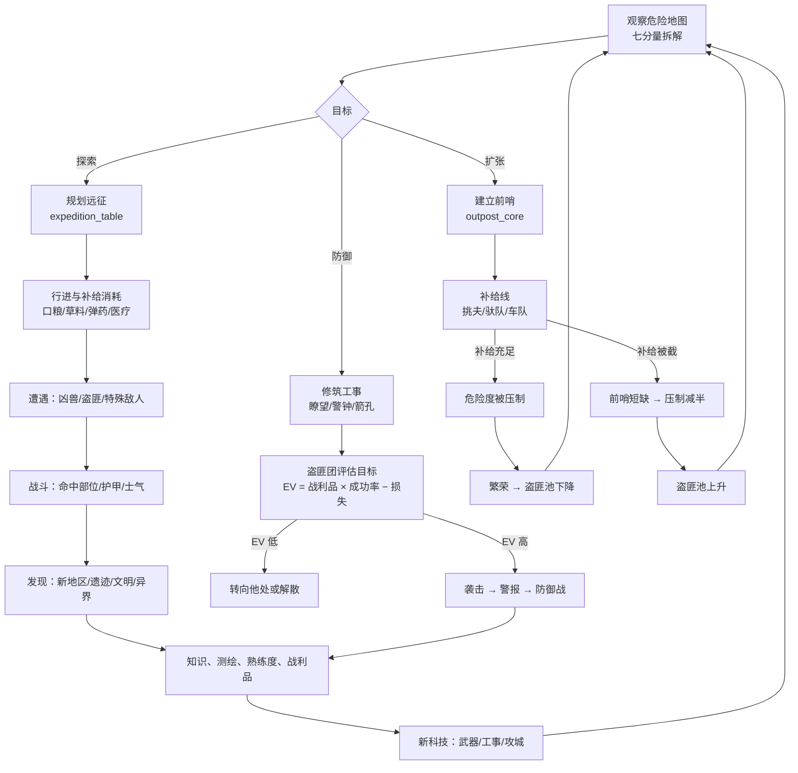

# 20 · 远征 Frontiers（`tcfrontiers`）

> 文档版本：DD-0.2 · 模组 ID `tcfrontiers` · Java 包 `com.nightcity.frontiers`（入口类 `TFrontiers`，事件类 `TFrontiersEvents`）
> 必需依赖：`tcivilization`。可选联动：其余全部模组（桥接类位于 `com.nightcity.frontiers.compat.<other>`）。
> 本章遵循 README §5.3 的 18 节模板；末尾附机器可读附录 A-D（格式见写作简报 §3）。
> 相关章节：01（各时代威胁）、02（地区附加层 `tcfrontiers:danger`、模拟分级、性能预算）、31（HUD 与文明面板契约）、21（异界影响区与原版怪物规则）、23（AI 文明战争宏观规则）。

---

## 1. 定位与设计支柱

### 1.1 定位

远征 Frontiers 负责“文明边缘”的一切：哪里危险、为什么危险、谁在那里、怎样把人和补给送过去、怎样守住已经拥有的地方。它把 DR-18 中“野生动物、盗匪、灾害”三类威胁里的**人为威胁与特殊威胁**做成可推理、可规划、可反制的系统，并提供 E2 以后的全部武器、护甲、防御工事功能方块与攻城器械。

| 本模组拥有 | 不拥有（归属） |
| --- | --- |
| 地区危险度模型、地区附加层 `tcfrontiers:danger` | 灾害的物理过程（Wildlands）、疾病（Settlements，仅聚落层） |
| 盗匪团、海盗、劫掠者及其生成经济（`BanditComponent`） | AI 文明的军队、战争宏观决策（Nations，使用本模组武器） |
| 特殊敌人与首领模板（凶兽、匪首、军阀、遗民守军等） | 普通野生动物物种与种群（Ecology）；原版怪物生成规则（Beyond） |
| 边疆前哨、补给线、远征计划与远征补给 | 车辆、船、道路本身（Networks）；食物本身（Cultivation） |
| E2 及以后的近战/远程武器、弹药、护甲 | E0-E1 石器、狩猎矛、简易弓（tctechnology）；所有金属工具（Industry） |
| 防御工事**功能方块**（哨位、瞭望台、警钟、烽燧、箭孔、闸门、吊桥、沙袋、铁丝网、防空炮等） | 城墙作为建筑材料与蓝图（Settlements）；砖、砂浆、混凝土（Industry） |
| 攻城器械与炮兵（攻城槌、攻城塔、投石机、配重投石机、火炮、迫击炮） | 军用载具外壳（Networks 车辆可挂载本模组 `WeaponMount`） |
| 民兵与守卫的战斗行为组件 `MilitiaComponent` | 职业分配、住房、作息（Settlements） |
| 战斗规则（伤害类型、命中部位、护甲、士气、重伤） | 玩家个人生存（DR-19：不做） |

### 1.2 设计支柱

| 编号 | 支柱 | 具体含义 |
| --- | --- | --- |
| FP-1 | **危险可以解释** | 每个地区的危险度都能拆成“偏远、地形、历史、生态、盗匪压力、异界渗透、压制”七个分量，并在地图与面板上逐项显示；不存在“随机刷怪”式的不讲理威胁 |
| FP-2 | **远征是后勤，不是苦役** | 远征的压力来自队伍（NPC、驮兽、车辆）的口粮、草料、弹药与士气；玩家本人没有饥渴体温条（DR-19）。玩家的决策是路线、编组、补给与时机 |
| FP-3 | **准备胜过反应** | 战斗短促且致命；瞭望、侦察、地形、工事、队形与士气决定胜负，而不是血条与连点 |
| FP-4 | **威胁有经济学** | 盗匪由贫困、动乱、战乱与过路财富“喂养”；剿灭只能治标，修路、驻军、赦免与繁荣才能治本 |
| FP-5 | **时代改变战争的动词** | 青铜盾墙 → 铁器筑城 → 城堡与攻城 → 火药与棱堡 → 线膛与野战工事 → 机枪与堑壕 → 防空与快速反应 → 太空风险预报 |
| FP-6 | **后期仍需亲自远行** | 生产仪表盘与卫星图不能替代“地面真相”：首次接触、深层遗迹、未知地区的最高测绘等级、异界与月面现场都需要玩家亲自带队 |

### 1.3 与 DR 的一致性检查

| DR | 本章做法 |
| --- | --- |
| DR-06 写实 | 主世界敌人全部是人类或真实动物；奇幻敌人只来自 Beyond 影响区（AR-8） |
| DR-18 威胁 | 野生动物（通过 Ecology 的凶兽标记）、盗匪、灾害后果（难民→盗匪池）；原版怪物不在本模组刷新 |
| DR-19 个人生存 | 远征补给只由队伍中的 NPC、驮兽与车辆消耗；玩家不消耗远征口粮 |
| DR-20 可见过程 | 补给由挑夫、驮队、车队实际运送；攻城器械是需要装填、瞄准、操作的实体 |
| DR-22 AI 文明战争 | 边境冲突与攻城由 Nations 决策，本模组提供武器、工事、攻城器械与抽象战斗结算 `CombatApi` |
| DR-25 技能中等 | `combat`、`exploration`、`leadership` 等只给效率与特殊操作，不阻挡装备使用 |
| 02 §4.2 一致性 | L2 抽象袭击不烧毁建筑、不杀死已命名 NPC，只造成可恢复的统计损失 |

---

## 2. 独立玩法（只安装 `tcivilization` + `tcfrontiers`）

只安装核心与本模组时，Frontiers 仍构成一个完整的“边疆生存经营”玩法：

1. **危险地图**：危险度模型用回退数据源计算——地形分量来自原版生物群系标签（`c:is_mountain`、`c:is_desert`、`c:is_swamp`、`c:is_snowy` 等）与高度；偏远分量来自与玩家床位、前哨核心的环绕距离；生态分量来自原版掠食者（狼、北极熊、熊猫以外的中立/敌对动物）的已观测数量；历史分量为 0。
2. **前哨经营**：放置 `tcfrontiers:outpost_core` 建立前哨，前哨压制周边危险度、提供补给储藏与重生点（可选配置）。前哨需要驻守人员：无 Settlements 时，驻守者是通过 `tcfrontiers:bounty_board` 用物品雇来的佣兵（`tcivilization:person` + `MilitiaComponent`，合同期 4-12 MC 日）。
3. **盗匪生态**：盗匪池由“过路财富”（玩家运送物品的总价值，按原版物品稀有度估值）与“偏远度”驱动；成团后占据 `tcfrontiers:bandit_lair` 等结构，劫掠玩家的前哨与运输。
4. **悬赏与清剿**：告示板自动张贴已知盗匪团、凶兽的悬赏；击败首领获得 `tcfrontiers:bandit_insignia` 作为凭证，领取奖励（物品或绿宝石）。
5. **远征**：在 `tcfrontiers:expedition_table` 规划路线、编组佣兵与驮兽、装载口粮包、草料袋、弹药与医疗包，前往由本模组生成的边疆地点（劫掠者营地、盗匪要塞、海盗湾、逃兵营地）。
6. **装备演进**：无 tctechnology 时，武器与护甲按**材料**推进：铜/青铜（若存在 `c:ingots/bronze`，否则用铜锭的“砷铜”回退配方）→ 铁 → 钢（若存在 `c:ingots/steel`）→ 火药武器（需要 `minecraft:gunpowder`）。
7. **工事与攻城**：所有防御功能方块与攻城器械都可用，攻城对方块的破坏受配置 `siege.block_damage` 控制。

独立模式下禁用的内容：与 AI 文明有关的战争（无 Nations）、历史分量与遗民守军（无 Echoes）、NPC 职业化民兵（无 Settlements 时只有佣兵）。

---

## 3. 联动玩法

每条联动都在附录 C 登记；桥接类只在对方模组加载时被类加载。

| 对方模组 | 联动机制（具体规则见第 5 节） |
| --- | --- |
| `tcivilization` | 使用共享实体 `tcivilization:person` 实现盗匪、佣兵、民兵、海盗；向地区网格注册附加层 `tcfrontiers:danger`；L0-L3 模拟分级；记忆系统记录“某地击退袭击”“某匪首伏诛” |
| `tctechnology` | 本模组拥有 20 项科技（附录 B）；E0-E1 狩猎矛与简易弓由 tctechnology 提供，本模组的危险模型在 E0-E1 用它们作为“部族战斗力”的装备基线；时代改变危险分量权重与遭遇表 |
| `tcskills` | `combat` 影响命中散布、格挡、装填速度；`exploration` 影响远征行进速度与发现概率；`leadership` 影响队伍与民兵士气；`logistics` 影响补给损耗；`surveying` 影响侦察情报精度；`medicine` 影响重伤 NPC 的救治成功率 |
| `tcwildlands` | 地形分量读取 `tcwildlands:geo`（崎岖度、海拔带）、`tcwildlands:climate`（极端气候）、`tcwildlands:hydro`（水障）；季节修正危险度；灾害后的难民进入盗匪招募池；深地 `minecraft:the_nether` 远征使用高温补给类型 |
| `tcecology` | 生态分量读取 `tcecology:ecosystem` 的掠食者生物量；凶兽（食人兽、狼王）是给 Ecology 动物附加的 `tcfrontiers:notoriety` 数据附件；过度猎杀掠食者的生态后果由 Ecology 结算 |
| `tccultivation` | 远征口粮包由任意 `c:foods` 封装；驮兽、战马来自 Cultivation 驯化动物；盗匪袭击优先瞄准粮仓与畜群；草料袋封装 `c:animal_feeds` |
| `tcindustry` | 武器与护甲配方使用 Industry 的锭、板、线、火药、钢；Industry 的锻造台、铸造与机床是高级武器的生产地点；装备磨损与修理使用 Industry 的修理流程；军工厂产能统计 |
| `tcnetworks` | 车队、商队、船队的路线穿越危险地区时按危险度结算伏击；道路降低危险度；`WeaponMountApi` 让车辆与船挂载机枪、舰炮；补给线可由 Networks 的定期路线承担 |
| `tcsettlements` | 民兵/士兵职业由 Settlements 分配，战斗行为由本模组 `MilitiaComponent` 执行；警钟触发居民避难；聚落防御力进入盗匪的目标估值；失业与流民进入盗匪招募池 |
| `tcexchange` | 悬赏金以文明货币支付；盗匪劫掠的价值以 `VU` 记账；过路贸易额吸引盗匪；军火价格进入地区市场；赎金与贡赋 |
| `tcdiscovery` | 战斗、远征、侦察产生知识；远征队中的学者在远方地区记录标本与观察；火药、弹道等知识点 |
| `tcechoes` | 历史分量读取 `tcechoes:history`（古战场、陷落王国、盗匪传说）；遗迹可被盗匪团占据；遗民守军首领来自历史模拟；玩家的战役写入世界历史 |
| `tccommons` | 赦免令、征兵、悬赏法、持械许可等政策；领地权限 `siege_damage` 决定攻城能否破坏方块；俘虏的处置受法律约束 |
| `tcbeyond` | 危险度的“异界渗透”分量读取 `tcbeyond:anomaly`；影响区内的原版怪物由 Beyond 生成，本模组只把它们计入危险度与远征风险；本模组武器对异界生物有效 |
| `tcatlas` | 危险度图层、盗匪情报标记、远征路线规划与地图片段；瞭望台与雷达警报显示在小地图；远征获得“地面真相”测绘等级 |
| `tcnations` | 军队使用本模组武器、工事与攻城器械，未实体化时调用 `CombatApi` 抽象结算；战争产生逃兵 → 盗匪；边境冲突提高边境地区危险度 |
| `tcorbit` | E10 太空风险预报：把 Orbit 报告的轨道碎片、太阳粒子事件、火星沙尘暴折算为月面/火星远征风险；月面远征沿用远征规划器 |

---

## 4. 核心玩法循环



### 4.1 三个尺度的循环

| 尺度 | 周期 | 玩家动作 | 反馈 |
| --- | --- | --- | --- |
| 战术（秒-分钟） | 单次遭遇 | 选择站位、队形、射击/格挡、撤退或谈判 | 伤亡、士气崩溃、俘虏、战利品 |
| 行动（MC 日） | 一次远征或一次防御战 | 路线、编组、补给、侦察、修工事、调民兵 | 远征成败、补给余量、熟练度、测绘 |
| 战略（季-年） | 边疆经营 | 前哨网络、补给线、道路、悬赏、赦免、繁荣政策 | 地区危险度曲线、盗匪池、贸易安全、聚落扩张方向 |

### 4.2 各时代的边疆动词

| 时代 | 威胁（01 §3.3） | 本模组新增动词 | 代表内容 |
| --- | --- | --- | --- |
| E0 `stone` | 猛兽 | 守夜、驱赶 | 危险度（生态分量为主）、凶兽标记（tctechnology 的狩猎矛与简易弓应对） |
| E1 `neolithic` | 小部落袭扰 | 戒备、预警 | 警戒火堆、号角、尖桩障碍、哨位 |
| E2 `bronze` | 盗匪 | 武装、立哨、远征 | 青铜兵器、复合弓、边疆前哨、远征规划 |
| E3 `iron` | 边境冲突、攻城器械 | 筑城、攻城、操练 | 铁制兵器、瞭望台、烽燧、闸门、攻城槌、投石机、民兵 |
| E4 `medieval` | 城堡战争 | 守城、重装 | 重甲、配重投石机、吊桥、杀人孔、长柄兵器、长弓 |
| E5 `renaissance` | 海盗、殖民边疆冲突 | 火器、护航、殖民远征 | 火绳枪、火炮、棱堡石笼、远洋远征特许 |
| E6 `industrial` | 劳资冲突（Settlements）、逃兵 | 线膛射击、野战筑垒 | 后装步枪、左轮、野战炮、沙袋、铁丝网 |
| E7 `electric` | 大规模边境战争 | 机枪防御、夜间照明 | 机枪、钢盔、迫击炮、探照灯、碉堡射孔 |
| E8 `atomic` | 空袭 | 防空、预警 | 防空炮、防空警报、防爆门、突击步枪 |
| E9 `information` | 系统性故障 | 快速反应 | 复合防弹衣、夜视仪、快速反应调度台 |
| E10 `space` | 太空碎片、太阳风暴、火星沙尘暴 | 风险预报 | 太空风险预报台、应急信标、月面/火星远征规划 |

---

## 5. 系统规则与公式

### 5.1 地区危险度模型

危险度 `D`（0-100）按地区（512×512，02 §2.1）计算。附加层 `tcfrontiers:danger` **只存分量**，`D` 在读取时按“观察者所属文明的时代”现场合成，因此同一地区对 E2 部族和 E8 国家呈现不同危险度（相同的山地对前者是天险，对后者只是不便）。

```text
D_raw  = wR·R + wT·T + wH·H + wE·E + wB·B + κA·A
D      = clamp( D_raw × S_season − P, 0, 100 )

R  偏远   = 100 × (1 − exp(−d_eff / 3000))
            d_eff = 地区图上到最近“文明锚点”的最小代价路径长度（方块）
            边代价 = 距离 × 地形系数 × 交通系数
            地形系数：平原 1.0 · 森林 1.3 · 丘陵 1.6 · 沼泽 2.0 · 沙漠 1.8 · 冰原 2.2 · 山地 2.5
                      水域：无船科技 ∞，有船 0.8
            交通系数：无路 1.0 · 土路 0.6 · 铺装道路 0.5 · 铁路/公路 0.3（Networks 提供）
            文明锚点：人口 ≥ 5 的己方聚落中心、前哨核心、友好文明（Nations 关系 ≥ 友好）的城镇
T  地形   = 0.4·崎岖度 + 0.3·极端气候 + 0.3·水障（各 0-100，来自 Wildlands；回退见 §2）
H  历史   = Echoes 历史危险：古战场 30、陷落王国 50、匪患传说 40、屠城遗址 70；
            按“距今年数”衰减：H × 0.5^(years / 20)
E  生态   = min(100, 掠食者生物量 / 地区掠食者承载量 × 100)（来自 Ecology）
B  盗匪   = min(100, Σ_band 实力(band) × 距离权重 / 10)
            距离权重：同地区 1.0 · 相邻 0.5 · 隔一地区 0.15
A  异界   = 本地区 tcbeyond:anomaly 强度最大值（无 Beyond 时为 0）
S_season  = 冬 1.15（寒带 1.30）· 汛期/雨季 1.10 · 其他 1.00
P  压制   = min(60, Σ 前哨压制 + 道路巡逻 + 聚落驻军 + 近 7 日清剿奖励)
```

分量权重随观察者时代变化（`κA` 默认 0.40，不随时代变化，配置 `danger.anomaly_weight`）：

| 时代段 | wR | wT | wH | wE | wB | 说明 |
| --- | --- | --- | --- | --- | --- | --- |
| E0-E1 | 0.20 | 0.25 | 0.05 | 0.40 | 0.10 | 猛兽是主要威胁 |
| E2-E4 | 0.20 | 0.15 | 0.10 | 0.20 | 0.35 | 盗匪时代 |
| E5-E7 | 0.25 | 0.15 | 0.10 | 0.10 | 0.40 | 海盗、逃兵、殖民边疆 |
| E8-E10 | 0.35 | 0.30 | 0.05 | 0.05 | 0.25 | 偏远与极端环境成为主要风险 |

压制项：

| 来源 | 压制值 | 范围 | 条件 |
| --- | --- | --- | --- |
| 前哨 I/II/III/IV 级 | 15 / 25 / 30 / 35 | 半径 128 / 256 / 384 / 512 方块覆盖的地区 | 驻军满员且补给 ≥ 3 日；否则减半 |
| 道路巡逻 | 8 | 道路经过的地区 | Settlements 有“巡逻”岗位或 Nations 指派巡逻队 |
| 聚落驻军 | 每名民兵 1，上限 20 | 聚落所在地区及相邻地区（减半） | 民兵训练度 ≥ 30 |
| 清剿奖励 | 消灭的盗匪团实力 × 0.5，上限 15 | 该团原驻地区 | 7 MC 日线性衰减 |

危险等级：

| 档 | D | 名称 | 遭遇倍率 | 其他效果 |
| --- | --- | --- | --- | --- |
| 0 | 0-14 | 安全 | 0 | NPC 可独行；商队不需护卫 |
| 1 | 15-29 | 平静 | 0.5 | 夜间 NPC 不独行 |
| 2 | 30-49 | 不安 | 1.0 | NPC 出行需 ≥ 2 人；Settlements 新建聚落满意度 −5 |
| 3 | 50-69 | 危险 | 1.5 | 商队需护卫才会自动发车；NPC 拒绝独自采集 |
| 4 | 70-84 | 凶险 | 2.0 | 只有远征队与军队进入；聚落无法在此建立（除非先建前哨 II） |
| 5 | 85-100 | 绝地 | 3.0 | 只有玩家亲自带队的远征可进入；抽象（L2）远征自动绕行 |

更新节奏：分量在 L3（每日）批量重算；以下事件把地区标脏并在下一个 L2 周期（1,000 tick）重算：盗匪团成立/移动/覆灭、前哨建立/废弃/补给跌破阈值、Echoes 历史事件、Beyond 影响区强度跨越 10 的倍数。重算在工作线程进行，结果在主线程交换（02 §5）。

### 5.2 遭遇生成

只在 L0 区块（玩家 128 格内）或实体化远征队周围生成物理遭遇。判定周期为每 MC 小时（1,000 tick），以“玩家或远征队所在地区”为单位：

```text
p_encounter = min(0.40, D/100 × 0.25 × m_tier × m_night × m_noise × m_stealth)
  m_tier    = 上表遭遇倍率
  m_night   = 夜间 1.5，白天 1.0
  m_noise   = 1 + 0.05 × max(0, 队伍人数 − 4) + 0.3 × [近 1 小时开过火器]
  m_stealth = 1 − 0.004 × exploration 等级（上限 −0.2）
冷却：同一玩家两次遭遇间隔 ≥ 2 MC 小时；同一地区 ≥ 1 MC 小时
```

遭遇类型按权重抽取（权重 = 对应分量值 × 时代系数）：

| 类型 | 权重来源 | 内容 | 生成者 |
| --- | --- | --- | --- |
| 野兽 | E | 掠食者群、凶兽（§5.6） | Ecology 生成动物，本模组只发出请求；无 Ecology 时用原版狼/熊 |
| 盗匪 | B | 盗匪团的斥候、拦路、伏击 | 本模组 |
| 特殊敌人 | max(H, B) × 0.2 | 匪首、遗民守军、逃兵等（§5.6） | 本模组 |
| 异界 | A | 影响区内原版怪物 | **Beyond** 生成，本模组不生成 |
| 非战斗 | 固定 15 | 迷路旅人、难民、废弃营地、受伤商人、可疑足迹 | 本模组 |

生成约束：距玩家 48-96 格、优先在视锥外、不在 Commons 领地或聚落范围内、不在水下（海盗除外）；同时存在的遭遇实体数 ≤ `encounter.max_entities_per_player`（默认 12）。遭遇实体 10 MC 分钟内无玩家在 64 格内则撤回到抽象层（盗匪回归团体，伤亡保留）。

### 5.3 商队与补给线的伏击

Networks 的商队、车队、船队以及本模组的补给运输每穿越一个地区判定一次：

```text
p_ambush = 0.02 × (D/50)² × (1 − escort)
escort   = min(0.9, 护卫战力 / (护卫战力 + 当地盗匪战力))
伏击结算：抽象层调用 CombatApi.resolveAbstractBattle；
  败：损失 10%-40% 货物（随机，按价值），护卫受伤；不杀死已命名 NPC（02 §4.2）
  胜：盗匪团实力 −20%-60%，护卫获得 combat 熟练度（若为玩家亲自护送）
```

若玩家在场（L0），伏击实体化为真实战斗。

### 5.4 边疆前哨

前哨是“文明锚点”的廉价形式：不是聚落，没有人口增长，但能压制危险度、储存补给、作为远征出发点与撤退点。

| 级别 | 解锁 | 核心要求 | 半径 | 压制 | 驻军 | 驻军日耗 | 额外功能 |
| --- | --- | --- | --- | --- | --- | --- | --- |
| I 哨站 | `bronze/frontier_outposts` | 前哨核心 + 补给箱 + 帐篷 ×2 | 128 | 15 | 2 | 2 RU | 可设为远征起点 |
| II 寨堡 | `iron/fortification` | I + 瞭望台平台 + 警钟 + 栅栏或墙围合 ≥ 70% | 256 | 25 | 4 | 4 RU + 1 GU | 烽燧联络；可驻骑兵 |
| III 要塞 | `renaissance/gunpowder_artillery` | II + 火药库 + 炮位 ×1 + 石墙围合 ≥ 80% | 384 | 30 | 6 | 6 RU + 2 GU | 可作为殖民据点（Settlements 可升级为聚落） |
| IV 基地 | `electric/machine_guns` | III + 探照灯 + 机枪巢 + 无线电（Industry/Networks） | 512 | 35 | 8 | 8 RU + 2 PU/周 | 车辆维修；空中补给落点（E8 后） |

围合度检测：以核心为中心、半径 16-48 的环带上，Settlements 的“墙/栅栏”方块标签 `tcsettlements:defensive_wall`（无 Settlements 时用 `c:fences`、`minecraft:walls`）的覆盖比例。检测在放置/破坏墙体后 100 tick 内异步重算。

补给存量与效果：

```text
stock_days = 补给箱内 RU / 驻军日耗 RU
stock_days ≥ 3     → 全额压制
1 ≤ stock_days < 3 → 压制 × 0.5，发出 AlertProvider 警报“前哨补给不足”
stock_days < 1     → 压制 × 0.25，驻军士气 −10/日
士气降至 0         → 驻军逃散：每日 1 人离开，加入当地盗匪招募池（§5.6）
```

补给线（`SupplyLine`）是一条从“源”（聚落仓库、补给箱、Networks 车站）到前哨补给箱的定期运输：

| 运输方式 | 每趟运量 | 速度（方块/日，L2） | 解锁 | 风险 |
| --- | --- | --- | --- | --- |
| 挑夫（抽象 NPC） | 16 RU | 1,500 | `bronze/frontier_outposts` | 按 §5.3 |
| 驮队（每头驮兽） | 48 RU | 1,800 | 同上 + Cultivation 驮兽 | 按 §5.3 |
| 车队（Networks） | 200 RU | 由 Networks 决定 | Networks 路线 | Networks 用本模组 `p_ambush` |
| 船队（Networks） | 600 RU | 由 Networks 决定 | Networks 航线 | 海盗按 §5.3 |
| 空投（E8+） | 120 RU | 即时（下一 MC 小时） | `atomic/air_defense` + Networks 飞机 | 仅防空火力 |

无 Networks 时只能用挑夫与驮队；挑夫与驮队在 L0 区块内实体化为真实行走的 NPC 与动物（DR-20）。

### 5.5 远征

#### 5.5.1 远征定义

远征 = 一支**有编组、有补给、有目标、有路线**的队伍离开文明锚点覆盖范围的行动。玩家可以带队，也可以只派出 NPC 队伍。玩家本人从不消耗远征补给（DR-19）；补给由 NPC 队员、驮兽、坐骑与车辆消耗。

补给单位：

| 单位 | 代码 | 含义 | 封装物品 | 消耗者 |
| --- | --- | --- | --- | --- |
| 口粮单位 | `RU` | 1 名 NPC 1 MC 日的口粮 | `ration_pack`（4 RU） | NPC 队员 |
| 水单位 | `WU` | 1 名 NPC 或驮兽 1 MC 日的饮水 | `water_cask`（8 WU） | 仅在干旱、极地、深地高温、太空地区需要 |
| 草料单位 | `GU`（Grazing Unit；不用 FU，FU 是 12/15/16 的食物单位） | 1 头驮兽/坐骑 1 MC 日 | `fodder_sack`（4 GU） | 驮兽、坐骑 |
| 弹药单位 | `AU` | 一次中等规模交战的弹药 | 箭袋、弹药盒（按武器类型换算） | 战斗 |
| 医疗单位 | `MU` | 救治 1 名重伤者 | `field_medical_kit`（3 MU） | 重伤队员 |
| 零件单位 | `PU` | 修理 1 次车辆或 10 件装备 | `repair_kit`（4 PU） | 车辆、装备 |

`ration_pack` 由任意 `c:foods` 封装：每 6 点原版 `nutrition` 折合 1 RU；同一包中包含 ≥ 3 种不同食物时带“多样”标记，队伍士气每日 +2。食物的种类、来源与腐败仍归 Cultivation 管理，封装后的口粮包保质期为最短成分保质期 × 3（腌制、风干类 × 6）。

#### 5.5.2 编组与容量

| 成员 | 作用 | 携带容量 | 日耗 |
| --- | --- | --- | --- |
| 队长（玩家或 NPC） | 决定士气上限与行进纪律 | 玩家不计 | 玩家 0；NPC 1 RU |
| 斥候 | 侦察半径 +64，伏击预警 | 4 | 1 RU |
| 挑夫 | 运输 | 16 | 1 RU |
| 护卫 | 战斗 | 6 | 1 RU + 战时 AU |
| 学者（Discovery） | 远方观察与标本，产生知识 | 4 | 1 RU |
| 测绘员（Atlas） | 测绘等级 +1（上限见 §5.5.5） | 4 | 1 RU |
| 医士 | 救治成功率 +30% | 4 | 1 RU |
| 驮兽 | 运输 | 48 | 1 GU（+1 WU 干旱） |
| 车辆（Networks） | 运输 | 由车辆决定 | PU 与燃料（Networks 结算燃料） |

容量单位与补给单位一一对应（1 格容量 = 1 个补给单位）。

#### 5.5.3 行进与消耗

```text
日行程 = 1800 × min(成员速度系数) × 地形系数⁻¹ × 道路 1.3（有路时） × 季节系数 × 士气系数
  季节系数：冬 0.75（寒带 0.6）· 汛期 0.85 · 其他 1.0
  士气系数：士气 ≥ 40 → 1.0；< 40 → 0.8
日耗 RU = Σ NPC × c_climate × (1 − 0.003 × logistics 等级)      c_climate：寒冷 1.25 · 炎热 1.10 · 其他 1.0
日耗 WU = 需要饮水的地区中 (NPC + 驮兽)
日耗 GU = 驮兽 × (1 − 放牧率)        放牧率：草地且非冬季 0.5，其他 0
```

士气（0-100，初值 = 60 + 队长 leadership 等级 × 0.2）：

| 事件 | 士气变化 |
| --- | --- |
| 每日自然回归 | 向 60 靠拢 5 |
| RU 不足（当日缺口 > 0） | −15 |
| WU 不足 | −10 |
| 队员重伤 / 失踪 | −5 / −8 |
| 战斗胜利、完成目标、重要发现 | +5 / +10 / +5 |
| “多样”口粮 | +2 |
| 玩家队长在场 | 下限 20（玩家在场时队伍不会自行溃散） |

| 士气 | 后果 |
| --- | --- |
| < 40 | 行进 ×0.8 |
| < 25 | NPC 队伍要求返程（玩家带队时弹出 `warning` 通知，玩家可强行继续，每日再 −5） |
| < 10 | 每日 1 名 NPC 队员擅自离队（离队者回到最近聚落；若距离 > 3 地区则加入盗匪招募池） |

缺粮 3 日以上的 NPC 进入“衰弱”状态（战斗力 ×0.6、行进 ×0.7），但不会因饥饿死亡；驮兽缺草料 3 日后被放生，成为野生动物（交给 Ecology）。

#### 5.5.4 抽象远征（L2）

玩家不在附近时，远征只是一条记录，按 L2 周期推进：

1. 每 1,000 tick 推进路程、扣除补给（按日耗 / 24 分摊）。
2. 每进入一个新地区，按该地区 `D` 与 §5.2 的权重抽取一次事件；战斗用 `CombatApi.resolveAbstractBattle` 结算。
3. 抽象结算**不杀死已命名 NPC**、不破坏方块：最坏结果是“重伤并被俘”，可由后续远征或赎金救回（02 §4.2）。
4. D ≥ 85 的地区，抽象远征自动绕行；无路可绕时停在边缘等待玩家。
5. 玩家进入远征队 128 格内时，队伍实体化（L0），补给与伤情按记录还原。

#### 5.5.5 目标与“亲临”要求（FP-6）

| 目标 | NPC 远征可达成 | 必须玩家亲临（`requires_presence`） |
| --- | --- | --- |
| 测绘（Atlas） | 测绘等级 ≤ 2（“踏勘”） | 等级 3（“实测”，地面真相）；E9 卫星图像只能到等级 2 |
| 接触未知文明（Nations） | 只能带回传闻与方位 | 首次正式接触、建交 |
| 探索遗迹（Echoes） | 外围、地表遗物 | 深层遗迹、核心文物、遗民守军首领谈判 |
| 采集样本（Wildlands/Ecology） | 普通矿样、普通标本 | 新物种首次记录、稀有矿脉确认 |
| 清剿悬赏 | 普通盗匪团 | 已命名特殊敌人（§5.6）的最终击败或招降 |
| 建立前哨 | I 级 | II 级以上的选址确认 |
| 异界（Beyond） | 影响区外围观测 | 裂隙之门、异界维度内的一切目标 |
| 月面/火星（Orbit） | 机器人勘测 | 首次登陆点、遗址与地下冰确认 |

这些限制以 `ExpeditionObjective.requiresPresence` 字段表达，由数据包定义；服务器可把配置 `expedition.presence_required` 设为 `false` 统一关闭（不推荐）。

### 5.6 盗匪经济

#### 5.6.1 招募池

每个地区维护一个盗匪招募池 `pool`（单位：潜在成员人数，浮点），每 MC 日结算：

```text
recruits/day = BASE × (0.5·unrest + 0.3·poverty + 0.2·war_displacement) × remote_mult × difficulty
  BASE              = 0.8（配置 bandits.base_recruit_rate）
  unrest            = 0-1：Settlements 不满居民占比、Commons 动乱指数（取大）；回退：0.2
  poverty           = 0-1：Exchange 地区人均收入低于生存线的比例；回退：0.3
  war_displacement  = 0-1：Nations 战争、Wildlands 灾害造成的流民 / 地区人口；回退：0
  remote_mult       = 0.5 + R/100        （越偏远越容易聚众）
  difficulty        = 和平 0 · 简单 0.5 · 普通 1.0 · 困难 1.5
直接注入（一次性）：
  逃散的驻军、离队的远征队员、战败的逃兵   +1/人
  被劫掠的财富（盗匪“名声”吸引）            +1 / 100 VU 掠获
  赦免令（Commons 政策）                    pool × 0.5，团体成员 30% 投降
自然流失：pool × 0.05 / 日；地区 D < 15 时 pool × 0.2 / 日
```

无 Settlements/Exchange/Nations 时，回退为“过路财富”驱动：玩家及其 NPC 每运送 1,000 VU 的物品穿过地区，`pool +0.3`（物品估值使用原版稀有度回退表，见 16 章 `VU` 回退）。

#### 5.6.2 盗匪团

```text
成团：pool ≥ 6 且地区内盗匪团 < 2 且全局团数 < cap
  cap = min(4 + 2 × 已知聚落数, bandits.max_bands)     max_bands 默认 40
  初始规模 6-10 人（从 pool 扣除），选择据点：
    Echoes 遗迹（优先）> 天然洞穴/峡谷 > 生成 bandit_lair 结构
成长：每 100 VU 掠获 +1 人；规模 ≥ 20 且有遗迹/城堡 → 升级为 bandit_fort
维持：每人每日 1 VU（掠获储备支付）；储备耗尽 → 每日 10% 成员散去（回到 pool）
实力：strength = Σ 成员（1 + 装备等级 × 0.5） × 士气/60
```

盗匪团是一个抽象记录（`BanditBand`），成员只在 L0 实体化为 `tcivilization:person` + `BanditComponent`。装备等级取“该地区可接触到的最高时代 − 1”（盗匪通常落后正规军一个时代，但会从劫掠中获得最新武器：每次成功劫掠军械库或商队，装备等级 +0.5，上限为观察者时代）。

| 盗匪团类型 | 出现条件 | 特点 |
| --- | --- | --- |
| 拦路匪 `highwaymen` | E2+，道路附近 | 小规模，勒索过路费（可交钱免战） |
| 山匪 `brigands` | E2+，山地/森林 | 据山寨，伏击商队 |
| 马匪 `raiders` | E2+，草原/沙漠，需要 Cultivation 马 | 高机动，长距离袭击聚落外围 |
| 河盗 `river_pirates` | E3+，大河沿岸 | 袭击河运与渡口 |
| 海盗 `pirates` | E5+，海岸，需要 `renaissance/celestial_navigation` 已出现于世界 | 占据 `pirate_cove`，袭击船队与沿海聚落 |
| 逃兵团 `deserters` | E5+，Nations 战争后 | 装备精良、纪律好、士气低 |
| 走私集团 `smugglers` | E6+，Exchange 高关税或禁运 | 不主动袭击，贩卖违禁品，贿赂守卫 |

#### 5.6.3 恶名与首领

```text
notoriety += 2 × 成功劫掠次数 + 0.02 × 掠获 VU + 5 × 杀死的守卫 − 0.5/日
notoriety ≥ 60  → 产生已命名首领（特殊敌人模板，§5.7），自动张贴悬赏
notoriety ≥ 85 且规模 ≥ 30 → 首领升级为军阀 warlord：吞并相邻地区的小团、向聚落索要贡赋
```

悬赏金额 = `50 VU × 1.03^notoriety`，由告示板所在文明支付（Exchange 货币）；无 Exchange 时以绿宝石支付（1 绿宝石 ≈ 10 VU）。

#### 5.6.4 袭击决策

盗匪团每 MC 日为附近（≤ 3 地区）的每个候选目标计算期望值，取最大者：

```text
EV(target)  = loot(target) × p_success − expected_loss
loot        = 目标可见财富估值（粮仓、畜群、仓库、商队货值）× 0.15
p_success   = 1 / (1 + exp(−0.08 × (atk − def)))
atk         = band.strength × 突袭系数（夜间 1.3，雨雪 1.2）
def         = 守卫战力 + 工事加成 + 预警加成
  工事加成：每级围合 10（围合度 50% / 75% / 95%）、闸门 5、箭孔/射孔各 1（上限 15）
  预警加成：瞭望半径覆盖接近路线时 ×1.25；警钟可召集民兵时 +民兵战力
expected_loss = band.strength × (1 − p_success) × 0.6
发动条件：EV > 0 且 p_success ≥ 0.35 且距上次袭击 ≥ 4 MC 日
勒索：若 p_success ≥ 0.8 且团体有首领，先派信使索要贡赋（= loot × 0.5）；拒绝则袭击
```

目标优先级的“可见性”：盗匪只知道“被侦察过”的目标。盗匪斥候以 1 次/2 日的频率侦察，被玩家瞭望发现的斥候若被俘，可审问出团体位置（`band_intel_sync`）。

#### 5.6.5 袭击结算

| 模拟级别 | 袭击方式 | 后果上限 |
| --- | --- | --- |
| L0（玩家在 128 格内） | 实体袭击：盗匪从视野外接近，攻击外围、抢掠容器、驱赶牲畜；火把可点燃木质建筑（受 Commons `fire_spread` 标志与配置 `raids.allow_arson` 限制） | 完整战斗规则 |
| L1（128 格外但区块加载） | 简化实体：只结算抢掠与伤亡，不放火 | 抢掠 ≤ 25% 可见财富 |
| L2（未加载） | `CombatApi.resolveAbstractBattle` | 抢掠 ≤ 15%；只造成受伤，不杀死已命名 NPC，不破坏方块 |

袭击开始发送 `FrontiersRaidStartedEvent` 与 `critical` 级通知（玩家所属聚落被袭时，可打断，31 章 UP-9）；结束发送 `FrontiersRaidResolvedEvent`。

#### 5.6.6 治本手段

剿灭只减少当前团体；招募池由社会条件驱动。下表列出“治本”手段及其对招募池的影响：

| 手段 | 来源 | 效果 |
| --- | --- | --- |
| 修路、驻军 | Networks、本模组 | R 与 P 改善，D 下降，`remote_mult` 下降 |
| 赦免令 | Commons | 一次性 pool × 0.5，团体 30% 成员投降并成为可雇用居民 |
| 救济、就业 | Settlements、Exchange | unrest、poverty 下降 |
| 招安 | 本模组（与有首领的团体谈判，需 `diplomacy`） | 团体转为“雇佣军”，驻守指定前哨 12 MC 日后成为居民 |
| 贡赋 | 本模组 | 支付后该团 24 MC 日不袭击该聚落，但团体实力 +10%（养虎为患） |

### 5.7 特殊敌人与首领

特殊敌人不是新实体类型，而是**数据驱动的模板**（`data/<ns>/tcfrontiers/enemy_template/*.json`），作用于 `tcivilization:person`（人类）或现有动物实体（野兽，经由 Ecology 或原版），附加装备、属性倍率、行为与战利品。每个模板都与生物群系、历史或社会条件挂钩，不会凭空出现。

| 模板 ID | 中文名 | 基础实体 | 时代 | 出现条件 | 机制要点 |
| --- | --- | --- | --- | --- | --- |
| `man_eater` | 食人兽 | 大型猫科/熊（Ecology）或原版北极熊 | E0+ | 地区 E ≥ 60 且近 10 日有 NPC 被掠食者攻击 | 夜间潜行，专挑落单者；生命 ×3；会避开火光与 4 人以上的队伍；击败后 E −20 |
| `pack_alpha` | 狼王 | 狼（Ecology/原版） | E0+ | 狼群规模 ≥ 8 | 统领狼群包抄；头狼死亡后狼群溃散 |
| `river_reaver` | 河上掠夺者 | person | E3+ | 河盗团恶名 ≥ 60 | 乘船袭击，落水者在水中有优势 |
| `steppe_khan` | 草原可汗 | person + 马 | E2+ | 马匪团成为军阀 | 骑射；“佯退”行为：被追击时回身齐射 |
| `mountain_brigand_chief` | 山大王 | person | E2+ | 山匪团恶名 ≥ 60 | 据守山寨；滚石陷阱（预置于结构内，不破坏地形） |
| `desert_raider_chief` | 沙漠劫掠首领 | person + 骆驼 | E2+ | 沙漠地区马匪团 | 沙暴天气（Wildlands）中进攻；熟知水源 |
| `sea_raider_jarl` | 海寇首领 | person | E3+ | 沿海、北方寒带，Echoes 有“海寇传说” | 抢滩登陆，焚烧沿海木质建筑 |
| `pirate_captain` | 海盗船长 | person | E5+ | 海盗团恶名 ≥ 60 | 船炮（Networks 船 + `WeaponMountApi`）；可被收买为私掠者 |
| `remnant_warden` | 遗民守军统领 | person | E2+ | Echoes 陷落王国遗迹 | 守护遗迹，不主动袭击；可谈判（`diplomacy` ≥ 30 或带回王国文物），谈判成功后成为 Nations/Echoes 的“遗民”势力 |
| `deserter_colonel` | 逃兵上校 | person | E5+ | Nations 战争结束后，逃兵团规模 ≥ 20 | 战术撤退、交替掩护；可被赦免收编 |
| `smuggler_baron` | 走私男爵 | person | E6+ | 走私集团恶名 ≥ 60 | 贿赂守卫（降低聚落 def 20%）；不能被武力根除，需 Commons 政策配合 |
| `warlord` | 军阀 | person | E2+ | 恶名 ≥ 85 且规模 ≥ 30 | 指挥多个团体；索要贡赋；拥有攻城器械（E3+） |

野兽类模板以数据附件 `tcfrontiers:notoriety`（`NotorietyAttachment`：模板 ID、恶名、击杀记录）挂在动物实体上；Ecology 负责该动物的生存与繁殖，本模组只负责“恶名”带来的行为与悬赏。

首领战规则：

1. 首领有士气但不会在士气 < 25 时溃逃，而是“负隅顽抗”（伤害 +20%，防御 −20%）；士气 < 10 时可接受投降。
2. 首领死亡或投降时，团体士气 −40，大多数成员溃散；溃散成员 50% 回到 pool。
3. 首领战利品：`bandit_insignia`（悬赏凭证，记录首领姓名与恶名）、首领装备（耐久 30%-60%）、掠获储备的 50%。
4. 已命名首领被击败后写入 Echoes 历史与核心编年史；再次出现同名首领需 ≥ 1 年（“后继者”）。

### 5.8 战斗规则

#### 5.8.1 伤害类型

伤害类型注册为数据驱动的 `DamageType`（`data/tcfrontiers/damage_type/`）：`tcfrontiers:slash`、`tcfrontiers:pierce`、`tcfrontiers:blunt`、`tcfrontiers:ballistic`、`tcfrontiers:explosive`、`tcfrontiers:siege`。原版伤害类型映射：`player_attack`/`mob_attack` → 按武器类别；`arrow` → pierce；`explosion` → explosive。

#### 5.8.2 命中部位

```text
命中部位抽取：头 12% · 躯干 48% · 腿 30% · 脚 10%
  远程武器：根据弹道命中点的相对高度直接判定（实体包围盒分 4 段）
  近战：按上表抽取，攻击者高于目标 ≥ 1 格时头部 +10%
部位倍率：头 ×1.5 · 躯干 ×1.0 · 腿 ×0.8 · 脚 ×0.6
对应护甲槽：头 → HEAD · 躯干 → CHEST · 腿 → LEGS · 脚 → FEET
```

#### 5.8.3 护甲公式

每件护甲有一个按伤害类型的防护值 `prot[type]`（0-0.9）与武器穿甲值 `ap`（0-0.9）：

```text
eff        = max(0, prot[type] − ap)
final      = dmg × 部位倍率 × (1 − eff)
钝伤       = 若 eff ≥ 0.6 且 type ∈ {slash, pierce, ballistic}：额外 dmg × 0.15 的 blunt 伤害（无视护甲）
护甲耐久   = −1 每次被命中；final 被护甲吸收部分每 4 点再 −1
原版护甲   = 按材质映射到本模组防护档（§6.3），因此战利品中的原版护甲仍有意义
```

不使用原版的护甲点与韧性公式：本模组在 `LivingIncomingDamageEvent` 中计算 `final` 并设置伤害值，同时把原版护甲减伤关闭（通过把伤害类型加入 `minecraft:bypasses_armor` 标签，再由本模组自行结算）。

#### 5.8.4 盾牌、格挡与姿态

| 动作 | 规则 |
| --- | --- |
| 举盾 | 正面 100° 扇形内的近战与远程伤害按盾牌 `block` 值减免（木盾 0.6、青铜盾 0.75、鸢盾 0.85）；盾牌耐久扣除 = 被挡伤害 |
| 盾牌破防 | 斧类、锤类命中举盾目标：盾牌冷却 2 秒（与原版一致） |
| 长柄优势 | 长枪、长戟对冲锋骑手伤害 ×2；攻击距离 +1 格 |
| 装填 | 弓：蓄力 0.5-1.0 秒；弩：装填 1.25-4 秒；火器：装填 3-20 秒（§6.2）；装填期间移动速度 ×0.5 |
| 散布 | 远程散布角 = 武器散布 × (1 − 0.004 × combat 等级) × 移动惩罚 1.5 |

#### 5.8.5 士气、溃逃、投降与重伤

NPC 战斗者（盗匪、民兵、士兵、远征护卫）有战斗士气（0-100）：

| 事件 | 变化 |
| --- | --- |
| 友军阵亡 / 重伤（视野 16 格内） | −8 / −5 |
| 首领、军官阵亡 | −25 |
| 被骑兵冲锋、遭炮击、被机枪压制 | −10 / −15 / −10 每 5 秒 |
| 己方占优（人数比 ≥ 2） | +5 每 10 秒 |
| 军旗 `war_banner` 32 格内 | 下限 +15 |
| 队长 leadership 加成 | 初值 + leadership × 0.2 |

```text
士气 < 25 → 溃逃（远离威胁，丢弃重物）
士气 < 10 → 投降（放下武器，可被俘）；首领例外，见 §5.7
```

玩家文明的已命名 NPC 生命归零时有 70%（配置 `combat.downed_chance`）进入“重伤倒地”而非死亡；倒地 60 秒内由他人救治（消耗 1 MU 或 `field_medical_kit`，成功率 = 0.5 + medicine × 0.004 + 医士 0.3）则存活并进入 Settlements 的伤病流程。盗匪与敌方 NPC 倒地率 30%，倒地者可被俘。

#### 5.8.6 俘虏

俘虏可被押送回聚落（`tcivilization:person` 状态 `captive`），处置方式由 Commons 法律决定：释放（盗匪池 +1）、劳役、赎回（向团体或文明索要 VU）、招安（成为居民，需忠诚审查 12 MC 日）。处决选项只在 Commons 允许且服务器配置 `combat.allow_execution = true` 时出现，默认关闭。

### 5.9 工事与攻城

#### 5.9.1 方块耐久

攻城破坏使用独立的“方块结构耐久”，不使用原版爆炸抗性。耐久按方块标签确定：

| 标签（优先级自上而下） | HP | 示例 |
| --- | --- | --- |
| `tcfrontiers:siege/obsidian_like` | 2,000 | 黑曜石、哭泣的黑曜石 |
| `tcfrontiers:siege/steel` | 1,200 | 钢板、防爆门 |
| `tcfrontiers:siege/reinforced_concrete` | 900 | 钢筋混凝土（Industry） |
| `tcfrontiers:siege/stone` | 300 | 石块、石砖、圆石墙 |
| `tcfrontiers:siege/brick` | 250 | 砖块（Industry） |
| `tcfrontiers:siege/mud_brick` | 100 | 泥砖、土坯 |
| `tcfrontiers:siege/rammed_earth` | 80 | 夯土（Settlements）、泥土 |
| `tcfrontiers:siege/wood` | 60 | 原木、木板、栅栏、木门 |
| （其余） | 硬度 × 20 | — |

累计伤害存在区块数据附件 `tcfrontiers:siege_damage`（稀疏：`Map<BlockPos, short>`），HP 归零时方块按原版掉落规则破坏；未归零的受损方块每 MC 日恢复 0（不自愈），可用 `repair_kit` 或重新放置修复。

攻城破坏受三重开关：服务器配置 `siege.block_damage`（`all`/`claims_respected`/`none`，默认 `claims_respected`）、Commons 领地标志 `siege_damage`、L2 永不破坏方块。

#### 5.9.2 攻城器械

| 器械 | 时代 | 操作人数 | 每击伤害（对方块 HP） | 射程（格） | 装填（秒） | 移动 |
| --- | --- | --- | --- | --- | --- | --- |
| 攻城槌 `battering_ram` | E3 | 4 | 40 | 接触 | 3 | 推行，顶棚防箭 |
| 攻城塔 `siege_tower` | E3 | 6 | — | — | — | 推行，顶层与城墙同高时放下跳板 |
| 投石机 `mangonel` | E3 | 3 | 120 | 24-64 | 20 | 拖曳（需 2 人或 1 驮兽） |
| 弩炮 `ballista` | E3 | 2 | 60（对实体 30 pierce） | 8-80 | 10 | 拖曳 |
| 配重投石机 `trebuchet` | E4 | 6 | 300 | 48-160 | 45 | 现场组装（不可移动），组装 60 秒 |
| 射石炮 `bombard` | E5 | 4 | 500 | 16-96 | 90 | 拖曳（2 驮兽） |
| 野战炮 `field_cannon` | E5 | 3 | 350 | 16-200 | 30 | 拖曳（1 驮兽） |
| 后膛野战炮 `field_gun` | E6 | 3 | 450 | 16-320 | 12 | 拖曳/车辆牵引 |
| 迫击炮 `mortar` | E7 | 2 | 300（曲射） | 24-240 | 4 | 可拆解搬运 |

攻城器械是实体，操作员可以是玩家或 NPC（`MilitiaComponent`/Nations 士兵）。玩家操作时：瞄准由准星与仰角刻度决定（无辅助瞄准线，E6 起有射表物品 `firing_table` 的数字提示——作为 `TargetInfoProvider` 显示在目标信息中）。

#### 5.9.3 抽象攻城

Nations 的 AI 战争未实体化时，攻城由 `CombatApi.resolveSiege` 结算：

```text
每日：wall_hp_pool −= Σ 器械伤害 × 命中率(0.4) × 天气系数
      守方士气 −= 2 + 3 × [补给 < 7 日]
破城条件：wall_hp_pool ≤ 0 或 守方士气 ≤ 10
抽象攻城不破坏实际方块；破城结果交由 Nations 处理领土变化
```

### 5.10 民兵与守卫

`MilitiaComponent` 挂在由 Settlements 分配到“守卫/民兵”岗位的居民上（无 Settlements 时挂在悬赏板雇来的佣兵上）。

| 字段/规则 | 内容 |
| --- | --- |
| 训练度 | 0-100；每日在 `training_dummy`/`archery_target` 训练 +2（上限受时代：E1 40、E3 70、E5 90、E7 100）；战斗胜利 +3 |
| 装备 | 从所属聚落 `armory_rack` 自动领取：按训练度与武器类别偏好分配最好的装备；归还后自动修理排队（Industry） |
| 集结 | `alarm_bell` 敲响后，128 格内民兵 10 秒内向警钟或指定集结点集结；非战斗居民进入住宅避难（Settlements） |
| 岗位 | 巡逻（沿路径点）、守门（在闸门/门旁）、守塔（瞭望台平台）、操炮（炮位/机枪巢） |
| 推荐比例 | 1 名民兵 / 10 名居民；超过 1/5 时生产效率下降由 Settlements 结算 |
| 战力 | `power = (1 + 装备等级 × 0.5) × (0.5 + 训练度/200) × 士气/60` |
| 命令 | 玩家通过指令轮盘（Z）对民兵下达“守住这里 / 跟随我 / 自由交战 / 停火 / 撤退到警钟” |

瞭望半径：

| 来源 | 半径 | 时代 |
| --- | --- | --- |
| `watch_fire` 旁的守夜人 | 48 | E1 |
| `guard_post` | 64 | E1 |
| `watchtower_platform`（高度 ≥ 8 格） | 96 + 2 × (高度 − 8)，上限 160 | E3 |
| `signal_beacon` 烽燧链 | 点燃后把警报沿链传递，每座烽燧 2 秒 | E3 |
| `searchlight` | 夜间 160 | E7 |
| 雷达（Industry/Networks） | 空中目标 2,000 | E8 |

瞭望发现敌人时：发出 `warning` 通知，并在 Atlas 小地图上标记敌人方向（无 Atlas 时显示在核心 `tcivilization:alerts`）。

### 5.11 边疆事件

| 事件 ID | 触发 | 效果 | 时代 |
| --- | --- | --- | --- |
| `refugee_column` | Wildlands 灾害或 Nations 战争 | 一队难民到达前哨或聚落：接纳（人口 +，粮耗 +）或拒绝（盗匪池 +） | E1+ |
| `lost_caravan` | D ≥ 30 地区的非战斗遭遇 | 迷途商队求救：护送可获 Exchange 信誉 | E2+ |
| `blood_feud` | 两个盗匪团地区相邻且均有首领 | 团体互斗，胜者吞并败者；玩家可挑拨 | E2+ |
| `tribute_demand` | 军阀出现 | 军阀信使索要贡赋（§5.6.4） | E2+ |
| `ransom_note` | 抽象远征队员被俘 | 支付赎金或组织营救远征 | E2+ |
| `plague_of_wolves` | Ecology 掠食者暴增 | 地区 E 分量 ×1.5，持续 1 季 | E0+ |
| `deserter_wave` | Nations 战争结束 | 逃兵团生成，附近地区 B 上升 | E5+ |
| `air_raid` | Nations 敌对文明拥有飞机 | 防空警报，空袭目标为工业设施（实体化时投弹破坏受 `siege.block_damage` 约束） | E8+ |
| `solar_storm_warning` | Orbit 太阳粒子事件 | 太空风险预报台提前 1-3 MC 日警报；月面远征应躲入掩体 | E10 |

---

## 6. 数值表

### 6.1 近战武器

伤害单位为生命值点（玩家 20 点）。`ap` = 穿甲。E0-E1 的狩猎矛（伤害 5、ap 0.05）与简易弓由 tctechnology 提供，作为基线。

| ID | 中文名 | 时代 | 伤害类型 | 伤害 | 攻速/秒 | ap | 触及 | 耐久 | 特性 |
| --- | --- | --- | --- | --- | --- | --- | --- | --- | --- |
| `bronze_dagger` | 青铜匕首 | E2 | pierce | 4 | 2.0 | 0.10 | 2.5 | 180 | 背后攻击 ×2 |
| `bronze_spear` | 青铜矛 | E2 | pierce | 6 | 1.1 | 0.15 | 3.5 | 200 | 长柄 |
| `khopesh` | 镰形剑 | E2 | slash | 6.5 | 1.4 | 0.10 | 3.0 | 220 | 勾盾：命中举盾者使盾冷却 1 秒 |
| `bronze_battle_axe` | 青铜战斧 | E2 | slash | 8 | 0.9 | 0.20 | 3.0 | 220 | 破盾 |
| `iron_sword` | 铁剑 | E3 | slash | 7 | 1.5 | 0.15 | 3.0 | 300 | — |
| `iron_spear` | 铁矛 | E3 | pierce | 7.5 | 1.1 | 0.25 | 3.5 | 300 | 长柄 |
| `iron_battle_axe` | 铁战斧 | E3 | slash | 9.5 | 0.9 | 0.25 | 3.0 | 300 | 破盾 |
| `longsword` | 长剑 | E4 | slash | 8.5 | 1.3 | 0.25 | 3.2 | 500 | 潜行攻击改为半剑刺击（pierce，ap 0.40） |
| `halberd` | 长戟 | E4 | slash | 11 | 0.8 | 0.35 | 4.0 | 450 | 长柄；对骑手命中有 30% 拉下坐骑 |
| `pike` | 长枪 | E4 | pierce | 9 | 0.9 | 0.35 | 5.0 | 400 | 长柄；≥ 3 人并排持枪时正面骑兵冲锋被阻止 |
| `mace` | 钉头锤 | E4 | blunt | 9 | 1.0 | 0.50 | 3.0 | 500 | — |
| `warhammer` | 战锤 | E4 | blunt | 10 | 0.9 | 0.55 | 3.0 | 500 | 破盾 |
| `rapier` | 刺剑 | E5 | pierce | 7 | 1.8 | 0.30 | 3.4 | 400 | 举副手时格挡后 1 秒内反击 ×1.5 |
| `bayonet` | 刺刀 | E6 | pierce | 7 | 1.0 | 0.25 | +1.0 | 300 | 装在枪上（副手合成），装上后火器可近战 |
| `cavalry_sabre` | 骑兵马刀 | E6 | slash | 8 | 1.5 | 0.15 | 3.0 | 450 | 骑乘冲锋 ×1.5 |

### 6.2 远程武器与弹药

| ID | 中文名 | 时代 | 类型 | 伤害 | ap | 有效射程 | 装填/蓄力 | 散布° | 弹药 | 耐久 | 特性 |
| --- | --- | --- | --- | --- | --- | --- | --- | --- | --- | --- | --- |
| `sling` | 投石索 | E2 | blunt | 4 | 0.05 | 32 | 1.0 s | 3.0 | `sling_bullet`、圆石 | 120 | — |
| `javelin` | 标枪 | E2 | pierce | 8 | 0.20 | 24 | 投掷 0.8 s | 2.0 | 自身 | 60 | 可回收 |
| `composite_bow` | 复合弓 | E2 | pierce | 7 | 箭 | 64 | 1.0 s | 1.0 | 箭类 | 300 | 可骑射 |
| `crossbow` | 弩 | E3 | pierce | 9 | 0.35 | 64 | 1.25 s | 0.8 | `crossbow_bolt` | 350 | 可预先上弦 |
| `longbow` | 长弓 | E4 | pierce | 9 | 箭 | 96 | 1.2 s（combat < 20 时 1.6 s） | 1.0 | 箭类 | 350 | 不可骑射 |
| `arbalest` | 重弩 | E4 | pierce | 14 | 0.50 | 96 | 4.0 s | 0.6 | `crossbow_bolt` | 450 | 装填时不能移动 |
| `arquebus` | 火绳枪 | E5 | ballistic | 14 | 0.45 | 48 | 20 s | 3.0 | `paper_cartridge` 或 `lead_ball`+`powder_flask` | 400 | 雨中哑火 50% |
| `matchlock_musket` | 火绳滑膛枪 | E5 | ballistic | 16 | 0.55 | 64 | 15 s | 2.5 | 同上 | 450 | 雨中哑火 50%；可装刺刀 |
| `flintlock_pistol` | 燧发手枪 | E5 | ballistic | 12 | 0.35 | 24 | 12 s | 4.0 | 同上 | 300 | 雨中哑火 20%；单手 |
| `rifled_musket` | 线膛枪 | E6 | ballistic | 18 | 0.60 | 160 | 12 s | 0.6 | `paper_cartridge` | 500 | 可装刺刀 |
| `breech_loading_rifle` | 后装步枪 | E6 | ballistic | 18 | 0.60 | 192 | 3 s | 0.5 | `metallic_cartridge` | 600 | 可卧姿装填 |
| `revolver` | 左轮手枪 | E6 | ballistic | 12 | 0.40 | 32 | 6 发 / 6 s | 2.0 | `metallic_cartridge` | 500 | 单手 |
| `bolt_action_rifle` | 栓动步枪 | E7 | ballistic | 20 | 0.65 | 256 | 5 发 / 3 s | 0.3 | `metallic_cartridge` | 800 | — |
| `light_machine_gun` | 轻机枪 | E7 | ballistic | 16 | 0.60 | 192 | 30 发 / 6 s | 2.5 | `metallic_cartridge` | 900 | 8 发/秒；未卧倒或架设时散布 ×3 |
| `hand_grenade` | 手榴弹 | E7 | explosive | 20（半径 4，衰减） | — | 投掷 24 | 引信 4 s | — | 自身 | — | 对方块：受 `siege.block_damage` 约束 |
| `assault_rifle` | 突击步枪 | E8 | ballistic | 15 | 0.60 | 160 | 30 发 / 3 s | 1.2 | `intermediate_cartridge` | 1,000 | 半自动/连发（10 发/秒）切换：潜行 + 使用 |
| `submachine_gun` | 冲锋枪 | E8 | ballistic | 11 | 0.40 | 64 | 32 发 / 2.5 s | 2.5 | `intermediate_cartridge` | 900 | 13 发/秒 |
| `carbine` | 卡宾枪 | E9 | ballistic | 15 | 0.65 | 192 | 30 发 / 2.5 s | 0.8 | `intermediate_cartridge` | 1,200 | 光学瞄具：瞄准时视野 ×2 |

箭与弹药修正：

| 弹药 | 时代 | 对弓/弩的 ap | 伤害修正 | 备注 |
| --- | --- | --- | --- | --- |
| `minecraft:arrow` | — | 0.10 | ×1.0 | 原版箭映射为燧石/骨箭头档 |
| `bronze_arrow` | E2 | 0.20 | ×1.0 | — |
| `iron_arrow` | E3 | 0.30 | ×1.05 | — |
| `bodkin_arrow` | E4 | 0.50 | ×0.95 | 锥形箭头，破甲 |
| `crossbow_bolt` | E3 | 由弩决定 | ×1.0 | — |

装填交互：远程武器无弹时，**按住使用键**即开始装填（与原版弩一致），松开中断；装填时间按上表，`combat` 每级 −0.3%（上限 −15%）。可选按键 `key.tcfrontiers.reload` 默认**不绑定**，玩家可自行绑定以在弹匣未空时提前换弹。

### 6.3 护甲

`prot` 按伤害类型：斩 / 刺 / 钝 / 弹 / 爆。移速为移动速度属性修正。盾牌只列 `block` 值。

| ID | 中文名 | 时代 | 槽 | 斩 | 刺 | 钝 | 弹 | 爆 | 耐久 | 移速 |
| --- | --- | --- | --- | --- | --- | --- | --- | --- | --- | --- |
| `bronze_helmet` | 青铜盔 | E2 | 头 | .45 | .35 | .20 | 0 | .05 | 200 | 0 |
| `linen_cuirass` | 亚麻胸甲 | E2 | 躯干 | .35 | .30 | .15 | 0 | .05 | 150 | 0 |
| `bronze_greaves` | 青铜胫甲 | E2 | 腿 | .40 | .30 | .15 | 0 | .05 | 180 | −2% |
| `iron_helmet` | 铁盔 | E3 | 头 | .55 | .45 | .25 | .05 | .10 | 300 | 0 |
| `lamellar_cuirass` | 札甲 | E3 | 躯干 | .55 | .45 | .25 | .05 | .10 | 350 | −3% |
| `lamellar_tassets` | 札甲裙 | E3 | 腿 | .50 | .40 | .20 | .05 | .10 | 300 | −2% |
| `hobnailed_boots` | 钉靴 | E3 | 脚 | .20 | .15 | .10 | 0 | 0 | 250 | 行军 +5% |
| `mail_hauberk` | 锁子长衣 | E4 | 躯干 | .70 | .40 | .15 | .05 | .10 | 450 | −3% |
| `mail_chausses` | 锁子护腿 | E4 | 腿 | .65 | .35 | .15 | .05 | .10 | 400 | −2% |
| `armet` | 全盔 | E4 | 头 | .80 | .70 | .40 | .15 | .15 | 600 | 0 |
| `plate_cuirass` | 板甲胸甲 | E4 | 躯干 | .80 | .70 | .35 | .20 | .20 | 700 | −6% |
| `plate_cuisses` | 板甲腿甲 | E4 | 腿 | .75 | .65 | .30 | .15 | .15 | 600 | −4% |
| `sabatons` | 铁靴 | E4 | 脚 | .60 | .50 | .25 | .10 | .10 | 500 | −2% |
| `morion` | 高冠盔 | E5 | 头 | .65 | .55 | .30 | .15 | .10 | 400 | 0 |
| `pikeman_cuirass` | 防弹胸甲 | E5 | 躯干 | .70 | .60 | .30 | .50 | .15 | 600 | −4% |
| `buff_coat` | 牛皮外套 | E5 | 躯干 | .45 | .30 | .25 | .05 | .05 | 350 | 0 |
| `steel_helmet` | 钢盔 | E7 | 头 | .60 | .50 | .30 | .25 | .45 | 500 | 0 |
| `flak_jacket` | 防破片背心 | E8 | 躯干 | .40 | .35 | .20 | .30 | .55 | 400 | −2% |
| `combat_boots` | 作战靴 | E8 | 脚 | .30 | .20 | .15 | .05 | .20 | 500 | 行军 +5% |
| `aramid_helmet` | 芳纶头盔 | E9 | 头 | .70 | .65 | .35 | .55 | .60 | 600 | 0 |
| `plate_carrier` | 插板防弹衣 | E9 | 躯干 | .75 | .70 | .30 | .85 | .60 | 500 | −4% |

| 盾牌 | 时代 | block | 耐久 |
| --- | --- | --- | --- |
| `wicker_shield` 柳条盾 | E2 | 0.60 | 120 |
| `bronze_shield` 青铜盾 | E2 | 0.75 | 300 |
| `round_shield` 圆盾 | E3 | 0.70 | 350 |
| `heater_shield` 鸢形盾 | E4 | 0.85 | 450 |
| `pavise` 大盾（方块式可放置掩体） | E4 | 0.95（放置时为方块掩体） | 600 |
| `minecraft:shield`（映射） | — | 0.70 | 原版 |

`night_vision_goggles`（E9）不是独立护甲件，而是附加到 `aramid_helmet` 的配件（工作台合成后头盔获得数据组件 `tcfrontiers:nvg`），佩戴时在亮度 ≤ 4 的环境中提供夜视。

原版装备映射（战利品与旧存档）：

| 原版 | 映射档 |
| --- | --- |
| 皮革护甲 | 亚麻胸甲档 × 0.8 |
| 锁链护甲 | 锁子甲档 |
| 铁护甲 | 札甲档 |
| 金护甲 | 青铜档，耐久 × 0.5 |
| 钻石护甲 | 板甲档 |
| 下界合金护甲 | 板甲档 + 爆 .30（只出现在 Beyond 影响区与遗迹） |
| 原版木/石/铁/金/钻石/下界合金剑、斧 | 分别映射为对应时代的剑/斧档；木、石档由 tctechnology 定义 |

### 6.4 平衡基准

| 指标 | 目标值 |
| --- | --- |
| 同时代、无甲对无甲，近战 TTK | 3-5 次命中 |
| 同时代主力护甲对同时代主力武器的减伤 | 30%-50% |
| 跨两个时代的武器对旧护甲 | 护甲几乎无效（eff ≤ 0.1） |
| 5 名训练度 50 的民兵 + II 级寨堡 对 10 人同时代盗匪团 | 守方胜率 ≈ 75% |
| 玩家在 E3 满套札甲 + 铁剑 对 3 名 E2 盗匪 | 玩家胜率 ≈ 80%，但无甲时 ≈ 30% |
| 远征 10 人、12 日的补给（120 RU + 草料） | ≈ 3 头驮兽；只用挑夫时需 ≈ 30 人（挑夫自身也吃口粮，因此长途必须用驮兽或车辆） |

---

## 7. 内容清单

完整 ID 见附录 A。下表只列有功能的方块（纯装饰方块不在本模组）。

| 方块 | 时代 | 功能 |
| --- | --- | --- |
| `watch_fire` 警戒火堆 | E1 | 守夜人值守时瞭望 48；光照 15；吓阻野兽（E 遭遇 ×0.5，半径 32） |
| `stake_barrier` 尖桩障碍 | E1 | 接触伤害 2 pierce；阻挡骑兵冲锋 |
| `guard_post` 哨位 | E1 | 指定守卫站岗点，瞭望 64 |
| `outpost_core` 前哨核心 | E2 | 建立前哨（§5.4），显示前哨级别、驻军、补给日数 |
| `supply_cache` 补给箱 | E2 | 27 格，只接收补给类物品；为前哨/远征计数 RU 等 |
| `field_tent` 野营帐篷 | E2 | 前哨驻军与远征队的宿营点；玩家可在此设置重生点（配置） |
| `expedition_table` 远征桌 | E2 | 打开远征页签的“新远征”深链接；容器用于装载补给 |
| `bounty_board` 告示板 | E2 | 悬赏列表；交付 `bandit_insignia` 领赏；雇佣佣兵 |
| `archery_target` 箭靶 | E2 | 远程训练，民兵训练度 +2/日 |
| `watchtower_platform` 瞭望台平台 | E3 | 放在 ≥ 8 格高处，瞭望 96-160 |
| `alarm_bell` 警钟 | E3 | 红石或交互敲响：召集民兵、居民避难（128 格） |
| `signal_beacon` 烽燧 | E3 | 链式传递警报（256 格内相互可见的烽燧） |
| `arrow_slit` 箭孔 | E3 | 半格射孔：内侧可射击，外侧来的投射物 80% 被阻挡 |
| `portcullis` 闸门 / `gate_winch` 绞盘 | E3 | 多格闸门（最宽 5×5），绞盘或红石升降，升降 3 秒 |
| `training_dummy` 训练假人 | E3 | 近战训练；显示最近一次命中伤害与部位 |
| `armory_rack` 军械架 | E3 | 民兵装备库，自动分配（§5.10） |
| `caltrops` 铁蒺藜 | E3 | 踩踏 2 pierce + 减速 50% 3 秒；对马 ×2 |
| `war_banner` 军旗 | E3 | 32 格内友军士气下限 +15；可绘制文明旗帜 |
| `drawbridge_hinge` 吊桥铰链 | E4 | 把相连的木板结构（最大 5×12）作为吊桥收放 |
| `murder_hole` 杀人孔 | E4 | 下方 4 格内的敌人受投石/热油伤害 |
| `pitch_cauldron` 热油锅 | E4 | 装填沥青后倾倒：下方 3×3 区域 6 点伤害 + 着火 |
| `pavise` 大盾 | E4 | 可放置的移动掩体，阻挡 95% 正面投射物 |
| `gabion` 石笼 | E5 | 炮兵阵地掩体：方块 HP 400，便宜 |
| `powder_magazine` 火药库 | E5 | 火药与弹药存储；被引燃时爆炸（受 `siege.block_damage` 约束） |
| `gun_platform` 炮位 | E5 | 火炮固定架设：射界 ±60°，装填 −20% |
| `sandbag` 沙袋 | E6 | 半格掩体：弹道伤害对身后目标 −70% |
| `barbed_wire` 铁丝网 | E6 | 减速 80%，接触 1 slash/秒 |
| `earthwork_parapet` 土木胸墙 | E6 | 可堆叠掩体，方块 HP 200，对爆炸抗性高（爆炸伤害 ×0.5） |
| `pillbox_embrasure` 碉堡射孔 | E7 | 阻挡 90% 来袭投射物，内侧机枪射界 ±45° |
| `searchlight` 探照灯 | E7 | 夜间瞭望 160，照亮的敌人对所有友军高亮（描边 + 图标） |
| `machine_gun_nest` 机枪巢 | E7 | 架设轻机枪：散布 ×0.5，操作员获得掩护 |
| `air_raid_siren` 防空警报 | E8 | 雷达或瞭望发现飞机时自动鸣响，居民进入掩体 |
| `blast_door` 防爆门 | E8 | 钢档 HP 1,200，红石开合 |
| `anti_aircraft_gun` 防空炮 | E8 | 对空目标（Networks 飞机）射击，近炸引信 |
| `rapid_response_console` 快速反应调度台 | E9 | 汇总辖区警报，一键派遣最近的民兵/车辆至警报点 |
| `hazard_forecast_console` 太空风险预报台 | E10 | 汇总 Orbit 数据，预测月面/火星远征风险窗口 |
| `emergency_beacon` 应急信标 | E10 | 远征队放置：持续广播位置，救援远征的路线优先级最高 |

实体：投射物 4 种（`ranged_projectile` 箭/弩矢/弹丸共用、`ballistic_projectile` 枪弹、`siege_projectile` 石弹/炮弹、`thrown_grenade`）；攻城器械 9 种（§5.9.2）。人类敌人（盗匪、海盗、佣兵、民兵）都使用核心实体 `tcivilization:person` + 组件，**不**注册新实体类型。

其他物品：`signal_horn` 号角（E1，便携警报：64 格内民兵集结、居民避难，冷却 30 秒）；`siege_ladder` 云梯（E3，靠墙放置的可攀爬梯，最长 12 格，守方可推倒）；`siege_engine_frame` 攻城器械框架（E3，放置后逐件交付材料组装器械）；器械弹药 `stone_shot` 石弹（E3）、`cannonball` 实心炮弹（E5）、`artillery_shell` 炮弹（E6）、`mortar_shell` 迫击炮弹（E7）；`firing_table` 射表（E6，副手持有时在目标信息中显示仰角-射程换算）；`repair_kit`（E3，4 PU）、`field_medical_kit`（E2，3 MU）、`ration_pack`、`water_cask`、`fodder_sack`（E2，§5.5.1）；`bandit_insignia` 匪首徽记（E2，悬赏凭证）。

结构：`bandit_lair` 匪窝（洞穴改造，6-10 人）、`bandit_fort` 匪寨（木石寨，20+ 人）、`raider_camp` 劫掠者营地（帐篷群，可移动）、`pirate_cove` 海盗湾（海岸洞窟 + 栈桥）、`deserter_camp` 逃兵营（壕沟营地）。结构不在世界生成时预置，而是由盗匪团在运行时“占据并改造”：生成器在团体成立时选址并以模板放置（L0 时逐步“建造”动画，L2 时直接放置在未加载区块的待放置队列中，区块加载时落地）。

---

## 8. 配方与获取

配方使用标签，材料归属方提供实物（Industry 的锭、板、线；Cultivation 的皮革、亚麻、木材）。无对应模组时使用括号中的回退材料。

| 产物 | 工作站 | 主要材料 | 解锁科技 |
| --- | --- | --- | --- |
| 青铜兵器、青铜护甲 | Industry 锻造砧（回退：工作台） | `c:ingots/bronze`（回退：铜锭 + 铁粒“砷铜”） + 木柄 | `bronze/bronze_weaponry` |
| 复合弓 | 工作台 | 木材 + `c:bones` 或角 + `c:leathers` + 筋（`c:strings`） | `bronze/composite_bow` |
| 前哨核心 | 工作台 | 原木 ×4 + `c:ingots/bronze` + 旗帜 | `bronze/frontier_outposts` |
| 口粮包 | 工作台（无序） | 任意 `c:foods` 折合 4 RU + `c:leathers` 或纸 | `bronze/frontier_outposts` |
| 铁制兵器与札甲 | Industry 锻造砧 | `c:ingots/iron` + 皮绳 | `iron/iron_weaponry` |
| 瞭望台平台、警钟、烽燧、闸门 | 工作台 / Industry 铸造（警钟） | 原木、铁锭、青铜（钟） | `iron/fortification` |
| 攻城槌、投石机、弩炮、攻城塔 | 实体放置：先放置“攻城器械框架”物品，再按配方逐件交付材料（可见组装过程，DR-20） | 原木 ×30-80、铁锭、绳 | `iron/siegecraft` |
| 锁子甲、板甲 | Industry 锻造砧 + 水力锤（加工时间 ×0.5） | 铁线、钢板（回退：铁锭 ×1.5） | `medieval/heavy_armour` |
| 火器 | Industry 机械加工（E5 为手工锻造 + 钻膛） | 钢管、木枪托、燧石/火绳 | `renaissance/firearms` |
| 火药武器弹药 | 工作台 | `minecraft:gunpowder`（或 Industry 火药）+ 铅 + 纸 | `renaissance/firearms` |
| 线膛与后装武器、金属弹壳 | Industry 机床 | 钢、黄铜 | `industrial/rifled_arms` |
| 机枪、迫击炮、钢盔 | Industry 工厂（流水线） | 钢、弹簧、黄铜 | `electric/machine_guns` |
| E8-E9 现代装备 | Industry 自动化产线 | 合金、芳纶（Industry 化工）、电子元件 | 各自科技 |

获取的其他途径：盗匪与特殊敌人战利品（耐久 30%-60%）；Exchange 市场（军火价格见 16 章）；Echoes 遗迹中的古代兵器（作为文物，可展示或研究，Discovery 知识点）。

---

## 9. 交互规格

| 对象 | 操作 | 结果 |
| --- | --- | --- |
| `outpost_core` | 右键 | 打开 `outpost` 菜单（驻军、补给日数、压制值、补给线列表、“在面板中打开”深链接） |
| `outpost_core` | 潜行 + 右键 | 显示前哨半径与围合度检测轮廓（L1 世界内标注，10 秒） |
| `expedition_table` | 右键 | 打开 `expedition_loadout` 容器（装载补给到队伍行囊）；按钮“规划路线”打开文明面板远征页签 |
| `supply_cache` / `armory_rack` | 右键 | 打开对应容器菜单；军械架显示每件装备的当前领用人（`TcPersonChip`） |
| `alarm_bell` | 右键 / 红石脉冲 | 敲响：发送 `warning` 通知给聚落成员；民兵集结 |
| `bounty_board` | 右键 | 打开 `bounty_board` 菜单：悬赏列表、交付凭证槽、雇佣佣兵 |
| 攻城器械实体 | 右键（空手） | 成为操作员（占据操作位）；需要的操作人数不足时射速按比例降低 |
| 攻城器械实体 | 手持弹药右键 | 装填；打开 `siege_engine` 菜单可调整仰角/方位（数字输入，不依赖鼠标精度） |
| 远程武器 | 按住使用 | 弹药为空时装填；已装填时瞄准；松开射击（弓/弩）或左键射击（火器） |
| 民兵 NPC | 指令轮盘（Z） | 守住这里 / 跟随我 / 自由交战 / 停火 / 撤退到警钟 / 更换装备 |
| 盗匪 NPC（士气 < 25） | 指令轮盘（Z） | 劝降（`diplomacy` 判定）/ 索要赎金 / 押送 |
| 已命名首领（士气 < 10 或可谈判模板） | 指令轮盘（Z） | 谈判：招安 / 贡赋 / 停战 24 MC 日 |

所有本模组方块与实体都注册 `TargetInfoProvider`：准星指向时，核心 `tcivilization:target_info` 显示名称、状态与关键数值（例如“前哨 II · 驻军 4/4 · 补给 5.2 日”“投石机 · 已装填 · 仰角 38°”“盗匪 · 黑石团 · 士气 低”）。

---

## 10. 界面

遵循 31 章：本模组**不**注册独立管理界面与入口按键，只向文明面板 `tcivilization:civ_panel`（J）注册页签，向核心 HUD 层注册情境控件，并使用核心共享控件（`TcTable`、`TcChart`、`TcMapSnippet`、`TcPersonChip`、`TcItemChip`、`TcProgressBar`、`TcEraBadge`、`TcSearchField`、`TcConfirmDialog`）。状态一律用“图标形状 + 文字 + 颜色”同时表达。

### 10.1 文明面板页签

| 页签 ID | 分组 | 排序 | 本地化键 | 解锁 | 子导航 | 总览卡片（200×100） |
| --- | --- | --- | --- | --- | --- | --- |
| `tcfrontiers:expeditions` | 世界 | 700 | `civtab.tcfrontiers.expeditions` | `bronze/frontier_outposts`（未解锁时显示锁定与解锁条件） | 危险地图 · 远征 · 前哨与补给线 · 悬赏 | “边疆”：进行中远征数、补给最低的前哨、最高恶名的盗匪团 |
| `tcfrontiers:defense` | 文明 | 280 | `civtab.tcfrontiers.defense` | `neolithic/watch_and_ward` | 防务概况 · 民兵 · 工事 · 军械 | “防务”：民兵数/建议数、最近一次袭击结果 |

远征页签（“远征”子页，新远征规划）线框：

```text
┌ 世界 › 远征 › 新远征 ─────────────────────────────────────────── [TcSearchField] ┐
│ 目标：[▼ 测绘 · 北境山地 (−3, 7)]   亲临要求：◆ 需要玩家带队（实测等级 3）       │
├──────────────────────────────┬───────────────────────────────────────────────────┤
│ TcMapSnippet                 │ 编组                                              │
│  起点 ■ 青川前哨             │  [TcPersonChip 队长：玩家]                        │
│  路线 ─ ─ ─ ▲(危险 62 危险)  │  斥候 1 · 挑夫 2 · 护卫 4 · 测绘员 1 · 医士 1    │
│  目标 ◎                      │  驮兽 3（容量 144）  车辆 —                       │
│  图例：▲ 危险≥50  ✕ 已知匪寨 │  [+ 添加成员]                                     │
│                              ├───────────────────────────────────────────────────┤
│  路线：14 地区 · 约 9.5 日   │ 补给（需求 / 已装载）                             │
│  [自动规划] [手动路点]       │  口粮 RU  110 / 120  TcProgressBar ████████▉  92% │
│                              │  草料 GU   30 /  24  TcProgressBar ██████▌    80% ⚠│
│                              │  弹药 AU    6 /   6  ✔   医疗 MU 3 / 3 ✔          │
├──────────────────────────────┴───────────────────────────────────────────────────┤
│ 风险摘要：伏击期望 1.8 次 · 最危险地区 黑石岭（D 74 凶险：盗匪 41 / 地形 18 / …）  │
│ [固定追踪]                       [保存草稿]   [TcConfirmDialog → 出发]             │
└──────────────────────────────────────────────────────────────────────────────────┘
```

“危险地图”子页使用 `TcMapSnippet`（有 Atlas 时为地图，无 Atlas 时为地区网格表 `TcTable`）；点击地区显示 7 个分量的条形分解（`TcChart` 横向条形，数值标签常显）。

### 10.2 HUD 控件

| 控件 ID | 最低等级 | 默认锚点 | 尺寸 | 刷新 | 出现条件（`relevant`） | 内容 |
| --- | --- | --- | --- | --- | --- | --- |
| `tcfrontiers:expedition_supply` | 标准 | 右中 | 160×≤44 | 20 tick | 玩家属于进行中的远征 | 剩余天数（按最紧缺补给）、RU/GU/WU/AU 小图标 + 数字、士气条 |
| `tcfrontiers:danger_level` | 标准 | 左上（`tcwildlands:local_conditions` 下方） | 96×12 | 100 tick | 所在地区 D ≥ 30；扩展等级下始终显示 | 危险档图标（盾形内 0-5 道刻痕）+ 档名 + D 值 |
| `tcfrontiers:ammo_counter` | 标准 | 下中侧挂（热栏右侧，`defaultX = 122`，31 §3.5） | 48×14 | 每帧（客户端数据） | 手持需要装填的远程武器 | 弹匣数/备弹数；装填中显示进度弧 |

```text
expedition_supply（标准）
┌──────────────────────────────┐
│ 远征：北境测绘   剩余 ≈4.5 日│
│ 粮 46 RU  草 12 GU  弹 5 AU  │
│ 士气 ███████░░░ 58           │
└──────────────────────────────┘
```

### 10.3 警报、通知、追踪与深链接

| 机制 | 使用 |
| --- | --- |
| `AlertProvider`（持续） | “前哨补给不足（< 3 日）”“远征士气低（< 25）”“盗匪团在聚落 3 地区内活动”“军械架装备不足” |
| `TcNotifications` | `info`：发现盗匪斥候；`success`：远征完成、悬赏领取；`warning`：瞭望发现敌人、警钟敲响；`critical`（可打断）：己方聚落/前哨遭袭、远征队员被俘；`ceremony`：击败已命名首领、建立首个 III 级要塞 |
| `TrackerApi` | 可固定：进行中远征（进度 = 路程）、悬赏、补给线 |
| 深链接 | `tc:tcfrontiers/expedition/<id>`、`tc:tcfrontiers/outpost/<id>`、`tc:tcfrontiers/band/<id>`、`tc:tcfrontiers/danger?rx=<x>&rz=<z>`、`tc:tcfrontiers/expedition/new?target=<objective>` |
| 指令轮盘（Z） | `WheelProvider` `tcfrontiers:militia`、`tcfrontiers:siege`、`tcfrontiers:parley`（见 §9） |

按键：本模组只登记一个可选按键 `key.tcfrontiers.reload`，**默认不绑定**（装填默认用“按住使用键”）。不占用 R、K、I、O、G、C、X、L、P、F、Q、T、E 等保留键。

---

## 11. 数据结构

### 11.1 存档

| 数据 | 位置 | 内容 |
| --- | --- | --- |
| 世界级 | `data/tcfrontiers.dat`（`SavedData`） | 盗匪团、远征、前哨、补给线、悬赏、招募池、首领名册 |
| 地区附加层 | `region/<dim>/tcfrontiers_danger.bin`（核心地区网格托管） | 每地区 8 字节：R、T、H、E、B、A 分量（各 1 字节）、P（1 字节）、标志位 |
| 区块附件 | `tcfrontiers:siege_damage` | 稀疏方块损伤 |
| 实体附件 | `tcfrontiers:notoriety`（动物）、`BanditComponent`/`MilitiaComponent`（person 组件） | — |
| 物品数据组件 | `tcfrontiers:loaded_ammo`、`tcfrontiers:ration_contents`、`tcfrontiers:nvg`、`tcfrontiers:insignia_record` | — |

### 11.2 记录与 Codec 草图

```java
package com.nightcity.frontiers.data;

import net.minecraft.resources.Identifier;

public record DangerComponents(byte remoteness, byte terrain, byte history, byte ecology,
                               byte bandit, byte anomaly, byte suppression, byte flags) {
    public static final Codec<DangerComponents> CODEC = Codec.BYTE_BUFFER.xmap(
            DangerComponents::fromBytes, DangerComponents::toBytes);
    public int compose(int era, Season season, FrontiersConfig cfg) { /* §5.1 */ }
}

public record BanditBand(UUID id, String name, BandType type, RegionPos home,
                         int members, float equipmentLevel, float morale, int notoriety,
                         long lootReserveVu, Optional<UUID> chief, long lastRaidDay,
                         Set<RegionPos> scouted) {
    public static final Codec<BanditBand> CODEC = RecordCodecBuilder.create(i -> i.group(
            UUIDUtil.CODEC.fieldOf("id").forGetter(BanditBand::id),
            Codec.STRING.fieldOf("name").forGetter(BanditBand::name),
            BandType.CODEC.fieldOf("type").forGetter(BanditBand::type),
            RegionPos.CODEC.fieldOf("home").forGetter(BanditBand::home),
            Codec.intRange(0, 500).fieldOf("members").forGetter(BanditBand::members),
            Codec.FLOAT.fieldOf("equipment_level").forGetter(BanditBand::equipmentLevel),
            Codec.FLOAT.fieldOf("morale").forGetter(BanditBand::morale),
            Codec.intRange(0, 100).fieldOf("notoriety").forGetter(BanditBand::notoriety),
            Codec.LONG.fieldOf("loot_reserve_vu").forGetter(BanditBand::lootReserveVu),
            UUIDUtil.CODEC.optionalFieldOf("chief").forGetter(BanditBand::chief),
            Codec.LONG.fieldOf("last_raid_day").forGetter(BanditBand::lastRaidDay),
            RegionPos.CODEC.listOf().xmap(Set::copyOf, List::copyOf)
                    .fieldOf("scouted").forGetter(BanditBand::scouted)
    ).apply(i, BanditBand::new));
}

public record Expedition(UUID id, UUID owner, Identifier objective, List<RegionPos> route,
                         int routeIndex, Party party, SupplyStock stock, float morale,
                         ExpeditionState state, boolean playerPresent, long startedDay) {}

public record SupplyStock(int ru, int wu, int gu, int au, int mu, int pu) {
    // CODEC：6 个非负 int 字段（ru/wu/gu/au/mu/pu），RecordCodecBuilder 写法同上
}

public record WeaponProfile(Identifier damageType, float damage, float attackSpeed, float ap,
                            float reach, Optional<RangedSpec> ranged, Set<WeaponTrait> traits) {}

public record ArmourProfile(EquipmentSlot slot, Map<Identifier, Float> protection,
                            float moveSpeedModifier) {}
```

### 11.3 数据包目录

| 路径 | 内容 |
| --- | --- |
| `data/<ns>/tcfrontiers/weapon_profile/*.json` | 武器档案；可为任意物品（含原版、其他模组）指定档案 |
| `data/<ns>/tcfrontiers/armour_profile/*.json` | 护甲档案 |
| `data/<ns>/tcfrontiers/enemy_template/*.json` | 特殊敌人模板（§5.7） |
| `data/<ns>/tcfrontiers/encounter_table/*.json` | 按时代 × 危险档 × 生物群系标签的遭遇表 |
| `data/<ns>/tcfrontiers/expedition_objective/*.json` | 远征目标类型（含 `requires_presence`） |
| `data/<ns>/tcfrontiers/siege_material/*.json` | 方块标签 → 结构 HP |
| `data/tcfrontiers/damage_type/*.json` | 6 种伤害类型 |

---

## 12. 公共 API、事件与网络

### 12.1 API（`com.nightcity.frontiers.api`，其他模组可软依赖调用）

```java
public interface FrontiersApi {
    static FrontiersApi get() { return FrontiersApiImpl.INSTANCE; }      // 未加载时由调用方先检查 ModList

    int danger(ServerLevel level, RegionPos region, int observerEra);   // 合成后的 D
    DangerComponents dangerComponents(ServerLevel level, RegionPos region);
    void registerDangerContributor(Identifier id, DangerContributor contributor);
    float ambushChance(ServerLevel level, RegionPos region, float escortPower);   // §5.3，Networks 调用
    List<BanditBandView> bandsNear(ServerLevel level, RegionPos center, int radiusRegions);
    void injectRecruits(ServerLevel level, RegionPos region, float amount, Identifier cause); // 逃兵、难民
    Optional<OutpostView> outpostAt(ServerLevel level, BlockPos pos);
}

/** 其他模组向危险度的某个分量贡献数值（例如 Beyond 写 anomaly，Nations 写边境冲突） */
public interface DangerContributor {
    DangerChannel channel();                       // REMOTENESS/TERRAIN/HISTORY/ECOLOGY/BANDIT/ANOMALY/SUPPRESSION
    int value(ServerLevel level, RegionPos region); // 0-100，在工作线程调用，只读快照
}

public interface CombatApi {
    /** 抽象战斗：Nations 的边境冲突、L2 伏击、抽象远征遭遇 */
    BattleResult resolveAbstractBattle(ForceSpec attacker, ForceSpec defender, BattleContext ctx);
    SiegeDayResult resolveSiege(SiegeState state, ServerLevel level);
    Optional<WeaponProfile> weaponProfile(ItemStack stack);
    Optional<ArmourProfile> armourProfile(ItemStack stack);
}

public record ForceSpec(int count, float equipmentLevel, float training, float morale,
                        float fortification, Set<Identifier> weaponClasses) {}
public record BattleResult(float attackerLosses, float defenderLosses, boolean attackerWon,
                           float lootFraction, List<UUID> captured) {}  // captured 只含未命名或允许被俘者

/** Networks 车辆、船、飞机挂载武器 */
public interface WeaponMountApi {
    void registerMount(Identifier vehicleType, MountSpec spec);   // 挂点位置、射界、可挂载武器类别
    boolean fireMount(Entity vehicle, int mountIndex, Vec3 aim, ServerPlayer operator);
}

/** 远征补给：Orbit 的月面远征、Networks 的补给线复用 */
public interface SupplyApi {
    SupplyStock countSupplies(Container container);
    SupplyStock consume(SupplyStock stock, PartySpec party, ClimateSnapshot climate, int days);
}
```

### 12.2 事件（NeoForge 游戏总线，服务端）

| 事件 | 可取消 | 字段 | 典型监听者 |
| --- | --- | --- | --- |
| `FrontiersDangerChangedEvent` | 否 | region, oldTier, newTier | Settlements（选址）、Atlas（图层刷新） |
| `FrontiersBanditBandFormedEvent` | 是 | band, region, cause | Echoes（写历史）、Commons |
| `FrontiersRaidStartedEvent` | 是 | band, target, simTier | Settlements（避难）、Nations |
| `FrontiersRaidResolvedEvent` | 否 | band, target, result | Exchange（损失记账）、Echoes |
| `FrontiersExpeditionStartedEvent` | 是 | expedition | Atlas、Discovery |
| `FrontiersExpeditionCompletedEvent` | 否 | expedition, outcome, objectivesMet | Atlas（测绘等级）、Discovery（知识）、Nations（接触） |
| `FrontiersOutpostEstablishedEvent` | 是 | outpost, tier | Settlements、Commons（领地） |
| `FrontiersSiegeBlockBreachedEvent` | 是 | pos, blockState, source | Commons（领地标志二次校验） |
| `FrontiersBountyClaimedEvent` | 否 | bounty, claimer, rewardVu | Exchange |
| `FrontiersSpecialEnemySpawnedEvent` | 是 | template, entity, region | Echoes、Ecology（凶兽） |

本模组监听：`LivingIncomingDamageEvent`（伤害结算）、`ServerTickEvent.Post`（L1/L2 调度）、核心 `RegionTierChangedEvent`（实体化/抽象化）、Settlements 的岗位变更事件、Nations 的战争结束事件（逃兵）、Wildlands 的灾害事件（难民）。

### 12.3 网络负载（`CustomPacketPayload`）

| 负载 ID | 方向 | 内容 | 频率上限 |
| --- | --- | --- | --- |
| `tcfrontiers:danger_sync` | S→C | 玩家周围 5×5 地区的分量（每地区 8 字节） | 进入新地区时 + 每 100 tick 增量 |
| `tcfrontiers:threat_alert` | S→C | 敌人方向、类型、距离（瞭望发现） | 每目标每 5 秒 1 次 |
| `tcfrontiers:expedition_plan_update` | C→S | 草稿编辑（目标、路线、编组、补给）+ 版本号 | 每 5 tick 1 次 |
| `tcfrontiers:expedition_state_sync` | S→C | HUD 数据：剩余天数、补给、士气 | 20 tick |
| `tcfrontiers:outpost_sync` | S→C | 前哨面板快照 | 打开时 + 40 tick |
| `tcfrontiers:bounty_list_sync` | S→C | 悬赏列表 | 打开告示板时 |
| `tcfrontiers:militia_order` | C→S | 民兵命令（经核心指令轮盘转发时不使用） | 每 10 tick 1 次 |
| `tcfrontiers:siege_engine_control` | C→S | 仰角、方位、开火 | 每 2 tick 1 次 |
| `tcfrontiers:weapon_action` | C→S | 装填开始/中断、射击模式切换 | 每 2 tick 1 次 |
| `tcfrontiers:band_intel_sync` | S→C | 玩家已知的盗匪团情报（位置精度随侦察等级） | 情报变化时 |

所有 C→S 负载在服务端校验：距离（≤ 交互距离或该玩家拥有的远征/前哨）、权限（Commons 角色）、版本号。

---

## 13. 配置

`config/tcfrontiers-server.toml`（服务端，同步到客户端只读显示）：

| 键 | 默认 | 范围 | 说明 |
| --- | --- | --- | --- |
| `danger.anomaly_weight` | 0.40 | 0.0-1.0 | `κA` |
| `danger.remoteness_scale` | 3000 | 500-20000 | 偏远分量的距离尺度（方块） |
| `danger.max_suppression` | 60 | 0-100 | 压制上限 |
| `encounter.enabled` | true | — | 关闭后只有盗匪袭击与远征事件，没有随机遭遇 |
| `encounter.max_chance_per_hour` | 0.40 | 0.0-1.0 | 每 MC 小时遭遇概率上限 |
| `encounter.max_entities_per_player` | 12 | 0-64 | — |
| `bandits.enabled` | true | — | — |
| `bandits.base_recruit_rate` | 0.8 | 0.0-5.0 | `BASE` |
| `bandits.max_bands` | 40 | 0-200 | 全局盗匪团上限 |
| `bandits.raid_cooldown_days` | 4 | 1-48 | — |
| `raids.allow_arson` | false | — | L0 袭击是否可点燃木质建筑 |
| `siege.block_damage` | `claims_respected` | `all` / `claims_respected` / `none` | 攻城与爆炸对方块的破坏 |
| `combat.downed_chance` | 0.70 | 0.0-1.0 | 己方已命名 NPC 倒地而非死亡的概率 |
| `combat.hit_locations` | true | — | 关闭后所有命中按躯干结算 |
| `combat.allow_execution` | false | — | — |
| `expedition.presence_required` | true | — | §5.5.5 |
| `expedition.base_travel_per_day` | 1800 | 600-6000 | — |
| `outpost.respawn_point` | true | — | 野营帐篷可设重生点 |
| `vanilla.disable_raids_and_patrols` | true | — | §16 |

`config/tcfrontiers-common.toml`：`compat.<modid>.enabled`（每个联动可单独关闭，默认 true）。

`config/tcfrontiers-client.toml`：`hud.show_danger_on_entry`（true，进入新危险档时在区域进入标题中附带危险档）、`combat.hit_marker`（true，命中部位提示）、`siege.show_trajectory_hint`（false，E6 前不显示弹道提示）。

---

## 14. 性能预算

预算（02 §8）：平均 0.4 ms/tick，峰值 2.0 ms/tick。

| 工作 | 线程 | 频率 | 预算 |
| --- | --- | --- | --- |
| 伤害结算（每次命中） | 主线程 | 事件 | ≤ 15 µs/次；每 tick 命中 ≤ 40 次时 ≤ 0.6 ms |
| 遭遇判定 | 主线程 | 每 MC 小时 / 玩家 | ≤ 0.05 ms |
| 盗匪 AI（L0 实体） | 主线程 | 每 tick（目标选择每 10 tick） | ≤ 24 个盗匪实体时 ≤ 0.2 ms |
| 危险度重算 | 工作线程 | L3 + 脏地区 | 4,096 地区 ≤ 30 ms（不占主线程） |
| 盗匪经济、袭击决策、抽象远征 | 工作线程（读快照） | L2 / 每 MC 日 | 40 团 × 200 目标 ≤ 20 ms |
| 围合度检测 | 工作线程 | 墙体变更后 | 半径 48 环带 ≤ 5 ms |
| 攻城损伤附件 | 主线程 | 事件 | 每区块 ≤ 4,096 条，超过时最旧的轻伤条目合并 |

降级策略：服务器 MSPT > 45 时，遭遇概率 ×0.5、L0 盗匪 AI 目标选择改为每 20 tick、投射物粒子减半（客户端）。

---

## 15. 技能挂钩

只使用 brief §2.1 的技能 ID（附录 D 为机器可读版本）：

| 技能 | 获得途径 | 效果（中等，DR-25） |
| --- | --- | --- |
| `combat` | 命中、格挡、击败敌人 | 散布 −0.4%/级、装填 −0.3%/级（上限 −15%）、格挡减免 +0.1%/级 |
| `exploration` | 远征行进、进入新地区 | 遭遇概率 −0.4%/级（上限 −20%）、远征日行程 +0.2%/级 |
| `leadership` | 带队完成远征、指挥民兵获胜 | 队伍与民兵初始士气 +0.2/级 |
| `logistics` | 规划补给、维持补给线 | 口粮消耗 −0.3%/级（上限 −15%） |
| `surveying` | 侦察、瞭望发现敌人 | 盗匪情报位置误差 −1%/级 |
| `smithing` | 锻造武器护甲 | 产物耐久 +0.3%/级 |
| `construction` | 建造工事、组装攻城器械 | 组装时间 −0.5%/级 |
| `medicine` | 救治倒地者 | 救治成功率 +0.4%/级 |
| `diplomacy` | 劝降、招安、谈判 | 劝降判定 +0.5%/级 |
| `hunting` | 击败凶兽 | 对动物伤害 +0.2%/级 |
| `engineering` | 操作攻城器械与火炮 | 器械散布 −0.4%/级 |
| `trade` | 领取悬赏、交付赎金 | 悬赏奖励 +0.2%/级 |

---

## 16. 原版改动

| 改动 | 方式 | 理由 |
| --- | --- | --- |
| 禁用原版袭击（Raid）、不祥之兆、灾厄巡逻队 | 游戏规则 `minecraft:raids` 设为 false（26.x 由旧名 `disableRaids` 改名且取值反转；仅在世界首次加载时写入，见 30 §6）+ `minecraft:spawn_patrols` 设为 false + 取消 `PatrolSpawner` 生成（`FinalizeSpawnEvent` 拦截，作为规则被改回时的保险），配置 `vanilla.disable_raids_and_patrols` | DR-17/DR-18：人为威胁由盗匪经济负责；灾厄村民只在 Beyond 维度结构中出现（21 章） |
| 原版护甲与武器获得档案 | 数据包 `weapon_profile`/`armour_profile` 映射（§6.3） | 战利品仍有意义 |
| 原版护甲减伤由本模组结算 | 伤害类型加入 `minecraft:bypasses_armor` 后自行计算（§5.8.3）；无 mixin | 统一命中部位与穿甲 |
| 原版弩、弓配方 | 弓由 tctechnology 管理；原版弩配方从配方书移除（物品保留并映射为 `crossbow` 档） | 避免两套弩 |
| 原版铁傀儡不再由村民召唤 | 无原版村庄（DR-17），不需额外改动 | — |

所有改动都通过事件、数据包、游戏规则实现，不使用 mixin。

---

## 17. 验收标准

1. 只安装核心 + 本模组：可建立前哨、规划并完成一次 NPC 远征、遭遇并击败一个盗匪团、领取悬赏；无报错，无对其他模组的类加载。
2. 危险地图任意地区可显示 7 个分量，且 `D` 与 §5.1 公式手算一致（单元测试覆盖 4 个时代段 × 6 档）。
3. 玩家从不消耗远征补给；远征队 NPC 缺粮不会死亡，只衰弱/离队（自动化测试）。
4. L2 抽象袭击与抽象远征在 1,000 次随机模拟中，已命名 NPC 死亡数 = 0、方块破坏数 = 0。
5. 盗匪招募池在“修路 + 驻军 + 赦免”组合下 3 季内下降 ≥ 60%（模拟测试）。
6. §6.4 平衡基准在战斗模拟器中误差 ≤ ±10 个百分点。
7. `siege.block_damage = none` 时任何武器与器械都不破坏方块；`claims_respected` 时尊重 Commons `siege_damage` 标志。
8. 30 名 L0 盗匪 + 20 名民兵交战时，本模组主线程开销平均 ≤ 0.4 ms、峰值 ≤ 2.0 ms（Spark 采样）。
9. 页签、HUD 控件、按键全部登记在附录 A；没有为未安装模组预留的页签或按钮；所有状态不只用颜色表达。
10. 附录 B 的 20 项科技全部可研究，前置无环，跨模组前置只引用关键科技。

---

## 18. 开放问题与风险

| 编号 | 问题/风险 | 当前倾向 |
| --- | --- | --- |
| FQ-1 | 第二个页签 `tcfrontiers:defense`（文明组，排序 280）不在 31 章默认页签表中 | **已解决**：31 §4.4 已登记（文明组 280，“建议”状态） |
| FQ-2 | 火器装填时间写实（15-20 秒）可能让 E5 战斗节奏拖沓 | 保留写实值，以“齐射队形”（民兵轮流射击）与刺刀补足；P3 试玩后再定 |
| FQ-3 | 命中部位判定与其他战斗模组（若有整合包外模组）冲突 | 提供 `combat.hit_locations = false` 回退 |
| FQ-4 | 盗匪“占据并改造”结构的放置可能破坏玩家建筑 | 只在非领地、非聚落、无玩家方块的区块落地；检测失败则改用洞穴 |
| FQ-5 | 完整攻城物理被列为范围削减 #7 | 方块 HP + 抽象攻城为基线；实体攻城器械在 P3 交付，复杂结构坍塌不做 |
| FQ-6 | 空袭（E8）依赖 Networks 飞机与 Nations AI | 无两者时 `air_raid` 事件不触发 |
| FQ-7 | 悬赏在多人服务器上被刷（自导自演） | 凭证记录首领 UUID，只能领取一次；盗匪团由服务器生成，玩家无法制造 |

---

## 附录 A：注册 ID

| 类型 | ID | 中文名 | 英文名 | 时代 | 说明 |
| --- | --- | --- | --- | --- | --- |
| block | tcfrontiers:watch_fire | 警戒火堆 | Watch Fire | E1 | 守夜瞭望 48，吓阻野兽 |
| block | tcfrontiers:stake_barrier | 尖桩障碍 | Stake Barrier | E1 | 接触伤害，阻骑兵 |
| block | tcfrontiers:guard_post | 哨位 | Guard Post | E1 | 站岗点，瞭望 64 |
| block | tcfrontiers:outpost_core | 前哨核心 | Outpost Core | E2 | 建立前哨 §5.4 |
| block | tcfrontiers:supply_cache | 补给箱 | Supply Cache | E2 | 补给计数容器 |
| block | tcfrontiers:field_tent | 野营帐篷 | Field Tent | E2 | 宿营点，可设重生点 |
| block | tcfrontiers:expedition_table | 远征桌 | Expedition Table | E2 | 装载补给，打开远征规划 |
| block | tcfrontiers:bounty_board | 告示板 | Bounty Board | E2 | 悬赏、雇佣佣兵 |
| block | tcfrontiers:archery_target | 箭靶 | Archery Target | E2 | 远程训练 |
| block | tcfrontiers:watchtower_platform | 瞭望台平台 | Watchtower Platform | E3 | 瞭望 96-160 |
| block | tcfrontiers:alarm_bell | 警钟 | Alarm Bell | E3 | 集结民兵、避难 |
| block | tcfrontiers:signal_beacon | 烽燧 | Signal Beacon | E3 | 链式警报 |
| block | tcfrontiers:arrow_slit | 箭孔 | Arrow Slit | E3 | 单向射孔 |
| block | tcfrontiers:portcullis | 闸门 | Portcullis | E3 | 多格升降闸门 |
| block | tcfrontiers:gate_winch | 绞盘 | Gate Winch | E3 | 控制闸门 |
| block | tcfrontiers:training_dummy | 训练假人 | Training Dummy | E3 | 近战训练 |
| block | tcfrontiers:armory_rack | 军械架 | Armory Rack | E3 | 民兵装备库 |
| block | tcfrontiers:caltrops | 铁蒺藜 | Caltrops | E3 | 减速与刺伤 |
| block | tcfrontiers:war_banner | 军旗 | War Banner | E3 | 士气下限 +15 |
| block | tcfrontiers:drawbridge_hinge | 吊桥铰链 | Drawbridge Hinge | E4 | 收放吊桥 |
| block | tcfrontiers:murder_hole | 杀人孔 | Murder Hole | E4 | 向下攻击 |
| block | tcfrontiers:pitch_cauldron | 热油锅 | Pitch Cauldron | E4 | 倾倒热沥青 |
| block | tcfrontiers:pavise | 大盾 | Pavise | E4 | 可放置掩体 |
| block | tcfrontiers:gabion | 石笼 | Gabion | E5 | 炮兵掩体 |
| block | tcfrontiers:powder_magazine | 火药库 | Powder Magazine | E5 | 火药存储，可殉爆 |
| block | tcfrontiers:gun_platform | 炮位 | Gun Platform | E5 | 固定火炮 |
| block | tcfrontiers:sandbag | 沙袋 | Sandbag | E6 | 半格掩体 |
| block | tcfrontiers:barbed_wire | 铁丝网 | Barbed Wire | E6 | 减速与割伤 |
| block | tcfrontiers:earthwork_parapet | 土木胸墙 | Earthwork Parapet | E6 | 抗爆掩体 |
| block | tcfrontiers:pillbox_embrasure | 碉堡射孔 | Pillbox Embrasure | E7 | 混凝土射孔 |
| block | tcfrontiers:searchlight | 探照灯 | Searchlight | E7 | 夜间瞭望 160 |
| block | tcfrontiers:machine_gun_nest | 机枪巢 | Machine Gun Nest | E7 | 架设机枪 |
| block | tcfrontiers:air_raid_siren | 防空警报 | Air Raid Siren | E8 | 空袭预警 |
| block | tcfrontiers:blast_door | 防爆门 | Blast Door | E8 | 钢档门 |
| block | tcfrontiers:anti_aircraft_gun | 防空炮 | Anti-Aircraft Gun | E8 | 对空射击 |
| block | tcfrontiers:rapid_response_console | 快速反应调度台 | Rapid Response Console | E9 | 汇总警报并派遣 |
| block | tcfrontiers:hazard_forecast_console | 太空风险预报台 | Hazard Forecast Console | E10 | 远征风险窗口 |
| block | tcfrontiers:emergency_beacon | 应急信标 | Emergency Beacon | E10 | 远征求救定位 |
| block_entity | tcfrontiers:outpost_core | 前哨核心 | Outpost Core | E2 | 前哨状态 |
| block_entity | tcfrontiers:supply_cache | 补给箱 | Supply Cache | E2 | 库存 |
| block_entity | tcfrontiers:expedition_table | 远征桌 | Expedition Table | E2 | 装载缓存 |
| block_entity | tcfrontiers:bounty_board | 告示板 | Bounty Board | E2 | 悬赏缓存 |
| block_entity | tcfrontiers:armory_rack | 军械架 | Armory Rack | E3 | 装备与领用记录 |
| block_entity | tcfrontiers:alarm_bell | 警钟 | Alarm Bell | E3 | 冷却与集结点 |
| block_entity | tcfrontiers:signal_beacon | 烽燧 | Signal Beacon | E3 | 链路状态 |
| block_entity | tcfrontiers:gate_winch | 绞盘 | Gate Winch | E3 | 闸门结构 |
| block_entity | tcfrontiers:drawbridge_hinge | 吊桥铰链 | Drawbridge Hinge | E4 | 吊桥结构 |
| block_entity | tcfrontiers:war_banner | 军旗 | War Banner | E3 | 旗帜图案 |
| block_entity | tcfrontiers:powder_magazine | 火药库 | Powder Magazine | E5 | 库存 |
| block_entity | tcfrontiers:searchlight | 探照灯 | Searchlight | E7 | 朝向 |
| block_entity | tcfrontiers:machine_gun_nest | 机枪巢 | Machine Gun Nest | E7 | 架设武器 |
| block_entity | tcfrontiers:anti_aircraft_gun | 防空炮 | Anti-Aircraft Gun | E8 | 目标与弹药 |
| block_entity | tcfrontiers:rapid_response_console | 快速反应调度台 | Rapid Response Console | E9 | 警报队列 |
| block_entity | tcfrontiers:hazard_forecast_console | 太空风险预报台 | Hazard Forecast Console | E10 | 预报缓存 |
| block_entity | tcfrontiers:emergency_beacon | 应急信标 | Emergency Beacon | E10 | 广播状态 |
| item | tcfrontiers:signal_horn | 号角 | Signal Horn | E1 | 便携警报 |
| item | tcfrontiers:bronze_dagger | 青铜匕首 | Bronze Dagger | E2 | §6.1 |
| item | tcfrontiers:bronze_spear | 青铜矛 | Bronze Spear | E2 | §6.1 |
| item | tcfrontiers:khopesh | 镰形剑 | Khopesh | E2 | §6.1 |
| item | tcfrontiers:bronze_battle_axe | 青铜战斧 | Bronze Battle Axe | E2 | §6.1 |
| item | tcfrontiers:sling | 投石索 | Sling | E2 | §6.2 |
| item | tcfrontiers:sling_bullet | 投石弹 | Sling Bullet | E2 | 弹药 |
| item | tcfrontiers:javelin | 标枪 | Javelin | E2 | §6.2 |
| item | tcfrontiers:composite_bow | 复合弓 | Composite Bow | E2 | §6.2 |
| item | tcfrontiers:bronze_arrow | 青铜箭 | Bronze Arrow | E2 | 弹药 |
| item | tcfrontiers:wicker_shield | 柳条盾 | Wicker Shield | E2 | §6.3 |
| item | tcfrontiers:bronze_shield | 青铜盾 | Bronze Shield | E2 | §6.3 |
| item | tcfrontiers:bronze_helmet | 青铜盔 | Bronze Helmet | E2 | §6.3 |
| item | tcfrontiers:linen_cuirass | 亚麻胸甲 | Linen Cuirass | E2 | §6.3 |
| item | tcfrontiers:bronze_greaves | 青铜胫甲 | Bronze Greaves | E2 | §6.3 |
| item | tcfrontiers:ration_pack | 口粮包 | Ration Pack | E2 | 4 RU |
| item | tcfrontiers:water_cask | 水桶囊 | Water Cask | E2 | 8 WU |
| item | tcfrontiers:fodder_sack | 草料袋 | Fodder Sack | E2 | 4 GU |
| item | tcfrontiers:field_medical_kit | 战地医疗包 | Field Medical Kit | E2 | 3 MU |
| item | tcfrontiers:bandit_insignia | 匪首徽记 | Bandit Insignia | E2 | 悬赏凭证 |
| item | tcfrontiers:iron_sword | 铁剑 | Iron Sword | E3 | §6.1 |
| item | tcfrontiers:iron_spear | 铁矛 | Iron Spear | E3 | §6.1 |
| item | tcfrontiers:iron_battle_axe | 铁战斧 | Iron Battle Axe | E3 | §6.1 |
| item | tcfrontiers:round_shield | 圆盾 | Round Shield | E3 | §6.3 |
| item | tcfrontiers:iron_helmet | 铁盔 | Iron Helmet | E3 | §6.3 |
| item | tcfrontiers:lamellar_cuirass | 札甲 | Lamellar Cuirass | E3 | §6.3 |
| item | tcfrontiers:lamellar_tassets | 札甲裙 | Lamellar Tassets | E3 | §6.3 |
| item | tcfrontiers:hobnailed_boots | 钉靴 | Hobnailed Boots | E3 | §6.3 |
| item | tcfrontiers:crossbow | 弩 | Crossbow | E3 | §6.2 |
| item | tcfrontiers:crossbow_bolt | 弩矢 | Crossbow Bolt | E3 | 弹药 |
| item | tcfrontiers:iron_arrow | 铁箭 | Iron Arrow | E3 | 弹药 |
| item | tcfrontiers:siege_ladder | 云梯 | Siege Ladder | E3 | 攀墙 |
| item | tcfrontiers:siege_engine_frame | 攻城器械框架 | Siege Engine Frame | E3 | 组装器械 |
| item | tcfrontiers:stone_shot | 石弹 | Stone Shot | E3 | 器械弹药 |
| item | tcfrontiers:repair_kit | 修理包 | Repair Kit | E3 | 4 PU |
| item | tcfrontiers:longsword | 长剑 | Longsword | E4 | §6.1 |
| item | tcfrontiers:halberd | 长戟 | Halberd | E4 | §6.1 |
| item | tcfrontiers:pike | 长枪 | Pike | E4 | §6.1 |
| item | tcfrontiers:mace | 钉头锤 | Mace | E4 | §6.1 |
| item | tcfrontiers:warhammer | 战锤 | Warhammer | E4 | §6.1 |
| item | tcfrontiers:longbow | 长弓 | Longbow | E4 | §6.2 |
| item | tcfrontiers:arbalest | 重弩 | Arbalest | E4 | §6.2 |
| item | tcfrontiers:heater_shield | 鸢形盾 | Heater Shield | E4 | §6.3 |
| item | tcfrontiers:bodkin_arrow | 锥头箭 | Bodkin Arrow | E4 | 破甲弹药 |
| item | tcfrontiers:mail_hauberk | 锁子长衣 | Mail Hauberk | E4 | §6.3 |
| item | tcfrontiers:mail_chausses | 锁子护腿 | Mail Chausses | E4 | §6.3 |
| item | tcfrontiers:armet | 全盔 | Armet | E4 | §6.3 |
| item | tcfrontiers:plate_cuirass | 板甲胸甲 | Plate Cuirass | E4 | §6.3 |
| item | tcfrontiers:plate_cuisses | 板甲腿甲 | Plate Cuisses | E4 | §6.3 |
| item | tcfrontiers:sabatons | 铁靴 | Sabatons | E4 | §6.3 |
| item | tcfrontiers:arquebus | 火绳枪 | Arquebus | E5 | §6.2 |
| item | tcfrontiers:matchlock_musket | 火绳滑膛枪 | Matchlock Musket | E5 | §6.2 |
| item | tcfrontiers:flintlock_pistol | 燧发手枪 | Flintlock Pistol | E5 | §6.2 |
| item | tcfrontiers:rapier | 刺剑 | Rapier | E5 | §6.1 |
| item | tcfrontiers:powder_flask | 火药壶 | Powder Flask | E5 | 散装火药 |
| item | tcfrontiers:lead_ball | 铅弹 | Lead Ball | E5 | 弹药 |
| item | tcfrontiers:paper_cartridge | 纸壳弹 | Paper Cartridge | E5 | 弹药 |
| item | tcfrontiers:cannonball | 实心炮弹 | Cannonball | E5 | 器械弹药 |
| item | tcfrontiers:morion | 高冠盔 | Morion | E5 | §6.3 |
| item | tcfrontiers:pikeman_cuirass | 防弹胸甲 | Pikeman Cuirass | E5 | §6.3 |
| item | tcfrontiers:buff_coat | 牛皮外套 | Buff Coat | E5 | §6.3 |
| item | tcfrontiers:rifled_musket | 线膛枪 | Rifled Musket | E6 | §6.2 |
| item | tcfrontiers:breech_loading_rifle | 后装步枪 | Breech-Loading Rifle | E6 | §6.2 |
| item | tcfrontiers:revolver | 左轮手枪 | Revolver | E6 | §6.2 |
| item | tcfrontiers:bayonet | 刺刀 | Bayonet | E6 | §6.1 |
| item | tcfrontiers:cavalry_sabre | 骑兵马刀 | Cavalry Sabre | E6 | §6.1 |
| item | tcfrontiers:metallic_cartridge | 金属弹壳弹 | Metallic Cartridge | E6 | 弹药 |
| item | tcfrontiers:artillery_shell | 炮弹 | Artillery Shell | E6 | 器械弹药 |
| item | tcfrontiers:firing_table | 射表 | Firing Table | E6 | 仰角射程换算 |
| item | tcfrontiers:bolt_action_rifle | 栓动步枪 | Bolt-Action Rifle | E7 | §6.2 |
| item | tcfrontiers:light_machine_gun | 轻机枪 | Light Machine Gun | E7 | §6.2 |
| item | tcfrontiers:hand_grenade | 手榴弹 | Hand Grenade | E7 | §6.2 |
| item | tcfrontiers:mortar_shell | 迫击炮弹 | Mortar Shell | E7 | 器械弹药 |
| item | tcfrontiers:steel_helmet | 钢盔 | Steel Helmet | E7 | §6.3 |
| item | tcfrontiers:assault_rifle | 突击步枪 | Assault Rifle | E8 | §6.2 |
| item | tcfrontiers:submachine_gun | 冲锋枪 | Submachine Gun | E8 | §6.2 |
| item | tcfrontiers:intermediate_cartridge | 中间威力弹 | Intermediate Cartridge | E8 | 弹药 |
| item | tcfrontiers:flak_jacket | 防破片背心 | Flak Jacket | E8 | §6.3 |
| item | tcfrontiers:combat_boots | 作战靴 | Combat Boots | E8 | §6.3 |
| item | tcfrontiers:carbine | 卡宾枪 | Carbine | E9 | §6.2 |
| item | tcfrontiers:aramid_helmet | 芳纶头盔 | Aramid Helmet | E9 | §6.3 |
| item | tcfrontiers:plate_carrier | 插板防弹衣 | Plate Carrier | E9 | §6.3 |
| item | tcfrontiers:night_vision_goggles | 夜视仪 | Night Vision Goggles | E9 | 头盔配件 |
| entity | tcfrontiers:ranged_projectile | 箭矢弹丸 | Ranged Projectile | E2 | 箭、弩矢、投石弹共用 |
| entity | tcfrontiers:ballistic_projectile | 枪弹 | Ballistic Projectile | E5 | 火器弹道 |
| entity | tcfrontiers:siege_projectile | 器械弹丸 | Siege Projectile | E3 | 石弹与炮弹 |
| entity | tcfrontiers:thrown_grenade | 投掷手榴弹 | Thrown Grenade | E7 | 定时引信 |
| entity | tcfrontiers:battering_ram | 攻城槌 | Battering Ram | E3 | §5.9.2 |
| entity | tcfrontiers:siege_tower | 攻城塔 | Siege Tower | E3 | §5.9.2 |
| entity | tcfrontiers:mangonel | 投石机 | Mangonel | E3 | §5.9.2 |
| entity | tcfrontiers:ballista | 弩炮 | Ballista | E3 | §5.9.2 |
| entity | tcfrontiers:trebuchet | 配重投石机 | Trebuchet | E4 | §5.9.2 |
| entity | tcfrontiers:bombard | 射石炮 | Bombard | E5 | §5.9.2 |
| entity | tcfrontiers:field_cannon | 野战炮 | Field Cannon | E5 | §5.9.2 |
| entity | tcfrontiers:field_gun | 后膛野战炮 | Field Gun | E6 | §5.9.2 |
| entity | tcfrontiers:mortar | 迫击炮 | Mortar | E7 | §5.9.2 |
| structure | tcfrontiers:bandit_lair | 匪窝 | Bandit Lair | E2 | 运行时占据生成 |
| structure | tcfrontiers:bandit_fort | 匪寨 | Bandit Fort | E2 | 20 人以上团体 |
| structure | tcfrontiers:raider_camp | 劫掠者营地 | Raider Camp | E2 | 可移动帐篷群 |
| structure | tcfrontiers:pirate_cove | 海盗湾 | Pirate Cove | E5 | 海岸洞窟 |
| structure | tcfrontiers:deserter_camp | 逃兵营 | Deserter Camp | E5 | 壕沟营地 |
| menu | tcfrontiers:outpost | 前哨 | Outpost | E2 | 前哨核心界面 |
| menu | tcfrontiers:supply_cache | 补给箱 | Supply Cache | E2 | 容器 |
| menu | tcfrontiers:expedition_loadout | 远征装载 | Expedition Loadout | E2 | 装载补给 |
| menu | tcfrontiers:bounty_board | 告示板 | Bounty Board | E2 | 悬赏与雇佣 |
| menu | tcfrontiers:armory_rack | 军械架 | Armory Rack | E3 | 容器 |
| menu | tcfrontiers:siege_engine | 攻城器械 | Siege Engine | E3 | 装填与瞄准 |
| keybind | tcfrontiers:reload | 装填 | Reload | — | key.tcfrontiers.reload，默认不绑定 |
| payload | tcfrontiers:danger_sync | 危险度同步 | Danger Sync | — | S→C |
| payload | tcfrontiers:threat_alert | 威胁警报 | Threat Alert | — | S→C |
| payload | tcfrontiers:expedition_plan_update | 远征草稿更新 | Expedition Plan Update | — | C→S |
| payload | tcfrontiers:expedition_state_sync | 远征状态同步 | Expedition State Sync | — | S→C |
| payload | tcfrontiers:outpost_sync | 前哨同步 | Outpost Sync | — | S→C |
| payload | tcfrontiers:bounty_list_sync | 悬赏列表同步 | Bounty List Sync | — | S→C |
| payload | tcfrontiers:militia_order | 民兵命令 | Militia Order | — | C→S |
| payload | tcfrontiers:siege_engine_control | 器械操控 | Siege Engine Control | — | C→S |
| payload | tcfrontiers:weapon_action | 武器动作 | Weapon Action | — | C→S |
| payload | tcfrontiers:band_intel_sync | 盗匪情报同步 | Band Intel Sync | — | S→C |
| hud_widget | tcfrontiers:expedition_supply | 远征补给 | Expedition Supply | E2 | hud.tcfrontiers.expedition_supply |
| hud_widget | tcfrontiers:danger_level | 危险等级 | Danger Level | — | hud.tcfrontiers.danger_level |
| hud_widget | tcfrontiers:ammo_counter | 弹药计数 | Ammo Counter | E2 | hud.tcfrontiers.ammo_counter |
| civ_tab | tcfrontiers:expeditions | 远征 | Expeditions | E2 | civtab.tcfrontiers.expeditions，世界组 700 |
| civ_tab | tcfrontiers:defense | 防务 | Defense | E1 | civtab.tcfrontiers.defense，文明组 280 |
| region_layer | tcfrontiers:danger | 危险度 | Danger | — | 7 分量，每地区 8 字节 |
| sound | tcfrontiers:item.signal_horn.blow | 号角声 | Signal Horn Blow | E1 | — |
| sound | tcfrontiers:entity.bowstring.release | 弓弦声 | Bowstring Release | E2 | — |
| sound | tcfrontiers:event.war_drum | 战鼓 | War Drum | E2 | 盗匪进攻信号 |
| sound | tcfrontiers:block.alarm_bell.ring | 警钟声 | Alarm Bell Ring | E3 | — |
| sound | tcfrontiers:entity.trebuchet.release | 投石机释放 | Trebuchet Release | E4 | — |
| sound | tcfrontiers:entity.musket.fire | 火枪射击 | Musket Fire | E5 | — |
| sound | tcfrontiers:entity.cannon.fire | 炮声 | Cannon Fire | E5 | — |
| sound | tcfrontiers:entity.machine_gun.fire | 机枪射击 | Machine Gun Fire | E7 | — |
| sound | tcfrontiers:block.air_raid_siren.wail | 防空警报声 | Air Raid Siren | E8 | — |

## 附录 B：科技

| 科技 ID | 中文名 | 时代 | RP | 知识阈值 | 前置 | 解锁 |
| --- | --- | --- | --- | --- | --- | --- |
| tctechnology:neolithic/watch_and_ward | 守望与戒备 | E1 | 60 | 15 | tctechnology:stone/knapping | 警戒火堆、号角、尖桩障碍、哨位、防务页签 |
| tctechnology:bronze/bronze_weaponry | 青铜兵器 | E2 | 150 | 40 | tctechnology:bronze/alloying | 青铜匕首、青铜矛、镰形剑、青铜战斧、青铜盾、青铜盔、亚麻胸甲、青铜胫甲、投石索、标枪 |
| tctechnology:bronze/composite_bow | 复合弓 | E2 | 170 | 45 | tctechnology:neolithic/animal_husbandry、tctechnology:bronze/bronze_weaponry | 复合弓、青铜箭、箭靶、柳条盾 |
| tctechnology:bronze/frontier_outposts | 边疆前哨 | E2 | 140 | 35 | tctechnology:bronze/the_wheel | 前哨核心、补给箱、野营帐篷、远征桌、告示板、口粮包、水桶囊、草料袋、战地医疗包、远征页签 |
| tctechnology:iron/iron_weaponry | 铁制兵器 | E3 | 320 | 80 | tctechnology:iron/bloomery、tctechnology:bronze/bronze_weaponry | 铁剑、铁矛、铁战斧、圆盾、铁盔、札甲、札甲裙、钉靴、铁箭 |
| tctechnology:iron/fortification | 筑城术 | E3 | 340 | 85 | tctechnology:iron/masonry、tctechnology:neolithic/watch_and_ward | 瞭望台平台、警钟、烽燧、箭孔、闸门、绞盘、铁蒺藜、前哨 II 级 |
| tctechnology:iron/siegecraft | 攻城术 | E3 | 360 | 90 | tctechnology:iron/iron_weaponry、tctechnology:bronze/the_wheel | 攻城器械框架、攻城槌、攻城塔、投石机、弩炮、云梯、石弹、修理包 |
| tctechnology:iron/militia_drill | 民兵操练 | E3 | 300 | 75 | tctechnology:iron/iron_weaponry | 弩、弩矢、训练假人、军械架、军旗、民兵组件 |
| tctechnology:medieval/heavy_armour | 重甲 | E4 | 650 | 160 | tctechnology:iron/iron_weaponry、tctechnology:medieval/water_power | 锁子长衣、锁子护腿、全盔、板甲胸甲、板甲腿甲、铁靴、鸢形盾 |
| tctechnology:medieval/castle_works | 城堡工事 | E4 | 700 | 170 | tctechnology:iron/fortification、tctechnology:iron/siegecraft | 配重投石机、吊桥铰链、杀人孔、热油锅、大盾 |
| tctechnology:medieval/polearms_and_longbow | 长柄兵器与长弓 | E4 | 600 | 150 | tctechnology:iron/militia_drill | 长剑、长戟、长枪、钉头锤、战锤、长弓、重弩、锥头箭 |
| tctechnology:renaissance/firearms | 火器 | E5 | 1200 | 300 | tctechnology:medieval/polearms_and_longbow、tctechnology:medieval/heavy_armour | 火绳枪、火绳滑膛枪、燧发手枪、刺剑、火药壶、铅弹、纸壳弹、高冠盔、防弹胸甲、牛皮外套 |
| tctechnology:renaissance/gunpowder_artillery | 火炮与棱堡 | E5 | 1300 | 320 | tctechnology:medieval/castle_works | 射石炮、野战炮、实心炮弹、石笼、火药库、炮位、前哨 III 级 |
| tctechnology:renaissance/colonial_expeditions | 远洋远征 | E5 | 1100 | 280 | tctechnology:bronze/frontier_outposts、tctechnology:renaissance/celestial_navigation | 跨海远征、船队补给线、海外前哨 |
| tctechnology:industrial/rifled_arms | 线膛枪械 | E6 | 2200 | 550 | tctechnology:renaissance/firearms、tctechnology:industrial/machine_tools | 线膛枪、后装步枪、左轮手枪、刺刀、骑兵马刀、金属弹壳弹 |
| tctechnology:industrial/field_fortification | 野战工事 | E6 | 2000 | 500 | tctechnology:renaissance/gunpowder_artillery、tctechnology:industrial/steelmaking | 沙袋、铁丝网、土木胸墙、后膛野战炮、炮弹、射表 |
| tctechnology:electric/machine_guns | 机枪与钢盔 | E7 | 3800 | 950 | tctechnology:industrial/rifled_arms、tctechnology:industrial/field_fortification | 栓动步枪、轻机枪、手榴弹、钢盔、迫击炮、迫击炮弹、碉堡射孔、探照灯、机枪巢、前哨 IV 级 |
| tctechnology:atomic/air_defense | 防空与现代步兵 | E8 | 6000 | 1500 | tctechnology:electric/machine_guns、tctechnology:atomic/radar | 突击步枪、冲锋枪、中间威力弹、防破片背心、作战靴、防空警报、防爆门、防空炮、空投补给 |
| tctechnology:information/composite_armour | 复合装甲与快速反应 | E9 | 9000 | 2200 | tctechnology:atomic/air_defense、tctechnology:information/computer_networks | 卡宾枪、芳纶头盔、插板防弹衣、夜视仪、快速反应调度台 |
| tctechnology:space/hazard_forecasting | 太空风险预报 | E10 | 13000 | 3200 | tctechnology:information/composite_armour、tctechnology:space/life_support | 太空风险预报台、应急信标、月面与火星远征规划 |

## 附录 C：联动登记

| 对方模组 | 方向 | 联动内容 |
| --- | --- | --- |
| tcivilization | 双向 | 使用 person 实体与组件实现盗匪、民兵、佣兵；注册地区附加层 tcfrontiers:danger；页签、HUD、警报、深链接接入核心 |
| tctechnology | 双向 | 本模组 20 项科技；E0-E1 狩猎矛与简易弓作为战斗基线；时代决定危险分量权重与遭遇表 |
| tcskills | 本模组→对方 | combat、exploration、leadership、logistics 等 12 项熟练度的获得与效果（附录 D） |
| tcwildlands | 对方→本模组 | 崎岖度、极端气候、水障构成地形分量；季节修正；灾害难民进入盗匪招募池 |
| tcecology | 双向 | 掠食者生物量构成生态分量；凶兽以 notoriety 附件挂在 Ecology 动物上；猎杀掠食者的生态后果由 Ecology 结算 |
| tccultivation | 双向 | 口粮包封装 c:foods；驮兽、战马、草料来自 Cultivation；盗匪袭击优先瞄准粮仓与畜群 |
| tcindustry | 双向 | 武器护甲使用 Industry 材料与工作站；军需订单与装备修理排队 |
| tcnetworks | 双向 | 路线伏击概率 ambushChance；道路降低偏远分量；WeaponMountApi 车辆与船挂载武器；补给线车队 |
| tcsettlements | 双向 | 守卫岗位挂载 MilitiaComponent；警钟触发避难；失业与不满进入盗匪池；前哨 III 级可升级为聚落 |
| tcexchange | 双向 | 悬赏、赎金、贡赋以文明货币与 VU 结算；贫困与过路财富驱动招募；军火价格 |
| tcdiscovery | 本模组→对方 | 战斗、远征、侦察产生知识点；远征队学者记录远方观察与标本 |
| tcechoes | 双向 | 历史分量与遗民守军来自 Echoes；盗匪占据遗迹；战役与首领伏诛写入历史 |
| tccommons | 对方→本模组 | 赦免令、悬赏法、俘虏处置、领地 siege_damage 标志约束攻城与袭击 |
| tcbeyond | 对方→本模组 | 异界影响区强度构成危险度 anomaly 分量；影响区内怪物由 Beyond 生成；本模组禁用原版袭击与巡逻，与 Beyond 原版生成规则协调 |
| tcatlas | 双向 | 危险度图层与盗匪情报标记；远征亲临带来实测测绘等级；瞭望警报显示在小地图 |
| tcnations | 双向 | 军队使用本模组武器、工事与攻城器械；CombatApi 抽象战斗与攻城；战后逃兵生成盗匪团；边境冲突提升危险度 |
| tcorbit | 双向 | 轨道碎片、太阳粒子事件、火星沙尘暴折算为远征风险；月面远征复用远征规划器与 SupplyApi |

## 附录 D：技能挂钩

| 行为 | 技能 | 数值 | 冷却/上限 |
| --- | --- | --- | --- |
| 武器命中敌对人类或敌对生物 | combat | 4 | 每目标每 2 秒 1 次 |
| 击败盗匪或敌方士兵 | combat | 20 | 每日 400 |
| 击败已命名特殊敌人 | combat | 150 | 每个首领 1 次 |
| 盾牌成功格挡 | combat | 3 | 每 2 秒 1 次 |
| 远征队进入新地区 | exploration | 25 | 每地区 1 次 |
| 完成远征目标 | exploration | 80 | 每远征每目标 1 次 |
| 带队完成远征（队长） | leadership | 60 | 每远征 1 次 |
| 指挥民兵赢得防御战 | leadership | 40 | 每次袭击 1 次 |
| 维持补给线 1 MC 日无短缺 | logistics | 5 | 每补给线每日 1 次 |
| 规划并出发远征 | logistics | 15 | 每日 3 次 |
| 瞭望或侦察发现盗匪团 | surveying | 30 | 每盗匪团 1 次 |
| 锻造武器或护甲 | smithing | 8 | 每日 300 |
| 建成前哨或工事功能方块 | construction | 12 | 每日 200 |
| 组装攻城器械 | construction | 40 | 每日 160 |
| 救治倒地者成功 | medicine | 25 | 每人每日 1 次 |
| 劝降或招安成功 | diplomacy | 35 | 每团体 1 次 |
| 领取悬赏 | trade | 20 | 每悬赏 1 次 |
| 击败凶兽 | hunting | 60 | 每凶兽 1 次 |
| 操作攻城器械或火炮命中 | engineering | 6 | 每 5 秒 1 次 |

