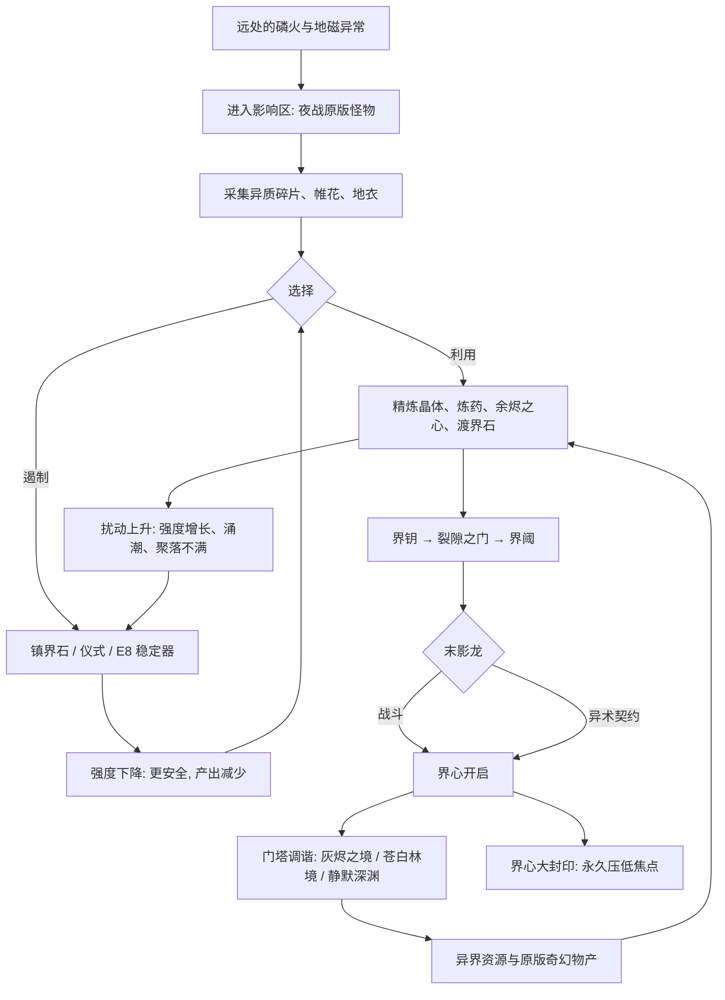
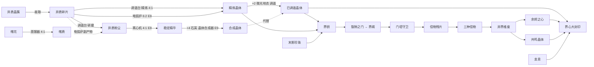

# 21 · 异界 Beyond（`tcbeyond`）

> 文档版本：DD-0.2 · 模组 ID `tcbeyond` · Java 包 `com.nightcity.beyond`（入口类 `TBeyond`，事件类 `TBeyondEvents`）
> 必需依赖：`tcivilization`。可选联动：其余全部模组（桥接类位于 `com.nightcity.beyond.compat.<other>`）。
> 代码约定：资源标识类为 `net.minecraft.resources.Identifier`（`Identifier.fromNamespaceAndPath(modid, path)`）。
> 本章遵循 README §5.3 的 18 节模板；末尾附机器可读附录 A-D（格式见写作简报 §3）。
> 相关章节：00（DR-06 写实为主、DR-16 末地为入口、DR-18/DA-08 原版怪物、DR-19、DR-25）、02（地区附加层 `tcbeyond:anomaly`、性能预算）、05（`arcana` 技能，SK-1 不设硬门槛）、10（深地 `minecraft:the_nether`）、20（危险度 anomaly 分量）、31（UI 契约）、32（AR-8 奇幻视觉只限影响区）、40（T-BEYOND 轨道）。

---

## 1. 定位与设计支柱

### 1.1 定位

异界是整个系列中**唯一允许奇幻内容**的模组，也是一条**可选支线**（DR-06）。主世界整体保持写实；但在少数“影响区”里，世界与“彼方”之间的边界变薄，原版怪物在这里出现，异质晶体在岩缝中生长，异术器物可以用来换取另一种发展方式。末地被重做为“界阈”，作为通往三个异界维度的枢纽。

| 本模组拥有 | 本模组不拥有（归属） |
| --- | --- |
| 异界影响区：焦点、强度、增长、蔓延、涌潮；地区附加层 `tcbeyond:anomaly` | 危险度的合成与遭遇（Frontiers 读取本层作为 anomaly 分量） |
| 原版 `monster` 类别在**所有维度**的自然生成规则（DA-08） | 野生动物种群与捕食者（Ecology）；盗匪与特殊人类敌人（Frontiers） |
| 末地重做 `minecraft:the_end` →“界阈 The Threshold”；末影龙的定位与两条通关路线 | 下界重做为深地 `minecraft:the_nether`（Wildlands） |
| 异界维度 `tcbeyond:ashen_reach`、`tcbeyond:pale_hollow`、`tcbeyond:silent_deep` 及其生态 | 太空维度（Orbit） |
| 异质资源、异界方块、异术器物、异界生物 4 种 | 武器与护甲（Frontiers；本模组**不注册任何武器**） |
| `arcana` 熟练度的全部来源（附录 D） | 技能等级曲线、天赋与倍率上限（Skills 05 章） |
| 8 项支线科技（不是任何时代的关键科技） | 时代关键科技（Technology Core） |
| Beyond 在场时原版附魔与酿造的**附加条件** | 原版附魔、酿造的基础去留（30 章） |
| 运行模式切换与干净关闭流程（§5.1） | 疾病模型（Settlements；本模组只上报暴露人数） |

### 1.2 设计支柱

| 编号 | 支柱 | 含义 |
| --- | --- | --- |
| BP-1 | **可选、可关、可卸** | 世界创建时可选 `full` / `quiet` / `mundane` 三种模式；已有存档可随时切换到 `mundane`，再用 `/tcbeyond purge` 清理后卸载本模组，不留下损坏的方块、物品或存档字段 |
| BP-2 | **有边界的奇幻** | 一切发光、非写实色彩与超自然形态只出现在影响区、界阈与异界维度内（AR-8）。站在影响区外，世界与没装本模组时看起来一样 |
| BP-3 | **另一条路，而不是更大的数字** | 异术器物不比同时代科技产品数值更高；它们提供**不同的轴**：不依赖基础设施、不依赖地点网络、能在偏远处独立工作。代价是扰动、试剂与社会成本 |
| BP-4 | **代价先看见** | 每项异术法式在施行前都显示“汲取”和“扰动”的预计值；所有后果都可以在异界页签中追溯到具体的焦点和行为 |
| BP-5 | **威胁可解释** | 原版怪物只按影响区强度分档出现；每一只自然生成的怪物都能追溯到一个焦点（目标信息显示“源自：北境极光疤”） |
| BP-6 | **两条遏制路线** | 异术路线（镇界石、仪式、界心大封印）与科技路线（E8 场稳定器、E9 合成替代）都能把影响区压到安全水平；选择不学异术的玩家不会被迫学 |

### 1.3 与全局决策的对照

| 决策 | 本章的落实 |
| --- | --- |
| DR-06 写实为主，异界为可选支线 | `mundane` 模式下没有任何奇幻内容；8 项科技全部是支线，不阻塞任何时代晋升 |
| DR-16 末地 = 异界入口 | 末地保留维度 ID，重做为界阈；原版要塞不生成，入口改为影响区中心的裂隙之门 |
| DR-17 无原版村庄 | 灾厄村民、林地府邸、掠夺者前哨只在 `tcbeyond:pale_hollow` 中生成 |
| DR-18 / DA-08 原版怪物只在遗迹与影响区 | 主世界强度 < 10 的位置完全不自然生成 `monster`；Echoes 遗迹中的刷怪笼与试炼刷怪笼不受影响 |
| DR-19 无个人生存机制 | 不引入法力条、理智值、异界饥饿或氧气；异术的代价落在**环境**（扰动）、**材料**（试剂）与**社会**（满意度、外交）上 |
| DR-25 / SK-1 技能中等影响、无硬门槛 | 所有法式与器物只由科技与材料解锁；`arcana` 等级只影响仪式精度与扰动折减，倍率上限由 05 章统一约束 |
| AR-8 奇幻视觉的边界 | 发光方块（`glimmer_lichen`、`anomalous_crystal`）只在强度 ≥ 20 的位置生成和生长；被带出影响区后停止发光（方块状态 `dormant=true`） |

### 1.4 运行模式一览

| 模式 | 影响区 | 原版怪物 | 界阈与异界维度 | 异术与器物 | 用途 |
| --- | --- | --- | --- | --- | --- |
| `full`（默认） | 有，会增长、蔓延、涌潮 | 按强度分档（§5.3） | 可进入 | 全部可用 | 标准体验 |
| `quiet` | 有，但强度冻结在世界生成时的值，不蔓延、不涌潮 | 只在强度 ≥ 30 处生成，密度 ×0.5 | 可进入 | 全部可用 | 想要异界内容、但不想要持续压力的玩家 |
| `mundane` | 无（强度全部视为 0） | 只在 Echoes 遗迹刷怪笼中出现 | 不可进入（已在其中的玩家被送回） | 器物变为惰性 | 纯写实玩法；卸载前的过渡状态 |

---

## 2. 独立玩法（只安装 `tcbeyond` + `tcivilization`）

本模组只强依赖文明核心。其他模组全部缺失时：

1. **影响区**：焦点按回退规则放置（§5.2.2）：原版群系标签 `c:is_snowy`/`c:is_icy` 代替极地，`c:is_badlands`/`c:is_volcanic` 代替地热热点，本模组自带结构 `tcbeyond:shattered_spire`（碎塔）代替 Echoes 的异教遗迹，`tcbeyond:starfall_crater`（星坠坑）由本模组直接生成。
2. **原版怪物**：完整的分档规则对原版主世界群系同样生效，于是玩家会第一次体验到“夜晚的平原是安全的，危险集中在某几片地方”。
3. **下界**：Wildlands 缺失时下界是原版下界。本模组把整个原版下界视为强度 70 的影响区（原版下界生物照常生成），并且**不生成** `tcbeyond:ashen_reach`（配置 `dimensions.ashen_reach = "auto"`），因为它的内容就是原版下界。
4. **末地**：`end.rework = true` 时要塞不生成，界阈只能经裂隙之门进入；设为 `false` 时保留原版要塞与原版末地，异界维度仍可从界阈外岛的门塔进入。
5. **科技回退**：`tctechnology` 缺失时，8 项科技的解锁改由本模组的进度链 `tcbeyond:standalone/*` 判定：

| 科技 | 独立模式下的进度条件 |
| --- | --- |
| `iron/anomaly_lore` | 拾取 8 个 `anomalous_shard`，并在 3 个不同焦点的影响区内各停留 1 个夜晚 |
| `medieval/warding_rites` | 放置过 4 块镇界石，且某个焦点强度被压低 5 以上 |
| `medieval/spagyric_arts` | 采集过 `veil_bloom` 与 `anomalous_shard` 各 16 个 |
| `renaissance/threshold_attunement` | 找到一座裂隙之门（进入其 32 格内） |
| `industrial/ember_engineering` | 进入过界阈，并获得 1 个 `ember_core` |
| `electric/resonance_theory` | 调谐过 2 座门塔 |
| `atomic/field_stabilization` | 完成一次界心大封印、击败末影龙，或用异象透镜在 5 个不同焦点完成观察 |
| `information/anomalous_synthesis` | 在三个异界维度各获得一种标志资源 |

6. **页签**：只有文明核心时，异界页签 `tcbeyond:anomalies` 照常注册在文明面板（J）的“世界”组；缺少 Atlas 时，影响区地图使用核心共享组件 `TcMapSnippet` 的简化区域格栅。

独立体验的一条典型路线：在雪原边缘看到夜空中的磷火 → 进入极光疤，夜里与僵尸、骷髅交战 → 拾取异质碎片，学会辨识 → 用镇界石把离家最近的焦点压住 → 找到裂隙之门，制作界钥 → 进入界阈，挑战或安抚末影龙 → 用三种信物调谐门塔，探索灰烬之境、苍白林境与静默深渊。

---

## 3. 联动玩法

| 对方模组 | 方向 | 联动内容 |
| --- | --- | --- |
| `tcivilization` | 双向 | 注册地区附加层 `tcbeyond:anomaly`；页签、HUD 控件、目标信息、警报、通知类别 `tcbeyond:anomaly`、深链接全部接入核心；编年史记录“影响区出现”“首次进入界阈”“界心大封印”等文明记忆 |
| `tctechnology` | 双向 | 8 项支线科技（附录 B），泳道 `space`（航天与异界）；Beyond 科技的知识点来自异象观察（PRACTICE/OBSERVATION）；不参与时代关键科技统计 |
| `tcskills` | 本模组→对方 | `arcana` 的全部熟练度来源（附录 D）；读取 `SkillsApi.getMultiplier(player, arcana, precision/ritual)` 与 `cost/anomaly` 两个效果；不按等级设硬门槛（SK-1） |
| `tcwildlands` | 对方→本模组 | 热流 `GeoApi.heatFlow` ≥ 100 mW/m² 的热点成为“深脉”焦点候选；纬度 ≥ 66° 成为“极光疤”候选；深地中热流最高处放置“余烬空洞”口袋；本模组不改动深地生成 |
| `tcecology` | 双向 | 影响区内野生动物承载力 −50% 并出现逃离行为（Ecology 实现，本模组提供强度）；本模组可通过 `WildlifeEmbodyEvent` 在强度 ≥ 60 处取消动物实体化；猎杀异界生物不计入生态种群 |
| `tccultivation` | 双向 | 翠华护符加速半径内作物生长 +25%，但土壤肥力消耗 ×2；强度 ≥ 40 的农田每季有 5% 概率出现“异化作物”（产量 −30%，可作为炼药试剂） |
| `tcindustry` | 双向 | 影响区内机器磨损 ×1.5（通过 `MachineWearModifier` 注入，随强度线性：`1 + 0.5·I/100`）；余烬之心向 Industry 热网提供 HU；E8+ 电弧炉与离心机可处理异质晶体，配方由本模组提供 |
| `tcnetworks` | 双向 | 影响区内磁罗盘失灵，未装无线电导航的船与飞机在区内航向随机偏转；航线规划自动绕开已知影响区；渡界石网络是铁路的“无轨”替代，但运量极小 |
| `tcsettlements` | 双向 | 强度 ≥ 40 的聚落满意度 −10，并通过 `reportExposure(..., tcsettlements:anomalous_blight, people)` 上报暴露人数；镇界石与稳定器覆盖的聚落免除该惩罚；异术活动在“未宽容”的聚落中产生满意度修正 |
| `tcexchange` | 本模组→对方 | 异质碎片、精炼晶体、灰烬之境的原版下界物产进入市场，带“异质”标签；Exchange 可对其征收风险溢价 |
| `tcdiscovery` | 对方→本模组 | 观察模式（V）下影响区现象显示为“无法解释”，产生 `anomaly` 标签知识碎片，换算为 Beyond 科技知识；Discovery 自身的挂钩不使用 `arcana` |
| `tcechoes` | 双向 | Echoes 的异教遗迹（标签 `tcechoes:cult_site`）成为“碎塔”焦点；遗迹刷怪笼在所有模式下都保留；界心大封印、屠龙、首次涌潮写入历史与传说 |
| `tccommons` | 双向 | 影响区不可被宣称为领地，但可以在其外缘建“镇界区”；Commons 的法律可以禁止或宽容异术（`tcbeyond:arcane_practice` 政策标志），影响 §5.7.5 的社会成本 |
| `tcfrontiers` | 本模组→对方 | 通过 `DangerContributor`（ANOMALY 通道）提供每个地区的强度；影响区中的怪物由本模组生成，Frontiers 只计入危险度；Frontiers 武器对异界生物正常生效；前往界阈与异界维度的远征复用 Frontiers 远征规划 |
| `tcatlas` | 本模组→对方 | 地图图层 `tcbeyond:anomaly`；区内罗盘读数加 σ = 30° 扰动、GPS 误差 ×10、雷达出现虚假回波；异界维度不提供卫星图像 |
| `tcnations` | 双向 | 影响区不可被任何文明宣称；共同对抗涌潮给出“共同威胁”关系修正（+10，持续 48 日）；AI 文明对异术的态度由其文化特质决定，通过意见修正 `tcbeyond:arcane_practice` 表达 |
| `tcorbit` | 本模组→对方 | E10 遥感卫星可从轨道发现未知影响区（显示为“地磁异常”）；太空维度中没有影响区，也不生成任何原版怪物 |

---

## 4. 核心玩法循环



一次典型的“利用—遏制”小循环：一座极光疤焦点强度 55 → 玩家在边缘建镇界石阵把 300 格内压到 25，保住附近聚落 → 在核心区开采晶簇，每块晶簇扰动 +0.05 → 一个季度后焦点回升到 62，涌潮把骷髅送到镇界线外 → 玩家决定：继续开采并加固镇界线，或者举行小封印仪式把焦点上限降到 40。

| 时代段 | 玩家在异界方向的主要动词 |
| --- | --- |
| E0-E2 | 避开、观察：远远看到磷火；夜里不进入影响区；偶尔拾到“惰性遗物” |
| E3-E4 | 辨识、镇守、炼化：学会异象志，建镇界石，炼制灵药，开始采集晶体 |
| E5 | 渡界：制作界钥，进入界阈，挑战或安抚末影龙，调谐第一座门塔 |
| E6-E7 | 化能、共鸣：余烬之心为工业供热，共鸣中继提供远距离即时联络 |
| E8-E9 | 稳定、合成：用科技手段压制和替代影响区；合成晶体让异质资源脱离危险地带 |
| E10 | 收尾：轨道遥感发现最后的未知焦点；决定保留哪些影响区作为“资源保护区” |

---

## 5. 规则与机制

### 5.1 运行模式与干净关闭

#### 5.1.1 模式切换

`beyond.mode` 是服务端配置（`tcbeyond-server.toml`），在世界创建界面的“文明设置”中提供三选一按钮，也可以在游戏中通过 `/tcbeyond mode <full|quiet|mundane>`（权限 3）切换。切换会写入存档 `data/tcbeyond/state.dat`，并广播 `beyond_mode_sync` 到所有客户端。

| 切换 | 立即效果 | 延迟效果 |
| --- | --- | --- |
| `full` → `quiet` | 停止每日增长、蔓延与涌潮；当前强度冻结 | 无 |
| `quiet` → `full` | 恢复每日动态 | 无 |
| 任意 → `mundane` | 见 §5.1.2 干净关闭 | 区块加载时惰性清理覆盖方块 |
| `mundane` → `full`/`quiet` | 按世界种子重新确定焦点（与首次生成结果相同），但所有焦点从强度 0 开始 | 12 个游戏日内线性渗入到目标强度；期间不发生涌潮 |

#### 5.1.2 干净关闭流程（切换到 `mundane`）

1. 所有地区的 `tcbeyond:anomaly` 层写为 0，焦点状态保留在 `state.dat` 中（标记 `suspended`），以便将来恢复。
2. 位于 `tcbeyond:*` 维度或界阈中的玩家被传送到其重生点；这些维度的区块不再加载，传送门方块失效（`rift_gate`、`gate_spire_core`、`resonance_gate` 的方块状态 `active=false`）。
3. 所有 `tcbeyond` 物品获得数据组件 `tcbeyond:inert`（拾取、打开容器或进入玩家背包时惰性添加），工具提示显示“惰性遗物 · 异界已沉寂”，功能全部停止，可作为装饰或在 Exchange 以古董价出售。
4. `arcana` 熟练度冻结（Skills 保存但不再显示）；Beyond 科技在科技树中显示为灰色“已沉寂”，已研究的状态保留。
5. 影响区覆盖方块（`glimmer_lichen`、`whisper_reed`、`veil_bloom`、`anomalous_crystal`）在区块下一次加载时被替换：地衣与芦苇移除，帷花变为 `minecraft:azure_bluet`，晶体变为 `minecraft:calcite`。替换表来自数据包 `data/tcbeyond/purge_map/*.json`。每个区块带附加数据 `tcbeyond:overlay_marker`（布尔值 + 版本号），没有标记的区块直接跳过，不扫描。
6. 原版怪物的自然生成退回到“只在刷怪笼中”的状态：本模组在 `mundane` 下让出 `MONSTER_SPAWNS`，由核心回退门以 `RUINS_ONLY` 执行（30 §3.4.1 第 2 行），本模组不重复过滤；已存在的怪物不会被删除，自然消失规则照常。

#### 5.1.3 卸载

卸载前运行 `/tcbeyond purge`：强制加载所有带 `overlay_marker` 的区块（按每 tick 最多 4 个区块分批处理），完成步骤 5；把背包与已加载容器中的本模组物品替换为 `purge_map` 中的原版对应物（例如 `anomalous_shard` → `minecraft:amethyst_shard`）；最后删除 `tcbeyond:*` 维度的区域文件（需加 `--all` 才删除维度文件）。完成后在聊天中报告处理的区块数与物品数。

未执行 purge 直接卸载时，NeoForge 会把缺失的方块替换为空气、缺失的物品丢弃，存档仍可加载；`tcbeyond:anomaly` 层由核心的“未知层”逻辑保留但忽略（02 章 §4）。

#### 5.1.4 缺少本模组时的原版怪物

当 `tcbeyond` 不在场时，原版怪物的去留由文明核心配置 `[vanilla] monster_policy` 决定（默认 `auto`：只有 Wildlands 星球生成启用时才收紧为“仅刷怪笼与试炼刷怪笼”，否则保持原版；30 章为总表）。本章的分档规则只在本模组在场时生效（见 BQ-1）。

### 5.2 影响区模型

#### 5.2.1 强度

每个地区（512×512 格，02 章 `REGION_SIZE`）存一个字节 `I ∈ [0, 100]`，称为异界强度；API 同时提供 `permeation() = I / 100` 的 0-1 表示（Settlements 等模块使用）。地区强度由所有焦点叠加：

```
I(region) = clamp( max over focus f of  I_f × falloff( d(region, f) / R_f ), 0, 100 )
falloff(x) = 1 − smoothstep(0.35, 1.0, x)        // x ≥ 1 时为 0
smoothstep(a, b, x) = t²(3 − 2t),  t = clamp((x − a)/(b − a), 0, 1)
d = 地区中心到焦点的距离（以地区为单位，可为小数）
```

方块级强度（用于生成判定、目标信息与 HUD）在地区值的基础上做双线性插值，再叠加遏制设施的局部压制：

```
I_block(x, z) = bilerp(I of 4 nearest region centers) − Σ_ward suppress_w(x, z)
suppress_w = S_w × (1 − dist / r_w)   当 dist < r_w
```

| 遏制设施 | 压制 `S_w` | 半径 `r_w` | 备注 |
| --- | --- | --- | --- |
| `chalk_ward` 镇界粉线（闭合圈） | 15 | 圈内全部 | 只压制圈内，雨天 25% 概率被冲断一节 |
| `ward_stone` 镇界石 | 25 | 48 格 | 每块消耗 1 枚已调谐晶体/30 日 |
| `ritual_circle` 小封印（仪式结果） | 作用于焦点，见 §5.9 | — | 改的是焦点上限，而不是局部压制 |
| `field_stabilizer` 场稳定器 | 60 | 128 格 | E8，耗电 400 kW |

#### 5.2.2 焦点放置

世界生成时，`FocusPlanner` 在世界种子决定的序列中挑选焦点：

```
焦点数 N = clamp( round( 已生成可达地区数估计 / 160 ), 6, 24 )   // 默认世界边界 ±30000 时为 24
约束：任意两焦点距离 ≥ 6 地区；距世界出生点 ≥ 4 地区
候选打分 score = typeWeight × siteFit × rand(0.8, 1.2)
```

| 焦点类型 | 中文 | 候选位置（联动） | 候选位置（独立回退） | 基础强度 `I_f` | 半径 `R_f` |
| --- | --- | --- | --- | --- | --- |
| `shattered_spire` | 碎塔 | Echoes 异教遗迹 `tcechoes:cult_site` | 本模组结构 `shattered_spire` | 70 | 1.5 地区 |
| `starfall` | 星坠 | 任意开阔地（陨坑由本模组生成） | 同左 | 60 | 1 地区 |
| `deep_vent` | 深脉 | `GeoApi.heatFlow ≥ 100` 的地表 | 群系 `c:is_badlands`、`c:is_volcanic` | 50 | 1 地区 |
| `aurora_scar` | 极光疤 | 纬度 ≥ 66°（Wildlands 气候） | `c:is_snowy`、`c:is_icy` | 45 | 2 地区 |
| `rift_scar` | 裂隙疤 | 仅由蔓延产生（§5.2.4） | 同左 | 30（初始） | 0.5 地区 |
| `ember_hollow` | 余烬空洞 | 深地中热流最高的 1-3 处洞穴 | 原版下界整体视为 I=70 | 80 | 128 格 |

每种类型至少 1 个（`ember_hollow` 只在 Wildlands 在场时计入）。焦点中心总是生成对应结构（碎塔、星坠坑、极光疤的“磁石环”、深脉的“晶喉”），中心 16 格内放置一座 `rift_gate`（未激活），只有当焦点强度 ≥ 85 时才能激活。

#### 5.2.3 每日动态（`full` 模式）

每个游戏日（`AnomalyDayTicker` 监听核心 `CivDayEvent`，§12.3）对每个焦点更新：

```
I_f(t+1) = clamp( I_f(t) + growth − contain + disturb , 0, cap_f )
growth   = 0.5                                         // full 模式；quiet 为 0
contain  = Σ 覆盖焦点核心(半径 0.5 R_f)的 ward_stone × 0.05
         + Σ 覆盖核心的 field_stabilizer × 0.8
disturb  = Σ_当日 echo(行为)                            // 采集、法式、仪式失败，见 §6.3
cap_f    = 初始 I_f + 25，最多 100；小封印 −15，界心大封印永久设为 15
```

#### 5.2.4 蔓延与涌潮

- **蔓延**：焦点连续 12 日处于 `cap_f`，则在 2-4 地区外生成一个子焦点 `rift_scar`（继承父焦点的 `parentId`）。每个父焦点最多 2 个子焦点；子焦点不再蔓延。生成时广播 `zone_event(type=SPREAD)` 并写入编年史。
- **涌潮**：焦点 `I_f ≥ 70` 时，每 6-12 日（随机，种子可复现）发生一次涌潮，持续 1 个夜晚：
  - 影响区半径临时 ×1.5，区内怪物生成上限 ×2；
  - 边缘 1 地区内的聚落收到 `critical` 通知“异界涌潮”，Frontiers 危险度的 anomaly 分量临时 +20；
  - 涌潮结束时若有玩家或 NPC 在区内存活到天亮，焦点扰动 −2（“守住了”）。

#### 5.2.5 涌潮与警报的可预测性

涌潮前 1 日，焦点所在地区内出现“前兆”（夜空磷火加密、`tcbeyond:ambient.anomaly_whisper` 声音加频），异界页签中焦点行显示“前兆”，并发出 `warning` 通知。装有 `anomaly_sensor`（E8）的地区提前 3 日给出预测。

### 5.3 原版怪物生成规则（本模组在场时）

本模组接管原版 `MobCategory.MONSTER` 在所有维度的**自然生成**。实现：
- 通过 NeoForge 生物群系修改器 `tcbeyond:monster_spawns` 为影响区可能出现的群系补全生成条目；
- 监听 `LevelEvent.PotentialSpawns`，按位置的 `I_block` 过滤候选列表；
- 监听 `FinalizeSpawnEvent` 对“调谐精英”加属性。

刷怪笼（`minecraft:spawner`）、试炼刷怪笼（`minecraft:trial_spawner`）、结构专属生成（`structure_overrides`）与命令/刷怪蛋**不受**本规则限制。

#### 5.3.1 主世界分档

| `I_block` | 允许自然生成的原版怪物 | 附加规则 |
| --- | --- | --- |
| < 10 | 无 | 完全安全，夜晚也不会出现怪物 |
| 10-29 | zombie、skeleton、spider；群系变种 husk、stray、drowned、zombie_villager（仅在 Echoes 遗迹附近） | 需方块光照 0（原版规则）；生成上限 ×0.5 |
| 30-59 | 上列 + creeper、witch、enderman、slime、cave_spider（洞穴）、silverfish（石质结构内） | 生成上限 ×1.0；骷髅陷阱马（雷暴）只在此档及以上出现 |
| 60-84 | 上列 + phantom（夜晚，见下）、bogged（沼泽） | 方块光照 ≤ 7 即可生成（火把不再完全安全）；生成上限 ×1.5 |
| 85-100 | 上列全部，并有 20% 为“调谐精英” | 白天也可在露天生成（亮度检查放宽到天空光照 ≤ 11）；生成上限 ×2 |

- **幻翼**：原版 `PhantomSpawner`（基于失眠统计）被禁用；幻翼改为在 `I ≥ 60` 的夜晚按普通怪物规则从高空生成，与玩家是否睡觉无关（DR-19）。
- **调谐精英**：最大生命值 +50%、移动速度 +10%、掉落额外 1-2 个 `anomalous_shard`；眼部发光贴图（AR-8 允许，因为只在影响区）。
- **史莱姆**：原版“史莱姆区块”规则被替换为 `I ≥ 30` 的沼泽与洞穴。
- **劫掠与巡逻**：由 Frontiers 关闭（`vanilla.disable_raids_and_patrols`）；Frontiers 缺失时本模组也会关闭主世界的灾厄巡逻。

#### 5.3.2 深地（`minecraft:the_nether`）

Wildlands 把下界重做为深地，深地本身不生成任何敌对生物。本模组只在余烬空洞口袋（半径 128 格，`I = 80`，不随时间增长）中补充：

| 条件 | 生物 |
| --- | --- |
| 口袋内，`I_block ≥ 50` | magma_cube |
| `I_block ≥ 80` | blaze（围绕余烬之心结晶） |
| `I_block ≥ 85` 且洞穴高度 ≥ 24 格 | ghast（每口袋最多 2 只） |
| 口袋中心的“余烬祭坛”结构 | wither_skeleton（结构专属生成） |

Wildlands 缺失时下界为原版下界，原版下界生成表照常生效（整个下界视为 `I = 70`）。

#### 5.3.3 界阈与异界维度

| 维度 | 生成 |
| --- | --- |
| `minecraft:the_end`（界阈） | enderman（原版密度）、shulker（末地城结构）；外岛门塔周围有 `spire_sentinel`；外岛深处有 `rift_wisp` |
| `tcbeyond:ashen_reach` | 原版下界五种生物群系的完整原版生成表（zombified_piglin、piglin、piglin_brute（堡垒遗迹）、hoglin、ghast、magma_cube、blaze（要塞）、wither_skeleton（要塞）、strider、enderman）；piglin 与 hoglin **只在此维度**出现 |
| `tcbeyond:pale_hollow` | creaking（苍白之心）、vex/evoker/vindicator（林地府邸）、pillager（前哨）、spider、witch、`veil_stalker`；灾厄村民**只在此维度**出现 |
| `tcbeyond:silent_deep` | warden（只由幽匿尖啸体召唤，**只在此维度**）、`crystal_mite`、zombie/skeleton（远古城市外的 `resonant_caverns`） |

#### 5.3.4 其他维度与特殊生物

- Orbit 的太空维度不生成任何原版怪物。
- 守卫者与远古守卫者：海底神殿在本模组在场时不生成（见 BQ-4）。
- 凋灵：可以照常用灵魂沙与凋灵骷髅头召唤；召唤位置的地区强度 +10（每次）。
- 铁傀儡与雪傀儡不属于 `monster`，不受本规则影响（原版村庄不存在，铁傀儡只能由玩家建造）。

#### 5.3.5 巡逻、袭击、幻翼、监守者、史莱姆与陷阱马

本节逐项确认 30 章 VO-RD-01/02、VO-SP-02/06/07/14 中“待 21 确认”的行。所有接管都在 `FMLCommonSetup` 通过 `VanillaPolicyService.registerOwner(...)` 按 30 §2.3 的链位登记（`MONSTER_SPAWNS`、`PHANTOMS` 为链首 100；`RAIDS`、`PATROLS` 为 90，低于 Frontiers 的 100），因此 Frontiers 在场时本模组对巡逻与袭击只作回退（§12.5）。

| 系统 | Frontiers 在场 | Frontiers 缺席、本模组在场 | 本模组 `mundane` | 本模组缺席 |
| --- | --- | --- | --- | --- |
| 灾厄巡逻 `PatrolSpawner` | Frontiers 写 `minecraft:spawn_patrols=false` | 本模组首次加载写 `minecraft:spawn_patrols=false`，并以 `FinalizeSpawnEvent` 拦截主世界的 `EntitySpawnReason.PATROL` | 同左（游戏规则已写入，不撤销） | 原版；核心有效策略为 `RUINS_ONLY` 时由核心拦截 |
| 袭击 Raid | Frontiers 写 `minecraft:raids=false` | 本模组首次加载写 `minecraft:raids=false`（30 VO-RD-01 拥有者链第二位，见 BQ-3） | 同左 | 原版 |
| 幻翼（失眠生成） | 本模组拒绝 | 本模组拒绝 | 本模组拒绝 | 核心按 VO-SP-02 处理 |
| 幻翼（影响区） | `I_block ≥ 60` 的夜晚自然生成 | 同左 | 无 | — |
| 监守者 | 只在 `tcbeyond:silent_deep` | 同左 | 无（异界维度关闭） | 原版 |
| 史莱姆 | `I_block ≥ 30` 的沼泽与地下 | 同左 | 核心 `RUINS_ONLY` | 原版或核心 |
| 骷髅陷阱马 | 只在 `I_block ≥ 30` 的雷暴中 | 同左 | 核心 `RUINS_ONLY` | 原版或核心 |

**巡逻与袭击。** 游戏规则只在世界第一次以本模组加载时写入一次（`state.dat` 中的位集 `gamerulesWritten` 记录已写入的规则），此后管理员可以改回，本模组不再覆盖。保险事件只拦截主世界：`pale_hollow` 的掠夺者前哨按结构专属生成照常出现。袭击关闭后，从苍白林境带回的不祥之兆不会转为袭击（30 VO-RD-03）。配置：`vanilla.patrols_fallback = true`、`vanilla.raids_fallback = true`。

**幻翼：选用事件，而不是游戏规则。** 本模组监听 `PlayerSpawnPhantomsEvent`，在所有维度返回 `DENY`，从而禁用基于失眠统计的 `PhantomSpawner`；**不写入** `minecraft:spawn_phantoms`。理由：
1. 事件的机制优先级高于游戏规则（30 §2.1）；
2. 卸载本模组或关闭开关 `vanilla.disable_insomnia_phantoms` 后，原版行为立即恢复，不留下游戏规则；
3. 管理员对 `minecraft:spawn_phantoms` 的设置不被覆盖。

影响区幻翼走普通自然生成：生物群系修改器 `tcbeyond:monster_spawns` 给主世界所有群系加入 `phantom`（权重 5，每组 1-2 只）；`LevelEvent.PotentialSpawns` 只在“`I_block ≥ 60`、主世界时间 13000-23000、该列可见天空”时保留该候选；`FinalizeSpawnEvent` 把生成位置上移 20-34 格（目标处为空气时）。这些幻翼与玩家是否睡觉无关（DR-19）。

**监守者。** 不改全局游戏规则 `minecraft:spawn_wardens`。理由：该规则同时作用于 `silent_deep`，改为 `false` 会让异界维度也没有监守者。做法：
- `FinalizeSpawnEvent`：实体类型为 `minecraft:warden`、原因为 `TRIGGERED`（幽匿尖啸体召唤），且维度不是 `tcbeyond:silent_deep` 时取消生成；尖啸体按原版冷却继续。命令与刷怪蛋不受影响。
- 远古城市只在 `silent_deep` 生成（§5.3.6）。主世界的幽匿催发体生成的尖啸体本来就不能召唤，因此上一条只是保险。
- 管理员把 `minecraft:spawn_wardens` 设为 `false` 时，`silent_deep` 也不会有监守者；异界页签的“界阈”子页显示黄色提示“监守者已被游戏规则关闭”。

**史莱姆。** 用 `MobSpawnEvent.SpawnPlacementCheck` 覆写史莱姆的放置检查。原版“史莱姆区块 + 沼泽月相”规则不再使用；改为：

```
允许 slime 自然生成 ⇔ I_block ≥ 30
                    ∧ ( 群系 ∈ #c:is_swamp ∧ 方块光照 ≤ 7
                        ∨ y < 40 ∧ 该列不可见天空 ∧ 方块光照 = 0 )
```

**骷髅陷阱马。** 雷暴中闪电生成陷阱马（原因 `EVENT`）时，若落点 `I_block < 30`，`FinalizeSpawnEvent` 取消生成（闪电照常落下）。

#### 5.3.6 原版结构的迁移

“灾厄村民、林地府邸、前哨站只在苍白林境”“监守者只在静默深渊”这类规则，靠**改结构所在群系的标签**实现，而不是把结构集的 `frequency` 设为 0。原因：结构集是全局注册项，设为 0 会让异界维度也无法生成这些结构。

| 原版结构 | 原位置 | 本模组在场时 | 实现 | 开关 |
| --- | --- | --- | --- | --- |
| `minecraft:pillager_outpost` | 主世界平原、针叶林等 | 只在 `tcbeyond:raider_steppe`（苍白林境） | 覆写 `#minecraft:has_structure/pillager_outpost`（`replace: true`） | `structures.relocate_vanilla` |
| `minecraft:mansion` | 主世界黑森林 | 只在 `tcbeyond:mansion_wilds` | 覆写 `#minecraft:has_structure/woodland_mansion` | 同上 |
| `minecraft:ancient_city` | 主世界深暗之域 | 只在 `tcbeyond:silent_dark` | 覆写 `#minecraft:has_structure/ancient_city` | 同上 |
| `minecraft:monument` | 主世界深海 | 不生成；海绵与海晶改由 `silent_deep` 的 `drowned_reliquary` 提供（BQ-4） | 覆写 `#minecraft:has_structure/ocean_monument` 为空 | 同上 |
| `minecraft:stronghold` | 主世界同心环 | `end.rework = true` 时不生成 | 覆写 `#minecraft:has_structure/stronghold` 为空 | `end.rework` |
| `minecraft:fortress`、`minecraft:bastion_remnant`、`minecraft:nether_fossil` | 原版下界 | 随原版下界群系进入 `ashen_reach`；深地中没有（10 章） | 不改（`ashen_reach` 使用原版下界群系） | `dimensions.ashen_reach` |
| `minecraft:end_city` | 末地外岛 | 保留在界阈外岛（潜影贝与鞘翅来源） | 不改 | — |
| `tcbeyond:ember_altar` | — | 深地：余烬空洞中心；原版下界（Wildlands 缺席）：随 `#minecraft:is_nether` 群系 | 本模组结构集 | `dimensions.ember_altar_in_vanilla_nether` |

- 两个内置数据包经 `AddPackFindersEvent`（`PackType.SERVER_DATA`，`Pack.Position.TOP`）注册：`tcbeyond:vanilla_relocation`（上表前四行）与 `tcbeyond:threshold_rework`（要塞、末影之眼标签）。按 30 §4.4，服务器配置在世界生成注册表之后才加载，所以**数据包本身是开关**：两者默认启用，玩家在创建世界的“文明设置 → 异界”或“数据包”界面取消勾选即可关闭；已有世界用 `/datapack disable`。`structures.relocate_vanilla` 与 `end.rework` 两个 server 键只用于一致性检查（§13）。
- 世界生成数据包只影响此后生成的区块；已生成的结构不删除。
- 星球模式下主世界群系是 `tcwildlands:*`，本来就不在这些标签中，迁移包对主世界没有额外影响；它的作用是让结构**出现在**异界维度。

#### 5.3.7 原版战利品、末影之眼与原版奇幻物品

| 修改器（GLM） | 作用对象 | 内容 | 开关 |
| --- | --- | --- | --- |
| `tcbeyond:zone_ores` | 位于 `I_block ≥ 30` 的任意结构箱子（含 Echoes 遗迹） | 追加原版矿石方块，权重见下 | `loot.zone_ores = true` |
| `tcbeyond:treasure_books` | 影响区结构箱子与异界维度结构箱子 | 追加宝藏附魔书（无原版村民交易时的唯一稳定来源） | `enchanting.treasure_loot = true` |
| `tcbeyond:core_vault` | 焦点中心结构的核心宝箱，`I_f ≥ 85` | 下界合金护甲件（每件 3%）、下界合金碎片 1-2（20%） | `loot.core_vault = true` |
| `tcbeyond:overworld_loot_swap` | 主世界中 `I_block < 30` 的原版结构箱子 | 把末影珍珠、烈焰棒等替换为同价值的写实物品（30 VO-LT-06） | `loot.swap_overworld_fantasy = true` |

原版矿石方块追加表（每次 roll 抽 1 种，数量 1-3；`I_block` 30-59 抽 1 次，60-84 抽 2 次，≥ 85 抽 3 次；`vent_throat` 与地下箱子使用深板岩变种）：

| 方块 | 权重 | 方块 | 权重 |
| --- | --- | --- | --- |
| `minecraft:coal_ore` | 15 | `minecraft:redstone_ore` | 8 |
| `minecraft:iron_ore` | 20 | `minecraft:lapis_ore` | 8 |
| `minecraft:copper_ore` | 20 | `minecraft:diamond_ore` | 2 |
| `minecraft:gold_ore` | 10 | `minecraft:emerald_ore` | 2 |

这兑现了 02 章“原版矿石方块只在 Echoes 遗迹与 Beyond 影响区的战利品中出现”的承诺：星球模式下原版矿石不生成，玩家可以把这些方块作为装饰或用精准采集保留。

宝藏附魔书来源：

| 附魔 | 来源 | 每箱概率 |
| --- | --- | --- |
| `minecraft:mending` 经验修补 | 影响区 `I_block ≥ 60` 的结构箱子；`pale_hollow` 林地府邸 | 5% / 12% |
| `minecraft:frost_walker` 冰霜行者 | 极光疤中心结构 `aurora_ring` | 10% |
| `minecraft:soul_speed` 灵魂疾行 | `ashen_reach` 堡垒遗迹（原版）；余烬祭坛 | 原版 / 8% |
| `minecraft:swift_sneak` 迅捷潜行 | `silent_deep` 远古城市（原版） | 原版 |

`overworld_loot_swap` 的映射是数据驱动的（`data/tcbeyond/loot_swap/overworld.json`），默认：

| 原物品 | 替换为 | 原物品 | 替换为 |
| --- | --- | --- | --- |
| `ender_pearl` | `amethyst_shard` | `ghast_tear` | `gold_nugget` ×4 |
| `ender_eye` | `amethyst_shard` ×2 | `nether_wart` | `beetroot_seeds` |
| `blaze_rod` | `gold_nugget` ×3 | `magma_cream` | `honeycomb` |
| `blaze_powder` | `gunpowder` | `phantom_membrane` | `leather` |

- 替换只作用于主世界、且箱子位置 `I_block < 30`；影响区内与异界维度的箱子保持原版（30 VO-LT-06）。30 章所说的 `purge_map` 在本章拆成两份数据：`loot_swap` 用于运行时战利品，`purge_map` 只用于切换到 `mundane` 与卸载（§5.1.2）。
- `mundane` 模式下所有位置的强度都是 0，因此替换作用于整个主世界。这时末影珍珠与下界合金的来源问题见 BQ-5。

**末影之眼。** 数据包 `tcbeyond:threshold_rework` 覆写 `#minecraft:eye_of_ender_located`，内容为 `tcbeyond:rift_gate_ruin` 与 `tcbeyond:gate_spire`。原版末影之眼按“当前维度中最近的标签结构”寻找目标：在主世界指向最近的裂隙之门，在界阈指向最近的门塔。为了让 `/locate` 与末影之眼能找到由 `FocusPlanner` 决定的位置，焦点中心结构使用本模组注册的结构放置类型 `tcbeyond:focus`（只在焦点中心所在区块返回 true）。`end.rework = false` 时不加载该数据包，末影之眼按原版指向要塞。

**原版奇幻物品不惰性化。** 30 章 VO-IT-14 建议“主世界内异界物品在影响区外惰性化”。本章**不采用**：末影珍珠、烈焰棒、末影之眼等原版物品在任何地方都保持原版功能；本模组物品也在影响区外照常工作（BP-3 要求异术器物“能在偏远处独立工作”）。数据组件 `tcbeyond:inert` 只在 `mundane` 模式下加到本模组物品上（§5.1.2）。见 BQ-6。

#### 5.3.8 原版附魔与酿造：只追加条件

原版附魔台、铁砧、砂轮、酿造台与全部药水配方**保持原版行为**（30 VO-MG-01/03）。本模组在场时只追加以下可选内容；`beyond.mode = mundane`、对应开关关闭或本模组缺席时，全部恢复原版。

**A. 异质增幅（附魔台）**

```
条件  = mode ≠ mundane ∧ enchanting.zone_amplify
      ∧ I_block(附魔台) ≥ 30
      ∧ 附魔台的原版书架位（EnchantingTableBlock.BOOKSHELF_OFFSETS）中
        至少 2 个是 anomalous_crystal(stage = 3, dormant = false)
bonus = min(3, 1 + floor((I_block − 30) / 20))        // 30-49: +1；50-69: +2；≥ 70: +3
level'(槽) = level(槽) + bonus                         // 可以超过 30，最高 33
p_curse = 0.15 × bonus / multiplier(arcana, tcskills:precision/ritual)
附魔完成后：以 p_curse 的概率追加一个与物品兼容的诅咒（绑定诅咒或消失诅咒）
            扰动 +0.02（计入最近焦点，§5.8.2）
            书架位中随机 1 块晶簇以 25% 概率退回 stage = 1
```

- 机制：`EnchantmentLevelSetEvent` 修改三个槽位的等级；`PlayerEnchantItemEvent` 结算诅咒、扰动与晶簇退化。
- 界面：附魔界面第三槽右侧显示紫色小字“异质增幅 +2 · 诅咒 30%”（`ScreenEvent.Render.Post`），让代价先被看见（BP-4）。
- 晶簇只算条件，不计入书架数量；原版 15 个书架仍然是达到 30 级的前提。

**B. 宝藏附魔书**：见 §5.3.7，开关 `enchanting.treasure_loot`。

**C. 酿造的追加配方与条件**

| 追加内容 | 规则 | 机制 | 开关 |
| --- | --- | --- | --- |
| 帷花基底 | 水瓶 + `veil_bloom` → 粗制的药水（与下界疣等价） | `RegisterBrewingRecipesEvent` | `brewing.veil_bloom_base = true` |
| 异质粉尘燃料 | `anomalous_dust` 加入 `#minecraft:brewing_fuel`，每份 20 次（与烈焰粉相同） | 数据包标签 | `brewing.dust_fuel = true` |
| 区域延长 | 酿造台 `I_block ≥ 40` 时，每瓶产物有 25% 概率直接变为延长版（按数据映射 `tcbeyond:zone_extension`，例如 `swiftness → long_swiftness`）；该批扰动 +0.01 | `PotionBrewEvent.Post` | `brewing.zone_conditions = true` |

- 星球模式下烈焰棒与下界疣只来自深地余烬空洞或 `ashen_reach`（30 VO-MG-03）。帷花基底与粉尘燃料让酿造在进入灰烬之境之前就可以开始，但酿造台本身仍需要烈焰棒（来自余烬空洞的烈焰人）。
- 本模组不注册任何新的原版药水；自有灵药走蒸馏器 `alembic`（§5.8.4），不经过酿造台。

### 5.4 异质资源

#### 5.4.1 资源总表

| 资源 | 形态 | 来源 | 可再生 | 主要用途 |
| --- | --- | --- | --- | --- |
| `anomalous_shard` 异质碎片 | 物品 | 敲取或采掘 `anomalous_crystal`；调谐精英掉落 | 是（晶簇再生） | 一切异术材料的起点 |
| `anomalous_crystal` 异质晶簇 | 方块（`stage` 0-3、`dormant`） | 影响区 `I ≥ 40` 的岩面（世界生成与迟到覆盖，§5.4.2） | 是 | 采收碎片；附魔增幅（§5.3.8） |
| `refined_crystal` 精炼晶体 | 物品 | 调谐台：4 碎片 → 1；电弧炉：6 碎片 → 2（E8） | 是 | 界钥、渡界费用、共鸣门 |
| `attuned_crystal` 已调谐晶体 | 物品 | 调谐台：1 精炼晶体 + 2 地衣 → 1 | 是 | 镇界石维持、仪式、信物、契约 |
| `anomalous_dust` 异质粉尘 | 物品 | 调谐台研磨：1 碎片 → 2；电弧炉副产物；磷火、晶螨掉落 | 是 | 酿造燃料、稳定精华 |
| `stabilized_essence` 稳定精华 | 物品 | 离心机：4 粉尘 → 1（E8）；Industry 缺失时晶体合成器：8 粉尘 → 1 | 是 | 合成晶体 |
| `synthetic_crystal` 合成晶体 | 物品 | 晶体合成器：4 `#c:gems/quartz` + 1 稳定精华 → 2（E9，扰动 0） | 是 | 代替已调谐晶体（大封印与契约除外） |
| `glimmer_lichen` 微光地衣 | 方块（多面附着） | `I ≥ 20` 的洞壁与背阴原木 | 是（蔓生） | 调谐、镇界粉笔 |
| `whisper_reed` 低语芦苇 | 方块（可堆叠 3 格） | `I ≥ 30` 的水边 | 是 | 静默信物、静默灵药 |
| `veil_bloom` 帷花 | 方块（花）与物品 | `I ≥ 20` 的草地；骨粉催生 | 是 | 酿造基底、帷质 |
| `veil_essence` 帷质 | 物品 | 蒸馏器：4 帷花 + 1 水瓶 → 1 | 是 | 苍白信物、镇邪灵药 |
| `twisted_produce` 异化作物 | 物品 | 影响区农田收获时概率出现（§5.5.1） | 是 | 灵药试剂、堆肥 |
| `ember_core` 余烬之心 | 物品 | 余烬祭坛中心的 `ember_heart` 方块（每 7 日充能 1 级，满 3 级可取 1 枚） | 是（慢） | 余烬坩埚、灰烬信物、大封印 |
| `resonant_crystal` 共鸣晶体 | 物品 | `silent_deep` 共鸣洞群系的 `resonant_cluster`；晶螨 3% | 否（维度足够大） | 共鸣中继、大封印 |
| `sigil_fragment` 信物残片 | 物品 | 门塔守卫掉落 1-2 | 是（守卫 3 日重置） | 三种门塔信物 |
| `warding_chalk` 镇界粉笔 | 物品（16 次耐久） | 1 碎片 + 2 骨粉 + 1 方解石 → 4 | 是 | 绘制粉线与仪式法阵 |

#### 5.4.2 晶簇的生成与生长

**世界生成。** 生物群系修改器把放置特征 `tcbeyond:anomaly_overlay` 加到主世界全部群系的 `VEGETAL_DECORATION` 阶段。该特征在区块生成时查询 `FocusPlanner`（焦点完全由种子决定，生成阶段即可计算）得到的规划强度，按下表放置覆盖方块，并给区块写入附加数据 `tcbeyond:overlay_marker`：

| 规划 `I` | 每区块尝试 | 放置内容 |
| --- | --- | --- |
| < 20 | 0 | 无（不写标记） |
| 20-39 | 6 | 地衣、帷花 |
| 40-69 | 12 | 上列 + 芦苇 + 晶簇 2-4 簇（stage 随机 0-3） |
| ≥ 70 | 20 | 上列 + 晶簇 4-8 簇；晶喉（深脉中心）内晶簇密度 ×3 |

**迟到覆盖。** 蔓延产生的裂隙疤或因每日增长越过阈值的地区，其区块早已生成。`ChunkEvent.Load` 时若区块没有标记（或标记版本低于当前覆盖版本）且所在地区 `I ≥ 20`，则把区块加入覆盖队列；服务器每 tick 最多处理 2 个区块，每个区块用高度图与洞穴空气采样 16 次放置覆盖方块。`mundane` 模式不入队。

**生长与再生。** 晶簇的随机刻：

```
若 I_block < 20                         → dormant = true（停止发光、停止生长），结束
若 dormant 且 I_block ≥ 20               → dormant = false
若 stage < 3 且 I_block ≥ 40:
    p_grow = 0.05 × I_block / 50         // 原版随机刻速率下，I = 50 时约 1.2 日长 1 级
    以 p_grow 概率 stage += 1
若 stage = 3 且 I_block ≥ 70 且本区块晶簇数 < 24:
    以 0.01 概率在相邻石质方块上生成一个 stage 0 晶簇
```

**采收。**
- 用镐右键 stage 3 晶簇为“敲取”：掉落 2-4 碎片（时运每级 +1，最多 6），晶簇退回 stage 0 并留在原处——这是可持续的采集方式。
- 直接挖掉：stage 3 掉落 1-3 碎片，stage 1-2 掉落 0-1，方块消失。精准采集得到 stage 0 的晶簇物品，可移栽。
- 两种方式扰动都是 +0.05（§6.3）。在 `I_block ≥ 70` 处采收有 10% 概率惊出 1-2 只晶螨（§5.5.3）。

#### 5.4.3 植物

| 植物 | 生长条件 | 蔓生 | 休眠时 | 采集 |
| --- | --- | --- | --- | --- |
| 微光地衣 | 多面附着于石头、深板岩、原木；`I_block ≥ 20` | 同原版发光地衣，但仅在 `I_block ≥ 20` 时蔓生 | 亮度 4 → 0，停止蔓生 | 剪刀；扰动 +0.005 |
| 低语芦苇 | 与甘蔗相同的水边条件；`I_block ≥ 30` | 每随机刻 1/16 长高 1 格，最高 3 格 | 停止长高 | 徒手；扰动 +0.005 |
| 帷花 | 草方块、泥土；`I_block ≥ 20` | 在 `I_block ≥ 20` 处对草方块使用骨粉时，30% 的花替换为帷花 | 白天合拢，无粒子 | 徒手；扰动 +0.01 |

三种植物在 `I_block < 20` 处可以被放置（便于装饰），但会立刻进入休眠：不发光、不蔓生、不长高（AR-8，BP-2）。

#### 5.4.4 异质资源与写实资源的关系

- **不比科技产品更强（BP-3）。** 例如余烬坩埚 200 HU/s 与同时代 Industry 锅炉相当，但不需要燃料运输；共鸣中继提供即时联络，但每对每 20 日要消耗 1 枚已调谐晶体；渡界石只运送玩家，不运货。
- **原版奇幻物产**（烈焰棒、下界疣、恶魂之泪、末影珍珠、潜影壳、回响碎片、下界合金等）在星球模式下只来自余烬空洞、界阈与异界维度。它们在 Exchange 中带“异质”标签（§3）。
- **合成替代。** E9 的合成晶体让异质资源脱离影响区：它不产生扰动，可代替已调谐晶体用于镇界石维持、渡界、共鸣中继与灵药；只有大封印与契约要求真正的已调谐晶体（这两项本来就需要进入界阈）。

### 5.5 魔法生态

#### 5.5.1 作物与牲畜

| 效果 | 条件 | Cultivation 在场 | Cultivation 缺席 |
| --- | --- | --- | --- |
| 作物生长减缓 | `I_block` 20-39 → ×0.75；≥ 40 → ×0.5 | 通过 Cultivation 的生长修正接口提供系数（BQ-8） | `CropGrowEvent.Pre` 以 `1 − 系数` 的概率返回 `DENY` |
| 异化作物 | `I_block ≥ 40` 的农田 | 每季每块农田 5% 概率出现（`I_block` ≥ 70 时 15%，12 §5.18）；该次收获产量 −30%，并额外掉落 1 个 `twisted_produce` | 每次收获成熟作物时 5%（≥ 70 时 15%；GLM `tcbeyond:twisted_harvest`） |
| 牲畜受惊 | `I_block ≥ 40` 的夜晚 | 每 200 tick 有 10% 概率触发惊逃 5 秒；繁殖冷却 ×1.5 | 同左 |
| 翠华护符 `verdant_charm` | 放置于方块上，半径 16 格 | 作物生长 +25%，土壤肥力消耗 ×2；每日扰动 +0.01 | 半径内作物随机刻额外 25% 概率生长；每日扰动 +0.01 |

翠华护符是“另一条路”的典型例子：它不需要灌溉或化肥，但持续制造扰动，并会更快耗尽土壤；放在影响区外它仍然有效（BP-3）。

#### 5.5.2 野生动物

| 条件 | Ecology 在场 | Ecology 缺席 |
| --- | --- | --- |
| `I` 30-59 的地区 | Ecology 读取 `BeyondApi.permeation()`，承载力 −50%，动物有逃离行为 | `LevelEvent.PotentialSpawns` 把 `CREATURE` 候选权重减半 |
| `I_block ≥ 60` | 本模组监听 `WildlifeEmbodyEvent` 并取消实体化（种群数值保留在 Ecology 的地区数据中） | 移除全部 `CREATURE` 候选 |

异界生物不计入 Ecology 种群，也不被 Ecology 的捕食者模型捕食。

#### 5.5.3 异界生物

本模组只注册 4 种生物，全部在 BP-2 的边界内出现。

| 实体 | 中文 | 类别 | 出现位置 | 生命 | 护甲 | 攻击 | 移速 | 掉落 |
| --- | --- | --- | --- | --- | --- | --- | --- | --- |
| `tcbeyond:spire_sentinel` | 门塔守卫 | MONSTER（结构生成，不消失） | 界阈门塔周围，每塔 4 只 | 60 | 12 | 近战 9；碎晶齐射 5×3（16 格，冷却 3 秒） | 0.18 | 信物残片 1-2（抢夺 +1）、碎片 3 |
| `tcbeyond:rift_wisp` | 裂隙磷火 | AMBIENT | 主世界 `I_block ≥ 60` 的夜晚；界阈外岛 | 6 | 0 | 无 | 飞行 0.6 | 粉尘 1-2；10% 微光地衣 |
| `tcbeyond:veil_stalker` | 帷影潜伏者 | MONSTER | `pale_hollow` 全域 | 28 | 4 | 6 | 0.32 | 帷花 1-2；10% 帷质 |
| `tcbeyond:crystal_mite` | 晶螨 | MONSTER（节肢） | `silent_deep` 共鸣洞；采收高强度晶簇时惊出 | 8 | 2 | 3 | 0.30 | 粉尘 1；`silent_deep` 中 3% 共鸣晶体 |

行为（AI 目标按优先级排列）：

- **门塔守卫**：`ReturnToSpireGoal`（离塔 > 24 格时回返）→ 近战 / `ShardVolleyGoal`（远程，目标距离 6-16 格时）→ `GuardAreaGoal`。免疫摔落与溺水，击退抗性 0.8。门塔被调谐后，守卫变为不可交互的“石像”状态并停止 AI；未调谐的门塔在 64 格内无玩家时，每 3 日补满守卫。
- **裂隙磷火**：不攻击；`FleeEntityGoal`（玩家手持镐或武器时 8 格内逃离）；受伤时向随机方向瞬移 8 格（最多 3 次）。它就是玩家在远处看到的“磷火”，是影响区最早的可见信号（§4）。
- **帷影潜伏者**：雾中 10 格外几乎不可见（渲染透明度 0.15）；`StalkGoal` 绕到目标背后再攻击；方块光照 ≥ 12 时逃离光源。
- **晶螨**：成群 3-6 只；`EatCrystalGoal` 会把附近晶簇 stage −1（每只每 30 秒最多 1 次），因此是采晶点的害虫；节肢杀手附魔对其有效。

调谐精英（§5.3.1）不是新实体，而是原版怪物的属性修饰与发光渲染层。

#### 5.5.4 音景与视觉

| ID | 内容 | 触发 |
| --- | --- | --- |
| `tcbeyond:ambient.anomaly_whisper` | 低频耳语环境音 | `I_block ≥ 30` 的夜晚，每 40-120 秒；前兆日频率 ×3 |
| `tcbeyond:block.crystal.resonance` | 晶体共鸣的嗡鸣 | 玩家 8 格内有 stage 3 晶簇 |
| `tcbeyond:event.surge_horn` | 涌潮开始的低沉号音 | 涌潮开始时，对区内与边缘 1 地区内的玩家播放 |
| `tcbeyond:block.gate.hum` | 传送门的持续嗡声 | 已激活的裂隙之门、门塔核心、共鸣门 16 格内 |

视觉只在客户端渲染：`I_block ≥ 40` 的夜空有缓慢移动的极光带粒子；`≥ 70` 时远景雾带淡紫色。粒子数随客户端“粒子”设置缩放；离开影响区后 3 秒内淡出。

### 5.6 界阈（`minecraft:the_end` 重做）

#### 5.6.1 进入方式

`end.rework = true`（默认）时，原版要塞不生成（§5.3.6），末地传送门框架不会自然出现。界阈的入口是每个焦点中心 16 格内的**裂隙之门**（结构 `tcbeyond:rift_gate_ruin`：5×5 哭泣黑曜石环，中央嵌一块门芯 `tcbeyond:rift_gate`，激活时内部 3×3 填充 `tcbeyond:rift_portal`）。

| 入口状态 | 条件 | 代价 | 持续 |
| --- | --- | --- | --- |
| 自然激活 | 所属焦点 `I_f ≥ 85` | 无 | 只要 `I_f ≥ 50` 就保持激活 |
| 引潮激活 | `I_f ≥ 65`；对门芯使用 `rift_key` | 界钥耐久 −1；焦点扰动 +2；当夜 `I_f` 临时 +20 | 到下一个日出 |
| 已封印焦点 | 焦点已被界心大封印（§5.9.2）且界心已开启；对门芯使用界钥 + 1 枚已调谐晶体 | 界钥耐久 −1、晶体 1 | 单次单人通过 |
| `mundane` 模式 | — | — | 永不激活 |

- **引潮的风险**：引潮当夜，若临时强度 ≥ 70，焦点立即按 50% 概率发生涌潮（不计入 §5.2.4 的间隔）。引潮前的法式预览（§5.8.5）显示“涌潮概率 50%”。
- **界钥** `rift_key`：耐久 4；配方见 §8。穿过已经激活的门不消耗界钥。
- 末影之眼在主世界指向最近的 `rift_gate_ruin`（§5.3.7）。

#### 5.6.2 落点与返回

- 无论从裂隙之门还是原版末地传送门进入，落点都是原版黑曜石平台（`ServerLevel.END_SPAWN_POINT` 附近）。平台东侧 8 格是结构 `tcbeyond:threshold_landing`，内有一座常亮的返回门。
- 返回门把玩家送回其上次使用的主世界裂隙之门（玩家附加数据 `tcbeyond:player.lastGate`）；该门已被破坏或没有记录时，送回重生点。
- 界心开启后，原版返回传送门（主岛中央）也改为送回上次使用的门：监听 `EntityTravelToDimensionEvent`，当实体从 `minecraft:the_end` 经 `minecraft:end_portal` 前往主世界时取消该事件，并以 `TeleportTransition` 传送到目标门前方的安全位置。

#### 5.6.3 末影龙与界心

`end.dragon_mode` 决定界阈主岛的结局路线：

| 值 | 战斗 | 契约 | 说明 |
| --- | --- | --- | --- |
| `both`（默认） | ✓ | ✓ | 玩家任选其一 |
| `fight` | ✓ | — | 只有原版战斗 |
| `pact` | — | ✓ | 龙免疫一切伤害（`LivingIncomingDamageEvent` 取消），只能走契约 |
| `none` | — | — | 第一名玩家进入界阈时直接调用结局逻辑，界心立即开启 |

**战斗路线**：原版末影龙战斗不变；末地水晶可照原版方式重生龙。

**契约路线**：主岛中央传送门外 30 格有结构 `tcbeyond:pact_circle`，东南西北各一块 `tcbeyond:pact_stone`。

1. 每块契约石放入 1 枚已调谐晶体（合成晶体不行），四块齐备后右键任意一块开始“引导”。
2. 引导 60 秒。期间：至少 1 名玩家留在法阵 12 格内；黑曜石柱上的末地水晶全部完好；任何玩家都不得伤害龙或水晶。龙被强制保持 `HOLDING_PATTERN` 阶段（不俯冲、不吐息）。
3. 任一条件被破坏 → 引导失败，晶体弹出（不消耗），龙恢复正常战斗阶段。
4. 成功 → 晶体被消耗，龙进入 `TAKEOFF` 阶段并在 5 秒内升空离开；随后调用 `EndDragonFight.setDragonKilled(dragon)` 生成返回传送门、末地折跃门与龙蛋。经验与原版首次击杀相同。

契约成立后：每块契约石每 3 日可用玻璃瓶取 1 份 `minecraft:dragon_breath`；界阈外岛不再涌潮。若有人用末地水晶重生末影龙，契约破裂：契约石熄灭，龙息停止产出，此后只能走战斗路线。

**界心**：任一路线完成后（`state.dat` 中 `dragon.resolved = true`），主岛中央称为“界心”：
- 返回传送门改为送回上次使用的门（§5.6.2）；
- 界心大封印只能在此举行（§5.9.2）；
- 末地折跃门照原版通往外岛；
- 已封印焦点的门可以单程开启（§5.6.1）。

#### 5.6.4 门塔与信物

外岛上有 3 座门塔（结构 `tcbeyond:gate_spire`，放置类型 `tcbeyond:spire_ring`）：距主岛中心 1,500-3,000 格，彼此相隔 120°，起始角度由种子决定。每座门塔对应一个异界维度（对应关系由种子打乱），塔顶有门塔核心 `tcbeyond:gate_spire_core`。

| 门塔 | 所需信物 | 信物配方 |
| --- | --- | --- |
| 灰烬之塔 → `ashen_reach` | `tcbeyond:ashen_sigil` | 信物残片 + 余烬之心 + 已调谐晶体 |
| 苍白之塔 → `pale_hollow` | `tcbeyond:pale_sigil` | 信物残片 + 帷质 |
| 静默之塔 → `silent_deep` | `tcbeyond:silent_sigil` | 信物残片 + 低语芦苇 |

调谐条件：塔周 24 格内没有存活的门塔守卫；把信物放入核心（消耗）。调谐后核心永久激活（全服共享，记录在 `state.dat` 的 `spires`），守卫变为石像，核心上方出现通往对应维度的门。门塔可以不按顺序调谐，但灰烬信物需要余烬之心，因此通常需要先去过余烬空洞或原版下界。

`end.rework = false` 时：原版要塞与末地传送门照常存在；门塔仍然生成，裂隙之门仍可作为第二入口；`end.dragon_mode` 被视为 `fight`（没有契约路线）；大封印在击杀末影龙后于返回传送门旁举行。

#### 5.6.5 界阈的强度与生物

- 界阈没有焦点，强度是静态底噪：主岛（距中心 < 1,000 格）`I = 50`，外岛 `I = 70`；门塔 64 格内与末地城 64 格内 `I = 90`。地区格栅使用核心已注册的 `minecraft:the_end` 网格（64×64 地区）。
- 原版末地的生成表照用（末影人、末地城的潜影贝），**不**按 §5.3.1 分档过滤；本模组只增加外岛的裂隙磷火与门塔守卫。`I ≥ 85` 的位置 20% 的末影人为调谐精英。
- 契约成立之前，外岛每 10 日涌潮一次（末影人生成上限 ×2，持续一夜）。
- 末地城、潜影贝、鞘翅全部保留（30 VO-ST-15）。

#### 5.6.6 `ThresholdPresence`

30 章的 `VanillaPolicyService.isThresholdMode()` 需要知道界阈是否接管末地。本模组在 `FMLCommonSetup` 中向核心服务注册：

```java
public interface ThresholdPresence {              // 核心接口（30 §2.3）
    boolean reworked();                           // = end.rework
    boolean accessible();                         // = mode != MUNDANE
    boolean dragonResolved(MinecraftServer s);    // = state.dragon.resolved
}
```

`isThresholdMode()` = 已注册 ∧ `reworked()`。`mundane` 模式下 `accessible() = false`：所有入口失效，界阈中的玩家被送回重生点。

### 5.7 异界维度

#### 5.7.1 通用规则

| 项目 | 规则 |
| --- | --- |
| 进入 | 界阈中已调谐门塔上方的门 → 维度中心附近的返回塔 `tcbeyond:return_spire`；返回塔送回界阈的对应门塔。E7 后可用共鸣门（§5.8.3）在基地与返回塔之间直达 |
| 范围 | 世界边界中心 (0, 0)，半径 8,192 格；地区格栅 32×32（经 03 §5.2.2 注册，签名见 BQ-10） |
| 强度 | 静态：不放置焦点，不增长、不蔓延；维度底噪见各小节；标志结构 64 格内 `I = 90` |
| 怪物 | 群系自身的生成表照用，**不**按 §5.3.1 分档过滤；`I_block ≥ 85` 处 20% 为调谐精英 |
| 宣称 | 不可宣称（Commons、Nations 的宣称检查调用 `BeyondApi.isClaimBlocked`） |
| 死亡 | 在主世界重生点复活；灰烬之境中重生锚可用 |
| 太空与卫星 | Orbit 的遥感不覆盖异界维度；Atlas 地图只记录玩家亲自走过的区块 |
| `mundane` | 不再加载；维度中的玩家被送回重生点；区域文件保留，`/tcbeyond purge --all` 才删除 |

维度类型与生成器都以数据包 JSON 提供（`dimension_type/*.json` 在模组主数据中；`dimension/*.json` 分别放在内置可选数据包 `tcbeyond:dim_pale_hollow`、`tcbeyond:dim_silent_deep` 中，`ashen_reach` 留在主数据并带 common 条件，见 §13）。下表描述语义；26.x 中这些语义一部分由维度类型字段、一部分由环境属性（environment attributes）表达，实现时以原版对应维度的 JSON 为模板复制修改。

#### 5.7.2 灰烬之境 `tcbeyond:ashen_reach`

| 项目 | 内容 |
| --- | --- |
| 维度类型 | `tcbeyond:ashen`：复制 `minecraft:the_nether` 的维度类型，只把坐标比例改为 1（不提供主世界捷径）；超暖（水蒸发）、有天花板、床爆炸、重生锚可用、猪灵不僵尸化 |
| 生成器 | 原版下界噪声设置 `minecraft:nether` 与原版下界多重噪声群系预设：下界荒地、灵魂沙峡谷、绯红森林、诡异森林、玄武岩三角洲 |
| 结构 | 原版下界要塞、堡垒遗迹、下界化石（随原版下界群系标签）；余烬祭坛 `tcbeyond:ember_altar`（玄武岩三角洲，稀有） |
| 底噪 | `I = 70`；要塞与堡垒遗迹 64 格内 `I = 90` |
| 生物 | 原版下界全部生成表：僵尸猪灵、猪灵、猪灵蛮兵（堡垒）、疣猪兽、恶魂、岩浆怪、烈焰人与凋灵骷髅（要塞）、炽足兽、末影人。猪灵与疣猪兽**只在此维度**出现 |
| 标志资源 | 下界合金（远古残骸）、烈焰棒、下界疣、恶魂之泪、下界石英、萤石、灵魂沙；猪灵以物易物照原版 |
| 危险 | 岩浆海、恶魂、堡垒；没有主世界捷径，回程只能走返回塔 |
| 开关 | `dimensions.ashen_reach = "auto"`：Wildlands 深地模式在场时生成并可进入；原版下界存在时不生成（内容重复），灰烬之塔改为通往原版下界中心 (0, 64, 0) 附近的安全点。`"always"` 强制生成，`"never"` 永不生成（灰烬之塔同样改通原版下界；深地模式下则该门塔不可调谐） |

#### 5.7.3 苍白林境 `tcbeyond:pale_hollow`

| 项目 | 内容 |
| --- | --- |
| 维度类型 | `tcbeyond:pale`：有天空但永夜（不挂世界时钟，天空亮度与雾色固定，相当于原版时间 13000）；浓雾，视距上限 8 区块；床只能设置重生点，不能入睡 |
| 生成器 | 本模组噪声设置 `tcbeyond:pale`（主世界式地形，高度 0-256，起伏较缓） |
| 群系 | `tcbeyond:pale_thicket` 苍白密林（苍白橡树、苍白之心、苍白苔藓）；`tcbeyond:hollow_moor` 空沼（浅水、低语芦苇、女巫）；`tcbeyond:mansion_wilds` 府邸荒林（林地府邸）；`tcbeyond:raider_steppe` 掠者草原（掠夺者前哨） |
| 底噪 | `I = 60`；林地府邸与前哨站 64 格内 `I = 90` |
| 生物 | 嘎枝（苍白之心夜间召唤，此维度永夜因此持续出现）、唤魔者与卫道士与恼鬼（府邸）、掠夺者（前哨）、蜘蛛、女巫、帷影潜伏者。灾厄村民**只在此维度**出现 |
| 标志资源 | 苍白橡木、树脂块与树脂砖、不死图腾（唤魔者）、绿宝石、悦灵（前哨与府邸的笼中）、宝藏附魔书（府邸） |
| 危险 | 低视距、帷影潜伏者背袭、府邸的唤魔者；袭击已被游戏规则关闭（§5.3.5），不祥之兆无后果 |
| 开关 | `dimensions.pale_hollow = true` |

#### 5.7.4 静默深渊 `tcbeyond:silent_deep`

| 项目 | 内容 |
| --- | --- |
| 维度类型 | `tcbeyond:silent`：无天空光、有天花板、环境光 0；高度 -64..191（远古城市需要 Y -27 附近）；床无效（不爆炸，不能设置重生点） |
| 生成器 | 本模组噪声设置 `tcbeyond:silent`：以大型洞穴与地下湖为主的全地下地形 |
| 群系 | `tcbeyond:silent_dark` 静默暗域（幽匿方块、远古城市）；`tcbeyond:resonant_caverns` 共鸣洞（异质晶簇与共鸣晶簇 `tcbeyond:resonant_cluster`）；`tcbeyond:drowned_vault` 沉渊（淹没的洞穴，守卫者自然生成；结构 `tcbeyond:drowned_reliquary`） |
| 底噪 | `I = 80`；远古城市与沉渊圣所 64 格内 `I = 90` |
| 生物 | 监守者（幽匿尖啸体召唤，**只在此维度**）、晶螨、共鸣洞中的僵尸与骷髅、沉渊中的守卫者与溺尸；沉渊圣所内 1-3 只远古守卫者（结构专属生成，不重生） |
| 标志资源 | 回响碎片、迅捷潜行附魔书、唱片残片（远古城市）；共鸣晶体；海绵、海晶碎片与海晶砂粒、海晶灯（沉渊圣所，代替原版海底神殿，见 BQ-4） |
| 危险 | 完全黑暗、监守者的声音感知、深水 |
| 开关 | `dimensions.silent_deep = true` |

#### 5.7.5 社会成本

异术的第三种代价落在社会关系上（DR-19：不落在玩家个人身上）。

**Commons 政策。** 本模组通过 Commons 的数据驱动注册表 `tc_policy` 贡献政策 `tcbeyond:arcane_practice`，选项为 `forbidden`（禁止）与 `tolerated`（容许）（19 章）。

| 政策 | 聚落满意度修正“异术见闻” | 其他 |
| --- | --- | --- |
| `forbidden` | 每层 −2 | 在本文明宣称地块内施行法式记为违法（由 Commons 的执法流程处理）；`ward_zone` 镇界区仍可建立 |
| `tolerated` | 每层 −1（×0.5） | 无 |
| Commons 缺席 | 每层 −2 | 无 |

- **触发**：玩家在聚落中心 64 格内完成一次会产生扰动的法式（调谐、炼化、引潮、仪式；不含采集），该聚落获得 1 层“异术见闻”；最多 5 层（−10），每 5 日衰减 1 层。由 Settlements 的满意度修正接口实现（BQ-8）；Settlements 缺席时没有此效果。
- **影响区本身**：强度 ≥ 40 的聚落满意度 −10，并按 `reportExposure(settlement, tcsettlements:anomalous_blight, people)` 上报暴露人数（§3）；被镇界石或稳定器覆盖到 `I_block < 40` 的聚落免除。

**Nations 意见。**

```
若 玩家文明近 30 日的扰动合计 > 5:
    对文化特质含“虔信”的 AI 文明：addOpinionModifier(ai, player, tcbeyond:arcane_practice, −15, halfLifeDays = 20)
    对文化特质含“好学”的 AI 文明：addOpinionModifier(ai, player, tcbeyond:arcane_practice,  +5, halfLifeDays = 20)
共同威胁：两个文明的成员或民兵在同一次涌潮中都在该影响区内坚持到天亮
    → 双方互加 tcbeyond:common_threat +10，halfLifeDays = 48（§3 的“持续 48 日”按 Nations 的半衰期语义实现）
```

意见修正每 10 日最多刷新一次，不叠加；Nations 缺席时无效果。

### 5.8 法式与器物

#### 5.8.1 法式

“法式”指一切会产生扰动（echo）的异术行为。每项法式在执行前都可预览（§5.8.5），执行后写入焦点的扰动账本。

| 法式 | 科技 | 设施或物品 | 汲取 | 扰动（基础） |
| --- | --- | --- | --- | --- |
| 研磨 | `iron/anomaly_lore` | 调谐台 | 1 碎片 → 2 粉尘 | 0 |
| 精炼 | `medieval/warding_rites` | 调谐台 | 4 碎片 → 1 精炼晶体 | +0.01 |
| 调谐 | `medieval/warding_rites` | 调谐台 | 1 精炼晶体 + 2 地衣 → 1 已调谐晶体 | +0.02 |
| 炼化 | `medieval/spagyric_arts` | 蒸馏器 | 见 §5.8.4 | 每瓶 +0.01 |
| 翠华 | `medieval/spagyric_arts` | 翠华护符 | 无 | 每日 +0.01 |
| 引潮 | `renaissance/threshold_attunement` | 界钥 | 界钥耐久 1 | +2 |
| 渡界 | `renaissance/threshold_attunement` | 渡界石 | 每 1,000 格 1 精炼晶体（任一端点 `I_block < 10` 时 ×2） | 每次 +0.1 |
| 化能 | `industrial/ember_engineering` | 余烬坩埚 | 每 20 日 1 余烬之心 | 每座每日 +0.03 |
| 共鸣 | `electric/resonance_theory` | 共鸣中继（成对） | 每对每 20 日 1 已调谐晶体 | 每对每日 +0.02 |
| 共鸣门 | `electric/resonance_theory` | 共鸣门 | 每次 1 精炼晶体 | 每次 +0.1 |
| 增幅附魔 | 无（需要晶簇） | 附魔台 | 见 §5.3.8 | +0.02 |
| 区域延长 | 无 | 酿造台 | 见 §5.3.8 | 每批 +0.01 |
| 采集 | 无 | — | — | 晶簇 +0.05、帷花 +0.01、地衣与芦苇 +0.005 |
| 小封印失败 | `medieval/warding_rites` | 仪式法阵 | 见 §5.9.1 | +3 |

#### 5.8.2 扰动的归属与折减

```
echo_eff = echo_base × multiplier(actor, arcana, tcskills:cost/anomaly)     // cost 类别，返回 1 − b
                     × reserveFactor                                         // 资源保护区 0.5，否则 1
目标焦点 f* = argmax_f  I_f × falloff( d(pos, f) / R_f )                       // 影响最大的焦点
若所有焦点在 pos 的贡献都为 0：f* = 最近焦点，echo_eff ×= 0.5
无行为者（机器、护符、坩埚）：multiplier 取放置者；放置者离线时取 1.0
fire AnomalousDisturbanceEvent(f*, echo_eff, source) → 监听者可修改数额
ledger[f*].today += echo_eff                    // 日结时并入 §5.2.3 的 disturb
```

- `quiet` 模式：扰动照常记账（用于社会成本与 Nations 30 日合计），但不改变 `I_f`。
- 界阈与异界维度中的扰动不计入任何焦点，只计入行为者文明的 30 日合计。
- 扰动账本保留每个焦点最近 30 日的逐日合计与前 5 大来源（§11），供页签“记录”子页追溯（BP-4）。

#### 5.8.3 器物

| 器物 | 科技 | 功能 | 维持 | 影响区外 | `mundane` |
| --- | --- | --- | --- | --- | --- |
| `anomaly_lens` 异象透镜 | E3 `anomaly_lore` | 手持右键：显示 `I_block`、主导焦点、趋势与来源；观察异象给予知识（§5.11） | 无 | 显示 0 | 惰性 |
| `chalk_ward` 镇界粉线 | E3 `anomaly_lore` | 用粉笔在地面画线（类似红石线的薄层方块）；闭合圈（≤ 32×32）内压制 15 | 雨天每次降雨 25% 概率断一节 | 有效 | 移除 |
| `ward_stone` 镇界石 | E4 `warding_rites` | 压制 25，半径 48；覆盖焦点核心时每日遏制 0.05；Commons `ward_zone` 的标记物 | 每 30 日 1 枚已调谐晶体（槽空则休眠） | 有效（压制无意义） | 惰性 |
| `attunement_altar` 调谐台 | E4 `warding_rites`（研磨 E3） | 研磨、精炼、调谐三种模式 | 无 | 有效 | 惰性 |
| `ritual_circle` 仪式法阵 | E4 `warding_rites` | 小封印、大封印的中心方块；四周需粉笔画出半径 4 的圆 | 无 | — | 惰性 |
| `alembic` 蒸馏器 | E4 `spagyric_arts` | 炼制灵药；下方需要火源（营火、火焰）或 Industry 热网 ≥ 20 HU/s | 无 | 有效 | 惰性 |
| `verdant_charm` 翠华护符 | E4 `spagyric_arts` | 见 §5.5.1 | 无 | 有效 | 惰性 |
| `waystone` 渡界石 | E5 `threshold_attunement` | 用精炼晶体绑定后可在渡界石之间传送玩家（不带坐骑与货物） | 按距离付晶体 | 有效 | 惰性 |
| `ember_crucible` 余烬坩埚 | E6 `ember_engineering` | 向 Industry 热网输出 200 HU/s；Industry 缺席时为正上方的原版熔炉、高炉、烟熏炉提供燃料 | 每 20 日 1 余烬之心 | 有效 | 惰性 |
| `resonance_relay` 共鸣中继 | E7 `resonance_theory` | 成对使用：不限距离、不限维度地传递 0-15 红石信号；Networks 在场时登记为一条低带宽通信链路 | 每对每 20 日 1 已调谐晶体 | 有效 | 惰性 |
| `resonance_gate` 共鸣门 | E7 `resonance_theory` | 在基地与某个已调谐维度的返回塔之间双向传送 | 每次 1 精炼晶体 | 有效 | 惰性 |
| `field_stabilizer` 场稳定器 | E8 `field_stabilization` | 压制 60，半径 128；覆盖焦点核心时每日遏制 0.8 | 400 kW；Industry 缺席时内部燃烧原版燃料，每游戏日约 12 个煤炭块当量 | 有效 | 停机 |
| `anomaly_sensor` 异象传感器 | E8 `field_stabilization` | 所在地区的涌潮提前 3 日预测；红石输出 `floor(I_block / 7)` | 20 kW（缺席时无需供电） | 输出 0 | 停机 |
| `crystal_synthesizer` 晶体合成器 | E9 `anomalous_synthesis` | 合成晶体；Industry 缺席时以 8 粉尘 → 1 稳定精华 | 50 kW；缺席时每 20 次合成 1 余烬之心 | 有效 | 停机 |

场稳定器、异象传感器与晶体合成器是“科技路线”的器物：它们不带 `tcbeyond:inert`，`mundane` 下只是停机（因为没有可压制的对象），可以作为普通机器拆除回收。

#### 5.8.4 灵药

蒸馏器每次炼制 1-3 瓶（输入按瓶数倍增），耗时 400 tick，每瓶扰动 +0.01。

| 灵药 | 输入（每瓶） | 效果 | 持续 |
| --- | --- | --- | --- |
| `elixir_of_sight` 明视灵药 | 水瓶 + 帷质 + 微光地衣 | 状态效果 `tcbeyond:attuned_sight`：32 格内的异界生物与精英显示轮廓；HUD 异常计显示主导焦点方向箭头 | 8 分钟 |
| `elixir_of_warding` 镇邪灵药 | 水瓶 + 帷质 + 2 粉尘 | `tcbeyond:veiled`：在影响区或异界维度中自然生成的怪物对你的索敌距离 ×0.5 | 5 分钟 |
| `elixir_of_embers` 余烬灵药 | 水瓶 + 2 粉尘 + 异化作物 | 原版 `minecraft:fire_resistance` | 3 分钟 |
| `elixir_of_hush` 静默灵药 | 水瓶 + 帷质 + 2 低语芦苇 | `tcbeyond:hushed`：自身动作不产生振动（幽匿感测体与监守者无法感知） | 4 分钟 |
| `verdant_tincture` 翠华酊 | 水瓶 + 2 帷花 + 骨粉 | 对土壤使用：Cultivation 在场时肥力 +20；缺席时 3×3 作物立即生长 1 阶段 | 立即 |

灵药不能被酿造台进一步加工，不会成为喷溅或滞留形态（避免与原版酿造体系纠缠）。

#### 5.8.5 法式预览

对调谐台、蒸馏器、界钥（对门芯）、渡界石、共鸣门、仪式法阵执行操作前，客户端发送 `rite_preview_request`，服务端返回 `rite_preview`，在操作按钮旁显示：

| 字段 | 示例 |
| --- | --- |
| 汲取 | 4 × 异质碎片 → 1 × 精炼晶体 |
| 扰动 | +0.01 → 北境极光疤（`arcana` 折减 −7%） |
| 目标焦点当前 | 强度 55 / 上限 70，趋势 +0.6/日 |
| 预计后果 | 引潮：今夜涌潮概率 50%；渡界：费用 ×2（终点在影响区外） |
| 社会成本 | 距“橡溪”聚落 40 格：异术见闻 +1 层（−2 满意度） |

预览只读，不修改任何状态；同一玩家每 10 tick 最多请求 1 次。

### 5.9 仪式

#### 5.9.1 小封印

| 项目 | 规则 |
| --- | --- |
| 地点 | 仪式法阵位于焦点核心（距焦点中心 ≤ 0.5 `R_f`） |
| 材料 | 4 枚已调谐晶体（放入法阵，可用合成晶体代替）、8 支镇界粉笔（画圆） |
| 开始 | 主世界时间 12000-13000（黄昏）右键法阵；主持者为发起玩家 |
| 进行 | 持续一夜。焦点区内怪物生成上限 ×1.5；至少 1 名参与者始终留在法阵 32 格内；粉笔圆被爆炸或怪物踩断超过 3 节则立即失败 |
| 判定 | 日出时 `p = min(0.95, 0.6 + 0.1 × (n − 1) + (multiplier(主持者, arcana, tcskills:precision/ritual) − 1))`，`n` 为参与者数（日出时在 32 格内，最多 5） |
| 成功 | `cap_f −= 15`（不低于 25），`I_f −= 10`；`Ceremonies.play(SMALL)`；编年史“小封印” |
| 失败 | 扰动 +3，粉笔圆损坏需重画；晶体照常消耗 |
| 限制 | 每焦点冷却 30 日；每焦点最多成功 3 次 |

`arcana` 宗师天赋 `ritual_echo`（05 章）：仪式完成时以 `opValue` 的概率不消耗已调谐晶体。

#### 5.9.2 界心大封印

| 项目 | 规则 |
| --- | --- |
| 前提 | 界心已开启（`dragon.resolved`）；目标焦点的裂隙之门至少被本文明成员使用过 1 次 |
| 地点 | 界阈主岛中央传送门 24 格内的仪式法阵；`end.rework = false` 时为击杀末影龙后的返回传送门旁 |
| 材料 | 16 枚已调谐晶体（不可用合成晶体）、1 余烬之心、1 共鸣晶体、1 龙息 |
| 进行 | 5 分钟、3 波：调谐精英末影人与裂隙磷火群从外圈逼近法阵；主持者死亡或法阵被破坏即失败（材料中的晶体返还一半） |
| 成功 | 目标焦点 `cap_f = 15`（永久），`I_f` 在 7 日内线性降到 15；删除其全部子焦点（裂隙疤）；其裂隙之门沉寂（只能按 §5.6.1 单程开启）；`Ceremonies.play(LARGE)`；编年史与 Echoes 传说 |
| 限制 | 全服每 20 日 1 次 |

### 5.10 遏制、净化与资源保护区

#### 5.10.1 两条遏制路线（BP-6）

| 手段 | 路线 | 时代 | 作用对象 | 效果 | 永久性 |
| --- | --- | --- | --- | --- | --- |
| 镇界粉线 | 异术 | E3 | 圈内 | 压制 15 | 雨会冲断 |
| 镇界石 | 异术 | E4 | 半径 48 / 焦点核心 | 压制 25；遏制 0.05/日 | 需维持 |
| 小封印 | 异术 | E4 | 焦点 | `cap −15`、`I −10` | 永久（最多 3 次） |
| 界心大封印 | 异术 | E5+ | 焦点 | `cap = 15` | 永久 |
| 场稳定器 | 科技 | E8 | 半径 128 / 焦点核心 | 压制 60；遏制 0.8/日 | 需供电 |
| 合成晶体 | 科技 | E9 | 资源 | 不再需要在影响区采集 | — |

只走科技路线的玩家：E8 之前依靠避开、夜间防守与照明（火把在 `I_block < 60` 处仍然有效）；E8 后两台场稳定器覆盖焦点核心即可让 `I_f` 每日净降 1.1，约 60 日把一个 70 的焦点降到 0 附近。

#### 5.10.2 资源保护区

玩家可以把一个焦点设为“资源保护区”（页签“焦点”子页的按钮，需要该焦点核心有本文明的设施）：

```
可设为保护区 ⇔ I_f ≤ 60 ∧ ( 覆盖核心的 ward_stone ≥ 6 ∨ 覆盖核心的 field_stabilizer ≥ 1 )
保护区效果：growth = 0；不涌潮；不蔓延；区内扰动 ×0.5；晶簇照常生长（I_block ≥ 40 处）
条件连续 3 日不满足 → 自动解除，并发 warning 通知
```

保护区让 E10 的玩家可以保留几处“可控的异质矿场”，而不是把所有焦点都封死（§4 E10 行）。

#### 5.10.3 涌潮对其他系统的影响

- Frontiers 危险度 anomaly 分量：`DangerContributor` 返回 `I`；涌潮期间临时 +20（κA = 0.40 由 20 章定义）。
- Industry 机器磨损：`MachineWearModifier` 返回 `1 + 0.5 · I_block / 100`；涌潮期间按涌潮时的临时强度计算。
- Networks：区内磁罗盘失灵、未装无线电导航的载具航向随机偏转（σ = 30°）；航线规划绕开已知影响区。
- Atlas：区内罗盘读数 σ = 30°、GPS 误差 ×10、雷达出现虚假回波。

### 5.11 知识来源

本模组在 `RegisterKnowledgeTriggersEvent` 中注册 6 个触发器，由 `TechApi.fireTrigger(player, trigger, context)` 发出；8 项科技的 `sources` 按下表引用（每日上限缺省为 `ceil(K/2)`，04 §6.2）：

| 触发器 | 来源类型 | 时机 | 单次知识 | 引用它的科技 |
| --- | --- | --- | --- | --- |
| `tcbeyond:observe_anomaly` | OBSERVATION | 用异象透镜检视 `I_block ≥ 10` 处的晶簇、植物、磷火或焦点结构；每焦点每日 1 次 | 3 | `anomaly_lore`、`spagyric_arts`、`field_stabilization` |
| `tcbeyond:harvest_anomalous` | PRACTICE | 采收晶簇或异质植物 | 1 | `anomaly_lore`、`spagyric_arts` |
| `tcbeyond:perform_rite` | PRACTICE | 完成一项法式（`context.rite` 为法式 ID；仪式成功给 5 倍） | 2 | `warding_rites`、`threshold_attunement`、`ember_engineering`、`resonance_theory` |
| `tcbeyond:defeat_elite` | PRACTICE | 击杀调谐精英或门塔守卫 | 2 / 5 | `warding_rites`、`threshold_attunement` |
| `tcbeyond:enter_dimension` | OBSERVATION | 每名玩家首次进入界阈或某个异界维度 | 15 | `threshold_attunement`、`resonance_theory`、`anomalous_synthesis` |
| `tcbeyond:study_relic` | ARTIFACT | 在研究地点检视信物残片、共鸣晶体、余烬之心或 Echoes 异教遗迹的遗物 | `0.25 × K × 倍率` | 全部 8 项 |

**Discovery 桥接**：Discovery 在场时，本模组监听 `ObservationCompletedEvent`；若观察目标处 `I_block ≥ 10`，再发出一次 `tcbeyond:observe_anomaly`（`context.value = 0.5 × value`，向下取整，至少 1）。Discovery 的 `anomaly` 标签碎片由 Discovery 自己通过 `DiscoveryApi.grantFragment` 发放，本模组不重复给予。

科技路线的两项（`field_stabilization`、`anomalous_synthesis`）也接受 `OBSERVATION`：不学异术的玩家可以靠观察与 Discovery 积累知识（BP-6）。

### 5.12 其他模组缺席时的行为汇总

| 缺席模组 | 本模组的回退 |
| --- | --- |
| `tctechnology` | 8 项科技改由进度 `tcbeyond:standalone/*` 判定（§2） |
| `tcskills` | `multiplier()` 返回 1.0（核心 `ProficiencyBridge`）；精度与扰动折减都不生效 |
| `tcwildlands` | 焦点候选使用原版群系标签；原版下界整体视为 `I = 70`；余烬祭坛随 `#minecraft:is_nether` 群系生成；`ashen_reach` 默认不生成 |
| `tcecology` | `PotentialSpawns` 直接调整 `CREATURE` 候选（§5.5.2） |
| `tccultivation` | `CropGrowEvent.Pre` 概率拒绝；异化作物按每次收获判定；翠华护符、翠华酊改用随机刻与即时生长 |
| `tcindustry` | 余烬坩埚为原版熔炉供燃料；场稳定器燃烧原版燃料；离心机配方改由晶体合成器以低产率完成；无机器磨损效果 |
| `tcnetworks` | 共鸣中继只传红石信号；无罗盘与航向效果 |
| `tcsettlements` | 无满意度与暴露上报 |
| `tcexchange` | 异质物品无市场标签 |
| `tcdiscovery` | 只有异象透镜产生 OBSERVATION 知识 |
| `tcechoes` | 碎塔由本模组结构生成；遗物检视只认本模组物品 |
| `tccommons` | 社会成本按“无政策”计算；宣称限制不存在 |
| `tcfrontiers` | 本模组接管巡逻与袭击回退（§5.3.5）；涌潮不影响危险度 |
| `tcatlas` | 页签使用核心 `TcMapSnippet`；无图层与仪器误差 |
| `tcnations` | 无意见修正 |
| `tcorbit` | 无轨道遥感发现；不影响任何本模组规则 |

---

## 6. 数值表

### 6.1 强度阈值速查

| `I_block` | 生效内容 |
| --- | --- |
| ≥ 10 | 自然生成原版怪物（§5.3.1）；Commons 不可宣称；透镜观察给知识 |
| ≥ 20 | 地衣、帷花生长；覆盖方块醒来；作物生长 ×0.75 |
| ≥ 30 | 史莱姆、苦力怕等第二档；低语芦苇；陷阱马；附魔增幅 +1；耳语音景；Ecology 承载力 −50% |
| ≥ 40 | 晶簇生长；作物 ×0.5、异化作物、牲畜受惊；聚落满意度 −10 与暴露上报；酿造区域延长 |
| ≥ 60 | 幻翼、沼骸；光照 ≤ 7 即可生成；磷火；动物不再实体化；附魔增幅 +2 |
| ≥ 70（`I_f`） | 涌潮；晶簇自我扩散；附魔增幅 +3；异化作物概率 15% |
| ≥ 85 | 调谐精英 20%；白天露天生成；裂隙之门自然激活（`I_f`） |

### 6.2 焦点动态参数

| 参数 | 值 | 参数 | 值 |
| --- | --- | --- | --- |
| 每日增长（`full`） | +0.5 | 上限 `cap_f` | 初始 `I_f` + 25，≤ 100 |
| 蔓延前置 | 连续 12 日处于上限 | 子焦点 | 每父焦点 ≤ 2，初始 30，半径 0.5 地区 |
| 涌潮间隔 | 6-12 日（`I_f ≥ 70`） | 涌潮效果 | 半径 ×1.5，怪物上限 ×2，危险度 +20 |
| 守住涌潮 | 扰动 −2 | 前兆 | 提前 1 日；传感器提前 3 日 |
| 镇界石遏制 | 0.05/日/块 | 稳定器遏制 | 0.8/日/台 |
| 小封印 | `cap −15`（≥ 25），`I −10` | 大封印 | `cap = 15`，7 日降到 15 |
| `mundane → full` 渗入 | 12 日线性 | 迟到覆盖 | ≤ 2 区块/tick |

### 6.3 扰动

基础值见 §5.8.1，折减与归属见 §5.8.2。下表给出几种典型经营方式的每日扰动，便于判断焦点趋势：

| 经营方式（一个焦点，一日） | 扰动 | 加每日增长后 | 结果 |
| --- | --- | --- | --- |
| 只观察、不采集 | 0 | +0.5 | 约 50 日到上限 |
| 敲取 10 簇晶簇 + 精炼 2 次 | +0.52 | +1.02 | 约 25 日到上限 |
| 上一行 + 4 块镇界石覆盖核心 | +0.52 − 0.20 | +0.82 | 放缓 |
| 2 座余烬坩埚 + 1 对共鸣中继 | +0.08 | +0.58 | 几乎只有自然增长 |
| 1 次引潮 | +2 | +2.5 | 单日跳升；可能涌潮 |
| 资源保护区内敲取 10 簇 | +0.25 | +0.25 | 增长为 0，只剩扰动 |
| 2 台场稳定器覆盖核心 | 0 | −1.1 | 持续下降 |

### 6.4 生成上限乘数

| 情形 | 乘数 | 情形 | 乘数 |
| --- | --- | --- | --- |
| 10-29 | ×0.5 | 涌潮 | ×2（与分档相乘） |
| 30-59 | ×1.0 | 小封印进行中 | ×1.5 |
| 60-84 | ×1.5 | `quiet` 模式 | ×0.5，且 `I < 30` 不生成 |
| 85-100 | ×2 | 界阈外岛涌潮 | 末影人 ×2 |

乘数作用于 `NaturalSpawner` 的类别上限：在 `LevelEvent.PotentialSpawns` 中按候选位置的乘数随机剔除候选（保留概率 = 乘数 / 2，最多保留全部），而不是修改全局 `MobCategory` 上限。

### 6.5 器物与技能数值

| 项目 | 值 | 项目 | 值 |
| --- | --- | --- | --- |
| 余烬坩埚 | 200 HU/s；1 核心/20 日 | 场稳定器 | 400 kW；压制 60；半径 128 |
| 共鸣中继 | 1 已调谐晶体/对/20 日 | 异象传感器 | 20 kW |
| 渡界 | 1 精炼晶体/1,000 格 | 晶体合成器 | 50 kW；400 tick/次 |
| `arcana` 精度上限 | 50 级 +20%；含天赋 ≤ +30%（05 §6.4） | `arcana` 扰动折减上限 | 50 级 −7.5%（次效果） |

---

## 7. 内容清单

完整 ID 见附录 A。下表按类别汇总数量与要点。

| 类别 | 数量 | 内容 |
| --- | --- | --- |
| 维度 | 3（+ 重做 `minecraft:the_end`） | `ashen_reach`、`pale_hollow`、`silent_deep` |
| 生物群系 | 7 | 苍白林境 4 个、静默深渊 3 个（灰烬之境复用原版下界群系） |
| 结构 | 11 | 焦点中心 4 种（碎塔、星坠坑、磁石环、晶喉）、裂隙之门遗迹、余烬祭坛、界阈落点、契约法阵、门塔、返回塔、沉渊圣所（灰烬之境的原版结构不计） |
| 方块 | 23 | 晶簇与植物 4、门与仪式 6、器物 11、余烬心座与共鸣晶簇 2 |
| 物品（不含方块物品） | 22 | 资源 11（含异化作物）、粉笔、透镜、界钥、信物 3、灵药 5 |
| 实体 | 4 | 门塔守卫、裂隙磷火、帷影潜伏者、晶螨 |
| 方块实体 | 15 | 门芯、门塔核心、契约石、余烬心座、镇界石、调谐台、蒸馏器、仪式法阵、渡界石、余烬坩埚、共鸣中继、共鸣门、场稳定器、异象传感器、晶体合成器 |
| 状态效果 | 3 | 见下表（写作简报的附录 A 没有 `mob_effect` 类型，只在此列出） |
| 声音 | 4 | 见 §5.5.4 |
| 网络负载 | 8 | 见 §12.4 |

| 状态效果 | 中文 | 类别 | 效果 |
| --- | --- | --- | --- |
| `tcbeyond:attuned_sight` | 明视 | 有益 | 32 格内异界生物与精英显示轮廓；HUD 显示主导焦点方向 |
| `tcbeyond:veiled` | 镇邪 | 有益 | 影响区与异界维度中自然生成的怪物对你的索敌距离 ×0.5 |
| `tcbeyond:hushed` | 静默 | 有益 | 自身动作不产生游戏事件振动 |

数据组件：`tcbeyond:inert`（`Unit`）、`tcbeyond:attunement`（信物对应的维度）、`tcbeyond:relay_link`（配对中继的 UUID）、`tcbeyond:waystone_bind`（渡界石绑定的位置与维度）。

---

## 8. 配方与生产链



| 产物 | 设施 | 输入 | 科技 |
| --- | --- | --- | --- |
| `warding_chalk` ×4 | 工作台（无序） | 1 碎片 + 2 骨粉 + 1 方解石 | `anomaly_lore` |
| `anomaly_lens` | 工作台 | 1 碎片 + 1 `#c:glass_panes` + 2 `#c:ingots/copper` + 1 木棍 | `anomaly_lore` |
| `attunement_altar` | 工作台 | 4 碎片 + 4 `#c:stones` + 1 `#c:ingots/iron` | `anomaly_lore`（研磨）；`warding_rites`（精炼、调谐） |
| `ward_stone` | 工作台 | 1 已调谐晶体 + 4 `#c:stones` + 4 镇界粉笔 | `warding_rites` |
| `ritual_circle` | 工作台 | 1 精炼晶体 + 4 `#c:stones` + 2 `#c:ingots/gold` | `warding_rites` |
| `alembic` | 工作台 | 1 碎片 + 4 `#c:glass_blocks` + 2 `#c:ingots/copper` | `spagyric_arts` |
| `verdant_charm` | 工作台 | 1 帷质 + 4 帷花 + 1 `#c:ingots/gold` | `spagyric_arts` |
| `rift_key` | 工作台 | 2 末影珍珠 + 2 精炼晶体 + 1 已调谐晶体 | `threshold_attunement` |
| `ashen_sigil` / `pale_sigil` / `silent_sigil` | 调谐台 | 信物残片 + 余烬之心 + 已调谐晶体 / 信物残片 + 帷质 / 信物残片 + 低语芦苇 | `threshold_attunement` |
| `waystone` | 工作台 | 2 精炼晶体 + 7 `#c:stones` | `threshold_attunement` |
| `ember_crucible` | 工作台 | 1 余烬之心 + 6 `#c:ingots/iron` + 2 砖块 | `ember_engineering` |
| `resonance_relay` ×2（已配对） | 调谐台 | 1 共鸣晶体 + 2 已调谐晶体 + 4 `#c:ingots/copper` + 2 红石 | `resonance_theory` |
| `resonance_gate` | 工作台 | 1 共鸣晶体 + 4 精炼晶体 + 4 `#c:obsidians` | `resonance_theory` |
| `anomaly_sensor` | 工作台 | 1 异象透镜 + 2 `#c:ingots/copper` + 1 红石比较器 | `field_stabilization` |
| `field_stabilizer` | 工作台 | 1 异象传感器 + 4 `#c:ingots/copper` + 3 `#c:ingots/iron` + 1 红石块 | `field_stabilization` |
| 电弧炉：6 碎片 → 2 精炼晶体 + 1 粉尘 | Industry 电弧炉 | 每批 400 tick | `field_stabilization` |
| 离心机：4 粉尘 → 1 稳定精华 | Industry 离心机 | 每批 200 tick | `field_stabilization` |
| `crystal_synthesizer` | 工作台 | 1 稳定精华 + 4 `#c:ingots/iron` + 2 `#c:glass_blocks` + 1 红石块 | `anomalous_synthesis` |
| `synthetic_crystal` ×2 | 晶体合成器 | 4 `#c:gems/quartz` + 1 稳定精华 | `anomalous_synthesis` |
| 灵药 | 蒸馏器（配方类型 `tcbeyond:distilling`） | 见 §5.8.4 | `spagyric_arts` |

- 调谐台使用配方类型 `tcbeyond:attuning`（字段 `mode`：`grind`/`refine`/`attune`/`sigil`）。
- 电弧炉与离心机的配方以 Industry 的配方类型提供（13 章尚未给出配方类型 ID，见 BQ-8），放在条件数据包 `data/tcbeyond/recipe/compat/tcindustry/` 中，`neoforge:conditions` 为 `mod_loaded tcindustry`。
- 科技门控用 Technology 的 `tc_recipe_gate` 数据（04 §11）；调谐台、蒸馏器、晶体合成器调用 `TechApi.isRecipeUnlocked(civ, recipeId)`。Technology 缺席时门控字段被忽略、配方直接可用，配方书条目由进度 `tcbeyond:standalone/*`（首次获得异质碎片等）逐步解锁，只影响显示。

---

## 9. 交互规范

本模组不新增按键（31 §6 规则 3）。所有操作挂在物品使用、方块右键、文明面板与指令轮盘上。

| 操作 | 输入 | 条件与反馈 |
| --- | --- | --- |
| 敲取晶簇 | 手持镐右键 stage 3 晶簇 | 掉落碎片，晶簇回到 stage 0；挥动动画 + `tcbeyond:block.crystal.resonance`；左键挖掘则整块掉落（毁掉再生点），挖掘前 2 秒在 HUD 提示“挖掘将毁掉晶簇；右键为敲取” |
| 透镜读数 | 手持异象透镜右键 | 动作栏显示 `I_block`、主导焦点名、趋势；按住 2 秒为“观察”，满进度后给知识（每焦点每日 1 次）；Discovery 在场时同时计入观察模式进度 |
| 门芯 | 手持界钥右键门芯 | 先显示法式预览（§5.8.5）；再次右键确认。条件不满足时门芯冒烟并在动作栏说明原因 |
| 契约石 | 手持已调谐晶体右键放入；空手右键任一石开始引导 | 引导期间 Boss 栏显示进度与“离开 16 格将中断” |
| 门塔核心 | 右键打开门塔界面 | 显示所需信物、守卫剩余、调谐者记录；放入信物后按“调谐” |
| 仪式法阵 | 右键打开预览；放入材料后在规定时段再次右键 | 不在时段内时按钮灰色并显示“需在黄昏（12000-13000）开始” |
| 渡界石 | 右键打开渡界石界面；`Shift + 右键` 用精炼晶体绑定 | 列表显示已绑定的目的地、距离与费用；目的地被移除时灰色 |
| 共鸣中继 | 右键打开 Networks 的通信设备界面（Networks 在场）或本模组简易界面 | 显示配对对象、链路状态、剩余晶体日数 |
| 镇界粉线 | 手持镇界粉笔右键地面 | 与红石线相同的连线放置；在 `I_block ≥ 60` 处放置时提示“粉线在此不起作用” |
| 蒸馏器、调谐台 | 右键打开界面 | 见 §10.4 |

### 9.1 指令轮盘

本模组提供 `WheelProvider` `tcbeyond:wheel`，只在目标位于 `I ≥ 10` 的区块或目标是本模组方块时返回选项：

| 目标 | 选项 | 不可用原因示例 |
| --- | --- | --- |
| 方块（影响区内） | “查看异常来源”（深链到焦点页）、“标记为资源保护区”（需 Commons 权限） | “需要领地管理权限”“已在另一保护区内” |
| 门芯 / 门塔核心 | “预览”、“查看通行条件” | “本焦点尚未封印” |
| 异界生物 | “查看图鉴”（Discovery 在场时深链到观察记录） | — |

### 9.2 目标信息

`TargetInfoProvider`：准星指向晶簇时显示“生长阶段 2/3 · 强度 47”；指向异界生物时显示“源自：北境极光疤”（精英加“调谐”标记）；指向器物时显示剩余燃料日数。指向在影响区内自然生成的原版怪物时，追加一行“源自：<焦点名>”——只读客户端缓存的生成标记（实体附加数据 `tcbeyond:origin`，生成时写入，同步给跟踪该实体的客户端）。

---

## 10. 界面

### 10.1 HUD 异常计 `tcbeyond:anomaly_meter`

`HudWidgetSpec`：`minLevel = STANDARD`，锚点 `MIDDLE_RIGHT`，`120×40`，`compactHeight = 12`，`priority = 40`，`defaultVisible = true`，`unlockTech = empty`，`refreshTicks = 20`，数据通道 `tcbeyond:meter`，`relevant = cache.inZone`（客户端缓存：所在区块 `I ≥ 10` 或位于异界维度 / 界阈）。

```
标准（120×40）                         压缩（120×12）
┌──────────────────────────────┐      ┌──────────────────────────────┐
│ ◈ 北境极光疤        ▲ +0.6/日 │      │ ◈ 47 ███████░░░  ⚠ 涌潮前兆 │
│ 强度 47  ██████████░░░░ 第3档 │      └──────────────────────────────┘
│ ⚠ 涌潮前兆：今夜             │
└──────────────────────────────┘
```

- 强度条按分档着色（§6.1 的五档）；颜色同时配合档位文字，满足色觉无障碍（31 §11）。
- 第三行按优先级显示一条：涌潮中 > 涌潮前兆 > 镇界中（`I_block` 被压制时显示“压制 −25”）> 空。
- 有“明视”效果时，第一行焦点名前显示指向主导焦点中心的方向箭头。
- 在界阈与异界维度中，第一行显示维度名，趋势显示“—”。
- `quiet` 模式下仍显示；`mundane` 模式下 `relevant` 恒为 false（没有影响区）。
- 服务端每 20 tick 只向位置变化跨区块或数值变化 ≥ 1 的玩家推送 `meter_sync`（≤ 32 字节）。

### 10.2 文明面板页签 `tcbeyond:anomalies`

`CivPanelTabSpec`：组 `WORLD`，排序 750，`unlockTech = empty`（只要模组加载就可见；未发现任何焦点时显示引导文字），`visible = mode != MUNDANE`，提供一张总览卡片“最近的焦点：强度、距离、趋势”。

```
┌ 异界 ─────────────────────────────────────────────────────────────┐
│ [焦点] [资源] [法式] [界阈] [记录]                       模式：full │
├────────────────────────────┬──────────────────────────────────────┤
│ ● 北境极光疤   47/70  ▲0.6 │ 北境极光疤（磁石环）                 │
│ ● 赤岩星坠     62/80  ▼0.3 │ 中心 (1240, 72, -880)  距离 1.2 km    │
│ ○ 西海晶喉     ？          │ 强度 47 / 上限 70  ▲ +0.6/日          │
│ ◎ 灰谷碎塔     封印 15     │ ┌ 30 日强度曲线 ─────────────────┐   │
│                            │ │      ▁▂▃▃▄▅▅▆▆▇                 │   │
│ 排序：[距离▼] 筛选：[全部] │ └─────────────────────────────────┘   │
│                            │ 今日扰动 +0.52  前 5 来源：           │
│                            │  阿岚 敲取晶簇 +0.30                  │
│                            │  橡溪 调谐台   +0.12 …                │
│                            │ 镇界：4 镇界石 −0.20/日；稳定器 0      │
│                            │ 下次涌潮：约 3 日后（传感器）          │
│                            │ [在地图上显示] [设为路点]              │
└────────────────────────────┴──────────────────────────────────────┘
```

| 子页 | 内容 | 数据来源 |
| --- | --- | --- |
| 焦点 | 已发现焦点列表（未亲自进入过影响区的焦点显示“？”）、详情、30 日曲线、扰动来源、镇界状态、涌潮预报 | 快照 `tcbeyond:foci`，打开页签时请求，之后每 100 tick 刷新 |
| 资源 | 异质资源图鉴：已见过的资源、来源、可再生性、当前已知产地（焦点） | 客户端配方与进度；Discovery 在场时合并观察记录 |
| 法式 | 已解锁的法式与器物，每项的汲取与扰动基础值；小封印冷却 | 科技镜像 + 快照 |
| 界阈 | 末龙状态（契约 / 已击败 / 未决）、三座门塔调谐状态与调谐者、三个异界维度的开关与相关游戏规则提示、已封印焦点 | 快照 `tcbeyond:threshold` |
| 记录 | 本文明的异术事件日志（涌潮、封印、调谐、蔓延），最近 100 条 | 快照 |

深链：`tc:tcbeyond/focus?id=<n>` 定位到焦点子页某项；`tc:tcbeyond/rites` 打开法式子页；`tc:tcbeyond/threshold` 打开界阈子页。地图按钮在 Atlas 在场时深链 `tc:tcatlas/map?x=&z=&layer=tcbeyond:anomaly`；缺席时按钮不显示（UP-5）。

### 10.3 通知

类别 `tcbeyond:anomaly`（名“异界”，默认最低级别 `INFO`）：

| 事件 | 级别 | 接收者 | 深链 |
| --- | --- | --- | --- |
| 发现新焦点（首次进入其影响区） | info | 本人 | 焦点 |
| 涌潮前兆（前一日黄昏） | warning | 影响区内有聚落或领地的文明成员 | 焦点 |
| 涌潮开始 | critical | 位于该焦点影响区内的玩家 | 焦点 |
| 焦点蔓延 | warning | 全服已发现该父焦点的玩家 | 焦点 |
| 门塔调谐、契约成立、末影龙被击败 | info | 全服 | 界阈 |
| 小封印 / 大封印完成或失败 | info | 参与者与本文明 | 记录 |

### 10.4 方块界面

```
调谐台（176×166）                     门塔界面（200×150）
┌──────────────────────────────┐      ┌───────────────────────────────┐
│ 模式 [研磨][精炼][调谐][信物] │      │ 苍白之塔 → 苍白林境            │
│  [碎片]×4 ─→ [  精炼晶体  ]  │      │ 所需：[苍白信物]  ✔ 已持有      │
│  [地衣]                       │      │ 守卫：0 / 3 存活 ✔             │
│ 扰动 +0.01 → 北境极光疤       │      │ 状态：未调谐                    │
│ 进度 ██████░░░░  [开始]       │      │          [ 调 谐 ]              │
│ 物品栏 …                      │      │ 调谐者：—                       │
└──────────────────────────────┘      └───────────────────────────────┘
```

- 所有消耗晶体的操作在按钮上方显示法式预览的“扰动”一行（§5.8.5）；完整预览悬停按钮显示。
- 原版附魔台：增幅与诅咒概率的提示行见 §5.3.8 A，只在 `bonus > 0` 时绘制。
- 蒸馏器界面：3 个输入槽 + 水瓶槽 + 粉尘燃料槽；灵药配方只在 `spagyric_arts` 解锁后显示于配方书。

---

## 11. 数据结构与存档

### 11.1 记录

```java
public record Focus(int id, FocusType type, BlockPos center, String name, float intensity, float cap,
                    float radiusRegions, int parentId, FocusDynamics dyn, long version) implements VersionedShared {}

public record FocusDynamics(int daysAtCap, int childCount, long nextSurgeDay, boolean surging,
                            int sealCount, long sealCooldownUntil, boolean grandSealed,
                            float dailyDisturbance, float containment) {}

public record AnomalyCell(byte intensity, byte dominantFocus, byte flags) {}   // flags: SURGE | SUPPRESSED | RESERVE
public record WardRecord(BlockPos pos, WardKind kind, int suppression, int radius, @Nullable CivId owner) {}
public enum FocusType { SHATTERED_SPIRE, STARFALL, DEEP_VENT, AURORA_SCAR, RIFT_SCAR, EMBER_HOLLOW }
public enum BeyondMode { FULL, QUIET, MUNDANE }
```

`Focus.CODEC` 用 `RecordCodecBuilder`，`FocusDynamics` 单独一个 codec 作为字段嵌入（避免超过 16 个字段的组合上限）。`version` 只在玩家操作（命名、保护区、封印）时 +1；每日演化不改 `version`。

### 11.2 存档位置

| 数据 | 位置 | 内容 |
| --- | --- | --- |
| 全局状态 | `data/tcbeyond/state.dat`（`SavedData`，主世界） | `schemaVersion`、`mode`、`foci[]`、`wards[]`、`spires{dim→{attunedBy, day}}`、`dragon{resolved, pact, pactStones[]}`、`seals[]`、`exposure{settlement→layers}`、`ledger{focus→30 日逐日合计 + 前 5 来源}`、`lastDay`、`gamerulesWritten`（位集，记录本模组写入过的游戏规则，用于 `mundane` 切换时还原） |
| 强度格 | 核心地区附加层 `tcbeyond:anomaly`（每地区 64×64 区块 → 4,096 个 `AnomalyCell`，约 12 KiB） | 主世界与三个异界维度各一套 |
| 区块标记 | 区块附加数据 `tcbeyond:overlay_marker`（`byte`） | 迟到覆盖是否已处理（§5.4.2） |
| 玩家 | 玩家附加数据 `tcbeyond:player` | `lastGate`（GlobalPos）、`knownFoci`（位集）、`waystones[]`、首次进入记录 |
| 实体 | 实体附加数据 `tcbeyond:origin`（`int` 焦点 ID，−1 = 维度底噪） | 生成来源，`sync = true`（33 §9.2） |
| 物品 | 数据组件 `tcbeyond:inert`、`attunement`、`relay_link`、`waystone_bind` | 见 §7 |
| 方块实体 | 各自 NBT | 燃料日数、配对、绑定 |

### 11.3 版本迁移

`schemaVersion` 当前为 1。`SavedData` 读取时若版本较低，按 `BeyondDataFixer` 中的步骤逐级升级；未知字段保留到 `legacy` 子标签，不丢弃。地区附加层带自己的版本字节。删除本模组后再加载世界：核心丢弃未知附加层与组件（03 §11），覆盖方块与器物方块被原版替换为空气（NeoForge 缺失注册项处理），游戏规则保持本模组最后写入的值（服主可按 `gamerulesWritten` 在日志中给出的清单手动恢复）。

---

## 12. API、事件与网络

### 12.1 公共 API（`com.nightcity.beyond.api`）

```java
public interface BeyondApi {
    static BeyondApi get();
    BeyondMode mode(MinecraftServer server);
    int intensity(ServerLevel level, BlockPos pos);                 // I_block，含压制；未覆盖处 0
    int regionIntensity(ServerLevel level, ChunkPos chunk);         // 区块平均，供 Danger 与 Commons
    float permeation(MinecraftServer server);                       // mundane→full 渗入系数 0..1
    Optional<Focus> dominantFocus(ServerLevel level, BlockPos pos);
    List<Focus> foci(MinecraftServer server);                       // 只读快照
    void addDisturbance(ServerLevel level, BlockPos pos, float amount, Identifier source, @Nullable Entity actor);
    boolean isClaimBlocked(ServerLevel level, ChunkPos chunk);      // I ≥ 10（19 章）
    boolean isSurging(ServerLevel level, BlockPos pos);
    RitePreview preview(ServerPlayer player, Identifier rite, BlockPos at);
}
```

其他模组的扰动来源（例如 Industry 机器处理异质晶体）通过 `addDisturbance` 上报，`source` 用于账本中的来源名。

### 12.2 事件（`NeoForge.EVENT_BUS`，服务端）

| 事件 | 时机 | 可取消 | 主要字段 |
| --- | --- | --- | --- |
| `AnomalyDayEvent` | `AnomalyDayTicker` 每日结算后 | 否 | `day`、`foci` 快照 |
| `FocusChangedEvent` | 强度跨分档、上限变化、改名 | 否 | `focus`、旧值 |
| `FocusSpreadEvent` | 生成子焦点前 | 是 | 父焦点、候选位置 |
| `SurgeEvent.Pre` / `Post` | 涌潮开始前 / 结束后 | Pre 可取消 | 焦点、持续 tick |
| `RiteCompletedEvent` | 小封印、大封印、契约、调谐 | 否 | 类型、参与者、成功 |
| `ThresholdResolvedEvent` | 契约成立或末影龙被击败 | 否 | `pact` 或 `fight` |
| `SpireAttunedEvent` | 门塔调谐 | 否 | 维度、调谐者 |
| `BeyondModeChangedEvent` | `/tcbeyond mode` | 否 | 旧、新模式 |
| `AnomalousDisturbanceEvent` | 扰动记入账本前 | 否（可修改 `amount`） | 来源、量、行为者 |

### 12.3 `AnomalyDayTicker`

本模组监听核心 `CivDayEvent`（03 §5.3），按 `elapsedDays` 补算：

```text
on CivDayEvent(e):
if e.day <= lastDay: return                            // 幂等：本模组中途加入或重复投递时跳过
steps = min(e.elapsedDays, e.day - lastDay, 7)         // 跳夜、长时间停服最多补算 7 日；/time set 倒退时核心不发布事件
repeat steps:
    for focus in foci (mode != MUNDANE):
        I += growth·permeation + dailyDisturbance − containment;  clamp(0, cap)
        update daysAtCap / spread / nextSurgeDay
        ledger.roll(focus)
    exposure.decay(); seals.cooldown()
lastDay = e.day
mark dirty; 重建强度格（分帧，≤ 4 区块/tick）; post AnomalyDayEvent
```

`/time add` 一次跳过多日时只补算 7 日，避免强度一次跳满；重建在后续 tick 分帧完成，期间沿用旧格值。

### 12.4 网络负载（`tcbeyond:` 命名空间，`PayloadRegistrar` 版本 `"1"`）

| 负载 | 方向 | 内容 | 频率 |
| --- | --- | --- | --- |
| `tcbeyond:beyond_mode_sync` | S→C | 模式、`end.rework`、渗入系数 | 登录、切换时 |
| `tcbeyond:meter_sync` | S→C | `I_block`、主导焦点 ID 与名、趋势、档位、状态位 | ≤ 1 次/20 tick，仅变化时 |
| `tcbeyond:zone_event` | S→C | 涌潮开始/结束、蔓延（驱动音景与天空色） | 事件时 |
| `tcbeyond:rite_preview_request` | C→S | 法式 ID、位置 | ≤ 1 次/10 tick |
| `tcbeyond:rite_preview` | S→C | §5.8.5 的字段 | 应答 |
| `tcbeyond:waystone_action` | C→S | 绑定 / 传送目的地 | 操作时（服务端校验距离 ≤ 6 格） |
| `tcbeyond:relay_action` | C→S | 配对、断开 | 操作时 |
| `tcbeyond:gate_action` | C→S | 门塔调谐、门芯确认 | 操作时 |

页签快照（`tcbeyond:foci`、`tcbeyond:threshold`）走核心的面板快照通道（31 §4.6），不另设负载。

### 12.5 接入核心与其他模组

| 接入 | 实现 |
| --- | --- |
| 原版拥有者 | `registerOwner`：`MONSTER_SPAWNS` 100、`PHANTOMS` 100、`END` 100（仅 `end.rework = true`）、`RAIDS` 90、`PATROLS` 90（30 §2.3 链位） |
| `ThresholdPresence` | §5.6.6 |
| 地区层 | `RegisterRegionLayersEvent` 注册 `tcbeyond:anomaly`，同步策略 `NEAR` |
| 通知 | `TcNotifications.registerCategory(tcbeyond:anomaly, …, Severity.INFO)` |
| 权限 | `CivPermissions` 解析器：在 `I ≥ 10` 区块宣称返回 `Deny(tcivilization:server)` 并附原因“异常强度过高” |
| 危险度 | `DangerContributor`（Frontiers）：`I_block / 2`，涌潮 +20 |
| 机器磨损 | `MachineWearModifier`（Industry）：`1 + 0.5·I_block/100` |
| 技能 | `ProficiencyBridge.add(player, "arcana", amount, source)`（附录 D）与 `ProficiencyBridge.multiplier(player, "arcana", effect)`（§15） |
| 知识 | `RegisterKnowledgeTriggersEvent` 注册 §5.11 的触发器 |
| 政策 | 数据包 `tc_policy/arcane_practice.json`（Commons 加载时生效） |

### 12.6 命令

| 命令 | 权限 | 作用 |
| --- | --- | --- |
| `/tcbeyond mode <full\|quiet\|mundane>` | 3 | 切换模式（§1.4）；写回 TOML 并广播 |
| `/tcbeyond focus list\|info <id>\|set <id> <I>` | 2 | 查看、调试焦点 |
| `/tcbeyond purge [--all]` | 3 | 从加载区块移除覆盖方块（每 tick 4 区块）；`--all` 包括未加载区块（逐区域文件处理，期间禁止该区域加载） |
| `/tcbeyond surge <id>` | 2 | 立即触发涌潮（测试） |

---

## 13. 配置项

服务端配置 `serverconfig/tcbeyond-server.toml`（随世界保存）：

```toml
[beyond]
mode = "full"                       # full | quiet | mundane（§1.4）；运行中用 /tcbeyond mode 切换
foci_min = 6                        # 3..24，主世界焦点数下限
foci_max = 24                       # foci_min..48
growth_per_day = 0.5                # 0..2
surge_interval_days = [6, 12]       # 每项 1..60
spread = true                       # 焦点蔓延
purge_chunks_per_tick = 4           # 1..32
overlay_chunks_per_tick = 2         # 1..16
catch_up_days_max = 7               # 1..30（§12.3）

[dimensions]
# ashen_reach 在 tcbeyond-common.toml（加载期条件需要读取它，见下方切换规则）
pale_hollow = true
silent_deep = true
ember_altar_in_vanilla_nether = true

[end]
rework = true                       # false = 保留原版要塞与末地入口（§5.6.4）
dragon_mode = "both"                # both | fight | pact | none

[structures]
relocate_vanilla = true             # §5.3.6；false 时原版结构留在主世界

[vanilla]
patrols_fallback = true             # Frontiers 缺席时关闭主世界巡逻
raids_fallback = true
disable_insomnia_phantoms = true
wither_region_bonus = 10            # 0..50，召唤凋灵时地区强度增量

[loot]
zone_ores = true
core_vault = true
swap_overworld_fantasy = true

[enchanting]
zone_amplify = true
treasure_loot = true

[brewing]
veil_bloom_base = true
dust_fuel = true
zone_conditions = true
```

客户端配置 `tcbeyond-client.toml`：`ambience = true`（音景）、`sky_tint = true`（影响区天空色）、`meter_flash = true`（涌潮时异常计闪烁；`reduced_motion` 开启时强制 false）。

通用配置 `config/tcbeyond-common.toml`（模组构造期加载，早于数据包）：

```toml
[dimensions]
ashen_reach = "auto"                # auto（Wildlands 深地模式时生成）| always | never
```

切换规则：

- **世界生成期开关（30 §4.4）。** `end.rework`、`structures.relocate_vanilla` 与 `dimensions.pale_hollow`、`dimensions.silent_deep` 控制的内容在服务器配置加载之前就已确定，实际由内置可选数据包承担：`tcbeyond:threshold_rework`、`tcbeyond:vanilla_relocation`、`tcbeyond:dim_pale_hollow`、`tcbeyond:dim_silent_deep`（均默认启用）。
- **`ashen_reach`。** 维度 JSON 留在主数据，条件为 `neoforge:or` [ `common_config(tcbeyond, dimensions.ashen_reach, equals="always")`, `neoforge:and` [ `common_config(tcbeyond, dimensions.ashen_reach, equals="auto")`, `common_config(tcwildlands, replace_nether)` ] ]（条件定义见 03 §16；Wildlands 键见 10 §13）。Wildlands 未加载时第二支为假，`auto` 不生成 `ashen_reach`。改动该键需要重启，不需要切换数据包。
- **一致性检查。** 世界加载（`ServerStartedEvent`）时，上述 server 键与对应数据包的启用状态不一致：向 OP 发一次聊天提示与 `WARN`，并给出可点击的 `/datapack enable|disable` 建议；不自动改动数据包。
- **运行时开关。** `mode` 只通过 `/tcbeyond mode` 或世界加载生效；其他键（`vanilla.*`、`loot.*`、`enchanting.*`、`brewing.*`、`foci_*` 等）在运行时事件中读取，`/reload` 后生效。
- `end.rework` 对已有末地的世界从 `true` 改为 `false`（停用 `threshold_rework`）不会重新生成要塞；已生成区块保持不变，日志给出 `WARN`。

---

## 14. 性能预算

02 章预算：平均 0.2 ms/tick，峰值 1.0 ms/tick。

| 工作 | 频率 | 预算 | 做法 |
| --- | --- | --- | --- |
| `I_block` 查询 | 生成、生长、磨损等每次调用 | ≤ 0.2 µs | 区块级缓存（地区层 → 区块数组），镇界压制在重建时预先合并 |
| `PotentialSpawns` / `FinalizeSpawnEvent` | 原版生成周期 | 平均 0.05 ms | 只读缓存；先判维度与类别，再查强度 |
| 日结 | 每游戏日 1 次 | 峰值 1.0 ms | 焦点与账本计算在当 tick；强度格重建分帧（≤ 4 区块/tick） |
| 迟到覆盖 | 区块加载后 | ≤ 2 区块/tick | 队列；跳过已标记区块 |
| 晶簇生长 | 随机刻 | 原版随机刻成本 | 不另设 tick |
| 器物 | 方块实体 tick | 每台 ≤ 2 µs | 每 20 tick 结算一次燃料与效果 |
| `meter_sync` | ≤ 1 次/20 tick/玩家 | 带宽 ≤ 32 B | 只推变化 |
| 净化 | 命令触发 | ≤ 4 区块/tick | 可中断，进度存档 |

地区层 `tcbeyond:anomaly` 每地区 ≤ 16 KiB（实际约 12 KiB），同步策略 `NEAR` 只给玩家周围 3×3 地区。

---

## 15. 技能熟练度挂钩

本模组是 `arcana` 的唯一来源（05 章）。熟练度通过 `ProficiencyBridge.add` 给予，数值与上限见附录 D。等级只通过 05 章的乘数起作用，不设硬门槛（SK-1）：

| 效果 | 05 章效果键 | 本模组用途 | 上限 |
| --- | --- | --- | --- |
| 仪式精度 | `tcskills:precision/ritual`（主效果） | 小封印成功率加成（§5.9.1）；契约引导与大封印每波失败判定的容错 | 50 级 +20%；含天赋 ≤ +30% |
| 扰动折减 | `tcskills:cost/anomaly`（次效果，cost 类别返回 `1 − b`） | 本人行为的扰动 ×乘数（§5.8.2）；附魔增幅的诅咒概率（§5.3.8） | 50 级 −7.5% |
| 天赋 `anomaly_insight` | T3b | 透镜读数与目标信息追加“来源焦点”“衰减至 < 10 所需日数” | — |
| 天赋 `ritual_echo` | 宗师 | 仪式完成时 10% 概率不消耗已调谐晶体（§5.9.1） | 0.10 |

规则：
- 同一行为在 `quiet` 模式下给 50%，`mundane` 模式下不给（技能冻结，§1.4）。
- 由 NPC 或机器完成的行为不给任何玩家熟练度（Industry 电弧炉处理晶体不给 `arcana`）。
- 共同参与的仪式给每名参与者全额（参与者 ≤ 5）。

---

## 16. 原版改动

本表是本模组对 30 章各条目的完整回应。“缺席”指本模组未安装；“关闭”指相应开关为 false 或 `beyond.mode = mundane`。`end.rework`、`structures.relocate_vanilla`、`dimensions.pale_hollow`、`dimensions.silent_deep` 是世界生成期开关：实际由对应内置数据包承担，“关闭”指停用该数据包，server 键只做一致性检查（§13，30 §4.4）。

| 改动 | 机制 | 配置开关 | 缺席或关闭时 | 理由 |
| --- | --- | --- | --- | --- |
| 原版怪物只在影响区与异界维度自然生成（VO-SP-01） | 生物群系修改器 `tcbeyond:monster_spawns`（加入影响区专属候选）+ `LevelEvent.PotentialSpawns`（按 `I_block` 分档剔除，§5.3.1、§6.4）+ `FinalizeSpawnEvent`（精英、`origin` 标记）；`MONSTER_SPAWNS` 链首 | `beyond.mode` | 核心 `[vanilla] monster_policy`（默认 `auto`）：Wildlands 星球时 `RUINS_ONLY`，否则原版 | DR-18/DA-08：奇幻危险集中在可识别的区域 |
| 刷怪笼与试炼刷怪笼 | 不修改 | — | — | 30 §3.4：`SPAWNER`/`TRIAL_SPAWNER` 原因始终放行 |
| 史莱姆（VO-SP-06） | `MobSpawnEvent.SpawnPlacementCheck` 改为“`I ≥ 30` 的沼泽或深层黑暗”，史莱姆区块不再使用 | `beyond.mode` | 原版（或核心 `RUINS_ONLY`） | 史莱姆区块对写实地形无意义 |
| 骷髅陷阱马（VO-SP-14） | `FinalizeSpawnEvent` 取消 `I < 30` 处的 `EVENT` 生成 | `beyond.mode` | 原版 | 同上 |
| 巡逻（VO-RD-02） | Frontiers 在场：由 Frontiers 关闭；缺席：首次加载写 `minecraft:spawn_patrols=false` + 主世界 `PATROL` 原因拦截 | `vanilla.patrols_fallback` | 原版 | 灾厄村民迁往苍白林境 |
| 袭击（VO-RD-01） | Frontiers 缺席时首次加载写 `minecraft:raids=false`（拥有者链第二位，BQ-3） | `vanilla.raids_fallback` | 原版 | 同上 |
| 幻翼（VO-SP-02） | `PlayerSpawnPhantomsEvent` 返回 `DENY`（所有维度）；不写 `minecraft:spawn_phantoms`；影响区 `I ≥ 60` 的夜间自然生成另行加入 | `vanilla.disable_insomnia_phantoms` | 关闭：原版失眠幻翼；缺席：核心在怪物稀缺时拒绝（30 VO-SP-02），否则原版 | DR-19：睡眠不应带来惩罚怪 |
| 维度专属生物（VO-SP-08~11） | 维度生成表 + 结构迁移：猪灵、疣猪兽只在 `ashen_reach`；星球模式下深地只在余烬空洞口袋补充岩浆怪、烈焰人、恶魂、凋灵骷髅（§5.3.2）；灾厄村民只在 `pale_hollow`；守卫者只在沉渊圣所（§5.3.3） | `dimensions.*`、`structures.relocate_vanilla` | 原版或 Wildlands 规则 | 奇幻生物集中于异界 |
| 下界与末地材料（30 §7.2、§7.3） | 荧石、下界疣、灵魂沙、岩浆块、下界岩、远古残骸来自 `ashen_reach`（§5.7）；紫珀、末地石、紫颂果、鞘翅、潜影壳、龙息、龙蛋来自界阈（§5.6） | `dimensions.ashen_reach` | 原版下界与末地 | 确认 30 章“待 21 确认”的来源 |
| 监守者（VO-SP-07） | `FinalizeSpawnEvent` 取消 `silent_deep` 以外的 `TRIGGERED` 监守者；不改 `minecraft:spawn_wardens`（该规则为 `false` 时 `silent_deep` 也没有监守者） | `dimensions.silent_deep` | 原版 | 监守者只属于静默深渊 |
| 末地重做（VO-WG-11、VO-DM-03） | 末地维度保留；新增外岛门塔、界阈落点、契约法阵；主世界入口改为裂隙之门（§5.6）；`END` 链首；`ThresholdPresence` | `end.rework` | 原版末地与要塞 | DR-16：末地作为异界的入口 |
| 要塞（VO-ST-04） | 结构集移除（内置数据包 `tcbeyond:threshold_rework`，默认启用） | `end.rework` | 原版 | 入口改为裂隙之门 |
| 末影之眼 | 不再指向要塞；`#minecraft:eye_of_ender_located` 改为 `tcbeyond:rift_gate_ruin` 与 `tcbeyond:gate_spire`（§5.3.7） | `end.rework` | 原版 | 保留原版物品用途 |
| 末影龙 | 契约或战斗二选一（§5.6.3）；击杀不再是唯一路线 | `end.dragon_mode` | 原版 | 给非战斗路线 |
| 返回传送门 | `EntityTravelToDimensionEvent` 改送到上次使用的裂隙之门（界心开启后） | `end.rework` | 原版重生点 | 与异界维度入口一致 |
| 结构迁移（VO-ST-02/03/05/06、VO-ST-14） | 数据包 `tcbeyond:vanilla_relocation` 把林地府邸、前哨站迁往苍白林境，远古城市迁往静默深渊，下界结构只在灰烬之境（§5.3.6）；只做“移除”，不改 Wildlands 的结果（30 §4.2） | `structures.relocate_vanilla` | 原版或 Wildlands 规则 | 奇幻结构集中于异界 |
| 海底神殿（BQ-4） | 主世界不生成；`silent_deep` 的沉渊圣所提供海绵与海晶 | `structures.relocate_vanilla` | 原版 | 守卫者属于异界；备选为保留原版，见 BQ-4 |
| 末地城（VO-ST-15） | 保留 | — | — | 鞘翅是重要交通，Networks 有替代但不强制 |
| 下界（VO-WG-09、VO-DM-02） | 不登记 `NETHER`；深地模式时提供 `ashen_reach`；非深地时原版下界整体视为 `I = 70` 的影响区（统计与 HUD），可建余烬祭坛 | `dimensions.ashen_reach`、`dimensions.ember_altar_in_vanilla_nether` | 原版下界，无强度 | 深地归 Wildlands（10 章） |
| `mundane` 下的怪物与末地（VO-DM-06） | 让出 `MONSTER_SPAWNS`，核心以 `RUINS_ONLY` 执行（30 VO-OQ-01）；`ThresholdPresence.accessible() = false`，界阈只能用命令进入 | `beyond.mode` | — | 运行模式贯穿；只有一套过滤器 |
| 凋灵召唤 | 召唤成功后所在地区强度 +10（`WitherBoss` 加入世界时判定原因） | `vanilla.wither_region_bonus` | 原版 | 召唤凋灵是异术行为 |
| 附魔（VO-MG-02） | 原版保留；影响区内附魔台增幅 +1/+2/+3（§5.3.8）；宝藏书只在影响区与异界战利品中 | `enchanting.zone_amplify`、`enchanting.treasure_loot` | 原版 | 30 章决议：保留原版，只追加条件 |
| 酿造（VO-MG-03） | 原版配方全保留；追加帷花基底、粉尘燃料、影响区延长时长（§5.3.8） | `brewing.*` | 原版 | 同上 |
| 信标、不死图腾、鞘翅材料（VO-MG-04） | 下界之星的凋灵骷髅头颅来自余烬空洞与 `ashen_reach`；不死图腾来自 `pale_hollow` 唤魔者；鞘翅来自界阈末地城；潮涌核心材料不受影响 | `dimensions.*` | 原版 | 物品机制不改，只改来源 |
| 战利品（VO-LT-06） | GLM：影响区矿石、核心宝库、主世界 `I < 30` 箱子的奇幻物品替换 | `loot.*` | 原版 | 奇幻物品集中于异界 |
| 物品惰性化（VO-IT-14） | **不采用**（BQ-6）；只在 `mundane` 下给本模组物品加 `tcbeyond:inert` | — | — | BP-3 |
| 作物与动物 | `CropGrowEvent.Pre` 概率拒绝；`I ≥ 60` 动物不实体化（§5.5.1） | `beyond.mode` | 原版 | 影响区的生态代价 |
| Orbit 太空维度 | 维度标签 `#tcbeyond:no_monsters`（可选条目引用 Orbit 维度）；`PotentialSpawns` 清空 `MONSTER` 类候选 | — | Orbit 自行负责 | 太空不出原版怪物 |

---

## 17. 验收标准

1. **独立运行**：只装核心 + 本模组（以及只装本模组）时，新世界生成 6-24 个焦点，可完成“敲取 → 调谐台 → 界钥 → 界阈 → 门塔 → 三个维度”的全流程；无其他模组类加载。
2. **怪物分档**：在 `I_block` = 0、15、45、70、90 的五处各挂机 1 个游戏夜，自然生成的原版怪物种类与 §5.3.1 一致；`I < 10` 处为 0（刷怪笼除外）。
3. **三种模式**：`full → quiet → mundane → full` 往返切换后，焦点位置与名称与切换前相同，门塔调谐、契约状态保留；`mundane` 下影响区 HUD 不出现、异界维度入口失效、维度中的玩家被送回；回到 `full` 后 12 日渗入曲线与 §5.1.1 相符。
4. **净化**：`/tcbeyond purge --all` 后全世界没有覆盖方块残留（区域文件扫描），期间服务器 tick ≤ 50 ms。
5. **巡逻与幻翼**：Frontiers 缺席时 100 个游戏日内主世界没有巡逻队；连续 10 日不睡觉的玩家在 `I < 60` 处不遇到幻翼；Frontiers 在场时本模组不写巡逻游戏规则。
6. **监守者**：主世界与 `ashen_reach`、`pale_hollow` 中用尖啸体召唤失败；`silent_deep` 中成功；把 `minecraft:spawn_wardens` 设为 `false` 后 `silent_deep` 也不召唤并出现界阈子页提示。
7. **末地**：`end.rework = true` 时主世界无要塞；末影之眼指向最近的裂隙之门；契约路线与战斗路线各自能打开界心；`end.rework = false` 时原版要塞与末地流程完整可用。
8. **结构迁移**：`relocate_vanilla = true` 时主世界无林地府邸、前哨站、远古城市、海底神殿；对应结构在 `/locate` 中能在异界维度找到。
9. **附魔与酿造**：本模组缺席或开关关闭时附魔台与酿造台输出与原版逐项一致（对照测试 200 例）；`I = 63` 处附魔等级增幅 +2 且诅咒概率与 §5.3.8 公式相符。
10. **扰动账本**：§6.3 的 7 种情形在单元测试中得出表中数值（误差 ±0.01）；账本前 5 来源与实际行为者一致。
11. **日结**：`/time add 240000`（10 日）只补算 7 日；`/time set 0` 不回滚强度。
12. **性能**：16 名玩家分布在 4 个焦点与 3 个异界维度，Spark 采样 10 分钟，本模组平均 ≤ 0.2 ms/tick、峰值 ≤ 1.0 ms/tick。
13. **UI**：HUD 异常计只在影响区与异界维度出现；压缩模式、色觉模式下档位可辨；页签 5 个子页的深链均可到达；Atlas 缺席时“在地图上显示”按钮不出现。
14. **缺席回退**：§5.12 的 16 个模组逐一缺席测试，均无报错且行为与表一致。
15. **技能**：附录 D 每一行在冷却与上限内只给一次；`mundane` 下不给熟练度；没有任何法式按 `arcana` 等级锁定。

---

## 18. 开放问题与风险

| 编号 | 问题/风险 | 当前倾向 |
| --- | --- | --- |
| BQ-1 | 本模组缺席时原版怪物的去留 | **已决议**：核心 `[vanilla] monster_policy`（默认 `auto`），30 章为总表；保留编号供追溯 |
| BQ-2 | ~~核心（03 章）没有“游戏日结束”事件~~ **已解决**：03 §5.3 新增 `CivDayEvent`，`AnomalyDayTicker` 改为监听它（§12.3），跳日补算上限保持 7 日 | — |
| BQ-3 | 30 章简报只要求本模组回退关闭“巡逻”，本章同时回退关闭“袭击”（`RAIDS` 链第二位） | 保留：灾厄村民迁往苍白林境后主世界袭击没有来源；请 30 章确认 VO-RD-01 链 |
| BQ-4 | 海底神殿迁往 `silent_deep` 会让海绵、海晶在中期难以获得 | 保留迁移；备选：增加开关 `structures.relocate_monument`（默认 false 时只保留原版神殿） |
| BQ-5 | `mundane` + 深地模式下，下界合金、末影珍珠、烈焰棒没有来源，Atlas E10（末影之眼相关）可能受阻 | **已解决**：22 §8.1 的 E10 配方与抽象发射成本改用钻石、紫水晶碎片与钛合金板，不再使用下界合金与末影之眼；14 章不使用这些物品。原版配方中的这些输入不做替换（30 §7.1 设计取舍） |
| BQ-6 | 不采用 30 章 VO-IT-14（影响区外惰性化） | 保留；请 30 章把该条标为“21 不采用” |
| BQ-7 | 10 章把本模组称作“彼岸”，与本章“异界”不一致 | 统一为“异界”，请 10 章修改 |
| BQ-8 | Cultivation 生长修正、Industry 配方类型 ID、Settlements 满意度修正、Networks 通信链路（共鸣中继）的接口签名未定 | 本章用事件回退实现；签名确定后改为接口调用 |
| BQ-9 | 三个异界维度的实现顺序 | `silent_deep` 先（监守者与远古城市迁移依赖它），`pale_hollow` 次，`ashen_reach` 最后（只在深地模式启用） |
| BQ-10 | 异界维度向核心注册地区格栅的 `RegionGridSpec` 签名；`#minecraft:brewing_fuel` 是否为 26.x 实际存在的物品标签 | 待 03 章确认签名；若标签不存在，改用 `BrewingStand` 燃料检查的 Mixin（或放弃粉尘燃料） |

主要风险：异界维度的世界生成工作量（3 个维度 + 7 个群系）；`PotentialSpawns` 剔除方式与其他刷怪模组叠加时的生成密度偏差（缓解：剔除只针对本模组声明的类别，并提供 `/tcbeyond focus info` 的生成统计）。

---

## 附录 A：注册 ID

| 类型 | ID | 中文名 | 英文名 | 时代 | 说明 |
| --- | --- | --- | --- | --- | --- |
| dimension | tcbeyond:ashen_reach | 灰烬之境 | Ashen Reach | E5 | 下界内容；默认只在深地模式启用 |
| dimension | tcbeyond:pale_hollow | 苍白林境 | Pale Hollow | E5 | 灾厄村民、府邸、前哨 |
| dimension | tcbeyond:silent_deep | 静默深渊 | Silent Deep | E5 | 监守者、远古城市、沉渊 |
| biome | tcbeyond:pale_thicket | 苍白密林 | Pale Thicket | — | pale_hollow |
| biome | tcbeyond:hollow_moor | 空寂荒原 | Hollow Moor | — | pale_hollow |
| biome | tcbeyond:mansion_wilds | 府邸荒林 | Mansion Wilds | — | pale_hollow；林地府邸 |
| biome | tcbeyond:raider_steppe | 劫掠草原 | Raider Steppe | — | pale_hollow；前哨站 |
| biome | tcbeyond:silent_dark | 静默暗域 | Silent Dark | — | silent_deep；远古城市 |
| biome | tcbeyond:resonant_caverns | 共鸣洞 | Resonant Caverns | — | silent_deep；共鸣晶簇 |
| biome | tcbeyond:drowned_vault | 沉渊 | Drowned Vault | — | silent_deep；守卫者 |
| structure | tcbeyond:shattered_spire | 碎塔 | Shattered Spire | — | 焦点中心（独立回退） |
| structure | tcbeyond:starfall_crater | 星坠坑 | Starfall Crater | — | 焦点中心 |
| structure | tcbeyond:aurora_ring | 磁石环 | Aurora Ring | — | 极光疤焦点中心 |
| structure | tcbeyond:vent_throat | 晶喉 | Vent Throat | — | 深脉焦点中心 |
| structure | tcbeyond:rift_gate_ruin | 裂隙之门遗迹 | Rift Gate Ruin | — | 界阈入口；末影之眼目标 |
| structure | tcbeyond:ember_altar | 余烬祭坛 | Ember Altar | — | 余烬空洞 / 原版下界 |
| structure | tcbeyond:threshold_landing | 界阈落点 | Threshold Landing | — | 末地主岛 |
| structure | tcbeyond:pact_circle | 契约法阵 | Pact Circle | — | 末地主岛 |
| structure | tcbeyond:gate_spire | 门塔 | Gate Spire | — | 外岛 3 座 |
| structure | tcbeyond:return_spire | 返回塔 | Return Spire | — | 异界维度出口 |
| structure | tcbeyond:drowned_reliquary | 沉渊圣所 | Drowned Reliquary | — | 代替海底神殿 |
| entity | tcbeyond:spire_sentinel | 门塔守卫 | Spire Sentinel | — | 60 HP |
| entity | tcbeyond:rift_wisp | 裂隙磷火 | Rift Wisp | — | 6 HP |
| entity | tcbeyond:veil_stalker | 帷影潜伏者 | Veil Stalker | — | 28 HP |
| entity | tcbeyond:crystal_mite | 晶螨 | Crystal Mite | — | 8 HP |
| block | tcbeyond:anomalous_crystal | 异质晶簇 | Anomalous Crystal | — | 覆盖方块；3 阶段 |
| block | tcbeyond:glimmer_lichen | 微光地衣 | Glimmer Lichen | — | 覆盖方块 |
| block | tcbeyond:whisper_reed | 低语芦苇 | Whisper Reed | — | 覆盖方块 |
| block | tcbeyond:veil_bloom | 帷花 | Veil Bloom | — | 覆盖方块 |
| block | tcbeyond:resonant_cluster | 共鸣晶簇 | Resonant Cluster | — | silent_deep |
| block | tcbeyond:ember_heart | 余烬心座 | Ember Heart | — | 产出余烬之心 |
| block | tcbeyond:rift_gate | 门芯 | Rift Gate | — | 裂隙之门 |
| block | tcbeyond:rift_portal | 裂隙帷幕 | Rift Portal | — | 传送方块 |
| block | tcbeyond:gate_spire_core | 门塔核心 | Gate Spire Core | — | 调谐 |
| block | tcbeyond:pact_stone | 契约石 | Pact Stone | — | 4 块 |
| block | tcbeyond:chalk_ward | 镇界粉线 | Chalk Ward | E3 | 压制 15 |
| block | tcbeyond:ritual_circle | 仪式法阵 | Ritual Circle | E4 | 封印 |
| block | tcbeyond:ward_stone | 镇界石 | Ward Stone | E4 | 压制 25，r48 |
| block | tcbeyond:attunement_altar | 调谐台 | Attunement Altar | E3 | 研磨 / 精炼 / 调谐 |
| block | tcbeyond:alembic | 蒸馏器 | Alembic | E4 | 灵药 |
| block | tcbeyond:verdant_charm | 翠华护符 | Verdant Charm | E4 | 作物 +25% |
| block | tcbeyond:waystone | 渡界石 | Waystone | E5 | 传送 |
| block | tcbeyond:ember_crucible | 余烬坩埚 | Ember Crucible | E6 | 200 HU/s |
| block | tcbeyond:resonance_relay | 共鸣中继 | Resonance Relay | E7 | 跨维度通信 |
| block | tcbeyond:resonance_gate | 共鸣门 | Resonance Gate | E7 | 跨维度门 |
| block | tcbeyond:field_stabilizer | 场稳定器 | Field Stabilizer | E8 | 压制 60，r128 |
| block | tcbeyond:anomaly_sensor | 异象传感器 | Anomaly Sensor | E8 | 红石输出、涌潮预报 |
| block | tcbeyond:crystal_synthesizer | 晶体合成器 | Crystal Synthesizer | E9 | 合成晶体 |
| item | tcbeyond:anomalous_shard | 异质碎片 | Anomalous Shard | — | 基础材料 |
| item | tcbeyond:anomalous_dust | 异质粉尘 | Anomalous Dust | E3 | 研磨 |
| item | tcbeyond:refined_crystal | 精炼晶体 | Refined Crystal | E4 | — |
| item | tcbeyond:attuned_crystal | 已调谐晶体 | Attuned Crystal | E4 | — |
| item | tcbeyond:stabilized_essence | 稳定精华 | Stabilized Essence | E8 | 离心机 |
| item | tcbeyond:synthetic_crystal | 合成晶体 | Synthetic Crystal | E9 | 代替已调谐晶体 |
| item | tcbeyond:veil_essence | 帷质 | Veil Essence | E4 | 蒸馏 |
| item | tcbeyond:twisted_produce | 异化作物 | Twisted Produce | — | 炼药试剂 |
| item | tcbeyond:ember_core | 余烬之心 | Ember Core | — | 余烬心座产出 |
| item | tcbeyond:resonant_crystal | 共鸣晶体 | Resonant Crystal | — | silent_deep |
| item | tcbeyond:sigil_fragment | 信物残片 | Sigil Fragment | — | 门塔守卫掉落 |
| item | tcbeyond:warding_chalk | 镇界粉笔 | Warding Chalk | E3 | 放置粉线 |
| item | tcbeyond:anomaly_lens | 异象透镜 | Anomaly Lens | E3 | 读数、观察 |
| item | tcbeyond:rift_key | 界钥 | Rift Key | E5 | 开门 |
| item | tcbeyond:ashen_sigil | 灰烬信物 | Ashen Sigil | E5 | 门塔 |
| item | tcbeyond:pale_sigil | 苍白信物 | Pale Sigil | E5 | 门塔 |
| item | tcbeyond:silent_sigil | 静默信物 | Silent Sigil | E5 | 门塔 |
| item | tcbeyond:elixir_of_sight | 明视灵药 | Elixir of Sight | E4 | — |
| item | tcbeyond:elixir_of_warding | 镇邪灵药 | Elixir of Warding | E4 | — |
| item | tcbeyond:elixir_of_embers | 余烬灵药 | Elixir of Embers | E4 | — |
| item | tcbeyond:elixir_of_hush | 静默灵药 | Elixir of Hush | E4 | — |
| item | tcbeyond:verdant_tincture | 翠华酊 | Verdant Tincture | E4 | — |
| block_entity | tcbeyond:rift_gate | 门芯 | Rift Gate | — | — |
| block_entity | tcbeyond:gate_spire_core | 门塔核心 | Gate Spire Core | — | — |
| block_entity | tcbeyond:pact_stone | 契约石 | Pact Stone | — | — |
| block_entity | tcbeyond:ember_heart | 余烬心座 | Ember Heart | — | — |
| block_entity | tcbeyond:ward_stone | 镇界石 | Ward Stone | E4 | — |
| block_entity | tcbeyond:ritual_circle | 仪式法阵 | Ritual Circle | E4 | — |
| block_entity | tcbeyond:attunement_altar | 调谐台 | Attunement Altar | E3 | — |
| block_entity | tcbeyond:alembic | 蒸馏器 | Alembic | E4 | — |
| block_entity | tcbeyond:waystone | 渡界石 | Waystone | E5 | — |
| block_entity | tcbeyond:ember_crucible | 余烬坩埚 | Ember Crucible | E6 | — |
| block_entity | tcbeyond:resonance_relay | 共鸣中继 | Resonance Relay | E7 | — |
| block_entity | tcbeyond:resonance_gate | 共鸣门 | Resonance Gate | E7 | — |
| block_entity | tcbeyond:field_stabilizer | 场稳定器 | Field Stabilizer | E8 | — |
| block_entity | tcbeyond:anomaly_sensor | 异象传感器 | Anomaly Sensor | E8 | — |
| block_entity | tcbeyond:crystal_synthesizer | 晶体合成器 | Crystal Synthesizer | E9 | — |
| menu | tcbeyond:attunement_altar | 调谐台 | Attunement Altar | E3 | — |
| menu | tcbeyond:alembic | 蒸馏器 | Alembic | E4 | — |
| menu | tcbeyond:waystone | 渡界石 | Waystone | E5 | — |
| menu | tcbeyond:gate_spire | 门塔 | Gate Spire | — | — |
| menu | tcbeyond:crystal_synthesizer | 晶体合成器 | Crystal Synthesizer | E9 | — |
| sound | tcbeyond:ambient.anomaly_whisper | 异常耳语 | Anomaly Whisper | — | 音景 |
| sound | tcbeyond:block.crystal.resonance | 晶体共鸣 | Crystal Resonance | — | 敲取 |
| sound | tcbeyond:event.surge_horn | 涌潮号角 | Surge Horn | — | 涌潮 |
| sound | tcbeyond:block.gate.hum | 门之嗡鸣 | Gate Hum | — | 激活的门 |
| payload | tcbeyond:beyond_mode_sync | 模式同步 | Mode Sync | — | S→C |
| payload | tcbeyond:meter_sync | 异常计同步 | Meter Sync | — | S→C |
| payload | tcbeyond:zone_event | 区域事件 | Zone Event | — | S→C |
| payload | tcbeyond:rite_preview_request | 法式预览请求 | Rite Preview Request | — | C→S |
| payload | tcbeyond:rite_preview | 法式预览 | Rite Preview | — | S→C |
| payload | tcbeyond:waystone_action | 渡界石操作 | Waystone Action | — | C→S |
| payload | tcbeyond:relay_action | 中继操作 | Relay Action | — | C→S |
| payload | tcbeyond:gate_action | 门操作 | Gate Action | — | C→S |
| hud_widget | tcbeyond:anomaly_meter | 异常计 | Anomaly Meter | — | 标准，右中 |
| civ_tab | tcbeyond:anomalies | 异界 | Anomalies | — | 世界组，排序 750 |
| region_layer | tcbeyond:anomaly | 异常强度层 | Anomaly Layer | — | 每地区 ≤ 16 KiB |

## 附录 B：科技

泳道 `space`，均为支线（不计入时代关键科技）。

| 科技 ID | 中文名 | 时代 | RP | 知识阈值 | 前置 | 解锁 |
| --- | --- | --- | --- | --- | --- | --- |
| tctechnology:iron/anomaly_lore | 异象学 | E3 | 320 | 80 | tctechnology:iron/bloomery | 异象透镜、镇界粉笔、调谐台（研磨） |
| tctechnology:medieval/warding_rites | 镇界仪轨 | E4 | 650 | 160 | tctechnology:iron/anomaly_lore、tctechnology:iron/masonry | 镇界石、仪式法阵、调谐台精炼与调谐 |
| tctechnology:medieval/spagyric_arts | 炼化术 | E4 | 650 | 160 | tctechnology:iron/anomaly_lore | 蒸馏器、灵药、翠华护符 |
| tctechnology:renaissance/threshold_attunement | 界阈调谐 | E5 | 1200 | 300 | tctechnology:medieval/warding_rites、tctechnology:medieval/magnetic_compass | 界钥、三种信物、渡界石 |
| tctechnology:industrial/ember_engineering | 余烬工程 | E6 | 2200 | 550 | tctechnology:renaissance/threshold_attunement、tctechnology:industrial/steam_engine | 余烬坩埚 |
| tctechnology:electric/resonance_theory | 共鸣理论 | E7 | 3800 | 950 | tctechnology:industrial/ember_engineering、tctechnology:electric/power_grid | 共鸣中继、共鸣门 |
| tctechnology:atomic/field_stabilization | 场稳定 | E8 | 6000 | 1500 | tctechnology:electric/resonance_theory、tctechnology:atomic/nuclear_fission | 场稳定器、异象传感器、电弧炉与离心机配方 |
| tctechnology:information/anomalous_synthesis | 异质合成 | E9 | 9000 | 2200 | tctechnology:atomic/field_stabilization、tctechnology:information/integrated_circuit | 晶体合成器、合成晶体 |

## 附录 C：联动登记

| 对方模组 | 方向 | 联动内容 |
| --- | --- | --- |
| tcivilization | 双向 | 地区层 `tcbeyond:anomaly`；HUD、页签、通知、深链、轮盘、目标信息；`VanillaPolicyService` 拥有者（MONSTER_SPAWNS、PHANTOMS、END、RAIDS、PATROLS）；`ThresholdPresence`；编年史记忆 |
| tctechnology | 双向 | 8 项 `space` 泳道支线科技；知识触发器（§5.11）；`tc_recipe_gate` |
| tcskills | 本模组→对方 | `arcana` 全部来源；读取 precision/ritual 与 cost/anomaly；天赋 `anomaly_insight`、`ritual_echo` |
| tcwildlands | 对方→本模组 | 热流与纬度决定焦点候选；深地余烬空洞；星球模式决定 `ashen_reach` 与核心怪物策略 |
| tcecology | 双向 | 承载力 −50%；`WildlifeEmbodyEvent` 在 `I ≥ 60` 取消实体化 |
| tccultivation | 双向 | 生长减缓、异化作物、翠华护符与翠华酊（BQ-8） |
| tcindustry | 双向 | `MachineWearModifier`；余烬坩埚供热；E8 电弧炉与离心机配方 |
| tcnetworks | 双向 | 区内罗盘失灵与航线绕行；共鸣中继作为跨维度通信链路（BQ-8）；渡界石 |
| tcsettlements | 双向 | `I ≥ 40` 满意度 −10 与暴露上报；异术见闻（BQ-8）；镇界覆盖免除 |
| tcexchange | 本模组→对方 | 异质物品带“异质”标签进入市场 |
| tcdiscovery | 对方→本模组 | 观察模式产生 `anomaly` 知识碎片，换算为本模组科技知识 |
| tcechoes | 双向 | `tcechoes:cult_site` 成为碎塔焦点；大事件写入历史 |
| tccommons | 双向 | `I ≥ 10` 不可宣称；政策 `tcbeyond:arcane_practice`（禁止 / 容许）；镇界区 |
| tcfrontiers | 本模组→对方 | `DangerContributor`（ANOMALY）；巡逻与袭击由 Frontiers 优先接管，本模组回退 |
| tcatlas | 本模组→对方 | 地图图层；罗盘与 GPS 扰动；异界维度无卫星图 |
| tcnations | 双向 | 影响区不可宣称；共同对抗涌潮 +10 关系；文化特质决定异术态度 |
| tcorbit | 本模组→对方 | 轨道遥感发现“地磁异常”；太空维度不生成原版怪物 |

## 附录 D：技能挂钩

| 行为 | 技能 | 数值 | 冷却/上限 |
| --- | --- | --- | --- |
| 敲取成熟晶簇 | arcana | 1 | 每日 100 |
| 调谐台研磨、精炼或调谐一次 | arcana | 2 | 每日 60 |
| 蒸馏器炼成一瓶灵药 | arcana | 2 | 每日 40 |
| 用透镜完成一次异象观察 | arcana | 3 | 每焦点每日 1 次 |
| 击杀调谐精英 | arcana | 5 | 每日 50 |
| 击杀门塔守卫 | arcana | 15 | 每座门塔每 3 日 1 次 |
| 首次进入一个异界维度或界阈 | arcana | 25 | 每维度 1 次 |
| 设立资源保护区 | arcana | 25 | 每焦点 1 次 |
| 引潮 | arcana | 10 | 每 7 日 1 次 |
| 小封印成功 / 失败 | arcana | 30 / 5 | 每焦点冷却 30 日 |
| 调谐门塔 | arcana | 50 | 每座 1 次 |
| 契约成立或击败末影龙 | arcana | 150 | 每世界 1 次 |
| 界心大封印成功 | arcana | 200 | 全服每 20 日 1 次 |
