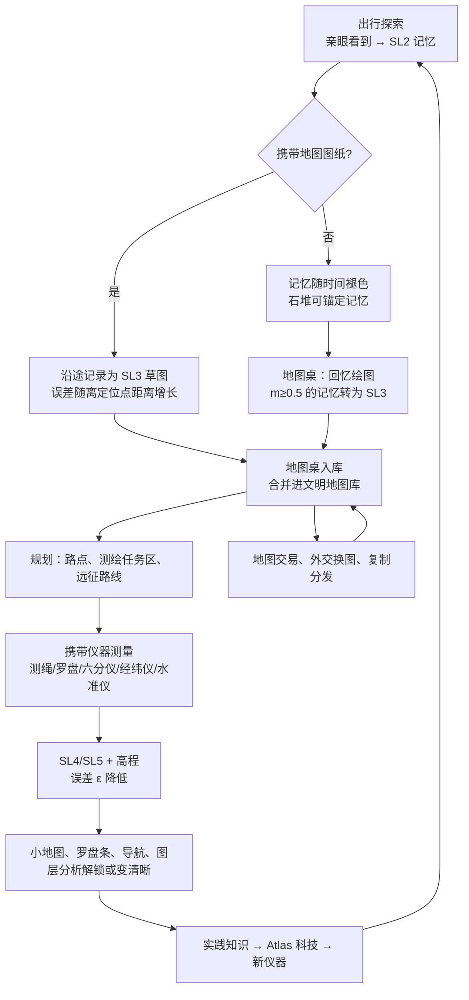

# 22 · 舆图 Atlas（`tcatlas`）

> 本章是模组章节，按 README §5.3 的 18 节模板组织，末尾附机器可读附录 A-D。
> 冲突裁决顺序：`design-brief.md` 契约 → 00 章 DR/DA → 31 章（UI 总规范）→ 本章。31 章把地图、小地图、罗盘条、路点、布局编辑器的**细节**交给本章；按键、HUD 控件 ID、HUD 等级、布局文件归属以 31 章为准。

## 0. 文档信息

| 项 | 内容 |
| --- | --- |
| 章节编号 | 22 |
| 模组 | 舆图 Atlas，mod id `tcatlas`，包 `com.nightcity.atlas`，主类 `TAtlas`，事件类 `TAtlasEvents` |
| 必需依赖 | `tcivilization`（HUD 控件注册 `HudWidgetRegistry`、文明面板 `CivPanelTabRegistry`、深链接、通知、区域层框架） |
| 可选依赖 | 其余 16 个模组全部可选；`tctechnology` 缺失时使用第 2.2 节的“测绘等级”独立进度 |
| 依赖章节 | 00（DR-02、DR-10、DR-26、DR-27、DR-28、DR-34、DA-02、DA-03、DA-13）、01 §3.2（地图时代表）、02（区域层、线程、存档、性能预算、配置分层）、31（HUD 与按键）、32 §5-§6（UI 美术、Iris 兼容） |
| 拥有内容 | 地图物品、测绘仪器、路点、世界地图界面、小地图、罗盘条、坐标控件、HUD 布局编辑器、时代皮肤 `tcatlas:skin/<era>`、区域层 `tcatlas:survey` |
| 不拥有内容 | 各专题图层的数据（归发布模组）、HUD 布局文件（归核心，Atlas 只编辑）、HUD 等级状态（存于核心配置，Atlas 注册 H 键） |
| 版本 | 设计 DD-0.2 |

### 0.1 本章术语

| 术语 | 含义 |
| --- | --- |
| 测绘级别 SL（Survey Level） | 某个持有者对某个区块的认知程度，0-5，见 5.1 |
| 持有者（holder） | 认知的拥有者：玩家个人（记忆）或玩家文明（地图库）；AI 文明另有自己的持有者 |
| 地图库（atlas archive） | 玩家文明共享的已入库地图知识，存于服务端 |
| 误差 ε | 地图上某处位置与真实位置的最大偏差（格） |
| 定位误差 ε_p | 玩家对“自己在哪里”的不确定度（格） |
| 瓦片（tile） | 世界地图渲染单元，256×256 像素，见 5.9 |
| 实时叠层（live overlay） | 与 SL 正交的“当前状态”信息：电报、雷达、卫星重访 |
| 测绘等级 T0-T10 | 无 `tctechnology` 时 Atlas 自带的能力等级，与 E0-E10 的地图能力一一对应 |
| 格 | 游戏距离单位（1 方块）。地理比例 1 格 ≈ 244.6 m（README `HORIZONTAL_SCALE`），只在地图比例尺上换算 |

---

## 1. 定位与设计支柱

### 1.1 定位

Atlas 把“我在哪里、那里有什么”变成一条贯穿 E0-E10 的知识进度线（DR-26、DR-27）。玩家一开始只有会褪色的记忆；随后亲手绘图、立碑记路、拉绳测量、拿罗盘定向、用六分仪测纬度、架经纬仪做三角网、用飞机航拍、用雷达看移动目标、在 GIS 里叠图分析，最终用卫星与 GPS 得到精确到格的全球图像，并绘制月球与火星。

Atlas 同时是整个模组家族的**地图渲染器**：地质、气候、生态、交通、经济、领土、危险、历史等专题数据由各自的模组以区域层（02 章）发布，Atlas 只负责把它们画出来、配图例、做测量与分析。Atlas 还拥有 HUD 的布局编辑器与时代皮肤，是 31 章 HUD 框架的“外观与编辑”提供方。

### 1.2 设计支柱

| 编号 | 支柱 | 落地规则 |
| --- | --- | --- |
| AP-1 | **地图即知识** | 地图只显示持有者已观察或已测绘的区块；没有“全图开放”。信息量随 SL 提升，而不是随时代自动出现 |
| AP-2 | **精度是可见的资源** | 每处地图都带误差 ε；低精度地图用确定性扭曲场真实地“画歪”，仪器与科技把它校正。玩家能看到、也能感受到精度的进步 |
| AP-3 | **一张地图，众多图层** | 专题数据归发布模组；Atlas 只做渲染、图例、分析。任何模组缺失时对应图层不出现，不留空项（31 UP-5） |
| AP-4 | **沉浸而克制的 HUD** | 默认 HUD 只有小地图、罗盘条与导航指引（DR-28）；坐标是 E10 的科技成果，而不是开局就有 |
| AP-5 | **巨型星球可承受** | 16 万 × 8 万格、东西环绕的星球在磁盘、带宽、显存、帧时间上都有硬预算（第 14 节） |
| AP-6 | **经度之谜** | 全球统一时钟（DA-02）使太阳位置与经度无关：纬度可以靠天体测量得到，经度只能靠航位推算、精密计时减小漂移、无线电测向、雷达与 GPS。这让“确定经度”成为一条有历史回声的科技线 |
| AP-7 | **合作的地图库** | 所有玩家同属一个玩家文明（DR-02）。个人记忆是私有的；把地图放到地图桌“入库”后成为全文明共享知识 |

### 1.3 不做的事

1. 不做按区块即时揭开的“迷雾全亮”地图；原版式全知小地图只在创造模式与旁观者模式可用（16.4）。
2. 不做时区与基于太阳时差的经度测量（与 DA-02 冲突）。
3. 不做“地图上点一下就传送”；快速旅行属于 Networks 的交通网络。
4. 不替其他模组保存专题数据；Atlas 缓存的是渲染结果。

---

## 2. 独立玩法（只安装 Atlas 与 `tcivilization` 时）

### 2.1 体验概要

只装核心与 Atlas 时，原版主世界（或任何世界生成）上仍有完整的“探索 → 绘图 → 测量 → 精确导航”进度：

1. 开局按 M 打开**记忆地图**：亲眼看到过的地方以炭笔素描风格模糊显示，会随时间褪色。按 B 可以放下最多 3 个会褪色的**记忆标记**（不是路点，不进入 HUD 导航）。
2. 用皮革与木炭制作**手绘地图**，持在手中行走即把沿途记录为草图（SL3），不再褪色；获得 8 个路点。
3. 制作路标、界碑、地图碑，路点扩到 32 个。
4. 制作测绳与十字杆，沿路测量，得到小地图（半径 64，只显示已测绘区域）。
5. 制作磁罗盘，获得罗盘条与半径 128 的小地图；之后依次是六分仪与航海图、经纬仪与等高线、无线电测向、航拍与雷达、GIS 终端、卫星与 GPS。

### 2.2 测绘等级（无 `tctechnology` 时）

能力判定统一通过 `AtlasCapabilities.tier(holder)`。有 `tctechnology` 时，等级等于玩家文明已掌握的 Atlas 科技链中最高的一级（附录 B）；没有时使用下表，等级记录在玩家文明上（DR-02，所有玩家共享）。

| 等级 | 对应时代能力（01 §3.2） | 解锁条件（无 Technology） | 关键仪器（原版材料配方，8.3） |
| --- | --- | --- | --- |
| T0 | E0 记忆地图 | 默认 | — |
| T1 | E1 手绘地图、8 路点 | 首次制作 `tcatlas:hand_drawn_map` | 皮革 + 木炭 |
| T2 | E2 地标、32 路点 | 文明已知区块 ≥ 1,500，且放置过 1 块 `tcatlas:map_stele` | 石砖 + 墨囊 |
| T3 | E3 道路测量、小地图 r=64 | 用 `tcatlas:measuring_rope` 完成 20 段测量 | 线 + 木棍 + 铁粒 |
| T4 | E4 罗盘条、小地图 r=128 | 制作 `tcatlas:magnetic_compass` | 铁锭 + 红石 |
| T5 | E5 航海图、经纬网 | 用 `tcatlas:sextant` 完成 5 次天体定位 | 铜锭 + 玻璃 + 金粒 |
| T6 | E6 三角测量、等高线 | 闭合 1 个三角网（5.7） | 铁锭 + 玻璃 + 黄铜等价物（铜 + 金） |
| T7 | E7 实时数据、天气 | 建成 2 座 `tcatlas:reporting_station` 并互联 | 红石比较器 + 铜 |
| T8 | E8 航拍、雷达 | 完成 1 条航拍带或运行雷达 1 个 MC 日 | 侦测器 + 紫水晶 + 铜 |
| T9 | E9 GIS | 建成 `tcatlas:gis_terminal` 并导入 ≥ 50 个地区的测绘 | 下界石英 + 红石块 + 金 |
| T10 | E10 卫星与 GPS | 地面站完成首次下行（无 Orbit 时使用“抽象发射”，2.4） | 钻石 + 紫水晶碎片（晶振） |

规则：

1. 测绘等级只升不降；配置 `standalone_tier_mode = progressive | all_unlocked`（服务器，13.2）。
2. 独立模式下没有 RP 与知识阈值；等级条件即是唯一门槛。
3. 安装 `tctechnology` 后，已有存档的 T 等级迁移为对应 Atlas 科技的“已掌握”状态（只迁移本模组拥有的科技）。

### 2.3 独立模式下的地图内容

| 内容 | 独立模式来源 |
| --- | --- |
| 地形底图 | 已加载区块的扫描（方块颜色、高度、水深） |
| 未生成区域的卫星预览 | 原版 `ChunkGenerator.getBaseHeight` 采样（5.10） |
| 专题图层 | 只有 Atlas 自己的“测绘覆盖”“路点”“死亡点”“注释”；其他图层不出现 |
| 聚落、领地 | 无 |
| 世界环绕 | 无 Wildlands 时世界不环绕，地图以普通平面处理；投影与经纬网仍按 README 星球尺寸计算，超出范围的坐标正常显示 |
| 测量员 NPC | 使用核心 `tcivilization:person` 的“跟随/前往”指令陪同扛杆，无岗位系统 |

### 2.4 无 Orbit 时的 E10 / T10

卫星图像与 GPS 依赖在轨卫星。没有 `tcorbit` 时，`tcatlas:ground_station` 允许“抽象发射”：消耗 `tcatlas:imaging_payload` 或 `tcatlas:navigation_payload` 以及配置的发射成本（默认 64 个烟花火箭 + 16 个铁块 + 8 个钻石；不用下界合金与末影之眼，因此 Beyond 的 `mundane` 模式下也能完成，21 BQ-5），在 1 个 MC 日后视为入轨。配置 `abstract_satellites = auto | always | never`，`auto` 表示仅在 Orbit 缺失时启用。

---

## 3. 联动玩法

每条联动都由“有则启用、无则隐藏”的软依赖实现（02 章 `ModList` 检查 + 可选 API 接口）。专题图层统一通过区域层与 `MapLayerProvider`（12.1）接入，下表只写各模组特有的内容。

### 3.1 `tcivilization`（必需）

| 方向 | 内容 |
| --- | --- |
| 核心 → Atlas | `RegisterHudWidgetsEvent` 注册 4 个控件；`CivPanelTabRegistry` 注册 1 个页签；`DeepLinkRegistry` 注册 `tc:tcatlas/...`；`TcNotifications` 发送路点、测绘、卫星下行通知；`TrackerApi` 固定追踪“导航到路点”；时代与科技镜像（`HudContext`） |
| Atlas → 核心 | 提供 H 键（写入核心 `[hud] level`）、`Ctrl+H` 布局编辑器（读写 `config/tcivilization/hud_layout.json`）、时代皮肤 `tcatlas:skin/<era>`（核心在 Atlas 缺失时用 `tcivilization:skin/neutral`）、`TcMapSnippet` 的地图绘制实现 |
| 指令轮盘（Z） | Atlas 的 `WheelProvider` 提供“在此添加路点”“导航到此”“标记此处”“请求测量员测量此处”（有 Settlements 时）四个选项 |
| 人物实体 | 核心 `tcivilization:person` 可作为扛杆员、测链员陪同测量（5.6）；死亡与远行的人物带回的见闻作为 SL1 传闻入库 |

### 3.2 `tctechnology`

1. Atlas 拥有附录 B 的 14 项科技，地图能力由这些科技解锁（6.1）。
2. **实践来源**：使用记忆地图（每天首次打开、标记）为 `neolithic/sketch_mapping` 提供知识；绘制草图为 `bronze/landmark_survey` 提供知识；完成测段、天体定位、三角网闭合等分别为后续科技提供知识（数值见 6.9）。
3. 科技树详情栏的“解锁内容”列出地图能力（例如“小地图 半径 64”），由 Atlas 通过 `TechUnlockDescriber` 提供文字。

### 3.3 `tcskills`

1. `surveying`（测绘）与 `exploration`（探索）是 Atlas 的主技能，`logistics`、`aeronautics`、`engineering`、`construction`、`trade`、`scholarship` 有少量挂钩（第 15 节）。
2. Atlas 通过 `SkillsApi.getMultiplier(player, skill, effect)` 读取修正（05 §6.7.4 键映射；m 含等级与天赋，上限按 05 §6.4，DR-25 中等影响）：步测与仪器误差 ×`(2 − m)`（`surveying`，`precision` 类，最多 −30%）；记忆半衰期 ×m（`exploration`，`range` 类，最多 +40%）；草图半径 ×m（`surveying`）。未安装 `tcskills` 时 m = 1。
3. 天赋（由 Skills 定义）可以引用 Atlas 的修正键：`tcatlas:pace_error`、`tcatlas:instrument_error`、`tcatlas:memory_half_life`、`tcatlas:sketch_radius`。

### 3.4 `tcwildlands`

| 方向 | 内容 |
| --- | --- |
| Wildlands → Atlas | 星球模型（`PLANET_GRID` 64 格/样本）作为传闻级底图与卫星预览；`TerrainPreviewApi` 对未生成区块做 4 格分辨率的仅噪声采样（5.10）；区域层 `tcwildlands:geology`、`climate`、`hydrology`、`ocean_current`、`weather`；地名（山脉、河流、海域）作为命名要素 |
| Wildlands → Atlas | 磁铁矿体与火山岩产生局部磁偏差（5.5），罗盘在矿体附近偏转，成为勘探提示 |
| Atlas → Wildlands | 地图上的“勘探记录”标记（由 Wildlands 的勘探工具写入）显示为点状要素 |
| 环绕 | Wildlands 负责世界东西环绕（DA-13）；Atlas 的距离、方位、瓦片全部按环绕计算（5.9） |

### 3.5 `tcecology`

图层 `tcecology:ecosystem`（生态健康，Cividis 色板）、物种分布范围（玩家在图鉴中选择物种后，在地图上显示已观察到的分布点与推断范围）。危险动物出没点由 Ecology 以要素形式发布，在 E4 起显示在罗盘条上。

### 3.6 `tccultivation`

图层 `tccultivation:agriculture`：农田、牧场、作物类型（分类色板 + 纹理）。土壤肥力属于 Wildlands/Cultivation 的区域层，Atlas 只渲染。E9 GIS 可以叠加“土壤 × 气候 × 坡度”求适宜度（5.12）。

### 3.7 `tcindustry`

1. 仪器部件来自 Industry：透镜、黄铜件、精密齿轮、真空管、晶体管、集成电路（配方见第 8 节，缺失时替换为原版材料）。
2. 雷达站与 GIS 终端、地面站消耗电能 `W`（DA-10）；无 Industry 时改为消耗红石能量等价（红石块燃料，8.4）。
3. 图层 `tcindustry:emission`（污染与排放，Viridis）。

### 3.8 `tcnetworks`

| 方向 | 内容 |
| --- | --- |
| Networks → Atlas | 道路、铁路、航线、航道、管线以矢量要素发布（`MapFeatureProvider`），按类型使用不同线型；车站、港口、机场为点要素 |
| Networks → Atlas | 电报网络（`electric/telegraphy`）承载“实时数据”：连通到电报网的聚落与报告站把天气、人口、库存、警报每 1 MC 小时推送到地图（E7）；无线电（同科技链）提供无线电信标测向 |
| Networks → Atlas | 飞机（`atomic/powered_flight`）是航拍平台；乘坐 Networks 载具时，HUD 上下文切换为“载具/飞行器”布局（9.6） |
| Atlas → Networks | 玩家文明自建的道路在掌握 `iron/road_survey` 后自动成为 SL4 测绘走廊（5.2）；GIS 路线规划调用 Networks 的路网图计算最短路径与行程时间 |

### 3.9 `tcsettlements`

1. 聚落范围内的区块自动成为文明 SL3（聚落居民的日常见闻）。
2. 岗位 `surveyor`（测量员）与 `cartographer`（制图员）由 Settlements 定义：测量员按玩家在地图上框选的“测绘任务区”自动出外测量，每 MC 日把约 4 个区块提升到 SL4（受仪器等级限制）；制图员在地图桌把成员带回的草图入库，并按需复制地图物品。
3. 图层 `tcsettlements:demography`（人口密度、职业构成）；聚落图标与名称在世界地图、小地图、罗盘条上显示。

### 3.10 `tcexchange`

1. 商路以矢量要素显示（货量用线宽、货类用图例）；市场图层 `tcexchange:market`（选定商品的价格面，RdBu 发散色板）。
2. 地图是可交易商品：地图物品的“内容价值”按其中 SL3+ 区块数与误差计算（6.8），AI 商人会买卖地图；购买的地图入库后得到 SL1-SL3 知识。

### 3.11 `tcdiscovery`

1. 日志线索带地图深链接 `tc:tcatlas/map?x=..&z=..&zoom=..`；线索的位置在地图上以“？”圆圈显示，圆圈半径等于线索的位置误差。
2. 造纸术（`medieval/papermaking`）让地图载体从兽皮、陶板、卷轴升级为纸质海图；印刷机（`renaissance/printing_press`）让 `tcatlas:bound_atlas` 能在地图桌批量复制。
3. 观察模式 V 对准地形要素（山峰、河口）时，可以“命名地物”，名字写入地图库。

### 3.12 `tcechoes`

1. 遗迹与传说位置：Echoes 发布要素与区域层 `tcechoes:history`；听到的传说给出 SL1 传闻圈（位置误差 64-256 格）。
2. 战利品 `tcatlas:ancient_map`：Echoes 的遗迹箱中生成，内容由 Echoes 的历史模拟提供（古代道路、城址），入库后是带“年代”的 SL1-SL3 知识，可能已经过时（古河道改道）。契约见 12.1 `AncientMapContentProvider` 与 12.1 第 3 条。

### 3.13 `tccommons`

1. 领地图层 `tccommons:claim`（领地边界、权限颜色 + 线型）。
2. 地图桌、路点旗、信标属于“共享设施”，受 Commons 权限控制：谁能入库、谁能修改文明路点、谁能编辑共享注释。无 Commons 时默认所有玩家文明成员可用（DR-02）。

### 3.14 `tcnations`

1. 国界与影响力：区域层 `tcnations:influence` 与边界要素；只有在玩家文明已知（SL≥1）的区域显示。
2. 外交交换地图：条约选项“交换地图”把双方地图库中对方未知的 SL≥3 区块按协议范围复制给对方。
3. AI 文明也有自己的地图库（持有者类型 `AI_CIV`），由 Nations 的抽象模拟定期写入；间谍或战利品可以获得其地图物品。

### 3.15 `tcfrontiers`

1. 危险图层 `tcfrontiers:danger`（盗匪、灾害、恶劣地形风险，琥珀色 + 符号，32 §5）。
2. 远征计划在地图上绘制：远征路线、补给点、据点；远征队回来时把沿途区块以 SL3 入库，带测量员时为 SL4。
3. 罗盘条在 E4 起显示已知危险区方向。

### 3.16 `tcbeyond`

异界影响区图层 `tcbeyond:anomaly`；在影响区内磁罗盘随机摆动（σ = 30°），GPS 定位误差 ×10，雷达出现虚假回波。异界维度不提供卫星图像。

### 3.17 `tcorbit`

1. 卫星由 Orbit 的卫星平台承载 Atlas 的载荷：`tcatlas:imaging_payload`（成像）与 `tcatlas:navigation_payload`（导航）。轨道参数（倾角、高度）由 Orbit 计算，Atlas 根据星下点轨迹决定成像覆盖与重访周期（5.8）。
2. 地面站 `tcatlas:ground_station` 接收下行数据；月球 `tcorbit:moon`、火星 `tcorbit:mars` 的地图在对应探测器或轨道器到达后生成（E10）。
3. 轨道视图：E10 世界地图切换为球面视图时显示在轨资产（由 Orbit 以要素发布）。

---

## 4. 核心玩法循环

### 4.1 主循环



### 4.2 各时代段的循环重心

| 时代段 | 主要动作 | 玩家得到的回报 |
| --- | --- | --- |
| E0-E2 个人探索 | 走、看、记、立石堆与路标 | 不再迷路；地标与路标让草图误差回落 |
| E3-E6 系统测量 | 布设测桩、导线、三角网、水准线；航海定位 | 小地图、罗盘条、经纬网、等高线；误差从数十格降到个位数 |
| E7-E8 远程感知 | 报告站、无线电信标、航拍、雷达 | 远方实时数据、移动目标、大面积高精度测绘 |
| E9-E10 分析与全球 | GIS 叠图与路线规划；卫星成像与 GPS | 全球精确图像、精确坐标、月球与火星地图 |

### 4.3 单次出行的微循环（E4 示例）

1. 在地图桌领取一张空白卷轴图纸（`tcatlas:scroll_map`），在世界地图上框选“测绘任务区”，按 B 在目标处放路点。
2. 出发：罗盘条指向路点；`tcatlas:waypoint_nav` 显示“东北 约 1,400 格”；随行走误差 ε_p 增长，导航箭头附近出现误差扇形。
3. 途经己方路标或三角点时自动定位，ε_p 回落；在河口打下测桩，用测绳与罗盘导线测量。
4. 回到聚落：图纸自动入库（`auto_deposit`），地图库更新，测量员 NPC 接手后续加密测量。

---

## 5. 系统规则与公式

### 5.1 知识模型：测绘级别 SL

每个持有者对每个区块有一个测绘级别（SL）、一个误差等级、一个“高程已知”标志和一个观测日。服务端是 SL 的唯一权威。

| SL | 名称 | 典型来源 | 渲染 | 位置误差 ε（格） | 持久性 |
| --- | --- | --- | --- | --- | --- |
| 0 | 未知 | — | 不绘制（空白、羊皮纸底或“此处未知”纹理） | — | — |
| 1 | 传闻 | NPC 口述、交易地图、传说、望远镜远眺、外交换图 | 星球模型 64 格分辨率 + 传闻斜线纹 | 64-256 | 持久 |
| 2 | 记忆 | 个人亲眼所见（仅个人持有者） | 区块摘要 + 模糊（半径随记忆强度） | 同观察时的 ε_p | 褪色（5.3） |
| 3 | 草图 | 携带图纸行走、回忆绘图、聚落日常见闻、地图碑 | 区块摘要 + 确定性扭曲场（幅度 ε） | 8-256 | 持久 |
| 4 | 测绘 | 测绳、罗盘导线、平板仪、三角网、雷达岸线、己方道路走廊 | 区块摘要，无扭曲或轻微扭曲 | 1-8 | 持久 |
| 5 | 精测 | 航拍立体测图、卫星成像、GIS 合成 | 区块摘要原样 + 高程 | ≤ 1 | 持久 |

附加属性：

| 属性 | 位宽 | 含义 |
| --- | --- | --- |
| `sl` | 3 bit | 0-5 |
| `heightKnown`（H） | 1 bit | 高程已测（水准、平板仪、立体测图、卫星）；等高线只画在 H=1 的区块 |
| `errClass` | 4 bit | ε 上界 = 2^errClass 格（0 → 1 格，8 → 256 格），9-15 保留 |
| `observedDay` | u16 | 最近一次观测的游戏日（世界开始起算） |

**合并规则**：同一区块的新知识只有在 `sl` 更高、或 `sl` 相同且 `errClass` 更小、或 `sl` 与 `errClass` 不劣且更新时才覆盖；`observedDay` 取较新者；`H` 取或。合并是幂等且可交换的，因此多人同时入库、外交换图、离线测量员回报都可以任意顺序合并。

```text
merge(a, b):
    if b.sl > a.sl or (b.sl == a.sl and b.errClass < a.errClass): base = b else base = a
    base.heightKnown = a.heightKnown or b.heightKnown
    base.observedDay = max(a.observedDay, b.observedDay)
    return base
```

**新鲜度**：`age = today - observedDay`。`age > 48`（一年，DR-13）时地图按 `desat = min(0.6, age / 480)` 去饱和，图例显示“资料年代”。实时叠层（电报、雷达、卫星重访）与 SL 正交，只影响“当前状态”图层，不改变 SL。

### 5.2 知识获取规则

**视野**：每 20 tick 对每个在线玩家计算一次可见区块。

```text
r_see(chunks) = clamp(3 + floor(sqrt(max(0, y_eye - h_mean) / 16)), 3, 12)
    h_mean = 以玩家为中心 7×7 区块地表高度的平均值（区块摘要缓存）
可见区块 = 以玩家所在区块为圆心、半径 r_see 的圆内，且区块中心到玩家眼睛的粗视线（4 段采样高度图）不被地形遮挡
水下、洞穴内（头顶 8 格内有实心方块且天空光 < 4）：r_see = 1
```

| 来源 | 写入持有者 | SL | ε |
| --- | --- | --- | --- |
| 亲眼看到 | 个人 | 2（记忆） | 当前 ε_p |
| 携带有效图纸看到（E1 须持在主/副手；E3 起放在背包任意格即可） | 图纸物品（未入库） | 3 | `ε_p` 与图纸自身精度下限中较大者 |
| 图纸在地图桌入库 | 文明 | 图纸上的 SL | 图纸上的 ε |
| 回忆绘图（地图桌，E1 起） | 文明 | 3（只转 m ≥ 0.5 的记忆） | 记忆 ε × 2 |
| 聚落范围（有 Settlements） | 文明 | 3 | 16 |
| 己方道路走廊（掌握 `iron/road_survey` 后，有 Networks） | 文明 | 4（宽 16 格） | 8 |
| 望远镜远眺（原版望远镜，E5 起可得，16.3） | 个人 | 1 | max(64, d / 16) |
| NPC 口述、传说、AI 商人地图 | 文明 | 1-3 | 64-256 |
| 仪器测量 | 文明（直接入库） | 4-5 | 见 5.6、5.7 |

### 5.3 记忆与褪色（个人 SL2）

```text
m(t) = 0.5 ^ ((now - seenTime) / (T_half × 1200))      （时间单位为游戏秒；1 MC 日 = 24000 tick = 1200 游戏秒）
T_half（MC 日）= base(tier) × (1 + 0.02 × min(exploration, 25)) × anchor
    base: T0 = 3, T1 = 6, T2+ = 12
    anchor = 4，若该区块中心 48 格内有玩家亲手堆过或到访过的石堆 tcatlas:cairn；否则 1
渲染：m ≥ 0.25 正常记忆样式（模糊半径 = 4 × (1 - m) 像素）
      0.05 ≤ m < 0.25 淡化（不透明度 = m / 0.25）
      m < 0.05 视为遗忘：保存时删除，该区块对个人回到 SL0
再次看到：seenTime 刷新为当前，m 回到 1
```

1. 记忆只存在于个人持有者，不共享、不入库（除非回忆绘图）。
2. 有图纸或地图库覆盖的区块，地图优先显示更高 SL；记忆只补空白。
3. 记忆标记（E0 按 B）：最多 3 个，强度与所在区块记忆相同，随之褪色；记忆消失时标记一起消失。T1 起记忆标记自动转为普通路点（不占路点上限，转换一次）。
4. 配置 `memory_decay = true`（服务器）；关闭时 SL2 永不褪色。

### 5.4 地图误差与确定性扭曲

低精度地图不是“模糊”，而是“画歪”：同一张地图每次打开都歪得一样，玩家可以靠地物认路，但用它量距离、量方位会出错。

```text
W(p)  = 光滑二维向量噪声，波长 256 格，|W| ≤ 1，种子 = worldSeed ⊕ holderId ⊕ sheetId
ε(p)  = 各区块 ε 的双线性插值（以区块中心为样点），保证扭曲连续
显示位置 p' = p + ε(p) × W(p)
瓦片构建时做逆采样：对每个输出像素 q，迭代 2 次求 p ≈ q - ε(q) × W(q)，再取 p 处的颜色
```

1. ε ≤ 2 的区块不扭曲（`|W|` 乘以 `smoothstep(2, 4, ε)`）。
2. 玩家自身、路点、要素都按同一扭曲场绘制，因此相对关系在图上自洽；量测工具（5.12）在图面坐标上计算，显示值附带“±误差”。
3. 不同图纸（未入库）用各自 `sheetId` 的扭曲场；入库后统一为文明扭曲场。

### 5.5 玩家定位误差、航位推算与磁偏角

玩家对自身位置的估计用两个分量表示：`ε_p = (εx, εz)`（东西、南北），这样纬度定位只校正 `εz`，体现“经度之谜”（AP-6）。

```text
每 20 tick（d = 本段水平移动距离，环绕计算）：
    εx += k_dr × d × |cos θ| + k_dr × d × 0.3
    εz += k_dr × d × |sin θ| + k_dr × d × 0.3      （θ 为移动方向；0.3 为横向漂移项）
    εx, εz 上限 2048
定位（fix）：按来源把对应分量设为 σ_fix（取较小者）
显示：|ε_p| = sqrt(εx² + εz²)
```

| 推算方式 | 条件 | k_dr |
| --- | --- | --- |
| 步测 | T0-T3 默认 | 0.10 |
| 磁罗盘 | 背包内有 `tcatlas:magnetic_compass`（T4） | 0.06 |
| 计程绳 | 乘船且背包内有 `tcatlas:log_line`（T5） | 0.04 |
| 航海天文钟 | 背包内有 `tcatlas:marine_chronometer`（T5，`renaissance/marine_chronometer`），与罗盘/计程绳叠加 | ×0.5（下限 0.02） |
| 载具里程表 | 乘坐 Networks 有轨或道路载具，且在 SL4 线路上 | 0（线路即定位） |
| GPS | 背包或载具内有 `tcatlas:gps_receiver`，可见导航卫星 ≥ 4 | 每秒定位，ε = 1 |

定位来源：

| 来源 | 时代 | 校正分量 | σ_fix（格） |
| --- | --- | --- | --- |
| 站在已测地标 32 格内（路标、地图碑、界碑、测桩、三角点、路点旗、聚落中心） | E2+ | 两者 | 该地标所在区块的 ε |
| 星盘测纬度 | E4（`medieval/magnetic_compass` 之后可制作） | εz | 137（±0.3°） |
| 六分仪测纬度 | E5 | εz | 14（±0.03°） |
| 无线电测向，两条方位线 | E7 | 两者 | `d × tan(2°) / sin(γ)`，γ 为两方位线交角，下限 16 |
| 雷达站覆盖区内（船、飞机） | E8 | 两者 | 16 |
| GPS | E10 | 两者 | 1 |

天体测量需要晴天、露天（头顶无方块）；正午测日窗口为 tick 5000-7000，夜间测北极星仅北半球、测南十字仅南半球（Wildlands 星空，缺失时任意晴夜可测）。测量是一个小游戏：仪器视图中把天体像与地平线对齐，残差 `r`（像素）附加误差 `σ = σ_inst × (1 + r / 4)`。

**磁偏角**（配置 `magnetic_declination = true`）：

```text
D(x, z)   = 10° × N2(x / 8192, z / 8192)        （光滑噪声，|D| ≤ 10°，东西环绕周期化）
dev(x, z) = Σ_磁铁矿体 25° × exp(-dist² / (2 × 12²)) × 方向符号    （需 Wildlands 矿体数据；32 格外忽略）
罗盘读数 = 真方位 + D + dev + 异界扰动（Beyond，σ = 30°）
```

1. 掌握 `renaissance/celestial_navigation` 后，在 SL≥4 的区域内 D 已知，罗盘条显示“真北（已校正）”；其余区域显示“磁北”并带偏差提示符号。
2. `dev` 不会被校正，罗盘在矿体附近持续摆动，成为勘探线索（Wildlands 可给 `mining` 熟练度，见其章节）。
3. 罗盘条、导航箭头、导线测量的方位都使用“罗盘读数”，因此偏角会真实地把玩家带偏，直到掌握校正。

**导航显示误差**：

```text
ε_nav = |ε_p| + ε_wp            （ε_wp：路点放置时的位置误差，B 键放置 = 当时 |ε_p|，地图点选 = 该处地图 ε）
显示目标 = 真实位置 + ε_nav × U(hash(waypointId, fixEpoch))      （U 为单位向量；每次定位 fixEpoch 自增）
到达判定：真实距离 ≤ 8 + 0.5 × ε_nav
```

### 5.6 测绘仪器与精度

所有仪器读数由服务端计算并写入地图库；客户端只做取景与小游戏。`skill` 修正见 3.3。

| 仪器 | 时代 | 测量对象 | 单次测程 | 误差模型 |
| --- | --- | --- | --- | --- |
| 步测（无仪器） | E1 | 距离 | — | 距离误差 10% |
| `measuring_rope` 测绳 | E3 | 两测桩间距离 | ≤ 32 | `σ_d = 0.5 + 0.005 × d` |
| `groma` 十字杆 | E3 | 直角与直线 | 64 | `σ_θ = 1.0°` |
| `surveyors_wheel` 测距轮 | E3 | 沿路距离 | 连续 | `σ_d = 0.01 × d` |
| `magnetic_compass` 磁罗盘 | E4 | 方位 | 64 | `σ_θ = 1.0°` + 未校正偏角 |
| `astrolabe` 星盘 | E4 | 纬度 | — | ±0.3° |
| `sextant` 六分仪 | E5 | 纬度、两物标水平角 | 视距 | ±0.03°；水平角 ±0.1° |
| `log_line` 计程绳 | E5 | 船速 | — | 速度误差 4% |
| `marine_chronometer` 航海天文钟 | E5 | 航行时间 | — | 推算漂移减半 |
| `survey_chain` 测链 | E6 | 基线 | ≤ 64 | `σ_d = 0.1 + 0.0002 × d` |
| `theodolite` 经纬仪 | E6 | 水平角、竖直角 | ≤ 2048 | `σ_θ = 0.01°` |
| `dumpy_level` 水准仪 + `levelling_staff` 水准尺 | E6 | 高差 | ≤ 48 | `σ_h = 0.05 × sqrt(d / 48)` |
| `plane_table` 平板仪 | E6 | 周边地形 | 半径 96 | ε = 站点 ε + 2 |
| `radio_direction_finder` 无线电测向仪 | E7 | 到信标方位 | ≤ 8192 | `σ_θ = 2°` |
| `aerial_camera` 航空相机 | E8 | 影像 | 见 5.8 | `GSD = h_agl / 256` |
| 雷达站 | E8 | 移动目标、岸线 | 4096 | 距离 ±8，方位 ±0.5° |
| `total_station` 全站仪 | E9 | 角度 + 距离 | ≤ 2048 | `σ_θ = 0.002°`，`σ_d = 0.02 + 1e-6 × d` |
| `gps_receiver` GPS 接收机 | E10 | 位置 | 全球 | ±1；可见卫星不足 4 颗时 ±64 |

**导线测量（E3-E5）**：

```text
测桩 S0（已知点，ε0）→ S1 → … → Sn
每段 i：σ_i² = σ_d(d_i)² + (d_i × σ_θ_rad)²
累计误差 ε_n = ε0 + sqrt(Σ σ_i²) × 2         （×2 取约 95% 置信上界）
导线走廊：每段两侧 24 格内的区块 → SL4，ε = 该段累计误差，向上取整到 2 的幂
闭合导线（Sn 回到任一已知点）：闭合差 f = 计算终点与已知点之差；
    按段长比例改正（Bowditch 法则），全部段 ε 改为 max(ε0, |f| / 2)，并给“闭合”奖励（第 15 节）
```

测桩（`tcatlas:survey_stake`）是方块；测绳右键第一根测桩、再右键第二根完成一段。两根测桩必须相互可见（眼高视线不被遮挡）。

### 5.7 三角测量（E6）

1. **基线**：两座三角点（`tcatlas:trig_pillar`，或测桩）之间用测链分段量距，得到基线长 `b` 与误差 `σ_b`。
2. **观测**：在三角点上架设经纬仪（`tcatlas:theodolite` 放在三角点顶部，或放在 2 格内），打开观测界面，对准其他三角点的觅标（三角点顶部的信号灯/标杆）读数。觅标必须在视距内：两点眼高连线不被地形遮挡，且距离 ≤ 2048 格（已加载区块，或使用星球模型高度做远距离遮挡判断）。
3. **解算**：一个三角形的三个角都观测后，角闭合差 `w = A + B + C - 180°`。若 `|w| ≤ 3 × sqrt(3) × σ_θ`，三角形闭合，按正弦定理推算边长：

```text
a = b × sin(A) / sin(C)，c = b × sin(B) / sin(C)       （b 为已知边）
新点误差 ε_new = ε_known + σ_b × (a / b) + a × σ_θ_rad × 2
三角形内部与外扩 64 格内的区块 → SL4，ε = 三个顶点 ε 的最大值（下限 2），H 不变
顶点高程由竖直角三角高程推算（H=1 只给顶点所在区块）
```

4. **网平差**：同一网中多个闭合三角形共享边时，服务端按最小二乘做简化平差（每次新三角形闭合时在后台线程运行，网中顶点 ≤ 512 个），所有顶点 ε 取平差后的标准差 × 2。
5. **加密**：三角形内部的高程与细部由平板仪、水准线补充；三角网提供的是控制框架。
6. **人物陪同**：观测需要“觅标在场”。玩家可以把核心人物实体派到远端三角点（指令轮盘 Z “前往该处”），人物到达后觅标点亮；或在远端放置信号灯方块（E6 的三角点自带）。

### 5.8 远程感知：电报实时数据、航拍、雷达、卫星

**电报实时数据（E7，`electric/telegraphic_reporting`）**

1. 报告站 `tcatlas:reporting_station` 必须连到 Networks 电报网（无 Networks 时用 2 座报告站之间 ≤ 2048 格的“架空线”方块链替代，8.4）。
2. 每座报告站每 1 MC 小时（1000 tick）上报：所在区域的天气（Wildlands 区域层 `weather`）、所在聚落的人口、库存摘要、持续警报。地图上以“实时”图标显示，数据超过 3 小时未更新显示为“失联”。
3. 无线电信标 `tcatlas:radio_beacon` 供测向仪定位（5.5），也作为航空导航点显示在地图与罗盘条上。

**航拍（E8，`atomic/aerial_photography`）**

```text
拍摄条件：玩家乘坐飞行器（Networks 飞机，或原版鞘翅飞行中），手持 tcatlas:aerial_camera，离地高度 h_agl ≥ 128
单张覆盖：正方形，边长 s = 2 × h_agl × tan(30°) ≈ 1.155 × h_agl，中心为相机正下方
地面分辨率 GSD = h_agl / 256（格/像素），ε = max(1, GSD)
每张照片 = 1 个 tcatlas:aerial_photograph 物品（消耗 1 个胶卷：纸 + 银等价物，8.2）
航带：连续照片重叠率 ≥ 60% 时形成立体像对
立体测图仪 tcatlas:stereo_plotter：放入立体像对 → 重叠区 SL5 + H，ε = max(1, GSD)
单张照片（无立体）→ 覆盖区 SL4，H = 0
```

服务端不保存照片像素：照片物品只记录 `{center, side, gsd, day, photoId}`；入库时把覆盖区块的 SL/ε/H 写入地图库，像素来自区块摘要（已生成区块）或地形预览（未生成区块，5.10）。

**雷达（E8，`atomic/radar`）**

1. 雷达站是多方块：`radar_antenna`（顶部，需高于周边地形 8 格以上）+ `radar_station`（机柜）+ `radar_console`（操作台）。耗电 20 kW（无 Industry 时见 8.4）。
2. 探测：每 40 tick 一次扫描，半径 4096 格，视距遮挡用星球模型高度图判断（地球曲率不模拟）。目标：Networks 的船舶、飞机、车辆实体，Nations 的 AI 文明载具与远征队（抽象实体以“幽灵点”表示），原版船、大型生物（≥ 2 格高）。
3. 显示：雷达控制台的 PPI 显示；文明成员的小地图“雷达接触”层（E8 起）与世界地图实时叠层。接触点只有位置、速度矢量与大小等级，识别（敌我）需要 Nations 的外交状态或目视。
4. 岸线测绘：雷达扫描范围内的海陆边界区块提升到 SL4（ε = 8），这是 E8 的海岸测绘捷径。
5. 雷达站同时为覆盖区内的船与飞机提供定位（5.5）。

**卫星（E10，`space/satellite_imagery`、`space/satellite_navigation`）**

```text
成像卫星（Orbit 卫星平台 + tcatlas:imaging_payload）：
    可成像纬带 |lat| ≤ i（轨道倾角，Orbit 提供）；幅宽 2048 格
    每 MC 日成像面积 ≈ 可成像纬带面积 / 8      → 任一点重访周期 ≈ 8 / n_imaging 日
    成像结果：区块 SL5 + H，ε = 1，observedDay = 成像日
    实现：只在地图库中写“已成像”位与日期（每区块 1 bit + 区域级日期），像素在客户端请求瓦片时按需生成
导航卫星（tcatlas:navigation_payload）：
    可见卫星数 n_vis(lat) = round(n_nav × coverage(i, lat))，coverage 由 Orbit 的轨道分布给出（无 Orbit 时取 n_nav × 0.67）
    n_vis ≥ 4 → GPS 精确定位（ε = 1）；1-3 → ε = 64；0 → 无定位
    全球覆盖需要 ≥ 6 颗（配置 gps_min_satellites）
```

月球与火星：Orbit 的探测器/轨道器到达 `tcorbit:moon`、`tcorbit:mars` 后，对应维度的地图库以同样规则成像；这两个维度不需要 E0-E9 的地面测绘阶段。

### 5.9 投影、环绕、极区与瓦片金字塔

**投影**：等距圆柱投影（plate carrée），即方块坐标直接作为图面坐标。理由：Minecraft 的方块网格本身就是这个投影；罗盘恒向线在图上是直线；没有面积或形状的“额外失真”需要向玩家解释。

```text
经度 lon = x / 81920 × 180°          （x ∈ [-81920, 81920)）
纬度 lat = -z / 40960 × 90°          （-Z 为北）
1° 纬度 ≈ 455.1 格；1° 经度（图面）≈ 455.1 格
比例尺显示：格为主单位；地图比例尺附带地理换算 1 格 ≈ 244.6 m（README HORIZONTAL_SCALE）
```

E9-E10 提供“球面视图”（正射投影的地球仪旋转视图），只用于浏览，不参与测量。

**环绕**（DA-13）：所有距离、方位、瓦片坐标按环绕计算。

```text
wrapX(dx) = ((dx + 81920) mod 163840) - 81920
距离 d = sqrt(wrapX(x2 - x1)² + (z2 - z1)²)
方位 = atan2(wrapX(x2 - x1), -(z2 - z1))，0° = 北，顺时针
世界地图：视口横向可无限平移，瓦片 X 索引对每层的列数取模；视口宽于整个星球时重复绘制
256 格缓冲带（Wildlands 的镜像区）不单独存档；|x| ≥ 81920 的方块坐标先归一化再查询
```

**极区**：Z = ±40960 是世界边界（不可越过）。地图在 |lat| > 85° 处画极区冰盖纹理；经纬网在极区只画经线到 85°。不做极点跨越导航；GIS 路线规划在边界处截断。

**瓦片金字塔**：

```text
瓦片 256 × 256 像素；层级 L = 0..9，L 层 1 像素 = 2^L 格
L0：1 瓦片 = 256 × 256 格 = 一个区域的 1/4
L9：整个星球 = 163840 / 512 × 81920 / 512 = 320 × 160 像素（单张瓦片内）
放大到 1 格 > 1 像素时（缩放 2×、4×、8×）直接放大 L0 瓦片（最近邻）
降采样：L(n+1) 像素 = L(n) 2×2 像素的众数色（分类）或均值（连续），水体优先
```

**瓦片管线（客户端）**：

```text
服务端区块摘要（5.13） ──► 客户端摘要缓存（磁盘） ──► 后台线程：样式化（时代风格 + 扭曲 + 图层合成）
    ──► NativeImage ──► 主线程上传为 DynamicTexture（每帧最多 4 张，≤ 0.3 ms）──► 屏幕绘制
```

1. 样式在 CPU 上于纹理构建时应用：E0 兽皮炭笔、E1 兽皮墨线、E2 陶板刻线、E3 卷轴墨色、E4 波特兰海图（罗盘玫瑰与恒向线）、E5 航海图（经纬网、水深注记）、E6 地形图（等高线、晕渲）、E7 同 E6 + 实时符号、E8 航空影像（灰阶真实色）、E9 GIS 矢量风格（扁平配色）、E10 卫星真彩色。风格由“文明当前地图等级”决定，玩家可在地图设置中选择任一已解锁风格。
2. 显存：最多 256 张 256² RGBA 瓦片纹理（64 MB）；LRU 回收。
3. 失效：区域的 `tileVersion` 变化（新入库、新图层数据）时，该区域对应的 L0 瓦片及其上层祖先标脏，按视口优先级重建。

### 5.10 未生成区域的预览

卫星成像、航拍、外交换图可能覆盖尚未生成的区块。为避免为地图而生成区块：

1. 优先调用 Wildlands 的 `TerrainPreviewApi.sample(x, z, step = 4)`：只计算噪声与生物群系，不放置方块与结构，返回高度、地表类别、水体。
2. 无 Wildlands 时使用原版 `ChunkGenerator.getBaseHeight(x, z, Heightmap.Types.WORLD_SURFACE_WG, ...)`，按 8 格步长采样，地表颜色取生物群系颜色。
3. 预览样本只在客户端请求对应瓦片时于服务端后台线程计算，每玩家每秒 ≤ 16 个区块，结果缓存在 `tc/atlas/preview/`；区块真正生成后由真实摘要替换。

### 5.11 等高线生成

```text
条件：时代风格 ≥ E6（掌握 industrial/triangulation）且区块 H = 1
等高距 Δh 随缩放：1 像素 ≤ 2 格 → 8 格；≤ 8 格 → 16 格；≤ 32 格 → 32 格；更远 → 64 格；计曲线每 5 条加粗
算法：对瓦片高度栅格（L0 为每格一个高度）做 marching squares；样本高度先做 3×3 均值平滑
标注：计曲线每 384 像素放一个高度标注（以海平面 63 为 0，单位“格”）
水下：水深线（E5 航海图起）使用相同算法，基于水深而不是地表高度，H 不要求（测深由航海测深完成，见 6.4）
```

等高线在瓦片构建线程中生成并栅格化进瓦片，不在每帧计算。

### 5.12 专题图层、测量工具与 GIS 分析

**图层来源**：Atlas 不计算任何专题数据。图层分两类：

| 类型 | 来源 | 例子 | 渲染 |
| --- | --- | --- | --- |
| 栅格图层 | 其他模组发布的区域层（02 章 `RegionLayer`），通过 `MapLayerProvider` 或数据驱动 `assets/<modid>/tcatlas/map_layers/*.json` 描述取值与色板 | 地质、气候、土壤、生态、排放、人口、价格面、影响力、危险、异界 | 每层一张半透明叠加瓦片；连续值用 Viridis/Cividis/RdBu，分类用 Okabe-Ito 12 色，超过 12 类加纹理 |
| 矢量要素 | `MapFeatureProvider` 返回的点、线、面 | 道路、铁路、航线、商路、国界、领地、遗迹、远征路线、在轨资产 | 每帧在屏幕空间绘制，按缩放级别抽稀 |

**图层可见性**：一个图层只在同时满足以下条件时出现在图层面板：

1. 发布模组已安装；
2. 文明地图等级 ≥ 图层声明的 `minTier`（与 31 §5.6 的时代表一致：E3 道路；E4 领地；E5 洋流；E6 等高线、地质、铁路；E7 天气；E8 雷达；E9 全部 + 分析）；
3. 该区块对查看者 SL ≥ 图层声明的 `minSl`（默认 3；危险、传说图层为 1）。

不满足 3 的区块在该图层上显示为斜线“无资料”纹理，而不是隐藏，以符合 31 UP-6。

**测量工具**（世界地图工具栏）：

| 工具 | 时代 | 规则 |
| --- | --- | --- |
| 直尺 | E1 | 两点或多段折线，按环绕计算；显示格数与“±(ε1 + ε2)” |
| 方位 | E4 | 显示真方位与罗盘方位（含偏角，5.5） |
| 面积 | E6 | 多边形面积（格²与 km²）；误差 = 周长 × 平均 ε |
| 高程剖面 | E6 | 折线下的高程曲线（只在 H=1 区块有值，其余段虚线） |
| 坡度/视域 | E9 | 坡度栅格；从一点出发的可视域（星球模型 + 摘要高度） |
| 叠加分析 | E9 | 最多 3 个栅格图层的条件组合（例如“土壤肥力 ≥ 0.6 且 年均温 10-20 ℃ 且 坡度 < 10°”），结果为二值叠加层，可保存为注释 |
| 路线规划 | E9 | 在 Networks 路网（有）与 SL≥3 地形代价栅格上做 A*：代价 = 距离 × 地表系数（道路 0.3、草地 1、森林 1.6、沼泽 2.5、山地按坡度 1-6、水面 ∞ 或按船只）；输出路线、行程时间、途经危险区 |
| 行程时间 | E3 | 沿折线按步行 4.3 格/秒、骑马 9 格/秒、载具速度（Networks）估算 |

GIS 分析在客户端后台线程以 L2（4 格/像素）以上的分辨率计算，单次分析区域上限 64 × 64 区域（约 3.3 万 × 3.3 万格），超出时提示缩小范围。

**注释**：玩家可在地图上画点、线、面与文字（每人 256 个，文明共享 2048 个）。注释可设为私有或文明共享；共享注释受 Commons 权限控制。

### 5.13 存储、同步与带宽

**区块摘要**（服务端，区块卸载或每 6000 tick 一次脏区块保存时生成）：

```text
每列（16 × 16 = 256 列）4 字节：
    u16 color   = 调色板索引（12 bit，地表方块的地图色 + 生物群系着色）| 明暗级（4 bit）
    u16 height  = 地表高度 + 512（11 bit，覆盖 -512..1024）| 水体标志（1 bit）| 水深等级（4 bit）
每区块原始 1,024 字节；Zstd（级别 3）后约 200 字节
区域文件 tc/atlas/summary/r.<rx>.<rz>.tas：1,024 个区块槽 + 偏移表，约 200 KB
```

**知识层**：区域层 `tcatlas:survey`（02 章区域层框架）每区块存 1 字节（`sl` 3 bit + `H` 1 bit + `errClass` 4 bit）与 u16 `observedDay`，每区域另存 u32 `tileVersion`；约 3 KB/区域。个人记忆 `tc/atlas/players/<uuid>.tcm`：稀疏存储，只为到访过的区域保存每区块 u32 `seenTime`（游戏总 tick ÷ 20，即游戏秒），约 4 KB/区域（压缩后约 1 KB）。

**容量估算**（EC-P1-5）：

| 场景 | 已知区块 | 服务端摘要 | 客户端缓存（含金字塔 +33%） |
| --- | --- | --- | --- |
| E2 典型存档 | 3 千 × 3 千格（3.5 万区块） | 7 MB | 9 MB |
| E6 典型存档 | 2 万 × 2 万格（156 万区块） | 320 MB | 430 MB |
| E10 卫星全覆盖（预览样本） | 全星球 5,120 万区块 | 摘要只存已生成区块；预览样本 4 格步长约 8 字节/区块 → 400 MB 上限，LRU 回收 | 客户端只缓存浏览过的瓦片，上限 1 GB（`client_cache_mb`） |

**同步与权威**：

1. 服务端是 SL 与摘要的权威。客户端只在“知识掩码”（服务端下发的 SL 位图）内显示地形；客户端本地扫描的已加载区块用于即时刷新附近瓦片，但只在掩码允许处显示。
2. 登录时下发：知识掩码的 L9 概览（全星球 320 × 160 × 1 字节 ≈ 50 KB，压缩后约 10 KB）、能力等级、路点、注释。
3. 打开地图或平移时，客户端按视口请求区域摘要（`map_tile_request`，带本地 `tileVersion`），服务端只回传版本不同的区域。
4. 带宽预算：每玩家持续 16 KB/s，突发 64 KB/s（令牌桶，`sync_kbps`、`sync_burst_kb`）；超出时按“离视口中心距离”排队。首次打开全星球概览约 200 KB。
5. 队伍共享：DR-02 下所有玩家共享文明地图库；个人记忆与未入库图纸只在本人客户端显示。旁观者与管理员可用 `/tcatlas reveal` 临时查看全部（不写入地图库）。
6. 客户端缓存目录 `.minecraft/tcatlas/<server-or-world-id>/`，按世界种子哈希 + 服务器地址区分；版本不符时整体丢弃。

### 5.14 路点

**上限**（E1、E2-E3 来自 01 §3.2；E4 起采用 31 §5.6 的建议值）：

| 时代/等级 | 个人路点 | 文明共享路点 | 备注 |
| --- | --- | --- | --- |
| E0 / T0 | 0（3 个记忆标记） | 0 | 记忆标记会褪色（5.3） |
| E1 / T1 | 8 | 16 | |
| E2-E3 / T2-T3 | 32 | 64 | |
| E4 / T4 | 64 | 128 | |
| E5-E6 / T5-T6 | 128 | 256 | |
| E7-E8 / T7-T8 | 256 | 512 | |
| E9 / T9 | 512 | 1024 | |
| E10 / T10 | 不限 | 不限 | 服务器安全上限 `waypoint_hard_cap = 4096`（每人与文明各自） |

1. 上限随等级自动提升；等级不会下降，因此不存在超限删除。管理员调低 `waypoint_hard_cap` 时超出部分变为只读（不删除）。
2. 路点旗 `tcatlas:waypoint_flag` 放置即创建一个文明路点，计入文明上限；拆除即删除。
3. 死亡点与临时标记（ping）不计入上限。

**类别**（图标同时用形状与颜色区分，满足 31 UP-8）：

| 类别 | 形状 | 默认色（Okabe-Ito） | 说明 |
| --- | --- | --- | --- |
| `home` 家 | 房屋 | 橙 #E69F00 | 罗盘条上始终显示 |
| `resource` 资源 | 菱形 | 蓝绿 #009E73 | 可附物品图标 |
| `danger` 危险 | 三角 + 感叹号 | 朱红 #D55E00 | E4 起在罗盘条上闪烁 1 次 |
| `ruin` 遗迹 | 拱门 | 红紫 #CC79A7 | Echoes 线索可自动生成 |
| `route` 路线 | 圆点 | 天蓝 #56B4E9 | 可串成路线，按顺序导航 |
| `port` 港口/车站 | 锚 | 蓝 #0072B2 | |
| `custom` 自定义 | 星 | 黄 #F0E442 | 可选 24 个图标之一 |
| `death` 死亡点 | 十字 | 黑/白描边 | 自动；保留最近 5 个；ε = min(32, 死亡时 \|ε_p\|) |
| `ping` 临时标记 | 涟漪 | 白 | 60 秒后消失；向文明成员广播 |

**共享范围**：`PRIVATE`（仅自己）、`GROUP`（Commons 小组，仅安装 Commons 时可选）、`CIVILIZATION`（全文明）。修改共享路点需要 Commons 权限 `tcatlas:waypoint_edit_shared`（无 Commons 时所有成员可改，记录最后修改人）。

**导航**：

1. 在地图、路点列表、指令轮盘（Z）或聊天深链接中选择“导航”。同一时间导航一个目标；`route` 路点串按顺序导航，到达一个自动切到下一个。
2. 导航时 `tcatlas:waypoint_nav` 出现（31 §3.3.1），罗盘条上目标高亮，世界内显示信标光柱，`TrackerApi` 自动固定一个“导航”追踪项（占 3 个固定位之一，可取消）。
3. 距离与方向显示随等级：

| 等级 | 方向 | 距离 |
| --- | --- | --- |
| E1-E3 | 8 方位文字（“东北方”） | 行程描述：≤ 215 格“就在附近”；≤ 1,290 格“约 N 小时路程”（N = round(d / 215)）；≤ 2,600 格“约半日路程”；更远“约 N 日路程”（N = round(d / 5,200)，至少 1） |
| E4-E9 | 箭头 + 16 方位；E6 起附度数 | 四舍五入到 10 格 |
| E10 | 箭头 + 度数 | 精确到 1 格 |

距离均以“格”为单位（31 §3.3.1 的“m”按“格”解释，见第 18 节问题 Q-7）。所有读数基于 5.5 的导航显示误差。

**信标光柱**：导航中或距离 ≤ 256 格的路点显示光柱与名称牌（31 §5.10）；远处缩小为图标。未启用光影时用与原版信标相同的渲染类型绘制光柱；检测到 Iris 光影包启用时改为屏幕投影的 2D 图标（在 TC HUD 层内绘制），避免光影管线中的透明排序问题（32 §6）。配置 `[waypoints] beams = auto | always_2d | off`。

### 5.15 小地图与罗盘条

**小地图模式**（N 键循环，31 §5.6）：`OFF → NORTH_UP → ROTATE → OFF`。E3 前按 N 显示提示“尚无小地图（需要道路测量）”。形状（圆/方）、尺寸（64-160，默认 96）与缩放是 `tcatlas-client.toml [minimap]` 与地图设置界面中的设置，不是 N 的状态。

| 等级 | 最大半径（格） | 显示内容 |
| --- | --- | --- |
| E3 | 64 | 只显示 SL ≥ 4 的区块；其余为空白底纹；只有北向上与旋转两种模式，无缩放 |
| E4-E5 | 128 | SL ≥ 3（扭曲按地图库）；路点、聚落、文明成员、已知危险 |
| E6-E7 | 192 | + 等高线（H=1 处）、铁路；E7 + 实时天气符号 |
| E8 | 256 | + 雷达接触（文明雷达覆盖区内） |
| E9 | 384 | + 缩放（0.5×、1×、2×）、GIS 规划路线 |
| E10 | 512 | 卫星风格；GPS 有定位时中心为真实位置 |

规则：

1. 小地图中心是玩家的**估计位置**（真实位置 + 5.5 的推算偏差）。推算误差大时，小地图上的河流与眼前的河流对不上——这是“迷路”的可见表现；定位后小地图立即对齐。
2. 玩家箭头周围画误差圆（半径 |ε_p|，超出小地图则在边缘显示“定位误差 ±N 格”）。
3. 地下（头顶 8 格内有实心方块且天空光 < 4）：地表图淡化到 40%，中心显示“地下”；掌握 `industrial/triangulation` 后附“约 N 格深”（按地表高度差，取整到 8 格）。
4. 下界、异界等维度：知识按维度分别存储，规则相同；有天花板的维度使用“玩家所在高度切片”扫描（见第 18 节 Q-4）。
5. 创造模式与旁观者模式：小地图不受时代门槛与 SL 限制（16.4）。

**小地图渲染**：

```text
一张 512×512 RGBA DynamicTexture（NativeImage），以 1 像素 = 1 格（半径 ≤ 256）或 2 格（半径 384/512）存放以玩家为中心的地图
玩家移动跨越区块：纹理按环形缓冲平移（只改 UV 偏移），新进入的区块行列在后台线程合成后，每帧最多上传 4 个区块瓦片（31 §3.7）
形状：圆形用预生成的 alpha 遮罩纹理做第二次混合；方形直接裁剪
旋转：在 GuiGraphics 的 pose 上旋转（不重建纹理）
标记：每帧在屏幕空间绘制（≤ 64 个，按距离裁剪）
只使用原版 GuiGraphics.blit 与 fill，不注册自定义核心着色器（Iris 不处理 GUI 通道，因此光影下外观不变）
```

**罗盘条**（`tcatlas:compass_bar`，E4 `medieval/magnetic_compass`）：

1. 240×14，上中；视野 ±90°，1.33 像素/度；每 5° 短刻度、每 45° 长刻度并标方位字（E4-E5 16 方位，E6 起每 15° 标度数）。
2. 标记：视野内的路点（视野外的导航目标在两端显示箭头）、文明成员（代替原版定位栏，16.2）、2,048 格内的聚落、已知危险区方向（Frontiers）、无线电信标（E7）、雷达接触（E8，只显示 1,024 格内）。同一像素位置的标记合并为“+N”。
3. 读数基于罗盘（含偏角，5.5）；显示“磁北”或“真北（已校正）”角标。
4. 风格随皮肤：E4 黄铜罗盘环、E6 刻度尺、E8 航空仪表、E10 玻璃 HUD。

### 5.16 地图物品、地图桌与地标

**图纸**：可记录的地图物品称为“图纸”。图纸的区块数据存在服务端 `tc/atlas/sheets/<sheetId>.tsh`，物品上只带数据组件 `tcatlas:map_sheet`（11.1），避免巨大物品 NBT 与刷物品。

| 物品 | 时代 | 记录方式 | 容量（区块） | ε 下限 | 特点 |
| --- | --- | --- | --- | --- | --- |
| `hand_drawn_map` 手绘地图 | E1 | 主/副手持有时 | 256 | 8 | 兽皮炭笔；淋雨 10% 概率模糊 1 个随机区块（降为 SL2 等价，入库时丢弃） |
| `clay_tablet_map` 陶板地图 | E2 | 只读（地图桌复制） | 1,024 | 8 | 不怕水；可交易、可放入遗迹（Echoes 会把它作为古地图来源） |
| `scroll_map` 卷轴地图 | E3 | 背包内即记录 | 1,024 | 4 | 测绘导线结果也写在当前卷轴上 |
| `portolan_chart` 波特兰海图 | E4 | 背包内即记录；乘船时记录半径 +2 区块 | 4,096 | 4 | 绘恒向线；E4 风格 |
| `nautical_chart` 航海图 | E5 | 背包内即记录；乘船时记录水深 | 4,096 | 2 | 经纬网；测深 |
| `topographic_map` 地形图 | E6 | 只读，地图桌从地图库印制某个区域 | 4 区域 | — | 可手持查看；离线分发给 NPC 远征队 |
| `bound_atlas` 地图集 | E5 | 容器，最多 16 张图纸 | — | — | 背包内时其中所有记录型图纸同时记录（每次只写入第一张未满的） |
| `aerial_photograph` 航空照片 | E8 | 拍摄生成 | 1 张覆盖 | GSD | 见 5.8 |
| `ancient_map` 古地图 | — | 只读，战利品 | 视内容 | 32-256 | Echoes 生成；入库为带“资料年代”的 SL1-SL3 |

**持握显示**：主手持有图纸时，第一人称像原版地图一样展开，显示以玩家为中心 128 × 128 格的图纸内容 + 地图库（使用小地图同一张动态纹理的子区域，不额外占用显存）。

**地图桌** `tcatlas:map_table`（E1；原版制图台右键也打开它，16.1）：

| 操作 | 输入 | 结果 |
| --- | --- | --- |
| 入库 | 记录型图纸 | 图纸内容合并进文明地图库；图纸清空后可复用（E1 兽皮图纸入库后损耗，返还 50% 概率） |
| 回忆绘图 | 空白图纸 | 本人 m ≥ 0.5 的记忆区块转为 SL3（ε × 2），写入图纸，每次最多 256 区块 |
| 复制 | 空白图纸 + 墨（墨囊或煤炭） | 从地图库复制选定区域到新图纸（只读副本可交易）；E5 起配合印刷机（Discovery）可批量 |
| 测绘任务区 | — | 在桌上框选矩形区域，Settlements 的测量员按区域工作（3.9） |
| 打开地图 | — | 打开世界地图并居中于本桌 |

**地标**（定位点，5.5）：

| 方块 | 时代 | 作用 |
| --- | --- | --- |
| `cairn` 石堆 | E0 | 48 格内记忆半衰期 ×4；E2 起成为定位点（ε = 所在区块 ε） |
| `waypoint_flag` 路点旗 | E1 | 创建文明路点；远处可见的旗帜；定位点 |
| `signpost` 路标 | E2 | 最多 4 块指向牌，每块指向一个路点或聚落并显示方向（玩家放置时按当时罗盘方位/真方位写入）；定位点 |
| `boundary_stone` 界碑 | E2 | 定位点；有 Commons 时同时作为领地边界标记 |
| `map_stele` 地图碑 | E2 | 建成时把周围半径 64 格内区块以 SL3（ε 16）写入地图库；定位点；可刻写文字（显示为地图注释） |
| `survey_stake` 测桩 | E3 | 导线端点；定位点（测量后） |
| `ranging_pole` 标杆 | E3 | 放在测桩上，使测桩在 128 格外可见（导线视线判定的觅标） |
| `trig_pillar` 三角点 | E6 | 三角网顶点；顶部信号灯作为觅标；定位点 |

### 5.17 HUD 等级、布局与皮肤（Atlas 部分）

1. **H 键**（`key.tcatlas.hud_level`）在 `MINIMAL → STANDARD → EXPANDED → MINIMAL` 间循环，写入核心 `tcivilization-client.toml [hud] level`，并显示 1.5 秒提示“HUD：标准”（31 §3.1）。Atlas 缺失时由核心注册 `key.tcivilization.hud_level`，两者不会同时存在。
2. **布局数据**归核心：`config/tcivilization/hud_layout.json`（31 §3.6 schema 1）。Atlas 的布局编辑器（`Ctrl+H`）读取并写回该文件；Atlas 自己只保存“方案”（profile，见 10.5）到 `config/tcatlas/hud_profiles/<name>.json`，格式与核心布局文件相同。
3. **时代皮肤** `tcatlas:skin/<era>`（`stone`、`neolithic`、`bronze`、`iron`、`medieval`、`renaissance`、`industrial`、`electric`、`atomic`、`information`、`space`，共 11 套）只改变外观：边框九宫格、底纹、字色、强调色、UI 声音（32 §5.1）。`skin_lock = "auto"` 时皮肤跟随文明当前时代；也可锁定为任一已到达时代的皮肤，不能选择未到达时代。皮肤通过核心 `UiSkin` 接口提供给所有模组的界面与 HUD 控件。
4. **无障碍**：Atlas 读取核心 `tcivilization-client.toml [accessibility]` 的 `colorblind_mode`、`reduced_motion`、`high_contrast`，不在自己的配置中重复。`colorblind_mode` 下分类色板替换为对应安全色板并强制叠加纹理；`high_contrast` 时地图底图降饱和 50%、要素描边加粗 1 像素；`reduced_motion` 时罗盘条刻度不做平滑插值、小地图旋转改为 15° 步进。

---

## 6. 数值表

### 6.1 测绘等级能力总表

有 `tctechnology` 时，等级 = 已掌握的最高 Atlas 链科技；`stone/wayfinding` 解锁石堆与记忆标记（未掌握时 T0 只有记忆地图，没有标记）。

| 等级 | 解锁科技 | 地图风格 | 个人路点 | 小地图 r | 罗盘条 | 新增图层（31 §5.6） | 地图坐标显示 | 实时数据 |
| --- | --- | --- | --- | --- | --- | --- | --- | --- |
| T0 | （初始）/ `stone/wayfinding` | 记忆图 | 3 标记 | — | — | — | — | — |
| T1 | `neolithic/sketch_mapping` | 兽皮草图 | 8 | — | — | — | — | — |
| T2 | `bronze/landmark_survey` | 陶板刻图 | 32 | — | — | 聚落、地标 | — | — |
| T3 | `iron/road_survey` | 卷轴道路图 | 32 | 64（SL≥4） | — | 道路 | — | — |
| T4 | `medieval/magnetic_compass` | 波特兰海图 | 64 | 128 | 有 | 领土 | 16 方位 | — |
| T5 | `renaissance/celestial_navigation` | 航海图 | 128 | 128 | 有 | 洋流、水深 | 经纬 1° | — |
| T5+ | `renaissance/marine_chronometer` | 同上 | 128 | 128 | 有 | — | 经度可测 | — |
| T6 | `industrial/triangulation` | 地形图 | 128 | 192 | 有 | 等高线、地质、铁路 | 0.1° | — |
| T7 | `electric/telegraphic_reporting` | 电报时代 | 256 | 192 | 有 | 天气 | 0.1° | 报告站 |
| T8 | `atomic/aerial_photography` 或 `atomic/radar` | 航空图 | 256 | 256 | 有 | 雷达 | 0.1° | 雷达 |
| T9 | `information/gis` | GIS | 512 | 384 | 有 | 全部 + 分析 | 0.01° | 全部图层 |
| T10 | `space/satellite_imagery` / `space/satellite_navigation` | 卫星 | 不限 | 512 | 有 | 卫星影像 | 精确（GPS） | 卫星 |

`tcatlas:coordinates` 控件只在掌握 `space/satellite_navigation` 且背包有可定位的 `gps_receiver` 时出现（或 F3 调试界面打开时，见 16.5）。

### 6.2 时代地图风格

| 风格 ID | 底色 | 线条 | 标注 | 特征 |
| --- | --- | --- | --- | --- |
| `memory` | 无（屏幕暗化） | 无 | 无 | 只有褪色色块与 3 个标记 |
| `sketch` | 兽皮棕 | 炭笔 2 px 抖动 | 象形符号 | 河流夸张、无比例尺 |
| `tablet` | 陶土 | 刻痕 | 楔形风格符号 | 区域按网格块状 |
| `scroll` | 米黄纸 | 墨线 | 手写体 | 道路红线、里程标 |
| `portolan` | 羊皮纸 | 恒向线放射 | 花体 | 风玫瑰、海岸线精细内陆空白 |
| `nautical` | 浅黄 | 细墨线 | 衬线体 | 经纬网、水深数字、浅滩阴影 |
| `topographic` | 白 | 等高线棕、水蓝 | 衬线体 | 晕渲、三角点符号 |
| `telegraph` | 白 | 同上 | 打字机体 | 实时数据以别针与纸条显示 |
| `aerial` | 照片灰绿 | 白色叠印 | 无衬线 | 航片拼接、雷达扇面 |
| `gis` | 深蓝灰 | 矢量 | 无衬线等宽 | 分层符号、分析色板 Viridis/Cividis |
| `satellite` | 卫星真彩 | 半透明矢量 | 无衬线 | 云层可选、夜间灯光 |

### 6.3 关键常量

| 常量 | 值 | 来源 |
| --- | --- | --- |
| 区块数据格式 | 4 B/列，约 200 B/区块（压缩） | 5.13 |
| 瓦片 | 256 px，L0-L9 | 5.9 |
| 记忆半衰期 | T0 3 日，T1 6 日，T2+ 12 日 | 5.3 |
| 视距 | 3-12 区块 | 5.2 |
| 到达半径 | `8 + 0.5 × ε_nav` 格 | 5.5 |
| 经纬换算 | 1° ≈ 455 格 | 5.9 |
| 同步带宽 | 16 KB/s 持续，64 KB 突发 | 5.13 |
| 注释 | 个人 256，共享 2,048 | 5.12 |

### 6.4 航海测深

1. 乘船（原版船或 Networks 船只）且背包中有记录型 `portolan_chart`（只记录岸线，不测深）或 `nautical_chart` 时，每 5 秒测深一次：船下方及半径 8 格内的水柱记录水深（取整到 1 格，最大记录 64）。
2. 测深结果写入图纸的“水深”字段，入库后成为水深图层（E5）与水深线（5.11）的数据源。
3. 水深分级与符号：

| 水深（格） | 0-2 | 3-5 | 6-10 | 11-20 | 21-50 | > 50 |
| --- | --- | --- | --- | --- | --- | --- |
| 显示 | 浅滩（交叉阴影 + 危险符号） | 深浅蓝 1 | 2 | 3 | 4 | 5（只标数字） |

4. E10 卫星影像对清澈水体给出 ≤ 20 格的水深（SL4），更深处仍需测深。
5. 记录了浅滩的航海图可让 Networks 的船只导航避开浅滩（`AtlasApi.knownDepth`，12.1）。

### 6.5 测量工作量

| 动作 | 时长 | 说明 |
| --- | --- | --- |
| 测绳量一段 | 2 秒（按住使用） | 中断则作废 |
| 罗盘定向 | 1 秒 | 读数后摆针 0.5 秒 |
| 星盘/六分仪测高 | 3 秒取景 + 对准小游戏 | 对准偏差计入误差（±0.5 倍 σ） |
| 经纬仪测一个方向 | 4 秒 | 测回法：正倒镜各一次，σ 除以 √2 |
| 水准一站 | 3 秒 | 前后视各一次 |
| 平板仪测站 | 20 秒 | 自动绘周边 96 格 |
| 航片冲洗 | 暗房 1 MC 小时 | 胶卷 → 照片 |
| 立体测图 | 每对照片 30 秒（立体测图仪） | 产出 SL5+H |

### 6.6 能耗（`W`，DA-10）

| 设备 | 功率 | 运行条件 |
| --- | --- | --- |
| `reporting_station` | 0.2 kW | 连续 |
| `radio_beacon` | 0.5 kW | 连续，发射半径 8,192 |
| `stereo_plotter` | 1 kW | 工作时 |
| `radar_station` | 20 kW | 连续；断电即停止扫描 |
| `gis_terminal` | 2 kW | 打开界面或执行分析时 |
| `ground_station` | 10 kW | 下行窗口期间 |

### 6.7 HUD 控件默认值

| 控件 | 默认等级 | 锚点 | 尺寸（GUI 像素） | 可缩放 |
| --- | --- | --- | --- | --- |
| `tcatlas:minimap` | STANDARD | 左上 | 96×96（64-160） | 0.5-2.0 |
| `tcatlas:compass_bar` | STANDARD | 上中 | 240×14 | 0.5-2.0 |
| `tcatlas:waypoint_nav` | MINIMAL | 上中（罗盘条下方） | 160×12 | 0.5-2.0 |
| `tcatlas:coordinates` | EXPANDED | 左上（`date_season` 下方） | 96×10 | 0.5-2.0 |

### 6.8 地图物品价值（供 Exchange）

```text
V(sheet, buyer) = Σ_{区块 c ∈ sheet, 且 buyer 文明在 c 的 SL < sheet 的 SL}  w(SL_c) × q(ε_c)
w: SL3 = 1, SL4 = 2, SL5 = 3；H 位 +0.5；水深 +0.5
q(ε) = 1 / (1 + ε / 16)
资料年代折价：age_days > 48 时 × max(0.3, 1 - (age_days - 48) / 480)
```

1. V 是无量纲“地图价值点”，Exchange 通过 `AtlasApi.mapValue(stack, buyerHolder)` 读取并按自己的定价规则换算（3.10）。
2. AI 商人只为“新”区块付费，因此把同一张图卖给同一文明两次第二次价值为 0。
3. 没有 Exchange 时，V 只在地图桌的“复制”界面显示为参考。

### 6.9 实践知识来源（供 Technology）

| 行为 | 目标科技 | 知识 | 上限 |
| --- | --- | --- | --- |
| 每日首次打开记忆地图 | `stone/wayfinding` | 1 | 每日 1 |
| 看见新区块 | `stone/wayfinding` | 0.05/区块 | 每日 4 |
| 绘制并入库图纸 | `neolithic/sketch_mapping` | 2 | 每日 10 |
| 放置地标（石堆除外） | `bronze/landmark_survey` | 2 | 每日 10 |
| 完成一段测绳测量 | `iron/road_survey` | 1 | 每日 20 |
| 用罗盘完成导航到达 | `medieval/magnetic_compass` | 3 | 每日 15 |
| 星盘/六分仪定位 | `renaissance/celestial_navigation` | 4 | 每日 20 |
| 远洋航行（离岸 > 1,024 格）到达路点 | `renaissance/marine_chronometer` | 10 | 每日 30 |
| 闭合导线 | `industrial/triangulation` | 15 | 每日 45 |
| 报告站运行 1 MC 日 | `electric/telegraphic_reporting` | 5 | 每站每日 1 次 |
| 完成航拍带 | `atomic/aerial_photography` | 20 | 每日 60 |
| 无线电测向定位 | `atomic/radar` | 5 | 每日 25 |
| 在 GIS 终端导入地区 | `information/gis` | 1/地区 | 每日 60 |
| 地面站下行 | `space/satellite_imagery`、`space/satellite_navigation` | 25 | 每日 100 |

---

## 7. 内容清单

完整注册 ID 见附录 A；本节按用途分组，说明每类内容的作用。

### 7.1 方块

| 时代 | 方块 | 作用 |
| --- | --- | --- |
| E0 | `cairn` 石堆 | 记忆锚点；E2 起为定位点 |
| E1 | `map_table` 地图桌、`waypoint_flag` 路点旗、`wall_map` 挂墙地图 | 入库/复制；文明路点；把图纸或地图库区域挂墙显示（1×1 至 8×8 拼接） |
| E2 | `signpost` 路标、`boundary_stone` 界碑、`map_stele` 地图碑 | 定位点与方向牌；领地边界；纪念性测绘 |
| E3 | `survey_stake` 测桩、`ranging_pole` 标杆 | 导线测量 |
| E5 | `chart_table` 海图桌、`globe` 地球仪 | 海图桌 = 地图桌 + 航线规划（恒向线/大圆）；地球仪打开 L0 全球视图 |
| E6 | `theodolite` 经纬仪、`plane_table` 平板仪、`trig_pillar` 三角点、`dumpy_level` 水准仪 | 三角测量与水准 |
| E7 | `reporting_station` 报告站、`radio_beacon` 无线电信标、`situation_board` 态势板、`field_wire` 野战电线 | 实时数据；无线电测向；墙面实时地图；无 Networks 时连接报告站 |
| E8 | `developing_tank` 显影罐、`stereo_plotter` 立体测图仪、`radar_antenna` / `radar_station` / `radar_console` 雷达三件 | 航拍冲洗与测图；雷达 |
| E9 | `gis_terminal` GIS 终端 | 全图层分析、批量导入导出 |
| E10 | `ground_station` 地面站 | 卫星下行、GPS 星历上载 |

### 7.2 物品

| 时代 | 物品 |
| --- | --- |
| E1 | `map_hide` 空白兽皮图、`charcoal_stylus` 炭笔、`hand_drawn_map` 手绘地图 |
| E2 | `clay_tablet_map` 陶板地图 |
| E3 | `scroll_map` 卷轴地图、`measuring_rope` 测绳、`groma` 十字杆、`surveyors_wheel` 测距轮 |
| E4 | `lodestone_needle` 磁石针、`magnetic_compass` 磁罗盘、`portolan_chart` 波特兰海图、`astrolabe` 星盘 |
| E5 | `sextant` 六分仪、`marine_chronometer` 航海天文钟、`log_line` 计程绳、`nautical_chart` 航海图、`bound_atlas` 地图集 |
| E6 | `survey_chain` 测链、`levelling_staff` 水准尺、`topographic_map` 地形图 |
| E7 | `radio_direction_finder` 无线电测向仪 |
| E8 | `aerial_camera` 航空相机、`aerial_film` 航空胶卷、`aerial_photograph` 航空照片 |
| E9 | `total_station` 全站仪 |
| E10 | `gps_receiver` GPS 接收机、`imaging_payload` 成像载荷、`navigation_payload` 导航载荷 |
| — | `ancient_map` 古地图（Echoes 战利品，无配方） |

空白图纸与已记录图纸是同一物品，区别只在 `tcatlas:map_sheet` 组件是否为空。

### 7.3 实体

无。航拍平台、船只与卫星分别属于 Networks 与 Orbit；Atlas 只读取其位置与姿态。临时标记与光柱是客户端渲染，不是实体。

### 7.4 方块实体与菜单

- 方块实体：`map_table`、`chart_table`、`wall_map`、`map_stele`、`signpost`、`theodolite`、`plane_table`、`trig_pillar`、`reporting_station`、`radio_beacon`、`situation_board`、`developing_tank`、`stereo_plotter`、`radar_station`、`gis_terminal`、`ground_station`。
- 菜单（服务端 `MenuType`）：`map_table`（海图桌共用）、`signpost`、`theodolite`、`plane_table`、`developing_tank`、`stereo_plotter`、`radar_console`、`gis_terminal`、`ground_station`、`bound_atlas`。
- 纯客户端界面（不是菜单）：世界地图、路点命名对话框、布局编辑器、地图设置。

### 7.5 声音

`ui.map.open`、`ui.map.close`、`ui.waypoint.add`、`ui.layout.snap`、`block.theodolite.adjust`、`block.radar.sweep`、`item.compass.needle`、`item.camera.shutter`、`item.gps.fix`（均在 `tcatlas` 命名空间；声音风格见 32 §7）。

---

## 8. 配方与生产链

材料使用通用标签（`#c:…`）；安装 Industry 时，精密部件改用 Industry 零件（列“联动替换”）。数量为一次合成产出 1 个，另有说明除外。

### 8.1 主要配方

| 产物 | 时代 | 基础配方（工作台） | 联动替换 |
| --- | --- | --- | --- |
| `cairn` | E0 | 圆石 ×5（徒手堆叠：对地面右键圆石 5 次） | — |
| `map_hide` ×2 | E1 | 皮革 ×1 + 木棍 ×2 | Cultivation：鞣制皮革 |
| `charcoal_stylus` ×4 | E1 | 木炭 ×1 + 木棍 ×1 | — |
| `map_table` | E1 | 木板 ×4 + `map_hide` ×1 + 木棍 ×2 | — |
| `waypoint_flag` | E1 | 木棍 ×3 + 羊毛 ×1 | — |
| `clay_tablet_map` | E2 | 黏土 ×4，在地图桌上从地图库刻写后烧制 | — |
| `map_stele` | E2 | 石砖 ×6 + 墨囊 ×1 + 凿子类工具（不消耗） | — |
| `signpost` | E2 | 木板 ×3 + 木棍 ×1 | — |
| `scroll_map` ×2 | E3 | 纸 ×3 + 木棍 ×2 | Discovery：纸张来源 |
| `measuring_rope` | E3 | 线 ×4 + 木棍 ×1 + 铁粒 ×1 | — |
| `groma` | E3 | 木棍 ×5 + 线 ×2 + 铁粒 ×4 | — |
| `surveyors_wheel` | E3 | 木板 ×3 + 木棍 ×2 + 铁锭 ×1 | `tcindustry:wooden_gear` ×1 |
| `lodestone_needle` | E4 | 铁粒 ×1，在磁石（原版 lodestone）上右键磁化 | 天然磁铁矿（Wildlands） |
| `magnetic_compass` | E4 | `lodestone_needle` + 铜锭 ×2 + 玻璃板 ×1 | — |
| `astrolabe` | E4 | `#c:ingots/brass`（无则铜锭 + 金粒）×3 + 金粒 ×2 | — |
| `sextant` | E5 | 黄铜 ×3 + 玻璃板 ×2 + 金粒 ×1 + 望远镜 ×1 | — |
| `marine_chronometer` | E5 | 黄铜 ×2 + 金锭 ×1 + 钟 ×1 + 红石 ×1 | `tcindustry:steel_gear` ×2 |
| `nautical_chart` ×2 | E5 | 纸 ×4 + 墨囊 ×1 + 蓝色染料 ×1 | — |
| `bound_atlas` | E5 | 书 ×1 + 皮革 ×2 + 线 ×1 | — |
| `theodolite` | E6 | 黄铜 ×4 + 玻璃板 ×2 + 望远镜 ×1 + 铁锭 ×2 | `tcindustry:steel_gear` ×2 |
| `dumpy_level` | E6 | 黄铜 ×3 + 望远镜 ×1 + 铁锭 ×1 | — |
| `survey_chain` | E6 | 铁链 ×4 + 铁锭 ×1 | — |
| `trig_pillar` | E6 | 混凝土或石砖 ×6 + 铜锭 ×1 | — |
| `reporting_station` | E7 | 铁锭 ×4 + 铜锭 ×2 + 红石比较器 ×1 + 气压计等价物（玻璃瓶 + 水银/铁） | `tcindustry:copper_wire` ×4 |
| `radio_direction_finder` | E7 | 铜锭 ×4 + 红石 ×2 + 铁锭 ×1 + 罗盘 | `tcindustry:copper_wire` ×2 |
| `aerial_camera` | E8 | 铁锭 ×4 + 玻璃 ×2 + 侦测器 ×1 + 黑色染料 | — |
| `radar_antenna` | E8 | 铁块 ×2 + 铜锭 ×6 + 紫水晶碎片 ×2 | `tcindustry:electric_motor_small` |
| `gis_terminal` | E9 | 下界石英 ×4 + 红石块 ×2 + 金锭 ×2 + 玻璃板 ×1 | `#c:circuits/integrated` ×2 |
| `total_station` | E9 | `theodolite` + `#c:circuits/integrated` ×1 + 红石 | 无 Industry/Discovery 电路时：下界石英 ×2 + 红石块 |
| `gps_receiver` | E10 | 钻石 ×1 + `#c:circuits/integrated` ×2 + 紫水晶碎片 ×2 + 铜锭 ×2 | Industry：钻石改为 `tcindustry:titanium_alloy_plate` ×1；无 Industry/Discovery 电路时：每个电路改为下界石英 ×2 + 红石块 ×1 |
| `imaging_payload` | E10 | `aerial_camera` ×1 + `#c:circuits/integrated` ×2 + 铁块 ×2 + 望远镜 ×1 | Industry：铁块改为 `tcindustry:titanium_alloy_plate` ×2；有 Orbit 时装上卫星平台（24 §5.8.1），否则用于抽象发射（2.4） |
| `navigation_payload` | E10 | `marine_chronometer` ×1 + `#c:circuits/integrated` ×2 + 铁块 ×2 + 紫水晶碎片 ×4 | 同上 |
| `ground_station` | E10 | 铁块 ×6 + 钻石 ×2 + 紫水晶碎片 ×4 + 望远镜 ×1 + `gis_terminal` | Industry：钻石改为 `tcindustry:titanium_alloy_plate` ×2，另加 `tcindustry:electric_motor_small` ×1 |

写实约束：本表不使用下界合金、末影之眼、烈焰棒等只来自 Beyond 的物品（30 §7.1、21 BQ-5），所以 Beyond 的 `mundane` 模式不会阻塞任何 Atlas 等级。

### 8.2 航拍链

```text
aerial_film ×4 = 纸 ×4 + 银等价物 ×1（#c:ingots/silver；无银则 金粒 ×2）+ 黑色染料 ×1
aerial_camera（装 1 卷 = 8 张）── 飞行拍摄 ──▶ 未冲洗的 aerial_photograph（组件 developed=false）
developing_tank（水 + 1 份显影液 = 骨粉 + 玻璃瓶 + 木炭）── 1 MC 小时 ──▶ 已冲洗照片
stereo_plotter：两张重叠 ≥ 60% 的照片 ──▶ 地图库 SL5 + H
```

### 8.3 独立模式（无 Technology）的仪器配方

2.2 表中“关键仪器”列的配方与 8.1 相同，只是去掉科技门槛；所有材料均为原版材料（黄铜标签缺失时自动回退为铜锭 + 金粒，电路标签缺失时回退为下界石英 + 红石块）。

### 8.4 联动缺失时的替代

1. **无 Industry（没有 `W` 电网）**：耗电设备在机身旁放置红石块作为“电池”：每个红石块 = 0.5 kW·MC 日（6.6 功率按此折算），用尽变为石头；或由持续红石信号（≥ 13）直接供能（只适用于 ≤ 2 kW 的设备）。雷达站必须用红石块。
2. **无 Networks（没有电报网）**：报告站之间用 `tcatlas:field_wire` 方块链连接（每块 1 格，可悬空；链长 ≤ 2,048 格）。断链时报告站显示“失联”。
3. **无 Orbit**：卫星为抽象发射（2.4）。
4. **无 Discovery**：纸与墨使用原版来源；`bound_atlas` 不能批量印刷，只能手工复制。

---

## 9. 交互规范

### 9.1 按键（类别 `key.categories.tc`）

| 按键 ID | 默认 | 作用 |
| --- | --- | --- |
| `key.tcatlas.world_map` | M | 打开/关闭世界地图（单人不暂停，`[map] pause_singleplayer = false`） |
| `key.tcatlas.minimap_mode` | N | 小地图 关 → 北向上 → 随朝向旋转 → 关；E3 前提示“尚无小地图（需要道路测量）” |
| `key.tcatlas.add_waypoint` | B | 在准星方块（≤ 64 格）或玩家位置添加路点并打开命名对话框 |
| `key.tcatlas.add_waypoint_quick` | Shift+B | 同上但跳过对话框（默认名“路点 #n”，类别 custom，共享范围取上次选择）；独立 `KeyMapping`，靠 `KeyModifier.SHIFT` 与 B 区分（31 §6.2） |
| `key.tcatlas.hud_level` | H | HUD 等级 MINIMAL → STANDARD → EXPANDED 循环（F1 仍为原版隐藏全部） |
| `key.tcatlas.layout_editor` | Ctrl+H | 打开 HUD 布局编辑器 |
| `key.tcatlas.minimap_zoom_in` / `minimap_zoom_out` | 未绑定 | 小地图缩放（E9 起） |
| `key.tcatlas.ping` | 未绑定 | 在准星处放置 60 秒临时标记；也可从指令轮盘（Z）选择“标记此处” |

E0 时按 B：若准星处或脚下可以作为记忆标记，则放置记忆标记（最多 3 个，最早的被替换），提示“记住了此处”；按 M 打开记忆地图。

### 9.2 物品使用

| 物品 | 动作 | 结果 |
| --- | --- | --- |
| 记录型图纸 | 手持 | 第一人称展开显示；E1 只在手持时记录 |
| 记录型图纸 | 右键 | 打开世界地图并聚焦图纸范围 |
| 记录型图纸 | 潜行 + 右键地图桌 | 直接入库 |
| `magnetic_compass` | 手持 | 指针指向磁北（含偏角）；罗盘条读数来自它 |
| `magnetic_compass` | 右键地标/路点方向 | 测方位线；对两个已知地标各测一次 → 交会定位（ε 见 5.5） |
| `astrolabe` / `sextant` | 右键（正午窗口或晴夜） | 进入取景：把十字线对准太阳/北极星，按住使用 3 秒，偏差计入误差 |
| `measuring_rope` / `survey_chain` | 右键测桩 A，再右键测桩 B | 完成一段（5.6） |
| `surveyors_wheel` | 手持行走 | 沿路累计距离，到达路点时写入路段长度 |
| `radio_direction_finder` | 右键 | 列出 8,192 格内信标方位；两个信标 → 定位 |
| `aerial_camera` | 在飞行器中右键 | 开/关自动连拍（间隔按 5.8 重叠率自动计算） |
| `gps_receiver` | 背包内 | 每 2 秒定位一次；可见卫星不足时显示“搜星中” |
| `lodestone_needle` | 右键原版磁石 | 磁化（消耗 1 个铁粒） |

### 9.3 世界地图操作

| 输入 | 作用 |
| --- | --- |
| 左键拖动 / 滚轮 | 平移 / 缩放（L0-L9；越过东西边界无缝环绕） |
| 双击 | 以该点为中心放大一级 |
| 右键 | 上下文菜单：添加路点、导航到此、测距起点、添加注释、复制深链接、请求测量员测量此处（有 Settlements） |
| 中键 | 临时标记（同 ping） |
| 空格 | 回到玩家估计位置 |
| Tab | 显示/隐藏图层面板 |
| `/` | 聚焦搜索框（`TcSearchField`：路点、聚落、地名、坐标 `x z` 或经纬度） |
| 1-6 | 选择测量工具（尺、方位、面积、剖面、通行时间、GIS 分析，按等级出现） |
| Esc / M | 关闭 |

### 9.4 路点对话框

字段：名称（≤ 32 字符）、类别、图标（24 选 1）、颜色 + 形状（两者都必选，保证不只靠颜色区分）、共享范围（个人 / 小组 / 文明）、可选备注（≤ 128 字符）。Enter 确认，Esc 取消；在世界地图中编辑现有路点打开同一对话框，并多出“删除”“导航”。

### 9.5 布局编辑器操作

| 输入 | 作用 |
| --- | --- |
| 左键拖动控件 | 移动；靠近锚点或网格 6 像素内吸附（4 像素网格） |
| 拖动右下角手柄 | 缩放 0.5-2.0（步进 0.05） |
| 右键控件 | 属性：显示模式 auto / force_shown / force_hidden、不透明度 20-100%、锚点 9 选 1 |
| Alt + 拖动 | 关闭吸附（自由放置，`free = true`） |
| Ctrl+Z / Ctrl+Y | 撤销 / 重做（50 步） |
| Esc | 退出；有未保存修改时用 `TcConfirmDialog` 确认 |

### 9.6 HUD 情境切换

1. 4 个情境：`on_foot` 步行、`vehicle` 陆地或水上载具（原版船/矿车或 Networks 载具）、`aircraft` 飞行器（含鞘翅滑翔 > 3 秒）、`spacesuit`（Orbit 宇航服或太空维度）。
2. 每个情境可绑定一个布局方案（10.5）。情境稳定 1 秒后才切换，防止上下船时闪烁；`reduced_motion` 时无过渡动画，否则 150 ms 淡入淡出。
3. 切换通过核心布局 API 在内存中应用方案，不改写 `hud_layout.json`；玩家在编辑器中保存时才写文件。默认关闭（`[hud] context_profiles = false`），开启后默认方案：步行“标准”、载具“导航”、飞行器“导航”、太空服“沉浸”。

---

## 10. UI 线框描述

所有界面使用当前时代皮肤 `tcatlas:skin/<era>`，列表与图表使用核心共享控件（`TcTable`、`TcChart`、`TcMapSnippet`、`TcSearchField`、`TcConfirmDialog` 等）。状态从不只用颜色表达（图标形状、文字或纹理同时出现）。

### 10.1 世界地图（M）

```text
┌──────────────────────────────────────────────────────────────────────────┐
│ [E6 地形图] 北纬 12.3° 东经 45.6°（估计 ±24 格）  [/ 搜索……        ]  [⚙] [×]│
├──────────────┬───────────────────────────────────────────────────────────┤
│ 图层  [Tab]  │                                                           │
│ ☑ 底图       │        ~~~ 河 ~~~        ▲ 三角点                          │
│ ☑ 等高线 16  │    ////无资料////       ⌂ 青石镇                           │
│ ☑ 道路       │                   ●───●───● 铁路（Networks）               │
│ ☐ 地质  [W]  │      ◆ 铁矿                  ✚ 死亡点                      │
│ ☐ 气候  [W]  │              ▶ 你（误差圆）                                 │
│ ☐ 生态  [Ec] │    ▒▒▒ 领土：本文明（斜线纹）  ░░░ 邻国（点纹）            │
│ ☐ 土壤  [Cu] │                                                           │
│ ☐ 经济  [Ex] │                                                           │
│ ☐ 人口  [S]  │                                                           │
│ ☐ 危险  [F]  │                                                           │
│ ☐ 历史  [Eh] │                                                           │
│ 不透明度 ▬▬▬○ │                                                           │
├──────────────┤                                                           │
│ 图例（当前图层）│                                                           │
│ ━ 铁路 ┄ 小路 │  比例尺 ├──┼──┤ 512 格（≈125 km）          [L6]  [+][−] │
├──────────────┴───────────────────────────────────────────────────────────┤
│ 工具：[1 尺][2 方位][3 面积][4 剖面][5 通行时间][6 GIS▸]  路点 23/128  注释 4│
└──────────────────────────────────────────────────────────────────────────┘
```

- 图层名后的方括号是提供方模组缩写（悬停显示全名）；未安装的模组的图层不出现，没有资料的区块显示“无资料”斜线纹（5.12）。
- 顶部坐标按等级显示（6.1）；E4 前只显示“估计位置”文字，不显示数字。
- 估计位置与误差圆在地图上，真实位置从不显示（除创造/旁观者模式）。
- 左下图例随打开的图层变化；分类数据使用 Okabe-Ito 色板 + 形状，连续数据使用 Viridis（`colorblind_mode` 开启时用 Cividis）。
- 世界地图预算 ≤ 4 ms/帧（第 14 节）。

### 10.2 HUD（STANDARD 等级，E6 示例）

位置与堆叠顺序以 31 §3.3.1、§3.3.3 为准：小地图在左上（原版状态效果图标与吐司占右上），罗盘条与导航在上中。

```text
┌────────────┐        ┌──── W ─┬─ 285 ─┬─ 300 ─┬─ NW ─▼家─┬─ 330 ─┐  ← tcatlas:compass_bar 240×14
│   ·  ~~    │                 磁北·已校正（真北）
│ ⌂   ▶   ◆  │          ▲ 铁矿营地  东北 1,240 格            ← tcatlas:waypoint_nav 160×12
│   ~~  ·    │
└─N──────────┘  ← tcatlas:minimap 96×96（左上）
 第 3 年 · 夏 · 第 7 日   ← 核心 date_season
（EXPANDED 且有 GPS 时，其下为 tcatlas:coordinates 96×10）
```

- 小地图边框上的“N”标记始终指向北；旋转模式下随朝向移动。
- 罗盘条上的路点图标同时有形状；超出 ±90° 的导航目标在两端显示“◀ 家”或“家 ▶”。

### 10.3 路点对话框（B）

```text
┌─ 新路点 ────────────────────────────────┐
│ 名称 [铁矿营地              ]            │
│ 类别 (●资源 ○家 ○危险 ○遗迹 ○路线 ○港口 ○自定义) │
│ 图标 [◆][⛏][⚒][⌂][⚓][★] …              │
│ 颜色 [■蓝绿▾]   形状 [◆菱形▾]            │
│ 共享 (○个人 ○小组 ●文明)                 │
│ 位置 北纬 7.4° 东经 2.6°（估计 ±16 格）   │
│ 备注 [                         ]         │
│                     [取消 Esc] [确定 ⏎] │
└─────────────────────────────────────────┘
```

“位置”行随等级：E5 前显示“此处”，E5-E9 显示经纬度（精度见 6.1），E10 有 GPS 定位时显示方块坐标 x / z。

### 10.4 HUD 布局编辑器（Ctrl+H）

```text
┌──────────────────────────────────────────────────────────────────────────┐
│ ◰ ─ ─ ─ ─ ─ ─ ─ ─ ─ ─ ◰ ─ ─ ─ ─ ─ ─ ─ ─ ─ ─ ◰   ← 9 个锚点（◰）与 4 px 网格 │
│ ┌date_season┐        ┌═══ compass_bar ═══┐          ┌──────────┐          │
│ └───────────┘        └───────────────────┘          │ minimap  │          │
│                       [waypoint_nav]                │  96×96   │          │
│ ◰                     ┄┄┄┄ 准星禁区 ┄┄┄┄           ◰└──────────┘          │
│ ┌alerts──┐                                            [coordinates]        │
│ └────────┘                                                                │
│ ◰ ▓▓▓▓▓▓▓▓▓▓▓▓▓▓ 快捷栏/经验/生命（红色禁区） ▓▓▓▓▓▓▓▓▓▓▓▓▓▓▓▓▓▓ ◰      │
├──────────────────────────────────────────────────────────────────────────┤
│ 方案 [标准 ▾] [另存为…] [导入] [导出]  预设：沉浸 | 标准 | 密集 | 导航       │
│ 预览等级 (○最小 ●标准 ○扩展)  情境 [步行 ▾]  ☑ 吸附  [撤销][重做] [保存][退出]│
└──────────────────────────────────────────────────────────────────────────┘
```

- 编辑器显示所有已注册控件（核心、Technology、Atlas 与其他模组），包括当前情境下不会出现的控件（以 50% 不透明度和“情境”角标显示）。
- 禁区（快捷栏、准星周围 32 像素、原版 Boss 条区域）以红色半透明并叠斜线显示，控件不能放入；控件重叠时黄色描边并附“重叠”文字。
- 按“预览等级”切换时只显示该等级可见的控件。

### 10.5 预设与方案

| 预设 | 内容 |
| --- | --- |
| 沉浸 `immersive` | 只保留 `waypoint_nav` 与 `tcivilization:alerts`；小地图关 |
| 标准 `standard` | 31 §3.3 的默认布局 |
| 密集 `dense` | 所有控件缩放 0.75，扩展等级控件全部显示 |
| 导航 `navigator` | 小地图 1.5 倍、罗盘条 1.25 倍、坐标（若可用），其余缩到 0.75 |

1. 方案最多 16 个，存于 `config/tcatlas/hud_profiles/<name>.json`，格式与核心 `hud_layout.json` 完全相同（31 §3.6）；“应用”= 把方案内容复制进核心文件。
2. 导出字符串：`TCHUD1:` + Base64（UTF-8 JSON，最大 16 KB）。导入时校验 schema；未知控件 ID 保留不丢弃（其他模组安装后即生效），未知字段忽略。
3. 方案与核心布局文件都在客户端，不同步到服务器。

### 10.6 地图桌 / 海图桌

```text
┌─ 地图桌 ────────────────────────────────────────────────┐
│ [输入图纸 □] → [入库]      文明地图库：已测 12,480 区块   │
│ [空白图纸 □] [墨 □] → [复制选区] [回忆绘图]  价值 V=86   │
│ ┌ TcMapSnippet（拖动框选区域）────────────────────────┐ │
│ │      ┌┄┄┄┄┄┐                                       │ │
│ │      ┊ 选区 ┊   ⌂                                   │ │
│ │      └┄┄┄┄┄┘                                       │ │
│ └────────────────────────────────────────────────────┘ │
│ 测绘任务区：[添加选区为任务]  已分配测量员 2（Settlements） │
│ 背包 ▒▒▒▒▒▒▒▒▒                                          │
└────────────────────────────────────────────────────────┘
```

海图桌额外有“航线规划”页：选择起止港口，显示航线（东西环绕时自动取较短方向，避开已测浅滩）、航程与预计天数。

### 10.7 经纬仪（取景界面）

```text
┌──────────────────────────────────────────────┐
│                     │                        │
│                ─────┼─────   ← 十字丝         │
│                     │      ▲ 三角点 #7 信号灯 │
│ 水平角 123°45'12"  竖直角 +2°03'   测回 1/2   │
│ [正镜 ✓] [倒镜 …]  鼠标微调；按住使用 4 秒读数 │
│ 已观测：#5 ✓  #6 ✓  #7 …   三角形闭合差：—    │
└──────────────────────────────────────────────┘
```

### 10.8 雷达操作台

```text
┌─ 雷达 PPI ───────────────────┬─ 目标 ──────────────────┐
│          ·  ╱                 │ #12 飞行器  方位 042°    │
│      ·    ╱  ◇12              │      距离 2,310  航速 38 │
│   ─────── ● ───────           │ #13 船只    方位 190°    │
│          ╱    · 岸线回波       │ [标为路点] [发送到地图]  │
│        ╱         ◇13          │ 扫描 40 tick  功率 20 kW │
│  量程 [1024][2048][●4096]      │ 状态：正常（⚡ 供电充足） │
└──────────────────────────────┴─────────────────────────┘
```

Beyond 的虚假回波与真实目标外观相同，只能通过多次扫描轨迹判断（3.16）。

### 10.9 GIS 终端

左侧为图层树（含所有已安装模组的图层，可设权重），中间为分析画布（最大 64×64 地区），右侧为分析工具：叠加分析、适宜性评分、可视域、坡度、最佳路线（成本面由选定图层加权）、导出为文明注释或任务区。结果以 `TcChart` 与 Viridis 色板显示，并可“发布为图层”（只在本文明可见，持续 7 MC 日）。

### 10.10 文明面板标签 `tcatlas:cartography`（WORLD 组，序号 610）

```text
┌─ J 文明面板 › 世界 › 测绘 ────────────────────────────────────┐
│ [路点] [测绘覆盖] [地图库] [注释] [地图交易]                     │
├────────────────────────────────────────────────────────────────┤
│ 路点（TcTable）  名称 | 类别 | 共享 | 距离 | 创建者 | 操作        │
│ ◆ 铁矿营地        资源   文明   1,240   Alex   [导航][编辑]      │
│ ⌂ 青石镇          家     文明   3,880   Steve  [导航][编辑]      │
│ 个人 23/128   文明 41/256                                        │
├────────────────────────────────────────────────────────────────┤
│ 测绘覆盖：SL3 38%  SL4 12%  SL5 1%（TcProgressBar ×3）            │
│ 任务区 3 个，测量员 2 名；最近入库：Alex 412 区块（2 小时前）      │
└────────────────────────────────────────────────────────────────┘
```

- 一个标签（每模组最多 2 个），语言键 `civtab.tcatlas.cartography`；概览卡片（200×100）：文明已测面积、本周新增、正在导航的路点。
- 没有 Atlas 时不显示此标签（核心不放占位标签）。31 §4.4 的标签表尚未列出它，见第 18 节 Q-8。

---

## 11. 数据结构与存档

### 11.1 核心记录（Java 草图）

```java
package com.nightcity.atlas.api;

import net.minecraft.resources.Identifier;

public enum SurveyLevel { UNKNOWN, RUMOR, MEMORY, SKETCH, SURVEYED, PRECISE } // SL0..SL5

/** 知识持有者：DR-02 下通常是文明；Nations 的 AI 文明也是持有者。 */
public record KnowledgeHolder(Kind kind, UUID id) {
    public enum Kind { PLAYER, CIVILIZATION, AI_CIV }
    public static final Codec<KnowledgeHolder> CODEC = RecordCodecBuilder.create(i -> i.group(
        Codec.STRING.xmap(Kind::valueOf, Kind::name).fieldOf("kind").forGetter(KnowledgeHolder::kind),
        UUIDUtil.CODEC.fieldOf("id").forGetter(KnowledgeHolder::id)
    ).apply(i, KnowledgeHolder::new));
}

/** 每区块 1 字节 + u16，运行时打包为 int：sl(3) | H(1) | errClass(4) | observedDay(16)。 */
public record ChunkKnowledge(SurveyLevel sl, boolean height, int errClass, int observedDay) {
    public int epsilon() { return 1 << errClass; }                 // ε = 2^errClass
    public int pack() { return sl.ordinal() | (height ? 8 : 0) | (errClass << 4) | (observedDay << 8); }
    public static ChunkKnowledge unpack(int v) { /* 反向 */ }
}

public record Waypoint(UUID id, String name, Identifier category, Identifier icon,
                       int argb, Identifier shape, Share share, ResourceKey<Level> dimension,
                       BlockPos pos, int epsilon, UUID creator, long createdDay,
                       Optional<String> note, Optional<Integer> routeOrder) {
    public enum Share { PRIVATE, GROUP, CIVILIZATION }
    // 字段超过 RecordCodecBuilder 的 16 个上限时拆成两个 MapCodec 组合；字段名：
    // id, name(1..32), category, icon, argb, shape, share, dim, pos, eps, creator, created, note?, route?
    public static final Codec<Waypoint> CODEC = /* RecordCodecBuilder */;
}

/** 物品数据组件 tcatlas:map_sheet：只引用服务端图纸文件。 */
public record MapSheet(UUID sheetId, Identifier style, int capacity, int used,
                       int minErrClass, long dataDay, boolean readOnly, boolean developed) {
    public static final Codec<MapSheet> CODEC = /* RecordCodecBuilder */;
    public static final StreamCodec<RegistryFriendlyByteBuf, MapSheet> STREAM_CODEC = /* … */;
}

public record Annotation(UUID id, KnowledgeHolder owner, Waypoint.Share share,
                         ResourceKey<Level> dimension, List<BlockPos> shape, // 点、折线或多边形，≤ 64 顶点
                         String text, int argb, Identifier pattern, long createdDay) {}

/** 测桩、三角点等组成的测站图（导线与三角网）。 */
public record SurveyStation(BlockPos pos, Identifier type, int epsilon,
                            Optional<Integer> heightKnown, List<BlockPos> observedTo) {}

public record AtlasCapabilities(int tier, int waypointCap, int minimapRadius, boolean compassBar,
                                Set<Identifier> layers, CoordinatePrecision coords,
                                boolean liveData, Identifier mapStyle) {
    public enum CoordinatePrecision { NONE, BEARING, DEG_1, DEG_0_1, DEG_0_01, EXACT }
}
```

HUD 布局与方案使用核心的 `HudLayout` 记录（31 §3.6），Atlas 不定义自己的布局格式。

### 11.2 存档布局

```text
<world>/tc/atlas/
    summary/r.<rx>.<rz>.tas                区块摘要（主世界；其他维度在 dim/<ns>/<path>/summary/）
    preview/r.<rx>.<rz>.tap                未生成区域的预览样本（5.10，LRU 回收）
    sheets/<sheetId>.tsh                   图纸内容（区块 SL/ε/水深，Zstd）
    players/<uuid>.tcm                     个人记忆 seenTime + 记忆标记 + 死亡点
    holders/<kind>-<uuid>/waypoints.dat    路点（Codec → NBT）
    holders/<kind>-<uuid>/annotations.dat  注释
    holders/<kind>-<uuid>/stations.dat     测站图、三角网、报告站/信标/雷达索引
    holders/<kind>-<uuid>/layers/          GIS 发布的临时图层
区域层 tcatlas:survey 由 02 章区域层框架统一存放（SL 掩码与 tileVersion）
```

1. 所有文件写入在 IO 线程完成，采用“写临时文件 → 原子替换”（02 存档规则）。
2. 文件头含 `format_version`（当前 1）；升级用逐版本转换函数。
3. 删除 Atlas 后，`tc/atlas/` 与区域层数据保留不读；物品上的 `tcatlas:map_sheet` 组件被丢弃。重新安装后除物品组件外的数据全部恢复。
4. 客户端缓存（5.13 第 6 条）可随时删除，不影响存档。

---

## 12. 公共 API、事件、网络负载

### 12.1 服务器端 API（`com.nightcity.atlas.api`）

```java
public interface AtlasApi {
    static AtlasApi get() { /* 通过 NeoForge 服务加载；Atlas 缺失时调用方应先检查 ModList */ }

    ChunkKnowledge knowledge(KnowledgeHolder h, ResourceKey<Level> dim, ChunkPos pos);
    AtlasCapabilities capabilities(KnowledgeHolder h);
    KnowledgeHolder holderOf(ServerPlayer player);                  // DR-02：返回玩家文明

    /** 写入知识（Discovery 地图、Echoes 古地图、Nations 地图交换、Orbit 下行等）。按 5.1 合并规则。 */
    int reveal(KnowledgeHolder h, ResourceKey<Level> dim, Collection<ChunkPos> chunks,
               SurveyLevel sl, int epsilon, boolean height, long dataDay, Identifier source);
    int transfer(KnowledgeHolder from, KnowledgeHolder to, ResourceKey<Level> dim,
                 BoundingBox area, SurveyLevel maxSl);                // 地图交换条约

    Vec3 estimatedPosition(ServerPlayer p);                           // 真实位置 + 推算偏差
    Vec2 positionError(ServerPlayer p);                               // ε_p
    void applyFix(ServerPlayer p, double epsilon, Identifier source); // Networks 信号、Orbit 等外部定位

    List<Waypoint> waypoints(ServerPlayer p);
    Optional<Waypoint> addWaypoint(ServerPlayer p, WaypointDraft draft);   // 超限返回空
    double mapValue(ItemStack stack, KnowledgeHolder buyer);          // 6.8
    OptionalInt knownDepth(KnowledgeHolder h, ResourceKey<Level> dim, int x, int z); // 已测水深（6.4）
    void invalidateFeatures(Identifier providerId, ResourceKey<Level> dim, long regionKey);
}

/** 专题图层：由数据拥有方注册，Atlas 负责采样缓存、瓦片化与绘制。 */
public interface MapLayerProvider {
    Identifier id();                      // 例如 tcwildlands:geology
    Identifier sourceRegionLayer();       // 例如 tcwildlands:geo
    LayerKind kind();                     // CATEGORICAL | CONTINUOUS | VECTOR
    int minTier();                        // 31 §5.6 时代表
    SurveyLevel minSl();                  // 只在该 SL 及以上的区块显示
    LayerSample sample(RegionCell cell, int chunkX, int chunkZ); // 工作线程调用，不得访问世界
    Legend legend();                      // 图例：类别（名称+色+纹理）或色带（Viridis/Cividis）
}

/** 要素：点、线、面（铁路、商路、聚落、边界、遗迹、危险区）。 */
public interface MapFeatureProvider {
    Identifier id();
    void collect(ResourceKey<Level> dim, BoundingBox area, KnowledgeHolder viewer, Consumer<MapFeature> out);
}
public record MapFeature(Identifier type, List<BlockPos> geometry, Component label, Identifier icon,
                         int minZoom, SurveyLevel minSl, Optional<String> deepLink) {}

/** 古地图内容回调（18 OQ-ECH-2）：Atlas 拥有物品、组件与入库规则，内容由提供方生成。 */
public interface AncientMapContentProvider {
    Identifier id();                                   // 例如 tcechoes:ruins
    /** 战利品生成时调用（战利品函数 tcatlas:fill_ancient_map，服务端主线程）：只掷图幅，不做重计算。 */
    AncientMapHeader roll(ServerLevel level, BlockPos lootPos, RandomSource random);
    /** 解读时调用，每张图 1 次，结果写入图纸文件；可读提供方存档，reader 用于发放提供方自己的奖励。 */
    AncientMapContent interpret(ServerLevel level, AncientMapHeader header, ServerPlayer reader);
}

/** 物品数据组件 tcatlas:ancient_header：未解读古地图的图幅。 */
public record AncientMapHeader(Identifier provider, ResourceKey<Level> dimension, ChunkPos center,
                               int radiusChunks, long dataDay, long seed) {
    public static final Codec<AncientMapHeader> CODEC = /* RecordCodecBuilder */;
}

public record AncientMapContent(Map<ChunkPos, SurveyLevel> chunks, int errClass,
                                List<MapFeature> features, Component title) {}
```

1. 要素只在观看者对其所在区块 SL 足够时显示（例如邻国边界需该处 SL ≥ 3）；`collect` 由 Atlas 在工作线程按区域批量调用，结果按区域缓存，提供方调用 `invalidateFeatures` 使缓存失效。
2. 6.4 的浅滩数据通过 `knownDepth` 对 Networks 的船只导航开放。
3. 古地图（3.12、5.16）按以下流程生成与入库：
   - **生成**：提供方的战利品表对 `tcatlas:ancient_map` 或 `tcatlas:clay_tablet_map` 套用战利品函数 `tcatlas:fill_ancient_map`（参数 `provider`）。Atlas 调用 `roll`，把结果写入组件 `tcatlas:ancient_header`。此时物品名为“未解读的古地图”，没有 `tcatlas:map_sheet` 组件。
   - **解读**：在地图桌入库，或手持右键长按 3 秒“解读”。Atlas 在服务端主线程调用 `interpret` 一次，把结果写入 `sheets/<sheetId>.tsh`，移除 header，换上 `MapSheet(readOnly = true, developed = true, dataDay = header.dataDay)`。此后与普通只读图纸相同：可复制、可交易，估值按 6.8 的资料年代折价。
   - **约束**：`radiusChunks` 为 2-7；`chunks` 最多 256 个且必须落在图幅正方形内，超出部分按离中心的距离截断；SL 夹到 SL1-SL3；`errClass` 至少为 4（ε ≥ 16 格）。
   - **入库**：Atlas 调用 `reveal(holder, dim, chunks, sl, ε, height = false, header.dataDay, provider)`，按 5.1 合并规则合并；`observedDay` 取较新者，所以古地图不会让已有的新知识变旧。
   - **要素**：`features` 存在图纸中；入库后作为只读注释加入持有者的地图库（`Annotation`，`pattern = tcatlas:ancient`，标签后缀“（据古图）”），不随世界变化更新。
   - **奖励**：提供方在 `interpret` 中用 `reader` 发放自己的奖励（例如 18 §5.6.4 的古地图传说）；Atlas 不另外发布事件。
   - **提供方缺失**（模组被移除）：物品保留 header，提示“无法解读”，解读按钮灰显。

### 12.2 事件

| 事件 | 总线 | 时机 | 可取消 |
| --- | --- | --- | --- |
| `RegisterMapLayersEvent` | 模组 | 公共初始化 | 否 |
| `RegisterMapFeaturesEvent` | 模组 | 公共初始化 | 否 |
| `RegisterAncientMapProvidersEvent` | 模组 | 公共初始化（注册 `AncientMapContentProvider`） | 否 |
| `KnowledgeChangedEvent` | 游戏 | 合并后批量触发（每 tick 每持有者最多 1 次，含区块数与最高 SL） | 否 |
| `WaypointEvent.Added` / `Removed` / `Arrived` | 游戏 | 路点增删、导航到达 | Added 可取消 |
| `SurveyCompletedEvent` | 游戏 | 导线闭合、三角网平差、水准线、航拍带、天体定位 | 否 |
| `PositionFixEvent` | 游戏 | 玩家获得定位（来源、ε） | 否 |
| `MapScreenEvent.Open` / `Close` | 客户端 | 世界地图开关 | Open 可取消 |

### 12.3 网络负载

全部用 NeoForge `PayloadRegistrar`（版本 "1"）注册，ID 为 `tcatlas:<name>`。

| 负载 | 方向 | 内容 | 典型大小 | 频率 |
| --- | --- | --- | --- | --- |
| `tcatlas:capability_sync` | S→C | `AtlasCapabilities` | 200 B | 登录、科技变化 |
| `tcatlas:knowledge_mask_sync` | S→C | L9 概览掩码或区域 SL 掩码 | 10 KB / 1.5 KB | 登录、区域变化 |
| `tcatlas:map_tile_request` | C→S | 区域坐标列表 + 本地 tileVersion | ≤ 1 KB | 平移地图时 |
| `tcatlas:map_tile_sync` | S→C | 区域摘要（Zstd） | ≤ 200 KB，分片 32 KB | 按请求，受令牌桶限制 |
| `tcatlas:memory_sync` | S→C | 个人记忆增量（seenTime） | ≤ 2 KB | 每 5 秒 |
| `tcatlas:nav_state_sync` | S→C | 估计位置偏差、ε_p、偏角校正位、导航目标 | 40 B | 4 Hz（静止时 1 Hz） |
| `tcatlas:waypoint_sync` | S→C | 路点全量或增量 | ≤ 64 KB | 登录、变更 |
| `tcatlas:waypoint_edit` | C→S | 新增/修改/删除 | ≤ 300 B | 玩家操作 |
| `tcatlas:annotation_sync` | S→C | 注释 | ≤ 4 KB | 变更 |
| `tcatlas:annotation_edit` | C→S | 注释编辑（新增/修改/删除） | ≤ 4 KB | 玩家编辑时 |
| `tcatlas:layer_data_request` | C→S | 图层 ID + 区域 | ≤ 1 KB | 打开图层时 |
| `tcatlas:layer_data_sync` | S→C | 采样结果 | ≤ 16 KB | 响应请求 |
| `tcatlas:live_track_sync` | S→C | 实时对象（雷达接触、文明成员、载具、天气符号） | ≤ 2 KB | 1 Hz |
| `tcatlas:survey_action` | C→S | 仪器操作（类型、目标、小游戏偏差） | ≤ 200 B | 玩家操作 |
| `tcatlas:survey_result` | S→C | 读数、闭合差、获得 SL 的区块数 | ≤ 500 B | 每次测量 |
| `tcatlas:map_sheet_sync` | S→C | 手持图纸的区块数据 | ≤ 32 KB | 切换手持时 |
| `tcatlas:ping` | 双向 | 临时标记位置与发起人 | 40 B | 玩家操作，每人 1 次/2 秒 |

服务端校验：所有 C→S 负载检查距离（≤ 64 格的方块交互、仪器手持）、频率（超限丢弃并计数）、上限（路点、注释）与权限（Commons）。

### 12.4 深链接、轮盘与核心集成

| 集成 | 内容 |
| --- | --- |
| `DeepLinkRegistry`（`RegisterDeepLinksEvent`） | `tc:tcatlas/map?x=..&z=..&zoom=..&layer=..`；`tc:tcatlas/waypoint?id=..`；`tc:tcatlas/cartography?page=waypoints\|coverage\|archive\|annotations\|trade` |
| `CommandWheelRegistry`（Z 轮盘） | “在此添加路点”“导航到此”“标记此处”“请求测量员测量此处”（有 Settlements） |
| `TargetInfoProvider` | 经纬仪、三角点、报告站、信标、雷达、地面站：状态与读数；路点旗：路点名 |
| `TrackerApi` | 导航目标自动固定 1 项（可取消） |
| `AlertProvider` | “报告站失联”“雷达断电”“GPS 卫星不足”（持续问题） |
| `TcNotifications` | 类别 `tcatlas:cartography`（31 §7.6，默认最低 info）：新地区（info）、导线/三角网闭合（success）、地图库新增大片区域（info）、首次 GPS 定位（ceremony） |
| `RegisterHudWidgetsEvent` | 4 个控件（6.7、10.2） |
| `RegisterCivTabsEvent` | `tcatlas:cartography`（10.10） |
| `RegisterRegionLayersEvent` | `tcatlas:survey`，同步策略 `ON_DEMAND` |

### 12.5 命令

| 命令 | 权限 | 作用 |
| --- | --- | --- |
| `/tcatlas status` | 所有人 | 显示测绘等级、路点数、地图库面积（已有实现） |
| `/tcatlas reveal <半径> [玩家]` | OP | 临时查看全部（不写入地图库，5.13） |
| `/tcatlas tier set <文明> <0-10>` | OP | 设置独立模式测绘等级 |
| `/tcatlas survey grant <文明> <x1> <z1> <x2> <z2> <SL>` | OP | 直接写入地图库（地图制作者用） |
| `/tcatlas waypoint export <文明>` | OP | 导出路点为 JSON |

---

## 13. 配置项

平衡数值（仪器误差、路点上限、半衰期、配方）放数据包 `data/tcatlas/atlas_balance/*.json`；TOML 只放开关与性能（02 §9）。

### 13.1 客户端 `tcatlas-client.toml`

| 键 | 默认 | 范围 | 说明 |
| --- | --- | --- | --- |
| `[map] pause_singleplayer` | false | bool | 世界地图是否暂停单人游戏 |
| `[map] default_zoom` | 6 | 0-9 | 打开地图时的 LOD 级别 |
| `[map] smooth_zoom` | true | bool | `reduced_motion` 开启时强制 false |
| `[map] tile_uploads_per_frame` | 4 | 1-16 | 每帧上传瓦片数 |
| `[map] gpu_cache_tiles` | 256 | 64-1024 | 显存中瓦片数（256 = 64 MB） |
| `[map] client_cache_mb` | 1024 | 64-8192 | 磁盘缓存上限 |
| `[map] show_grid` | auto | auto/always/never | 经纬网（auto = 按等级） |
| `[minimap] shape` | circle | circle/square | 小地图形状 |
| `[minimap] size` | 96 | 64-160 | 像素（GUI 缩放前） |
| `[minimap] zoom` | 1.0 | 0.5/1.0/2.0 | E9 起可调 |
| `[minimap] max_markers` | 64 | 16-256 | 每帧绘制标记上限 |
| `[minimap] show_error_circle` | true | bool | 误差圆 |
| `[compass] tick_style` | auto | auto/degrees/cardinal | 刻度样式 |
| `[waypoints] beams` | auto | auto/always_2d/off | 世界内光柱（5.14） |
| `[waypoints] beam_distance` | 256 | 64-1024 | 非导航路点显示光柱的距离 |
| `[hud] context_profiles` | false | bool | 情境自动切换方案（9.6） |
| `[hud] profile_on_foot` / `profile_vehicle` / `profile_aircraft` / `profile_spacesuit` | standard / navigator / navigator / immersive | 方案名 | 情境对应方案 |
| `[skin] skin_lock` | "auto" | auto 或已到达时代 ID | 时代皮肤锁定 |
| `[skin] ui_effects` | true | bool | 皮肤动效（纸张卷边、仪表指针摆动；32 §5） |
| `[compat] external_map` | `none` | `none` / `detected` | 检测到 Xaero's Minimap、JourneyMap、FTB Chunks 等时由 Atlas 写为 `detected`；此时小地图默认关闭，世界地图与路点保留（31 §6.3） |

`[ui] ui_skin`、`[ui] ui_effects`（32 章旧名）在读取时分别视为 `[skin] skin_lock`、`[skin] ui_effects` 的别名，并在保存时迁移。色盲模式、减少动效、高对比度读取核心 `tcivilization-client.toml [accessibility]`，HUD 等级读取核心 `[hud] level`，本文件不重复。

### 13.2 服务器 `tcatlas-server.toml`

| 键 | 默认 | 范围 | 说明 |
| --- | --- | --- | --- |
| `standalone_tier_mode` | progressive | progressive/all_unlocked | 无 Technology 时的等级规则（2.2） |
| `memory_decay` | true | bool | 记忆褪色（5.3） |
| `magnetic_declination` | true | bool | 磁偏角（5.5） |
| `dead_reckoning` | true | bool | 关闭则 ε_p 恒为 0（简单模式） |
| `map_warp` | true | bool | 关闭则地图不扭曲，只降低清晰度 |
| `abstract_satellites` | auto | auto/always/never | 无 Orbit 时的抽象发射（2.4） |
| `gps_min_satellites` | 6 | 4-24 | 全球 GPS 覆盖所需卫星数 |
| `waypoint_hard_cap` | 4096 | 64-65536 | E10 每人与每文明路点安全上限 |
| `auto_deposit` | true | bool | 回到有地图桌的聚落时自动入库 |
| `sync_kbps` | 16 | 4-256 | 每玩家持续同步带宽 |
| `sync_burst_kb` | 64 | 16-1024 | 令牌桶容量 |
| `preview_chunks_per_second` | 16 | 0-64 | 每玩家预览采样速率（0 = 关闭预览） |
| `preview_cache_mb` | 400 | 0-4096 | 预览缓存上限（LRU） |
| `summary_threads` | 1 | 1-4 | 摘要与瓦片生成工作线程 |
| `replace_locator_bar` | true | bool | 用罗盘条替代原版定位栏（16.2） |
| `hide_vanilla_coordinates` | false | bool | 未掌握 GPS 时隐藏 F3 坐标（16.5） |
| `death_point_count` | 5 | 0-20 | 保留的死亡点 |

### 13.3 公共 `tcatlas-common.toml`

| 键 | 默认 | 范围 | 说明 |
| --- | --- | --- | --- |
| `remove_vanilla_map_recipes` | true | bool | 移除原版地图、罗盘、追溯指针、制图台配方（16.1） |
| `cartography_table_opens_map_table` | true | bool | 原版制图台右键打开地图桌界面 |
| `allow_third_party_minimaps` | false | bool | 为 true 时不向第三方小地图发送限制请求（Q-1） |

---

## 14. 性能预算

| 项目 | 预算 | 手段 |
| --- | --- | --- |
| 服务端知识合并、仪器、导航 | 平均 ≤ 0.2 ms/tick，峰值 ≤ 1.0 ms | 位运算掩码；合并批量化；导航状态 4 Hz |
| 区块摘要生成 | 不在主线程 | 区块卸载/保存时复制方块颜色与高度数组（≤ 0.05 ms），压缩在工作线程 |
| 预览采样 | 工作线程；每玩家 ≤ 16 区块/秒 | 4 格步长仅噪声采样 |
| 客户端 HUD（Atlas 部分） | ≤ 0.4 ms/帧（小地图 0.25、罗盘条 0.05、导航与坐标 0.1）；与核心及其他控件合计 ≤ 0.6 ms（02） | 环形缓冲纹理，每帧 ≤ 4 区块瓦片；标记屏幕空间批绘 |
| 世界地图 | ≤ 4 ms/帧 | 瓦片金字塔，视口内 ≤ 48 瓦片；要素按 LOD 抽稀；图层采样缓存 |
| 瓦片上传 | ≤ 0.3 ms/帧 | 每帧 ≤ 4 张 256² 上传 |
| 显存 | ≤ 64 MB（地图）+ 1 MB（小地图） | LRU；切换维度清空 |
| 内存 | 客户端 ≤ 128 MB 堆；服务端每在线玩家 ≤ 2 MB | 摘要按需加载，区域缓存 LRU 256 个 |
| 网络 | 每玩家持续 16 KB/s | 令牌桶 + tileVersion 去重 |

测量方法：客户端用 NeoForge 帧计时（HUD 控件由核心 `HudWidgetRegistry` 统计单控件耗时，超预算 3 秒以上在布局编辑器中显示“耗时”警告）；服务端用 TC 公共 tick 计时器（02）。

---

## 15. 技能熟练度挂钩

1. 所有经验通过 `SkillsApi.addProficiency(player, skillId, amount)` 在服务端发放，数值与上限见附录 D；没有 `tcskills` 时跳过。
2. 主要技能：`exploration`（发现）、`surveying`（测量与制图）；辅助：`logistics`（远程导航、路线规划）、`aeronautics`（航拍）、`engineering`（雷达运行）、`construction`（路标）、`trade`（地图交易）、`diplomacy`（地图交换）、`scholarship`（地图碑）。
3. 技能对 Atlas 的反向修正（读取 `tcskills` 修正键，3.3）：`tcatlas:pace_error`、`tcatlas:instrument_error`、`tcatlas:sketch_radius`（`surveying`）与 `tcatlas:memory_half_life`（`exploration`），均经 `SkillsApi.getMultiplier` 读取（05 §6.7.4）。
4. 防刷：同一区块的“首次看见”每个玩家只计一次；入库经验按“新增 SL3+ 区块”计算；测量经验要求两测桩相距 ≥ 16 格且不重复（同一对测桩 24 小时内只计一次）。
5. **回退挂钩**：本模组不调用 `SkillsApi.claimFallback`。原版地图配方被移除（16.1）后，`tcskills:hook/map_fill` 只在战利品地图上触发；“首次进入一个地区”按 512×512 地区计，不覆盖逐群系、逐结构的首入。因此 `map_fill`、`first_biome`、`first_structure` 保持开启，重叠由 05 15.2 第 4 条去重。

---

## 16. 原版改动

### 16.1 地图、罗盘与制图台

1. 移除原版 `map`（空地图）、`compass`、`recovery_compass`、`cartography_table` 的配方（`remove_vanilla_map_recipes`）；这些物品仍存在，可由创造模式、战利品或命令获得。
2. 原版制图台保留为方块（出现在未被 Settlements 抑制的原版村庄与 Echoes 遗迹中，见 30 章），右键打开 `map_table` 界面；放入原版 `filled_map` 可“导入”：按原版地图已探索像素，把对应区块以 SL3、ε = 原版地图比例（1:1 → 4，1:2 → 8……1:16 → 64）写入地图库，原地图不消耗。
3. 原版罗盘与追溯指针保持原功能（指向世界出生点/死亡点），但不提供罗盘条。磁石（lodestone）保持原版行为，并用于磁化 `lodestone_needle`（8.1）。
4. 原版制图师村民的探险家地图与战利品中的藏宝图保持可用（Settlements 可能替换村民交易）；手持时在 Atlas 世界地图中显示为该结构周围 512 格的 SL1 传闻圈。

### 16.2 定位栏（Locator Bar）

`replace_locator_bar = true` 时在世界首次加载时设置游戏规则 `minecraft:locator_bar = false`（26.x 蛇形命名，见 30 章 §6），文明成员的方向改由 `tcatlas:compass_bar` 显示（E4 起）；E4 之前看不到队友方向（只有共享路点与临时标记）。为 false 时保留原版定位栏，罗盘条不显示玩家。

### 16.3 望远镜

原版望远镜配方门槛的拥有者是 Discovery（`renaissance/telescope`，17 章 §16，30 章 VO-RC-08）。本模组只在 **Discovery 未安装且 Technology 已安装**时登记次级门槛 `renaissance/celestial_navigation`（E5，与六分仪同一时代）；两者都未安装时不改。远眺可把 64 格外的区块写入个人记忆（5.2），与门槛无关。

### 16.4 创造模式与旁观者模式

不受时代门槛、SL 与推算误差限制：小地图与世界地图显示真实地形（使用客户端已加载区块与服务端摘要），坐标精确。所得信息不写入文明地图库。

### 16.5 F3 坐标

默认不改（31 章：玩家在解锁前仍可用原版 F3）。服务器可开启 `hide_vanilla_coordinates = true`：未掌握 `space/satellite_navigation` 的生存模式玩家被逐个发送原版“简化调试信息”标志（实体事件 22/23，不修改全局游戏规则 `minecraft:reduced_debug_info`），F3 中不显示坐标与朝向（OP 与创造模式除外）。`tcatlas:coordinates` 控件在 F3 打开时也显示（受同一开关约束）。

### 16.6 死亡位置

读取原版 `lastDeathLocation` 生成 `death` 路点（保留最近 5 个，ε 见 5.14），不修改原版字段。

---

## 17. 验收标准

1. **记忆与褪色**：E0 新玩家走过 1,000 格后打开 M，看到沿途色块；3 个 MC 日不回访，该路线显示亮度降为约 50%，6 日后接近消失；在石堆 48 格内的记忆半衰期为 4 倍。
2. **路点上限**：E1 第 9 个个人路点被拒绝并提示“需要更多测绘知识”；E2 起上限 32；数据包修改上限后即时生效。
3. **入库与共享**：两名同文明玩家，A 绘制图纸并在地图桌入库，B 立即在世界地图中看到该区域（SL3），A 未入库的图纸内容 B 看不到。
4. **小地图门槛**：E3 前按 N 显示“尚无小地图（需要道路测量）”；E3 只显示导线走廊内的 SL4 区块；E4 起显示 SL3 区块、半径 128；N 依次切换 关 → 北向上 → 旋转 → 关。
5. **航位推算**：E4 玩家在无地标的海上航行 4,000 格后，罗盘条与小地图中心偏离真实位置，误差圆半径与 5.5 公式计算值相差 < 10%；E5 正午用六分仪测纬度后 εz ≤ 14。
6. **三角测量**：建 3 个三角点、用经纬仪观测并闭合，三角形内部与 64 格缓冲区变为 SL4，闭合差超出 `3√3 σθ` 时提示重测。
7. **专题图层**：只安装 Wildlands 时图层面板只出现 Wildlands 提供的图层；未安装的模组不出现任何占位；无资料区块显示斜线纹与“无资料”文字。
8. **环绕与极区**：在 X = 81,900 附近平移，地图无缝接到 X = -81,920 一侧；测距工具跨越边界时取较短距离；纬度 > 85° 的区域显示极区特殊画法。
9. **布局编辑器**：Ctrl+H 打开，控件不能放进快捷栏禁区；保存后 `config/tcivilization/hud_layout.json` 符合 31 §3.6 schema；导出 `TCHUD1:` 字符串在另一客户端导入后布局一致，未知控件条目保留。
10. **皮肤与无障碍**：文明进入 E6 时 `skin_lock = auto` 的玩家皮肤切换为 industrial；开启核心 `colorblind_mode = deuteranopia` 后所有地图分类色同时显示纹理或形状。
11. **性能**：在 E9 典型存档（2 万 × 2 万格已测）中，HUD + 小地图 ≤ 0.6 ms/帧，世界地图 ≤ 4 ms/帧（中端显卡、1080p）；服务端 Atlas 平均 ≤ 0.2 ms/tick；启用 Iris 光影包时小地图与罗盘条外观不变，光柱改为 2D 图标。
12. **带宽**：新玩家首次登录并打开全星球概览，下行 ≤ 256 KB；持续平移地图时每玩家 ≤ 16 KB/s 平均。
13. **缺失联动**：只安装核心与 Atlas 时，T0-T10 全部可通过 2.2 的条件达成；无 Industry 时雷达可用红石块供能；无 Networks 时报告站可用野战电线互联。
14. **卸载安全**：移除 Atlas 后世界可正常加载，重新安装后地图库、路点与注释完整恢复。

---

## 18. 开放问题与风险

| # | 问题 / 风险 | 当前处理 | 需要谁决定 |
| --- | --- | --- | --- |
| Q-1 | 第三方小地图模组（JourneyMap、Xaero 等）会绕过知识模型 | 默认向其发送服务器端限制（支持时）；`allow_third_party_minimaps` 允许整合包作者放开 | 整合包维护者 |
| Q-2 | E10 全星球存储（摘要 + 预览）可达数百 MB | 预览 LRU、摘要只存已生成区块；需要实测 | 实现阶段测量 |
| Q-3 | 预览依赖 Wildlands `TerrainPreviewApi`；无 Wildlands 时原版基础高度采样较慢 | 原版回退使用 8 格步长并降低速率 | 10 章作者确认 API |
| Q-4 | 下界等有天花板的维度如何定义“地表” | 暂用玩家所在高度切片 ±16 格扫描；地图按层切换 | 设计复审 |
| Q-5 | 记忆褪色可能让 E0-E1 玩家沮丧 | 石堆延长半衰期、可关闭 `memory_decay`；首次褪色时提示“建石堆或绘制地图” | 试玩反馈 |
| Q-6 | 磁偏角与磁铁矿偏差的强度是否过于硬核 | 默认上限 10°/25°，可关 | 试玩反馈 |
| Q-7 | 31 §3.3.1 将导航精度写作“10 m / 1 m” | 本章按“格”（1 格 = 1 方块）显示；请 31 改为“格” | 31 作者 |
| Q-8 | ~~31 §4.4 标签表未列出 `tcatlas:cartography`（WORLD，610）~~ | 已解决：31 §4.4 已补入（权威行） | — |
| Q-9 | 31 对 E0 路点写“无”；本章 E0 有 3 个会褪色的“记忆标记”（不是路点，不计上限） | 两者不冲突，建议 31 加注 | 31 作者 |
| Q-10 | 32 §5 的 `ui_skin` 与 `colorblind_mode` 位于 Atlas 配置；31 规定无障碍归核心、皮肤键为 `skin_lock` | 本章按 31：`ui_skin` 作为别名读取，无障碍读核心 | 32 作者更新 |
| Q-11 | 9.6 情境切换需要核心提供“内存中应用布局、不写文件”的 API | 若核心不提供，则情境切换写文件（节流 ≥ 5 秒） | 03/31 作者 |
| Q-12 | 测量员 NPC 依赖 Settlements 的职业系统 | 无 Settlements 时只有玩家测量 | 15 章作者 |
| Q-13 | 路点上限 E4 起采用 31 建议（64/128/256/512/不限）；E10“不限”另设 `waypoint_hard_cap = 4096` | 已采用 | 协调者确认 |
| R-1 | 地图交易刷价值（复制后反复卖） | 6.8 只为买方未知区块付费 | — |
| R-2 | 共享路点被恶意修改或刷屏 | Commons 权限、文明上限、编辑记录 | — |
| R-3 | 巨大星球上瓦片金字塔更新风暴（大量区块同时变化） | tileVersion 按区域合并；L0-L4 每 5 分钟最多重建 1 次 | — |

---

## 附录 A：注册 ID

| 类型 | ID | 中文名 | 英文名 | 时代 | 说明 |
| --- | --- | --- | --- | --- | --- |
| block | tcatlas:cairn | 石堆 | Cairn | E0 | 记忆锚点；E2 起为定位点 |
| block | tcatlas:map_table | 地图桌 | Map Table | E1 | 入库、复制、回忆绘图、任务区 |
| block | tcatlas:waypoint_flag | 路点旗 | Waypoint Flag | E1 | 放置即创建文明路点 |
| block | tcatlas:wall_map | 挂墙地图 | Wall Map | E1 | 1×1 至 8×8 拼接显示 |
| block | tcatlas:signpost | 路标 | Signpost | E2 | 最多 4 块指向牌；定位点 |
| block | tcatlas:boundary_stone | 界碑 | Boundary Stone | E2 | 定位点；Commons 边界标记 |
| block | tcatlas:map_stele | 地图碑 | Map Stele | E2 | 周围 64 格写入 SL3 |
| block | tcatlas:survey_stake | 测桩 | Survey Stake | E3 | 导线端点 |
| block | tcatlas:ranging_pole | 标杆 | Ranging Pole | E3 | 测桩 128 格外可见 |
| block | tcatlas:chart_table | 海图桌 | Chart Table | E5 | 地图桌 + 航线规划 |
| block | tcatlas:globe | 地球仪 | Globe | E5 | 打开 L0 全球视图 |
| block | tcatlas:theodolite | 经纬仪 | Theodolite | E6 | 三角测量 |
| block | tcatlas:plane_table | 平板仪 | Plane Table | E6 | 测站周边 96 格 |
| block | tcatlas:trig_pillar | 三角点 | Trig Pillar | E6 | 三角网顶点与觅标 |
| block | tcatlas:dumpy_level | 水准仪 | Dumpy Level | E6 | 高差测量 |
| block | tcatlas:reporting_station | 报告站 | Reporting Station | E7 | 实时数据，0.2 kW |
| block | tcatlas:radio_beacon | 无线电信标 | Radio Beacon | E7 | 测向定位，0.5 kW |
| block | tcatlas:situation_board | 态势板 | Situation Board | E7 | 墙面实时地图 |
| block | tcatlas:field_wire | 野战电线 | Field Wire | E7 | 无 Networks 时连接报告站 |
| block | tcatlas:developing_tank | 显影罐 | Developing Tank | E8 | 冲洗航空照片 |
| block | tcatlas:stereo_plotter | 立体测图仪 | Stereo Plotter | E8 | 照片对 → SL5+H |
| block | tcatlas:radar_antenna | 雷达天线 | Radar Antenna | E8 | 雷达多方块顶部 |
| block | tcatlas:radar_station | 雷达站 | Radar Station | E8 | 雷达机柜，20 kW |
| block | tcatlas:radar_console | 雷达操作台 | Radar Console | E8 | PPI 显示 |
| block | tcatlas:gis_terminal | GIS 终端 | GIS Terminal | E9 | 全图层分析 |
| block | tcatlas:ground_station | 地面站 | Ground Station | E10 | 卫星下行与抽象发射 |
| item | tcatlas:map_hide | 空白兽皮图 | Blank Map Hide | E1 | E1 图纸 |
| item | tcatlas:charcoal_stylus | 炭笔 | Charcoal Stylus | E1 | 绘制草图 |
| item | tcatlas:hand_drawn_map | 手绘地图 | Hand-drawn Map | E1 | 手持记录，256 区块 |
| item | tcatlas:clay_tablet_map | 陶板地图 | Clay Tablet Map | E2 | 只读，1,024 区块 |
| item | tcatlas:scroll_map | 卷轴地图 | Scroll Map | E3 | 背包内记录，1,024 区块 |
| item | tcatlas:measuring_rope | 测绳 | Measuring Rope | E3 | 导线测距 ≤ 32 |
| item | tcatlas:groma | 十字杆 | Groma | E3 | 直角与直线 |
| item | tcatlas:surveyors_wheel | 测距轮 | Surveyor's Wheel | E3 | 沿路测距 |
| item | tcatlas:lodestone_needle | 磁石针 | Lodestone Needle | E4 | 罗盘部件 |
| item | tcatlas:magnetic_compass | 磁罗盘 | Magnetic Compass | E4 | 方位与罗盘条 |
| item | tcatlas:portolan_chart | 波特兰海图 | Portolan Chart | E4 | 4,096 区块，岸线 |
| item | tcatlas:astrolabe | 星盘 | Astrolabe | E4 | 纬度 ±0.3° |
| item | tcatlas:sextant | 六分仪 | Sextant | E5 | 纬度 ±0.03° |
| item | tcatlas:marine_chronometer | 航海天文钟 | Marine Chronometer | E5 | 经度、推算漂移减半 |
| item | tcatlas:log_line | 计程绳 | Log Line | E5 | 船速 |
| item | tcatlas:nautical_chart | 航海图 | Nautical Chart | E5 | 经纬网、测深 |
| item | tcatlas:bound_atlas | 地图集 | Bound Atlas | E5 | 容纳 16 张图纸 |
| item | tcatlas:survey_chain | 测链 | Survey Chain | E6 | 基线 ≤ 64 |
| item | tcatlas:levelling_staff | 水准尺 | Levelling Staff | E6 | 配合水准仪 |
| item | tcatlas:topographic_map | 地形图 | Topographic Map | E6 | 地图库印制，只读 |
| item | tcatlas:radio_direction_finder | 无线电测向仪 | Radio Direction Finder | E7 | σ 2° |
| item | tcatlas:aerial_camera | 航空相机 | Aerial Camera | E8 | 航拍 |
| item | tcatlas:aerial_film | 航空胶卷 | Aerial Film | E8 | 8 张/卷 |
| item | tcatlas:aerial_photograph | 航空照片 | Aerial Photograph | E8 | 冲洗后可测图 |
| item | tcatlas:total_station | 全站仪 | Total Station | E9 | 角度 + 距离 |
| item | tcatlas:gps_receiver | GPS 接收机 | GPS Receiver | E10 | ±1 格定位 |
| item | tcatlas:imaging_payload | 成像载荷 | Imaging Payload | E10 | 卫星影像 |
| item | tcatlas:navigation_payload | 导航载荷 | Navigation Payload | E10 | GPS 星座 |
| item | tcatlas:ancient_map | 古地图 | Ancient Map | — | Echoes 战利品，SL1-SL3 |
| block_entity | tcatlas:map_table | 地图桌 | Map Table | E1 | 海图桌复用其逻辑 |
| block_entity | tcatlas:chart_table | 海图桌 | Chart Table | E5 | 航线规划状态 |
| block_entity | tcatlas:wall_map | 挂墙地图 | Wall Map | E1 | 显示区域与拼接 |
| block_entity | tcatlas:map_stele | 地图碑 | Map Stele | E2 | 刻写文字 |
| block_entity | tcatlas:signpost | 路标 | Signpost | E2 | 4 块指向牌 |
| block_entity | tcatlas:theodolite | 经纬仪 | Theodolite | E6 | 观测记录 |
| block_entity | tcatlas:plane_table | 平板仪 | Plane Table | E6 | 测站进度 |
| block_entity | tcatlas:trig_pillar | 三角点 | Trig Pillar | E6 | 网内编号与 ε |
| block_entity | tcatlas:reporting_station | 报告站 | Reporting Station | E7 | 连接状态 |
| block_entity | tcatlas:radio_beacon | 无线电信标 | Radio Beacon | E7 | 频率与呼号 |
| block_entity | tcatlas:situation_board | 态势板 | Situation Board | E7 | 显示区域 |
| block_entity | tcatlas:developing_tank | 显影罐 | Developing Tank | E8 | 冲洗进度 |
| block_entity | tcatlas:stereo_plotter | 立体测图仪 | Stereo Plotter | E8 | 照片对队列 |
| block_entity | tcatlas:radar_station | 雷达站 | Radar Station | E8 | 扫描状态与接触 |
| block_entity | tcatlas:gis_terminal | GIS 终端 | GIS Terminal | E9 | 分析任务 |
| block_entity | tcatlas:ground_station | 地面站 | Ground Station | E10 | 下行窗口、抽象发射 |
| menu | tcatlas:map_table | 地图桌 | Map Table | E1 | 地图桌与海图桌共用 |
| menu | tcatlas:signpost | 路标 | Signpost | E2 | 编辑指向牌 |
| menu | tcatlas:theodolite | 经纬仪 | Theodolite | E6 | 取景与观测 |
| menu | tcatlas:plane_table | 平板仪 | Plane Table | E6 | 测站 |
| menu | tcatlas:developing_tank | 显影罐 | Developing Tank | E8 | 冲洗 |
| menu | tcatlas:stereo_plotter | 立体测图仪 | Stereo Plotter | E8 | 测图 |
| menu | tcatlas:radar_console | 雷达操作台 | Radar Console | E8 | PPI |
| menu | tcatlas:gis_terminal | GIS 终端 | GIS Terminal | E9 | 分析 |
| menu | tcatlas:ground_station | 地面站 | Ground Station | E10 | 下行与发射 |
| menu | tcatlas:bound_atlas | 地图集 | Bound Atlas | E5 | 16 格图纸容器 |
| keybind | tcatlas:world_map | 世界地图 | World Map | — | key.tcatlas.world_map，默认 M，单人不暂停 |
| keybind | tcatlas:minimap_mode | 小地图模式 | Minimap Mode | — | key.tcatlas.minimap_mode，默认 N，关 → 北向上 → 旋转 → 关 |
| keybind | tcatlas:add_waypoint | 添加路点 | Add Waypoint | — | key.tcatlas.add_waypoint，默认 B |
| keybind | tcatlas:add_waypoint_quick | 快速添加路点 | Quick Add Waypoint | — | key.tcatlas.add_waypoint_quick，默认 Shift+B，跳过命名对话框 |
| keybind | tcatlas:hud_level | 切换 HUD 级别 | Cycle HUD Level | — | key.tcatlas.hud_level，默认 H；安装 Atlas 时核心不注册同名键 |
| keybind | tcatlas:layout_editor | HUD 布局编辑器 | HUD Layout Editor | — | key.tcatlas.layout_editor，默认 Ctrl+H |
| keybind | tcatlas:minimap_zoom_in | 小地图放大 | Minimap Zoom In | — | key.tcatlas.minimap_zoom_in，默认未绑定 |
| keybind | tcatlas:minimap_zoom_out | 小地图缩小 | Minimap Zoom Out | — | key.tcatlas.minimap_zoom_out，默认未绑定 |
| keybind | tcatlas:ping | 临时标记 | Ping | — | key.tcatlas.ping，默认未绑定 |
| hud_widget | tcatlas:minimap | 小地图 | Minimap | E3 | STANDARD，左上，96×96 |
| hud_widget | tcatlas:compass_bar | 罗盘条 | Compass Bar | E4 | STANDARD，上中，240×14 |
| hud_widget | tcatlas:waypoint_nav | 路点导航 | Waypoint Navigation | E1 | MINIMAL，导航时显示，160×12 |
| hud_widget | tcatlas:coordinates | 坐标 | Coordinates | E10 | EXPANDED，需 GPS 或 F3，96×10 |
| civ_tab | tcatlas:cartography | 测绘 | Cartography | E1 | WORLD 组，序号 610，civtab.tcatlas.cartography |
| region_layer | tcatlas:survey | 测绘知识层 | Survey Knowledge | — | 每区块 SL/H/ε/日期，ON_DEMAND |
| payload | tcatlas:capability_sync | 能力同步 | Capability Sync | — | S→C |
| payload | tcatlas:knowledge_mask_sync | 知识掩码同步 | Knowledge Mask Sync | — | S→C |
| payload | tcatlas:map_tile_request | 瓦片请求 | Map Tile Request | — | C→S |
| payload | tcatlas:map_tile_sync | 瓦片同步 | Map Tile Sync | — | S→C，分片 32 KB |
| payload | tcatlas:memory_sync | 记忆同步 | Memory Sync | — | S→C |
| payload | tcatlas:nav_state_sync | 导航状态同步 | Navigation State Sync | — | S→C，4 Hz |
| payload | tcatlas:waypoint_sync | 路点同步 | Waypoint Sync | — | S→C |
| payload | tcatlas:waypoint_edit | 路点编辑 | Waypoint Edit | — | C→S |
| payload | tcatlas:annotation_sync | 注释同步 | Annotation Sync | — | S→C |
| payload | tcatlas:annotation_edit | 注释编辑 | Annotation Edit | — | C→S |
| payload | tcatlas:layer_data_request | 图层数据请求 | Layer Data Request | — | C→S |
| payload | tcatlas:layer_data_sync | 图层数据同步 | Layer Data Sync | — | S→C |
| payload | tcatlas:live_track_sync | 实时目标同步 | Live Track Sync | — | S→C，1 Hz |
| payload | tcatlas:survey_action | 测量操作 | Survey Action | — | C→S |
| payload | tcatlas:survey_result | 测量结果 | Survey Result | — | S→C |
| payload | tcatlas:map_sheet_sync | 图纸同步 | Map Sheet Sync | — | S→C |
| payload | tcatlas:ping | 临时标记 | Ping | — | 双向 |
| sound | tcatlas:ui.map.open | 打开地图 | Map Open | — | 纸张展开，随皮肤变化 |
| sound | tcatlas:ui.map.close | 关闭地图 | Map Close | — | |
| sound | tcatlas:ui.waypoint.add | 添加路点 | Waypoint Add | — | |
| sound | tcatlas:ui.layout.snap | 布局吸附 | Layout Snap | — | 编辑器吸附提示 |
| sound | tcatlas:block.theodolite.adjust | 经纬仪调节 | Theodolite Adjust | E6 | |
| sound | tcatlas:block.radar.sweep | 雷达扫描 | Radar Sweep | E8 | |
| sound | tcatlas:item.compass.needle | 罗盘摆针 | Compass Needle | E4 | |
| sound | tcatlas:item.camera.shutter | 相机快门 | Camera Shutter | E8 | |
| sound | tcatlas:item.gps.fix | GPS 定位 | GPS Fix | E10 | |

## 附录 B：科技

本模组配额 12（±3），共 14 项；关键科技为 `medieval/magnetic_compass`、`renaissance/celestial_navigation`、`atomic/radar`。跨模组前置只引用 brief §2.2 的关键科技；拥有该前置的模组未安装时按 04 章规则剪除。

| 科技 ID | 中文名 | 时代 | RP | 知识阈值 | 前置 | 解锁 |
| --- | --- | --- | --- | --- | --- | --- |
| tctechnology:stone/wayfinding | 识途 | E0 | 20 | 8 | tctechnology:stone/foraging_lore | 石堆、记忆标记（3 个） |
| tctechnology:neolithic/sketch_mapping | 绘图 | E1 | 60 | 18 | tctechnology:stone/wayfinding | 兽皮图、炭笔、手绘地图、地图桌、路点旗、挂墙地图；8 个路点；路点导航控件 |
| tctechnology:bronze/landmark_survey | 地标测记 | E2 | 150 | 40 | tctechnology:neolithic/sketch_mapping, tctechnology:bronze/writing | 路标、界碑、地图碑、陶板地图；32 个路点；地标定位 |
| tctechnology:iron/road_survey | 道路测量 | E3 | 320 | 90 | tctechnology:bronze/landmark_survey, tctechnology:iron/road_building | 卷轴地图、测绳、十字杆、测距轮、测桩、标杆；导线测量；小地图 r=64 |
| tctechnology:medieval/magnetic_compass | 磁罗盘 | E4 | 650 | 170 | tctechnology:iron/road_survey | 磁石针、磁罗盘、星盘、波特兰海图；罗盘条；小地图 r=128；64 个路点 |
| tctechnology:renaissance/celestial_navigation | 天文导航 | E5 | 1200 | 300 | tctechnology:medieval/magnetic_compass | 六分仪、航海图、计程绳、地图集、海图桌、地球仪；经纬网；测深；偏角校正；128 个路点 |
| tctechnology:renaissance/marine_chronometer | 航海天文钟 | E5 | 1500 | 360 | tctechnology:renaissance/celestial_navigation | 航海天文钟；经度测定 |
| tctechnology:industrial/triangulation | 三角测量 | E6 | 2200 | 520 | tctechnology:renaissance/marine_chronometer, tctechnology:industrial/machine_tools | 经纬仪、平板仪、三角点、水准仪、水准尺、测链、地形图；等高线与地质图层；小地图 r=192 |
| tctechnology:electric/telegraphic_reporting | 电报测报 | E7 | 3800 | 880 | tctechnology:industrial/triangulation, tctechnology:electric/telegraphy | 报告站、无线电信标、无线电测向仪、态势板、野战电线；实时数据与天气图层；256 个路点 |
| tctechnology:atomic/aerial_photography | 航空摄影 | E8 | 6000 | 1350 | tctechnology:industrial/triangulation, tctechnology:atomic/powered_flight | 航空相机、胶卷、显影罐、立体测图仪；SL5 |
| tctechnology:atomic/radar | 雷达 | E8 | 6500 | 1450 | tctechnology:electric/telegraphic_reporting, tctechnology:electric/power_grid | 雷达天线、雷达站、雷达操作台；雷达图层；小地图 r=256 |
| tctechnology:information/gis | 地理信息系统 | E9 | 9000 | 2000 | tctechnology:atomic/aerial_photography, tctechnology:information/integrated_circuit | GIS 终端、全站仪；全部图层与分析；小地图 r=384；512 个路点 |
| tctechnology:space/satellite_imagery | 卫星遥感 | E10 | 13000 | 2800 | tctechnology:information/gis, tctechnology:information/rocketry | 地面站、成像载荷；卫星影像；小地图 r=512 |
| tctechnology:space/satellite_navigation | 卫星导航 | E10 | 14000 | 3000 | tctechnology:space/satellite_imagery, tctechnology:atomic/radar | 导航载荷、GPS 接收机；坐标控件；路点不限 |

## 附录 C：联动登记

| 对方模组 | 方向 | 联动内容 |
| --- | --- | --- |
| tcivilization | 双向 | 核心提供 HudWidgetRegistry、CivPanelTabRegistry、区域层、DeepLinkRegistry、指令轮盘、TrackerApi、AlertProvider、TcNotifications、UiSkin 接口与 hud_layout.json；Atlas 提供 4 个 HUD 控件、测绘标签、布局编辑器、时代皮肤 tcatlas:skin/<era> 与 H 键（核心在 Atlas 缺失时自行注册） |
| tctechnology | 双向 | Technology 门控 14 项 Atlas 科技；Atlas 提供实践知识来源（6.9）与 TechUnlockDescriber 描述 |
| tcskills | 双向 | Atlas 发放 exploration/surveying 等经验；Skills 修正步测误差、仪器误差、记忆半衰期、草图半径 |
| tcwildlands | 对方→本模组 | 星球模型、TerrainPreviewApi 预览、地质/气候/水文/洋流/天气图层、地名、磁铁矿偏角 |
| tcecology | 对方→本模组 | 生态健康、物种分布图层；生态考察点作为注释 |
| tccultivation | 对方→本模组 | 土壤与作物适宜性图层 |
| tcindustry | 双向 | Industry 提供 W 电网与零件（齿轮、铜线、电动机）；Atlas 地图显示工业设施与排放图层 |
| tcnetworks | 双向 | Networks 提供道路/铁路/航线要素、电报网、飞行器与船只、trail_cairn 作为定位点；Atlas 提供导线走廊 SL4、浅滩水深、路线规划与载具情境 HUD |
| tcsettlements | 双向 | 测量员/制图员职业、聚落要素与人口图层；Atlas 提供任务区与自动入库 |
| tcexchange | 双向 | 地图作为商品（AtlasApi.mapValue）；市场价格图层与商路要素 |
| tcdiscovery | 双向 | 纸、墨、印刷机批量印图；Atlas 提供观察对象位置注释与地图碑铭文 |
| tcechoes | 对方→本模组 | ancient_map 战利品、遗迹与历史图层、传闻级知识 |
| tccommons | 双向 | 领地与界碑、共享路点编辑权限、小组共享范围 |
| tcnations | 双向 | 国界要素与领土图层、AI 文明作为知识持有者、地图交换条约（AtlasApi.transfer） |
| tcfrontiers | 双向 | 危险区要素与危险图层；远征队携带地形图并回传测绘 |
| tcbeyond | 对方→本模组 | 异常区罗盘干扰（σ 30°）、GPS 误差 ×10、虚假雷达回波 |
| tcorbit | 双向 | Orbit 发射成像与导航载荷、地面站下行、月球与火星地图；Atlas 提供卫星影像与 GPS |

## 附录 D：技能挂钩

| 行为 | 技能 | 数值 | 冷却/上限 |
| --- | --- | --- | --- |
| 首次看见一个区块 | exploration | 1 | 每 MC 日上限 200 |
| 首次进入一个地区（512×512） | exploration | 10 | 每地区每人 1 次 |
| 发现命名地物（山脉、河流、海域） | exploration | 25 | 每地物每人 1 次 |
| 找到传闻中的遗迹 | exploration | 25 | 每遗迹每人 1 次 |
| 绘制一张图纸（≥ 64 个新区块） | surveying | 5 | 每 MC 日上限 50 |
| 图纸入库 | surveying | 2（每 64 个新增 SL3+ 区块） | 每 MC 日上限 100 |
| 完成一段导线测量 | surveying | 5 | 同一对测桩 24 小时 1 次 |
| 闭合导线或三角形 | surveying | 15 | 每 MC 日上限 150 |
| 完成一条水准线 | surveying | 10 | 每 MC 日上限 100 |
| 天体定位 | surveying | 3 | 冷却 1 MC 小时 |
| 地面站卫星下行 | surveying | 10 | 每 MC 日上限 50 |
| 跨越 ≥ 2,000 格航位推算后到达路点 | logistics | 20 | 每 MC 日上限 100 |
| GIS 规划一条路线 | logistics | 2 | 每 MC 日上限 20 |
| 完成一条航拍带 | aeronautics | 10 | 每 MC 日上限 100 |
| 雷达站连续运行 1 MC 日 | engineering | 10 | 每站每日 1 次 |
| 放置并设置路标 | construction | 2 | 每 MC 日上限 20 |
| 卖出或买入地图（V ≥ 10） | trade | 5 | 每 MC 日上限 50 |
| 签订地图交换条约 | diplomacy | 5 | 每对文明每 48 日 1 次 |
| 建成地图碑 | scholarship | 5 | 每 MC 日上限 25 |
