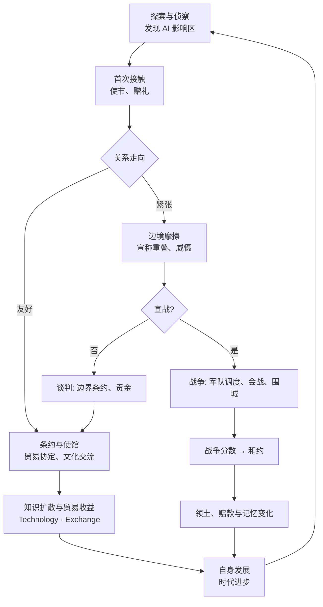

# 23 · 列国 Nations（`tcnations`）

> 文档版本：DD-0.2 · 模组 ID `tcnations` · Java 包 `com.nightcity.nations`（入口类 `TNations`，事件类 `TNationsEvents`，调试指令 `/tcnations status`）
> 必需依赖：`tcivilization`、`tctechnology`。可选联动：其余全部模组（桥接类位于 `com.nightcity.nations.compat.<other>`）。
> 本章遵循 README §5.3 的 18 节模板；末尾附机器可读附录 A-D（格式见写作简报 §3）。
> 相关章节：01（时代与追赶机制）、02（区域层 `tcnations:influence`、L3 模拟、性能预算）、03（`Civilization` 记录、`SoldierComponent`）、04（AI 科技状态存储、扩散）、15（聚落规则）、16（货币与贸易）、18（世界历史）、19（领地与投票）、20（武器与 `CombatApi`）、22（地图）、31（文明面板“外交”页签）。

---

## 1. 定位与设计支柱

### 1.1 定位

列国 Nations 让玩家文明“不再孤独”：世界上同时存在若干由程序驱动的 AI 文明。它们从世界历史中诞生，占据领土、增长人口、研究科技、修路贸易、结盟或交战，并且记得玩家做过什么。玩家通过礼物、使节、使馆、条约、贸易协定与战争与它们打交道。本模组只负责“文明之间”的宏观层；文明内部的具体内容（聚落、货币、武器、法律）由各自的模组按同一套规则模拟。

| 本模组拥有 | 不拥有（归属） |
| --- | --- |
| AI 文明的播种（从 Echoes 世界历史或回退生成器创建）与生命周期（建国、分裂、衰亡） | `Civilization` 记录本身（核心，Nations 通过 `CivilizationApi.createAiCivilization` 创建） |
| AI 文明的 L3 宏观模拟：领土、人口、经济、科技等级、文化、政体、性格与议程 | 聚落内部的人口结构、岗位与建造（Settlements；AI 聚落同样由其规则模拟） |
| 效用型决策 AI（扩张、研究、贸易、外交、战争） | 科技树与科技状态存储（tctechnology；Nations 只决定 AI 研究什么） |
| 外交：关系值、信任、条约、使节、使馆、文化交流、贸易协定框架 | 货币、价格、汇率与贸易执行（Exchange） |
| 战争宏观规则：宣战理由、战争分数、和约、军队调度、围城编排 | 武器、护甲、工事功能方块、攻城器械与战斗结算 `CombatApi`（Frontiers） |
| 区域层 `tcnations:influence`；人物组件 `SoldierComponent`、`EnvoyComponent`、`LeaderComponent` | 土地权限、法律与玩家间投票（Commons） |
| AI 聚落与军队在玩家附近的实体化编排 | 世界历史与遗迹（Echoes）；地图绘制（Atlas）；道路与航线本体（Networks） |

### 1.2 设计支柱

| 编号 | 支柱 | 含义 |
| --- | --- | --- |
| NP-1 | 活的邻居 | AI 文明遵守与玩家相同的规则：同一棵科技树、同一种聚落规则、同一种货币系统。它们的扩张与发展在地图与世界中可见（DR-20）：使节真的骑马走来，商队真的沿路而行。 |
| NP-2 | 可读的意图 | 每个 AI 决策都附带“理由”：外交页签显示效用最高的 3 个因素（例如“边境压力 +18、对你的恐惧 +12、林地被砍伐 −9”）。玩家可以推理并改变 AI 的行为。 |
| NP-3 | 节奏保护 | AI 文明是挑战与机会，不是压路机。呼吸半径、扩张上限、开战门槛与难度预设保证单人玩家不会被淹没（5.12）。 |
| NP-4 | 后果可逆 | 战争不能消灭玩家文明；“占领”是统计性的，可以通过和约、赎回或收复撤销（设计支柱 7、02 §4.2）。 |
| NP-5 | 外交是玩法 | 礼物、使节印信、条约卷轴、使馆、边界石都是物品、方块或 NPC；外交页签只是“文书柜”，执行需要在世界中完成。 |

### 1.3 与 DR 的一致性检查

| DR / 规则 | 本模组的落实 |
| --- | --- |
| DR-02 一个玩家文明 | 所有玩家同属 `PLAYER_CIV_ID`；AI 文明不能由玩家加入或扮演；多人的外交决定通过投票或 Commons 权限产生（5.13） |
| DR-17 不用原版村民 | AI 文明的居民、使节、士兵全部是 `tcivilization:person`；原版村庄、掠夺者巡逻队不生成 |
| DR-19 无个人生存 | 外交与战争不引入玩家个人需求；行军补给只由 NPC 军队统计消耗 |
| DR-20 可见过程 | 使节、商队、军队在玩家附近实体化并沿真实道路移动；条约需要在条约台上用印 |
| DR-22 AI 文明 | AI 文明会扩张、研究科技、贸易与外交；战争以边境冲突与围城为主，不做全面歼灭战 |
| DR-23 各文明货币 | 每个 AI 文明在 Exchange 存在时拥有自己的货币与汇率；贡金与赔款以 `VU` 记账 |
| DR-24 科技共享与传播 | AI 文明与玩家的接触、贸易、使馆与文化交流产生知识扩散（04 章的扩散压力） |
| DR-25 技能中等 | `diplomacy`、`leadership`、`combat` 等熟练度只提供效率与特殊选项，不阻挡任何外交行动 |
| DR-30 性能 | 远离玩家的 AI 文明只在 L3 每日聚合模拟；实体士兵总数受预算限制（14） |
| 02 §4.2 抽象一致性 | 抽象层的战争不烧毁玩家建筑、不杀死已命名 NPC，只造成可恢复的统计损失 |
| 设计支柱 7 后果可逆 | 被占领的地区可以通过和约归还、赎买或收复；AI 不能消灭玩家文明 |

---

## 2. 独立玩法（只安装 `tcivilization` + `tctechnology` + `tcnations`）

独立模式下，Nations 仍是完整的“邻国”系统，只是缺少其他模组提供的细节：

1. **播种**：没有 Echoes 时，使用回退生成器（5.1.2）在可居住陆地上放置 `ai_civ_count`（默认 8）个 AI 文明，并赋予随机性格、议程与初始时代（不超过玩家时代 +1）。
2. **AI 聚落**：没有 Settlements 时，AI 聚落是 Nations 自带的结构模板（`ai_camp` 至 `ai_metropolis`），只有静态建筑与少量巡游的 `tcivilization:person` 居民；人口只作为统计值。
3. **首次接触**：玩家走入 AI 影响区、或 AI 使节抵达玩家聚落时触发。之后该文明出现在文明面板“文明 › 外交”页签中。
4. **外交**：赠礼（`gift_bundle`）、派遣/接待使节（`envoy_seal`）、签订条约（`treaty_scroll` + `treaty_lectern`）、建立使馆（`embassy_desk`）。条约类型全部可用；“贸易协定”在没有 Exchange 时改为每 12 MC 日一次的“互赠物资包”（按双方经济类别生成原版物品）。
5. **战争**：宣战、战争分数、和约全部可用。没有 Frontiers 时，士兵使用原版武器（木/石/铁剑、弓、弩、盾），实体战斗使用原版伤害；未实体化的战斗使用本模组的回退兰彻斯特公式（5.9.2）；围城只做“围困补给”和“攻门”两步，攻门目标为 AI 指定的门方块（原版门、栅栏门），破坏后在和约中自动恢复。
6. **投票**：没有 Commons 时，宣战与媾和需要在线玩家多数同意（5.13）。

独立模式下禁用的内容：AI 货币与汇率（无 Exchange）、AI 聚落的岗位与建造（无 Settlements）、从世界历史继承的文明名称与宿怨（无 Echoes）、工事与攻城器械（无 Frontiers）、国界的地图图层（无 Atlas 时只在 HUD 进入国境提示与外交页签的地图片段中显示）。

---

## 3. 联动玩法

每条联动都是“有则启用、无则隐藏”的软依赖（02 章 `ModList` 检查 + 可选 API）。

| 对方模组 | 联动内容 |
| --- | --- |
| `tcivilization`（必需） | 通过 `CivilizationApi.createAiCivilization` 创建 AI `Civilization`；人物组件 `SoldierComponent`、`EnvoyComponent`、`LeaderComponent`；区域层 `tcnations:influence`；文明面板页签 `tcnations:diplomacy`（CIV 组，order 300）及其概览卡；`TcNotifications` 外交通知；`AlertProvider` 战争与边境警报；文明记忆记录条约、背约与战争（AI 据此“记住”玩家）；指令轮盘（Z）“外交”条目 |
| `tctechnology`（必需） | 存储每个 AI 文明的科技状态；Nations 决定 AI 的研究顺序与速度（5.5）；接触、贸易、使馆与文化交流产生扩散压力；本模组 8 项外交/军事科技（附录 B） |
| `tcechoes` | 从世界历史 `history.bin` 的终态播种 AI 文明（名称、文化、宿怨、圣地、遗迹归属）；AI 文明之间的战争、衰亡写回世界历史，生成新遗迹与传说；玩家的条约与战争进入编年史 |
| `tccommons` | AI 领土与玩家领地的边界协商（边界条约生成 Commons 领地边界）；宣战、媾和、签约的权限节点与投票；外交政策（关税、开放边境、难民接收）由 Commons 法律定义 |
| `tcfrontiers` | 军队装备 Frontiers 武器、护甲与攻城器械；未实体化的战斗调用 `CombatApi.resolveAbstractBattle`；边境冲突提高地区危险度；战争产生逃兵 → 盗匪池；AI 前沿堡垒使用 Frontiers 工事方块 |
| `tcexchange` | 每个 AI 文明拥有货币、价格与汇率；贸易协定降低关税、开放市场；贡金、赔款、赎金以 `VU` 记账并以货币支付；禁运与制裁；AI 商队 |
| `tcsettlements` | AI 聚落使用与玩家相同的聚落规则（L3 只做聚合）；兵源按 AI 人口结构计算；移民与难民在文明之间流动；占领期间聚落满意度下降 |
| `tcnetworks` | 军队与使节沿 Networks 道路、铁路与航线移动（速度见 6.5）；过境条约控制跨境线路；战争可破坏桥梁与轨道（可修复）；AI 抽象修路在接近玩家时实体化 |
| `tcatlas` | 国界与影响力图层、AI 首都与聚落标记、战线与军队位置（需侦察）；AI 文明拥有自己的地图库（持有者类型 `AI_CIV`），可通过使馆交换或战利品获得 |
| `tcwildlands` | 可居住度、河流、海岸与山脉决定 AI 扩张方向与天然边界；灾害削弱 AI 的人口与粮食（读取 `DisasterEndedEvent` 的统计结果） |
| `tcecology` | AI 文明按人口消耗种群账本（狩猎/伐木压力）；“林地守护者”等议程关注玩家的砍伐与狩猎；跨境迁徙物种保护可写入条约 |
| `tccultivation` | AI 粮食产量按其农业科技与土地计算；粮食援助是一种外交礼物；饥荒提高 AI 的扩张与掠夺倾向 |
| `tcindustry` | AI 工业等级影响军队装备质量；“工业目标”可以成为战争目标（由 Nations 决策、Frontiers 执行）；战略资源（煤、石油、铀）争夺成为 E6+ 的宣战理由 |
| `tcdiscovery` | 与 AI 学者交流、阅读 AI 典籍产生知识；外交与战争事件写入日志；文化交流条约提高知识共享 |
| `tcorbit` | E9+ AI 文明进行抽象航天竞赛（5.12.4）；“太空合作”条约共享发射场与轨道资产；侦察卫星提供 AI 军队与边境情报 |
| `tcskills` | `diplomacy`、`leadership`、`combat`、`trade`、`exploration`、`logistics` 获得熟练度并提供中等加成（第 15 节） |
| `tcbeyond` | 异界影响区不可被任何文明宣称；共同应对异界渗透可以带来关系加成（“共同威胁”修正） |

---

## 4. 核心玩法循环



### 4.1 三个尺度的循环

| 尺度 | 周期 | 玩家行为 | 反馈 |
| --- | --- | --- | --- |
| 微观 | 数分钟 | 接待使节、赠礼、在条约台用印、视察边界石、指挥一队士兵守门 | 使节对话、关系值变化文字与图标、战斗结果 |
| 中观 | 数个 MC 日 | 谈判条约、建立使馆、组织贸易、侦察边境、动员与调度军队、攻守一座城 | 条约生效、贸易收益、战争分数曲线、围城进度 |
| 宏观 | 一个或数个时代 | 选择盟友与对手、塑造地区秩序、建立集体安全体系、参与航天竞赛 | 世界格局（国界地图）、编年史、AI 文明兴衰 |

### 4.2 各时代的外交动词

| 时代 | 外交与军事主题 | 新动词 | 本模组内容 |
| --- | --- | --- | --- |
| E0 `stone` | 偶遇的游团 | 观察、回避 | 首次接触只能远观；AI 不宣战 |
| E1 `neolithic` | 部落与礼物 | 赠礼、交换 | `gift_exchange` 科技、`gift_bundle`、赠礼关系修正；AI 不对玩家宣战。`gift_exchange`（赠礼外交，本模组）与 16 的 `neolithic/barter`（物物交换）互不为前置 |
| E2 `bronze` | 城邦与使节 | 派遣使节、立约 | `envoys`、`envoy_seal`、`treaty_scroll`；边境冲突开始（最多 1 场） |
| E3 `iron` | 王国与军队 | 动员、行军、攻城 | `military_command`、`war_table`、`regiment_banner`；围城 |
| E4 `medieval` | 封建与常驻使馆 | 建立使馆、联姻式同盟 | `resident_embassies`、`embassy_desk`、使馆院落结构 |
| E5 `renaissance` | 万国法与殖民 | 国际仲裁、殖民宣称 | `law_of_nations`；战争礼法（宣战需理由，违者信誉下降） |
| E6 `industrial` | 民族国家与铁路动员 | 总动员、铁路调兵 | `general_staff`；铁路使军队速度大幅提高；资源战争 |
| E7 `electric` | 集体安全与电报外交 | 即时外交、集体防御 | `collective_security`；电报 + 使馆使外交消息即时到达 |
| E8 `atomic` | 多边机构 | 召开国际会议、制裁 | `multilateral_institutions`；地区组织与多边条约 |
| E9 `information` | 全球化 | 全球贸易网、情报 | 侦察卫星情报（需 Orbit）；AI 航天竞赛开始 |
| E10 `space` | 太空时代的秩序 | 太空合作 | “太空合作”条约；与 AI 共建轨道站模块（需 Orbit） |

---

## 5. 系统规则与公式

### 5.1 播种（Seeding）

AI 文明在世界首次加载、Wildlands 星球模型生成之后（若存在），由 `NationSeeder` 在 `TCSimulationExecutor` 上一次性生成，结果写入 `<world>/tc/nations/civs.dat`。播种是确定性的：种子为 `worldSeed ^ 0x4E4154494F4E53`（"NATIONS"）。

**触发时机**（一次性，`civs.dat` 已存在时一律跳过）：

| 条件 | 触发 | 说明 |
| --- | --- | --- |
| 安装 Echoes | 监听核心事件 `WorldHistoryReadyEvent`（03 §12.3，类在 `api.history`），`freshlyGenerated = true` 时按 5.1.1 播种 | `freshlyGenerated = false`（读档）时不播种；若读档时 `civs.dat` 缺失（例如中途加装 Nations），改用 `TcHistory.view()` 的当前终态播种一次并记录 `INFO` |
| 未安装 Echoes | `ServerStartedEvent` 中，`TcWorldApis.planet()` 就绪后（Wildlands 缺失时立即）按 5.1.2 播种 | 与 Echoes 无关的世界也能得到 AI 文明 |

播种完成前玩家已可加入时（Echoes 缺失的回退路径），外交页签显示“诸国尚未成形”，不发布任何关系事件。

#### 5.1.1 从世界历史播种（安装 Echoes）

1. 读取 `TcHistory.view()`（Echoes `history.bin`）的终态：所有“存续”政体按终态人口降序排列，取前 `ai_civ_count` 个，转换为 AI 文明。
2. 继承字段：名称、文化、首都地区、圣地、终态时代（截断为 `min(历史时代, 玩家起始时代 + start_era_lead_max)`）、相互之间的宿怨与盟约（转换为初始关系修正“世仇”“旧盟”）。
3. 已灭亡政体不成为 AI 文明，而是留给 Echoes 生成遗迹；若某遗迹位于 AI 文明领土内，该文明对其有“祖地”宣称。
4. 若存续政体少于 `ai_civ_count`，不足部分由回退生成器补齐。

#### 5.1.2 回退生成器（无 Echoes）

```text
候选地区 r：所有陆地地区（512×512 格）
可居住度 H(r) ∈ [0,1]
  有 Wildlands：H = 0.35·温度适宜 + 0.25·降水适宜 + 0.2·河流/湖泊 + 0.1·海岸 + 0.1·土壤肥力
  无 Wildlands：在地区内按 8×8 网格采样生物群系，H = Σ 群系权重 / 64
               （平原/森林/草原/河流 1.0，针叶林/热带草原 0.7，丛林/沼泽 0.5，沙漠/冻原/山地 0.2，海洋 0）
首都放置：Poisson-disk 采样，接受概率 ∝ H(r)²
  首都之间最短距离 d_min = capital_min_spacing（默认 6,000 格）
  与世界出生点距离 ≥ spawn_exclusion_radius（默认 2,500 格）
保证邻居：第一个首都必须落在出生点 2,500-4,000 格的环带内，且性格 aggression ≤ 35（“和平邻居”）
初始时代：E0 起步的世界中，AI 初始时代 = E0 或 E1（概率 70% / 30%）
```

播种完成后，每个 AI 文明获得 1 个首都聚落（`ai_camp` 或 `ai_village` 等级）、初始人口 `P0 = 40 + 120·H(capital)`、随机性格（5.6）与 1 个议程。

### 5.2 领土与影响力

影响力是每个文明对每个地区的“控制强度”，存放在区域层 `tcnations:influence`（每地区保存影响力最高的 3 个文明及数值，0-1000）。

```text
单个聚落 s 对地区 r 的影响力：
  I_s(r) = min(1000, 40 · sqrt(P_s) · T(era) · C(culture) · exp(−d(s,r) / λ))
  d(s,r) = 沿地形代价的旅行距离（格），由 TCPathExecutor 在地区图上计算，每 12 MC 日缓存一次
  λ      = 1,500 · R(road)，R = 1.0（无路）/ 1.3（土路）/ 1.6（铺装路）/ 2.0（铁路，E6+）
  T(era) = 1 + 0.12 · era_index      C(culture) = 1 + 0.05 · 文化特质“扩张型”层数
文明影响力 I_c(r) = min(1000, Σ_s I_s(r))
地区归属：I_top ≥ 200 且 I_top − I_second ≥ 50 → 归 top 文明；否则为“争议地区”
```

规则：

1. **玩家文明**的影响力由玩家聚落按同一公式计算（聚落人口来自 Settlements；无 Settlements 时以“聚落核心方块”周边 64 格内的床数 ×2 估算）。
2. **Commons 领地优先**：被 Commons 宣称的地区在国界计算中固定归玩家文明，AI 影响力只能使其显示为“受压”，不能夺走。只有和约中的“割让”能改变。
3. **天然边界**：跨越大河、海峡、山脊（Wildlands 标记）时 `d` 额外 +800 格。
4. **宣称**：AI 对地区的宣称来自（a）影响力 ≥ 150 但未归属，（b）Echoes 祖地，（c）条约。宣称与归属重叠时产生“宣称冲突”，是宣战理由之一。
5. 归属变化发布 `NationsBorderChangedEvent`，Atlas 刷新国界图层。

### 5.3 人口与经济

AI 文明的人口与经济只在 L3（每 MC 日一次）聚合计算；玩家附近 L1/L2 的 AI 聚落由 Settlements 规则逐个模拟，结果回写到聚合值中。

```text
人口（逻辑斯蒂，每 MC 日）：
  P' = P + r · P · (1 − P / K) − 战争损失 − 灾害损失 + 移民净值
  r  = 0.004 · F_food · F_stab          （F_food = min(1.2, 粮食/需求)，F_stab = 0.5 + 稳定度/200）
  K  = Σ_{r∈领土} H(r) · K_era           （K_era：E0 60 → E10 9,000，见 6.2）
聚落数 n_s = clamp(round(P / 聚落人口中位数(era)), 1, 当期上限)  // 上限见 5.12
经济（8 个类别，单位 VU/日）：
  产出_k = P · 劳动参与率 0.45 · 生产率_k(era, 科技) · 资源丰度_k(领土)
  类别 k ∈ {粮食, 木材, 石料, 金属, 纺织, 燃料/能源, 制成品, 奢侈品}
  库存_k 上限 = 30 日产出；盈余 > 20% → 贸易出口意愿；缺口 > 20% → 进口或扩张意愿
国力 Power = 0.4·军力 + 0.3·经济总产出^0.8 + 0.2·人口^0.7 + 0.1·科技数
```

国力只用于 AI 决策与 UI 档位显示（“弱小 / 相当 / 强大 / 压倒性”），不直接参与战斗结算。

### 5.4 科技与追赶

AI 文明的科技状态由 tctechnology 存储；Nations 决定研究速度与方向。

```text
每 MC 日 AI 获得研究点：
  RP_ai = 6 · P^0.6 · S_sci · rp_mult · D_diff
  S_sci   = 0.7 + personality.science / 100 · 0.6       （0.7-1.3）
  rp_mult = 1 / (1 + 0.5 · max(0, era_ai − era_player)) （领先越多越慢：橡皮筋）
  D_diff  = 难度系数（沙盒 0.8、标准 1.0、历史 1.0、自定义 0.5-1.5）
硬上限：era_ai ≤ era_player + ai_max_era_lead（默认 2）；达到上限后 RP_ai 改为积累“储备”，不越级
研究选择：对所有可研究科技计算 w = 基础 1 + 性格偏好（军事/商业/科学/扩张）+ 已拥有前置数，按 w 加权随机
```

玩家的追赶收益遵循 01 §5.1：每接触 1 个已掌握该科技的文明，该科技 RP −10%（上限 −40%）；落后 2 个时代及以上额外 −15%。Nations 向 tctechnology 报告“已接触文明集合”。条约中的“研究交流”和“文化交流”额外提高扩散压力（6.4）。

### 5.5 文化与政体

| 政体 `Government` | 可用时代 | 决策修正 |
| --- | --- | --- |
| `TRIBE` 部落 | E0-E2 | 战争疲劳上限低，结盟意愿 −10 |
| `CHIEFDOM` 酋邦 | E1-E3 | 贡金接受度 +15 |
| `CITY_STATE` 城邦 | E2-E5 | 贸易协定效用 +20，扩张效用 −15 |
| `MONARCHY` 君主制 | E3-E6 | 首领性格权重 ×1.5（个人恩怨更重要） |
| `FEUDAL` 封建制 | E4-E5 | 动员慢 ×0.7，但守城士气 +10 |
| `MERCHANT_REPUBLIC` 商人共和国 | E4-E7 | 贸易效用 +30，宣战需要内部“议会”通过（概率 60%） |
| `EMPIRE` 帝国 | E5-E8 | 扩张效用 +20，被征服地区稳定度 −10 |
| `CONSTITUTIONAL` 宪政国家 | E6-E10 | 背约惩罚 ×1.5，战争疲劳增长 ×1.3 |
| `FEDERATION` 联邦 | E8-E10 | 多边条约效用 +25 |

政体在时代切换时按性格重新抽取（每个文明保留与上一政体相邻的概率 60%）。文化特质从 16 种中选 2-3 种（例如“航海”“山地”“商贸”“尚武”“好学”“虔信”“林地”“游牧”），影响影响力、偏好与议程。

### 5.6 性格与议程

每个 AI 文明有 6 个性格轴（0-100），由播种时的文化与历史决定，之后每个时代切换时随机游走 ±10：

| 轴 | 低值含义 | 高值含义 |
| --- | --- | --- |
| `aggression` 侵略 | 避战 | 好战、频繁边境挑衅 |
| `expansion` 扩张 | 固守 | 快速建立新聚落 |
| `commerce` 商业 | 自给自足 | 积极签订贸易协定 |
| `science` 学术 | 保守 | 研究快、乐于研究交流 |
| `honor` 守信 | 机会主义 | 遵守条约、厌恶背约者 |
| `xenophilia` 亲外 | 排外 | 欢迎使馆、文化交流与移民 |

议程（Agenda）是 AI 对玩家行为的“价值观”。每个文明 1 个主议程（播种时决定）+ E5 起 1 个隐藏议程（需要使馆或 `diplomacy` 熟练度 ≥ 300 才能看到）。议程每 12 MC 日评估一次玩家文明，产生 −15 至 +15 的关系修正（完整列表见 6.3）。

### 5.7 决策 AI

每个 AI 文明在 L3 每 MC 日执行一次决策；N 个文明错开在不同 tick 槽：`slot(i) = i · 24000 / N`，避免同一 tick 峰值。

```text
可选行动 a ∈ A：
  EXPAND(地区)  BUILD_ROAD(路段)  RESEARCH_FOCUS(方向)  TRADE_PROPOSE(对象)
  TREATY_PROPOSE(对象, 类型)  GIFT(对象)  SEND_ENVOY(对象)  DEMAND(对象, 要求)
  MOBILIZE  DEMOBILIZE  DECLARE_WAR(对象, 理由)  OFFER_PEACE(对象, 条款)
  ARMY_ORDER(军队, 目标)  SPACE_LAUNCH（E9+，需 Orbit）  IDLE
效用：
  U(a) = Σ_i w_i(personality, agenda, government) · f_i(state, a) − cost(a) + ε
  f_i 为 0-1 归一化特征：边境压力、资源缺口、相对国力、关系值、信任、恐惧、战争疲劳、
      条约冲突、宣称数、贸易盈余、对方弱点（被围、疲劳）、节奏约束（5.12）
  cost(a) = 资源成本/日产出 + 信誉成本 + 机会成本
选择：
  对通过合法性检查的行动按 softmax 抽样：P(a) = exp(U(a)/τ) / Σ exp(U(b)/τ)
  τ = 0.15（标准）；“历史”难度 0.10（更理性）；沙盒 0.25
  每日最多执行：1 个外交提案 + 1 个扩张/建设 + 1 个军事命令；IDLE 永远合法
记录：每次决策保存前 3 个贡献最大的 w_i·f_i 项，作为外交页签中的“理由”（NP-2）
```

宣战行动的效用示例（标准难度）：

```text
U(DECLARE_WAR, 对象 t) =
    0.35·aggression/100 · 边境压力(t)
  + 0.25 · 宣称冲突数(t)/3
  + 0.20 · clamp((Power_self/Power_t − 1), 0, 1)
  + 0.15 · (−opinion_t / 100)⁺
  + 0.10 · 资源缺口
  − 0.40 · honor/100 · [与 t 有有效条约]
  − 0.30 · 战争疲劳/100
  − 0.25 · fear_t/100
  − 0.20 · min(1, tradeDependency(self, t))   （Exchange 在场时取 `ExchangeApi.tradeDependency`，16 §12.1；缺失时 0）
  − 节奏惩罚（5.12；对玩家宣战时）
合法性：需要有效宣战理由（5.10.1）；E5（万国法）之后无理由宣战改为“侵略”，信誉 −30
```

### 5.8 关系与外交行动

#### 5.8.1 关系三值

每对文明（包括 AI ↔ 玩家、AI ↔ AI）保存 3 个值：

```text
好感 opinion ∈ [−100, +100] = clamp(Σ 修正 m_j)，每个修正带半衰期 h_j（MC 日）：
    m_j(t) = m_j(0) · 0.5^(Δt / h_j)；|m_j| < 0.5 时删除；永久修正 h = ∞
信任 trust ∈ [0, 100]：初值 50；每守约满 12 MC 日 +2（每个条约，上限 +10/12 日）；
    背约 −25；在互不侵犯期内突然宣战 −40；按时支付贡金/赔款 +3；拖欠 −10
    Exchange 存在时，trust 作为该文明对玩家文明的“主权信用”输入（贷款利率由 Exchange 计算）
恐惧 fear ∈ [0, 100] = clamp(50 · (Power_other / Power_self − 1) + 10 · 近 48 日内被对方击败次数, 0, 100)
```

好感档位（UI 一律“文字 + 图标”，不只用颜色）：

| 档位 | 范围 | 图标 | 典型行为 |
| --- | --- | --- | --- |
| 敌对 Hostile | ≤ −60 | ▼▼ | 拒绝一切条约；可能宣战；驱逐使节 |
| 冷淡 Cold | −59 至 −20 | ▼ | 只接受互不侵犯与边界条约 |
| 中立 Neutral | −19 至 +19 | ● | 接受贸易与开放边境 |
| 友好 Friendly | +20 至 +59 | ▲ | 接受研究交流、防御同盟 |
| 亲密 Close | ≥ +60 | ▲▲ | 接受全面同盟；主动赠礼与援助 |

#### 5.8.2 使节与消息传递

外交提案是实物“国书”，需要被送达（DR-20、NP-5）：

1. 在外交页签起草提案 → 在条约台 `treaty_lectern` 生成 `treaty_scroll`（草案）→ 交给使节送达。
2. **使节**：给一名己方 `tcivilization:person` 授予 `envoy_seal`，其获得 `EnvoyComponent` 并自主沿道路前往对方首都或使馆；也可以由玩家亲自携带国书前往（“亲自出使”，接受度 +5）。
3. 没有可用 NPC 时可雇佣“驿使”：支付 `courier_cost_vu`（默认 20 VU 或等价物资），抽象送达。
4. 送达时间：`t = d / v`，`v` 取沿途最快交通方式（6.5）。答复以同样方式返回。
5. 消息加速：拥有对方首都内的使馆时，时间 ×0.5（常驻大使就地谈判，只需传回批准）；掌握 `electric/telegraphy` 且双方均有使馆并通电报线时，消息即时到达；`atomic/multilateral_institutions` 后，多边会议允许一次与多个文明同时谈判。
6. AI 的使节以同样方式来访：抵达玩家聚落后在 `embassy_desk` 或聚落核心旁等待，最多等 3 MC 日；玩家与之对话（右键）即可查看提案。超时后视为“冷遇”，好感 −5。

#### 5.8.3 提案的接受

```text
A(提案) = U_ai(条款) + 0.4·opinion + 0.3·(trust − 50) + 0.2·fear·[条款有助于避战]
        + 礼物加成 + 熟练度加成（第 15 节）+ 亲自出使 5 − 门槛(类型)
U_ai(条款)：AI 用 5.7 的同一套特征评价条款对自己的价值（−50..+50）
礼物加成 = min(25, 10 · log10(1 + 礼物 VU / AI 日均产出 VU))，同一文明每 12 MC 日只计算一次
A ≥ 0            → 接受
−15 ≤ A < 0      → 还价：AI 修改 1 个条款（要求额外贡金、缩短期限或减少割让）后返回
A < −15          → 拒绝，并给出前 2 个理由
```

#### 5.8.4 使馆与文化交流

1. **使馆**（需要 `medieval/resident_embassies`）：签订“互设使馆”条约后，对方在首都划出 9×9 地块（结构 `embassy_compound`）；玩家在其中放置 `embassy_desk` 并派驻 1 名 NPC 大使。
2. 使馆效果：可见对方隐藏议程、军队总数与位置（精度 ±20%）、科技时代与在研方向；消息时间 ×0.5；每 12 MC 日好感 +1（上限 +10）；知识扩散压力 +1 档。
3. **文化交流**（条约）：双方每 12 MC 日交换 1 名学者或工匠 NPC（短期驻留），玩家获得对方文化的知识点（Discovery）与 1 档扩散压力；对“排外”文明（xenophilia < 30）效果减半。

### 5.9 军队与战斗

#### 5.9.1 军队记录与调度

军队是 `ArmyRecord`：抽象地存在于地区图上，只有接近玩家时才实体化。

```text
兵源上限 = P · m(era)
  m(era)：E2 3%、E3 4%、E4 5%、E5 6%、E6 10%、E7 12%、E8 10%、E9 6%、E10 5%
动员成本：经济产出 × (1 − 1.5 · 动员比例)；动员耗时 = 3 MC 日（E6 起 `general_staff` 为 1 MC 日）
团（Regiment）：同一兵种、同一装备等级的 50-500 人；军队由 1-12 个团组成
移动：沿地区图最短时间路径（TCPathExecutor），速度见 6.5；可通过过境条约穿越第三方领土
补给：每名士兵每 MC 日消耗 1 份抽象口粮；距己方领土 ≤ 3 个地区时视为有补给
  无补给：士气 −10/日，减员 2%/日（统计值），并使所在地区经济 −15%（就地征粮）
士气 morale ∈ [0, 100]：初值 70；胜利 +15、失败 −25、无补给 −10/日、主帅在场 +10
```

玩家的军队同样是 `ArmyRecord`：在 `war_table` 上把己方民兵（Frontiers `MilitiaComponent` 或 Settlements 岗位）编为团并下达命令（6.6）。玩家可以亲自随军，此时军队一直保持实体化。

#### 5.9.2 抽象战斗结算

两支敌对军队位于同一地区（或攻击方进入守方所在地区）时触发会战。

1. 安装 Frontiers：Nations 由两支军队构造 `BattleInput`（团、兵种、装备等级、士气、补给、地形、工事等级），调用 `CombatApi.resolveAbstractBattle(input)`，按返回的 `BattleOutcome` 回写伤亡与士气。签名以 20 章为准。
2. 未安装 Frontiers：使用本模组的回退公式（兰彻斯特平方律 + 崩溃阈值）。

```text
单位战斗力 q = Q · M · S · T · F · ε
  Q = 1 + 0.3 · 装备等级（按时代 0-10）
  M = 0.5 + morale / 200
  S = 1.0（有补给）/ 0.7（无补给）
  T = 地形（仅守方）：平原 1.0、森林 1.15、丘陵 1.25、山地 1.4；攻方渡河 ×0.8
  F = 工事（仅守方）：无 1.0、木栅 1.3、石墙 1.8、棱堡 2.2、野战工事 1.6
  ε ~ LogNormal(0, 0.1)
总战力 Φ = q · N²（兰彻斯特平方律）；Φ 较大者获胜
败方崩溃比例 b = 0.25 + (100 − morale_loser) / 500         （0.25-0.45）
败方损失 ΔN_L = b · N_L
胜方损失 ΔN_W = ΔN_L · (q_L · N_L) / (q_W · N_W)
损失构成：60% 伤员（6 MC 日后回到人口）、30% 阵亡（统计人口）、10% 被俘（和约中交换）
```

示例：攻方 1,000 人（q = 1.2），守方 600 人守石墙（q = 1.0 × 1.8 = 1.8）。Φ_攻 = 1.2 × 10⁶，Φ_守 = 0.648 × 10⁶，攻方胜。守方士气 50 → b = 0.35，损失 210；攻方损失 210 × (1.8×600)/(1.2×1000) = 189。

已命名 NPC 在抽象战斗中永不阵亡（02 §4.2）：只会“负伤”或“被俘”，在和约或交换后返回。

#### 5.9.3 实体化

```text
触发：任一玩家与军队位置的距离 ≤ embody_radius（默认 128 格）且该处区块已加载
实体数：每支军队最多 max_embodied_per_army（默认 40）名 tcivilization:person 士兵（SoldierComponent）
  其余为“预备队”：实体士兵倒下时，每 10 秒从军队行进方向的边缘补入 1 名，直到达到崩溃比例
全局上限：max_embodied_soldiers（默认 120，计入 DR-30 的 500 名 NPC 预算）
回写：实体战斗中每倒下 1 名无名士兵 = 统计损失 1 人；已命名 NPC 按 Frontiers 的重伤规则处理
去实体化：所有玩家离开 embody_radius + 32 格并持续 30 秒，或战斗结束；剩余士兵回到抽象记录
```

实体士兵使用 Frontiers 武器（无 Frontiers 时为原版武器），装备等级 = AI 文明的军事科技时代；外观使用该文明的文化服饰与 `regiment_banner` 旗手。

### 5.10 战争规则

#### 5.10.1 宣战理由（Casus Belli）

| 理由 ID | 名称 | 条件 | 最早时代 | 战争目标上限 | 信誉成本 |
| --- | --- | --- | --- | --- | --- |
| `border_dispute` | 边境争端 | 与目标存在 ≥ 1 个宣称冲突地区 | E2 | 割让争议地区 | 0 |
| `treaty_breach` | 背约 | 目标在 48 MC 日内违反了与本方的条约 | E2 | 任意（≤ 战争分数） | 0 |
| `raid_retaliation` | 报复袭扰 | 目标军队在 24 MC 日内袭扰本方领土 | E2 | 赔款、非军事区 | 0 |
| `ally_defense` | 援助盟友 | 盟友遭到攻击（同盟条约） | E2 | 盟友的战争目标 | 0（拒绝履约：信任 −30） |
| `ancestral_claim` | 祖地 | Echoes 祖地宣称（需 Echoes） | E3 | 割让祖地地区 | 信任 −5 |
| `liberation` | 解放 | 目标占领了第三方或本方原有地区 | E5 | 释放聚落、归还地区 | 0 |
| `resource_war` | 资源战争 | 战略资源缺口 > 30% 且目标控制产地 | E6 | 割让资源地区 | 信任 −10 |
| `aggression` | 无端侵略 | 无理由 | E0 | 任意 | E5 前信任 −10；E5（万国法）后信任 −30，且所有已知文明好感 −20 |

宣战本身是实物仪式：玩家在 `war_table` 上签署宣战书（`TcConfirmDialog` 输入对方名称确认），发布 `NationsWarDeclaredEvent`，全服 `critical` 通知并播放 `tcnations:event.war_declared`。

#### 5.10.2 战争分数

每场战争记录双方的累计分数 `s_A`、`s_B`（各 0-100），净分数 `W = s_A − s_B ∈ [−100, 100]`。

| 事件 | 分数 | 上限 |
| --- | --- | --- |
| 会战胜利 | `2 + 10 · (敌方损失 / 敌方参战总兵力)` | 每场 12 |
| 围城成功（占领聚落） | 营地 4、村庄 8、城镇 12、城市 16、首都 20 | — |
| 占领地区 | 每地区每 MC 日 +0.2 | 合计 40 |
| 封锁（切断对方贸易线或港口，需 Networks/Exchange） | 每 MC 日 +0.1 | 合计 10 |
| 战争目标地区持有满 12 MC 日 | +10 | 一次 |
| 拒绝对方的白和平提议 | 对方 +2 | 每次 |

#### 5.10.3 战争疲劳

```text
每 MC 日：exhaustion += 0.5 + 100 · (当日伤亡 / 动员总数) + 1.0 · 被占本方地区数
和平时：exhaustion −= 2 / MC 日
效果：AI 接受和约的门槛降低 exhaustion/2；exhaustion ≥ 100 时 AI 必须提出白和平
玩家文明：exhaustion ≥ 50 时聚落满意度 −10（Settlements）、产出 −10%；≥ 80 时 −20 / −20%
```

#### 5.10.4 和约

和约条款按“分数成本”计价；提出方的净分数 W 必须 ≥ 条款总成本（AI 另加 `exhaustion/2` 的让步）。

| 条款 | 成本 | 说明 |
| --- | --- | --- |
| 白和平 | 0 | 恢复战前状态，被占地区与俘虏全部归还 |
| 割让地区 | 每地区 10（含首都地区 ×2） | **玩家文明的聚落核心所在地区不能被割让**（只能割让无聚落的宣称地区） |
| 割让聚落 | 城镇 20、城市 30（仅 AI → 玩家或 AI → AI） | AI 聚落转为玩家聚落；NPC 归属转移，初始忠诚 30 |
| 贡金 | 每份 5（每份 = 战败方 10% 日均产出，每 12 MC 日支付，持续 48 MC 日） | 以货币或物资支付；拖欠计入背约 |
| 赔款 | 每 1 日产出 1 分，上限 20 | 一次性支付，可分 4 期 |
| 释放聚落 | 每个 15 | 成为新的 AI 文明或归还原主 |
| 非军事区 | 每地区 5，持续 96 MC 日 | 双方不得驻军或建造 Frontiers 工事功能方块 |
| 解除同盟 | 10 | 战败方退出指定同盟 |
| 交换俘虏 | 0（强制） | 所有和约都包含 |

和约签订：双方在 `treaty_lectern` 或使馆盖印（AI 由使节完成），发布 `NationsPeaceSignedEvent`，所有被占领的玩家聚落立即恢复（5.11.3）。

### 5.11 围城与占领

#### 5.11.1 围城阶段

```text
阶段：包围 → 围困 → 破口 → 强攻 → 投降/占领
包围：攻方军队位于目标聚落地区，且守方与本国领土之间的补给路径被切断
守方补给日数 S_d = 聚落粮食库存 / (守军 + 0.5 · 居民)
围困：每 MC 日 S_d −= 1；S_d = 0 后守军士气 −8/日
破口进度 B（%）：每 MC 日 B += 100 · Σ攻城器械威力 / 工事耐久
  攻城器械威力与工事耐久由 Frontiers 定义；无 Frontiers 时：攻方每 100 人提供 1 点威力，城门耐久 10
强攻条件：B ≥ 60 或守军士气 < 30；强攻按 5.9.2 结算，F_eff = F · (1 − 0.8 · B/100)
投降：S_d = 0 且士气 < 20 时，守方每 MC 日 30% 概率投降
```

#### 5.11.2 玩家聚落的围城保护

1. **提前告示**：AI 军队必须在抵达前至少 `siege_warning_days`（默认 1 MC 日）发出围城告示（`critical` 通知 + `tcnations:war_status` 控件倒计时），给玩家准备时间。
2. **在线要求**：只有在至少 1 名玩家在线时，玩家聚落的围城才能越过“围困”阶段；离线期间破口进度最多停在 59%。
3. **实体化优先**：任一玩家在聚落 256 格内时，强攻必须实体化进行（5.9.3），玩家可以亲自守城。
4. **方块破坏**：AI 攻城只损伤 Frontiers 工事功能方块（变为“受损”状态，可修复，不掉落、不消失）与城门；不放火、不破坏其他玩家方块。Commons 领地权限 `siege_damage` 只对“玩家攻打 AI”生效。
5. **欺凌限制**：若 `Power_ai / Power_player > 2.5`，该战争的目标只能是贡金或赔款，AI 不得围攻玩家聚落。

#### 5.11.3 占领状态

被占领的玩家聚落进入 `OCCUPIED` 状态（统计性、可逆）：

| 项目 | 效果 |
| --- | --- |
| 产出 | −50%，其中 25% 作为贡物计入占领方 |
| 居民 | 满意度 −20；已命名 NPC 不会被杀、不会被带走 |
| 法律 | Commons 法律在该聚落暂停 |
| 方块与容器 | 不变：不搬走物品、不拆除建筑 |
| 玩家 | 可以自由进出、建造；击败抽象守军（实体化战斗）即解放 |
| 结束 | 任一和约签订时自动归还；或玩家击败守军；或战争疲劳迫使 AI 撤军 |

AI 聚落被玩家占领时规则对称；和约中可通过“割让聚落”转为玩家所有。

### 5.12 节奏调控（Pacing Governor）

#### 5.12.1 呼吸半径

```text
R_breath = min(4,000, 1,500 + 250 · era_index(player))   （格）
AI 不得在任一玩家聚落核心 R_breath 范围内建立聚落；
该范围内 AI 影响力上限 199（永远不能拥有该地区）
```

#### 5.12.2 扩张上限

| 玩家时代 | E0 | E1 | E2 | E3 | E4 | E5 | E6 | E7 | E8 | E9 | E10 |
| --- | --- | --- | --- | --- | --- | --- | --- | --- | --- | --- | --- |
| 每个 AI 文明聚落上限 | 1 | 2 | 4 | 6 | 9 | 12 | 16 | 20 | 24 | 28 | 32 |
| 全部 AI 聚落总上限 | 8 | 16 | 28 | 40 | 60 | 80 | 100 | 120 | 140 | 160 | 180 |

每个 AI 文明每 12 MC 日最多新建 1 个聚落；上限乘以难度系数（沙盒 0.75、标准 1.0、历史 1.25）。

#### 5.12.3 对玩家开战的门槛

| 规则 | 默认 |
| --- | --- |
| 玩家时代低于 `war_min_player_era` 时 AI 不对玩家宣战 | E2 |
| 首次接触后的宽限期 | 24 MC 日 |
| 同时对玩家开战的 AI 数上限 | 沙盒 0、标准 1、历史 2、自定义 0-3 |
| 与玩家媾和后同一 AI 的再宣战冷却 | 48 MC 日（1 年）；其他 AI 24 MC 日 |
| 无玩家在线时 | 不产生新的对玩家宣战；所有涉及玩家的战争计时暂停 |
| 宣战前的威胁期 | AI 必须先提出“要求”（`DEMAND`），玩家拒绝或 3 MC 日不回应后才能宣战（`aggression` 理由除外，但它带来高信誉成本） |

节奏惩罚进入 5.7 的效用：`penalty = 0.5 · [玩家已在战争中] + 0.3 · [玩家文明过去 48 日已被打败过] + 1.0 · [违反上表任意规则]`（违反规则时直接不合法）。

#### 5.12.4 AI 航天竞赛（安装 Orbit 且 AI 时代 ≥ E9）

1. AI 在 L3 进行抽象发射：每 24 MC 日按 `p = 0.1 · S_sci · 经济系数` 尝试一次，成功后其“轨道资产数”+1；里程碑依次为首颗卫星 → 载人入轨 → 轨道站 → 登月 → 火星前哨。
2. 橡皮筋：AI 的航天里程碑最多领先玩家 1 级；落后玩家时概率 ×1.5。
3. AI 不在 `tcorbit` 维度中生成方块或实体；其成就只以新闻通知、编年史条目与外交修正（“太空竞争”−5 或“太空合作”+10）体现。

#### 5.12.5 难度预设

| 预设 | 侵略系数 | AI 对玩家宣战 | AI 之间战争 | τ（5.7） | RP 系数 |
| --- | --- | --- | --- | --- | --- |
| 沙盒 Sandbox | 0 | 从不 | 抽象进行（可关闭） | 0.25 | 0.8 |
| 标准 Standard | 1 | 受 5.12.3 限制 | 是 | 0.15 | 1.0 |
| 历史 Historical | 2 | 受 5.12.3 限制，上限 2 | 是 | 0.10 | 1.0 |
| 自定义 Custom | 0-3 | 按设置 | 按设置 | 0.10-0.30 | 0.5-1.5 |

### 5.13 多人规则

1. **一个文明**：AI 把所有玩家视为同一个玩家文明（DR-02）；任一玩家的敌对行为（攻击 AI 居民、毁坏 AI 方块）都计入玩家文明。
2. **权限**：安装 Commons 时，外交行动映射为权限节点 `tcnations:propose`、`tcnations:sign_treaty`、`tcnations:declare_war`、`tcnations:make_peace`、`tcnations:army_command`，由 Commons 的职位与法律授予；法律可要求宣战/媾和经过投票。
3. **无 Commons**：`war_requires_vote = true` 时，宣战、媾和、同盟与割让需要在线玩家简单多数同意；投票持续 6,000 tick（5 分钟），弃权不计；仅 1 人在线时立即通过。赠礼、出使、起草不需要投票。
4. **私人冲突的撇清**：某玩家违反 Commons 外交法律攻击 AI 时，文明可以在 12 MC 日内“公开撇清”，使该事件的好感惩罚减半（Commons 治理行动）。
5. **离线**：所有玩家离线时，涉及玩家的战争、围城、占领与贡金计时暂停；AI 之间的模拟照常。

### 5.14 AI 文明的兴衰

1. **AI 之间的战争**完全抽象（5.9.2 + 5.10），可能导致地区易主与文明衰亡。
2. **分裂**：稳定度 < 15 持续 12 MC 日且聚落 ≥ 6 时，按地理分为两个文明（通过 `CivilizationApi.createAiCivilization` 创建新文明，继承文化，性格随机游走 ±20）。
3. **殖民**：E5 起扩张性格 ≥ 60 的沿海文明可以跨海建立殖民地；殖民地稳定度 < 30 时有概率独立为新文明。
4. **衰亡**：人口 < 30 或失去全部聚落时文明灭亡，发布 `NationsCivCollapsedEvent`。其聚落：若在任一玩家 512 格内，保持为“废弃聚落”（方块不变，NPC 迁出）；否则由 Echoes 转为遗迹并写入世界历史。
5. **新生**：AI 文明总数低于 `ai_civ_count` 的 50% 且存在适宜无主地区时，每 48 MC 日可能新生 1 个文明（总数不超过 `ai_civ_max`）。
6. AI 文明永远不能消灭玩家文明：玩家文明没有“灭亡”状态。

---

## 6. 数值表

### 6.1 播种与模拟常量

| 常量 | 默认 | 说明 |
| --- | --- | --- |
| `ai_civ_count` | 8 | 播种数量（0-24；0 = 关闭 AI 文明） |
| `capital_min_spacing` | 6,000 格 | 首都最短间距 |
| `spawn_exclusion_radius` | 2,500 格 | 出生点禁区 |
| 保证邻居环带 | 2,500-4,000 格 | 第一个首都，aggression ≤ 35 |
| 影响力归属阈值 / 领先差 | 200 / 50 | 5.2 |
| 决策频率 | 每 MC 日 1 次 / 文明 | 错开 tick 槽 |

### 6.2 各时代的 AI 参数

| 时代 | K_era（每单位可居住度） | 聚落人口中位数 | 兵源比例 m | 装备等级 | 典型军队规模 |
| --- | --- | --- | --- | --- | --- |
| E0 | 60 | 25 | 0% | 0 | — |
| E1 | 150 | 60 | 0% | 1 | 抽象袭扰（不对玩家） |
| E2 | 300 | 150 | 3% | 2 | 50-200 |
| E3 | 550 | 300 | 4% | 3 | 200-800 |
| E4 | 900 | 500 | 5% | 4 | 300-1,500 |
| E5 | 1,400 | 800 | 6% | 5 | 500-3,000 |
| E6 | 2,200 | 1,500 | 10% | 6 | 2,000-10,000 |
| E7 | 3,400 | 2,500 | 12% | 7 | 3,000-15,000 |
| E8 | 5,000 | 4,000 | 10% | 8 | 3,000-12,000 |
| E9 | 7,000 | 6,000 | 6% | 9 | 2,000-8,000 |
| E10 | 9,000 | 8,000 | 5% | 10 | 2,000-8,000 |

抽象人口与军队规模只是统计值；实体化的士兵数量始终受 5.9.3 的上限约束。

### 6.3 议程

| 议程 ID | 名称 | 喜欢（每 12 MC 日 +） | 厌恶（每 12 MC 日 −） | 联动 |
| --- | --- | --- | --- | --- |
| `forest_keepers` | 林地守护者 | 玩家领土森林覆盖率保持或上升 | 玩家 12 日内砍伐 > 2,000 棵树 | Ecology/Wildlands |
| `merchant_princes` | 商贾之王 | 双方贸易额高（`ExchangeApi.tradeDependency` ≥ 0.15；无 Exchange 时按“互赠物资包”按期履约计） | 玩家对其禁运或加征关税 | Exchange |
| `honor_bound` | 重诺守信 | 玩家守约记录 | 玩家任何背约 | — |
| `warrior_code` | 尚武之风 | 玩家军力强大 | 玩家军力弱小（轻视） | Frontiers |
| `scholars` | 学者之邦 | 研究交流、玩家科技领先 | 玩家拒绝研究交流 | Technology/Discovery |
| `devout` | 虔诚 | 玩家保护其圣地 | 玩家进入或开发其圣地 | Echoes |
| `expansionist` | 拓土 | 无主地区多 | 玩家抢先宣称邻近地区 | Commons |
| `isolationist` | 闭关 | 玩家不踏入其领土 | 开放边境请求、过多使节 | — |
| `seafarers` | 航海者 | 玩家有港口贸易 | 玩家控制其附近海峡 | Networks |
| `herders` | 游牧 | 牧场与开放草原 | 玩家在草原地区大规模开垦 | Cultivation |
| `industrialists` | 工业主义（E6+） | 玩家出口制成品 | 玩家垄断战略资源 | Industry |
| `stargazers` | 仰望星空（E9+） | 太空合作 | 玩家拒绝太空合作或军事化轨道 | Orbit |

每项议程每次评估的修正为 ±5 至 ±15（按程度线性），半衰期 24 MC 日。

### 6.4 条约

| 条约 ID | 名称 | 所需科技 | 门槛 | 期限 | 效果 |
| --- | --- | --- | --- | --- | --- |
| `non_aggression` | 互不侵犯 | `bronze/envoys` | 10 | 48 日 | 双方不得宣战；违约为背约 |
| `border_treaty` | 边界条约 | `bronze/envoys` | 15 | 永久 | 固定争议地区归属；Commons 生成领地边界；`border_stone` 标记 |
| `open_borders` | 开放边境 | `bronze/envoys` | 15 | 24 日 | 允许对方军队与使节通行；扩散 +1 档 |
| `trade_agreement` | 贸易协定 | `neolithic/gift_exchange` | 10 | 48 日 | 关税 −50%，开放市场（Exchange）；无 Exchange 时互赠物资包 |
| `tribute` | 朝贡 | `bronze/envoys` | 25 | 48 日 | 一方定期支付贡金，换取和平与保护 |
| `research_exchange` | 研究交流 | `medieval/resident_embassies` | 20 | 48 日 | 双方已知科技的扩散压力 +2 档 |
| `cultural_exchange` | 文化交流 | `medieval/resident_embassies` | 20 | 48 日 | 5.8.4 |
| `embassy` | 互设使馆 | `medieval/resident_embassies` | 15 | 永久 | 5.8.4 |
| `defensive_alliance` | 防御同盟 | `iron/military_command` | 35 | 96 日 | 一方被攻击时另一方参战 |
| `full_alliance` | 全面同盟 | `renaissance/law_of_nations` | 50 | 96 日 | 共同宣战与媾和；共享视野 |
| `collective_security` | 集体安全公约 | `electric/collective_security` | 30 | 永久 | 多边：任一成员被侵略时，其余成员对侵略者获得 `ally_defense` 理由 |
| `space_cooperation` | 太空合作 | `atomic/multilateral_institutions` + Orbit | 25 | 96 日 | 共享发射场与轨道资产；AI 提供推进剂或模块（需 Orbit） |

“门槛”用于 5.8.3 的接受公式。到期前 6 MC 日通知续约。主动撕毁有期条约为背约（信任 −25、好感 −20）。

### 6.5 移动速度（军队与使节，抽象层）

| 方式 | 时代 | 格/MC 日 | 说明 |
| --- | --- | --- | --- |
| 步行 | E0+ | 2,000 | 含休息 |
| 骑马 | E2+ | 4,500 | 需要马匹（Cultivation/Ecology 或原版） |
| 道路加成 | E3+ | ×1.3 / ×1.6 | 土路 / 铺装路（Networks） |
| 帆船 | E4+ | 8,000 | 沿航线 |
| 铁路 | E6+ | 30,000 | 需要己方或过境铁路 |
| 汽车 / 卡车 | E7+ | 15,000 | 公路 |
| 飞机 | E8+ | 120,000 | 仅使节与少量空降部队 |

### 6.6 好感修正

| 修正 | 初值 | 半衰期（MC 日） |
| --- | --- | --- |
| 首次接触 | 0 | — |
| 同一文化 / 相邻文化 | +10 / +5 | ∞ |
| 共同边境 | −5，每个宣称冲突地区再 −3 | ∞（随边境变化） |
| 赠礼 | 见 5.8.3 礼物加成 | 24 |
| 冷遇使节 | −5 | 12 |
| 有效贸易协定 | +1/12 日，上限 +15 | 随条约 |
| 背约 | −20 | 96 |
| 对其宣战 | −40 | 96 |
| 和约（被迫割让） | −15 | 192 |
| 共同敌人 / 共同对抗异界渗透 | +10 | 48 |
| 世仇（Echoes） / 旧盟（Echoes） | −25 / +15 | ∞ / 192 |
| 议程评估 | ±5 至 ±15 | 24 |
| 杀害其已命名居民（玩家实体战斗以外） | −30 | 192 |

---

## 7. 内容清单

### 7.1 方块

| ID | 中文名 | 时代 | 说明 |
| --- | --- | --- | --- |
| `tcnations:treaty_lectern` | 条约台 | E2 | 起草与签署条约；生成 `treaty_scroll` |
| `tcnations:border_stone` | 界碑 | E2 | 标记条约确定的边界；Atlas 显示为界线要素 |
| `tcnations:war_table` | 军议桌 | E3 | 编组军队、下达命令、签署宣战书；显示战区地图 |
| `tcnations:embassy_desk` | 使馆公案 | E4 | 在 AI 首都或本方聚落设立使馆 |
| `tcnations:tribute_chest` | 贡箱 | E2 | 收付贡金与赔款的实物交接点 |
| `tcnations:seat_of_power` | 权力宝座 | E2 | AI 首都的外交中心；玩家也可放置作为本文明“国都”标记 |
| `tcnations:ai_settlement_core` | 异邦聚落核心 | E0 | AI 聚落的锚点方块（无 Settlements 时使用；不可被玩家合成） |

### 7.2 物品

| ID | 中文名 | 时代 | 说明 |
| --- | --- | --- | --- |
| `tcnations:gift_bundle` | 礼物包 | E1 | 装入任意物品（最多 9 格）作为外交礼物；价值按 Exchange 估价或回退估价 |
| `tcnations:envoy_seal` | 使节印信 | E2 | 授予 NPC `EnvoyComponent`；不消耗 |
| `tcnations:treaty_scroll` | 条约卷轴 | E2 | 草案或已签署的条约；签署后成为可展示的纪念品 |
| `tcnations:white_flag` | 白旗 | E2 | 手持右键：向附近敌军请求停战谈判（实体战斗暂停 60 秒） |
| `tcnations:regiment_banner` | 团旗 | E3 | 编组团、在 `war_table` 指定集结点；旗手提升士气 +10 |
| `tcnations:war_declaration` | 宣战书 | E2 | 签署后生效的宣战文书（由 `war_table` 生成） |

### 7.3 结构

| ID | 中文名 | 时代 | 说明 |
| --- | --- | --- | --- |
| `tcnations:ai_camp` | 异邦营地 | E0 | 帐篷、篝火，10-30 人 |
| `tcnations:ai_village` | 异邦村落 | E1 | 30-200 人 |
| `tcnations:ai_town` | 异邦城镇 | E3 | 200-800 人，木/石墙 |
| `tcnations:ai_city` | 异邦城市 | E5 | 800-3,000 人 |
| `tcnations:ai_castle` | 异邦城堡 | E4 | 封建领主据点 |
| `tcnations:ai_frontier_fort` | 异邦边堡 | E3 | 边境驻军，使用 Frontiers 工事 |
| `tcnations:ai_colony` | 异邦殖民地 | E5 | 海外殖民据点 |
| `tcnations:ai_metropolis` | 异邦都会 | E7 | 实体化时只生成中心 3×3 区块，其余为远景 LOD |
| `tcnations:embassy_compound` | 使馆院落 | E4 | 9×9 地块，供玩家设使馆 |

结构外观按文化与时代选择模板集合（32 章）；安装 Settlements 时，AI 聚落之后的建造由 Settlements 蓝图规则接管。

### 7.4 实体组件与声音

| ID | 类型 | 说明 |
| --- | --- | --- |
| `SoldierComponent` | 人物组件 | 所属军队/团、兵种、装备等级、士气 |
| `EnvoyComponent` | 人物组件 | 使节任务（国书、目的地、返回期限） |
| `LeaderComponent` | 人物组件 | AI 首领（性格权重、在位时间、继承） |
| `tcnations:event.first_contact` | 声音 | 首次接触号角 |
| `tcnations:event.envoy_horn` | 声音 | 使节抵达 |
| `tcnations:event.treaty_seal` | 声音 | 盖印 |
| `tcnations:event.war_declared` | 声音 | 宣战鼓声（按时代变体：战鼓 → 军号 → 警报） |
| `tcnations:event.peace_signed` | 声音 | 和约钟声 |

---

## 8. 配方与生产链

| 产物 | 配方（工作台，除非另注） | 时代 |
| --- | --- | --- |
| `gift_bundle` | 皮革 ×1 + 线 ×2 | E1 |
| `envoy_seal` | 铜锭 ×2 + 蜡/蜂巢 ×1（无 Industry 时铜锭 + 蜜脾） | E2 |
| `treaty_scroll` | 纸 ×3 + 墨囊 ×1（E4 起 Industry 纸张可替代） | E2 |
| `treaty_lectern` | 讲台 ×1 + 书 ×1 + 铜锭 ×1 | E2 |
| `border_stone` | 石砖 ×4 + 凿子痕（石匠台，无 Industry 时为石切机） | E2 |
| `tribute_chest` | 箱子 ×1 + 铜锭 ×2 + 锁（铁粒 ×2） | E2 |
| `white_flag` | 白色羊毛 ×1 + 木棍 ×2 | E2 |
| `war_table` | 木板 ×6 + 地图 ×1 + 铁锭 ×2 | E3 |
| `regiment_banner` | 任意旗帜 ×1 + 金粒 ×2 + 线 ×2 | E3 |
| `seat_of_power` | 抛光石材 ×6 + 金锭 ×2 + 旗帜 ×1 | E2 |
| `embassy_desk` | 讲台 ×1 + 金锭 ×1 + 条约卷轴 ×1 + 木板 ×4 | E4 |

外交不形成生产链；它消耗的是物资（礼物、贡金）、NPC 的时间（使节、大使）与军队的口粮。安装 Exchange 时，礼物与贡金按 `VU` 估价；否则使用回退估价表（原版物品按稀有度 1-50 VU）。

---

## 9. 交互规范

### 9.1 世界交互

| 对象 | 操作 | 结果 |
| --- | --- | --- |
| AI 使节（`EnvoyComponent`） | 右键 | 对话气泡 + 打开文明面板“外交”页签并定位到该提案（深链 `tc:tcnations/proposal?id=<uuid>`） |
| 任意 AI 人物 | `Shift + 右键` | 核心人物界面；Nations 增加 `tcnations:allegiance`“归属”分节（order 300，31 §5.9；所属文明、关系档位、军籍） |
| `treaty_lectern` | 手持草案右键 | 盖印签署（需要权限/投票，5.13）；空手右键打开 `tcnations:treaty_lectern` 菜单（草案列表） |
| `war_table` | 右键 | 打开 `tcnations:war_table` 菜单（战区地图、军队、命令） |
| `embassy_desk` | 右键 | 打开 `tcnations:embassy` 菜单（驻在国情报、大使任命） |
| `tribute_chest` | 右键 | 打开 `tcnations:tribute_chest` 菜单：应付/应收清单与倒计时；放入物资即支付 |
| `border_stone` | 右键 | 显示所属条约与两侧文明（聊天栏 + 目标信息） |
| `white_flag` | 手持右键（实体战斗中） | 双方实体士兵停火 60 秒并弹出谈判提示；每场战斗 1 次 |
| `regiment_banner` | 放置 | 设为该团集结点；右键团旗查看团状态 |
| `gift_bundle` | 交给 AI 使节或放入对方 `tribute_chest` | 送礼；关系变化在 3 秒后以文字档位提示 |

### 9.2 入口与快捷方式

1. 外交页签 `tcnations:diplomacy`：文明面板（J）› 文明 › 外交。快捷键 `key.tcnations.diplomacy` **默认未绑定**，玩家可在控制设置中自行绑定，按下后只调用 `CivPanel.open("tcnations:diplomacy")`。
2. 指令轮盘（Z）：Nations 注册“外交”条目（打开页签）；手持 `regiment_banner` 时增加“集结至此”“撤回”条目。
3. 目标信息 `TargetInfoProvider`：AI 人物（文明名 + 关系档位图标 + 文字）、AI 聚落核心（文明、人口档位、占领状态）、界碑（条约名）。
4. 追踪 `TrackerApi`：可固定“战争：战争分数与疲劳”“提案：使节预计返回时间”“贡金：下次到期”。
5. 警报 `AlertProvider`：围城告示（持续到围城结束）、条约 6 日内到期、贡金逾期、军队无补给。
6. 深链：`tc:tcnations/civ?id=`、`tc:tcnations/proposal?id=`、`tc:tcnations/war?id=`、`tc:tcnations/army?id=`，通过 `DeepLinkRegistry` 注册。

### 9.3 通知分级（`TcNotifications`）

| 事件 | 级别 | 可打断 |
| --- | --- | --- |
| 首次接触 | ceremony | 是（一次性，播放 `tcnations:event.first_contact`） |
| 对玩家宣战、围城告示 | critical | 是 |
| 和约签订、同盟成立 | success | 否 |
| 使节抵达、提案答复 | info | 否 |
| 条约即将到期、贡金逾期、关系降为敌对 | warning | 否 |
| AI 文明之间的战争、AI 文明衰亡 | info（编年史同时记录） | 否 |

---

## 10. UI 线框描述

所有界面使用核心共享控件（`TcTable`、`TcChart`、`TcMapSnippet`、`TcPersonChip`、`TcItemChip`、`TcProgressBar`、`TcEraBadge`、`TcSearchField`、`TcConfirmDialog`）；状态一律“文字 + 图标/形状”，不只依赖颜色。

### 10.1 外交页签（`tcnations:diplomacy`，文明面板 › 文明，order 300）

```text
┌─ 文明面板 J ─ [概览][科技][聚落][治理][外交*] ─────────────────────────────────────┐
│ ┌ 已知文明 ──────────┐ ┌ 赤岸王国  [E4 封建]  首领：TcPersonChip(阿斯塔) ┐ ┌ 行动 ─────────┐│
│ │ [搜索 TcSearchField]│ │ 关系：友好 ▲ (+34)   信任 62   恐惧 18        │ │ [赠礼]        ││
│ │ ▣ 赤岸王国  友好 ▲  │ │ 国力：相当 ≈   人口档：约 4,000            │ │ [遣使]        ││
│ │ ▣ 苍原部族  冷淡 ▼  │ │ 议程：商贾之王（可见） / 隐藏议程：？        │ │ [起草条约 ▸]  ││
│ │ ▣ 北岭城邦  中立 ●  │ ├ 关系历史 TcChart（48 日折线，标注事件点）──┤ │ [互设使馆]    ││
│ │ ⚔ 黑水联盟  敌对 ▼▼ │ │  +40 ┤      ╭──╮   ╭─────                    │ │ [提出要求]    ││
│ │                    │ │    0 ┼──────╯  ╰───╯                          │ │ [宣战…] ✖灰色 ││
│ │ 未接触的文明不显示  │ ├ 当前条约 TcTable ───────────────────────────┤ │  原因：互不侵犯││
│ └────────────────────┘ │ 贸易协定    剩余 31 日   状态 ● 生效            │ │  期内（17 日）││
│                        │ 互不侵犯    剩余 17 日   状态 ● 生效            │ └───────────────┘│
│                        ├ 边境 TcMapSnippet（国界、争议地区 ▨、界碑 ◆）──┤                   │
│                        ├ AI 想法（前 3 理由）：贸易盈余 +12 · 共同敌人 +10 · 宣称冲突 −6 ┤   │
│                        └──────────────────────────────────────────────────┘                   │
└──────────────────────────────────────────────────────────────────────────────────────────────┘
```

规则：左栏按好感排序，处于战争的文明置顶并带 ⚔；行动按钮不可用时灰色并在下方写明原因；宣战、撕毁条约使用 `TcConfirmDialog` 并要求输入对方文明名称。

### 10.2 起草条约（页签内子页）

```text
┌ 起草：致 赤岸王国 ──────────────────────────────────────────────────────┐
│ 条约类型 [贸易协定 ▾]   期限 [48 日 ▾]                                   │
│ 我方给出：[TcItemChip 铁锭×64] [+添加]    对方给出：[开放市场] [+添加]  │
│ AI 预估态度：可能接受（A ≈ +8）  主要理由：贸易盈余 +12、信任 +4        │
│ 送达方式：(●) 使节 TcPersonChip(莉娜)  约 1.6 日  ( ) 亲自出使 ( ) 驿使 20 VU │
│                         [生成草案到条约台]   [取消]                     │
└─────────────────────────────────────────────────────────────────────────┘
```

“AI 预估态度”只在拥有使馆或 `diplomacy` 熟练度 ≥ 200 时显示数值，否则显示文字档位（“看起来有兴趣 / 犹豫 / 冷淡”）。

### 10.3 军议桌菜单（`tcnations:war_table`）

```text
┌ 军议桌 · 战争：对 黑水联盟 ───────────────────────────────────────────────┐
│ 战争分数 TcProgressBar  我方 34 ◀━━━━━━━╋━━━━▶ 对方 21   净 +13          │
│ 战争疲劳  我方 28 / 对方 41    理由：边境争端    目标：割让 [灰石谷]     │
├ 战区地图 TcMapSnippet ─────────────────────────────┬ 军队 TcTable ───────┤
│  ◆我方第一军 → 灰石谷     ✕敌军(约 600)            │ 第一军 1,200 士气 72 │
│  ▲围城：黑石堡  破口 45% 守方补给 2 日             │ 第二军   400 无补给 ◐│
│                                                    │ [编组] [命令 ▾]      │
├────────────────────────────────────────────────────┴─────────────────────┤
│ [提出和约 ▸]  [签署宣战书…]  [动员]  [复员]                               │
└──────────────────────────────────────────────────────────────────────────┘
```

命令：移动、驻防、围城、袭扰、巡逻、撤回；路径预览沿 Networks 道路绘制并显示预计到达时间。

### 10.4 HUD 控件与概览卡

| 控件 ID | 等级 | 锚点 | 尺寸 | 出现条件 | 内容 |
| --- | --- | --- | --- | --- | --- |
| `tcnations:war_status` | 标准 | 右中（情境堆叠） | 120×28 | 玩家文明处于战争中 | 对手旗帜、净战争分数（数字 + 箭头）、最近围城告示倒计时 |
| `tcnations:territory_entry` | 极简 | 上中（堆叠末尾，31 §3.3.3） | 160×14 | 跨越国界后 3 秒 | “进入 赤岸王国 · 友好 ▲”，淡入淡出 |

概览卡（200×100，核心概览页）：已接触文明数、最友好与最敌对的文明（文字 + 图标）、进行中的战争与和约提醒。

---

## 11. 数据结构与存档

### 11.1 存档布局

| 路径 | 内容 | 写入频率 |
| --- | --- | --- |
| `<world>/tc/nations/civs.dat` | 所有 AI 文明的 `NationState`（NBT，Codec 序列化） | 每 MC 日 + 保存时 |
| `<world>/tc/nations/relations.dat` | 文明对之间的 `RelationRecord` 与修正 | 同上 |
| `<world>/tc/nations/treaties.dat` | `TreatyRecord` 列表（含已失效的最近 50 条） | 变更时 |
| `<world>/tc/nations/wars.dat` | `WarRecord`、`ArmyRecord`、`SiegeRecord` | 每 MC 日 + 变更时 |
| 区域层 `tcnations:influence` | 每地区前 3 个文明的影响力（`short` × 3 + 文明索引 `byte` × 3） | L3 每 MC 日 |

`Civilization` 记录本身由核心保存；Nations 只保存扩展状态，以 `civId` 关联。

### 11.2 记录（Java 草图）

```java
package com.nightcity.nations.api;

import net.minecraft.resources.Identifier;
import java.util.*;

public record NationState(
        UUID civId,                       // 核心 Civilization ID
        Identifier culture,               // 例如 tcnations:culture/steppe
        Government government,
        Personality personality,
        Identifier agenda, Optional<Identifier> hiddenAgenda,
        int eraIndex, double population, double stability,
        EnumMap<EconomyCategory, Double> stock,
        double rpReserve, double exhaustion,
        List<UUID> settlements, Optional<UUID> leader,
        long foundedTick, NationStatus status) {}       // ACTIVE / COLLAPSED

public record Personality(int aggression, int expansion, int commerce,
                          int science, int honor, int xenophilia) {}

public record RelationRecord(UUID a, UUID b, double trust, double fearAB, double fearBA,
                             List<OpinionModifier> modifiers, boolean contacted,
                             long firstContactTick) {}

public record OpinionModifier(Identifier id, double initial, long createdTick,
                              int halfLifeDays) {}         // halfLifeDays < 0 = 永久

public record TreatyRecord(UUID id, Identifier type, List<UUID> parties,
                           List<TreatyTerm> terms, long signedTick, long expiresTick,
                           TreatyStatus status) {}          // DRAFT / ACTIVE / EXPIRED / BROKEN

public record WarRecord(UUID id, UUID attacker, UUID defender, List<UUID> allies,
                        Identifier casusBelli, List<WarGoal> goals,
                        double scoreAttacker, double scoreDefender,
                        double exhaustionAttacker, double exhaustionDefender,
                        long declaredTick, WarStatus status) {}

public record ArmyRecord(UUID id, UUID owner, List<Regiment> regiments, double morale,
                         double supplyDays, long regionKey, Optional<BlockPosLite> pos,
                         ArmyOrder order, List<Long> path, boolean embodied) {}

public record Regiment(Identifier unitType, int count, int equipmentTier) {}

public record SiegeRecord(UUID id, UUID war, UUID settlement, UUID army,
                          SiegePhase phase, double breach, double defenderSupplyDays,
                          long warningTick) {}
```

所有记录提供 `public static final Codec<...> CODEC`（`RecordCodecBuilder`），并带 `dataVersion` 字段以便迁移（02 章存档版本规则）。

### 11.3 数据包

| 路径 | 内容 |
| --- | --- |
| `data/<ns>/tcnations/culture/*.json` | 文化：名称词库、服饰、结构模板集合、特质 |
| `data/<ns>/tcnations/agenda/*.json` | 议程：评估条件与修正范围 |
| `data/<ns>/tcnations/treaty_type/*.json` | 条约类型：所需科技、门槛、期限、效果钩子 |
| `data/<ns>/tcnations/casus_belli/*.json` | 宣战理由：条件、目标上限、信誉成本 |
| `data/<ns>/tcnations/unit_type/*.json` | 兵种：时代、装备标签（Frontiers 物品标签）、基础 q |

---

## 12. 公共 API、事件、网络负载

### 12.1 API

```java
package com.nightcity.nations.api;

public interface NationsApi {
    static NationsApi get() { return NationsApiHolder.INSTANCE; }   // 未安装时调用方先检查 ModList

    Collection<NationState> activeNations();
    Optional<NationState> nation(UUID civId);
    Optional<UUID> regionOwner(ResourceKey<Level> dim, long regionKey);   // null = 无主/争议
    RelationView relation(UUID a, UUID b);                    // opinion、trust、fear、档位
    boolean hasContact(UUID a, UUID b);
    Set<UUID> contactedCivs(UUID civ);                         // tctechnology 扩散用
    List<TreatyRecord> treaties(UUID civ);
    boolean hasTreaty(UUID a, UUID b, Identifier type);
    Optional<WarRecord> war(UUID a, UUID b);
    boolean atWar(UUID civ);

    // 供其他模组写入关系修正（例如 Ecology 的“共同保护迁徙物种”）
    void addOpinionModifier(UUID from, UUID to, Identifier id, double value, int halfLifeDays);

    // 供 Orbit / Exchange 等提出 AI 可评估的提案
    ProposalHandle propose(UUID from, UUID to, TreatyDraft draft, DeliveryMode mode);
}

public interface BattleResolver {                               // Frontiers 存在时由桥接实现
    BattleOutcome resolve(BattleInput input);
}
```

### 12.2 事件（`NeoForge.EVENT_BUS`，服务端）

| 事件 | 字段 | 可取消 | 订阅者 |
| --- | --- | --- | --- |
| `NationsCivFoundedEvent` | civId, capital, cause（SEED/SPLIT/COLONY/REBIRTH） | 否 | Echoes、Atlas |
| `NationsCivCollapsedEvent` | civId, conqueror?, settlements | 否 | Echoes（遗迹）、Atlas |
| `NationsFirstContactEvent` | civA, civB, pos | 否 | Technology（扩散）、Discovery、Skills |
| `NationsTreatySignedEvent` | treaty | 否 | Commons（边界）、Exchange（关税） |
| `NationsTreatyBrokenEvent` | treaty, breaker | 否 | 核心文明记忆 |
| `NationsWarDeclaredEvent` | war | 是（Commons 投票未通过时由 Nations 自身取消） | Frontiers（危险度）、Exchange（禁运） |
| `NationsPeaceSignedEvent` | war, terms | 否 | Settlements（解除占领）、Echoes |
| `NationsBorderChangedEvent` | dim, regionKey, oldOwner, newOwner | 否 | Atlas、Commons |
| `NationsSiegeStageEvent` | siege, phase | 否 | Frontiers、Settlements |
| `NationsDecisionEvent` | civId, action, topFactors | 否（只读，调试与 UI） | — |

本模组监听的外部事件：`WorldHistoryReadyEvent`（核心 `api.history`，播种触发，5.1）。

### 12.3 网络负载（`tcnations:` 命名空间）

| 负载 ID | 方向 | 内容 |
| --- | --- | --- |
| `tcnations:diplomacy_snapshot` | S→C | 打开外交页签时的已知文明列表、关系、条约（只含该玩家文明已知的信息） |
| `tcnations:relation_update` | S→C | 单个关系值增量 |
| `tcnations:proposal_submit` | C→S | 草案（类型、条款、送达方式）；服务端校验权限与科技 |
| `tcnations:proposal_response` | S→C | AI 答复（接受/还价/拒绝 + 理由） |
| `tcnations:treaty_sync` | S→C | 条约状态变化 |
| `tcnations:war_state_sync` | S→C | 战争分数、疲劳、围城进度（`war_status` 控件用，每 100 tick 最多 1 次） |
| `tcnations:army_order` | C→S | 军议桌命令（军队、命令、目标地区） |
| `tcnations:army_snapshot` | S→C | 战区地图上的军队（已侦察部分） |
| `tcnations:border_overlay` | S→C | 玩家附近 5×5 地区的归属（`territory_entry` 控件与地图片段） |
| `tcnations:vote_cast` | C→S | 无 Commons 时的宣战/媾和投票 |

所有 C→S 负载在服务端重新校验：玩家权限、科技、距离（`treaty_lectern` / `war_table` 交互需 ≤ 8 格）、速率限制每玩家每秒 5 条。

---

## 13. 配置项

### 13.1 `tcnations-server.toml`

| TOML 键 | 默认 | 范围 | 说明 |
| --- | --- | --- | --- |
| `seeding.ai_civ_count` | 8 | 0-24 | 播种数量；0 = 无 AI 文明 |
| `seeding.ai_civ_max` | 24 | 0-48 | 分裂、殖民、新生后的总上限 |
| `seeding.capital_min_spacing` | 6000 | 2000-20000 | 格 |
| `seeding.spawn_exclusion_radius` | 2500 | 500-10000 | 格 |
| `seeding.guaranteed_neighbour` | true | — | 是否保证 2,500-4,000 格内的和平邻居 |
| `seeding.start_era_lead_max` | 1 | 0-3 | 播种时 AI 时代领先上限 |
| `difficulty.preset` | `standard` | sandbox/standard/historical/custom | 01 §6 |
| `difficulty.aggression` | 1 | 0-3 | 仅 custom |
| `difficulty.ai_wars_between_ai` | true | — | 沙盒下可关闭 |
| `research.ai_max_era_lead` | 2 | 0-4 | 5.4 硬上限 |
| `research.rubber_band` | 0.5 | 0-2 | rp_mult 的系数 |
| `pacing.breathing_radius_base` | 1500 | 0-6000 | 5.12.1 |
| `pacing.breathing_radius_per_era` | 250 | 0-1000 | 5.12.1 |
| `pacing.war_min_player_era` | 2 | 0-10 | 5.12.3 |
| `pacing.max_wars_vs_player` | 1 | 0-3 | 预设覆盖 |
| `pacing.contact_grace_days` | 24 | 0-96 | MC 日 |
| `pacing.peace_cooldown_days` | 48 | 0-192 | MC 日 |
| `pacing.pause_war_when_offline` | true | — | 5.13 |
| `war.siege_warning_days` | 1 | 0-5 | MC 日；0 = 不告示（不推荐） |
| `war.bully_ratio` | 2.5 | 1.5-10 | 5.11.2 |
| `war.player_settlement_occupation` | true | — | false = 玩家聚落永不被占领 |
| `war.requires_vote` | true | — | 无 Commons 时生效 |
| `embodiment.embody_radius` | 128 | 64-256 | 格 |
| `embodiment.max_embodied_per_army` | 40 | 8-80 | — |
| `embodiment.max_embodied_soldiers` | 120 | 0-250 | 0 = 只做抽象战斗 |
| `diplomacy.courier_cost_vu` | 20 | 0-500 | 驿使费用 |
| `diplomacy.instant_messages` | false | — | true = 忽略送达时间（休闲服务器） |
| `space.ai_space_race` | true | — | 需要 Orbit |

### 13.2 `tcnations-client.toml`

| TOML 键 | 默认 | 范围 | 说明 |
| --- | --- | --- | --- |
| `ui.show_ai_reasons` | true | — | 显示 AI 决策理由 |
| `ui.territory_entry_banner` | true | — | 跨境提示控件 |
| `ui.relation_number` | false | — | 关系除档位外显示数值（需要相应条件） |

无障碍、HUD 等级与缩放统一读取 `tcivilization-client.toml`，本模组不重复定义。

---

## 14. 性能预算

预算（02 章）：服务器平均 0.4 ms/tick、峰值 3.0 ms/tick。

| 任务 | 线程 | 频率 | 预算 |
| --- | --- | --- | --- |
| 单个 AI 文明的 L3 决策（含效用评估） | `TCSimulationExecutor` | 每 MC 日每文明 1 次（错开） | ≤ 2 ms（后台），主线程只做 0.1 ms 的结果提交 |
| 影响力计算（全图） | `TCSimulationExecutor` | 每 MC 日 | ≤ 30 ms 后台；增量（只算变化聚落的半径内地区） |
| 旅行距离缓存 | `TCPathExecutor` | 每 12 MC 日或道路变更 | 后台，分帧 |
| 军队移动（抽象） | 主线程 | 每 20 tick | 每支 ≤ 0.01 ms；≤ 64 支 |
| 实体化士兵 AI | 主线程（核心 person AI） | 每 tick | 计入核心 NPC 预算；Nations 只负责战术目标选择 ≤ 0.1 ms |
| 网络同步 | 主线程 | 事件驱动 | `war_state_sync` ≤ 1 次/100 tick |

内存：24 个文明、600 个聚落、64 支军队、5,000 条修正时 ≤ 8 MB。决策结果以不可变快照提交给主线程，主线程不等待后台任务（02 章线程规则）。

---

## 15. 技能熟练度挂钩

使用的技能：`diplomacy`、`leadership`、`combat`、`trade`、`exploration`、`logistics`（数值见附录 D）。加成均为中等（DR-25）：

| 技能 | 效果 |
| --- | --- |
| `diplomacy` | 提案接受度 +0 至 +8（按等级线性）；≥ 200 时看到 AI 预估态度数值；≥ 300 时看到隐藏议程 |
| `leadership` | 亲自随军时团士气 +5 至 +12；动员时间 −10% 至 −25% |
| `combat` | 实体战斗中的个人表现（由 Frontiers 定义），本模组只计入熟练度 |
| `trade` | 贸易协定谈判时 AI 对关税条款的估值 +5% 至 +15% |
| `exploration` | 首次接触与侦察敌军时的情报精度 ±20% → ±10% |
| `logistics` | 玩家军队补给范围 3 → 4 个地区；无补给减员 2% → 1.5% |

---

## 16. 原版改动

1. 本模组不修改原版方块、物品或实体的行为。
2. 原版村庄、灾厄巡逻队与袭击（Raid）的关闭由 30 章统一处理（DR-17、DA-08）；Nations 的 AI 聚落与军队是其替代内容。
3. 结构生成：AI 聚落结构通过数据驱动的结构集注册，生成在播种指定的位置；不覆盖原版结构集。
4. 按键：不占用任何原版或 Iris 按键；`key.tcnations.diplomacy` 默认未绑定（31 章 §6.3）。

---

## 17. 验收标准

1. 新世界（默认设置）播种出 8 个 AI 文明，其中 1 个首都位于出生点 2,500-4,000 格内且 aggression ≤ 35；同一种子两次播种结果完全一致。
2. 无 Echoes 时使用回退生成器；有 Echoes 时 AI 文明名称与宿怨来自 `history.bin`，且已灭亡政体不会成为 AI 文明。
3. 首次接触触发 ceremony 通知，外交页签出现该文明；未接触的文明在任何 UI 中均不出现。
4. 使节实体从对方首都沿道路走到玩家聚落；送达时间与 6.5 的速度表误差 ≤ 10%；掌握电报并互设使馆后消息即时。
5. 提案接受遵循 5.8.3：对同一状态重复评估 100 次，接受/还价/拒绝的判定一致（AI 提案的随机性只在 5.7 的 softmax 中）。
6. 标准难度下，玩家时代 < E2 时 AI 从不对玩家宣战；同时对玩家开战的 AI ≤ 1；媾和后同一 AI 48 MC 日内不再宣战。
7. 围城玩家聚落前至少提前 1 MC 日告示；所有玩家离线时破口进度不超过 59%。
8. 被占领的玩家聚落：方块与容器内容在占领前后完全相同（自动化测试比对区块快照）；任何和约签订后状态恢复为正常。
9. 无 Frontiers 时 5.9.2 的示例（1,000 vs 600 石墙）结果为攻方胜、守方损失 210、攻方损失 189（ε 固定为 1 时）。
10. 实体化士兵总数从不超过 `max_embodied_soldiers`；去实体化后抽象兵力 = 原兵力 − 实体战斗损失。
11. AI 研究：AI 时代从不超过玩家时代 + `ai_max_era_lead`。
12. 24 个文明、600 个聚落的压力测试中，Nations 平均 ≤ 0.4 ms/tick、峰值 ≤ 3.0 ms/tick。
13. 多人无 Commons：宣战需要在线多数同意；投票超时未过半则取消并发布取消原因。
14. 移除 Nations 后重新加载世界：核心中的 AI `Civilization` 记录保留为“休眠”，不崩溃；重新安装后恢复。

---

## 18. 开放问题与风险

| 编号 | 问题 / 风险 | 当前处理 | 待定 |
| --- | --- | --- | --- |
| NQ-1 | 玩家聚落被占领的“痛感”是否足够，或者过于惩罚 | 统计性占领 + 产出 −50%，可配置关闭 | 试玩后调整比例 |
| NQ-2 | AI 军队实体化时的寻路成本（40 人 × 多支） | 以团为单位共享路径；限制同时实体化军队数为 3 | 需要原型测量 |
| NQ-3 | Frontiers `CombatApi` 与 `BattleInput` 的最终签名 | 本章按 20 章名称引用；字段映射在桥接类中 | 20 章定稿后同步 |
| NQ-4 | AI 航天竞赛是否应在月球留下可访问的“AI 旗帜”结构 | 目前完全抽象 | 与 24 章协商 |
| NQ-5 | 多人服务器上玩家人数多时 AI 是否需要按人数提高国力 | 暂不缩放；节奏调控只看时代 | 多人试玩数据 |
| NQ-6 | 科技前置中引用的其他模组关键科技在该模组缺失时视为满足（04 章规则） | 采用此假设 | 04 章确认 |
| NR-1 | AI 决策的可读性不足导致“AI 无理由开战”的观感 | 强制宣战前“要求”阶段 + 理由显示 | — |
| NR-2 | 播种在海洋比例高的种子上找不到足够的首都位置 | 逐步放宽 `capital_min_spacing`（×0.8，最多 3 次），仍不足则减少数量并记录日志 | — |
| NR-3 | AI 之间的战争导致早期大量文明灭亡，世界变得空旷 | 新生规则（5.14）+ AI 对 AI 的同样节奏冷却 | — |

---

## 附录 A：注册 ID

| 类型 | ID | 中文名 | 英文名 | 时代 | 说明 |
| --- | --- | --- | --- | --- | --- |
| block | `tcnations:treaty_lectern` | 条约台 | Treaty Lectern | E2 | 起草与签署条约 |
| block | `tcnations:border_stone` | 界碑 | Border Stone | E2 | 条约边界标记 |
| block | `tcnations:war_table` | 军议桌 | War Table | E3 | 军队编组与命令 |
| block | `tcnations:embassy_desk` | 使馆公案 | Embassy Desk | E4 | 设立使馆 |
| block | `tcnations:tribute_chest` | 贡箱 | Tribute Chest | E2 | 贡金与赔款交接 |
| block | `tcnations:seat_of_power` | 权力宝座 | Seat of Power | E2 | 首都外交中心 |
| block | `tcnations:ai_settlement_core` | 异邦聚落核心 | Foreign Settlement Core | E0 | AI 聚落锚点，不可合成 |
| block_entity | `tcnations:treaty_lectern` | 条约台 | Treaty Lectern | E2 | 保存草案队列 |
| block_entity | `tcnations:war_table` | 军议桌 | War Table | E3 | 绑定战争与军队 |
| block_entity | `tcnations:embassy_desk` | 使馆公案 | Embassy Desk | E4 | 绑定驻在国与大使 |
| block_entity | `tcnations:tribute_chest` | 贡箱 | Tribute Chest | E2 | 应付/应收清单 |
| block_entity | `tcnations:ai_settlement_core` | 异邦聚落核心 | Foreign Settlement Core | E0 | 聚落 ID 与文明 ID |
| item | `tcnations:gift_bundle` | 礼物包 | Gift Bundle | E1 | 外交礼物容器 |
| item | `tcnations:envoy_seal` | 使节印信 | Envoy Seal | E2 | 授予 EnvoyComponent |
| item | `tcnations:treaty_scroll` | 条约卷轴 | Treaty Scroll | E2 | 草案/已签条约 |
| item | `tcnations:white_flag` | 白旗 | White Flag | E2 | 实体战斗停火谈判 |
| item | `tcnations:regiment_banner` | 团旗 | Regiment Banner | E3 | 团编组与集结点 |
| item | `tcnations:war_declaration` | 宣战书 | Declaration of War | E2 | 由军议桌生成 |
| structure | `tcnations:ai_camp` | 异邦营地 | Foreign Camp | E0 | 10-30 人 |
| structure | `tcnations:ai_village` | 异邦村落 | Foreign Village | E1 | 30-200 人 |
| structure | `tcnations:ai_town` | 异邦城镇 | Foreign Town | E3 | 200-800 人 |
| structure | `tcnations:ai_city` | 异邦城市 | Foreign City | E5 | 800-3,000 人 |
| structure | `tcnations:ai_castle` | 异邦城堡 | Foreign Castle | E4 | 封建据点 |
| structure | `tcnations:ai_frontier_fort` | 异邦边堡 | Foreign Frontier Fort | E3 | 边境驻军 |
| structure | `tcnations:ai_colony` | 异邦殖民地 | Foreign Colony | E5 | 海外据点 |
| structure | `tcnations:ai_metropolis` | 异邦都会 | Foreign Metropolis | E7 | 中心 3×3 区块实体化 |
| structure | `tcnations:embassy_compound` | 使馆院落 | Embassy Compound | E4 | 9×9 使馆地块 |
| menu | `tcnations:treaty_lectern` | 条约台菜单 | Treaty Lectern Menu | E2 | 草案列表与签署 |
| menu | `tcnations:war_table` | 军议桌菜单 | War Table Menu | E3 | 战区地图与命令 |
| menu | `tcnations:embassy` | 使馆菜单 | Embassy Menu | E4 | 驻在国情报 |
| menu | `tcnations:tribute_chest` | 贡箱菜单 | Tribute Chest Menu | E2 | 支付与收取 |
| civ_tab | `tcnations:diplomacy` | 外交 | Diplomacy | E0 | CIV 组 order 300；语言键 `civtab.tcnations.diplomacy` |
| keybind | `tcnations:diplomacy` | 打开外交 | Open Diplomacy | — | `key.tcnations.diplomacy`，默认未绑定，打开 J 面板外交页签 |
| hud_widget | `tcnations:war_status` | 战争状态 | War Status | E2 | 标准；处于战争时显示；语言键 `hud.tcnations.war_status` |
| hud_widget | `tcnations:territory_entry` | 进入国境 | Territory Entry | E0 | 极简；跨越国界后 3 秒；语言键 `hud.tcnations.territory_entry` |
| region_layer | `tcnations:influence` | 影响力 | Influence | — | 每地区前 3 个文明的影响力 |
| payload | `tcnations:diplomacy_snapshot` | 外交快照 | Diplomacy Snapshot | — | S→C |
| payload | `tcnations:relation_update` | 关系更新 | Relation Update | — | S→C |
| payload | `tcnations:proposal_submit` | 提交提案 | Proposal Submit | — | C→S |
| payload | `tcnations:proposal_response` | 提案答复 | Proposal Response | — | S→C |
| payload | `tcnations:treaty_sync` | 条约同步 | Treaty Sync | — | S→C |
| payload | `tcnations:war_state_sync` | 战争状态同步 | War State Sync | — | S→C |
| payload | `tcnations:army_order` | 军队命令 | Army Order | — | C→S |
| payload | `tcnations:army_snapshot` | 军队快照 | Army Snapshot | — | S→C |
| payload | `tcnations:border_overlay` | 国界叠层 | Border Overlay | — | S→C |
| payload | `tcnations:vote_cast` | 投票 | Vote Cast | — | C→S |
| sound | `tcnations:event.first_contact` | 首次接触 | First Contact | E0 | 号角 |
| sound | `tcnations:event.envoy_horn` | 使节抵达 | Envoy Horn | E2 | — |
| sound | `tcnations:event.treaty_seal` | 盖印 | Treaty Seal | E2 | — |
| sound | `tcnations:event.war_declared` | 宣战 | War Declared | E2 | 按时代变体 |
| sound | `tcnations:event.peace_signed` | 和约 | Peace Signed | E2 | 钟声 |

## 附录 B：科技

| 科技 ID | 中文名 | 时代 | RP | 知识阈值 | 前置 | 解锁 |
| --- | --- | --- | --- | --- | --- | --- |
| `tctechnology:neolithic/gift_exchange` | 赠礼交往 | E1 | 60 | 16 | — | `gift_bundle`；贸易协定（回退形式）；赠礼好感加成 |
| `tctechnology:bronze/envoys` | 使节制度 | E2 | 150 | 40 | `bronze/writing`、`neolithic/gift_exchange` | `envoy_seal`、`treaty_scroll`、`treaty_lectern`、`border_stone`、`tribute_chest`、`seat_of_power`、`white_flag`；互不侵犯、边界、开放边境、朝贡条约 |
| `tctechnology:iron/military_command` | 军事指挥 | E3 | 320 | 86 | `iron/road_building`、`bronze/writing` | `war_table`、`regiment_banner`；军队编组与命令；防御同盟 |
| `tctechnology:medieval/resident_embassies` | 常驻使馆 | E4 | 650 | 175 | `bronze/envoys`、`medieval/papermaking` | `embassy_desk`、使馆院落；研究交流、文化交流、互设使馆 |
| `tctechnology:renaissance/law_of_nations` | 万国法 | E5 | 1200 | 324 | `medieval/resident_embassies`、`renaissance/printing_press` | 全面同盟；国际仲裁；“无端侵略”信誉惩罚生效 |
| `tctechnology:industrial/general_staff` | 总参谋部 | E6 | 2200 | 594 | `iron/military_command`、`industrial/railway` | 动员 1 MC 日；铁路调兵；资源战争理由 |
| `tctechnology:electric/collective_security` | 集体安全 | E7 | 3800 | 1026 | `renaissance/law_of_nations`、`electric/telegraphy` | 集体安全公约；电报即时外交 |
| `tctechnology:atomic/multilateral_institutions` | 多边机构 | E8 | 6000 | 1620 | `electric/collective_security` | 多边会议（同时与多个文明谈判）；太空合作条约（需 Orbit） |

## 附录 C：联动登记

| 对方模组 | 方向 | 联动内容 |
| --- | --- | --- |
| `tcivilization` | 双向 | 创建 AI `Civilization`；人物组件；`tcnations:influence` 区域层；外交页签与概览卡；通知、警报、指令轮盘条目；文明记忆记录条约与战争 |
| `tctechnology` | 双向 | AI 科技状态存储与研究决策；接触/使馆/交流产生扩散压力；本模组 8 项科技 |
| `tcechoes` | 双向 | 从世界历史播种 AI 文明；AI 兴衰、战争与条约写回世界历史与遗迹 |
| `tccommons` | 双向 | 边界条约生成领地边界；外交权限节点与投票；外交法律；Commons 领地不可被影响力夺走 |
| `tcfrontiers` | 双向 | 军队使用 Frontiers 武器与攻城器械；`CombatApi` 抽象结算；战争提高危险度并产生逃兵盗匪 |
| `tcexchange` | 双向 | AI 货币与汇率；贸易协定关税；贡金赔款以 VU 记账；禁运；信任作为主权信用输入；`tradeDependency` 降低宣战效用（§5.7）并判定 `merchant_princes` 议程（§6.3） |
| `tcsettlements` | 双向 | AI 聚落按聚落规则模拟；兵源来自人口结构；移民与难民；占领状态 |
| `tcnetworks` | 双向 | 军队与使节沿道路、铁路移动；过境条约；战争破坏桥梁与轨道 |
| `tcatlas` | 本模组→对方 | 国界与影响力图层、AI 聚落标记、战线与已侦察军队；AI 地图库 |
| `tcwildlands` | 对方→本模组 | 可居住度与天然边界决定播种与扩张；灾害削弱 AI 人口 |
| `tcecology` | 双向 | AI 人口消耗种群账本；林地守护者议程；迁徙物种保护条约条款 |
| `tccultivation` | 对方→本模组 | AI 粮食产量；粮食援助作为礼物；饥荒提高扩张倾向 |
| `tcindustry` | 对方→本模组 | AI 工业等级影响装备；战略资源争夺成为宣战理由 |
| `tcdiscovery` | 本模组→对方 | 与 AI 学者交流、文化交流产生知识；外交事件写入日志 |
| `tcorbit` | 双向 | AI 抽象航天竞赛；太空合作条约；侦察卫星提供军队与边境情报 |
| `tcskills` | 本模组→对方 | 外交、领导、战斗、贸易、探索、后勤熟练度来源 |
| `tcbeyond` | 对方→本模组 | 异界影响区不可宣称；共同对抗异界渗透带来好感 |

## 附录 D：技能挂钩

| 行为 | 技能 | 数值 | 冷却/上限 |
| --- | --- | --- | --- |
| 首次接触一个 AI 文明 | `diplomacy` | 50 | 每个文明 1 次 |
| 首次接触一个 AI 文明（亲自发现其领土） | `exploration` | 25 | 每个文明 1 次 |
| 赠礼被接受 | `diplomacy` | 5 | 每个文明每 12 MC 日 1 次 |
| 亲自出使并送达国书 | `diplomacy` | 20 | 每个文明每 12 MC 日 1 次 |
| 签订条约（作为签署人） | `diplomacy` | 25 | 每份条约 1 次 |
| 签订贸易协定（作为签署人） | `trade` | 15 | 每份条约 1 次 |
| 建立使馆 | `diplomacy` | 40 | 每个文明 1 次 |
| 签订和约（作为签署人） | `diplomacy` | 60 | 每场战争 1 次 |
| 亲自随军赢得会战 | `leadership` | 30 | 每场会战 1 次 |
| 亲自守城成功或破城 | `leadership` | 80 | 每次围城 1 次 |
| 实体战斗中击退敌方士兵 | `combat` | 2 | 每 MC 日上限 60 |
| 军队在无补给警报前完成补给线 | `logistics` | 10 | 每支军队每 12 MC 日 1 次 |
| 侦察到敌军位置（实体化范围内首次看到） | `exploration` | 5 | 每支军队每 MC 日 1 次 |
| 促成集体安全公约 | `diplomacy` | 200 | 每个世界 1 次 |
