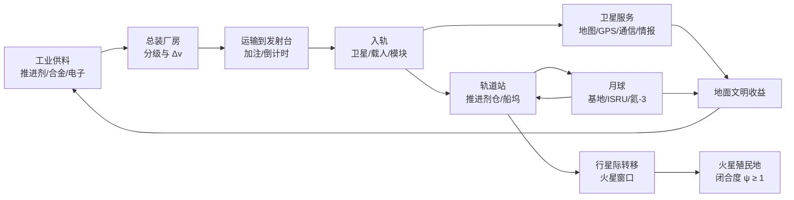
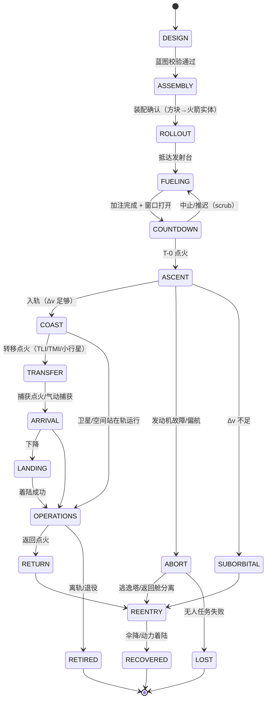

# 24 · 寰宇 Orbit（`tcorbit`）

> 文档版本：DD-0.2 · 模组 ID `tcorbit` · Java 包 `com.nightcity.orbit`（入口类 `TOrbit`，事件类 `TOrbitEvents`，调试指令 `/tcorbit status`）
> 必需依赖：`tcivilization`、`tctechnology`、`tcindustry`（02 §1.2 的唯一例外：火箭需要工业材料链）。可选联动：其余全部模组（桥接类位于 `com.nightcity.orbit.compat.<other>`）。
> 本章遵循 README §5.3 的 18 节模板；末尾附机器可读附录 A-D（格式见写作简报 §3）。
> 相关章节：01（E9-E10 里程碑）、02（维度、地区网格、性能预算）、03（`RegionGridSpec`、`CrewComponent`、UI 外壳）、04（里程碑判定器、`space/knowledge_ark`）、13（燃料与材料）、14（发射场接驳）、15（`habitat_bunk`、宇航员职业）、22（卫星载荷、地面站）、23（AI 航天竞赛）、31（`tcorbit:space_program` 页签、`tcorbit:life_support` 控件）、32（天空与声音）。

---

## 1. 定位与设计支柱

### 1.1 定位

寰宇 Orbit 是 E9-E10 的太空计划：从探空火箭、第一颗人造卫星，到轨道站、登月、月面基地、小行星采矿，最终在火星建立自给殖民地（DR-04）。它用简化但诚实的火箭方程与轨道规则，把“能不能飞到那里”变成工程问题：推进剂、级间比、发射纬度、发射窗口、生命维持闭合度。所有太空活动都依托地面工业（13 章）与物流（14 章），太空中的产出（卫星服务、氦-3、月壤、小行星金属）又反过来改变地面文明。

| 本模组拥有 | 不拥有（归属） |
| --- | --- |
| 火箭部件、总装、发射、分级、再入与着陆 | 推进剂流体（煤油、液氢、液氧、`hypergolic_propellant`）、合金、碳纤维、集成电路、太阳能电池、RTG、燃料电池（Industry） |
| 航天器、太空服（EVA 套装）、轨道站模块、月面车与加压车 | 地面载具、驳船、磁浮接驳（Networks）；地外基地车辆归本模组 |
| 维度 `tcorbit:low_orbit`、`tcorbit:moon`、`tcorbit:mars` 的生成、重力、昼夜、天气 | 主世界与星球模型（Wildlands）；主世界环绕的物理实现（Wildlands） |
| 月壤、钛铁矿月壤、氦-3、月冰、火星土、火星冰、干冰、小行星岩 | 月球与火星的地图库（Atlas；在本模组的轨道器到达后生成） |
| 卫星平台与轨道资产、轨道碎片、太阳风暴、火星尘暴 | 成像与导航载荷 `tcatlas:imaging_payload`、`tcatlas:navigation_payload`、地面站 `tcatlas:ground_station`（Atlas） |
| 加压容积判定、生命维持（以舱段与船员统计计算） | 聚落、住房 `habitat_bunk`、宇航员/殖民者职业与公共卫生（Settlements） |
| 原位资源利用（ISRU）机器与配方 | 通用电解、熔炼配方类型与机器维护（Industry） |
| E9→E10 里程碑“首颗人造卫星”与终局里程碑“火星自给殖民地”的判定器 | 里程碑框架与时代宣告（tctechnology）；编年史书（Echoes） |

### 1.2 设计支柱

| 编号 | 支柱 | 含义 |
| --- | --- | --- |
| OP-1 | 火箭是工程 | 火箭在总装厂房里逐块搭建，显示每一级的 Δv 与推重比；由平台运到发射台，加注、倒计时、点火、分级全部可见（DR-20）。没有传送门，也没有“一键入轨”。 |
| OP-2 | 简化而诚实的物理 | 使用齐奥尔科夫斯基方程、Δv 预算表、纬度与倾角、发射窗口；不做多体积分。玩家用小学算术就能理解为什么要分级、为什么赤道发射更省。 |
| OP-3 | 太空是文明工程 | 不给玩家加任何个人生存数值（DR-19）。氧气、水、食物、电力是舱段与船员的统计账本；宇航服的“续航”是装备的电量，耗尽后安全回撤，不造成伤害。 |
| OP-4 | 天地互为因果 | 卫星给 Atlas 提供卫星图像与 GPS，给 Networks 提供全球通信，给 Nations 提供情报；月面与小行星资源回流地面工业与市场。 |
| OP-5 | 可逆的风险 | 发射失败、碎片撞击、太阳风暴、尘暴只损坏设备或降低统计数值，不会杀死玩家、不会删除建筑；所有损失都能修复或重建。 |

### 1.3 与 DR 的一致性检查

| DR / 规则 | 本模组的落实 |
| --- | --- |
| DR-02 一个玩家文明 | 太空计划属于玩家文明整体；任一玩家都可以总装与发射，权限由 Commons 节点控制（5.17） |
| DR-04 太空范围 | 卫星（5.8）、轨道站（5.9）、月球基地（5.10-5.11）、小行星采矿（5.12）、火星殖民（5.13-5.14）全部覆盖 |
| DR-05 里程碑 | E9→E10“首颗人造卫星”、E10 终局“火星自给殖民地”，人口门槛 8,000 / 12,000 与 01 章一致 |
| DR-09/10 类地星球 | 发射纬度取自主世界 z 坐标：`φ = −z / 40,960 × 90°`；地球自转加成与倾角规则真实（5.3） |
| DR-15 原版进度 | 不提供原版物品的捷径；火箭部件全部需要 Industry 材料 |
| DR-18 威胁 | 三个维度不刷新任何生物；威胁只有碎片、太阳风暴、尘暴，作用于设备与统计 |
| DR-19 个人生存 | 没有氧气条、饥饿或温度伤害；真空暴露与续航耗尽一律“安全回撤”（5.7），可关闭续航 |
| DR-20 可见过程 | 总装、运输、加注、点火、分级、回收着陆都有实体与动画；轨道站由模块对接拼成 |
| DR-25 技能 | `aeronautics` 等技能只提供中等加成（第 15 节） |
| DR-27 地图进度 | 卫星成像与 GPS 是 Atlas T10 的来源；月球、火星地图在轨道器到达后由 Atlas 生成 |
| DR-28 HUD | 只注册 2 个情境控件，只在太空维度或动力飞行中出现 |
| DR-30 性能 | 卫星、轨道站、地外基地在无人在场时为数据记录（L2），不加载区块 |

---

## 2. 独立玩法（仅 `tcivilization` + `tctechnology` + `tcindustry`）

Orbit 的独立形态就是“需要工业”的完整太空计划。缺少其他模组时：

| 缺失模组 | 替代行为 |
| --- | --- |
| Wildlands | 主世界为原版生成；发射纬度仍按 z 坐标计算（`\|z\| > 40,960` 时取 ±90°）；月球与火星不做物理环绕，以世界边界收口 |
| Settlements | 船员与殖民者为核心人物记录 + `CrewComponent`；住房使用本模组的后备方块 `tcorbit:crew_berth`（仅 Settlements 缺失时可合成）；殖民地由 `colony_beacon` 定义 |
| Atlas | 不能使用成像与导航载荷；卫星只有通信、科学与信标三类；登陆点在任务规划页以经纬度网格选择 |
| Networks | 全球通信网只影响本模组的远程指挥（5.8.3）；火箭部件用原版矿车或玩家搬运；月面车使用内置简易驾驶控制 |
| Cultivation | 太空口粮 `space_ration` 由 Industry 食品机或原版熟食合成；温室只按“温室面板面积”计算食物产量 |
| Discovery | 科学卫星与轨道实验室直接产生 RP（5.8.4）而不是观察记录 |
| Echoes | 终局只写入核心编年史，不生成编年史书 |
| Nations | 没有 AI 航天竞赛与太空合作条约 |

单人独立流程：E8 探空火箭 → E9 液体火箭入轨、首颗卫星（进入 E10）→ 载人飞行与轨道站 → 登月与月面基地 → ISRU 与推进剂仓 → 火星转移 → 火星自给殖民地。

---

## 3. 与其他模组的联动

| 模组 | 联动内容 |
| --- | --- |
| tcivilization | 为 `tcorbit:moon`（88 × 44 地区）与 `tcorbit:mars`（170 × 85 地区）注册 `RegionGridSpec`；`CrewComponent` 的航天角色；页签 `tcorbit:space_program`；HUD 控件；通知类别 `tcorbit:space`；编年史记录首颗卫星、首次载人、首次登月、火星殖民 |
| tctechnology | 24 项科技；E9→E10 与终局里程碑判定器；`space/knowledge_ark`（核心）以 `space/orbital_assembly` 为前置；Orbit 缺失时核心使用 5 大陆 `comm_station` 后备里程碑 |
| tcindustry | 必需：推进剂流体、铝锂合金、钛合金、碳纤维、耐热陶瓷、集成电路、太阳能电池、RTG、燃料电池；燃烧类机器在三个维度不运行（13 §3.17）；ISRU 使用 Industry 的电解与熔炼配方类型 |
| tcatlas | 卫星平台承载成像/导航载荷；GEO/MEO 星座决定 GPS 与 `tcatlas:coordinates` 控件；轨道器到达后生成月球与火星地图；球面视图显示在轨资产 |
| tcnetworks | 重型运输车、驳船、铁路运送火箭部件；磁浮接入航天港；GEO 通信卫星提供全球通信覆盖；月面车可实现 Networks 的载具接口 |
| tcsettlements | `habitat_bunk` 需要本模组判定的加压容积；宇航员、任务控制员、殖民者职业；生命维持故障与辐射剂量进入公共卫生事件；火星殖民地是位于火星的聚落 |
| tccultivation | 火星土壤修复后可耕作；温室面板、太空温室模块的作物产量；口粮营养 |
| tcexchange | 发射服务、卫星租用、氦-3 与铂族金属定价；多星球结算（E10 电子支付） |
| tccommons | 发射权限节点 `tcorbit:launch`、核热发动机禁用于大气层内的法律、太空资源宣称（月面领地） |
| tcwildlands | `space/planetary_geology` 让月球与火星样本获得矿物识别；地球观测卫星读取全球气候与地质快照；发射纬度使用星球模型 |
| tcecology | 地球观测卫星提供野生种群普查与森林覆盖率；Ecology 的地区健康图层获得遥感精度 |
| tcnations | AI 航天竞赛（抽象）；太空合作条约；侦察卫星揭示 AI 军队与边境；AI 可出售发射服务 |
| tcdiscovery | 科学卫星、轨道实验室与地外样本产生观察记录与知识；航天中心研究台 `space_research_console` |
| tcechoes | 终局触发“文明纪元”结算，生成编年史书 |
| tcskills | `aeronautics` 为主，另有 `engineering`、`construction`、`mining`、`scholarship`、`exploration`、`logistics`、`leadership` |
| tcfrontiers | 太空设施不受盗匪与远征威胁；`atomic/air_defense` 不能攻击轨道资产（双方约定） |
| tcbeyond | 三个太空维度不产生异界影响区 |

---

## 4. 核心循环



| 尺度 | 循环 | 典型动作 |
| --- | --- | --- |
| 任务（数分钟） | 设计 → 总装 → 加注 → 发射 → 分级 → 入轨/着陆 | 调整级间比、选择窗口、操纵对接 |
| 计划（数个 MC 日） | 卫星星座、轨道站扩建、月面基地建设 | 安排发射序列、补给、船员轮换 |
| 文明（E9-E10 全程） | ISRU 降低发射质量 → 推进剂仓 → 行星际转移 → 自给 | 提高生命维持闭合度、在火星复制工业链 |

| 阶段 | 时代 | 新动词 |
| --- | --- | --- |
| 探空 | E8 | 发动机试车、探空火箭、惯性制导 |
| 入轨 | E9 | 多级火箭、发射窗口、卫星信标、低温推进剂、任务控制、再入 |
| 卫星服务 | E9-E10 | 通信星座、导航星座、对地观测、科学卫星 |
| 载人与轨道站 | E10 | 载人飞船、EVA、模块对接、生命维持、推进剂仓 |
| 月面 | E10 | 着陆、月面车、栖息舱、ISRU、氦-3 |
| 深空 | E10 | 小行星捕获、核热推进、火星转移、火星殖民 |

---

## 5. 系统规则与公式

### 5.0 全局常量与时间换算

本章所有物理量都用真实单位（m、m/s、t、kN、s），再按固定比例换算到游戏时间与方块。主世界 1 格 ≈ 245 m 水平距离（163,840 格对应 40,075 km），月球与火星的网格选用相同的水平比例，因此三个星球的“格/公里”一致。

```text
g0            = 9.81 m/s²                    // 比冲换算常数
R_E           = 6,371 km ; μ_E = 398,600 km³/s² ; v_rot,eq = 465 m/s
R_M(月)       = 1,737 km ; g_M = 1.62 m/s²（0.165 g）
R_Ma(火)      = 3,390 km ; g_Ma = 3.71 m/s²（0.378 g）
时间换算      : 1 MC 日 = 24,000 tick = 1 个真实日 → tick = 秒 / 3.6
              : 1 年 = 48 MC 日（DR-13，10 章）
轨道周期      : T = 2π·√(a³/μ)                // a = R + h（km）
              : LEO 200 km ≈ 5,300 s ≈ 1,470 tick ; LEO 400 km ≈ 1,540 tick
              : MEO 20,200 km = 43,080 s ≈ 12,000 tick ; GEO = 1 MC 日（与主世界同步）
纬度          : φ = −z / 40,960 × 90°（主世界，北为负 z）
              : 月球 λ_M = −z / 11,264 × 90° ; 火星 λ_Ma = −z / 21,760 × 90°
经度          : lon = x / 163,840 × 360°（主世界）；月球除以 45,056，火星除以 87,040
```

> 可见飞行与运输使用“视觉时间压缩”（5.5），物理结算仍使用真实秒数；L2 任务（无人在场）直接以真实秒数换算 tick 推进。

### 5.1 太空计划与任务生命周期

太空计划属于整个玩家文明（DR-02）。每次飞行是一条 **任务记录** `Mission`，由任务规划页（10.2）或任务控制台创建。任务状态机：



| 任务类型 | 最早科技 | 目标 | 成功判定 |
| --- | --- | --- | --- |
| 探空 Sounding | `atomic/liquid_fuel_rockets` | 竖直飞行 | 远地点 ≥ 100 km（卡门线） |
| 入轨 Orbital | `information/rocketry` | LEO/SSO/MEO/GEO | 近地点 ≥ 160 km，偏差在容差内 |
| 卫星部署 Deploy | `information/rocketry` | 指定轨道 + 载荷 | 卫星进入 `ACTIVE` |
| 载人 Crewed | `space/crewed_spaceflight` | LEO | 乘员安全回收或抵达空间站 |
| 对接/补给 Rendezvous | `space/rendezvous_docking` | 空间站 | 对接端口锁定 |
| 模块 Module | `space/orbital_assembly` | 空间站 | 模块方块化并接入站体 |
| 月球 Lunar | `space/lunar_landing` | `tcorbit:moon` | 着陆点误差 ≤ 着陆椭圆 |
| 小行星 Asteroid | `space/asteroid_mining` | 目录中的近地小行星 | 采样返回或捕获入轨 |
| 火星 Mars | `space/interplanetary_transfer` | `tcorbit:mars` | 捕获 + 着陆 |

每个文明最多同时有 `max_active_missions = 16` 条 `ASCENT`-`ARRIVAL` 状态的任务；处于 `OPERATIONS` 的资产（卫星、空间站、基地）不计入该上限，另有资产上限（5.20）。

**任务控制中心**：`tcorbit:mission_control_console`（单方块，E9）。一座任务控制中心 = 同一房间内 ≥ 2 台控制台 + 1 台 `tcorbit:tracking_antenna`（或 Atlas 的 `tcatlas:ground_station`）。没有任务控制中心时只能执行探空任务。控制台数量决定可同时指挥的飞行中任务数：`n_parallel = 控制台数 / 2`（向下取整，至少 1）。Settlements 安装时，每台控制台是一个 `mission_controller` 岗位（5.21），有人值守的控制台使发射失败率 ×0.9（同一任务最多计 2 台）。

### 5.2 火箭物理

#### 5.2.1 齐奥尔科夫斯基方程与分级

```text
每一级 k（自下而上编号，第 1 级最先点火）：
  m0_k = 本级湿质量 + 上面所有级的湿质量 + 载荷
  mf_k = m0_k − 本级推进剂质量
  Δv_k = Isp_k × g0 × ln(m0_k / mf_k)
  Isp_k：大气层内级用平均比冲 Isp_avg = 0.4·Isp_sl + 0.6·Isp_vac；真空级用 Isp_vac
总 Δv = Σ Δv_k
同一级多台发动机：F = ΣF_i ; Isp = ΣF_i / Σ(F_i / Isp_i)    // 推力加权的调和平均
助推器（并联）：与芯级同时点火的部分视为“第 0 级”，其推进剂耗尽时分离；
               并联段的 Isp 与 F 按上式合并，芯级剩余推进剂计入下一段
```

**推重比**（TWR）在每一级点火瞬间检查：

```text
TWR_k = F_k / (m0_k × g_local)          // g_local：地球 9.81，月球 1.62，火星 3.71，轨道上不检查
起飞级：TWR ≥ twr_min_liftoff = 1.20（配置 1.05-2.0）
着陆级（月/火下降）：TWR ≥ 1.5（需要悬停余量）
真空上面级：TWR ≥ 0.30（低于时重力损失 +200 m/s，低于 0.15 拒绝）
```

#### 5.2.2 Δv 预算

从地面入轨的需求：

```text
Δv_LEO(i, φ) = v_orb − v_rot(i) + L_grav + L_drag + L_steer + Δv_dogleg
  v_orb      = 7,800 m/s（200 km 圆轨道）
  v_rot(i)   = 465 × cos(i)                        // i ≥ |φ| 时，地球自转贡献 = 465·cos i；逆行轨道为负
  L_grav     = 1,500 × clamp(1.4 / TWR_1, 0.7, 1.6) × skillLoss   // TWR 越低重力损失越大
  L_drag     = 300（大气层内）；月球、轨道发射 = 0；火星 = 60
  L_steer    = 200
  Δv_dogleg  = i < |φ| 时：2 × 7,800 × sin((|φ| − i) / 2) ；否则 0
  skillLoss  = ProficiencyBridge.multiplier(pilot, aeronautics, cost/propellant)  // ≥ 0.85，见第 15 节
```

| 发射场纬度 φ | 目标 | v_rot | Δv_LEO（TWR 1.4） | 说明 |
| --- | --- | --- | --- | --- |
| 0° | 赤道 i = 0° | 465 | 9,335 | 最省 |
| 28.5° | i = 28.5° | 409 | 9,391 | 典型参考值约 9,400 |
| 45° | i = 45° | 329 | 9,471 | — |
| 45° | i = 0° | 465 | 9,335 + 5,971 = 15,306 | 狗腿机动极贵：赤道轨道应从低纬发射 |
| 任意 | 极轨 i = 90° | 0 | 9,800 | — |
| 任意 | 太阳同步 i = 98° | −65 | 9,865 | 对地观测常用 |

**在轨与行星际 Δv 表**（m/s，真实近似值；`orbit.dv_table_scale` 可整体缩放，默认 1.0）：

| 航段 | Δv | 备注 |
| --- | --- | --- |
| LEO → GTO | 2,440 | — |
| GTO → GEO | 1,470 + 12 × \|φ_deg\| | 含倾角修正；28.5° 时约 1,810 |
| LEO → MEO（20,200 km） | 3,510 | 导航星座 |
| LEO → 月球转移（TLI） | 3,150 | — |
| TLI → 环月轨道（LLO） | 850 | — |
| LLO → 月面 | 1,870 | 含悬停余量 400；着陆级 TWR ≥ 1.5 |
| 月面 → LLO | 1,870 | 上升级 |
| LLO → 返地（TEI） | 850 | 返回舱需隔热罩 ≥ 13%（5.6） |
| 月面 → 地球直接返回 | 2,750 | — |
| LEO → 火星转移（TMI，最优窗口） | 3,600 | 窗口外按 5.3 加罚 |
| 火星捕获（推进） | 900 | 有隔热罩时气动捕获 100 |
| 低火星轨道 → 火星表面 | 700 | 必须有隔热罩 + 降落伞；其余为动力着陆 |
| 火星表面 → 低火星轨道 | 4,100 | 通常用火星 ISRU 甲烷推进剂 |
| 低火星轨道 → 返地（TEI） | 1,000 | 返回舱隔热罩 ≥ 15% |
| LEO → 近地小行星 | 4,000-6,500 | 由小行星目录给出（5.12） |
| 交会与对接 | 120 | 含相位调整与 RCS |
| 离轨（LEO） | 100 | 上面级钝化离轨，减少碎片（5.16.1） |
| GEO 坟墓轨道 | 15 | — |
| 轨道保持 | 卫星每 48 MC 日 25 | 从卫星推进剂扣除，耗尽后 LEO 卫星 1 年内陨落 |

任务规划页把各航段的 Δv 求和，与火箭各级 Δv 对照，显示每一级在哪一段烧完（10.2 的 Δv 条）。余量 `margin = Σ Δv_k − Σ Δv_req`；`margin < 0` 时“发射”按钮禁用（探空任务除外），`0 ≤ margin < 3%` 时提示“余量过小”。

#### 5.2.3 发动机

| 方块 ID | 名称 | 推进剂 | Isp 海平面 / 真空（s） | 推力 海平面 / 真空（kN） | 质量（t） | 节流 | 重启次数 | 科技 |
| --- | --- | --- | --- | --- | --- | --- | --- | --- |
| `tcorbit:solid_motor_segment` | 固体发动机段 | 内置固体推进剂 1.6 t | 242 / 268 | 40 / 44（每段，纵向叠加） | 0.20（干） | 无 | 0 | `atomic/liquid_fuel_rockets` |
| `tcorbit:solid_motor_nozzle` | 固体发动机喷管 | — | — | — | 0.30 | — | — | `atomic/liquid_fuel_rockets` |
| `tcorbit:rocket_engine` | 早期液体发动机 | 煤油/液氧 | 240 / 275 | 270 / 310 | 0.90 | 无 | 0 | `atomic/liquid_fuel_rockets` |
| `tcorbit:kerolox_engine` | 煤油液氧主发动机 | 煤油/液氧 | 282 / 311 | 760 / 845 | 0.47 | 60-100% | 1（可复用后 3） | `information/rocketry` |
| `tcorbit:kerolox_vacuum_engine` | 真空煤油发动机 | 煤油/液氧 | — / 345 | — / 90 | 0.18 | 40-100% | 3 | `information/rocketry` |
| `tcorbit:hypergolic_engine` | 自燃推进剂发动机 | `hypergolic_propellant` | 270 / 315 | 40 / 45 | 0.10 | 10-100% | 不限 | `information/rocketry` |
| `tcorbit:hydrolox_engine` | 氢氧主发动机 | 液氢/液氧 | 366 / 452 | 1,860 / 2,280 | 3.20 | 67-109% | 0 | `information/cryogenic_propellants` |
| `tcorbit:hydrolox_upper_engine` | 氢氧上面级发动机 | 液氢/液氧 | — / 465 | — / 110 | 0.30 | 30-100% | 15 | `information/cryogenic_propellants` |
| `tcorbit:methalox_engine` | 甲烷液氧发动机 | 甲烷/液氧 | 327 / 350 | 2,200 / 2,400 | 1.60 | 40-100% | 10 | `space/methalox_propulsion` |
| `tcorbit:methalox_vacuum_engine` | 真空甲烷发动机 | 甲烷/液氧 | — / 380 | — / 1,000 | 1.20 | 40-100% | 10 | `space/methalox_propulsion` |
| `tcorbit:nuclear_thermal_engine` | 核热发动机 | 液氢（工质） | — / 900 | — / 110 | 6.50 | 20-100% | 不限 | `space/nuclear_thermal_propulsion` |
| `tcorbit:ion_thruster` | 离子推力器 | 氩（工质） | — / 3,000 | 游戏化 0.1（真实值 × 200） | 0.15 | — | 不限 | `space/electric_propulsion` |
| `tcorbit:rcs_thruster` | 姿控推力器 | `hypergolic_propellant` | — / 220 | — / 0.4 | 0.02 | — | 不限 | `information/rocketry` |

规则：

1. 海平面 Isp 为“—”的发动机不能作为起飞级（大气层内喷管流动分离）；在月球、火星表面起飞不受此限（火星按真空计，大气修正忽略）。
2. 核热发动机在主世界大气层内禁止点火（Commons 法律 `nuclear_thermal_ban`，19 章；Commons 缺失时由配置 `propulsion.ntr_atmosphere_ban = true` 代替，见 5.17）；只能作为轨道组装飞船的转移级。核燃料组件取自 Industry 的 `#tcorbit:nuclear_fuel` 标签，每次任务消耗 1 个，退役时进入 Industry 乏燃料流程。
3. 离子推力器需要电力 25 kW/台，Δv 按 MC 日累积：`Δv/日 = F × 86,400 / m`。只用于卫星轨道提升、小行星拖船与无人货运；载人任务不能以离子推进为主推进。
4. 姿控推力器不计入 Δv，对接与着陆微调时消耗 `hypergolic_propellant`：每次机动 = 航天器质量（t）× 0.4 mB。
5. 发动机质量随 Industry 部件品质 Q 修正：Q1 ×1.15、Q2 ×1.07、Q3 ×1.00、Q4 ×0.94、Q5 ×0.88；Isp 不受品质影响，可靠性受影响（5.5.2）。

#### 5.2.4 贮箱与推进剂密度

每个贮箱方块的容积为 1 m³ = 1,000 mB（混合推进剂按体积比同时储存在同一方块的两个内部槽中，玩家不需要分别管理燃料与氧化剂）。

| 贮箱方块 | 可选组合 | 每格推进剂质量 | 体积比（燃料 : 氧化剂，mB） | 干质量（t） | 科技 |
| --- | --- | --- | --- | --- | --- |
| `tcorbit:propellant_tank` | 煤油/液氧 KEROLOX | 1.03 t | 360 : 640 | 0.07 | `atomic/liquid_fuel_rockets` |
| 同上 | 自燃推进剂 HYPERGOLIC（单一流体） | 1.19 t | 1,000 | 0.07 | `information/rocketry` |
| 同上 | 氩 ARGON（高压气态，离子工质） | 0.60 t | 1,000 | 0.07 | `space/electric_propulsion` |
| `tcorbit:cryogenic_tank` | 液氢/液氧 HYDROLOX | 0.36 t | 727 : 273 | 0.085 | `information/cryogenic_propellants` |
| 同上 | 甲烷/液氧 METHALOX | 0.83 t | 430 : 570 | 0.085 | `space/methalox_propulsion` |
| 同上 | 纯液氢 LH2（核热工质） | 0.071 t | 1,000 | 0.085 | `space/nuclear_thermal_propulsion` |

1. 组合用扳手或贮箱界面设置，同一级的所有贮箱必须是同一组合，且与该级发动机的推进剂一致；装配校验会指出不一致的方块。
2. 低温组合（HYDROLOX、METHALOX、LH2）加注后开始蒸发：每 1,000 tick 损失 `boiloff_rate`（液氢 0.5%，甲烷与液氧 0.1%）；在轨推进剂仓带主动制冷时为 0（5.9.4）。
3. 干质量同样受品质修正；E10 `space/reusable_launch` 后贮箱可用 `#tcorbit:materials/carbon_fiber` 合成，干质量 ×0.75。
4. 推进剂流体全部来自 Industry（13 章），只通过标签引用：`#tcorbit:propellants/kerosene`（`tcindustry:kerosene`）、`liquid_oxygen`、`liquid_hydrogen`（后备 `tcindustry:hydrogen`）、`methane`（后备 `tcindustry:natural_gas`）、`hypergolic`、`argon`（完整标签名与成员见 §8.1 与 13 §8.12）。

#### 5.2.5 结构与载荷部件

| 方块 ID | 名称 | 质量（t） | 作用 | 科技 |
| --- | --- | --- | --- | --- |
| `tcorbit:avionics_unit` | 航电舱 | 0.15 | 制导；每枚火箭的最上一级必须有 1 个；其余级跟随 | `atomic/inertial_guidance` |
| `tcorbit:stage_separator` | 级间分离环 | 0.08/格 | 定义级的分界；分离面上的所有方块属于上一级 | `atomic/liquid_fuel_rockets` |
| `tcorbit:radial_decoupler` | 侧向分离器 | 0.05 | 连接并联助推器 | `information/rocketry` |
| `tcorbit:nose_cone` | 头锥 | 0.03 | 探空火箭与助推器顶端 | `atomic/liquid_fuel_rockets` |
| `tcorbit:payload_fairing` | 整流罩 | 0.04/格 | 包住载荷；无整流罩时入轨失败率 +10% | `information/rocketry` |
| `tcorbit:launch_escape_tower` | 逃逸塔 | 0.60 | 载人发射必需，任何上升段故障都能拉出返回舱 | `space/crewed_spaceflight` |
| `tcorbit:capsule_hull` | 返回舱壳体 | 0.35/格 | 气密、可再入；与座椅、舱门组成返回舱 | `space/crewed_spaceflight` |
| `tcorbit:crew_seat` | 乘员座椅 | 0.15 | 1 名乘员（玩家或 NPC） | `space/crewed_spaceflight` |
| `tcorbit:capsule_hatch` | 返回舱舱门 | 0.10 | 出入口，亦是对接面（需对接机构） | `space/crewed_spaceflight` |
| `tcorbit:heat_shield` | 隔热罩 | 0.40/格 | 再入防热（5.6） | `information/reentry_systems` |
| `tcorbit:parachute_pack` | 降落伞包 | 0.25 | 末段减速到 8 m/s | `information/reentry_systems` |
| `tcorbit:landing_leg` | 着陆腿 | 0.12 | 动力着陆（月面、火星、助推器回收） | `space/lunar_landing`（助推器：`space/reusable_launch`） |
| `tcorbit:grid_fin` | 栅格舵 | 0.08 | 助推器返航控制；每级需 4 个 | `space/reusable_launch` |
| `tcorbit:docking_port` | 对接机构 | 0.30 | 交会对接；空间站模块接口 | `space/rendezvous_docking` |
| `tcorbit:satellite_bus` | 卫星平台 | 0.25 | 卫星核心：电源、姿控、通信、推进剂 40 kg | `information/rocketry` |
| `tcorbit:solar_array` | 太阳能帆板 | 0.05/格 | LEO 光照时 2 kW/格（地月轨道 2.2，火星轨道 0.95） | `information/rocketry` |
| `tcorbit:radiator_panel` | 散热板 | 0.04/格 | 每格排热 3 kW；核热与大型舱段必需 | `space/orbital_assembly` |

载荷模块（卫星载荷、舱段）在 5.8、5.9 定义。

#### 5.2.6 参考设计（用于平衡验证）

| 设计 | 结构 | 起飞质量 | Δv（真空合计） | 起飞 TWR | 能力 |
| --- | --- | --- | --- | --- | --- |
| 探空火箭 | 2 段固体 + 喷管 + 头锥 + 0.1 t 仪器 | 4.05 t | 约 3,900 | 2.0 | 远地点约 400 km |
| 首颗卫星火箭 | 1 级：28 贮箱 + 1 煤油主机；2 级：4 贮箱 + 1 真空煤油机 + 航电；载荷 0.5 t | 36.4 t | 约 9,540 | 2.3 | 0.5 t 进入 LEO（首颗人造卫星） |
| 中型运载 | 1 级：360 贮箱 + 9 主机；2 级：80 贮箱 + 1 氢氧上面级（低温贮箱 220 格） | 约 520 t | 约 10,800 | 1.4 | LEO 18 t、GTO 6 t |
| 重型载人登月 | 3 级氢氧 + 煤油助推，逃逸塔、返回舱 3 座、着陆器 | 约 2,900 t | 约 13,000（到 TLI） | 1.25 | 40 t 进入 TLI |
| 火星转移船（轨道组装） | 核热级 × 3 + 推进剂仓补加 | 地面不起飞 | 约 7,500（自 LEO） | 0.18（真空） | 载 12 人与 30 t 货物 |

参考设计 2 的验算：第 2 级湿 5.31 t、干 1.19 t（贮箱 0.24 + 发动机 0.18 + 航电 0.15 + 整流罩与载荷 0.62），Δv₂ = 345 × 9.81 × ln(4.46) ≈ 5,060 m/s；第 1 级湿 36.4 t、干 7.6 t，Isp_avg = 299，Δv₁ ≈ 4,590 m/s；合计约 9,650 m/s，扣除 28.5° 发射场的 9,400 需求后余量约 2.6%。所以“首颗卫星”需要约 32 个贮箱方块（3×3 截面的箭体约 4 层高），这是 E9 玩家能完成的规模。

### 5.3 发射场、纬度、倾角与发射窗口

#### 5.3.1 发射场

发射场 = 发射台多方块 + 任务控制中心（同一文明，距离不限，但需通信链路：同一 Networks 信息网或直线距离 ≤ 4,096 格）。

| 发射台等级 | 平台面积 | 最大起飞质量 | 必需部件 | 科技 |
| --- | --- | --- | --- | --- |
| 探空架 `sounding_rail` | 1 格 | 10 t | 导轨 | `atomic/liquid_fuel_rockets` |
| 小型发射台 | 5 × 5 | 150 t | 甲板 + 导流槽 + 脐带塔 | `information/rocketry` |
| 中型发射台 | 9 × 9 | 800 t | 同上 + 2 个加注臂 | `information/cryogenic_propellants` |
| 重型发射台 | 13 × 13 | 4,000 t | 同上 + 喷水降噪塔 + 4 个加注臂 | `space/crewed_spaceflight` |

发射台部件：`tcorbit:launch_pad_deck`（甲板，耐热混凝土）、`tcorbit:flame_trench`（导流槽，甲板下方，至少 3 格深并朝一侧开口）、`tcorbit:umbilical_tower`（脐带塔，高度 ≥ 火箭高度 − 2）、`tcorbit:propellant_loading_arm`（加注臂，接 Industry 管道）、`tcorbit:sound_suppression_tower`（喷水降噪，接水管）。发射台核心 `tcorbit:launch_pad_controller` 扫描多方块并显示等级。

#### 5.3.2 纬度与倾角

```text
φ_pad = −z_pad / 40,960 × 90°（Wildlands 缺失且 |z| > 40,960 时取 ±90°）
可直接到达的倾角：i ∈ [|φ|, 180° − |φ|]
发射方位角 A：sin A = cos i / cos φ（A 从正北顺时针，东 = 90°）
下游落区：第 1 级沿方位角 A 方向 300-600 km（≈ 1,220-2,450 格），并联助推器 50-150 km（≈ 200-610 格）；地图上显示为落区椭圆预览
```

| 发射场位置 | 最省轨道 | 代价 |
| --- | --- | --- |
| 赤道 | 赤道 LEO、GEO | GEO 圆化不需倾角修正 |
| 中纬度 | i ≥ \|φ\| 的 LEO | GEO 每度纬度 +12 m/s |
| 高纬度（> 60°） | 极轨、太阳同步 | 地球自转贡献小 |

**落区安全**：落区椭圆与己方或 AI 聚落重叠时，任务规划页显示黄色警告；坚持发射则抛弃的级落入聚落附近：不破坏方块，只给该聚落满意度 −0.05 持续 4 日（Settlements 的 `putModifier`），若为 AI 文明聚落则 Nations 好感 −5（“落区事件”）。可回收的级没有落区。

#### 5.3.3 发射窗口

| 目标 | 窗口规则 | 窗口时长 | 窗口外 |
| --- | --- | --- | --- |
| 任意 LEO/SSO/MEO/GEO 卫星 | 随时 | — | — |
| 与空间站交会 | 发射场经过空间站轨道面时：`\|φ\| < i_s` 每 MC 日 2 次，`\|φ\| = i_s` 1 次 | ±300 tick | 等待下个窗口；或直接发射后在停泊轨道相位等待 ≤ 1 圈（+20 m/s） |
| 月球（TLI） | 每 MC 日 2 次（停泊轨道每经过一次合适相位） | 600 tick | 等待 |
| 火星（TMI） | 会合周期 `S = mars_synodic_days`（默认 48 MC 日 = 1 年），最优点前后 3 日 | 6 MC 日 | Δv 加罚（下式） |
| 火星返回 | 最优返回点 = 出发最优点 + 0.6 S | 6 MC 日 | Δv 加罚 |
| 近地小行星 | 目录给出每颗的窗口（周期 24-96 日） | 4 MC 日 | Δv 加罚同火星，系数 1,500 |

```text
火星窗口外加罚：Δv_TMI(t) = 3,600 + 2,400 × (1 − cos(2π·(t − t_opt) / S)) / 2
转移时长：T_moon = 3 MC 日 ; T_mars = mars_transit_days（默认 16，约 S × 0.33，与真实比例一致）
```

**天气**：主世界发射受 Wildlands 天气限制：地面风速 > 15 m/s 或雷暴时倒计时自动推迟（scrub），等待到天气好转（无 Wildlands 时：原版雷暴推迟，下雨不推迟）。推迟不消耗推进剂，但低温推进剂继续蒸发。

### 5.4 总装、运输与加注（DR-20）

#### 5.4.1 总装厂房

总装厂房是一座多方块：`tcorbit:assembly_controller` + 地面上一片 `tcorbit:mobile_launch_platform`（移动发射平台，面积 = 火箭最大占地）+ 四周可选 `tcorbit:assembly_crane`。

1. 玩家在移动发射平台上方 **逐块放置** 火箭部件方块。也可以把一个已保存的设计（蓝图）交给吊车，吊车从相邻容器或 Networks 交付点取料，每 `crane_ticks_per_block = 10` tick 放置 1 块（engineering 的 `speed/assembly` 修正）。Settlements 安装时，每台吊车是一个 Industry 通用操作员岗位（本模组不新增装配职业），无人值守时放置间隔 ×2。
2. 控制器实时计算：级划分（以 `stage_separator` 为界）、每级湿/干质量、Δv、TWR、重心与推力线偏差（推力中心与质心水平偏差 > 0.5 格时报错“推力不对称”）。
3. 上限：占地 ≤ 13 × 13、高度 ≤ 120 格、方块数 ≤ 4,096、起飞质量 ≤ 4,000 t（`rocket.max_*` 配置）。
4. 点击“装配确认”后，平台上方所有连通的火箭部件方块被移除并生成一个 `tcorbit:rocket` 实体（方块快照，客户端以烘焙模型渲染），站在移动发射平台上。这一步可以撤销：在总装厂房内对实体使用“拆解”，原样还原为方块。
5. 设计可保存为 `tcorbit:rocket_blueprint` 物品（记录方块列表与组合设置，不含材料），用于吊车自动装配与交易。

#### 5.4.2 转运

1. `tcorbit:crawler_transporter`（履带运输车实体）驶到移动发射平台下方，顶起平台和火箭，沿 `tcorbit:crawlerway`（运输道方块，宽 ≥ 平台宽度）以 `crawler_speed = 2 m/s`（配置 0.5-8）行驶到发射台，最长 4,096 格。
2. 运输途中火箭与平台作为一个整体渲染，倾斜 ≤ 2°（运输道坡度 > 5% 时停车）。
3. 128 格内没有玩家时，运输以 L2 推进（直接按距离与速度计时），抵达时在发射台重新出现。
4. 与 Networks 的关系：火箭 **部件** 由 Networks 的重型运输车、驳船、铁路运到总装厂房（5.21）；整枚火箭只由履带运输车搬运。没有总装厂房也可以直接在发射台上总装（发射台本身作为平台），代价是该发射台在总装期间不能发射。

#### 5.4.3 加注与倒计时

```text
加注速率：每个加注臂 100 mB/tick（燃料、氧化剂各需一个臂；单组元只需一个）
加注时长 ≈ 贮箱格数 × 1,000 mB / (100 mB/tick × 臂对数)
倒计时：T−600 tick 开始；T−200 内部供电；T−60 点火序列；T−0 释放
保持点：T−200、T−60（任何检查失败自动保持；保持超过 1,200 tick 进入 scrub）
```

| 倒计时检查 | 失败时 |
| --- | --- |
| 推进剂 ≥ 99%（低温组合考虑蒸发） | 保持，补加 |
| 发射窗口内 | 保持到窗口 |
| 天气（5.3.3） | scrub |
| 落区（5.3.2）已确认 | 保持，要求确认 |
| 发射权限 `tcorbit:launch`（5.17） | 拒绝，显示原因 |
| 乘员全部就位（载人） | 保持 |
| 发射台未损坏 | scrub |

点火瞬间产生尾焰粒子、发射台导流槽喷出烟云（32 章：火箭发射时保持可见至 512 格）；喷水降噪塔存在时声音 −6 dB、烟云变为白色蒸汽。发射台在每次发射后进入 `COOLDOWN` 2,400 tick（重型 4,800），损坏状态见 5.5.3。

### 5.5 上升、分级与失败

#### 5.5.1 可见飞行与模拟切换

1. 点火后火箭实体沿真实上升剖面运动：前 20 s（真实时间）竖直上升，之后按重力转弯剖面倾斜。可见速度做视觉压缩：实体在 `visible_ascent_ticks = 400`（配置 200-1,200）内上升到发射台上方 512 格。
2. 分级在可见阶段发生时，下面一级作为独立的 `tcorbit:spent_stage` 实体脱离、翻滚并下落：可回收级执行返航（5.6.3）；不可回收级在落到地面前 64 格处爆成碎片粒子并消失，地面落区只记录落区事件（5.3.2），不破坏方块。
3. 实体到达 +512 格或离开所有玩家视距后，任务转入 **航迹模拟**（L2）：按 Δv 表逐段扣除推进剂，按 5.5.2 判定故障，入轨后生成轨道资产记录。
4. 乘坐火箭的玩家在 +512 格时看到 2 s 的过渡画面（地平线弯曲、天空变黑），随后被放到目标维度（`tcorbit:low_orbit` 的到达点、月面着陆点等）或留在返回舱实体中继续再入（亚轨道任务）。地面旁观者看到尾焰缩小为光点，512 格后淡出（32 章）。

#### 5.5.2 可靠性与故障

每台发动机、每次分级、每个航电单元都有一次独立判定：

```text
p_fail(部件) = base × qualityFactor × wear × (1 − 0.5·testBonus) × crewFactor
  base         = 发动机 1.5%、分级 0.8%、航电 0.5%、再入 1.0%（每次）
  qualityFactor= Q1 2.0、Q2 1.4、Q3 1.0、Q4 0.75、Q5 0.55（Industry 品质）
  wear         = 1 + 0.15 × 已飞行次数（可复用发动机；翻修后归 1，5.6.3）
  testBonus    = 同型号发动机在本文明试车台累计成功试车 ≥ 5 次时为 1，否则 = 次数 / 5
  crewFactor   = 有人值守任务控制台 0.9；无 1.0
p_fail(任务) = 1 − Π(1 − p_fail(部件))   // 任务规划页显示为“成功率”
p_fail 下限 = 0.2%（`reliability.floor`），保证太空始终有风险但不惩罚过重
```

| 故障 | 结果 | 载人时 |
| --- | --- | --- |
| 发动机熄火（起飞级，1 台以上） | 剩余推力不足以 TWR > 1 → 任务失败；否则继续，损失 Δv | 逃逸塔拉出返回舱 → 再入回收（5.6） |
| 发动机熄火（上面级） | 若能用剩余发动机完成则继续；否则进入亚轨道或低轨道 | 返回舱分离再入 |
| 分级失败 | 任务失败 | 逃逸塔或返回舱分离 |
| 航电失效 | 入轨误差 σ ×4；入轨后卫星有 50% 进入 `DEGRADED` | 手动接管（玩家驾驶员可修正 50%） |
| 再入失败 | 返回舱与载荷损失 | **不伤害玩家**：玩家在舱体解体前被放到最近的回收船位置（5.7 安全回撤）；NPC 船员按 5.15.5 处理 |

无人任务失败的后果仅为材料与推进剂损失，以及“发射失败”编年史条目；发射台按 5.5.3 受损。

#### 5.5.3 发射台受损

| 原因 | 损坏 | 修复 |
| --- | --- | --- |
| 正常发射 | 无 | — |
| 起飞后 10 s 内失败 | 发射台进入 `DAMAGED`：甲板 30% 方块变为 `tcorbit:scorched_pad_deck`，不能发射 | 用修复包 `tcorbit:pad_repair_kit` 逐块修复 |
| 发射台上爆炸（倒计时中） | 同上，加注臂 50% 变为损坏状态 | 同上 |

本模组的火箭爆炸 **不** 使用原版爆炸，不破坏发射台范围外的任何方块，也不伤害实体（只播放特效与声音）。

#### 5.5.4 入轨精度

```text
入轨误差 σ_alt = 25 km × (1 / precisionMult) × avionicsFactor
precisionMult = ProficiencyBridge.multiplier(pilot, aeronautics, precision/flight/launch)   // 1.0-1.10（05 章余量），路径匹配也计入 precision/flight 的天赋
avionicsFactor = 航电正常 1.0 ; 航电失效 4.0
入轨后高度偏差 > 80 km 时额外消耗 Δv = 0.55 × 偏差(km) m/s 做修正
```

驾驶员 = 发射时坐在指令座椅上的玩家；无人任务使用任务控制台前值守的玩家（或熟练度最高的在线船员）。

### 5.6 再入、回收与可复用

#### 5.6.1 再入热载荷

```text
q_peak 指数 H = v_entry² / 1.0e6 × (m / A)^0.5 / 10
隔热罩质量分数要求 f_hs = 返回舱隔热罩质量 / 返回舱总质量
  LEO 再入（7.8 km/s）：f_hs ≥ 8%
  月球返回（11.0 km/s）：f_hs ≥ 13%
  火星返回（12.5 km/s）：f_hs ≥ 15%
  火星进入（5.6 km/s，大气稀薄）：f_hs ≥ 10% + 降落伞 + 动力末段
不足时：再入失败概率 = 1.0% + 25% × (f_req − f_hs) / f_req
```

返回舱必须由 `capsule_hull`、`heat_shield`（位于底面）、`parachute_pack`、至少 1 个 `crew_seat` 或载荷适配器组成。再入时可见：返回舱实体从着陆点上空 +512 格出现，带等离子尾迹下降，降落伞在 +120 格展开，以 8 m/s 落地（水面溅落时漂浮，等待回收）。

#### 5.6.2 着陆点

再入着陆点 = 目标点 + 正态误差（σ = 2 km × `1/precisionMult`，≈ 8 格）。地面着陆在落点生成返回舱方块组；在水面时生成可乘坐的返回舱实体，任意玩家或 Networks 船只靠近后可拖回港口（回收）。

#### 5.6.3 可复用火箭（`space/reusable_launch`）

| 项目 | 规则 |
| --- | --- |
| 条件 | 一级配备 `landing_leg` × 4、`grid_fin` × 4，发动机可重启 ≥ 2 次 |
| Δv 保留 | 返回发射场：一级保留其 Δv 的 35%；海上着陆船 `tcorbit:landing_barge`（Networks 驳船上放置的着陆甲板方块）：15% |
| 可见着陆 | 128 格内有玩家时，一级实体可见地点火减速、展开着陆腿、落在着陆区或着陆船上 |
| 着陆成功率 | 基础 90%，每次复用 −2%；失败概率 ÷ precisionMult（5.5.4） |
| 翻修 | 着陆后的一级成为 `RECOVERED_STAGE`，在总装厂房用 `tcorbit:engine_refurbish_kit` 翻修：wear 归 1；engineering `wear/machine` 降低翻修套件消耗 |
| 收益 | 复用后的一级省去 80% 的结构材料与发动机，仅消耗推进剂与翻修套件 |

### 5.7 宇航服、EVA 与安全回撤（DR-19）

宇航服是一套装备，不是玩家的生理系统。DR-19 原文要求“不加个人生存机制”，因此：

1. 玩家在任何维度都 **没有** 氧气条、窒息伤害、减压伤害、低温或高温伤害；本模组不读取也不修改玩家的饥饿值与生命值。
2. 宇航服 `tcorbit:eva_suit`（一件式套装，占胸甲栏；头盔、腿、靴栏空出以兼容其他装备）有 **续航** 组件 `tcorbit:suit_endurance`（0-100%），表示套装电池、气瓶与散热剂的综合储量，属于装备状态。
3. 续航只在“加压容积外 + 太空维度内”消耗：`drain = 100% / suit_endurance_ticks`（默认 12,000 tick = 半个 MC 日；配置 2,400-72,000；`eva.suit_endurance = false` 时不消耗）。在 `suit_port`（套装接口，5.9.2）上充满需要 600 tick。
4. 续航 ≤ 15% 时 HUD 控件变黄并播放提示音；≤ 5% 变红并在屏幕中央显示“套装续航即将耗尽，返回气闸”。
5. 续航到 0 时执行 **安全回撤**（不是死亡、不掉落物品、不扣经验）：
   - 2 s 的屏幕淡出后，玩家被移动到 256 格内最近的己方气闸、加压舱或航天器座位；
   - 若没有，移动到该维度最近一次的着陆点（着陆器、基地、空间站对接口）；
   - 若仍没有，移动到主世界的重生点（床或世界出生点）；
   - 套装进入 `NEEDS_SERVICE` 状态，在 `suit_port` 上维护 600 tick 才能再次出舱。
6. 不穿套装进入真空：气闸拒绝在无套装的玩家面前循环（显示“需要舱外套装”）。其他途径（破坏舱壁、传送、创造模式）导致玩家处于真空且无套装时，屏幕提示 3 s 后执行同样的安全回撤（无伤害）。`eva.safe_retreat = false` 时（仅推荐用于创造/建筑服务器）完全不检查。
7. 套装提供月面与火星的照明、在 `tcorbit:low_orbit` 中的推进背包移动（5.18.1），以及 Atlas 的 `spacesuit` HUD 情境（5.21）。
8. 回撤使任务记一条“EVA 中止”，该任务后续熟练度奖励减半（第 15 节）；这是唯一的代价。

### 5.8 卫星

#### 5.8.1 卫星平台与载荷

卫星在总装厂房里由 `satellite_bus` + 1-3 个载荷方块 + `solar_array` 组成，装在整流罩内发射，入轨后成为轨道资产记录（不是常驻实体；轨道视图与 Atlas 球面视图中显示为图标）。

| 载荷方块 ID | 名称 | 质量（t） | 功率（kW） | 作用 | 科技 |
| --- | --- | --- | --- | --- | --- |
| `tcorbit:beacon_payload` | 信标载荷 | 0.08 | 0.1 | 发出全服可听的信标，满足“首颗人造卫星”里程碑 | `information/rocketry` |
| `tcorbit:comm_payload` | 通信载荷 | 0.6 | 3 | 中继、远程指挥、全球通信覆盖（5.8.3） | `information/communications_satellites` |
| `tcorbit:earth_observation_payload` | 对地观测载荷（多光谱 + 磁力计） | 0.5 | 2 | 气候、植被、种群普查、地磁异常（5.8.5） | `information/remote_sensing` |
| `tcorbit:science_payload` | 科学载荷 | 0.4 | 1.5 | Discovery 缺席时直接产生 RP（5.8.4） | `information/remote_sensing` |
| `tcorbit:solar_monitor_payload` | 太阳监测载荷 | 0.3 | 1 | 太阳粒子事件预警（5.16.2） | `information/remote_sensing` |
| `tcorbit:relay_payload` | 深空中继载荷 | 0.8 | 4 | 地月、地火通信中继（5.8.3） | `space/lunar_landing` |
| `tcatlas:imaging_payload` | 成像载荷（Atlas） | 0.5 | 2 | 卫星图像图层 | Atlas `space/satellite_imagery` |
| `tcatlas:navigation_payload` | 导航载荷（Atlas） | 0.4 | 1 | GPS 星座 | Atlas `space/satellite_navigation` |
| `tcdiscovery:space_telescope` | 空间望远镜（Discovery） | 2.0 | 3 | 每日 3 次观测 | Discovery `space/space_science` |

外模组载荷通过 `OrbitApi.registerPayload(PayloadSpec)` 注册（第 12 节），本模组只负责把它们送入轨道、供电并报告在轨状态。

卫星状态：`ACTIVE`（正常）→ `DEGRADED`（功率或载荷受损，效率 ×0.5）→ `FAILED`（停止工作，成为碎片源）→ `DEORBITED`。卫星设计寿命默认 `satellite.design_life_days = 240`（5 年），之后每 MC 日有 1% 概率转为 `FAILED`；推进剂耗尽的 LEO 卫星 48 日内再入烧毁。

#### 5.8.2 轨道模型与覆盖

轨道用 5 个参数表示：`(a, e, i, Ω, u0)`（半长轴、偏心率、倾角、升交点赤经、历元相位）。不做摄动，只做以下简化：

```text
T = 2π·√(a³/μ)             （秒 → tick = 秒 / 3.6）
星下点纬度 lat(t) = asin(sin i · sin u(t))，u(t) = u0 + 2π·t/T
星下点经度 lon(t) = Ω + atan2(cos i·sin u, cos u) − ω_E·t   // ω_E = 360° / 24,000 tick
```

| 轨道类型 | 高度 | 周期（tick） | 倾角 | 用途 |
| --- | --- | --- | --- | --- |
| LEO | 200-2,000 km | 1,470-1,900 | 任意 | 空间站、对地观测、侦察 |
| SSO 太阳同步 | 600-800 km | ~1,620 | 97.8-98.6° | 对地观测、成像（每日同一地方时） |
| MEO | 20,200 km | ~12,000 | 55° | 导航星座 |
| GEO | 35,786 km | 24,000 | 0° | 通信、气象 |
| Molniya | 近地点 600 / 远地点 39,700 km | 12,000 | 63.4° | 高纬通信 |

**覆盖函数**（为 22 §5.8 的 `coverage(i, lat)` 提供具体形式）：

```text
i_eff         = min(i, 180° − i)
coverage(i, lat) = 0.67 × clamp(1 − max(0, |lat| − i_eff − 30°) / 50°, 0, 1)
n_vis(lat)    = Σ_sat coverage(i_sat, lat)            // 同类卫星可见数期望
成像带        = |lat| ≤ i_eff（成像只覆盖星下点能到达的纬度带）
GEO 通信      : 3 颗经度相隔 120° 覆盖 |lat| ≤ 70°；高于 70° 需 Molniya 或极轨中继
```

当所有卫星倾角相同时 `n_vis = n × coverage(i, lat)`，与 Atlas 的 `round(n_nav × coverage)` 一致（Atlas 负责取整）；Orbit 把逐颗求和的结果通过 `OrbitApi.visibleCount(type, lat)` 提供给 Atlas。6 颗 i ≥ 55° 的导航卫星在任意纬度 round(n_vis) ≥ 4（极点 6 × 0.603 = 3.6 → 4）。

#### 5.8.3 通信、地面站与远程指挥

1. 卫星与空间站需要地面站才能接收指令和下传数据：`tcatlas:ground_station`（Atlas 安装时）或本模组的 `tcorbit:tracking_antenna`（后备，覆盖半径 = 地区网格 3 × 3）。
2. 没有通信卫星时，LEO 资产每圈只有 `p_contact = 地面站数 × 0.12`（上限 1）的时间可通信；指令延迟到下次可通信时执行。
3. 3 颗 GEO 通信卫星（或 1 颗以上中继载荷 + 任意 GEO）后，LEO 资产 100% 可通信（|lat| ≤ 70°）。
4. **深空网**：`tcorbit:deep_space_antenna`（9 × 9 多方块，E10）。3 座经度相隔约 120°（容差 ±30°）时，月球与火星任务连续可通信；只有 1 座时，每 MC 日 1/3 的时间可通信。
5. 远程指挥延迟：月球 0 tick（游戏化忽略 1.3 s）；火星 `delay = 60 + 310 × (1 − cos θ) / 2` tick，θ 为会合周期相位（60-370 tick ≈ 3.6-22 分钟真实时间）。火星的车辆与机器指令显示倒计时“指令传输中”。
6. Networks 安装时：GEO 通信卫星为 Networks 的全球通信网提供覆盖（14 章 `informationLatency` 用 `OrbitApi.relayLatencyTicks(dimA, dimB)` 查询跨维度延迟）；Networks 缺失时，只影响本模组的远程指挥（§2）。

#### 5.8.4 科学

| 来源 | 每 MC 日产出（Discovery 安装） | Discovery 缺失 |
| --- | --- | --- |
| `science_payload` 卫星 | 1 次“轨道观测”记录，送到 `tcdiscovery:space_research_console` | 每颗 60 RP（直接加入科技点数） |
| `tcdiscovery:space_telescope` | 3 次深空观测（17 章约定） | 不可用 |
| 轨道实验室模块 `tcorbit:lab_module` | 1 次“微重力实验”+ 船员 scholarship 熟练度 | 每模块 120 RP |
| 月球/火星样本 `tcorbit:lunar_sample`、`mars_sample` | 在研究台上分析：1 次观测/样本 | 每个 40 RP |

Discovery 安装时 `science_payload` 的直接 RP 功能隐藏（避免双重来源），载荷仍可制作，作为 Discovery 观测的通用来源。

#### 5.8.5 对地观测

`earth_observation_payload` 每颗卫星每个轨道周期扫描其成像带内的一批地区（每周期 `eo.regions_per_pass = 8` 个），产出：

| 数据 | 接收方 | 效果 |
| --- | --- | --- |
| 气候与地质快照 | Wildlands | 勘测方法 `SATELLITE`（权重 0.20，每轨道周期刷新），见 10 章 |
| 植被与种群普查 | Ecology | 野生种群普查误差 ±3%（无卫星 ±15%）；地区健康图层获得遥感精度 |
| 磁力计异常 | Beyond | “地磁异常”检测：Beyond 的影响区在扫描后显示在地区图层中 |
| 军事与边境 | Nations | 侦察：揭示扫描地区内 AI 军队与工事（23 章情报） |
| 资源普查 | 本模组/Atlas | 地区图层 `tcorbit:remote_sensing` 显示探测到的矿藏类别（不显示坐标） |

### 5.9 轨道站、对接与轨道组装

#### 5.9.1 低轨道维度中的空间站

`tcorbit:low_orbit` 是一个虚空维度（5.18）。每个文明的每座空间站占据一个 **轨道槽**：槽中心位于 `x = 4,096 × k`、`y = 128`、`z = 0`（k = 0, 1, 2…），槽半径 1,024 格。空间站的轨道参数（a、i）记录在槽数据中，与维度坐标无关。

#### 5.9.2 模块与对接

| 模块方块（多方块核心） | 尺寸 | 加压容积 | 作用 | 科技 |
| --- | --- | --- | --- | --- |
| `tcorbit:core_module` | 5 × 5 × 9 | 是 | 第一个模块：航电、生命维持基础、2 个对接口 | `space/crewed_spaceflight` |
| `tcorbit:habitat_module_frame` | 5 × 5 × 9 | 是 | 居住舱：放置 Settlements `habitat_bunk` 或 `crew_berth` | `space/life_support` |
| `tcorbit:lab_module` | 5 × 5 × 9 | 是 | 微重力实验（5.8.4） | `space/orbital_assembly` |
| `tcorbit:node_module` | 5 × 5 × 5 | 是 | 6 个对接口 | `space/orbital_assembly` |
| `tcorbit:airlock_module` | 3 × 3 × 5 | 气闸 | 出舱 | `space/extravehicular_activity` |
| `tcorbit:truss_segment` | 3 × 3 × 3 | 否 | 桁架：挂太阳能帆板、散热板 | `space/orbital_assembly` |
| `tcorbit:propellant_depot` | 7 × 7 × 11 | 否 | 推进剂仓（5.9.4） | `space/orbital_assembly` |
| `tcorbit:orbital_dock` | 15 × 15 × 31 | 否 | 轨道船坞（5.9.5） | `space/orbital_assembly` |
| `tcorbit:greenhouse_module` | 5 × 5 × 9 | 是 | 太空温室：食物与氧气（5.15.3） | `space/life_support` |

对接流程：

1. 发射到空间站的航天器在到达点（槽中心外 512 格）出现为可驾驶的 `tcorbit:spacecraft` 实体（方块快照）。
2. **手动对接**：玩家驾驶员用 RCS（WASD + 空格/潜行）把对接机构对准空间站的 `docking_port`：位置误差 ≤ 0.3 格、角度误差 ≤ 5°、相对速度 ≤ 0.1 格/tick 时锁定。HUD 的 `flight_telemetry` 显示对准指示。
3. **自动对接**：`space/rendezvous_docking` 后可选，耗时 1,200 tick，消耗 2 倍 RCS 推进剂；无人货运飞船只能自动对接。
4. 锁定后：载人飞船保持实体并与空间站共享加压容积（舱门打开）；模块飞船的载荷 **方块化** 写入站体（实体 → 方块，DR-20 的逆过程），整流罩与运载级被抛弃。

#### 5.9.3 轨道组装

`space/orbital_assembly` 后，玩家可以在低轨道维度里直接放置火箭部件方块（由货运飞船送上来的方块物品），在轨道船坞内总装远超发射台上限的航天器（上限见 5.9.5）。EVA 放置方块使用套装推进背包；船坞机械臂 `tcorbit:station_arm` 可以从站内容器取料自动放置（10 tick/块）。

#### 5.9.4 推进剂仓

| 项目 | 数值 |
| --- | --- |
| 容量 | 每座 2,000 m³（混合推进剂按组合计） |
| 主动制冷 | 消耗 40 kW，低温推进剂蒸发为 0；断电时按 5.2.4 的速率蒸发 |
| 加注速率 | 200 mB/tick（对接后） |
| 来源 | 地面发射的加注任务；月面 ISRU 推进剂（月面 → LLO 只需 1,870 m/s，比从地面便宜） |

**推进剂经济**：月面产的液氧与液氢送到推进剂仓，使离开 LEO 的飞船可以加满后再转移。任务规划页的 Δv 条在“推进剂仓加注”节点把 Δv 重置为满箱值。

#### 5.9.5 轨道船坞

轨道船坞内组装的航天器上限：占地 ≤ 15 × 15、长度 ≤ 31（船坞内部尺寸）、方块 ≤ 8,192、质量 ≤ 3,000 t。只有真空级（TWR 不检查起飞，只检查 ≥ 0.05）。火星转移船、小行星拖船、核热转移级都在船坞中建造。

### 5.10 月球维度 `tcorbit:moon`

| 项目 | 规则 |
| --- | --- |
| 尺寸 | 88 × 44 地区（`RegionGridSpec`，地区 512 格）：x ∈ [−22,528, 22,528)，z ∈ [−11,264, 11,264]；x 方向物理环绕（5.18.3），z 边界为极区世界边界 |
| 纬度 | `λ = −z / 11,264 × 90°`；\|λ\| ≥ 80° 为极区 |
| 重力 | ×0.165（5.18.1） |
| 大气 | 真空：无降水、无云、无雾，天空黑色，白天也能看到星空与地球 |
| 昼夜 | 自有世界时钟 `tcorbit:lunar_day`：1 个月昼 = `moon.day_length_days = 8` MC 日（配置 2-30）；4 日光照、4 日黑夜；极区坑底永久阴影 |
| 地形高度 | 月海 y ≈ 70-90（平坦、深色），高地 y ≈ 110-200，环形山直径 16-600 格、深度 = 直径 × 0.2，中央峰（直径 > 200 格）；地表 3-8 格月壤，其下斜长岩/玄武岩 |
| 地下 | y = 0-60 为斜长岩与玄武岩；熔岩管洞穴（每 16 地区约 1 条，长 200-800 格） |
| 生物 | 无（5.18.2） |
| 光照 | 白天天空光照 15，黑夜 0；地球照在黑夜提供亮度 2（近侧半球，x ∈ [−11,264, 11,264)） |

**生物群系**（全部 `has_precipitation = false`、空刷怪表）：`tcorbit:lunar_mare`（月海）、`tcorbit:lunar_highlands`（高地）、`tcorbit:lunar_crater`（大型环形山内部）、`tcorbit:lunar_polar`（极区，含永久阴影坑）。

**方块与资源分布**：

| 方块 | 位置 | 分布 | 产出 |
| --- | --- | --- | --- |
| `tcorbit:regolith` 月壤 | 高地地表 3-8 格 | 普遍 | 烧结建材、氧（钛铁矿含量低） |
| `tcorbit:mare_regolith` 月海月壤 | 月海地表 | 普遍 | 氦-3 0.5 mB/块、少量钛 |
| `tcorbit:ilmenite_regolith` 钛铁矿月壤 | 月海地表下 1-4 格，团块 | 月海面积的 12% | 氦-3 2 mB/块、钛铁矿 → 氧 + 钛 + 铁 |
| `tcorbit:anorthosite` 斜长岩 | 高地基岩 | 普遍 | 铝、硅、钙 |
| `tcorbit:lunar_basalt` 月球玄武岩 | 月海基岩 | 普遍 | 铁、钛、镁 |
| `tcorbit:lunar_ice` 月冰 | 极区永久阴影坑底下 1-6 格 | \|λ\| ≥ 80° 的坑 30% 含冰 | 水 → 液氢 + 液氧 |
| `tcorbit:kreep_basalt` KREEP 玄武岩 | 月海边缘 | 近侧 3-5 处大团块 | 稀土、钍（Industry 标签 `#c:ores/thorium` 后备） |

**着陆**：着陆器按任务规划页选择的坐标着陆（Atlas 安装时在月球地图上点击，未成像区域只能按经纬度网格选择）。着陆误差 σ = 200 m / precisionMult（≈ 1 格）。着陆器实体可见地从 +256 格下降、扬起月尘粒子并落地；着陆后方块化为 `tcorbit:lander_base`（可作为上升级的发射台）。

### 5.11 月面基地、ISRU 与氦-3

#### 5.11.1 月面基地

月面基地 = 加压容积（5.15）+ 电源 + 至少 1 个对外接口（气闸或着陆器）。基地核心 `tcorbit:outpost_core` 注册为聚落中心（Settlements 安装时为太空聚落，人口上限由 `habitat_bunk` 数决定；缺失时由 `crew_berth` 数决定）。

| 电源 | 输出 | 条件 |
| --- | --- | --- |
| `#tcorbit:power/solar_panel`（Industry 太阳能板） | 月面光照时 ×1.36（无大气），月夜 0 | 需储能度过 4 日月夜 |
| `#tcorbit:power/rtg`（Industry RTG） | 恒定 | 半衰期按 Industry |
| `#tcorbit:power/fission_reactor`（Industry 小型裂变） | 恒定 | `space/in_situ_resources` 后可在月面装配 |
| `#tcorbit:power/battery` 与 `fuel_cell` | 储能 | 燃料电池消耗氢氧，产水回到生命维持 |

**月面车**：`tcorbit:lunar_rover`（2 座，开放式，续航 20 km ≈ 80 格 / 充电；最大速度 4 格/秒）与 `tcorbit:pressurized_rover`（4 座，加压容积，续航 600 格，可作为移动基地）。两者都是可驾驶实体，Networks 安装时实现其载具接口（14 章），否则使用内置简易驾驶控制（§2）。

#### 5.11.2 ISRU 机器

全部为单方块或小型多方块，耗电，产出 Industry 流体（通过 `#tcorbit:propellants/*` 与 `#tcorbit:fluids/*` 标签解析为 Industry 的流体 ID）：

| 机器 | 输入 | 输出 | 功率 | 节拍 | 科技 |
| --- | --- | --- | --- | --- | --- |
| `tcorbit:regolith_excavator` 月壤挖掘机 | 前方 3 × 3 地表方块 | 月壤物品 | 15 kW | 40 tick/块 | `space/lunar_outpost` |
| `tcorbit:ice_drill` 冰钻 | 下方 `lunar_ice`/`mars_ice` | 水 1,000 mB/块 | 20 kW | 80 tick/块 | `space/in_situ_resources` |
| `tcorbit:regolith_reducer` 钛铁矿氢还原炉 | 钛铁矿月壤 + 氢 50 mB | 水 100 mB（氢循环）+ 铁钛渣 | 60 kW | 200 tick | `space/in_situ_resources` |
| `tcorbit:molten_regolith_electrolyzer` 熔融月壤电解槽 | 任意月壤/火星土 | 氧 180 mB + `tcorbit:lunar_metal_slag`（Fe/Si/Al） | 120 kW | 400 tick | `space/in_situ_resources` |
| Industry 电解槽（复用配方类型） | 水 1,000 mB | 氢 1,333 mB + 氧 667 mB（气态当量） | 按 Industry | 按 Industry | — |
| `tcorbit:propellant_liquefier` 推进剂液化器 | 氢/氧/甲烷气体 | 液氢/液氧/液甲烷（按标签解析） | 30 kW | 1,000 mB / 100 tick | `space/in_situ_resources` |
| `tcorbit:regolith_sinterer` 月壤烧结机 | 4 月壤 | 4 `tcorbit:sintered_regolith_brick` | 25 kW | 100 tick | `space/lunar_outpost` |
| `tcorbit:helium3_extractor` 氦-3 提取器 | 月海/钛铁矿月壤 | `tcorbit:helium_3` 0.5/2 mB + 月壤（返还） | 80 kW | 60 tick/块 | `space/helium3_mining` |
| `tcorbit:sabatier_reactor` 萨巴蒂尔反应器 | CO₂ 气 + 氢 | 甲烷 + 水 | 15 kW | 100 tick | `space/in_situ_resources` |
| `tcorbit:co2_collector` 火星大气收集器 | 火星大气（无输入） | CO₂ 200 mB/100 tick | 10 kW | 100 tick | `space/in_situ_resources` |
| `tcorbit:solid_oxide_electrolyzer` 固体氧化物电解器 | CO₂ 200 mB | 氧 100 mB | 25 kW | 100 tick | `space/in_situ_resources` |
| `tcorbit:perchlorate_washer` 高氯酸盐清洗机 | 火星土 + 水 | `washed_mars_soil`（Cultivation 可用）+ 氧 20 mB | 10 kW | 100 tick | `space/mars_colonization` |

CO₂ 为本模组流体 `tcorbit:carbon_dioxide`，仅在 Industry 没有同名流体时注册（标签 `#c:carbon_dioxide` 优先）。

#### 5.11.3 氦-3

氦-3 是 E10 高价值商品：本模组注册流体 `tcorbit:helium_3` 与罐 `tcorbit:helium3_canister`（100 mB）。

```text
提取量（游戏化）：mare_regolith 0.5 mB/块、ilmenite_regolith 2 mB/块
一台提取器每 MC 日约处理 400 块 → 200-800 mB
运回地球：每 100 mB 计 0.02 t（含罐体）
用途：Exchange 商品（6.4）；Industry 聚变配方接受 #tcorbit:fusion_fuel 时可作燃料（Q4）；
      Discovery 观测记录“月壤中的太阳风气体”
```

### 5.12 小行星

1. 小行星目录：每个世界种子生成 24 颗近地小行星（`asteroid.catalog_size`），各有 ID、类型（S 石质 50%、C 碳质 35%、M 金属 15%）、直径（32/48/64 格）、Δv（4,000-6,500 m/s）、窗口周期（24-96 MC 日）。观测（Atlas 或 `tcorbit:tracking_antenna`）揭示条目，`space/asteroid_mining` 前只显示 4 颗。
2. **采样返回任务**：无人探测器到达后带回 `tcorbit:asteroid_sample` × 4，供 Discovery 或 RP。
3. **捕获任务**：小行星拖船（船坞建造，离子推力器 ≥ 8 台或核热发动机）抵达后，经 `capture_days`（按质量 ÷ 推力换算，8-24 MC 日）把小行星带回低轨道维度的空轨道槽，在槽中心生成直径 32-64 格的不规则岩体。
4. 岩体方块：`tcorbit:asteroid_rock`（S 型，硅酸盐 + 镍铁颗粒）、`tcorbit:carbonaceous_rock`（C 型，水 + 有机物）、`tcorbit:asteroid_metal`（M 型，镍铁 + 铂族）。采矿产出 `tcorbit:nickel_iron_chunk`、`tcorbit:pgm_concentrate`（铂族金属精矿，交给 Industry 冶炼或 Exchange）、水。
5. 每个文明同时最多 `asteroid.max_captured = 3` 颗捕获小行星；采空后槽位释放。

### 5.13 火星维度 `tcorbit:mars`

| 项目 | 规则 |
| --- | --- |
| 尺寸 | 170 × 85 地区：x ∈ [−43,520, 43,520)，z ∈ [−21,760, 21,760]；x 物理环绕 |
| 重力 | ×0.38 |
| 大气 | 稀薄 CO₂：天空白天为黄褐色，日落为蓝色；有雾（能见度 256 格，尘暴时 32 格）；无降水（极区冬季地表结霜方块 `tcorbit:co2_frost`，纯视觉） |
| 昼夜 | 世界时钟 `tcorbit:sol`：1 火星日 = 24,660 tick |
| 地形 | 北部低地 y ≈ 50-80（平坦）、南部高地 y ≈ 100-160（陨石坑密集）；每个种子 1 座巨型盾状火山（底径 1,200 格、高 250 格，y 上限 320）与 1 条大峡谷（长 6,000 格、宽 200-400、深 120）；干涸河道与三角洲 |
| 生物 | 无 |

**生物群系**：`tcorbit:mars_lowlands`、`tcorbit:mars_highlands`、`tcorbit:mars_volcano`、`tcorbit:mars_canyon`、`tcorbit:mars_polar`。

| 方块 | 分布 | 产出 |
| --- | --- | --- |
| `tcorbit:mars_regolith` 火星土 | 地表 2-6 格 | 含高氯酸盐，清洗后可耕（12 章） |
| `tcorbit:hematite_regolith` 赤铁矿火星土 | 低地与河道，团块 | 铁矿（`#c:ores/iron` 等价物） |
| `tcorbit:mars_basalt` 火星玄武岩 | 基岩 | 建材、铁、镁 |
| `tcorbit:mars_ice` 火星冰 | \|λ\| ≥ 40° 地表下 1-3 格；极冠地表 | 水 |
| `tcorbit:dry_ice` 干冰 | 极冠表层 | CO₂ |
| `tcorbit:mars_clay` 火星黏土 | 三角洲与古湖床 | 陶瓷、Discovery 样本（古环境） |

**进入与着陆**：火星进入必须有隔热罩（5.6.1），降落伞减速后动力着陆：着陆级 Δv ≥ 700，TWR（火星）≥ 1.5。着陆误差 σ = 3 km / precisionMult（≈ 12 格）。

**尘暴**：见 5.16.3。

### 5.14 火星殖民地与闭合度 ψ

火星殖民地 = 位于 `tcorbit:mars` 的太空聚落（Settlements）或 `tcorbit:colony_beacon` 定义的殖民地（Settlements 缺失）。**闭合度** 衡量它不依赖地球补给的程度：

```text
对每个资源类别 c ∈ {oxygen, water, food, power, propellant, building_materials, spare_parts}：
  ψ_c = 殖民地本地生产量（过去 8 个 MC 日）/ 殖民地消耗量（同期）
ψ = min_c ψ_c                                  // 最短板
building_materials：本地烧结/冶炼产出的建材块数 vs 建造消耗
spare_parts：本地制造的 Industry 零件 vs 机器维护消耗
地球货运（来自主世界或空间站的货运任务卸货）不计入“本地生产”
```

| ψ | 状态 | 效果 |
| --- | --- | --- |
| < 0.5 | 前哨 | 依赖补给；每 8 日需要至少 1 次货运 |
| 0.5-0.99 | 发展中 | HUD 与殖民地页显示短板类别 |
| ≥ 1.0 | 自给 | 殖民地页显示“自给” |

**终局里程碑“火星自给殖民地”**（01 章：50 名殖民者在火星连续 1 年无需地球补给；文明人口门槛 12,000 由 tctechnology 检查）：

1. 火星殖民地殖民者 ≥ `colony.min_colonists = 50`（Settlements 居民；缺失时为 `CrewComponent` 船员记录）；
2. ψ ≥ 1.0 连续 `colony.self_sufficiency_days = 48` MC 日（1 年）；
3. 同期没有任何地球货运卸货（推进剂仓、空间站之间的转运不计）。

判定器每 MC 日检查一次，失败时计时器归零并通知“自给计时中断：<类别>”。

### 5.15 生命维持（设备系统，DR-19）

生命维持是 **舱段、航天器与套装的设备账本**，不是玩家属性。玩家只作为“占用负载”被计数：玩家在舱内时按 1 名船员消耗储备，但储备耗尽对玩家本人没有任何效果。

#### 5.15.1 加压容积

1. 由气密方块围成的封闭空间：`tcorbit:hull_plating`（舱壁）、`tcorbit:pressure_window`（舷窗）、`tcorbit:pressure_hatch`（舱门，关闭时气密）、`tcorbit:airlock_controller` 所在气闸、模块多方块、`capsule_hull`、`sintered_regolith_brick` 加 `tcorbit:sealant_coating` 后的墙体，以及标签 `#tcorbit:airtight`（其他模组可扩展）。
2. 判定：`tcorbit:life_support_unit`（生命维持机）从自身相邻的空气方块开始 6 向洪水填充，遇到非气密方块的开口即判定“泄漏”；容积上限 `pressurized.max_volume = 4,096` 格（配置 512-32,768）。多台生命维持机可以合并到同一容积（填充相交时合并）。
3. 重新判定：容积内或边界方块变化时标记脏，下一个 20 tick 周期内增量重算（只重算变化方块所在的连通分量）；泄漏时状态立即变为 `LEAKING`，并在 HUD 指出最近的开口坐标。
4. Settlements 的 `habitat_module` 判定“气密”时调用 `OrbitApi.isPressurized(level, pos)`。

#### 5.15.2 储备与消耗

| 资源 | 单位 | 每名船员每 MC 日消耗 | 存储方块 / 每方块容量 |
| --- | --- | --- | --- |
| 氧气 O₂ | kg | 0.84 | `tcorbit:oxygen_tank` 120 kg |
| 水 | L | 3.5（回收后净消耗见下） | `tcorbit:water_tank` 1,000 L |
| 食物 | kg | 1.8 | 容积内任意容器中的 `#tcorbit:space_food`（每份口粮 0.6 kg） |
| CO₂ 清除 | kg | 1.0 产生 | `tcorbit:co2_scrubber` 每台 8 kg/日，滤芯 30 日 |
| 电力 | kW | 2.0 / 船员 + 容积 0.05 kW/格 | 电网（Industry） |
| 舱压 | kPa | 正常 101；泄漏时 −5 kPa/20 tick | — |

```text
回收率（E10 科技与设备）：
  水回收 r_w：无回收机 0；`tcorbit:water_recycler` 0.85；`space/in_situ_resources` 后 0.93
  氧回收 r_o：`tcorbit:oxygen_generator`（电解水）按水供给；萨巴蒂尔闭环 +0.5 的 CO₂→水
  净消耗 = 消耗 × (1 − r)
储备天数 days_c = 储备_c / (船员数 × 净消耗_c)
HUD 与界面显示 min_c days_c 及其类别
```

**船员计数** = 容积内 Settlements 居民（`habitat_bunk` 分配到该容积的人）+ `CrewComponent` 船员记录 + 当前在容积内的玩家数。

#### 5.15.3 生产来源

| 来源 | 产出 | 依赖 |
| --- | --- | --- |
| `tcorbit:greenhouse_module` / 加压容积内的 Cultivation 温室 | 食物 + O₂（每格种植面积每日 0.06 kg 食物、0.05 kg O₂） | Cultivation 安装时按其作物产量；缺失时按面积（§2） |
| Ecology 闭合生态 | 温室效率 = 0.5 + 0.4 × closure × stability | Ecology 的封闭生态系统指标（11 章） |
| 电解 | O₂ + H₂ | 水、电力 |
| ISRU | 水、O₂（5.11.2） | 月面/火星 |
| 补给任务 | 任意 | 货运飞船对接或着陆卸货 |

#### 5.15.4 状态与后果

| 状态 | 条件 | 设备后果 | 船员（NPC）后果 | 玩家 |
| --- | --- | --- | --- | --- |
| `NOMINAL` | 所有 days_c ≥ 3，舱压 ≥ 95 kPa | — | — | — |
| `WARNING` | 某类 days_c < 3 | HUD 黄色，通知 `tcorbit:space` | — | 只看到提示 |
| `DEGRADED` | 某类储备 = 0 或舱压 < 70 kPa | 容积内机器与实验台停机；生命维持机应急模式（只维持舱压） | NPC 停工并前往最近的返回舱/邻近容积；无法到达时以抽象方式撤回地球（记入殖民者流失） | 无影响 |
| `FAILED` | DEGRADED 持续 1 MC 日 | 容积标记为“不可居住”，里程碑计时清零；`habitat_bunk` 居住质量 = 0 | 未撤离者进入公共卫生事件：`SettlementsApi.reportExposure(id, tcorbit:hypoxia_exposure, n)`（Orbit 以数据包注册该非传染病：β 0、γ 0.2、CFR 0，患病者 5 日不能工作） | 无影响 |
| `LEAKING` | 泄漏 | 舱压下降，降到 70 kPa 进入 DEGRADED | 同上 | 无影响；泄漏点有气流粒子 |

所有状态都可通过补给、修复方块、增加设备恢复为 `NOMINAL`；本模组不删除建筑或物品。

#### 5.15.5 航天器与套装

航天器（返回舱、着陆器、加压车、转移船）的加压容积在装配时确定，储备在发射前加注。任务规划页按“转移时长 × 船员数 × 净消耗 × 1.2”计算所需储备，不足时“发射”禁用并说明短缺类别。转移途中储备耗尽：Δv 足够时自动“中止返回”；否则 NPC 船员到达时按 FAILED 处理，玩家照常到达。宇航服续航见 5.7。

**巡航压缩**：月球与火星转移途中，若航天器内所有玩家都按下“巡航”确认，剩余可见航程压缩为 `cruise.compressed_ticks = 1,200`（配置 600-6,000）；储备仍按名义转移时长扣除，转移在 L2 中完成。

### 5.16 威胁（DR-18：只作用于设备与统计）

#### 5.16.1 轨道碎片

```text
每个轨道壳层 s ∈ {LEO, MEO, GEO} 维护碎片计数 D_s
来源：未离轨上面级 +1；失败卫星 +1；碰撞 +20；发射失败于入轨段 +3
衰减：LEO 每 MC 日 D × (1 − 0.25/48)（大气阻力，1 年约 −25%）；MEO、GEO 不衰减
碰撞概率（每颗卫星/空间站每 MC 日）：p = min(0.05, k_s × D_s)，k_LEO = 2e-5，k_MEO = k_GEO = 5e-6
空间站有碎片防护板 `tcorbit:whipple_shield` 时 p × 0.3（按覆盖率线性）
凯斯勒阈值：D_LEO > debris.kessler_threshold（默认 400）时每次碰撞额外 +10，并使 LEO 发射失败率 +2%
```

碰撞结果：卫星 `DEGRADED`（60%）或 `FAILED`（40%）；空间站随机一个模块 `LEAKING`（EVA 用 `tcorbit:repair_kit` 修复）。治理：`space/orbital_debris_management` 解锁清理卫星（`tcorbit:debris_collector_payload`，每 MC 日 −2）与 Commons “离轨义务”条款（未带离轨 Δv 的发射需领袖批准）。

#### 5.16.2 太阳粒子事件（SPE）

| 项目 | 数值 |
| --- | --- |
| 频率 | 每年 `spe.per_year = 3` 次（泊松），持续 1-2 MC 日 |
| 预警 | 有 `solar_monitor_payload` 或 Frontiers 的 `hazard_forecast_console`（警报 `solar_storm_warning`）：提前 1-3 MC 日；否则提前 0.25 MC 日 |
| 卫星 | 未进入安全模式的 MEO/GEO 卫星 10% 转为 `DEGRADED`；预警后自动安全模式（暂停服务，不受损） |
| 舱段 | 有 `tcorbit:storm_shelter`（水箱环绕的掩体方块组）或在月球/火星地下 ≥ 3 格时无影响；否则 NPC 船员经 `reportExposure(id, tcorbit:space_radiation_exposure, n)`（β 0、γ 0.1、CFR 0，患病者不能工作） |
| 套装 | 事件期间舱外续航消耗 ×3，不伤害玩家 |

#### 5.16.3 火星尘暴

| 类型 | 频率 | 范围 | 持续 | 效果 |
| --- | --- | --- | --- | --- |
| 区域尘暴 | 每火星年（48 MC 日）4 次 | 半径 8-30 地区 | 4-12 MC 日 | 太阳能 ×0.2-0.6，雾 32 格，开放式月面车停驶（加压车速度 ×0.5），着陆与上升推迟 |
| 全球尘暴 | 每 3 火星年 1 次（10%/年） | 全火星 | 16-24 MC 日 | 同上且太阳能 ×0.2；Discovery 记录 |

尘暴预报来自 Frontiers 预报台或火星轨道上的 `earth_observation_payload`（提前 2 MC 日）。

### 5.17 权限、法律与领地

| 节点（`CivPermissions`） | 别名 | 默认 | 用途 |
| --- | --- | --- | --- |
| `tcorbit:launch` | `tcorbit:launch` | 公民 | 发射、scrub（19 章已登记） |
| `tcorbit:assemble` | `tcorbit:assemble` | 公民 | 总装确认、拆解 |
| `tcorbit:mission_command` | `tcorbit:mission_command` | 公民 | 远程指挥卫星、车辆、轨道转移 |
| `tcorbit:deorbit` | `tcorbit:deorbit` | 官员 | 离轨、退役卫星与空间站模块 |
| `tcorbit:colony_admin` | `tcorbit:colony_admin` | 官员 | 殖民地设置、撤离命令 |

Commons 安装时：法律 `nuclear_thermal_ban`（19 章）阻止核热发动机在主世界点火；`space/interstellar_charter` 让月面与火星基地核心所在地区及周围 8 个地区成为领地，颁发 `colony_charter` 后离线殖民地按宪章自治。缺失时：成员可执行全部操作，核热禁令由配置执行，无月面领地。

### 5.18 太空维度通用规则

#### 5.18.1 重力与移动

| 维度 | `minecraft:gravity` 修正（`tcorbit:dimension_gravity`，ADD_MULTIPLIED_TOTAL） | 跳跃 | 摔落伤害 | 物品实体 |
| --- | --- | --- | --- | --- |
| `tcorbit:low_orbit` | −1.0（= 0） | 推进移动（下表） | 无 | 无重力 + 阻尼 0.95 |
| `tcorbit:moon` | −0.835 | 约 2.5 格高（`minecraft:jump_strength` 修正，限制最大值） | `minecraft:safe_fall_distance` +12 | 正常（低重力下落） |
| `tcorbit:mars` | −0.62 | 约 1.8 格 | `safe_fall_distance` +5 | 正常 |

修正在进入维度时添加、离开时移除（事件见第 16 节）。低轨道微重力移动：空格上升、潜行下降、WASD 平移，速度上限 0.4 格/tick，阻尼 0.91/tick；真空中由套装推进背包驱动（推进时每 400 tick 消耗续航 1%）。

#### 5.18.2 生物生成

三个维度不生成任何原版或模组生物（DR-18，与 21 章一致）：刷怪表为空，生成事件拒绝与刷怪笼停用见第 16 节。玩家用刷怪蛋、繁殖或拴绳带来的生物允许存在（例如温室中的牲畜），不受本模组任何生存规则影响。Beyond 不在这三个维度生成影响区（21 章）。

#### 5.18.3 环绕与边界

月球与火星沿 X 方向物理环绕，本模组按 10 §5.1.3 的同一算法自行实现（不依赖 Wildlands）：

```text
月球：W = 45,056，TELEPORT_AT = 22,528 + 128，WRAP_BUFFER = 256
火星：W = 87,040，TELEPORT_AT = 43,520 + 128，WRAP_BUFFER = 256
1. 生成噪声对 X 周期为 W；缓冲带内方块与对侧一致，禁止放置与破坏
2. 实体（含载具与乘客）|x| ≥ TELEPORT_AT 时传送到 x ∓ W，保持 y、z、速度、朝向
3. 预加载 payload：tcorbit:wrap_preload（|x| ≥ W/2 − 192 时发送）
4. 世界边界 X = ±(W/2 + 256)；Z 方向由实体位置检查推回到 ±(H/2 − 64)
```

低轨道维度不环绕：世界边界 ±65,536，轨道槽 k ≤ 31。

#### 5.18.4 天空、光照与环境属性

| 维度 | 天空 | 太阳/星空 | 特殊渲染 |
| --- | --- | --- | --- |
| 低轨道 | 黑色 | 常亮星空；轨道昼夜 6,000 tick，38% 处于地影 | 脚下渲染地球：Atlas 安装时用世界地图快照纹理，否则用程序生成球面 |
| 月球 | 黑色 | 白天也显示星空；近侧天空固定位置显示地球（含地相） | 无雾、无云 |
| 火星 | 黄褐色（日落蓝色） | 两颗小卫星 | 雾、尘暴时浓雾 |

实现：维度类型 JSON 的 `default_clock` 指向本模组世界时钟（`tcorbit:orbital_day`、`lunar_day`、`sol`），环境属性（`minecraft:visual/sky_color`、`fog_color` 等）写在维度与生物群系 JSON 中；`OrbitSkyRenderer` 只绘制地球与卫星（32 章）。

### 5.19 里程碑判定器

本模组通过 `RegisterMilestoneCheckersEvent` 注册：

| 判定器 ID | 里程碑 | 判定 |
| --- | --- | --- |
| `tcorbit:first_satellite` | E9 → E10 “首颗人造卫星” | 任一卫星（含仅 `beacon_payload`）在轨 `ACTIVE` ≥ 1 个完整轨道周期；入轨瞬间触发熟练度“首次轨道发射” |
| `tcorbit:mars_self_sufficiency` | E10 终局 “火星自给殖民地” | 5.14 的三个条件 |

触发时：仪式“首次发射入轨”（大型，7 s，31 章）与终局仪式；写入 `MemoryApi`（重要度 5）；Echoes 生成纪元编年史书。Orbit 缺失时 04 章的 `comm_station` 与方舟物资后备生效。

另有非时代级的“航天成就”只进入编年史（重要度 4）与 Nations 航天竞赛等级（`OrbitApi.spaceRaceLevel`）：首颗卫星（1）→ 载人入轨（2）→ 轨道站（3）→ 登月（4）→ 火星前哨（5）。

### 5.20 模拟层级与上限（DR-30）

| 层级 | 对象 | 方式 |
| --- | --- | --- |
| L0 | 玩家附近的火箭、履带车、航天器、月面车 | 完整实体，每 tick |
| L1 | 已加载区块中的 ISRU 机器、生命维持机 | 方块实体，每 20 tick 结算 |
| L2 | 卫星、轨道资产、未加载的空间站/基地/殖民地、飞行中的任务 | `OrbitSavedData` 记录，每 200 tick 一个批次；每 MC 日结算储备、ψ、碎片、威胁 |

| 上限 | 默认 | 范围 |
| --- | --- | --- |
| 每文明卫星 | 128 | 16-1,024 |
| 每文明空间站 | 8 | 1-32 |
| 每文明月面/火星基地 | 各 8 | 1-32 |
| 同时飞行中任务 | 16 | 4-64 |

未加载基地的 L2 结算按“最近一次加载时的产出速率 × 时间”累积（同 Industry L2），扣除船员消耗，加载时一次性写回。

### 5.21 联动承诺兑现

| 对方 | 承诺（出处） | 本章落实 |
| --- | --- | --- |
| Atlas（22 §3.17、§5.8） | 成像/导航载荷；coverage；月球/火星地图；球面视图在轨资产 | 5.8.1、5.8.2；`visibleCount`；`OrbitBodyReachedEvent`；`MapFeatureProvider` 发布轨道资产 |
| Atlas HUD | 情境 `spacesuit` | 穿 `eva_suit` 或位于三个维度时为真（`isSpacesuitContext`） |
| Wildlands（10 §3.17） | 遥感全球快照；样本矿物识别 | 5.8.5；`space/planetary_geology` 后样本显示矿物 |
| Ecology（11） | 种群普查 ±3%；闭合生态效率 | 5.8.5、5.15.3 |
| Networks（14） | 部件运输、磁浮接驳、全球通信、载具接口、信息延迟 | 5.4.2、5.8.3、5.11.1；交付点可作吊车取料源 |
| Settlements（15） | `habitat_bunk`、`habitat_module` 气密、三种职业、公共卫生 | 5.15；`mission_control_console`→`mission_controller`、`crew_seat`/`lab_module`→`astronaut`、殖民地 ISRU→`colonist` |
| Discovery（17） | 太空望远镜 3 次/日；空间科学控制台 | 5.8.4 |
| Frontiers（20） | 风险折算、`solar_storm_warning`、`SupplyApi`、防空不打轨道资产 | 5.16；`OrbitHazardEvent`；月面远征补给从着陆器扣除 |
| Nations（23 §5.12.4） | 航天竞赛等级、`space_cooperation`、侦察、`stargazers` | 5.19；条约生效时 AI 每 24 日提供 1 次免费推进剂补给或 1 个核心模块 |
| Exchange（16 §3.17） | 发射服务、卫星租用、氦-3/PGM、多星球结算 | 6.4；`bodyOf(level)` 划分天体市场 |
| Commons（19） | `tcorbit:launch`、`nuclear_thermal_ban`、月面领地 | 5.17 |
| Echoes（18 §3.16） | 纪元编年史；轨道考古 | 5.19；`hasRemoteSensing(civ)` |
| Core（04） | 首颗卫星判定；`space/knowledge_ark` 前置 `space/orbital_assembly` | 5.19；附录 B |
| Skills（05） | 首次轨道发射 aeronautics 500 | 第 15 节 |

---

## 6. 数值表

### 6.1 任务参考规模

| 任务 | 参考运载 | 推进剂（t） | 主要材料 | 典型 Δv 需求 | 首次可行科技 |
| --- | --- | --- | --- | --- | --- |
| 探空 | 固体 2 段 | 3.2（固体） | 钢、铝 | 1,500（竖直） | `atomic/liquid_fuel_rockets` |
| 首颗卫星 | 2 级煤油 | 33 | 铝 30 块、电路 12 | 9,400 | `information/rocketry` |
| GEO 通信卫星 1.5 t | 中型 + 氢氧上面级 | 480 | 铝锂、钛、电路 60 | 9,400 + 2,440 + 1,810 | `information/communications_satellites` |
| 载人 LEO 3 人 | 中型 + 逃逸塔 | 500 | 同上 + 隔热罩 | 9,400 + 100 | `space/crewed_spaceflight` |
| 空间站模块 18 t | 中型 | 500 | 铝锂 120、钛 40 | 9,400 + 120 | `space/orbital_assembly` |
| 登月（3 人） | 重型 | 2,650 | 全套 | 9,400 + 3,150 + 850 + 1,870 ×2 + 850 | `space/lunar_landing` |
| 火星（12 人） | 船坞组装 + 推进剂仓 | 0（地面）/ 900 LH2（仓） | 碳纤维、核燃料 | 3,600 + 900/100 + 700 | `space/interplanetary_transfer` |

### 6.2 储备设计（每名船员）

| 时长 | O₂（kg） | 净水（L，r_w = 0.85） | 食物（kg） | 典型场景 |
| --- | --- | --- | --- | --- |
| 1 MC 日 | 0.84 | 0.53 | 1.8 | 亚轨道、短期 LEO |
| 3 MC 日（月球转移） | 2.5 | 1.6 | 5.4 | 登月单程 |
| 16 MC 日（火星转移） | 13.4 | 8.4 | 28.8 | 火星单程 |
| 48 MC 日（1 年） | 40.3 | 25.2 | 86.4 | 空间站补给周期上限 |

### 6.3 太阳能与电力

| 位置 | 太阳能系数（相对主世界正午） | 平均光照比例 | 建议储能（每 kW 负载） |
| --- | --- | --- | --- |
| 低轨道 | 1.36 | 62% | 0.6 kWh × 38% 周期 |
| 月面赤道 | 1.36 | 50%（4 日昼） | 96 kWh（4 日夜） |
| 月面极区峰顶 | 1.36 | 85% | 15 kWh |
| 火星 | 0.59 | 50%（每 sol） | 12 kWh；尘暴 ×0.2-0.6 |

### 6.4 Exchange 基础价（Exchange 安装时，以 16 章基准货币计）

| 商品/服务 | 基础价 | 弹性 | 说明 |
| --- | --- | --- | --- |
| `tcorbit:helium3_canister`（100 mB） | 1,800 | 高 | 首批到货价格冲击按 16 §5.7 |
| `tcorbit:pgm_concentrate` | 950 | 中 | 铂族金属 |
| `tcorbit:lunar_sample` | 400 | 低 | 收藏与科研 |
| 发射服务（每吨到 LEO） | 成本 × 1.25 | 合同 | `LaunchServiceContract` |
| 卫星租用（每颗每 MC 日） | 通信 60、导航 40、遥感 80 | 合同 | 租用方获得对应服务 |

---

## 7. 内容清单

完整 ID 见附录 A。方块 113（自然 17、火箭部件与载荷 38、发射与总装设施 17、空间站/居住/基地 28、ISRU 13）；物品 13；流体 2（`carbon_dioxide` 条件注册）；实体 6（返回舱、着陆器、转移飞行器共用 `spacecraft`）；维度 3；生物群系 10；方块实体 8；菜单 9；按键 3；HUD 控件 2；页签 1；地区层 1；网络负载 11；声音 6。

---

## 8. 配方与生产链

### 8.1 材料标签（引用 Industry，本模组不注册这些物品）

| 标签 | 默认成员（13 §8.12） |
| --- | --- |
| `#tcorbit:propellants/kerosene` | `tcindustry:kerosene` |
| `#tcorbit:propellants/liquid_oxygen` | `tcindustry:liquid_oxygen` |
| `#tcorbit:propellants/liquid_hydrogen` | `tcindustry:liquid_hydrogen` |
| `#tcorbit:propellants/methane` | `tcindustry:liquefied_natural_gas`、`tcindustry:natural_gas`（13 OQ-5） |
| `#tcorbit:propellants/hypergolic` | `tcindustry:hypergolic_propellant` |
| `#tcorbit:propellants/argon` | `tcindustry:argon` |
| `#tcorbit:materials/aluminium` | `tcindustry:aluminium_ingot` |
| `#tcorbit:materials/aluminium_lithium` | `tcindustry:al_li_alloy_ingot` |
| `#tcorbit:materials/titanium` | `tcindustry:titanium_ingot`、`tcindustry:titanium_alloy_ingot` |
| `#tcorbit:materials/carbon_fiber` | `tcindustry:carbon_fiber`、`tcindustry:carbon_fiber_panel` |
| `#tcorbit:materials/heat_ceramic` | `tcindustry:heat_shield_tile` |
| `#tcorbit:electronics/integrated_circuit` | `tcindustry:integrated_circuit` |
| `#tcorbit:power/solar_panel` | `tcindustry:solar_panel`；`#tcorbit:power/solar_cell` = `tcindustry:solar_cell` |
| `#tcorbit:power/battery` | `tcindustry:lithium_battery_bank` |
| `#tcorbit:power/rtg`、`#tcorbit:power/fuel_cell` | `tcindustry:rtg`、`tcindustry:fuel_cell` |
| `#tcorbit:power/fission_reactor` | `tcindustry:compact_fission_reactor` |
| `#tcorbit:nuclear_fuel` | `tcindustry:fuel_assembly` |
| `#tcorbit:space_food` | `tcorbit:space_ration`、Cultivation 脱水食品 |
| `#tcorbit:airtight` | 本模组舱壁类方块，可由其他模组扩展 |

除 `#tcorbit:space_food` 与 `#tcorbit:airtight` 由本模组提供外，上述标签文件由 Industry 随 JAR 提供在 `data/tcorbit/tags/`（13 §8.12；本模组必需依赖 Industry，两者总是同时存在）。本模组只按标签读取，不硬编码 Industry ID。

### 8.2 关键配方

| 产物 | 配方类型 | 输入 | 科技 |
| --- | --- | --- | --- |
| `kerolox_engine` | Industry 装配机 | 钛 ×4、铝 ×6、`#c:plates/steel` ×4、集成电路 ×2、涡轮泵（Industry 精密零件）×1 | `information/rocketry` |
| `hydrolox_engine` | Industry 装配机 | 钛合金 ×8、铝锂 ×6、耐热陶瓷 ×4、集成电路 ×4、精密零件 ×4 | `information/cryogenic_propellants` |
| `methalox_engine` | Industry 装配机 | 钛合金 ×6、碳纤维 ×4、耐热陶瓷 ×4、集成电路 ×6 | `space/methalox_propulsion` |
| `nuclear_thermal_engine` | Industry 装配机 | 钛合金 ×12、耐热陶瓷 ×8、`#tcorbit:nuclear_fuel` ×1（消耗后需补装）、散热板 ×2 | `space/nuclear_thermal_propulsion` |
| `propellant_tank` ×2 | 工作台 | 铝 ×6、钢板 ×2 | `atomic/liquid_fuel_rockets` |
| `cryogenic_tank` ×2 | Industry 装配机 | 铝锂 ×6、隔热材料（Industry）×2 | `information/cryogenic_propellants` |
| `avionics_unit` | Industry 装配机 | 集成电路 ×4、铝 ×2、陀螺仪（Industry 精密零件）×1 | `atomic/inertial_guidance` |
| `heat_shield` ×2 | Industry 装配机 | 耐热陶瓷 ×4、碳纤维 ×1（E10 前：酚醛树脂 ×2） | `information/reentry_systems` |
| `satellite_bus` | Industry 装配机 | 铝 ×4、集成电路 ×6、太阳能电池 ×2、电池组 ×1 | `information/rocketry` |
| `beacon_payload` | 工作台 | 铝 ×2、集成电路 ×1、天线（铜线 ×4） | `information/rocketry` |
| `eva_suit` | Industry 装配机 | 织物（Industry/原版羊毛）×8、铝锂 ×2、电池组 ×1、舷窗 ×1 | `space/extravehicular_activity` |
| `hull_plating` ×8 | 工作台 | 铝锂 ×6、密封剂 ×1 | `space/crewed_spaceflight` |
| `sintered_regolith_brick` | 月壤烧结机 | 月壤 ×1 | `space/lunar_outpost` |
| `space_ration` ×4 | Industry 食品机（缺失时工作台） | 任意熟食 ×4、铝箔 ×1 | `space/crewed_spaceflight` |
| `crew_berth` | 工作台（仅 Settlements 缺失） | 铝 ×4、羊毛 ×3 | `space/life_support` |

### 8.3 生产链

```text
推进剂： Industry 炼油 → 煤油 ─┐
          Industry 空分 → 液氧 ─┼→ 加注臂 → 火箭贮箱
          电解/重整 → 氢 → 液化器 → 液氢 ┘
月面推进剂： 月冰 → 冰钻 → 水 → 电解 → H₂ + O₂ → 液化器 → 推进剂仓（经月面上升级运往 LLO/LEO）
火星推进剂： 大气 CO₂ → 收集器 ─┬→ 固体氧化物电解 → O₂
             火星冰 → 水 → 电解 → H₂ ┴→ 萨巴蒂尔 → CH₄ + 水 → 液化器 → 甲烷/液氧（返地上升级）
氦-3： 月海月壤 → 挖掘机 → 氦-3 提取器 → 氦-3 罐 → 货运返回舱 → Exchange / Industry
建材： 月壤/火星土 → 烧结机 → 烧结砖 + 密封涂层 → 气密墙体
金属： 月壤 → 熔融电解槽 → O₂ + 金属渣 → Industry 冶炼 → 铁、硅、铝
小行星： M 型岩 → 挖掘 → 铂族精矿/镍铁 → Industry 冶炼或 Exchange
```

---

## 9. 交互规范

| 对象 | 操作 | 结果 | 反馈 |
| --- | --- | --- | --- |
| 总装控制器 | 右键 | 打开火箭装配界面（10.4） | Δv/TWR 实时 |
| 火箭部件方块 | 放置在移动发射平台上方 | 计入设计，控制器刷新 | 部件描边：绿色有效、红色不连通 |
| 贮箱 | 扳手右键 | 循环推进剂组合 | 方块侧面颜色条 |
| 火箭实体 | 右键（总装厂房内） | 拆解为方块 | 2 s 进度弧 |
| 履带运输车 | 驾驶或在运输界面指定发射台 | 搬运平台与火箭 | 地面震动粒子 |
| 发射台控制器 | 右键 | 加注、倒计时、发射、scrub | 倒计时语音（32 章） |
| 任务控制台 | 右键 | 打开页签“任务规划”页（深链） | — |
| 航天器 | 驾驶键 | RCS 平移（WASD/空格/潜行）、旋转（鼠标）、疾跑键（或已绑定的 `key.tcorbit.toggle_rcs_mode`）切换平移/旋转 | `flight_telemetry` |
| 对接机构 | 对准后自动 | 锁定 | 锁定音效 + 通知 |
| 气闸控制器 | 右键 | 循环（需套装） | 无套装时提示“需要舱外套装” |
| 套装接口 | 穿套装站立 3 s | 充电、维护 | 进度条 |
| 生命维持机 | 右键 | 容积信息、储备、泄漏点 | 泄漏点以粒子标记 |
| 月面车/加压车 | 驾驶 | 移动；车灯默认自动（环境光 < 7 时开灯），可经轮盘或 `key.tcorbit.vehicle_headlights` 切换 自动 → 开 → 关 | 续航条 |
| 殖民地信标 | 右键 | 殖民地设置（Settlements 缺失） | — |

按键（`KeyMapping`，分类 `key.categories.tc`，冲突上下文为本模组的载具上下文，登记于 31 §6.1–6.2）。三个键都**默认未绑定**——31 §6.3 已无空闲单字母键，R、C、L 分别被 Iris 重载光影、原版快捷栏保存、原版进度占用：

| 按键 | 默认 | 不绑定时的入口 |
| --- | --- | --- |
| `key.tcorbit.toggle_rcs_mode` | 未绑定 | 驾驶航天器时，原版**疾跑键**切换 RCS 平移/旋转（31 §6.1 规则 5；与 14 章“疾跑 = 手刹”同法） |
| `key.tcorbit.cruise_confirm` | 未绑定 | 巡航可用时 `flight_telemetry` 显示提示；按 Z 打开轮盘，目标为所乘航天器，“上”槽为“确认巡航” |
| `key.tcorbit.vehicle_headlights` | 未绑定 | 车灯默认“自动”（环境光 < 7 时开）；轮盘对所乘车辆选“车灯”循环 自动 → 开 → 关 |

离开驾驶座：航天器停靠或着陆、月面车静止时按潜行下车；飞行中潜行只作 RCS 下降，需按住 1 秒才离座（与 14 章列车“运行中按住 1 秒”一致）。

---

## 10. UI 线框描述

页签 `tcorbit:space_program`（`CivPanelTabSpec`：WORLD 分组，排序 800，所有成员可见；`atomic/liquid_fuel_rockets` 前不显示，`information/rocketry` 前只显示“探空”简化页）。页面：概览、任务规划、轨道资产、火箭装配、殖民地、历史。

### 10.1 概览

```text
┌ 太空计划 ─ 概览 ───────────────────────────────────────────────┐
│ 航天等级：3 轨道站     在轨卫星 14/128   空间站 1/8   基地 月 1 │
│ ┌ 飞行中任务 ───────────────────────┐ ┌ 警报 ─────────────────┐ │
│ │ ▶ 月球补给-07  转移 T+1.6/3 日    │ │ ⚠ SPE 预警：约 1.4 日  │ │
│ │ ▶ GEO 通信-3   倒计时 T−420       │ │ ⚠ 月面基地 水 2.6 日   │ │
│ │   [查看] [任务规划]               │ │ ● LEO 碎片 D=212       │ │
│ └───────────────────────────────────┘ └───────────────────────┘ │
│ ┌ 下一个窗口 ─────────────────────────────────────────────────┐ │
│ │ 月球 TLI   01:12:40    火星 TMI 最优 21 日后 (Δv +0 / 窗口 6 日) │ │
│ └─────────────────────────────────────────────────────────────┘ │
│ 里程碑：首颗人造卫星 ✔   火星自给 ψ=0.82（短板：备件）  计时 0/48 │
└───────────────────────────────────────────────────────────────┘
```

### 10.2 任务规划

```text
┌ 太空计划 ─ 任务规划 ───────────────────────────────────────────┐
│ 任务：[登月-02      ]  类型 [月球 ▼]  火箭 [重型登月 Mk2 ▼]       │
│ 发射场 [赤道港 φ=3.2° ▼]  目标 [月面 λ=-12.4° lon=31.0°  地图…]   │
│ 航段          需求 Δv    ███ 第1级 ███ 第2级 ███ 第3级 ███ 着陆级 │
│ 入轨 LEO      9,330     ██████████████████                      │
│ TLI           3,150                      ██████                 │
│ LLO           850                              ██               │
│ 下降          1,870                                ████         │
│ 上升/返回     2,720                                    █████    │
│ 合计 17,920   火箭 18,450   余量 +3.0%  ✔                         │
│ 乘员 [3/3]  储备 3+1+3 日 ×1.2 ✔  成功率 94.1%  窗口 01:12:40     │
│ 落区：第1级 东 1,640 格（无聚落） ✔                               │
│ [保存草案] [送往总装] [加注与倒计时]                              │
└───────────────────────────────────────────────────────────────┘
```

### 10.3 轨道资产（轨道视图）

```text
┌ 太空计划 ─ 轨道资产 ───────────────────────────────────────────┐
│ [地球] [月球] [火星]   图层: ☑卫星 ☑空间站 ☑碎片 ☐覆盖          │
│            . ─── GEO ─── .                │ 选中：导航-4        │
│        .'   ╭─ MEO ─╮     '.              │ MEO 20,200 km i=55° │
│       :   ╭─  LEO  ─╮       :             │ 周期 12,000 tick     │
│       :   │  (地球)  │  ◆    :             │ 状态 ACTIVE  寿命 61%│
│        '.  ╰────────╯     .'              │ 推进剂 72%           │
│            '  ──────── '                  │ [离轨] [安全模式]    │
│ 星下点轨迹（墨卡托）：∿∿∿∿∿∿∿∿∿∿∿∿∿∿∿∿∿     │ [调整相位 Δv 12]     │
│ 覆盖：GPS n_vis(你的纬度)=5  成像重访 1.3 日 │                      │
└───────────────────────────────────────────────────────────────┘
```

### 10.4 火箭装配

```text
┌ 火箭装配 ─ 总装控制器 ─────────────────────────────────────────┐
│  侧视剖面        │ 级 │ 湿质量 │ 干质量 │ Isp  │ Δv     │ TWR    │
│    /\            │ 3  │  41 t  │  9 t   │ 465  │ 6,940  │ 0.27 ⚠ │
│   [载荷]         │ 2  │ 230 t  │ 28 t   │ 452  │ 3,960  │ 0.92   │
│   ====  ← 分离环 │ 1  │2,620 t │ 210 t  │ 299  │ 6,550  │ 1.31 ✔ │
│   ████           │ 合计 2,891 t           │      │ 17,450 │        │
│   ████           │ 问题：第3级 TWR < 0.30 → 重力损失 +200（可接受）│
│   ████  ← 贮箱   │       推力中心偏差 0.2 格 ✔                     │
│   ▼▼▼  ← 发动机  │ 方块 1,912/4,096  高度 64/120  占地 9×9/13×13  │
│ [保存蓝图] [吊车自动装配] [装配确认 → 火箭实体]                  │
└───────────────────────────────────────────────────────────────┘
```

### 10.5 殖民地与历史

殖民地页：每个基地一行（天体、船员、ψ 各类别条形图、储备天数、状态），点击进入详情。历史页：任务列表（日期、类型、结果），点击跳转编年史。

### 10.6 HUD 控件

`tcorbit:life_support`（标准档，左中；可见条件：位于三个太空维度之一，或乘坐本模组航天器/火箭；显示 **设备** 状态）：

```text
┌ 生命维持 ─ 月面基地A ┐      ┌ 套装 ──────────┐
│ 舱压 101 kPa  NOMINAL │      │ 续航 ███████░ 72% │
│ O₂ 14.2 日  水 6.1 日  │      │ 舱外 · 推进 0.3  │
│ 食物 9.0 日  电 +12 kW │      └────────────────┘
└──────────────────────┘
```

容积内显示容积卡片，舱外显示套装卡片，航天器内显示航天器储备。颜色：≥ 3 日白、< 3 日黄、0 红（31 章状态色）。

`tcorbit:flight_telemetry`（标准档，底部中央；可见条件：驾驶或乘坐处于动力飞行/对接/着陆阶段的本模组载具；与 `tcnetworks:vehicle_status` 同位互斥，本模组载具优先）：

```text
  T+00:42  高度 18.4 km  速度 1,120 m/s  第1级 剩余 Δv 2,310  TWR 1.84
  对接：距离 3.2 格  相对速度 0.04 ✔  角度 2.1° ✔  [R] 平移模式
```

通知类别 `tcorbit:space`（31 章）；仪式“首次发射入轨”（大型，7 s）；所有数值格式化使用 `TcFormat`（31 §8.4）。

---

## 11. 数据结构与存档

存档：`OrbitSavedData`（主世界 `DataStorage`，键 `tcorbit_program`），按文明分片；每个太空维度另有 `OrbitDimensionData`（轨道槽、捕获小行星、着陆点）。所有记录带 `schema` 版本号，经 `VersionedShared` 迁移（03 章）。

```java
public record SpaceProgram(UUID civId, int raceLevel, List<UUID> missions, List<UUID> assets,
        Map<ResourceKey<Level>, List<UUID>> bases, MilestoneProgress colonyTimer, DebrisState debris) { }
// 以下 record 均提供 CODEC（存档）与 STREAM_CODEC（网络），字段名 snake_case

public record RocketDesign(String name, List<StageSpec> stages, BlockSnapshot blocks, int footprint, int height) { }
public record StageSpec(int index, double wetMass, double dryMass, double ispSl, double ispVac,
        double thrustSl, double thrustVac, PropellantCombo combo, int restarts, boolean recoverable) { }
public enum PropellantCombo { SOLID, KEROLOX, HYPERGOLIC, HYDROLOX, METHALOX, LH2, ARGON }

public record Mission(UUID id, UUID civId, MissionType type, MissionState state, RocketDesign design,
        LaunchSite site, MissionTarget target, List<Leg> legs, List<UUID> crew, Consumables stores,
        long stateSinceTick, long nextEventTick, double successChance, long seed) { }
public record Leg(LegType type, double dvRequired, int stageIndex, long durationTicks) { }
public record MissionTarget(Body body, OrbitElements orbit, Optional<GlobalPos> surface, Optional<UUID> dockTo) { }
public enum Body { EARTH, MOON, MARS, ASTEROID }

public record OrbitElements(Body primary, double semiMajorKm, double ecc, double inclDeg,
        double raanDeg, double phase0, long epochTick) {
    public long periodTicks() { return Math.round(2 * Math.PI * Math.sqrt(Math.pow(semiMajorKm, 3) / primary.mu()) / 3.6); }
}

public record OrbitalAsset(UUID id, UUID civId, AssetKind kind, OrbitElements orbit, List<Identifier> payloads,
        AssetStatus status, float propellantKg, long launchedTick, int designLifeDays, Optional<Integer> stationSlot) { }
public enum AssetStatus { ACTIVE, SAFE_MODE, DEGRADED, FAILED, DEORBITED }

public record PressurizedVolume(UUID id, ResourceKey<Level> dim, BlockPos anchor, int volume,
        float pressureKpa, Consumables stores, int crew, LifeSupportState state, long stateSinceTick) { }
public record Consumables(float oxygenKg, float waterL, float foodKg, float scrubberKgDay, float powerKw) { }
public enum LifeSupportState { NOMINAL, WARNING, LEAKING, DEGRADED, FAILED }

public record Colony(UUID id, UUID civId, Body body, BlockPos core, int colonists,
        Map<String, Float> psiByCategory, long selfSufficientSinceDay, long lastEarthCargoDay) { }
public record DebrisState(int leo, int meo, int geo) { }
```

数据组件（物品）：`tcorbit:suit_endurance`（`float` 0-1 + `boolean needsService`）、`tcorbit:rocket_blueprint`（不含材料的 `RocketDesign`）、`tcorbit:sample_origin`（天体、坐标、日期）。

数据包：`data/<ns>/tcorbit/payload/<id>.json`（载荷质量、功率、服务类型；外模组可加）、`data/<ns>/tcorbit/engine/<id>.json`（发动机参数，默认值见 5.2.3）、`data/tcorbit/tc_disease/hypoxia_exposure.json` 与 `space_radiation_exposure.json`（Settlements 疾病格式，仅其安装时加载）。

存档大小：每任务 ≤ 2 KB（不含方块快照）；方块快照压缩后 ≤ 64 KB；每文明 128 颗卫星约 40 KB。

---

## 12. 公共 API、事件、网络负载

```java
package com.nightcity.orbit.api;

public interface OrbitApi {
    static OrbitApi get() { return TOrbit.API; }

    Optional<Body> bodyOf(Level level);                                  // Exchange
    boolean isSpaceDimension(ResourceKey<Level> dim);
    boolean isPressurized(Level level, BlockPos pos);                    // Settlements
    Optional<PressurizedVolumeView> volumeAt(Level level, BlockPos pos);
    boolean isSpacesuitContext(Player player);                           // Atlas HUD

    List<OrbitalAssetView> assets(UUID civId, Predicate<OrbitalAssetView> filter);
    float visibleCount(UUID civId, Identifier serviceType, double latDeg); // Atlas
    boolean hasService(UUID civId, Identifier serviceType);              // 如 "tcorbit:comm_global"
    boolean hasRemoteSensing(UUID civId);                                // Echoes
    int relayLatencyTicks(ResourceKey<Level> a, ResourceKey<Level> b);   // Networks
    int spaceRaceLevel(UUID civId);                                      // Nations 0-5
    Optional<ColonyView> colony(UUID colonyId);

    void registerPayload(PayloadSpec spec);                              // FMLCommonSetup 中调用
}

public record PayloadSpec(Identifier item, double massT, double powerKw, Identifier serviceType,
        Set<OrbitClass> allowedOrbits, PayloadHandler handler) { }
public interface PayloadHandler {
    void onActivated(MinecraftServer server, OrbitalAssetView asset);
    void onDailyTick(MinecraftServer server, OrbitalAssetView asset);    // L2：禁止访问方块
    void onStatusChanged(MinecraftServer server, OrbitalAssetView asset, AssetStatus from);
}
```

**事件**（`NeoForge.EVENT_BUS`，服务端）：

| 事件 | 时机 | 可取消 | 主要监听者 |
| --- | --- | --- | --- |
| `RocketAssembledEvent` | 装配确认 | 是 | 技能、Commons |
| `LaunchEvent.Pre` / `.Post` | T−0 / 点火后 | Pre 是 | Commons 权限、Nations、Echoes |
| `OrbitInsertionEvent` | 入轨 | 否 | Atlas、技能、里程碑 |
| `PayloadDeployedEvent` | 载荷激活 | 否 | Atlas、Discovery |
| `OrbitBodyReachedEvent` | 首个探测器/轨道器抵达月球、火星 | 否 | Atlas（生成地图库）、Frontiers |
| `DockingEvent` | 对接锁定 | 否 | 技能 |
| `LandingEvent` | 着陆（含助推器回收） | 否 | 技能、编年史 |
| `LifeSupportStateEvent` | 容积状态变化 | 否 | Settlements、HUD、通知 |
| `OrbitHazardEvent` | SPE 预警/开始、尘暴、碰撞 | 否 | Frontiers、通知 |
| `ColonyPsiEvent` | 每日 ψ 结算 | 否 | Settlements、Echoes |

**网络负载**（`PayloadRegistrar`，版本 `1`；限速遵循 03 章）：

| ID | 方向 | 内容 | 频率上限 |
| --- | --- | --- | --- |
| `tcorbit:assembly_state` | S→C | 各级质量、Δv、TWR、问题列表 | 4/s |
| `tcorbit:assembly_action` | C→S | 保存蓝图、吊车装配、装配确认、拆解 | 4/s |
| `tcorbit:mission_plan` | C→S | 任务草案 | 2/s |
| `tcorbit:mission_sync` | S→C | 任务列表与状态（增量） | 2/s |
| `tcorbit:launch_command` | C→S | 加注、倒计时、scrub、发射、巡航确认 | 2/s |
| `tcorbit:orbit_view` | S→C | 轨道资产（分页，≤ 256 项） | 1/s |
| `tcorbit:life_support_hud` | S→C | 容积/航天器/套装状态 | 1/s（变化时） |
| `tcorbit:flight_telemetry` | S→C | 高度、速度、Δv、对接误差 | 10/s |
| `tcorbit:rcs_input` | C→S | RCS 输入 | 20/s |
| `tcorbit:wrap_preload` | S→C | 环绕边界预加载 | 事件 |
| `tcorbit:sky_snapshot` | S→C | 地球纹理快照版本号 | 进入维度时 |

所有 C→S 负载在服务端校验权限节点（5.17）与距离（交互对象 ≤ 8 格，任务规划不限距离但需权限）。

---

## 13. 配置项

`config/tcorbit-server.toml`（服务端，同步到客户端只读显示）：

```toml
[rocket]
twr_min_liftoff = 1.20          # 1.05-2.0
max_footprint = 13              # 3-31
max_height = 120                # 16-256
max_blocks = 4096               # 256-16384
max_mass_t = 4000.0             # 100-20000
visible_ascent_ticks = 400      # 200-1200
reliability_floor = 0.002       # 0.0-0.05
dv_table_scale = 1.0            # 0.5-1.5，整体缩放 5.2.2 的在轨 Δv 表
crane_ticks_per_block = 10      # 1-100
crawler_speed = 2.0             # 0.5-8.0 m/s

[propulsion]
ntr_atmosphere_ban = true       # Commons 缺失时的核热禁令
boiloff_lh2 = 0.005             # 0-0.05 / 1000 tick
boiloff_lox = 0.001

[time]
moon_transit_days = 3           # 1-10
mars_synodic_days = 48          # 24-102
mars_transit_days = 16          # 4-48
orbit_day_length_ticks = 6000   # 1500-24000
moon_day_length_days = 8        # 2-30
cruise_compressed_ticks = 1200  # 600-6000

[eva]
safe_retreat = true
suit_endurance = true
suit_endurance_ticks = 12000    # 2400-72000

[life_support]
enabled = true                  # false：容积只判定气密，不计算储备
max_volume = 4096               # 512-32768
warning_days = 3.0

[hazards]
debris = true
kessler_threshold = 400         # 100-5000
spe_per_year = 3.0              # 0-12
dust_storms = true

[colony]
min_colonists = 50              # 10-500
self_sufficiency_days = 48      # 8-192

[limits]
max_satellites = 128
max_stations = 8
max_bases_per_body = 8
max_active_missions = 16
asteroid_catalog_size = 24      # 8-64
asteroid_max_captured = 3       # 0-8

[vanilla]
dimension_gravity = true        # 以下均见第 16 节
space_spawn_guard = true
vacuum_combustion = true
vacuum_elytra = true
vacuum_water = true
orbit_item_float = true
```

`config/tcorbit-client.toml`：`sky.render_earth = true`、`sky.earth_texture_from_atlas = true`、`hud.telemetry_units = "metric"`、`effects.launch_particles = 1.0`。

---

## 14. 性能预算

| 项目 | 平均 | 峰值 | 措施 |
| --- | --- | --- | --- |
| L2 资产批处理（128 卫星 × 文明） | 0.05 ms/tick | 0.4 ms | 每 200 tick 一批；每 MC 日结算 |
| 生命维持容积 | 0.05 ms | 0.5 ms（重算 4,096 格） | 增量填充，脏标记，每 20 tick |
| 火箭实体（L0） | 0.08 ms | 0.3 ms | 烘焙为单一模型；碰撞盒用外包盒 |
| 总装控制器质量计算 | — | 0.2 ms | 方块变化时增量 |
| 月球/火星地形生成 | 区块 ≤ 4 ms（工作线程） | — | 噪声与主世界同级 |
| 网络 | ≤ 2 KB/s/玩家（飞行中 6 KB/s） | — | 遥测 10/s 仅驾驶者 |
| **合计（服务端主线程）** | **≤ 0.3 ms/tick** | **≤ 1.5 ms** | 02 章预算 |

客户端：天空地球渲染 ≤ 0.3 ms/帧；发射粒子上限 2,000（按 `effects.launch_particles`，0-1，缩放）。

---

## 15. 技能熟练度挂钩

熟练度通过核心 `ProficiencyBridge.add(player, skill, amount, source)` 发放（03 §12.1、05 §12）；Skills 缺席时为空操作，所有乘数取 1.0。行为与数值见附录 D。

| 乘数路径 / op | 技能 | 范围 | 作用点 |
| --- | --- | --- | --- |
| `cost/propellant` | aeronautics | 0.85-1.0 | 只缩放 Δv 损失项（重力、阻力、转向损失，5.2.2），不缩放理想 Δv 与载荷 |
| `precision/flight/launch` | aeronautics | 1.0-1.10 | 发射失败率、着陆失败率 ÷；入轨误差 ÷（5.5.4） |
| `speed/assembly` | engineering | 1.0-1.15 | 吊车放置间隔 ÷ |
| `wear/machine` | engineering | 1.0-1.15 | 翻修套件消耗 ÷ |
| op `eva_efficiency` | aeronautics 天赋 `astronaut` | 0.15 | EVA 维修与轨道组装作业速度 +15%；**不**改变套装续航、辐射或任何防护（05 章原文） |

规则：
- 发放对象：手动驾驶时为驾驶者；自动任务为签署任务的指挥官（持 `tcorbit:mission_command`）。NPC 完成的工作不发放玩家熟练度。
- 首次轨道发射 aeronautics +500（05 章 MILESTONE，文明内每名在场参与者各一次）。
- 任务中发生“EVA 中止”（5.7 安全回撤）时，该任务后续 aeronautics 发放 ×0.5；不扣除已有熟练度，也不影响玩家本身（DR-19）。
- 失败任务只发放已完成航段的份额（例如上升成功但入轨失败：发射奖励的 50%）。

---

## 16. 原版改动

| 改动 | 机制 | 配置开关（TOML 键与默认值） | 本模组缺席或开关关闭时 | 理由 |
| --- | --- | --- | --- | --- |
| 太空维度内实体的重力、跳跃与摔落 | 事件 `EntityTravelToDimensionEvent`/`PlayerChangedDimensionEvent` 增删属性修饰符 `tcorbit:dimension_gravity`（数值见 5.18.1） | `vanilla.dimension_gravity = true` | 缺席：维度不存在；关闭：原版重力 | 写实（DR-06） |
| 太空维度不生成生物 | 刷怪表为空（本模组数据）；`FinalizeSpawnEvent` 拒绝 `NATURAL`、`CHUNK_GENERATION`、`PATROL`、`REINFORCEMENT`、`EVENT` 原因；刷怪笼与试炼刷怪笼不运作 | `vanilla.space_spawn_guard = true` | 关闭：仍无自然生成，刷怪笼照常 | DR-18；与 21 章一致 |
| 真空中鞘翅不能滑翔 | `PlayerTickEvent.Post`：`low_orbit`、`moon` 加压容积外调用 `stopFallFlying()`；火星可滑翔但每 tick 额外下沉 0.05 格 | `vanilla.vacuum_elytra = true` | 原版鞘翅行为 | 无空气则无升力 |
| 真空中原版熔炉、高炉、烟熏炉、营火不工作，火熄灭 | mixin（最后手段，熔炉 tick 无可取消事件）：`AbstractFurnaceBlockEntity#serverTick`、`CampfireBlockEntity#cookTick` 头部注入，容积外返回；火由 `BlockEvent.NeighborNotifyEvent` 移除 | `vanilla.vacuum_combustion = true` | 原版燃烧行为 | 写实；火把与灯笼不受影响 |
| 加压容积外的水 | `PlayerInteractEvent.RightClickBlock`（水桶）与 `NeighborNotifyEvent`：月球与火星上转为冰，低轨道上移除并播放蒸发粒子 | `vanilla.vacuum_water = true` | 原版：水可放置 | 写实；温室须在加压容积内 |
| 低轨道物品实体无重力 | `EntityJoinLevelEvent` 对 `ItemEntity` 设 `setNoGravity(true)`，阻尼 0.95 | `vanilla.orbit_item_float = true` | 原版：物品落入虚空 | 避免掉落物丢失 |

**烟花：无改动。**鞘翅推进依赖滑翔，真空中滑翔已被禁止，烟花自然不再提供推进；其他用途与原版相同。床与重生锚由本模组维度 JSON 的 `minecraft:gameplay/bed_rule` 决定，属于本模组数据，不是原版改动。

---

## 17. 验收标准

1. 仅安装 `tcivilization` + `tctechnology` + `tcindustry` 时，5.2.6 的首颗卫星参考设计可从赤道附近入轨（余量约 2.6%）；装配界面各级 Δv 与齐奥尔科夫斯基手算误差 ≤ 0.5%。
2. TWR < `twr_min_liftoff` 的设计无法点火并给出原因；分离后的废弃级以实体形式可见并按 5.5 落入落区。
3. 火箭从装配确认到 T−0 全程是可见实体（DR-20）；拆解可原样还原方块。
4. 火星窗口每 `mars_synodic_days` 开放一次；窗口外规划时显示下次窗口与额外 Δv。
5. 三个太空维度连续运行 10 个 MC 日，生物计数为 0（玩家带入的牲畜除外）。
6. 生命维持在任何状态下都不对玩家造成伤害或状态效果；储备耗尽、泄漏、套装续航归零只产生设备/任务后果与安全回撤（DR-19）。
7. 安全回撤按 5.7 的顺序把玩家送到加压容积 → 航天器 → 主世界重生点，背包不丢失。
8. 月球与火星 X 向环绕：跨边界后坐标连续、乘客不脱离、无区块空洞。
9. 6 颗 55° 倾角导航卫星时，±55° 纬度内 `visibleCount ≥ 4`，Atlas 坐标精度达到 22 章 E10 的 1 m。
10. 首颗卫星、首次载人入轨、首次登月、火星自给各触发一次编年史与仪式；首次轨道发射发放 aeronautics +500。
11. 128 颗卫星 × 4 文明时服务端主线程平均 ≤ 0.3 ms/tick、峰值 ≤ 1.5 ms。
12. 卸载任一可选联动模组后，第 2 节的独立玩法仍完整，对应功能按 5.21 降级。

---

## 18. 开放问题与风险

| # | 问题 | 当前处理 | 需要谁确认 |
| --- | --- | --- | --- |
| Q1 | HUD 控件 `tcorbit:flight_telemetry` 不在 31 章控件表中 | **已解决**：31 §3.3.2 登记，下中互斥组 `vehicle`（priority 60，优先于 `tcnetworks:vehicle_status`） | — |
| Q2 | Networks 无接收 `relayLatencyTicks` 的挂钩 | 只提供 API；未接入时地月通信无延迟 | 14 |
| Q3 | Industry 的液氢、液氧、甲烷、偏二甲肼、氩与铝锂合金 ID 未确认 | **已解决**：13 §8.12 定稿全部成员并随 JAR 提供 `data/tcorbit/tags/`；§8.1 已同步 | — |
| Q4 | 氦-3 作聚变燃料需 Industry 接受 `#tcorbit:fusion_fuel` | **已定**：13 OQ-6 规定本版聚变只作科研设施（Q ≤ 1.5，无净电输出），不读取 `#tcorbit:fusion_fuel`；氦-3 只作 Exchange 商品与科研样本，标签保留给后续版本 | — |
| Q5 | Nations AI 是否在月面放置旗帜结构（23 章 NQ-4） | 默认不放置，只在编年史与外交中体现 | 23 |
| Q6 | 疾病数据（`hypoxia_exposure`、`space_radiation_exposure`）放在 `data/tcorbit/tc_disease/` 是否被 Settlements 加载 | 若只扫描自身命名空间，改为 API 注册 | 15 |
| Q7 | 低轨道天空的地球纹理需 Atlas 导出地图快照，Atlas 尚无接口 | 无接口时用程序生成的球面 | 22 |
| Q8 | 火星会合周期 48 天、转移 16 天是否过慢 | 已配置化；按试玩数据调整 | 40 |

风险：火箭实体方块快照过大导致同步卡顿（缓解：4,096 块上限与烘焙模型）；真空燃烧 mixin 与其他熔炉类模组冲突（缓解：只在本模组维度生效且可关闭）。

---

## 附录 A：注册 ID

| 类型 | ID | 中文名 | 英文名 | 时代 | 说明 |
| --- | --- | --- | --- | --- | --- |
| dimension | tcorbit:low_orbit | 近地轨道 | Low Orbit | E9 | 不环绕 |
| dimension | tcorbit:moon | 月球 | Moon | E10 | X 向环绕 |
| dimension | tcorbit:mars | 火星 | Mars | E10 | X 向环绕 |
| biome | tcorbit:orbit_void | 轨道虚空 | Orbit Void | E9 | — |
| biome | tcorbit:lunar_mare | 月海 | Lunar Mare | E10 | — |
| biome | tcorbit:lunar_highlands | 月陆高地 | Lunar Highlands | E10 | — |
| biome | tcorbit:lunar_crater | 环形山 | Lunar Crater | E10 | — |
| biome | tcorbit:lunar_polar | 月球极区 | Lunar Polar | E10 | 永久阴影冰 |
| biome | tcorbit:mars_lowlands | 火星低地 | Martian Lowlands | E10 | — |
| biome | tcorbit:mars_highlands | 火星高地 | Martian Highlands | E10 | — |
| biome | tcorbit:mars_volcano | 火星火山 | Martian Volcano | E10 | — |
| biome | tcorbit:mars_canyon | 火星峡谷 | Martian Canyon | E10 | — |
| biome | tcorbit:mars_polar | 火星极冠 | Martian Polar Cap | E10 | — |
| block | tcorbit:regolith | 月壤 | Regolith | E10 | — |
| block | tcorbit:mare_regolith | 月海月壤 | Mare Regolith | E10 | — |
| block | tcorbit:ilmenite_regolith | 钛铁矿月壤 | Ilmenite Regolith | E10 | — |
| block | tcorbit:anorthosite | 斜长岩 | Anorthosite | E10 | — |
| block | tcorbit:lunar_basalt | 月球玄武岩 | Lunar Basalt | E10 | — |
| block | tcorbit:lunar_ice | 月球冰 | Lunar Ice | E10 | — |
| block | tcorbit:kreep_basalt | 克里普玄武岩 | KREEP Basalt | E10 | — |
| block | tcorbit:mars_regolith | 火星土 | Martian Regolith | E10 | — |
| block | tcorbit:hematite_regolith | 赤铁矿火星土 | Hematite Regolith | E10 | — |
| block | tcorbit:mars_basalt | 火星玄武岩 | Martian Basalt | E10 | — |
| block | tcorbit:mars_ice | 火星冰 | Martian Ice | E10 | — |
| block | tcorbit:dry_ice | 干冰 | Dry Ice | E10 | — |
| block | tcorbit:mars_clay | 火星黏土 | Martian Clay | E10 | — |
| block | tcorbit:co2_frost | 二氧化碳霜 | CO2 Frost | E10 | — |
| block | tcorbit:asteroid_rock | 小行星岩 | Asteroid Rock | E10 | — |
| block | tcorbit:carbonaceous_rock | 碳质岩 | Carbonaceous Rock | E10 | — |
| block | tcorbit:asteroid_metal | 小行星金属 | Asteroid Metal | E10 | — |
| block | tcorbit:sounding_rail | 探空架 | Sounding Rail | E8 | — |
| block | tcorbit:solid_motor_segment | 固体发动机段 | Solid Motor Segment | E8 | — |
| block | tcorbit:solid_motor_nozzle | 固体发动机喷管 | Solid Motor Nozzle | E8 | — |
| block | tcorbit:rocket_engine | 早期液体发动机 | Rocket Engine | E8 | — |
| block | tcorbit:propellant_tank | 推进剂贮箱 | Propellant Tank | E8 | — |
| block | tcorbit:stage_separator | 级间分离器 | Stage Separator | E8 | — |
| block | tcorbit:nose_cone | 整流头锥 | Nose Cone | E8 | — |
| block | tcorbit:avionics_unit | 航电单元 | Avionics Unit | E8 | — |
| block | tcorbit:kerolox_engine | 煤油液氧主发动机 | Kerolox Engine | E9 | — |
| block | tcorbit:kerolox_vacuum_engine | 真空煤油发动机 | Kerolox Vacuum Engine | E9 | — |
| block | tcorbit:hypergolic_engine | 自燃推进剂发动机 | Hypergolic Engine | E9 | — |
| block | tcorbit:rcs_thruster | 姿控推力器 | RCS Thruster | E9 | — |
| block | tcorbit:payload_fairing | 整流罩 | Payload Fairing | E9 | — |
| block | tcorbit:radial_decoupler | 径向分离器 | Radial Decoupler | E9 | — |
| block | tcorbit:satellite_bus | 卫星平台 | Satellite Bus | E9 | — |
| block | tcorbit:solar_array | 太阳翼 | Solar Array | E9 | — |
| block | tcorbit:beacon_payload | 信标载荷 | Beacon Payload | E9 | — |
| block | tcorbit:cryogenic_tank | 低温贮箱 | Cryogenic Tank | E9 | — |
| block | tcorbit:hydrolox_engine | 氢氧主发动机 | Hydrolox Engine | E9 | — |
| block | tcorbit:hydrolox_upper_engine | 氢氧上面级发动机 | Hydrolox Upper Engine | E9 | — |
| block | tcorbit:comm_payload | 通信载荷 | Comm Payload | E9 | — |
| block | tcorbit:heat_shield | 防热罩 | Heat Shield | E9 | — |
| block | tcorbit:parachute_pack | 降落伞包 | Parachute Pack | E9 | — |
| block | tcorbit:earth_observation_payload | 对地观测载荷 | Earth Observation Payload | E9 | — |
| block | tcorbit:science_payload | 科学载荷 | Science Payload | E9 | — |
| block | tcorbit:solar_monitor_payload | 太阳监测载荷 | Solar Monitor Payload | E9 | — |
| block | tcorbit:assembly_controller | 总装厂房控制器 | Assembly Controller | E9 | — |
| block | tcorbit:mobile_launch_platform | 移动发射平台 | Mobile Launch Platform | E9 | — |
| block | tcorbit:assembly_crane | 总装吊车 | Assembly Crane | E9 | — |
| block | tcorbit:crawlerway | 履带运输道 | Crawlerway | E9 | — |
| block | tcorbit:launch_pad_deck | 发射台面 | Launch Pad Deck | E9 | — |
| block | tcorbit:scorched_pad_deck | 烧蚀发射台面 | Scorched Pad Deck | E9 | 需修复 |
| block | tcorbit:flame_trench | 导流槽 | Flame Trench | E9 | — |
| block | tcorbit:umbilical_tower | 脐带塔 | Umbilical Tower | E9 | — |
| block | tcorbit:propellant_loading_arm | 加注臂 | Propellant Loading Arm | E9 | — |
| block | tcorbit:sound_suppression_tower | 喷水降噪塔 | Sound Suppression Tower | E9 | — |
| block | tcorbit:launch_pad_controller | 发射台控制器 | Launch Pad Controller | E9 | — |
| block | tcorbit:mission_control_console | 任务控制台 | Mission Control Console | E9 | — |
| block | tcorbit:tracking_antenna | 跟踪天线 | Tracking Antenna | E9 | — |
| block | tcorbit:capsule_hull | 返回舱壳体 | Capsule Hull | E10 | — |
| block | tcorbit:crew_seat | 乘员座椅 | Crew Seat | E10 | — |
| block | tcorbit:capsule_hatch | 返回舱舱门 | Capsule Hatch | E10 | — |
| block | tcorbit:launch_escape_tower | 逃逸塔 | Launch Escape Tower | E10 | — |
| block | tcorbit:hull_plating | 舱体壁板 | Hull Plating | E10 | — |
| block | tcorbit:core_module | 核心舱 | Core Module | E10 | — |
| block | tcorbit:life_support_unit | 生命维持单元 | Life Support Unit | E10 | — |
| block | tcorbit:oxygen_tank | 氧气罐 | Oxygen Tank | E10 | — |
| block | tcorbit:water_tank | 水箱 | Water Tank | E10 | — |
| block | tcorbit:co2_scrubber | 二氧化碳洗涤器 | CO2 Scrubber | E10 | — |
| block | tcorbit:water_recycler | 水回收器 | Water Recycler | E10 | — |
| block | tcorbit:oxygen_generator | 制氧机 | Oxygen Generator | E10 | — |
| block | tcorbit:habitat_module_frame | 居住舱框架 | Habitat Module Frame | E10 | — |
| block | tcorbit:greenhouse_module | 温室舱 | Greenhouse Module | E10 | — |
| block | tcorbit:crew_berth | 乘员卧铺 | Crew Berth | E10 | Settlements 缺失时可合成 |
| block | tcorbit:pressure_window | 耐压舷窗 | Pressure Window | E10 | — |
| block | tcorbit:pressure_hatch | 耐压舱门 | Pressure Hatch | E10 | — |
| block | tcorbit:airlock_controller | 气闸控制器 | Airlock Controller | E10 | — |
| block | tcorbit:sealant_coating | 密封涂层 | Sealant Coating | E10 | — |
| block | tcorbit:storm_shelter | 辐射掩体 | Storm Shelter | E10 | — |
| block | tcorbit:suit_port | 套装接口 | Suit Port | E10 | — |
| block | tcorbit:airlock_module | 气闸舱 | Airlock Module | E10 | — |
| block | tcorbit:docking_port | 对接口 | Docking Port | E10 | — |
| block | tcorbit:lab_module | 实验舱 | Lab Module | E10 | — |
| block | tcorbit:node_module | 节点舱 | Node Module | E10 | — |
| block | tcorbit:truss_segment | 桁架段 | Truss Segment | E10 | — |
| block | tcorbit:propellant_depot | 推进剂补给站 | Propellant Depot | E10 | — |
| block | tcorbit:orbital_dock | 轨道船坞 | Orbital Dock | E10 | — |
| block | tcorbit:station_arm | 空间站机械臂 | Station Arm | E10 | — |
| block | tcorbit:radiator_panel | 散热板 | Radiator Panel | E10 | — |
| block | tcorbit:whipple_shield | 惠普尔防护板 | Whipple Shield | E10 | — |
| block | tcorbit:debris_collector_payload | 碎片收集载荷 | Debris Collector Payload | E10 | — |
| block | tcorbit:landing_leg | 着陆腿 | Landing Leg | E10 | — |
| block | tcorbit:grid_fin | 栅格舵 | Grid Fin | E10 | — |
| block | tcorbit:landing_barge | 回收船平台 | Landing Barge | E10 | — |
| block | tcorbit:methalox_engine | 甲烷液氧主发动机 | Methalox Engine | E10 | — |
| block | tcorbit:methalox_vacuum_engine | 真空甲烷发动机 | Methalox Vacuum Engine | E10 | — |
| block | tcorbit:nuclear_thermal_engine | 核热发动机 | Nuclear Thermal Engine | E10 | — |
| block | tcorbit:ion_thruster | 离子推力器 | Ion Thruster | E10 | — |
| block | tcorbit:relay_payload | 中继载荷 | Relay Payload | E10 | — |
| block | tcorbit:lander_base | 着陆器底座 | Lander Base | E10 | — |
| block | tcorbit:deep_space_antenna | 深空天线 | Deep Space Antenna | E10 | — |
| block | tcorbit:outpost_core | 前哨核心 | Outpost Core | E10 | — |
| block | tcorbit:regolith_excavator | 月壤挖掘机 | Regolith Excavator | E10 | — |
| block | tcorbit:regolith_sinterer | 月壤烧结机 | Regolith Sinterer | E10 | — |
| block | tcorbit:sintered_regolith_brick | 烧结月壤砖 | Sintered Regolith Brick | E10 | — |
| block | tcorbit:ice_drill | 冰钻 | Ice Drill | E10 | — |
| block | tcorbit:regolith_reducer | 月壤氢还原炉 | Regolith Reducer | E10 | — |
| block | tcorbit:molten_regolith_electrolyzer | 熔融月壤电解槽 | Molten Regolith Electrolyzer | E10 | — |
| block | tcorbit:propellant_liquefier | 推进剂液化器 | Propellant Liquefier | E10 | — |
| block | tcorbit:sabatier_reactor | 萨巴蒂尔反应器 | Sabatier Reactor | E10 | — |
| block | tcorbit:co2_collector | 二氧化碳收集器 | CO2 Collector | E10 | — |
| block | tcorbit:solid_oxide_electrolyzer | 固体氧化物电解器 | Solid Oxide Electrolyzer | E10 | — |
| block | tcorbit:helium3_extractor | 氦-3 提取器 | Helium-3 Extractor | E10 | — |
| block | tcorbit:perchlorate_washer | 高氯酸盐清洗机 | Perchlorate Washer | E10 | — |
| block | tcorbit:washed_mars_soil | 洗净火星土 | Washed Martian Soil | E10 | — |
| block | tcorbit:colony_beacon | 殖民地信标 | Colony Beacon | E10 | — |
| item | tcorbit:rocket_blueprint | 火箭蓝图 | Rocket Blueprint | E9 | — |
| item | tcorbit:pad_repair_kit | 发射台修复包 | Pad Repair Kit | E9 | — |
| item | tcorbit:repair_kit | 维修包 | Repair Kit | E9 | — |
| item | tcorbit:space_ration | 航天口粮 | Space Ration | E10 | — |
| item | tcorbit:eva_suit | 舱外航天服 | EVA Suit | E10 | — |
| item | tcorbit:engine_refurbish_kit | 发动机翻修套件 | Engine Refurbish Kit | E10 | — |
| item | tcorbit:lunar_sample | 月球样本 | Lunar Sample | E10 | — |
| item | tcorbit:mars_sample | 火星样本 | Martian Sample | E10 | — |
| item | tcorbit:asteroid_sample | 小行星样本 | Asteroid Sample | E10 | — |
| item | tcorbit:helium3_canister | 氦-3 罐 | Helium-3 Canister | E10 | — |
| item | tcorbit:lunar_metal_slag | 月壤金属渣 | Lunar Metal Slag | E10 | — |
| item | tcorbit:nickel_iron_chunk | 镍铁块 | Nickel-Iron Chunk | E10 | — |
| item | tcorbit:pgm_concentrate | 铂族金属精矿 | PGM Concentrate | E10 | — |
| fluid | tcorbit:helium_3 | 氦-3 | Helium-3 | E10 | — |
| fluid | tcorbit:carbon_dioxide | 二氧化碳 | Carbon Dioxide | E10 | Industry 无同类时注册 |
| entity | tcorbit:rocket | 火箭 | Rocket | E8 | 方块快照 |
| entity | tcorbit:spent_stage | 废弃级 | Spent Stage | E8 | — |
| entity | tcorbit:crawler_transporter | 履带运输车 | Crawler Transporter | E9 | — |
| entity | tcorbit:spacecraft | 航天器 | Spacecraft | E10 | 返回舱/着陆器 |
| entity | tcorbit:lunar_rover | 月面车 | Lunar Rover | E10 | — |
| entity | tcorbit:pressurized_rover | 加压车 | Pressurized Rover | E10 | — |
| block_entity | tcorbit:assembly_controller | 总装厂房控制器 | Assembly Controller | E9 | — |
| block_entity | tcorbit:launch_pad_controller | 发射台控制器 | Launch Pad Controller | E9 | — |
| block_entity | tcorbit:mission_control_console | 任务控制台 | Mission Control Console | E9 | — |
| block_entity | tcorbit:life_support_unit | 生命维持单元 | Life Support Unit | E10 | — |
| block_entity | tcorbit:airlock_controller | 气闸控制器 | Airlock Controller | E10 | — |
| block_entity | tcorbit:isru_machine | 原位资源机器 | ISRU Machine | E10 | ISRU 方块共用 |
| block_entity | tcorbit:outpost_core | 前哨核心 | Outpost Core | E10 | — |
| block_entity | tcorbit:colony_beacon | 殖民地信标 | Colony Beacon | E10 | — |
| menu | tcorbit:rocket_assembly | 火箭装配 | Rocket Assembly | E9 | — |
| menu | tcorbit:launch_pad | 发射台 | Launch Pad | E9 | — |
| menu | tcorbit:mission_control | 任务控制 | Mission Control | E9 | — |
| menu | tcorbit:life_support | 生命维持 | Life Support | E10 | — |
| menu | tcorbit:isru_machine | 原位资源机器 | ISRU Machine | E10 | — |
| menu | tcorbit:airlock | 气闸 | Airlock | E10 | — |
| menu | tcorbit:suit_port | 套装接口 | Suit Port | E10 | — |
| menu | tcorbit:propellant_depot | 推进剂补给站 | Propellant Depot | E10 | — |
| menu | tcorbit:colony_beacon | 殖民地信标 | Colony Beacon | E10 | — |
| keybind | tcorbit:toggle_rcs_mode | 切换 RCS 模式 | Toggle RCS Mode | E10 | key.tcorbit.toggle_rcs_mode，默认未绑定（驾驶时疾跑键） |
| keybind | tcorbit:cruise_confirm | 确认巡航 | Confirm Cruise | E9 | key.tcorbit.cruise_confirm，默认未绑定（轮盘） |
| keybind | tcorbit:vehicle_headlights | 车灯 | Vehicle Headlights | E10 | key.tcorbit.vehicle_headlights，默认未绑定（默认自动） |
| payload | tcorbit:assembly_state | 装配状态 | Assembly State | — | S→C |
| payload | tcorbit:assembly_action | 装配操作 | Assembly Action | — | C→S |
| payload | tcorbit:mission_plan | 任务规划 | Mission Plan | — | C→S |
| payload | tcorbit:mission_sync | 任务同步 | Mission Sync | — | S→C |
| payload | tcorbit:launch_command | 发射指令 | Launch Command | — | C→S |
| payload | tcorbit:orbit_view | 轨道视图 | Orbit View | — | S→C |
| payload | tcorbit:life_support_hud | 生命维持 HUD | Life Support HUD | — | S→C |
| payload | tcorbit:flight_telemetry | 飞行遥测 | Flight Telemetry | — | S→C |
| payload | tcorbit:rcs_input | RCS 输入 | RCS Input | — | C→S |
| payload | tcorbit:wrap_preload | 环绕预加载 | Wrap Preload | — | S→C |
| payload | tcorbit:sky_snapshot | 天空快照 | Sky Snapshot | — | S→C |
| hud_widget | tcorbit:life_support | 生命维持 | Life Support | E10 | 标准，左中 |
| hud_widget | tcorbit:flight_telemetry | 飞行遥测 | Flight Telemetry | E9 | 标准，下中，与 vehicle_status 互斥；31 §3.3.2 |
| civ_tab | tcorbit:space_program | 太空计划 | Space Program | E8 | 世界分组，排序 800 |
| region_layer | tcorbit:remote_sensing | 遥感 | Remote Sensing | E9 | — |
| sound | tcorbit:vehicle.rocket.ignition | 点火 | Launch Ignition | E8 | — |
| sound | tcorbit:vehicle.rocket.countdown | 倒计时 | Countdown Beep | E9 | — |
| sound | tcorbit:vehicle.rocket.stage_separation | 级间分离 | Stage Separation | E8 | — |
| sound | tcorbit:vehicle.docking.lock | 对接锁定 | Docking Lock | E10 | — |
| sound | tcorbit:vehicle.reentry.plasma | 再入等离子 | Reentry Plasma | E9 | — |
| sound | tcorbit:item.eva_suit.warning | 套装警告 | Suit Warning | E10 | — |

---

## 附录 B：科技

| 科技 ID | 中文名 | 时代 | RP | 知识阈值 | 前置 | 解锁 |
| --- | --- | --- | --- | --- | --- | --- |
| tctechnology:atomic/liquid_fuel_rockets | 液体火箭 | E8 | 6000 | 300 | tctechnology:atomic/powered_flight, tctechnology:electric/industrial_chemistry | 探空架、固体发动机、早期液体发动机、贮箱、分离器、头锥 |
| tctechnology:atomic/inertial_guidance | 惯性制导 | E8 | 6500 | 350 | tctechnology:atomic/liquid_fuel_rockets, tctechnology:atomic/transistor | 航电单元 |
| tctechnology:information/rocketry | 火箭技术 | E9 | 9000 | 1200 | tctechnology:atomic/inertial_guidance, tctechnology:information/integrated_circuit | 总装厂房、小型发射台、履带运输车、任务控制台、跟踪天线、煤油与自燃发动机、RCS、整流罩、卫星平台、太阳翼、信标载荷；近地轨道维度 |
| tctechnology:information/cryogenic_propellants | 低温推进剂 | E9 | 9500 | 1000 | tctechnology:information/rocketry, tctechnology:electric/industrial_chemistry | 低温贮箱、氢氧发动机、中型发射台 |
| tctechnology:information/communications_satellites | 通信卫星 | E9 | 9000 | 1000 | tctechnology:information/rocketry, tctechnology:information/computer_networks | 通信载荷 |
| tctechnology:information/reentry_systems | 再入与回收 | E9 | 8500 | 900 | tctechnology:information/rocketry | 防热罩、降落伞包 |
| tctechnology:information/remote_sensing | 遥感 | E9 | 9000 | 1000 | tctechnology:information/rocketry, tctechnology:atomic/radar | 对地观测、科学、太阳监测载荷；遥感地区层 |
| tctechnology:space/crewed_spaceflight | 载人航天 | E10 | 13000 | 1800 | tctechnology:information/reentry_systems, tctechnology:information/cryogenic_propellants | 返回舱、座椅、逃逸塔、重型发射台、核心舱、舱壁、航天口粮 |
| tctechnology:space/life_support | 生命维持 | E10 | 14000 | 2000 | tctechnology:space/crewed_spaceflight | 生命维持单元与设备、居住舱、温室舱、乘员卧铺 |
| tctechnology:space/extravehicular_activity | 舱外活动 | E10 | 12000 | 1600 | tctechnology:space/life_support | 舱外航天服、套装接口、气闸 |
| tctechnology:space/rendezvous_docking | 交会对接 | E10 | 13000 | 1800 | tctechnology:space/crewed_spaceflight, tctechnology:information/automation | 对接口 |
| tctechnology:space/orbital_assembly | 轨道组装 | E10 | 15000 | 2400 | tctechnology:space/rendezvous_docking, tctechnology:space/life_support | 实验舱、节点舱、桁架、补给站、船坞、机械臂、散热板 |
| tctechnology:space/orbital_debris_management | 太空碎片治理 | E10 | 12000 | 1500 | tctechnology:space/rendezvous_docking | 碎片收集载荷、惠普尔防护板 |
| tctechnology:space/reusable_launch | 可复用火箭 | E10 | 13000 | 1800 | tctechnology:information/reentry_systems, tctechnology:information/automation | 助推器着陆腿、栅格舵、回收船、翻修套件 |
| tctechnology:space/methalox_propulsion | 甲烷发动机 | E10 | 13000 | 1600 | tctechnology:information/cryogenic_propellants, tctechnology:space/reusable_launch | 甲烷发动机 2 种 |
| tctechnology:space/lunar_landing | 月面着陆 | E10 | 14000 | 2000 | tctechnology:space/rendezvous_docking, tctechnology:information/cryogenic_propellants | 着陆器、着陆腿、中继载荷；月球维度 |
| tctechnology:space/lunar_outpost | 月面前哨 | E10 | 14000 | 2200 | tctechnology:space/lunar_landing, tctechnology:space/life_support | 前哨核心、月面车、加压车、挖掘机、烧结机 |
| tctechnology:space/in_situ_resources | 原位资源利用 | E10 | 15000 | 2600 | tctechnology:space/lunar_outpost | ISRU 机器（5.11.2） |
| tctechnology:space/helium3_mining | 氦-3 开采 | E10 | 14000 | 2200 | tctechnology:space/in_situ_resources | 氦-3 提取器 |
| tctechnology:space/electric_propulsion | 电推进 | E10 | 12000 | 1500 | tctechnology:information/communications_satellites | 离子推力器 |
| tctechnology:space/asteroid_mining | 小行星采矿 | E10 | 16000 | 2600 | tctechnology:space/electric_propulsion, tctechnology:space/in_situ_resources | 小行星捕获任务 |
| tctechnology:space/nuclear_thermal_propulsion | 核热推进 | E10 | 17000 | 2800 | tctechnology:atomic/nuclear_fission, tctechnology:space/orbital_assembly | 核热发动机 |
| tctechnology:space/interplanetary_transfer | 行星际转移 | E10 | 18000 | 3000 | tctechnology:space/orbital_assembly, tctechnology:space/life_support | 火星任务、深空天线；火星维度 |
| tctechnology:space/mars_colonization | 火星殖民 | E10 | 20000 | 3200 | tctechnology:space/interplanetary_transfer, tctechnology:space/in_situ_resources, tctechnology:space/methalox_propulsion | 高氯酸盐清洗机、殖民地信标 |

---

## 附录 C：联动登记

| 对方模组 | 方向 | 联动内容 |
| --- | --- | --- |
| tcivilization | 本模组→对方 | 月球、火星 `RegionGridSpec`；页签、HUD 控件、通知类别 `tcorbit:space`；里程碑 `first_satellite`、`mars_self_sufficiency` |
| tctechnology | 本模组→对方 | 附录 B 的 24 项科技（含 5 项关键科技） |
| tcindustry | 双向 | Industry 提供材料、推进剂流体、电力与电子；本模组提供金属渣、镍铁、铂族精矿、氦-3（Q4） |
| tcatlas | 双向 | 发射 Atlas 载荷，提供 `visibleCount`、`hasService`、`OrbitBodyReachedEvent`；Atlas 提供地面站与地图快照 |
| tcnetworks | 双向 | Networks 运输部件、磁浮接驳；本模组提供 GEO 通信覆盖、月面车载具接口、`relayLatencyTicks`（Q2） |
| tcsettlements | 本模组→对方 | 岗位（宇航员、任务控制员、殖民者）；`isPressurized`；`reportExposure`；火星殖民地是聚落 |
| tccultivation | 双向 | 洗净火星土可耕作；温室舱作物产量；航天口粮营养 |
| tcexchange | 本模组→对方 | 发射服务合同、卫星租用、氦-3 与铂族金属定价（6.4）、天体市场 `bodyOf` |
| tccommons | 双向 | 权限节点 `tcorbit:launch` 等（19 §5.2.4 登记默认角色）；Commons 的 `nuclear_thermal_ban` 与月面领地约束本模组 |
| tcwildlands | 双向 | 对地观测读取气候与地质快照；样本显示矿物；发射纬度使用星球模型 |
| tcecology | 双向 | 种群普查（±3%）与森林覆盖率；闭合生态效率用于温室舱 |
| tcnations | 双向 | `spaceRaceLevel`；`space_cooperation` 条约；侦察卫星；AI 出售发射服务 |
| tcdiscovery | 本模组→对方 | 科学卫星、太空望远镜（3 次/日）、轨道实验室与样本观察记录 |
| tcechoes | 本模组→对方 | 文明纪元编年史；`hasRemoteSensing` 支持轨道考古 |
| tcskills | 本模组→对方 | 附录 D 的熟练度、乘数与 `eva_efficiency` 消费 |
| tcfrontiers | 双向 | 月面远征补给走 `SupplyApi`；`OrbitHazardEvent` 太阳风暴预警；防空不能攻击轨道资产 |
| tcbeyond | 对方→本模组 | 遥感卫星可从轨道发现影响区（显示为“地磁异常”）；太空维度无影响区 |

---

## 附录 D：技能挂钩

| 行为 | 技能 | 数值 | 冷却/上限 |
| --- | --- | --- | --- |
| 首次轨道发射（时代级里程碑） | aeronautics | 500 | 每人一次 |
| 轨道发射成功 | aeronautics | 25 | 每日 3 次 |
| 探空火箭发射 | aeronautics | 5 | 每日 10 次 |
| 发动机试车 | aeronautics | 2 | 每日 20 次 |
| 发动机试车 | engineering | 2 | 每日 20 次 |
| 火箭装配确认 | engineering | 10 | 每日 5 次 |
| 手动对接 | aeronautics | 40 | 每次对接 |
| 自动对接 | aeronautics | 10 | 每次对接 |
| 首次载人入轨 | aeronautics | 150 | 每人一次 |
| 首次登月 | aeronautics | 300 | 每人一次 |
| 首次火星着陆 | exploration | 300 | 每人一次 |
| 助推器回收着陆 | aeronautics | 30 | 每日 3 次 |
| 载人再入 | aeronautics | 20 | 每次任务 |
| 模块对接入站 | construction | 25 | 每日 4 次 |
| 形成加压容积 | construction | 15 | 每日 5 次 |
| EVA 维修 | engineering | 15 | 每日 10 次 |
| 月面或火星舱外活动（每 1,200 tick） | exploration | 2 | 每日 40 |
| 采集样本 | scholarship | 5 | 每日 20 |
| 科学卫星投入运行 | scholarship | 25 | 每颗一次 |
| 开采月壤或火星土 | mining | 1/块 | 每日 200 |
| 捕获小行星 | exploration | 100 | 每颗一次 |
| 指挥任务成功 | leadership | 10 | 每日 5 次 |
| 火星自给里程碑 | leadership | 300 | 每文明一次 |
| 发射场物资交付 | logistics | 5 | 每日 20 次 |
