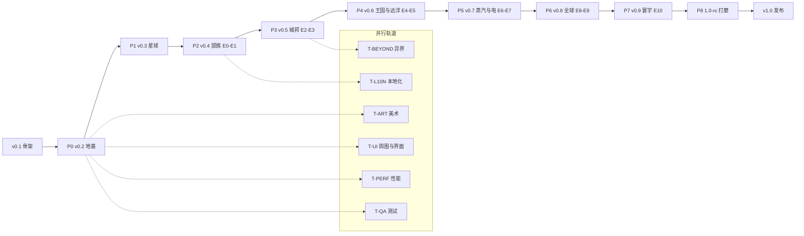

# 40 · 实现路线图 Implementation Roadmap

> 状态：设计稿 v1  
> 适用版本：v0.1（当前）→ v1.0  
> 依赖章节：[00](00-vision-and-pillars.md)、[01](01-eras-and-progression.md)、[02](02-architecture.md)、03-24 各模组章节、[30](30-vanilla-overrides.md)-[36](36-registry-index.md)

本章把整套设计拆成按顺序交付的阶段。每个阶段用 **退出标准（Exit Criteria，EC）** 收口：全部 EC 通过才发布对应版本号，没有日期，也不估工期。

阅读方式：

- 想知道“先做什么”：看第 3 节总览和第 4 节各阶段。
- 想知道“某个模组什么时候有内容”：看第 6 节模组 × 阶段矩阵。
- 想知道“一个功能怎样才算做完”：看第 8 节完成定义。
- 想知道“版本之间存档会不会坏”：看第 2 节与第 9 节。

---

## 1. 路线原则

| 编号 | 原则 | 说明 |
| --- | --- | --- |
| RM-P1 | 地基先行 | 核心 API（[03](03-core-civilization.md)、[04](04-core-technology.md)、[05](05-skills.md)、[33](33-data-api.md)）在 P0 冻结为 `api-v1`。之后只做向后兼容的增补。 |
| RM-P2 | 垂直切片 | 每个阶段交付“一段完整可玩的时代”，而不是“所有模组各做一层皮”。 |
| RM-P3 | 按时代推进 | 内容按 E0 → E10 推进。同一阶段内，各模组只实现本阶段时代的内容。 |
| RM-P4 | 独立可玩回归 | 每个阶段结束时，“任一主题模组 + 核心”的单独安装都必须通过冒烟测试（[02 §1.1](02-architecture.md)）。 |
| RM-P5 | 数据驱动 | 科技、配方、物种、作物、建筑蓝图、事件和传说模板都放在数据文件里。代码只实现机制。 |
| RM-P6 | 预算从第一天开始测 | P0 起提供 `/tcdebug profile` 和自动性能基准。超出 [02 §8](02-architecture.md) 预算视为阻断缺陷。 |
| RM-P7 | 存档可迁移 | P1（v0.3）起承诺存档只能向前迁移。破坏性变更必须附带迁移器（第 9 节）。 |
| RM-P8 | 占位可见、ID 稳定 | 未实现内容保留注册 ID，并使用 `tcivilization:placeholder` 占位贴图与说明；不允许出现紫黑缺失贴图。阶段之间不改 ID。 |
| RM-P9 | 文档即规格 | 实现与设计冲突时，先改文档再改代码。每个阶段结束时重新生成 [34](34-interaction-matrix.md) 和 [36](36-registry-index.md)。 |
| RM-P10 | DR 不可静默违背 | 任何削减或改动如果触及 [00 第 6 节](00-vision-and-pillars.md) 的 DR 决策，必须先得到用户确认，并新增 DR 修订记录。 |

---

## 2. 版本与兼容规则

### 2.1 版本号

| 对象 | 规则 | 示例 |
| --- | --- | --- |
| 整合包实例 | HMCL 实例名固定为 `Technology_and_Civalization` | `F:\Games\MC\.minecraft\versions\Technology_and_Civalization` |
| 发行包 | `dist\Technology_and_Civilization-v<版本>.zip`（沿用 v0.1 命名） | `Technology_and_Civilization-v0.4.zip` |
| 模组家族 | 18 个模组共用一个版本号，在根 `gradle.properties` 的 `mod_version` 中维护 | `0.4.2` |
| 阶段映射 | P0 = 0.2，P1 = 0.3 …… P7 = 0.9，P8 = `1.0.0-rc.N`，发布 = `1.0.0` | — |
| 补丁号 | 同一阶段内修复缺陷，不加新内容 | `0.4.0` → `0.4.1` |
| API 版本 | `tcivilization` 暴露整数常量 `TcApi.VERSION`，P0 = 1 | 主题模组在 `mods.toml` 中声明 `api ≥ 1` |
| 存档格式 | 每个 SavedData 与 `tc/` 二进制文件都带 `formatVersion`（[02 §7](02-architecture.md)） | `planet.bin formatVersion=3` |
| 数据包格式 | `tc_data_format` 整数，写在每个数据包 `pack.mcmeta` 的自定义字段 | `"tc_data_format": 1` |

### 2.2 兼容承诺随阶段收紧

| 范围 | v0.2 | v0.3 – v0.9 | v1.0 起 |
| --- | --- | --- | --- |
| 存档 | 不保证，需新建世界 | 向前迁移：新版本可以读旧存档 | 同左，并且 CI 覆盖所有已发布版本的样本存档 |
| 核心 API | 允许破坏性修改 | 只增不删；废弃项至少保留 1 个版本 | 语义化版本；破坏性修改只能出现在主版本 |
| 注册 ID | 允许修改 | 改名必须登记注册别名（第 9.2 节） | 不改名 |
| 大尺度地理（`planet.bin`） | 可变 | 已有存档永不重算，读取存档内保存的结果 | 同左 |
| 区块级生成细节 | 可变 | 可变，旧存档中新旧区块交界处可能有接缝，更新说明必须提示 | 同一主版本内冻结 |
| 数据包 | 可变 | 新增字段必须有默认值 | 同左，并为每次格式升级提供转换脚本 |

### 2.3 平台版本锁定

- 开发基线锁定在 **Minecraft Java 26.3 + NeoForge 26.3.0.101 + Sodium 0.9.2 + Iris 1.11.7**。
- 只有在两个阶段之间，才能单独执行一次平台升级“U 阶段”。U 阶段不加内容，只做到以下几点：
  1. 修复编译与混入（mixin）失效问题；
  2. 全量回归第 10 节测试；
  3. 重新验证 Sodium 与 Iris 兼容（[32 §6](32-art-audio.md)）；
  4. 发布补丁版本。
- 阶段进行中不升级平台。

---

## 3. 阶段总览

| 阶段 | 版本 | 代号 | 覆盖时代 | 已实现科技（累计） | 主线 | 退出门槛摘要 |
| --- | --- | --- | --- | --- | --- | --- |
| — | v0.1 | 骨架 Skeleton | — | 0 | 18 个模组占位、构建、打包 | 已完成 |
| P0 | v0.2 | 地基 Foundation | — | 0（360 项占位数据） | 核心 API、科技加载器、技能框架、HUD 外壳、测试设施 | 加载矩阵全绿；API v1 冻结 |
| P1 | v0.3 | 星球 Planet | — | 0 | Wildlands 星球生成、环绕、历史模拟骨架、Atlas 世界地图 | 确定性、无缝环绕、预计算 ≤ 100 s |
| P2 | v0.4 | 部族 Tribe | E0-E1 | 44 | 前 10 小时完整体验 | [01 §8](01-eras-and-progression.md) 脚本可完整通关 |
| P3 | v0.5 | 城邦 City-State | E2-E3 | 106 | 冶金、文字、道路、货币、法律、遗迹、AI 文明登场 | 3 城 + 2 AI 文明，200 日经济稳定 |
| P4 | v0.6 | 王国与远洋 Realms & Oceans | E4-E5 | 178 | 水力风力、造纸印刷、银行、远洋航行、航海图 | 跨洋贸易站维持 2 季 |
| P5 | v0.7 | 蒸汽与电 Steam & Current | E6-E7 | 256 | 工厂、铁路、电网、化工、污染与气候反馈 | **标准性能场景达标**（[02 §8.1](02-architecture.md)） |
| P6 | v0.8 | 全球 Global | E8-E9 | 326 | 航空、核能、计算、自动化、火箭与首颗卫星 | 500 NPC 与 8 万全局人口达标 |
| P7 | v0.9 | 寰宇 Orbit | E10 | 360 | 轨道、月球、火星、终局 | 火星自给殖民地可达成 |
| P8 | 1.0.0-rc.N | 打磨 Polish | 全部 | 360 | Beyond 收尾、平衡、美术音频、本地化、无障碍、多人压力测试 | 0 个阻断/严重缺陷，回归全绿 |
| R | 1.0.0 | 发布 Release | — | 360 | 发行 | 第 11 节发布清单 |

累计科技数来自 [01 第 2 节](01-eras-and-progression.md)：E0 18、E1 26、E2 30、E3 32、E4 36、E5 36、E6 40、E7 38、E8 36、E9 34、E10 34。Beyond 的 8 项科技计入各自时代，但它们可以在 T-BEYOND 轨道中以占位形式先行存在（第 5 节）。



关键路径是：**核心 API → 星球生成 → 聚落与人 → 工业与网络 → 轨道**。其中 Wildlands 的预计算管线和 `tcivilization:person` 是阻塞最多下游工作的两个组件，必须优先保证。

---

## 4. 阶段详述

每个阶段都按同一结构描述：目标、前置、交付范围、明确不做、退出标准（EC）、主要风险、可削减项。

- “可削减项”可以推迟到下一阶段，不阻塞本阶段发布。
- 推迟时必须在 [36](36-registry-index.md) 中把相关 ID 标记为 `placeholder`。

### 4.1 P0 · v0.2 · 地基 Foundation

**目标**：所有模组共享的连接层可用、可测试、可度量。玩家此时看不到新玩法，但能看到外壳：按 `J`、`U` 能打开对应面板（技能页经 `J` › 个人进入），按 `H` 能切换 HUD 级别，按住 `Z` 出现指令轮盘外壳。

**前置**：v0.1 已完成（18 个模组可构建、已打包）。

**交付范围**：

| 模组 / 设施 | 交付内容 | 规格来源 |
| --- | --- | --- |
| tcivilization | 地区网格（512 格）与 `tc/regions` 文件读写；`Civilization` / `Settlement` 登记对象；地区附加层 API（Region Layers）；事件总线与全部核心事件类型；`tcivilization:person` 实体骨架（寻路、日程桩、部件外观桩、存档）；模拟调度器与 LOD 分级（L0/L1/L2）；线程模型；`HudWidgetRegistry`、`CivPanelTabRegistry`、`J` 面板外壳；网络负载框架；`/tc` 与 `/tcdebug` 命令（`simulate`、`profile`、`selftest`） | [03](03-core-civilization.md)、[02 §2-5](02-architecture.md) |
| tctechnology | 科技数据加载器 `tc_tech`（校验前置存在、图无环、时代计数）；时代状态；研究点 RP；配方门槛条件；原版配方移除框架（清单在 [30](30-vanilla-overrides.md)）；`U` 科技树界面骨架；缺失模组替代条件框架（[01 §4.1](01-eras-and-progression.md)）；难度预设 | [04](04-core-technology.md) |
| tcskills | 22 个技能 ID 注册；熟练度经验 API；倍率 API；天赋数据加载器；技能页签界面骨架（快捷键默认未绑定）；与 `tcivilization` 的可选桥接 | [05](05-skills.md) |
| tcatlas | HUD 显示级别切换（`H`）；布局编辑器（`Ctrl+H`）可拖动测试组件并保存；时代皮肤加载框架（[32 §8](32-art-audio.md)） | [22](22-atlas.md) |
| 15 个主题模组 | 按 [02 §1.3](02-architecture.md) 修正 `mods.toml` 依赖；创建 `compat.<other>` 桥接包骨架；声明各自的地区附加层（可为空）；生成默认配置文件；注册全部附录 A ID 并使用占位资源 | 各模组章节附录 A |
| 构建与测试 | 根 Gradle 约定插件；JUnit 5；NeoForge GameTest；无头服务器测试脚本；文档校验（CI 运行 `aggregate.py --check --strict` 与 `api_index.py --check --strict`，检查 ID 重复、前置缺失、联动单向登记与 API 约定，见 README §5.4）；美术导出管线骨架 `tools/art-export/` | [02 §11](02-architecture.md)、[32 §4](32-art-audio.md) |
| 本地化 | `zh_cn` 与 `en_us` 语言文件骨架；键名规范 | [31](31-ui-ux.md) |

**明确不做**：世界生成、任何时代内容、NPC 行为、正式贴图。

**退出标准**：

| 编号 | 标准 | 验证方式 |
| --- | --- | --- |
| EC-P0-1 | `gradle clean build` 通过，包括全部单元测试 | 构建日志 |
| EC-P0-2 | 加载矩阵全部通过：仅核心；核心 + 每个主题模组单独安装（15 种）；全家族；全家族减去任意一个主题模组（15 种）。每种组合都能进入标题屏、创建世界、保存并退出，`tc*` 日志中没有 ERROR | 第 10.3 节组合测试脚本 |
| EC-P0-3 | API v1 冻结：[33](33-data-api.md) 列出的接口与事件全部有实现与 Javadoc，每个事件至少有一个 GameTest 触发 | GameTest 报告 |
| EC-P0-4 | 科技加载器能载入 360 项占位科技（由 [36](36-registry-index.md) 生成），前置全部存在，图无环，每个时代的数量与 01 一致 | `/tcdebug selftest tech` |
| EC-P0-5 | 全家族在空世界的空闲开销 ≤ 0.5 ms/tick | `/tcdebug profile` |
| EC-P0-6 | HUD 外壳：`H` 能循环三个显示级别；`Ctrl+H` 能移动测试组件，重启后布局仍保留 | 手动检查清单 |
| EC-P0-7 | SavedData 往返测试通过，并写入 `formatVersion = 1` | 单元测试 |
| EC-P0-8 | 文档校验为 0 错误：无重复 ID；前置全部存在；联动双向登记 | `aggregate.py --check --strict`、`api_index.py --check --strict`（README §5.4） |

**主要风险**：API 设计过早冻结，导致后续阶段需要破坏性修改。缓解办法：P0 的 API 只覆盖 P1-P3 已经确定会用到的部分，其余用 `@ApiStatus.Experimental` 标注。

**可削减项**：`person` 的部件外观系统可推迟到 P2；时代皮肤只要求 1 套（E0）。

---

### 4.2 P1 · v0.3 · 星球 Planet

**目标**：每个种子都会生成一颗地理可信的类地星球。玩家可以徒步探索、环绕世界，并在世界地图上看到已探索区域。

**前置**：EC-P0 全部通过。

**交付范围**：

| 模组 | 交付内容 | 规格来源 |
| --- | --- | --- |
| tcwildlands | 完整预计算管线：板块、高度场、侵蚀、水文、气候、生物群系、地质与矿床（[02 §6.1](02-architecture.md)）；`tcwildlands:earthlike` 维度类型（Y -512..1024）；区块生成器（双三次插值 + 本地细节）；东西环绕（DA-13）；岩石四形态与全部 `raw_<mineral>`；季节与天气基础（DR-13）；`minecraft:the_nether` 深地重做骨架；开局地点选择；进度屏 | [10](10-wildlands.md) |
| tcechoes | 历史模拟骨架（5,000 年，≤ 30 s），输出 `tc/history.bin` 与遗迹点位地区层；暂不生成遗迹结构 | [18](18-echoes.md) |
| tcnations | AI 文明初始分布（管线中的 N 步骤）：只写入数据，暂不运行 AI | [23](23-nations.md) |
| tcatlas | 世界地图（`M`）根据预计算结果与已探索区块渲染地形；地图瓦片缓存；路径点（`B`）基础功能；小地图渲染器完成，但只通过调试开关开放（正式开放受科技控制） | [22](22-atlas.md) |
| tcecology | 按生物群系替换原版动物生成表（只换分布，不含行为） | [11](11-ecology.md) |
| 原版改写 | 不生成原版村庄与大部分原版结构（DR-17）；原版敌对生物生成规则按 [30](30-vanilla-overrides.md) 改写（DA-08） | [30](30-vanilla-overrides.md) |
| 美术 | 全部岩石、土壤、矿石的 64x 贴图与 128x 资源包；矿石合成管线 `:tcwildlands:composeOreTextures` | [32 §3-5](32-art-audio.md) |

**明确不做**：聚落、科技内容、遗迹结构、AI 行为、灾害玩法。

**退出标准**：

| 编号 | 标准 | 验证方式 |
| --- | --- | --- |
| EC-P1-1 | 确定性：同一种子两次预计算得到逐字节相同的 `planet.bin`；随机抽取 1,000 个区块，两次生成的方块完全一致 | 单元测试（固定种子快照） |
| EC-P1-2 | 环绕：在 3 个纬度带越过 `x = ±81,920` 时，地形、群系、河流都没有可见接缝；玩家、坐骑、船只传送后速度与乘客关系保持不变 | GameTest + 手动截图对比 |
| EC-P1-3 | 在参考机上，预计算总耗时 ≤ 100 s，各步骤满足 [02 §8.3](02-architecture.md) | 基准测试 |
| EC-P1-4 | 抽查 20 个种子：每个种子都有 3 块以上大陆，单块大陆约 2-5 万格（DR-11）；最高山约 800 格；深海约 -300（DR-12）；99% 以上河流最终入海或进入内流盆地；出生点不在海中 | 统计脚本 + 人工评审 |
| EC-P1-5 | 世界地图打开时帧耗时 ≤ 4 ms；地图瓦片缓存磁盘占用符合 [22](22-atlas.md) 规格 | 帧耗时分析 |
| EC-P1-6 | 在 Sodium + Iris + Complementary 下，-512 与 1024 高度附近没有渲染错误；新方块的水、植物、发光映射正确 | [32 §6](32-art-audio.md) 检查清单 |
| EC-P1-7 | 不生成原版村庄；允许区域之外不刷原版敌对生物 | 统计 100 个 MC 日的生成日志 |
| EC-P1-8 | 存档迁移承诺生效：v0.3 存档能被后续补丁版本读取 | 样本存档测试 |

**主要风险**：预计算超时；高度范围扩大导致 Sodium 或光照引擎出现问题。缓解办法：P1 第一项工作先做“高度 -512..1024 + Sodium + Iris”的技术验证世界，再接入完整管线。

**可削减项**：深地维度只需能生成，内容推迟到 P5（地热）；Echoes 的历史模拟精度可以先低一档。

---

### 4.3 P2 · v0.4 · 部族 Tribe（E0-E1）

**目标**：从“玩家 + 4 名族人”的部族开始，经历石器时代与新石器时代，建成第一粮仓并宣布进入青铜时代。这就是 [01 §8](01-eras-and-progression.md) 的前 10 小时体验。

**前置**：EC-P1 全部通过。

**交付范围**：

| 模组 | 交付内容 |
| --- | --- |
| tctechnology | E0-E1 中由本模组拥有的科技，包括 `stone/fire_making`、`stone/knapping`、`stone/foraging_lore`；石器工具、狩猎矛、简易弓；科技树 `U` 可完整使用；时代宣布仪式（E0→E1、E1→E2） |
| tcsettlements | 开局部族（DA-01）；营地 → 村落；部落火塘里程碑；窝棚建造（`stone/shelter_building`）；E0-E1 职业（采集者、猎人、打制匠、守火人、农夫、牧人、陶工、织工）；住房基础；NPC 采集、狩猎、耕作、建造、作息 |
| tccultivation | `neolithic/cultivation`、`neolithic/animal_husbandry`；E1 作物与土壤；种子筛选；驯化；粮窖与第一粮仓里程碑；基础食品保存 |
| tcecology | E0-E1 狩猎相关物种的种群模型、习性、基础迁徙；狩猎压力反馈 |
| tcindustry | `neolithic/pottery`、`neolithic/weaving`；露天窑、陶器、纺织；手工加工过程 |
| tcdiscovery | 观察（`V`）；日志（`Y`）；E0-E1 研究点来源 |
| tcwildlands | 季节对作物与动物的影响；干旱等基础天气事件 |
| tcnetworks | 木筏、独木舟、雪橇、驮兽 |
| tcexchange | 赠礼经济与物物交换（按 [16](16-exchange.md) 的 E0-E1 范围） |
| tcfrontiers | 猛兽威胁；小部落袭扰 |
| tccommons | 族长与长老会治理；多人土地标记基础 |
| tcechoes | E0-E1 范围的传说与线索（篝火故事、岩画），不含遗迹结构 |
| tcatlas | 记忆地图（模糊、会褪色）；E1 手绘地图物品；8 个路径点；E0 与 E1 两套时代皮肤 |
| tcskills | E0-E1 行为产生熟练度（附录 D 中 E0-E1 的挂钩）；第一层天赋 |
| 美术与音频 | E0-E1 全部内容的 64x 与 128x 贴图；NPC 部件外观第一批；营地与荒野声景（[32 §10](32-art-audio.md)） |

**明确不做**：AI 文明运行（由 Frontiers 的部族袭扰与 Echoes 线索暂代）；货币；金属；遗迹结构。

**退出标准**：

| 编号 | 标准 | 验证方式 |
| --- | --- | --- |
| EC-P2-1 | 3 名试玩者在标准难度、不使用命令的情况下，完整走完 01 §8 脚本，并且每一步的触发条件都正常触发 | 试玩记录（第 10.4 节） |
| EC-P2-2 | E0→E1→E2 时代跃迁在两种模式下都能完成：全家族模式；“核心 + 单个主题模组”的替代条件模式（01 §4.1，至少测试 Cultivation 缺失与 Settlements 缺失两种） | GameTest + 手动检查 |
| EC-P2-3 | 44 项 E0-E1 科技全部非占位，每项科技解锁的内容都有 GameTest | GameTest 报告 |
| EC-P2-4 | 村落中有 30 名实体 NPC，连续 10 个 MC 日长测，寻路卡住率 < 2% | `/tcdebug simulate` 报告 |
| EC-P2-5 | 无头模拟 100 个 MC 日：标准难度、默认政策下，村落能存续；L0 与 L2 结果一致性符合 [02 §4.2](02-architecture.md) | 长时模拟测试 |
| EC-P2-6 | HUD 与地图遵守时代门槛：E0-E2 没有小地图；记忆地图会褪色 | 手动检查 |
| EC-P2-7 | 技能倍率处于 DR-25 定义的“中等”范围内（具体上下限见 [35](35-balance.md)） | 单元测试 |
| EC-P2-8 | E0-E1 内容不使用占位贴图 | 资源扫描脚本 |

**主要风险**：`person` 的 AI 与寻路是全项目最复杂、复用最多的系统。缓解办法：P2 期间对 NPC AI 做专项性能分析，并把结果作为 P3-P6 的扩展基线。

**可削减项**：Ecology 的迁徙；Echoes 传说；E1 驮兽。

---

### 4.4 P3 · v0.5 · 城邦 City-State（E2-E3）

**目标**：从青铜时代走到铁器时代。冶炼、书写、车轮、铸币、法律、道路与城墙出现；第一批遗迹可以考古；AI 文明作为邻居登场。

**前置**：EC-P2 全部通过。

**交付范围**：

| 模组 | 交付内容 |
| --- | --- |
| tcindustry | 采矿流程；`bronze/smelting`、`bronze/alloying`、`iron/bloomery`；竖炉、木炭、块炼炉；金属工具（全部金属工具归 Industry） |
| tcnetworks | `bronze/the_wheel`、`iron/road_building`；牛车、车队、铺装道路、河船、近岸帆船、驿站；大道里程碑的道路判定 |
| tcexchange | 商品货币与称量银；`iron/coinage` 与铸币厂；市场、订单、商队、商业信誉；地区供需模型；记账单位 VU |
| tcdiscovery | `bronze/writing`；泥板与石碑；书吏；考古基础（与 Echoes 联动） |
| tccommons | 议事厅；法典与律法石碑里程碑；征税；土地权利；城邦、王权与共和治理形态 |
| tcsettlements | 镇 → 城；`iron/masonry`；城墙；E2-E3 职业；教育；公共卫生与聚落疫病 |
| tcfrontiers | 盗匪；E2+ 武器与护甲；防御工事方块；攻城器械；边疆据点与远征补给 |
| tcechoes | 根据历史模拟生成遗迹结构；古文物；地方传说与历史事件呼应 |
| tcnations | AI 文明 L2 抽象模拟开始运行：扩张、科技、贸易；首次接触；边界；外交页签（`J` › 文明 › 外交）基础动作；边境冲突（DR-22） |
| tcatlas | E2 地标、路标、32 个路径点、石碑记录；E3 道路测量与首个小地图（半径 64，仅显示已测绘地区） |
| tccultivation | E2-E3 作物、灌溉、畜力耕作、地区特产 |
| tcecology | 食物网与生态演替；采矿、开垦、捕猎对生态的长期影响（DR-14 的慢速部分） |
| tcwildlands | 洪水、地震的物理过程；可供采矿的地质细节 |
| tcskills | 第二层天赋；E2-E3 挂钩 |
| T-BEYOND | 异界影响区与原版怪物规则的第一版（第 5 节） |

**退出标准**：

| 编号 | 标准 | 验证方式 |
| --- | --- | --- |
| EC-P3-1 | E2→E3→E4 跃迁在全家族与替代模式下都能完成 | GameTest + 试玩 |
| EC-P3-2 | 3 座玩家聚落 + 2 个 AI 文明无头运行 200 个 MC 日：价格保持在 [35](35-balance.md) 规定区间内；不存在无限套利循环；货币总量增长率在设计范围内 | 长时模拟 + 经济审计脚本 |
| EC-P3-3 | 大道里程碑：车队沿 1,000 格以上道路往返时，在区块卸载期间切换为 L1 抽象运输，重新加载后位置一致 | GameTest |
| EC-P3-4 | 100 名实体 NPC 场景满足 [02 §8](02-architecture.md) 中按比例换算的预算 | 性能基准 |
| EC-P3-5 | 每个种子的遗迹都与 `history.bin` 一致；传说文本引用真实历史事件 | 一致性检查脚本 |
| EC-P3-6 | AI 文明会扩张、贸易、发生边境冲突；全部外交动作都有效果 | 无头模拟 + 手动检查 |
| EC-P3-7 | HUD 与小地图合计 ≤ 0.6 ms/帧 | 帧耗时分析 |
| EC-P3-8 | v0.4 存档迁移到 v0.5 成功，NPC、作物、科技状态完整保留 | 样本存档测试 |

**主要风险**：经济系统失衡；AI 文明与玩家文明共用 `person`，导致实体数量失控。缓解办法：AI 文明默认只在 L2 运行，只有玩家靠近时才实体化，并受 [02 §4.1](02-architecture.md) 实体化预算约束。

**可削减项**：攻城器械的完整物理效果（可以先抽象结算）；地震。

---

### 4.5 P4 · v0.6 · 王国与远洋 Realms & Oceans（E4-E5）

**目标**：从中世纪走到大航海时代。水力与风力带来第一批可见的机械动力；纸、书、学府和印刷推动知识传播；远洋船把贸易扩展到另一块大陆。

**前置**：EC-P3 全部通过。

**交付范围**：

| 模组 | 交付内容 |
| --- | --- |
| tcindustry | `medieval/water_power`；水车、风车、传动轴网络（SU，DR-20）；水力锻锤；玻璃；火药；精密黄铜 |
| tcnetworks | 马车；运河与闸门；柯克船、卡拉维尔船、盖伦船；港口；远洋航线；远洋贸易站里程碑判定 |
| tcexchange | `medieval/guilds`、`renaissance/banking`；汇票；纸币；文明之间的汇率（DR-23） |
| tcdiscovery | `medieval/papermaking`、`renaissance/printing_press`、`renaissance/scientific_method`；学府里程碑；实验；望远镜；知识传播 |
| tcatlas | `medieval/magnetic_compass`（罗盘方位条，小地图半径 128）；`renaissance/celestial_navigation`；航海图（经纬网格、海岸线、洋流图层） |
| tcsettlements | 行会师傅、修士学者、水手、银行家等职业；瘟疫事件 |
| tccommons | 封建与行会自治；议会与君主立宪 |
| tcfrontiers | 城堡；海盗；殖民边疆 |
| tcnations | 王国规模 AI；城堡战争；跨大陆殖民 |
| tcwildlands | 洋流、盛行风（影响航行）；风暴 |
| tcecology | 海洋物种；过度捕捞反馈 |
| tccultivation | 跨大陆作物引种；地区特产与贸易需求 |
| T-BEYOND | 末地重做 `minecraft:the_end` 作为异界入口；第一个异界维度可游玩切片 |

**退出标准**：

| 编号 | 标准 | 验证方式 |
| --- | --- | --- |
| EC-P4-1 | E4→E5→E6 跃迁在两种模式下都能完成 | GameTest + 试玩 |
| EC-P4-2 | 船只跨越大洋：船只在 L1 抽象航行与实体航行之间切换无损；航线沿洋流时有预期收益 | GameTest |
| EC-P4-3 | 远洋贸易站在另一块大陆维持 2 季，期间补给与贸易全部通过实体或抽象航线完成 | 试玩 + 无头模拟 |
| EC-P4-4 | 传动轴网络有 100 个机械部件时，Industry 的 tick 耗时在预算内 | 性能基准 |
| EC-P4-5 | 瘟疫事件只影响聚落与 NPC，不影响玩家（DA-12）；可通过公共卫生政策遏制 | GameTest |
| EC-P4-6 | 多大陆经济：2 块大陆、5 座聚落、3 个 AI 文明运行 300 个 MC 日，汇率稳定在 [35](35-balance.md) 区间内 | 长时模拟 |
| EC-P4-7 | 罗盘条、航海图图层与经纬网格在环绕边界正确连续 | 手动检查 |

**主要风险**：船只实体在长距离航行中的区块加载问题；机械动力网络的性能问题。

**可削减项**：盖伦船以外的船型变体；过度捕捞反馈。

---

### 4.6 P5 · v0.7 · 蒸汽与电 Steam & Current（E6-E7）

**目标**：工业革命与电气化。工厂需要供应链、劳动力和运输；铁路与电网把聚落连接成区域经济；污染开始改变气候。这是 **主性能门槛**。

**前置**：EC-P4 全部通过。

**交付范围**：

| 模组 | 交付内容 |
| --- | --- |
| tcindustry | `industrial/steam_engine`、`industrial/steelmaking`、`industrial/machine_tools`；锅炉；焦炭；多方块机器；设备维护；传送带与管道；`electric/power_grid`、`electric/internal_combustion`、`electric/industrial_chemistry`；原油、天然气与炼化（相关流体归 Industry） |
| tcnetworks | `industrial/railway`、`electric/telegraphy`；轨道、信号、车站、调度；蒸汽机车与蒸汽船；电车、汽车、卡车；配送中心；干线铁路里程碑判定 |
| tcsettlements | 都市；机械工、司炉、电工等职业；工业事故；工会 |
| tcexchange | 中央银行；股票交易所；电汇 |
| tcwildlands | 污染与碳排放驱动区域气候变化（DR-14）；深地维度的地热内容 |
| tcecology | 污染影响；局部灭绝风险；生态恢复 |
| tccommons | 宪政、工会、普选等治理形态；公共工程 |
| tcfrontiers | 大规模边境战争；工业时代武器 |
| tcnations | 工业化 AI；战争宏观规则 |
| tcatlas | 三角测量；等高线、地质与铁路图层；电报联网后显示远程聚落实时数据；天气图层 |
| tcdiscovery | 实验室；专业研究机构 |

**退出标准**：

| 编号 | 标准 | 验证方式 |
| --- | --- | --- |
| EC-P5-1 | **标准性能场景**（单人、E6、3 座城、200 名实体 NPC）满足 [02 §8.1](02-architecture.md)：模组合计平均耗时 ≤ 10 ms/tick，各模组峰值不超标；整体 MSPT ≤ 35 ms | 自动性能基准，连续 3 次运行 |
| EC-P5-2 | E6→E7→E8 跃迁在两种模式下都能完成 | GameTest + 试玩 |
| EC-P5-3 | 干线铁路总长 ≥ 5,000 格并连接 3 座城；列车在实体与抽象状态之间切换时，货物守恒 | GameTest + 货物守恒审计 |
| EC-P5-4 | 区域电网同时为 5 座聚落供电；断路与过载行为符合 [13](13-industry.md) | GameTest |
| EC-P5-5 | 气候可逆：高排放运行 200 个 MC 日后，区域气候偏移可以测量；治理后逐步恢复（DR-14） | 长时模拟 |
| EC-P5-6 | 工厂供应链：一条 E6 产业链在原料、劳动力或运输任一缺失时会停工，并在 HUD 和文明面板中给出可读原因 | 手动检查 |

**主要风险**：这是性能最容易失控的阶段。如果 EC-P5-1 不通过，P6 不能开始。缓解办法：P5 前半程先完成工厂与铁路的 L1 抽象，再加内容。

**可削减项**：电车；股票交易所的完整撮合（可先用简化价格模型）。

---

### 4.7 P6 · v0.8 · 全球 Global（E8-E9）

**目标**：航空、核能、计算机、自动化与全球网络。人口达到数万；聚落变成特大城市；文明开始为进入太空做准备。

**前置**：EC-P5 全部通过。

**交付范围**：

| 模组 | 交付内容 |
| --- | --- |
| tcindustry | `atomic/nuclear_fission`（包括事故机制）、`atomic/transistor`、`information/integrated_circuit`、`information/automation`；石化与塑料；光伏、风机与智能电网；锂电池 |
| tcnetworks | `atomic/powered_flight`、`information/computer_networks`；机场与航线；高速公路；油轮与管道；集装箱与自动调度；高铁；洲际航线里程碑判定 |
| tcorbit | `information/rocketry`；发射场；探空火箭；首颗人造卫星里程碑（E9→E10） |
| tcsettlements | 特大城市；500 名实体 NPC 上限；全局人口 2-8 万 |
| tcexchange | 国际货币体系；电子支付 |
| tcdiscovery | 计算机加速研究；数字知识传播 |
| tcwildlands | 气候变化全球反馈 |
| tccommons | 福利国家与计划经济（可选）；数字治理 |
| tcfrontiers / tcnations | 空袭；雷达预警；全球外交 |
| tcatlas | `atomic/radar`（显示移动目标）；航拍；GIS 图层叠加、分析与路线规划 |

**退出标准**：

| 编号 | 标准 | 验证方式 |
| --- | --- | --- |
| EC-P6-1 | 500 名实体 NPC 在客户端渲染耗时 ≤ 3 ms/帧；服务器预算达标 | 性能基准 |
| EC-P6-2 | 8 万全局人口的抽象模拟仍满足 [02 §8.1](02-architecture.md) | 长时模拟 |
| EC-P6-3 | 跨洋定期航班运营 1 年（48 个 MC 日） | 无头模拟 + 试玩 |
| EC-P6-4 | 首颗人造卫星发射后进入在轨状态，并解锁 E10 门槛 | GameTest |
| EC-P6-5 | 核事故可预防、可发生、可治理；后果只作用于地区与聚落层（DR-19） | GameTest |
| EC-P6-6 | E8→E9→E10 跃迁在两种模式下都能完成；Orbit 缺失时使用“全球通信网”替代条件 | GameTest |

**主要风险**：飞机这类高速载具会触发大量区块加载；全球人口规模推高抽象模拟成本。

**可削减项**：油轮与管道运输；高铁专用线路。

---

### 4.8 P7 · v0.9 · 寰宇 Orbit（E10）

**目标**：轨道、月球与火星。完成终局目标“火星自给殖民地”，生成本文明编年史。

**前置**：EC-P6 全部通过。

**交付范围**：

| 模组 | 交付内容 |
| --- | --- |
| tcorbit | `space/life_support`、`space/orbital_assembly`、`space/in_situ_resources`、`space/interplanetary_transfer`；维度 `tcorbit:low_orbit`、`tcorbit:moon`、`tcorbit:mars`；轨道站模块；太空服；月面车；月面采矿；氦-3；火星殖民；太空碎片、太阳风暴、火星沙尘暴 |
| tcindustry | 先进裂变、太空光伏、RTG、实验聚变；钛合金与碳纤维 |
| tcsettlements | 宇航员、任务控制员、殖民者；殖民地聚落规则 |
| tcexchange | 多星球结算 |
| tccommons | 星际宪章治理 |
| tcatlas | 卫星图像；GPS 精确坐标；月球与火星地图 |
| tcechoes | “文明纪元”结算：生成本文明的编年史书 |

**退出标准**：

| 编号 | 标准 | 验证方式 |
| --- | --- | --- |
| EC-P7-1 | 月球与火星维度生成具有确定性；在 Sodium + Iris 下渲染正常 | 单元测试 + 检查清单 |
| EC-P7-2 | 终局可达：50 名殖民者在火星连续 1 年无需地球补给 | 无头模拟 + 至少 1 次完整试玩 |
| EC-P7-3 | 已实现 360 项科技，0 项占位（Beyond 可例外，见第 5 节） | 汇总脚本 |
| EC-P7-4 | 编年史书内容覆盖本存档的时代跃迁、里程碑、战争与重大事件 | 手动检查 |
| EC-P7-5 | 终局后游戏可以继续，所有系统继续运行，不出现异常 | 长时模拟 |

**可削减项**：小行星采矿可简化为轨道任务（DR-04 提到小行星采矿；如果削减到无法游玩，必须先得到用户确认）。

---

### 4.9 P8 · 1.0.0-rc.N · 打磨 Polish

**目标**：把“功能齐全”打磨成“可以发布”。

**交付范围**：

| 方向 | 交付内容 |
| --- | --- |
| Beyond | 完成全部异界内容、科技与维度（[21](21-beyond.md)） |
| 平衡 | 依据试玩遥测与无头模拟调整 [35](35-balance.md)，使标准难度总时长落在 300-500 小时（DR-05），每个时代时长偏差不超过 ±25% |
| 美术 | 256x 与 512x 资源包；全部 LabPBR 通道；时代 UI 皮肤 11 套 |
| 音频 | 全部声景、机器音效与音乐（[32 §10-11](32-art-audio.md)） |
| 光影 | Iris 兼容最终版；`/tcclient shadercompat apply` 覆盖全部方块类别 |
| 本地化 | `zh_cn` 与 `en_us` 100% 覆盖；其他语言开放社区翻译 |
| 无障碍 | 色盲安全色板、UI 缩放、按键冲突检查、字幕（[31](31-ui-ux.md)） |
| 多人 | 4-8 名玩家合作压力测试（DR-01、DR-02） |
| 引导 | 游戏内指南与工具提示（Discovery 日志承载） |

**退出标准（即 v1.0 发布门槛）**：

| 编号 | 标准 |
| --- | --- |
| EC-P8-1 | 0 个阻断级、0 个严重级缺陷 |
| EC-P8-2 | P0-P7 全部 EC 回归通过 |
| EC-P8-3 | 每个时代至少 2 次完整人工试玩；另外进行 1 次 407 小时等效的无头全程模拟 |
| EC-P8-4 | 8 名玩家服务器在 E6 标准场景下 MSPT ≤ 40 ms，地图同步带宽符合 [22](22-atlas.md) 规格 |
| EC-P8-5 | 所有已发布版本（v0.3 起）的样本存档都能迁移到 v1.0 |
| EC-P8-6 | 文档与实现一致：`aggregate.py` 与 `api_index.py` 的 `--check --strict` 均 0 错误、0 警告；[36](36-registry-index.md) 中没有 `placeholder` |

---

## 5. 并行轨道

并行轨道不单独发布版本。它们挂在各阶段上，按阶段交付各自的增量。

| 轨道 | 负责范围 | P0 | P1 | P2 | P3 | P4 | P5 | P6 | P7 | P8 |
| --- | --- | --- | --- | --- | --- | --- | --- | --- | --- | --- |
| T-ART 美术 | [32](32-art-audio.md) | 导出管线、占位规范 | 岩石、土壤、矿石 | E0-E1 全部；NPC 外观第一批 | E2-E3 | E4-E5 | E6-E7 | E8-E9 | E10、月球、火星 | 256x/512x、LabPBR 补全 |
| T-AUDIO 音频 | [32 §10-11](32-art-audio.md) | 声音注册框架 | 自然声景 | 营地、狩猎、手工 | 冶炼、市集 | 水车、风车、航海 | 蒸汽、工厂、铁路 | 航空、电子 | 太空 | 音乐与混音 |
| T-UI 舆图与界面 | [22](22-atlas.md)、[31](31-ui-ux.md) | HUD 外壳、布局编辑器 | 世界地图 | 记忆地图、手绘地图 | 小地图 r64 | 罗盘条、航海图 | 专题图层 | GIS、雷达 | 卫星、行星地图 | 皮肤、无障碍 |
| T-PERF 性能 | [02 §8](02-architecture.md) | 度量工具、基准 | 预计算 | NPC AI 基线 | 经济与 AI 文明 | 机械网络、船只 | **主门槛** | 500 NPC、8 万人口 | 多维度 | 多人 |
| T-BEYOND 异界 | [21](21-beyond.md) | 占位 | — | — | 影响区、原版怪物规则 | 末地重做、第一个异界维度 | 中期内容 | 后期内容 | — | 完成 |
| T-QA 测试 | 第 10 节 | 测试设施、加载矩阵 | 确定性、环绕 | 试玩脚本 | 经济审计 | 航行 | 货物守恒 | 规模 | 终局 | 回归 |
| T-L10N 本地化 | [31](31-ui-ux.md) | 键名规范 | — | 中英同步开始 | 持续 | 持续 | 持续 | 持续 | 持续 | 100% |
| T-DOC 文档 | 本目录 | API 文档 | — | 每阶段结束后运行 `aggregate.py` 与 `api_index.py` 重新生成 34/36/33，并更新本章状态 | | | | | | 玩家指南 |
| T-COMPAT 兼容 | [02 §10](02-architecture.md) | Sodium/Iris 冒烟 | 高度范围 | 每阶段回归 | | | | | | 最终验证 |

Beyond 的特殊规则：

- Beyond 是可选支线（DR-06）。在它的正式切片完成前，`tcbeyond` 的 8 项科技可以以占位形式存在，并且可以研究，但只解锁说明文本。
- 这些占位不阻塞 P2-P7 的 EC。
- P8 必须清零。

---

## 6. 模组 × 阶段交付矩阵

单元格写本阶段新增的主要内容；“—”表示本阶段没有新增内容。

| 模组 | P0 | P1 | P2 E0-E1 | P3 E2-E3 | P4 E4-E5 | P5 E6-E7 | P6 E8-E9 | P7 E10 | P8 |
| --- | --- | --- | --- | --- | --- | --- | --- | --- | --- |
| tcivilization | 全部核心 API、`person` 骨架、调度器 | 地理地区层 | `person` AI 基线 | 实体化预算调优 | L1 航行抽象支持 | L1 列车与工厂抽象 | 8 万人口扩展 | 多维度文明 | 打磨 |
| tctechnology | 加载器、`U`、替代条件 | — | E0-E1 本模组科技、石器 | 本模组 E2-E3 科技 | 本模组 E4-E5 科技 | 本模组 E6-E7 科技 | 本模组 E8-E9 科技 | 本模组 E10 科技 | 难度预设平衡 |
| tcskills | API、22 技能、技能页签 | — | 第一层天赋 | 第二层天赋 | 第三层 | 第四层 | 第五层 | 终局天赋 | 平衡 |
| tcwildlands | 占位 | **星球生成**、环绕、季节 | 季节与干旱影响 | 洪水、地震 | 洋流、风、风暴 | 气候反馈、深地地热 | 全球气候变化 | — | 打磨 |
| tcecology | 占位 | 动物分布 | 种群、狩猎 | 食物网、演替 | 海洋 | 污染影响 | 全球生态 | — | 打磨 |
| tccultivation | 占位 | — | 农耕、驯化、粮仓 | 灌溉、特产 | 引种 | 机械化农业 | 现代农业 | 太空农业 | 平衡 |
| tcindustry | 占位 | — | 陶器、纺织 | 冶炼、合金、块炼 | 水力、风力、传动轴 | 蒸汽、钢、机床、电、化工 | 核能、半导体、自动化 | 先进能源 | 平衡 |
| tcnetworks | 占位 | — | 筏、独木舟、雪橇 | 车轮、道路、河船 | 运河、远洋船 | 铁路、电报、汽车 | 航空、网络、集装箱 | — | 打磨 |
| tcsettlements | 占位 | — | 部族、营地、村落 | 镇、城、城墙、疫病 | 瘟疫、行会职业 | 都市、工业事故 | 特大城市、500 NPC | 殖民地 | 平衡 |
| tcexchange | 占位 | — | 赠礼与物物交换 | 铸币、市场、商队 | 行会、银行、汇率 | 央行、股市 | 国际货币、电子支付 | 多星球结算 | 平衡 |
| tcdiscovery | 占位 | — | 观察、日志 | 文字、考古 | 造纸、学府、印刷、科学方法 | 实验室 | 计算机研究 | — | 指南 |
| tcechoes | 占位 | 历史模拟骨架 | 传说 | 遗迹结构、古文物 | 更多遗迹类型 | 工业遗址 | — | 编年史 | 打磨 |
| tccommons | 占位 | — | 族长、长老会 | 法典、税、土地 | 封建、议会 | 宪政、工会 | 福利、数字治理 | 星际宪章 | 多人测试 |
| tcfrontiers | 占位 | — | 猛兽、部族袭扰 | 盗匪、武器、攻城 | 城堡、海盗 | 边境战争 | 空袭 | 太空威胁 | 平衡 |
| tcbeyond | 占位 | — | — | 影响区 | 末地、异界维度 | 中期 | 后期 | — | **完成** |
| tcatlas | HUD 外壳 | 世界地图 | 记忆地图、手绘图 | 地标、小地图 | 罗盘、航海图 | 测量、专题图层 | 雷达、GIS | 卫星、行星地图 | 皮肤 |
| tcnations | 占位 | 初始分布 | — | AI 运行、外交 | 王国、殖民 | 工业化 AI、战争 | 全球外交 | — | 平衡 |
| tcorbit | 占位 | — | — | — | — | — | 火箭、首颗卫星 | **轨道、月球、火星** | 打磨 |

---

## 7. 科技实现计划

| 时代 | 科技数 | 实现阶段 | 累计 | 时代关键科技（拥有者） | 里程碑 |
| --- | --- | --- | --- | --- | --- |
| E0 `stone` | 18 | P2 | 18 | fire_making、knapping、foraging_lore（tctechnology）；shelter_building（tcsettlements） | 部落火塘 |
| E1 `neolithic` | 26 | P2 | 44 | cultivation、animal_husbandry（tccultivation）；pottery、weaving（tcindustry） | 第一粮仓 |
| E2 `bronze` | 30 | P3 | 74 | smelting、alloying（tcindustry）；writing（tcdiscovery）；the_wheel（tcnetworks） | 律法石碑 |
| E3 `iron` | 32 | P3 | 106 | bloomery（tcindustry）；coinage（tcexchange）；road_building（tcnetworks）；masonry（tcsettlements） | 大道 |
| E4 `medieval` | 36 | P4 | 142 | water_power（tcindustry）；papermaking（tcdiscovery）；guilds（tcexchange）；magnetic_compass（tcatlas） | 学府 |
| E5 `renaissance` | 36 | P4 | 178 | printing_press、scientific_method（tcdiscovery）；celestial_navigation（tcatlas）；banking（tcexchange） | 远洋贸易站 |
| E6 `industrial` | 40 | P5 | 218 | steam_engine、steelmaking、machine_tools（tcindustry）；railway（tcnetworks） | 干线铁路 |
| E7 `electric` | 38 | P5 | 256 | power_grid、internal_combustion、industrial_chemistry（tcindustry）；telegraphy（tcnetworks） | 区域电网 |
| E8 `atomic` | 36 | P6 | 292 | nuclear_fission、transistor（tcindustry）；powered_flight（tcnetworks）；radar（tcatlas） | 洲际航线 |
| E9 `information` | 34 | P6 | 326 | integrated_circuit、automation（tcindustry）；computer_networks（tcnetworks）；rocketry（tcorbit） | 首颗人造卫星 |
| E10 `space` | 34 | P7 | 360 | life_support、orbital_assembly、in_situ_resources、interplanetary_transfer（tcorbit） | 火星自给殖民地 |

各模组在每个阶段需要实现的科技清单，由汇总脚本根据各章附录 B 生成，写入 [36](36-registry-index.md) 的“按时代分组”部分。

一项科技只有满足以下全部条件，才算“已实现”：

1. 数据文件存在，并且字段完整；
2. 解锁的全部配方、方块、物品、建筑或政策都可用；
3. 中英文名称与描述齐全；
4. 有 GameTest 验证解锁效果；
5. 科技树图标不是占位图标。

---

## 8. 完成定义 Definition of Done

一个功能（方块、机器、物种、建筑、政策、界面等）只有在下列各项全部满足时才算完成。

| # | 项目 | 说明 |
| --- | --- | --- |
| D1 | 代码 | 实现符合模组章节规格；没有编译警告；Javadoc 覆盖公开 API |
| D2 | 数据 | 平衡数值在数据包中，不写死在代码里（[02 §9](02-architecture.md)） |
| D3 | 注册 | ID 已在章节附录 A 中登记，并由汇总脚本收录进 [36](36-registry-index.md) |
| D4 | 联动 | 涉及其他模组时，已在两边章节附录 C 登记，并通过桥接类实现（[02 §1.4](02-architecture.md)） |
| D5 | 缺失模组 | 在联动对象未安装时，功能仍能工作或优雅降级 |
| D6 | 技能 | 若附录 D 有挂钩，熟练度与倍率生效 |
| D7 | 界面 | HUD 组件或面板页签已注册；工具提示齐全；遵守时代门槛 |
| D8 | 本地化 | `zh_cn` 与 `en_us` 都有完整文本 |
| D9 | 美术 | 64x 内置贴图与 128x 资源包贴图；LabPBR `_n`/`_s` 通道；Iris 类别映射（[32](32-art-audio.md)） |
| D10 | 音频 | 有对应的声音事件与字幕 |
| D11 | 测试 | 纯逻辑有单元测试，游戏内行为有 GameTest |
| D12 | 性能 | 已用 `/tcdebug profile` 测量，计入所属模组预算 |
| D13 | 存档 | 新状态带 `formatVersion`；若修改旧状态，必须附迁移器 |
| D14 | 多人 | 状态在服务器端维护，客户端只做显示；同步负载已登记 |
| D15 | 文档 | 如果实现与规格不同，先更新章节 |

---

## 9. 存档与数据迁移

### 9.1 迁移器

- 每个模组提供 `TcMigrator` 实现，签名为 `migrate(int fromVersion, CompoundTag data) → CompoundTag`。迁移器链式执行。
- `tc/` 下的二进制文件（`planet.bin`、`history.bin`、`regions/*.tcr`、`people/*.tcp`）都在文件头记录版本。读取时如果版本较旧，先迁移到内存，下次保存时写入新版本。
- 迁移失败时：不覆盖原文件，在 `logs/tc-migration.log` 中写入详细信息，并在客户端弹出可读错误，提示玩家备份。

### 9.2 注册 ID 变更

- v0.3 起，注册 ID 改名必须通过注册别名把旧 ID 映射到新 ID，并在 [36](36-registry-index.md) 的“别名”表中登记。
- 删除 ID 时，旧方块转换为 `tcivilization:placeholder`，旧物品转换为同名说明物品，不允许出现“世界加载时静默丢失方块”。

### 9.3 世界生成变更

- 大尺度地理保存在 `planet.bin` 中，已有存档永不重新计算，因此河流、气候与大陆形状不会因更新而改变。
- 区块级细节噪声在 v0.x 中可能变化。更新说明必须标注“旧存档未生成区块可能出现接缝”。
- v1.0 起，同一主版本内冻结区块级生成。

### 9.4 样本存档

- 每次发布都在 `testdata/saves/v<版本>/` 保存 3 个样本存档：
  1. 刚开局；
  2. 本阶段最高时代中期；
  3. 多人存档。
- CI 中的迁移测试会把所有历史样本加载到当前版本，然后运行 `/tcdebug selftest` 并比对关键统计量：人口、科技数、聚落数和货币总量。

---

## 10. 测试与试玩

### 10.1 参考机

性能 EC 统一在“参考机”上测量。参考机对应 DR-30 的“中高端单机”。

| 部件 | 规格 |
| --- | --- |
| CPU | 8 核 16 线程，桌面级（与 [02 §8.3](02-architecture.md) 的“8 核”一致） |
| 内存 | 32 GB；客户端分配 10-12 GB（[02 §8.2](02-architecture.md)） |
| GPU | 8 GB 显存级别 |
| 存储 | NVMe SSD |
| 设置 | 渲染距离 16；模拟距离 10；Sodium 默认；Iris + Complementary Reimagined 默认档；128x 资源包 |

### 10.2 测试层级

| 层级 | 工具 | 频率 |
| --- | --- | --- |
| 单元测试 | JUnit 5 | 每次构建 |
| 确定性快照 | 固定种子 + 哈希比对 | 每次构建 |
| GameTest | NeoForge GameTest 服务器 | 每次构建 |
| 加载矩阵 | 第 10.3 节组合脚本 | 每次发布 |
| 长时模拟 | 无头服务器 + `/tcdebug simulate <duration>`（如 `200d`，03 §5.13） | 每次发布；每个阶段至少一次长于 200 个 MC 日 |
| 性能基准 | `/tcdebug profile` + Spark | 每次发布；P5 起每周固定运行 |
| 人工试玩 | 第 10.4 节脚本 | 每个阶段结束 |
| 多人压力 | 2/4/8 人服务器 | P3、P5、P8 |

### 10.3 模组组合测试策略

15 个主题模组的完整组合有 2^15 种，不能穷举。采用以下集合：

| 集合 | 数量 | 目的 |
| --- | --- | --- |
| 仅核心（`tcivilization` + `tctechnology` + `tcskills`） | 1 | 核心独立运行 |
| 核心 + 单个主题模组 | 15 | 独立可玩性（RM-P4） |
| 全家族 | 1 | 主体验 |
| 全家族减一个主题模组 | 15 | 替代条件与降级 |
| [34](34-interaction-matrix.md) 中登记的每一对联动：核心 + 这两个模组 | 等于联动对数 | 联动本身 |
| 仅 `tcskills` | 1 | 完全独立（[02 §1.3](02-architecture.md)） |

注意：`tcorbit` 必须依赖 `tcindustry`，所以“核心 + tcorbit”实际测试的是“核心 + tcindustry + tcorbit”。

### 10.4 试玩脚本

| 阶段 | 脚本 | 通过条件 |
| --- | --- | --- |
| P2 | 01 §8 前 10 小时 | 不看文档、不用命令完成 E1→E2 跃迁 |
| P3 | 从 E2 存档开始建成律法石碑与大道 | 能理解经济面板，并主动使用商队 |
| P4 | 从 E4 存档开始跨洋建立贸易站 | 在航海图引导下完成首次远洋 |
| P5 | 从 E6 存档开始建成干线铁路与区域电网 | 能通过面板定位工厂停工原因 |
| P6 | 从 E8 存档开始开通洲际航线并发射卫星 | — |
| P7 | 从 E10 存档开始建立火星殖民地 | — |
| P8 | 全程（可分段） | 时长落在 DR-05 范围内 |

每次试玩记录：耗时、卡关点、困惑点、性能问题。记录写入会话外的试玩报告目录，不进入设计文档。

---

## 11. 发布流程

1. **版本号**：更新根 `gradle.properties` 中的 `mod_version`，18 个模组同步。
2. **构建**：
   ```powershell
   $env:JAVA_HOME = 'C:\Program Files\Microsoft\jdk-17.0.5.8-hotspot'
   I:\Projects\SuperMC\.tools\gradle-8.14.3\bin\gradle.bat clean build --no-daemon -q
   ```
   Gradle 通过 Foojay 获取 Java 25 工具链。
3. **测试**：单元测试、GameTest、加载矩阵与迁移测试全部通过。
4. **文档校验**：汇总脚本 0 错误，并重新生成 [34](34-interaction-matrix.md) 与 [36](36-registry-index.md)。
5. **打包**：生成 `dist\Technology_and_Civilization-v<版本>.zip`，包含：
   - `mods/`：18 个 `tc*.jar`，以及 Sodium、Iris；
   - `config/`：整合包默认配置（HUD 布局、难度、渲染设置）；
   - `resourcepacks/`：128x 资源包，并默认启用；
   - `shaderpacks/`：只有在 Complementary Reimagined 的许可证允许再分发时才打入；否则在说明中提供下载链接（[00 §8.2](00-vision-and-pillars.md) 不再分发第三方资产的原则）；
   - `README` 与更新说明。
6. **安装到本地实例**：先删除 `F:\Games\MC\.minecraft\versions\Technology_and_Civalization\mods` 中旧的 `tc*.jar`，再复制新版本。
7. **冒烟测试**：通过 HMCL 启动，新建世界，运行 `/tcdebug selftest`，再加载上一版本的样本存档。
8. **更新说明**：列出新增内容、已知问题、存档兼容性提示，以及 [36](36-registry-index.md) 的 ID 差异。

---

## 12. 风险登记

| 编号 | 风险 | 可能性 | 影响 | 缓解措施 | 触发信号 |
| --- | --- | --- | --- | --- | --- |
| RM-R1 | 核心 API 在 P3 后仍频繁改动 | 中 | 高 | P0 只冻结确定会用的部分；实验 API 加注解；每次破坏性修改都要写 ADR（架构决策记录） | 一个阶段内出现 2 次以上破坏性修改 |
| RM-R2 | 星球预计算超过 100 s 或环绕出现接缝 | 中 | 高 | P1 先做技术验证；预计算多线程；粗模型分辨率可配置 | EC-P1-2/3 失败 |
| RM-R3 | 500 名 NPC 的 AI 与寻路超出预算 | 高 | 高 | P2 建立基线；分层寻路；日程批处理；严格执行实体化预算 | P3 的 100 NPC 场景已接近预算 |
| RM-R4 | Minecraft 或 NeoForge 版本更新导致大面积失效 | 中 | 中 | 锁定平台，只在 U 阶段升级；减少 mixin，优先使用事件 | 上游发布大版本 |
| RM-R5 | Sodium 或 Iris 内部 API 变化 | 中 | 中 | 不依赖其内部类；兼容层隔离在 `compat` 包 | 上游更新日志 |
| RM-R6 | 内容量过大（360 项科技、数千资产），美术成为瓶颈 | 高 | 中 | 数据驱动；材料参数库与合成管线（[32](32-art-audio.md)）；占位规则允许推进玩法 | T-ART 落后 1 个阶段以上 |
| RM-R7 | 407 小时平衡无法完全靠人工验证 | 高 | 中 | 无头全程模拟 + 试玩遥测 + 分时代存档试玩 | 时代时长偏差超过 ±25% |
| RM-R8 | 模组组合导致隐藏缺陷 | 中 | 中 | 第 10.3 节组合策略；桥接类隔离 | 联动对测试失败 |
| RM-R9 | 多人地图与模拟数据同步占用过多带宽 | 中 | 中 | 增量瓦片同步；按需订阅；时代门槛减少早期数据量 | 8 人测试带宽超标 |
| RM-R10 | 范围蔓延 | 高 | 高 | 新功能必须先写入对应章节与 DR/DA；不在本章阶段内的内容一律放到 v1.x | 阶段中途新增未登记功能 |
| RM-R11 | 存档迁移链过长、过脆 | 中 | 高 | 样本存档 CI；迁移器单元测试；v1.0 后可压缩旧迁移链 | 迁移测试失败 |
| RM-R12 | 开发带宽有限（作者 + AI 协作） | 高 | 高 | 严格按关键路径推进；并行轨道可延后；保持每个阶段可发布 | 一个阶段内 EC 长期无法收口 |

---

## 13. 范围削减顺序

如果需要压缩范围，按下表从上到下削减。凡是标为“触及 DR”的条目，都必须先获得用户确认（RM-P10）。

| 顺序 | 削减项 | 影响 | 触及 DR |
| --- | --- | --- | --- |
| 1 | 512x 资源包 | 只影响极高清用户 | 否（DA-07 为假设） |
| 2 | 256x 资源包 | 同上 | 否 |
| 3 | 各时代的装饰性方块变体 | 建造多样性下降 | 否 |
| 4 | 第二个及之后的异界维度 | Beyond 支线变短 | 否 |
| 5 | 次要载具变体（电车、油轮等） | Networks 多样性下降 | 否 |
| 6 | 股票交易所完整撮合 → 简化价格模型 | Exchange 深度下降 | 否 |
| 7 | 攻城器械完整物理 → 抽象结算 | Frontiers 演出下降 | 否 |
| 8 | 小行星采矿 → 轨道任务 | Orbit 内容变少 | **是（DR-04）** |
| 9 | 火星殖民 → 月球基地终局 | 终局改变 | **是（DR-04）** |
| 10 | 实体 NPC 上限从 500 降到 300 | 城市热闹程度下降 | **是（DR-30）** |
| 11 | AI 文明战争改为纯外交 | Nations 威胁下降 | **是（DR-22）** |

---

## 14. 阶段状态

本节在每次发布后更新。

| 阶段 | 版本 | 状态 | 备注 |
| --- | --- | --- | --- |
| — | v0.1 | 已完成 | 18 个模组占位；`dist\Technology_and_Civilization-v0.1.zip`；已安装到 HMCL 实例 |
| P0 | v0.2 | 未开始 | 设计文档完成后启动 |
| P1-P8 | — | 未开始 | — |

---

## 15. 相关章节

- 时代、科技数与里程碑：[01](01-eras-and-progression.md)
- 依赖、预算、存档与测试策略：[02](02-architecture.md)
- 各模组规格：[03](03-core-civilization.md) – [24](24-orbit.md)
- 原版改写清单：[30](30-vanilla-overrides.md)
- 界面与交互：[31](31-ui-ux.md)
- 美术与音频：[32](32-art-audio.md)
- 数据与 API：[33](33-data-api.md)
- 联动矩阵：[34](34-interaction-matrix.md)
- 平衡与数值：[35](35-balance.md)
- 注册表索引：[36](36-registry-index.md)
